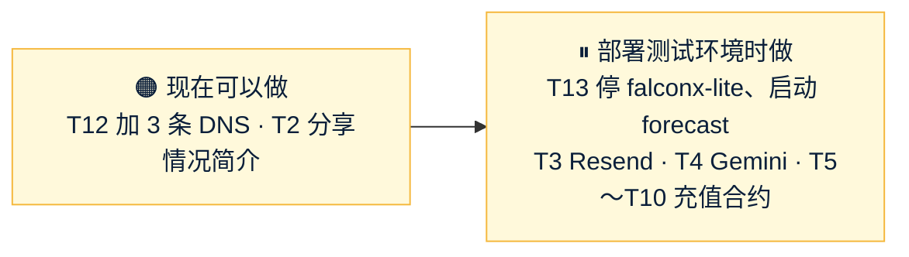

# Amos 待办（forecast）
- 用途：记下**需要 Amos 做的事**和**等 Amos 回答的问题**，避免遗漏。智能体每次汇报时对照本文件提醒；Amos 说"做完了"或答复后，智能体核实，删除对应条目，并在文末"已完成"里留一行记录。
- 维护：智能体（PM）。新增事项写清楚"做什么、为什么、怎么确认做好了、阻塞了什么"。**不写任何密钥、密码的值**（只写变量名）。需要 Amos 注册、沟通的事，智能体把查到的资料写全，Amos 不用再自己找。
- 答复方式：同意建议的回复"按建议"；不同意的写编号和意见，例如"AQ-14 加白名单"。
- 版本：v1.13（2026-10-25）
- 变更历史：v1.0（2026-10-25）Amos 同意创建（"同意，建一份 Amos 待办"），按 10-24～10-25 的对话整理：架构问题 AQ、研发问题 SQ、推广问题 MQ、对外说法 F、两件要 Amos 做的事；v1.1（2026-10-25）Amos 回复"agents #26 合并"：T1 删除，记入已完成；v1.2（2026-10-25）S3 完成，新增 SQ-5、SQ-6；v1.3（2026-10-25）S4 完成，新增 SQ-7；SQ-8（充值地址并发死锁）研发直接修；AQ-3 改为不卡进度（S5 结算做成可配置，默认按需求"一个事务"）；v1.4（2026-10-25）Amos 答复 AQ、SQ、MQ（原话见"已完成"）：删除已答复的问题；AQ-1、AQ-2 等研发核实后给推荐；新增 T3、T4（Resend、Gemini 的 key 由你自己填，不要发给我）；v1.5（2026-10-25）S5 完成（主线打通），新增 SQ-10、SQ-11；v1.6（2026-10-25）架构 v1.2 完成：AQ-1、AQ-2 给出推荐，改为 AQ-15～AQ-22；Amos 要求充值地址用智能合约方案（研发在做）；需求 v1.3 和"事件和文章自动化"需求草稿完成，新增 EQ-1～EQ-8 和待审核的范围变更；v1.7（2026-10-25）新增 AQ-23（测试环境和 falconx-lite 放一台）、WQ-1、WQ-2；充值合约方案完成，新增"⏸ 充值合约部署"T5～T10；v1.8（2026-10-25）Amos 答复"AQ-23 我还是会用同一台服务器，但是在跑当前系统时，我会停掉原来cfd的项目  ，其他全部按建议"：所有问题已答复，删除问题清单，记入已完成；v1.9（2026-10-25）原型截图已发，新增 PQ-1～PQ-5；S6 完成，新增 SQ-12～SQ-14；v1.10（2026-10-25，整合 PR #15）按 AQ-23 的落实新增 T11（审核整合 PR #15）、T12（加 `fc-test*` 三条 DNS）、"⏸ 测试环境第一次部署"T13（操作说明 `部署方案/v1-测试环境与切换.md`）；v1.11（2026-10-25）Amos："forecast #15 合并，关闭 #3 #4    PQ 按现在的，SQ 按建议"：#15 已合并、#3 #4 已关闭，T11 删除；PQ-1～5、SQ-12～14 记入已完成；v1.12（2026-10-25）S7 完成，新增 SQ-15、SQ-16；v1.13（2026-10-25）Amos："SQ-15 和 SQ-16  按照建议"，记入已完成

## 一图看懂

这张图想说明：现在没有要答的问题；能随手做的是加 3 条 DNS、分享情况简介，其余到部署测试环境（S12）时再做。

## 🟠 要你做的事
| # | 做什么 | 为什么 | 怎么确认做好了 | 提出时间 |
|---|---|---|---|---|
| T12 | （随时可以做，不影响 falconx-lite）Cloudflare → `quickcome.online` → DNS → 加三条 A 记录 `fc-test`、`fc-test-admin`、`fc-test-www`，内容都是 `47.251.87.158`，**代理状态"仅 DNS"（灰色云）**，TTL 自动；`test-app` 等三条不要动 | 测试环境的三个子域名（SQ-4），第一次部署申请证书前必须能解析 | 我从外部查到三个子域名都指向 47.251.87.158 | 10-25 |
| T2 | 给朋友的《预测平台项目情况简介》（https://claude.ai/artifact/CYg8Ei1uhynh1YLm6NSeey）：在页面右上角"分享"里打开访问权限 | 现在只有你能打开，朋友看不到 | 朋友能打开链接 | 10-24 |
| T3 | （到部署测试环境时再做）开 Resend 账号，验证发信子域名 `fc-email.quickcome.online`，把 API key **自己填进服务器 `.env` 的 `FC_MAIL_PASSWORD`**（Resend 的 SMTP 密码就是 API key，架构 v1.2 定的变量名）。**不要把 key 发给我**：密钥不经过 AI | 发邮件（验证码、通知）要用 | 测试环境注册能收到验证码邮件 | 10-25 |
| T4 | （用到时再做）Gemini API key **自己填进服务器 `.env` 的 `FC_GEMINI_API_KEY`**，同样不要发给我 | 体育数据抓取的解析、自动化文章生成会用 | 后台自动化日志里 Gemini 调用成功 | 10-25 |

## ⏸ 测试环境第一次部署（S12 时再做；操作说明 `部署方案/v1-测试环境与切换.md`）
测试环境就用 falconx-lite 的测试服务器 47.251.87.158，**同一时间只运行一个项目**（AQ-23）。命令在阿里云控制台"远程连接"里粘贴执行；**不要用控制台的 AI 助手**，也不要把 `.env`、密码、key 发给任何对话框（包括控制台助手和我）。
| # | 做什么 | 怎么确认做好了 |
|---|---|---|
| T13 | 按部署方案第 4 节停掉 falconx-lite（**先停它每分钟自动部署的定时器 `falconx-deploy.timer`** 和备份定时器，再备份、停容器）→ 第 5.2 节第一次部署 forecast（`preflight.sh` 通过才启动）→ 截 `free -m`、`docker stats` 给我 | 部署方案每一步的"怎么确认"；我从外部跑 `deploy/verify.sh` 全部通过 |
| — | 切回 falconx-lite 按第 6 节：`sudo bash /opt/forecast/stop.sh`，再启动 falconx-lite、打开它的定时器 | 第 6 节每一步的"怎么确认" |

两个项目的数据目录都保留，**不要运行** `docker compose down -v`、`docker system prune --volumes`，不要删 `/opt/falconx/data`、`/opt/forecast/data`。

## ⏸ 充值合约部署（到部署测试环境时再做；操作说明 `部署方案/v1-归集合约部署.md`）
先在测试网做，测试环境验收通过后再在主网重做一遍（WQ-2）。全部在你自己电脑上操作，**私钥和助记词只由你处理，不发给我**。
| # | 做什么 | 怎么确认做好了 |
|---|---|---|
| T5 | 建 forecast 专用的 Safe 冷钱包（2-of-3，和 falconx-lite 分开），以太坊和 BSC 同一个地址 | Safe 网页里两条网络地址相同、3 个签名人、阈值 2 |
| T6 | 建部署账户：新的普通账户，两条链都没发过交易，各领一点手续费币 | 区块浏览器上两条链都是 0 笔交易、有余额 |
| T7 | 建发起账户：新的普通账户（不是热钱包），两条链都充一点手续费币 | 两条链有余额，地址和热钱包不同 |
| T8 | 按部署说明第 1～8 步部署合约（核对源码 → 模拟 → 部署时在终端里输入私钥 → Safe 签 `acceptOwnership` → 链上核对 → BSC 再做一遍） | 两条链都打印 `== 全部通过`；三个合约地址两条链一样。把 5 行 `FC_SWEEP_EVM_…` **公开地址**发给我核对 |
| T9 | 在服务器 `sudo nano /opt/forecast/.env` 填 `FC_SWEEP_EVM_*`（私钥只由你填），再运行 `sudo /opt/forecast/deploy.sh` | 健康检查 `status` UP，`deposit.evm`、`sweep.config` 都是 UP；客户端 ERC20 和 BSC 显示同一个地址 |
| T10 | 测试网验收：ERC20 充 150 测试 USDT → 到账 → 执行归集 → Safe 收到；BSC 再做一遍 | Safe 里收到 |

以太坊体系不再需要 xpub；TRON 仍然要 `FC_WALLET_TRON_XPUB`（到时一起写进待办）。

## ❓ 等你回答的问题

目前没有。

## 📚 资料
| # | 内容 |
|---|---|
| R1 | 待审核的 PR：#3 推广策略 v2.1、#4 架构方案 v1.0；进行中的分支：`claude/integration-2`（把原型、S6、S7 整合成 PR 到 main）、`claude/s8-sports`（体育赛程和自动结算）、`claude/integration-1`（把 S1～S5、合约方案、需求 v1.3、架构 v1.3、推广策略整合成一个 PR 到 main，跑 GitHub CI）、`claude/s6-crypto`（加密自动生成和自动裁决）、`claude/m1-prototype`（原型）、`claude/req-v1.3`（需求 v1.3 + 自动化程序，已完成待审）、`claude/arch-v1.2`（架构 v1.2，已完成待审）、`claude/wallet-create2`（充值地址改用合约方案，已完成）；已完成的开发分支 `claude/s1-skeleton`～`claude/s5-settle`（主线打通） |
| R2 | 正式品牌候选（上线前再定，按 C93）：架构方案第 15 节的 Poolsay / Larkpool / Poolvane；推广策略第 4.4 节的 ZeroHouse / PoolPulse / TickOdds / OptiPool（OmniPool 明显撞名，不建议） |

## 已完成（保留最近的记录）
| 日期 | 事项 | 结论 |
|---|---|---|
| 10-25 | SQ-15、SQ-16 | "按照建议"：人工裁决的加密市场也公示 2 小时（参数可改）；每个市场只补偿一次，真遇到再补时写一次性脚本由你审批 |
| 10-25 | 整合 PR #15 | 已合并到 main（`24c48a0`）：S1～S5、充值合约方案、需求 v1.3、架构 v1.3、推广策略 v2.2；#3、#4 已关闭 |
| 10-25 | 原型取舍 PQ-1～PQ-5 | "PQ 按现在的"：加密涨跌用绿红、其他二选一中性色；默认按快截止排序；手机顶栏显示可用；固定绿涨红跌；繁体待懂繁体的人校对 |
| 10-25 | SQ-12～SQ-14 | 按建议：默认加密节目模板上线前由你检查后启用；AC-28 改成按模板场次生成（合入 S6 时改）；裁决提醒先发告警邮箱、S9 改按角色 |
| 10-25 | AQ-3、6、12、13、14 | 同意建议：结算先算好再分批派彩（S5 已按此调整，需求 v1.3 改第 3.5 节）；页面风格 A（原型在做，做完发截图）；原型只交截图；币安主、OKX 备；生产后台不加 IP 白名单 |
| 10-25 | AQ-7 体育数据源 | 找免费数据源，不够就写独立抓取程序，可用 Gemini（研发在调研，写进架构 v1.2） |
| 10-25 | AQ-8 CDN、AQ-10 邮件 | Cloudflare 免费版；Resend（key 你自己填，见 T3） |
| 10-25 | AQ-23 测试环境 | "我还是会用同一台服务器，但是在跑当前系统时，我会停掉原来cfd的项目"：测试环境用 falconx-lite 那台测试服务器，同一时间只跑一个项目；研发重算内存预算并写停用和切换步骤（`部署方案/v1-测试环境与切换.md`） |
| 10-25 | 其余全部按建议 | AQ-15 阿里云新加坡（生产）、AQ-16 服务器 MySQL + R2 加密备份、AQ-17 免费体育数据源（上线时 TheSportsDB $9）、AQ-18 抓取程序先不建、AQ-19 Gemini 免费档、AQ-20 后台加 Cloudflare Access、AQ-21 Resend 先用免费档、AQ-22 改站点设置前先说明影响；RV-1 需求 v1.3 通过；EQ-1～EQ-8 按建议；WQ-1 测试网合约和测试环境一起上、WQ-2 测试网和主网各一套；SQ-10 正式裁决台做好后删掉临时结算入口、SQ-11 只停该客户提现；F-5、F-13、F-14 按建议 |
| 10-25 | SQ-2～SQ-8 | 全部同意 |
| 10-25 | AQ-1、AQ-2（Cloudflare） | 研发核实：Cloudflare 免费服务跑不了后端和资金数据库，改为 AQ-15、AQ-16 的推荐方案；AQ-14 "同意" = 不加 IP 白名单 |
| 10-25 | 充值地址 | "钱包地址的产生和分配，用我们之前已经调研过的智能合约方案"：ERC20 / BEP20 只用 CREATE2 合约地址，TRON 维持离线签名方案；研发在做 |
| 10-25 | MQ-1～MQ-11 | MQ-5 暂时不做返佣和分成；MQ-8 中英文都做；其余按建议；新增"事件和文章自动化程序"（PM 在写需求，v1.3） |
| 10-25 | Amos 原话 | "AQ1 cloudflare，地区可以调节，你来推荐 / AQ2 cloudflare，的免费服务中是否有？ / AQ3 同意 / AQ6 同意 / AQ7 找免费的数据源，找不到就写个独立的爬虫程序，如有需要可以用我Gemini的模型，我来配置key / AQ8 先用cloudflare免费的，后面再考虑付费 / AQ10 Resend，到时候发给你 / AQ12 同意 / AQ13 同意 / AQ14 同意 / SQ 全部同意 / MQ5 暂时不做返佣和分成 / MQ8 中英文都做 MQ 其他全部同意，另外需要写一个事件和文章自动化程序"；"做完原型直接发我截图看" |
| 10-24 | 调研 FQ-1～FQ-14 | 全部答复；彩池模式、只向赢家盈利抽成、不做市、不做积分版；律师、牌照、法币不再讨论（调研报告"Amos 审核结论"） |
| 10-24 | 需求 RQ-1～RQ-19 | RQ-4 默认 5%、每个市场可在后台改；RQ-16 最小提现默认 100；RQ-17 不做两人复核；其余按建议；风控"费率被随意修改"一行删除（需求说明书 v1.1） |
| 10-24 | 推广策略 v1 | Amos 否定（零预算、没有人脉、不降费不改规则），重写为 v2.0；10-25 整理朋友反馈为 v2.1 |
| 10-24 | 架构先开始 | 已开始，架构方案 v1.0 交审（PR #4） |
| 10-25 | AQ-5 品牌名 | "上线前用 Quick Come 和 quickcome.online 子域名，正式上线时才改名和域名"；需求 v1.2、架构 v1.1 已改 |
| 10-25 | T1 agents #26（规则 C93） | "agents #26 合并"：已合并（agents main `1f92bbc`），总则、产品经理 v0.12.1 |
| 10-25 | 开工 | Amos："你可以开始动工了吗"→ S1 复制骨架、S2 账本拆分、S3 市场和状态机、S4 下注和奖池已完成，S5 结算进行中 |
| 10-25 | SQ-8 充值地址并发分配死锁（复制源带来的） | 明显的缺陷，研发在 S5 开头直接修，单独一个提交；不同意可以提 |
| 10-25 | 建本文件 | "同意，建一份 Amos 待办" |
