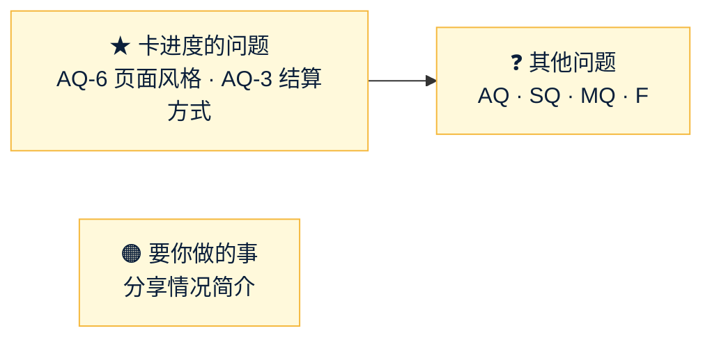

# Amos 待办（forecast）
- 用途：记下**需要 Amos 做的事**和**等 Amos 回答的问题**，避免遗漏。智能体每次汇报时对照本文件提醒；Amos 说"做完了"或答复后，智能体核实，删除对应条目，并在文末"已完成"里留一行记录。
- 维护：智能体（PM）。新增事项写清楚"做什么、为什么、怎么确认做好了、阻塞了什么"。**不写任何密钥、密码的值**（只写变量名）。需要 Amos 注册、沟通的事，智能体把查到的资料写全，Amos 不用再自己找。
- 答复方式：同意建议的回复"按建议"；不同意的写编号和意见，例如"AQ-14 加白名单"。
- 版本：v1.1（2026-10-25）
- 变更历史：v1.0（2026-10-25）Amos 同意创建（"同意，建一份 Amos 待办"），按 10-24～10-25 的对话整理：架构问题 AQ、研发问题 SQ、推广问题 MQ、对外说法 F、两件要 Amos 做的事；v1.1（2026-10-25）Amos 回复"agents #26 合并"：T1 删除，记入已完成

## 一图看懂

这张图想说明：先答两个带 ★ 的问题，页面原型和结算开发在等它们；其余问题不影响当前开发，可以一起答。

## 🟠 要你做的事
| # | 做什么 | 为什么 | 怎么确认做好了 | 提出时间 |
|---|---|---|---|---|
| T2 | 给朋友的《预测平台项目情况简介》（https://claude.ai/artifact/CYg8Ei1uhynh1YLm6NSeey）：在页面右上角"分享"里打开访问权限 | 现在只有你能打开，朋友看不到 | 朋友能打开链接 | 10-24 |

## ❓ 等你回答的问题

### 架构问题 AQ（原文：`技术方案/v1-架构方案.md` 第 19 节，PR #4）
| 编号 | 问题 | 建议 | 说明 |
|---|---|---|---|
| AQ-1 | 服务器放在哪 | 阿里云新加坡 | 美国机房访问币安主站受限（实测 451） |
| AQ-2 | 生产数据库 | 阿里云托管数据库（RDS） | 自动备份、能恢复到某个时间点 |
| ★ AQ-3 | 结算方式 | 先算好、对平账，再分批派彩 | 需求原文是"一个事务完成"，赢家多时会卡住他们的下注和提现十几秒。**会改需求第 3.5 节**。S5 开始前要定 |
| ★ AQ-6 | 页面风格 | A"清爽数据"（蓝色主色，涨跌绿红和主色分开） | 对比图在 `assets/v1/style/`（PR #4）。**页面原型要等它** |
| AQ-7 | 体育数据源 | 足球 API-Football + football-data；NBA balldontlie + API-NBA | 约 30 美元/月；付费前请你看商用条款 |
| AQ-8 | CDN | 开 Cloudflare 代理 | 海外打开更快，不暴露服务器 IP |
| AQ-10 | 邮件服务商 | 新开一个 Resend 账号，和 falconx-lite 分开 | 发信域名见 SQ-3 |
| AQ-12 | 原型放哪 | 测试服务器，或 GitHub Pages 这类免费托管 | 方案原写 Vercel，但你的 Vercel 账号不能用，已改建议 |
| AQ-13 | 币价数据来源 | 币安为主、OKX 备用，Coinbase 第三源默认关 | 三家实测都能访问 |
| AQ-14 | 生产后台加 IP 白名单 | **不加**（和 falconx-lite 一致） | 方案原写"加白名单"，按你对 falconx-lite 的决定改了建议 |

AQ-4（代码内部名 forecast）、AQ-9（迁移脚本重新编号）、AQ-11（第一期 1 个后端实例）已按建议开发，你不同意可以随时提。AQ-5 品牌名已定，见"已完成"。

### 研发问题 SQ（原文：`开发记录/S1-复制骨架.md`、`开发记录/S2-账本拆分.md`）
| 编号 | 问题 | 建议 |
|---|---|---|
| SQ-2 | 旧名残留扫描时，需求说明书和调研报告里本来就会提到复制来源 | 把这两份文档加进扫描排除名单，不改你已审核的文档 |
| SQ-3 | 发信域名要和 falconx-lite 分开 | 用新的发信子域名 `fc-email.quickcome.online` |
| SQ-4 | 测试环境子域名 | 客户端 `fc-test.quickcome.online`、后台 `fc-test-admin.quickcome.online`、官网 `fc-test-www.quickcome.online` |

### 推广问题 MQ（原文：`市场/v1-市场调研与推广策略.md` v2.1 第 13 节，PR #3）
| 编号 | 问题 | 建议 |
|---|---|---|
| MQ-1 | 冷启动只做"固定节目" | 每天 21:00 一场 BTC 1 小时涨跌，加最多 1 场焦点赛（周末最多 2 场）；同时开放的市场不超过 2 个；场均人数连续 2 周 ≥ 8 才加场 |
| MQ-2 | 开盘、截止、封盘倒计时、开奖、周报 5 种卡片能否自动发 | 你一次性审定模板后系统自动发；评论、回复、私信仍由你本人发 |
| MQ-3 | 什么时候注册 X 和 Telegram 数据号 | 现在就用 Quick Come 名义注册，品牌定了再改名，粉丝保留；简介写清是"预测市场"项目 |
| MQ-4 | 上线前的数据号用不用产品账号 | 就用产品账号，只发体育、加密、经济类题，注明数据来源 |
| MQ-5 | 给渠道方的分成 | 群主、预测博主：他们带来的用户产生的抽成分 30%，12 个月；前 10 家 40%。用户邀请返佣 10%，放第二期 |
| MQ-6 | 先试哪些野路子 | 试：大号评论区手动回复、大 V 预测帖下的概率对照回复、同题对照盘、进群当有用的人、每天 ≤ 5 条私信谈分成、中文搜索收录、开源工具、反向指标系列。暂缓：币安广场、Reddit。其余不做 |
| MQ-7 | 你每天投入多少时间 | 上线前 30 分钟，上线后前 4 周 60 分钟，之后 45 分钟 |
| MQ-8 | 先做哪个语种 | 华语为主；英文只做自动卡片和 SEO 页，英文访问占比 ≥ 30% 再加人工运营 |
| MQ-9 | 是否以创始人身份公开连载 | 只写不录音，可以用昵称、不露脸，每周一篇 |
| MQ-10 | 体育先开什么玩法 | 大小球 2.5、NBA 大小分；强弱悬殊的比赛不开胜平负 |
| MQ-11 | 上线日对齐大事件 | 选在大事件前 3～7 天（如 12 月 FOMC、欧冠联赛阶段第 7、8 轮），但不为此推迟超过 1 周 |

只请知悉、不用决定：冷启动期把加密 1 小时市场的单人上限从 2,000 调到 200～500 USDT（后台参数），避免一个人押满一边。

### 对外说法 F（原文：同上第 14 节；用到对应推广功能前确认即可）
| 编号 | 问题 | 建议 |
|---|---|---|
| F-5 | 提现说法里"人工审核"的时效 | 对外写"盈利提现需人工审核，冷静期结束后通常 24 小时内处理完"；做不到就不写具体时长 |
| F-13 | FAQ 里要不要提竞品（Polymarket Trustpilot 1.3 分） | FAQ 只讲我们自己的规则，竞品数据只在对比文章里引用，每次用前重新查 |
| F-14 | 定位措辞"散户用真钱投票的概率" | 采用；说明页仍照实写"用 USDT 押注、平台从赢家盈利里抽 5%" |
| F-1～F-16 其余 | 逐条见原文 | 原文每条都列了依据 |

## 📚 资料
| # | 内容 |
|---|---|
| R1 | 待审核的 PR：#3 推广策略 v2.1、#4 架构方案 v1.0（S2 分支上已改到 v1.1）；开发分支 `claude/s1-skeleton`、`claude/s2-ledger`、`claude/s3-market`（进行中），每步完成后开 PR |
| R2 | 正式品牌候选（上线前再定，按 C93）：架构方案第 15 节的 Poolsay / Larkpool / Poolvane；推广策略第 4.4 节的 ZeroHouse / PoolPulse / TickOdds / OptiPool（OmniPool 明显撞名，不建议） |

## 已完成（保留最近的记录）
| 日期 | 事项 | 结论 |
|---|---|---|
| 10-24 | 调研 FQ-1～FQ-14 | 全部答复；彩池模式、只向赢家盈利抽成、不做市、不做积分版；律师、牌照、法币不再讨论（调研报告"Amos 审核结论"） |
| 10-24 | 需求 RQ-1～RQ-19 | RQ-4 默认 5%、每个市场可在后台改；RQ-16 最小提现默认 100；RQ-17 不做两人复核；其余按建议；风控"费率被随意修改"一行删除（需求说明书 v1.1） |
| 10-24 | 推广策略 v1 | Amos 否定（零预算、没有人脉、不降费不改规则），重写为 v2.0；10-25 整理朋友反馈为 v2.1 |
| 10-24 | 架构先开始 | 已开始，架构方案 v1.0 交审（PR #4） |
| 10-25 | AQ-5 品牌名 | "上线前用 Quick Come 和 quickcome.online 子域名，正式上线时才改名和域名"；需求 v1.2、架构 v1.1 已改 |
| 10-25 | T1 agents #26（规则 C93） | "agents #26 合并"：已合并（agents main `1f92bbc`），总则、产品经理 v0.12.1 |
| 10-25 | 开工 | Amos："你可以开始动工了吗"→ S1 复制骨架、S2 账本拆分已完成，S3 进行中 |
| 10-25 | 建本文件 | "同意，建一份 Amos 待办" |
