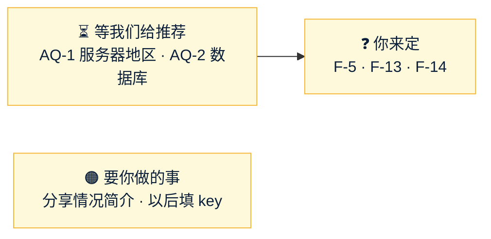

# Amos 待办（forecast）
- 用途：记下**需要 Amos 做的事**和**等 Amos 回答的问题**，避免遗漏。智能体每次汇报时对照本文件提醒；Amos 说"做完了"或答复后，智能体核实，删除对应条目，并在文末"已完成"里留一行记录。
- 维护：智能体（PM）。新增事项写清楚"做什么、为什么、怎么确认做好了、阻塞了什么"。**不写任何密钥、密码的值**（只写变量名）。需要 Amos 注册、沟通的事，智能体把查到的资料写全，Amos 不用再自己找。
- 答复方式：同意建议的回复"按建议"；不同意的写编号和意见，例如"AQ-14 加白名单"。
- 版本：v1.4（2026-10-25）
- 变更历史：v1.0（2026-10-25）Amos 同意创建（"同意，建一份 Amos 待办"），按 10-24～10-25 的对话整理：架构问题 AQ、研发问题 SQ、推广问题 MQ、对外说法 F、两件要 Amos 做的事；v1.1（2026-10-25）Amos 回复"agents #26 合并"：T1 删除，记入已完成；v1.2（2026-10-25）S3 完成，新增 SQ-5、SQ-6；v1.3（2026-10-25）S4 完成，新增 SQ-7；SQ-8（充值地址并发死锁）研发直接修；AQ-3 改为不卡进度（S5 结算做成可配置，默认按需求"一个事务"）；v1.4（2026-10-25）Amos 答复 AQ、SQ、MQ（原话见"已完成"）：删除已答复的问题；AQ-1、AQ-2 等研发核实后给推荐；新增 T3、T4（Resend、Gemini 的 key 由你自己填，不要发给我）

## 一图看懂

这张图想说明：现在没有卡住开发的问题；AQ-1、AQ-2 等研发核实 Cloudflare 能做什么后给你推荐；F 三条到推广功能上线前定就行。

## 🟠 要你做的事
| # | 做什么 | 为什么 | 怎么确认做好了 | 提出时间 |
|---|---|---|---|---|
| T2 | 给朋友的《预测平台项目情况简介》（https://claude.ai/artifact/CYg8Ei1uhynh1YLm6NSeey）：在页面右上角"分享"里打开访问权限 | 现在只有你能打开，朋友看不到 | 朋友能打开链接 | 10-24 |
| T3 | （到部署测试环境时再做）开 Resend 账号，验证发信子域名 `fc-email.quickcome.online`，把 API key **自己填进服务器 `.env` 的 `FC_RESEND_API_KEY`**。**不要把 key 发给我**：密钥不经过 AI | 发邮件（验证码、通知）要用 | 测试环境注册能收到验证码邮件 | 10-25 |
| T4 | （用到时再做）Gemini API key **自己填进服务器 `.env` 的 `FC_GEMINI_API_KEY`**，同样不要发给我 | 体育数据抓取的解析、自动化文章生成会用 | 后台自动化日志里 Gemini 调用成功 | 10-25 |

## ❓ 等你回答的问题

### 架构问题 AQ
| 编号 | 问题 | 现在的状态 |
|---|---|---|
| AQ-1 | 服务器放在哪（你说用 Cloudflare，地区让我推荐） | 研发在核实：后端是 Java 常驻程序加 MySQL，Cloudflare 免费服务可能放不下，大概率是"一台云服务器 + Cloudflare 免费的 DNS / CDN / 防护在前面"。核实后给你推荐，含地区和费用 |
| AQ-2 | 数据库：Cloudflare 免费服务里有没有 | 同上一起核实。初步判断：Cloudflare 的免费数据库 D1 是 SQLite，不适合放资金账本；推荐服务器上跑 MySQL，每天自动备份到 Cloudflare R2（免费额度） |

### 对外说法 F（原文：`市场/v1-市场调研与推广策略.md` 第 14 节；用到对应推广功能前确认即可）
| 编号 | 问题 | 建议 |
|---|---|---|
| F-5 | 提现说法里"人工审核"的时效 | 对外写"盈利提现需人工审核，冷静期结束后通常 24 小时内处理完"；做不到就不写具体时长 |
| F-13 | FAQ 里要不要提竞品（Polymarket Trustpilot 1.3 分） | FAQ 只讲我们自己的规则，竞品数据只在对比文章里引用，每次用前重新查 |
| F-14 | 定位措辞"散户用真钱投票的概率" | 采用；说明页仍照实写"用 USDT 押注、平台从赢家盈利里抽 5%" |
| F-1～F-16 其余 | 逐条见原文 | 原文每条都列了依据 |

## 📚 资料
| # | 内容 |
|---|---|
| R1 | 待审核的 PR：#3 推广策略 v2.1、#4 架构方案 v1.0；进行中的分支：`claude/s5-settle`（结算）、`claude/m1-prototype`（原型）、`claude/req-v1.3`（需求 v1.3 + 自动化程序）、`claude/arch-v1.2`（架构 v1.2：Cloudflare、免费数据源）；已完成的开发分支 `claude/s1-skeleton`～`claude/s4-pool` |
| R2 | 正式品牌候选（上线前再定，按 C93）：架构方案第 15 节的 Poolsay / Larkpool / Poolvane；推广策略第 4.4 节的 ZeroHouse / PoolPulse / TickOdds / OptiPool（OmniPool 明显撞名，不建议） |

## 已完成（保留最近的记录）
| 日期 | 事项 | 结论 |
|---|---|---|
| 10-25 | AQ-3、6、12、13、14 | 同意建议：结算先算好再分批派彩（S5 已按此调整，需求 v1.3 改第 3.5 节）；页面风格 A（原型在做，做完发截图）；原型只交截图；币安主、OKX 备；生产后台不加 IP 白名单 |
| 10-25 | AQ-7 体育数据源 | 找免费数据源，不够就写独立抓取程序，可用 Gemini（研发在调研，写进架构 v1.2） |
| 10-25 | AQ-8 CDN、AQ-10 邮件 | Cloudflare 免费版；Resend（key 你自己填，见 T3） |
| 10-25 | SQ-2～SQ-8 | 全部同意 |
| 10-25 | MQ-1～MQ-11 | MQ-5 暂时不做返佣和分成；MQ-8 中英文都做；其余按建议；新增"事件和文章自动化程序"（PM 在写需求，v1.3） |
| 10-25 | Amos 原话 | "AQ1 cloudflare，地区可以调节，你来推荐 / AQ2 cloudflare，的免费服务中是否有？ / AQ3 同意 / AQ6 同意 / AQ7 找免费的数据源，找不到就写个独立的爬虫程序，如有需要可以用我Gemini的模型，我来配置key / AQ8 先用cloudflare免费的，后面再考虑付费 / AQ10 Resend，到时候发给你 / AQ12 同意 / AQ13 同意 / AQ14 同意 / SQ 全部同意 / MQ5 暂时不做返佣和分成 / MQ8 中英文都做 MQ 其他全部同意，另外需要写一个事件和文章自动化程序"；"做完原型直接发我截图看" |
| 10-24 | 调研 FQ-1～FQ-14 | 全部答复；彩池模式、只向赢家盈利抽成、不做市、不做积分版；律师、牌照、法币不再讨论（调研报告"Amos 审核结论"） |
| 10-24 | 需求 RQ-1～RQ-19 | RQ-4 默认 5%、每个市场可在后台改；RQ-16 最小提现默认 100；RQ-17 不做两人复核；其余按建议；风控"费率被随意修改"一行删除（需求说明书 v1.1） |
| 10-24 | 推广策略 v1 | Amos 否定（零预算、没有人脉、不降费不改规则），重写为 v2.0；10-25 整理朋友反馈为 v2.1 |
| 10-24 | 架构先开始 | 已开始，架构方案 v1.0 交审（PR #4） |
| 10-25 | AQ-5 品牌名 | "上线前用 Quick Come 和 quickcome.online 子域名，正式上线时才改名和域名"；需求 v1.2、架构 v1.1 已改 |
| 10-25 | T1 agents #26（规则 C93） | "agents #26 合并"：已合并（agents main `1f92bbc`），总则、产品经理 v0.12.1 |
| 10-25 | 开工 | Amos："你可以开始动工了吗"→ S1 复制骨架、S2 账本拆分、S3 市场和状态机、S4 下注和奖池已完成，S5 结算进行中 |
| 10-25 | SQ-8 充值地址并发分配死锁（复制源带来的） | 明显的缺陷，研发在 S5 开头直接修，单独一个提交；不同意可以提 |
| 10-25 | 建本文件 | "同意，建一份 Amos 待办" |
