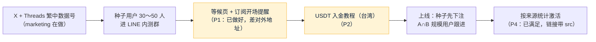

# forecast 第一期台湾推广：给 PM 和研发的需求单
- 版本：v1.0（2026-10-27）
- 编写：市场经理（marketing 项目，`dollar3651314/marketing`）
- 依据：本仓库 `市场/v1-市场调研与推广策略.md` v2.2（总策略，**Amos 审核通过**）；marketing 仓库的 `项目/forecast/台湾市场调研.md` v1.2、`项目/forecast/台湾推广计划.md` v1.1（**Amos 审核通过**：2026-10-27"D 都按默认"）
- 用途：Amos 2026-10-27 决定**第一期瞄准台湾市场**。台湾推广的完整计划和每天的运行记录放在 marketing 仓库；这份文件只列**需要 forecast 的 PM 和研发决定、实现的事**，方便开发 agent 在本仓库里看到。按 agents"谁的边界谁负责"，下面每一条都是市场提出的反馈，**纳不纳入需求、排在哪个阶段，由本项目的 PM 决定**（C71）
- 变更历史：v1.0（2026-10-27）首次创建

## 一图看懂
这张图想说明：台湾第一期的用户分三层进来，其中哪几步要依赖本项目的功能（黄色）。

## 一、和总策略 v2.2 不同的地方（只影响推广，不改需求）
| 项目 | 总策略 v2.2 | 台湾第一期 |
|---|---|---|
| 目标市场 | 华语 | **台湾** |
| 主语言 | 简中为主 | **繁中（台湾用语）为主** |
| 主平台 | X + Telegram 频道 | **X（`@QuickCome6`）+ Threads**；种子内测群用 **LINE 社群** |
| 用户分层 | 不分 | 种子（Polymarket 用户 + 币圈老手）→ 规模（看球又有 USDT 的人）→ 以后（没有 USDT 的运彩玩家） |
| 对外卖点 | "只从赢家的盈利里抽 5%"（F-2） | 不变；不点名比较台湾运彩 |

零预算、不做返佣和分成（MQ-5）、不进中国大陆平台等结论都不变。

## 二、需求单（交 PM 决定）
写之前对照了本仓库 main `d6c43e2` 的开发记录：S13（来源统计）、S15（自动化程序）、S16（等候页、机器人）已经做了一部分，下面按实际情况写。

| 编号 | 内容 | 现状（对照开发记录） | 要 PM / 研发做的 | 优先级 |
|---|---|---|---|---|
| **P1** | 等候页兼公开概率看板 + 订阅开场提醒（MF-8、MF-17） | **已完成**（S16：`/data`，邮箱双重确认、上线通知只发一次） | 只差**能公开访问**：希望在 L 日前 4 周有一个对外地址（测试环境或单独发布等候页），市场才能把关注者和种子引过去。怎么发布由研发、运维和 Amos 定 | 高 |
| **P2** | 产品内"USDT 入金教程（台湾）"：用新台币在 MAX、BitoPro 买 USDT，再提币到本平台的充值地址 | 没有 | 新增一个说明页（或放进新手引导、帮助）；**文案由市场起草**，PM 定位置和结构 | 高 |
| **P3** | 繁中用**台湾用语**（zh-TW） | 客户端有繁体，"繁体待人工校对"（PQ-5）；S15 的草稿"繁体由程序从简体按固定规则转换" | 市场可以按台湾用语**校对**客户端、官网、通知模板、卡片模板的繁体文案（PM 定稿，研发合入）；S15 的自动转换在台湾第一期可能不够，要不要加台湾用语词表由研发评估 | 中 |
| **P4** | 来源统计能区分"内测群邀请" | **已满足**（S13：`?src=&cmp=&ref=`） | 不用开发。市场约定内测群里发的链接一律带 `?src=line&cmp=seed`，来源统计页按这个看 | — |

## 二点一、和 S15 自动化程序的分工（知会 PM）
S15 的"内容中心"已经能用 Gemini 起草 X、Telegram 帖子和回复（数字核对、禁用词），marketing 现在每天在 marketing 仓库起草同类草稿包（预热期产品还没上线，只能在仓库里做）。
- **上线前**：marketing 继续在仓库里起草；措辞、选题的经验（台湾用语、只写体育/加密/经济、数字附来源）整理后交 PM，供内容中心的模板参考。
- **内容中心能对外用以后**：日常草稿改由内容中心生成，marketing 改做选题策划、台湾用语校对和复盘，不再重复起草。

## 三、上线日
总策略 MQ-11 建议对齐一个大事件。台湾第一期的预热从 2026-10-26 开始，第 4、8 周检查点是 11-22、12-20。L 日由 Amos 和开发按进度决定，marketing 跟着调整。

## 跨角色反馈 / 分歧记录
| 编号 | 提出方 → 接收方 | 内容 | 状态 |
|---|---|---|---|
| F1 | 市场 → PM | 第二节 P1～P3（P4 已满足） | 转 PM（Amos 2026-10-27 同意转给开发） |
| F2 | 市场 → PM | 第二节之一：和 S15 内容中心的分工 | 转 PM（知会） |
