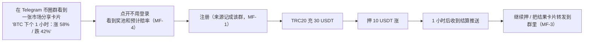
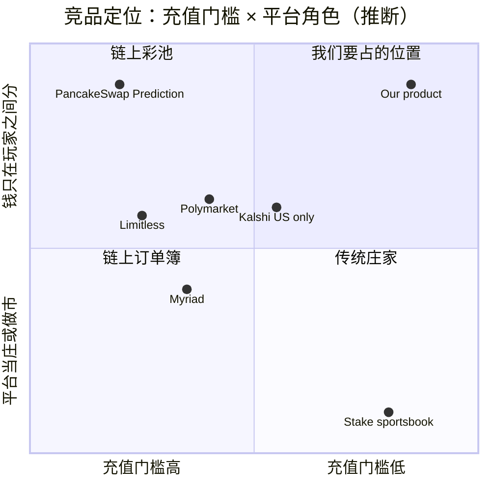
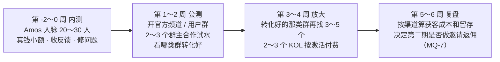
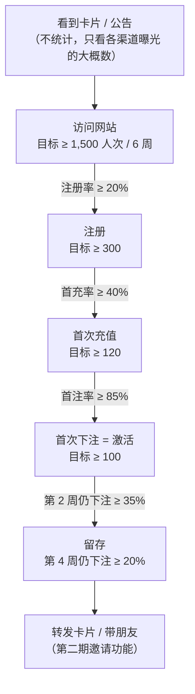

# forecast 市场调研与推广策略（v1）

- 版本：v1.0（2026-10-24）
- 编写：市场经理
- 依据：agents main `bd492c9`（《协作总则》v0.12：可视化规范、C7、C62、C66、C71、C73；《市场经理》v0.11）；forecast main `b45082f`：`调研/v1-Polymarket调研报告.md` v1.2（开头"Amos 审核结论"、第 4、5、8 节）、`需求文档/v1-需求说明书.md` v1.1（第 0、1.4、1.5、3、7、11、12 节）、《项目地图》v0.5
- 变更历史：v1.0（2026-10-24）首次创建，交 PM 和 Amos
- 状态：**待 Amos 审核**。MF-1～MF-16 交 PM 逐条写"纳入 / 不做"，MQ-1～MQ-9 待 Amos 决定。
- 读法：先看"一图看懂"和"一页结论"，再看第 8 节"推广需要的产品功能清单（MF）"和第 10 节"需要 Amos 决定的问题（MQ）"。其余章节是依据。
- 不讨论的内容（Amos 已定）：面向全球、只收 USDT 三链、不做法币和积分版；律师、牌照、合规；彩池玩法、赢家盈利抽成默认 5%、不做市；第一批品类；独立品牌、不和 Quick Come 导流。本文的"风险"一节**只写推广渠道的平台规则和广告政策，不是法律意见**。
- **对外发布由 Amos 决定（C73）**：本文里的发帖、建群、联系群主和 KOL、投放、付费、注册推广账号，全部由 Amos 执行或明确同意后执行。本文没有任何对外发布的物料；第 11 节的事实性描述交 Amos 确认后才能用于对外内容。

> **标注约定（C66）**
> - 【证实】：本次实际打开了原文（平台官方文档、政策页、公开接口），链接见第 14 节。
> - 【二手】：只看到新闻、第三方文章或搜索摘要，没有打开原始出处；当线索用。
> - 【推断】：市场经理根据资料和计算得出的判断，不是查到的事实。
> - 【未查到】：查了没有找到。【未核实】：没有去查，需要后续核对。
> - "今天"指 2026-10-24。金额单位不写时是美元；USDT 按 1 美元计。

---

## 一图看懂

```mermaid
flowchart LR
    subgraph U["给谁用"]
        U1["A 币圈短线玩家<br/>手里有 USDT · 玩 15 分钟 / 1 小时涨跌"]
        U2["B 华语体育球迷<br/>足球 · NBA · 现在用离岸体育博彩或球迷群"]
        U3["C 时事观点型（次要）"]
    end
    subgraph V["凭什么选我们"]
        V1["USDT 三链直接充值<br/>不用换 USDC、不用懂钱包"]
        V2["彩池：钱只在玩家之间分<br/>平台不当庄、不做市"]
        V3["只对赢家的盈利抽 5%<br/>50 / 50 的市场约等于奖池的 2.5%"]
        V4["每个市场的奖池、结果、依据公开"]
    end
    subgraph C["前 100 个用户从哪里来（4～6 周）"]
        C1["Amos 的人脉内测 20～30"]
        C2["Telegram 群主合作 30～40"]
        C3["小 KOL 按效果付费 15～25"]
        C4["官方 Telegram 频道 / X 自然流量 10～15"]
    end
    subgraph M["怎么衡量"]
        M1["激活 = 首充 + 首注 ≥ 100 人"]
        M2["第 4 周仍下注 ≥ 20%"]
        M3["有效市场率 ≥ 70%<br/>（没有因为单边作废）"]
        M4["获客成本 ≤ 30 USDT / 激活用户"]
    end
    U --> V --> C --> M
    R["渠道限制：X、Telegram、Google、Meta 的付费广告<br/>对博彩类基本走不通 → 靠社群和内容"]:::risk
    R -.-> C
    classDef risk fill:#FDE2E1,stroke:#D93025,color:#5F0B07
```

这张图想说明：第一批用户是"手里已经有 USDT 的币圈短线玩家"和"华语体育球迷"；卖点是"USDT 直接充、平台不当庄、只对盈利抽成"；四大平台的付费广告对博彩类基本走不通，所以前 100 个用户靠 Amos 的人脉、Telegram 群主合作和按效果付费的小 KOL。

---

## 一页结论

| 问题 | 结论 | 依据 |
|---|---|---|
| **给谁用** | 主攻两类：**A 币圈短线玩家**（已有 USDT，玩 15 分钟 / 1 小时涨跌）和 **B 华语体育球迷**（足球、NBA）；C 时事观点型用户只做内容引流，不作为冷启动重点。 | 第 1 节 |
| **市场有多大** | 赛道已被验证：Polymarket 2026-09 月手续费约 9,361 万【证实，DefiLlama】，体育占成交 53.5%【二手】；最接近我们玩法的 **PancakeSwap Prediction（彩池涨跌）近 30 天手续费约 25.6 万，折合奖池约 850 万 / 月**【证实 + 推断】——说明"彩池 + 短周期加密"是真需求但规模不大；USDT 用户超过 6.5 亿【二手】。 | 第 2 节 |
| **竞品** | 没有一家同时做到"USDT 三链直充 + 彩池不当庄 + 体育和加密都有"：Polymarket 要 USDC / Polygon；PancakeSwap Prediction 只有加密、要链上钱包；离岸体育博彩是庄家。用户最大的不满是**提现被卡、裁决不透明、客服慢**（Polymarket Trustpilot 1.3 分）【证实】。 | 第 3 节 |
| **一句话卖点** | **"用 USDT 押球赛和币价：钱只在玩家之间分，平台不当庄，只从赢家的盈利里抽 5%。"**（对外使用前按 C73 交 Amos 确认，见第 11 节） | 第 4 节 |
| **定价** | **默认 5% 合适**：在 50 / 50 的市场上约等于奖池的 2.5%，和 Polymarket 体育的水平相当，比 PancakeSwap Prediction（奖池的 3%）低。**冷启动建议前 30 天全部市场 0% 抽成**，按 100 个活跃用户估算少收约 300～600 USDT【推断】，换一个清楚的上线卖点（MQ-1）。不设会员档位。 | 第 5 节 |
| **前 100 个用户** | 4～6 周，预算建议上限 **2,000 USDT**（MQ-2）：Amos 人脉内测 20～30 人（0 成本）→ 5～8 个 Telegram 群主合作 30～40 人 → 2～3 个小 KOL 按激活付费 15～25 人 → 官方频道和 X 自然流量 10～15 人。**冷启动期集中市场数量**，避免奖池分散、单边作废（MQ-3）。 | 第 6 节 |
| **指标** | 6 周内：注册 ≥ 300、**激活（首充 + 首注）≥ 100**、注册 → 首充 ≥ 40%、第 2 周仍下注 ≥ 35%、第 4 周仍下注 ≥ 20%、有效市场率 ≥ 70%、获客成本 ≤ 30 USDT / 激活用户。统计依赖 MF-1 来源统计。 | 第 7 节 |
| **推广功能** | 16 条（MF-1～MF-16）。**建议第一期 7 条**（来源统计、渠道码、市场分享卡片、不登录可浏览、落地页、已结算公开记录、增长看板），都是小 / 中工作量；邀请返佣、排行榜、战绩卡片、Telegram 推送机器人放第二期；**首充奖励、体验金、积分不建议做**。 | 第 8 节 |
| **渠道风险** | **X**：博彩广告只在指定国家、要事先授权；2026-02 起付费合作（KOL 推广）禁止博彩和加密金融产品【二手】。**Telegram Ads**：禁止真钱博彩，明确包括体育投注、赔率和预测【证实】。**Google**：博彩要逐国认证和牌照，预测市场广告只开放给美国 CFTC 持牌平台【证实 / 二手】。**Meta**：博彩广告要事先书面授权，并证明在目标地区持牌或合法【证实】。结论：**四大平台的付费广告第一期都不作为渠道**。 | 第 9 节 |

---

## 1. 目标用户和使用场景

### 1.1 用户画像

| | **A 币圈短线玩家（主力）** | **B 华语体育球迷（主力）** | C 时事观点型（次要） |
|---|---|---|---|
| 是谁 | 20～35 岁，手里常年有 USDT（交易所或 TRC20 / BEP20 钱包），玩合约、Meme 币，盯盘时间长 | 25～45 岁，看英超、欧冠、NBA，在 Telegram 或其他球迷群里聊盘口，部分人有 USDT（场外买或交易所） | 关心美联储、选举、油价，习惯看 Polymarket 的赔率当新闻 |
| 典型场景 | 盯盘间隙押"BTC 下一个 15 分钟涨还是跌"，10～50 USDT 一注，一天十几注 | 周末开赛前押胜平负或大小球，20～200 USDT 一注；看奖池比例判断"大家怎么看" | 议息前押一注，表达观点，金额小 |
| 现在用什么 | 合约（有强平）、币安等交易所的期权类产品、PancakeSwap Prediction（BNB 链 5 分钟彩池）、Polymarket 15 分钟涨跌（要 USDC / Polygon） | 离岸体育博彩网站（例如 Stake 这类加密体育博彩）、私下的球迷群盘口 | Polymarket、Kalshi（美国） |
| 痛点 | 合约一波插针就爆仓；Polymarket 要换 USDC、跨链、连钱包；链上彩池要付 Gas、要钱包 | 庄家抽水高、赔率不透明；**赢了提不出来、怕平台跑路**；群里私下盘口没有保障 | 题目多但英文为主；中文内容少 |
| 我们能给什么 | USDT 三链直接充，几秒下一注，最多亏本金，不爆仓 | 平台不当庄，赔率由奖池决定、公开可查；只对盈利抽 5%；规则和裁决依据公开 | 中文题目、概率 % 为主的显示 |
| 去哪里找 | 加密 Telegram 群、币圈 X（Crypto Twitter）、交易所社群 | 球迷 Telegram 群、足球 / NBA 内容 KOL | X、新闻评论区 |
| 冷启动优先级 | **最高**（已有 USDT，充值门槛最低） | **高**（体育是预测市场最大品类） | 低（只做内容引流） |
| 标注 | 画像整体【推断】；Pew：Polymarket 典型用户每笔约 6.5 美元、6 周 46 笔【证实，调研报告第 4.3 节】 | 体育占 Polymarket 成交 53.5%【二手，调研报告第 4.2 节】；Stake 一类加密体育博彩的规模见第 2 节【二手】 | 【推断】 |

### 1.2 用户旅程（以 A 为例）

这张图想说明：A 类用户从社群里的一张卡片进来，最关键的两步是"不登录就能看到市场"和"充值后马上能押一个很快开奖的市场"；他们转发卡片又把下一个人带进来。

---

## 2. 市场规模和趋势

| 指标 | 数字 | 时间 | 来源 | 标注 |
|---|---|---|---|---|
| Polymarket 月手续费 | 2026-09 约 9,361 万；近 30 天约 1.157 亿 | 2026-10-24 | DefiLlama 接口（调研报告第 4.4 节） | 【证实（第三方链上统计）】 |
| Polymarket 品类结构 | 体育 53.5%、加密 15.9%、政治 6.6% | 2026-09-24～10-23 | DefiRate（调研报告第 4.2 节） | 【二手】 |
| Kalshi 近 30 天成交 | 约 153 亿（只服务美国） | 2026-10-24 | DefiLlama（调研报告第 5 节） | 【证实（第三方链上统计）】 |
| **PancakeSwap Prediction（彩池涨跌）** | 近 30 天手续费 **255,553**，近 24 小时 15,507，累计约 1,700 万；按"奖池的 3%"折算，近 30 天奖池约 **850 万**，一天约 28 万 | 2026-10-24 | DefiLlama 接口 `summary/fees/pancakeswap-prediction` | 手续费【证实（第三方链上统计）】；奖池是按 3% 倒推【推断】 |
| USDT 用户数 | 超过 6.5 亿（Tether CEO 口径，季度增加 3,000 万以上，增长集中在拉美、东南亚、非洲） | 2026 Q2 | Crypto Times 等转述 Tether Q2 报告 | 【二手】（用户数来自 CEO 表态，不在审计鉴证里） |
| Telegram 月活 | "远超 10 亿" | 2025-03 | TechCrunch 转述 Durov 频道 | 【二手】；2026 年的新数字【未查到】 |
| 加密体育博彩（参考：用户现在的替代品） | Stake 2024 年博彩毛收入约 47 亿（估算） | 2024 | SCCG 研究报告引用 Yield Sec / 金融时报 | 【二手，估算】 |
| 华语 / 中文用户在预测市场的占比 | — | — | — | 【未查到】 |
| 彩池模式预测市场的整体规模 | — | — | — | 【未查到】（只有 PancakeSwap Prediction 一个可查的数） |

**趋势判断**【推断】：
1. 预测市场的钱主要在**体育**，其次是**加密**，和我们的第一批品类一致。
2. 纯链上的彩池涨跌（PancakeSwap Prediction）一个月约 850 万奖池，说明"彩池 + 短周期加密"有稳定的小众需求，但**靠它单独撑不起一个平台**，体育是增长主力。
3. USDT 用户的增长在拉美、东南亚、非洲【二手】，这些地方的足球需求强；第一期语言是英、简中、繁中，**冷启动先打华语，英文市场第二阶段再跟进**（MQ-4）。

---

## 3. 竞品

### 3.1 竞品对比

| 维度 | **Polymarket（国际站）** | **PancakeSwap Prediction** | **Limitless** | **Stake 类加密体育博彩** | Kalshi | Myriad |
|---|---|---|---|---|---|---|
| 和我们的关系 | 品类、显示方式的标杆 | **玩法最接近**（彩池 + 短周期涨跌） | 链上小平台，有 15 分钟涨跌和体育 | B 类用户现在的替代品 | 只服务美国，非直接竞争 | 媒体内嵌的获客思路 |
| 玩法 | 订单簿，Yes / No 份额，价格即概率 | **彩池**：涨、跌两个池，赢方按比例分；每轮 5 分钟连续滚动 | 订单簿 | 庄家开赔率，平台是对手方 | 订单簿 | AMM + 订单簿 |
| 品类 | 全品类，体育最大 | 只有加密（BNB、BTC、ETH；其他链暂停） | 加密、体育、电竞、金融等 | 体育 + 赌场游戏 | 全品类 | 多品类 |
| 资金 | USDC → pUSD（Polygon） | 链上钱包直接押 BNB 等 | Base 链 | 多种加密货币 | 美元 | 多条链 |
| 收费 | taker 按"份额 × 费率 × p × (1−p)"；体育 0.05、加密 0.07；p = 0.5 时约成交额的 2.5% / 3.5% | **每轮奖池（含赢方和输方）的 3%**，一部分用于回购 CAKE | 未查到最新费率 | 赔率里含庄家利润（体育博彩成熟市场约 5～6%） | 未能打开费率表 | 未查到 |
| 激励 | 邀请返佣：直接邀请 10%、间接 5% 的净手续费，只算被邀请人注册后 30 天，邀请人自己要先有 1 万美元累计成交；做市奖励 | 周年活动奖池（例如 2024 年 4,444 美元） | 积分换代币空投、邀请得积分、世界杯活动 | 首充奖励、返水、VIP（常见做法） | — | — |
| 渠道 | 媒体引用赔率、X 官方合作、Telegram 小程序第三方接入（Predicton） | 交易所生态、Telegram 机器人（2024-09 上线，只有 BNB） | 代币激励、空投社区 | 体育赞助、联盟营销 | 电视和体育联盟合作 | 内嵌新闻页 |
| 用户主要不满 | Trustpilot **1.3 / 5**（654 条评论，约 90% 一星）：**提现被拒或延迟、账户被冻结要求认证、客服慢**；裁决争议走 UMA 投票，被认为大户能左右 | 未查到集中的评价 | 未查到 | 未查到（本次没有查） | 未查到 | 未查到 |
| 标注 | 收费、邀请返佣【证实：官方文档】；Trustpilot【证实：评价页】；Predicton【二手】 | 玩法、收费【证实：官方文档】；规模见第 2 节；Telegram 机器人【二手：Cointelegraph】 | 【二手】 | 体育博彩抽水 5～6%【二手：TDN 评论】；激励做法【推断】 | 【二手】 | 【二手】 |

### 3.2 竞品定位图

这张图想说明：右上角（"USDT 直接充 + 平台不当庄"）目前没有成规模的玩家。横轴是"要不要换币、跨链、连钱包"，纵轴是"平台是不是对手方"；坐标是市场经理的判断【推断】，不是测量值。Polymarket 本身不坐庄，但订单簿要靠做市商，所以放在中间偏上。

### 3.3 从竞品得到的启示【推断】
1. **提现和客服是最大的口碑点**：Polymarket 的差评几乎都是"提不出来、没人回"。我们复用 falconx-lite 的提现流程，对外要把"提现规则"写清楚（白名单 24 小时、冷静期、最小金额），**宁可先讲清楚，也不要让用户在提现时才发现**。
2. **裁决透明是彩池平台的命根子**：彩池里平台不当庄，用户唯一怀疑的就是"结果判得对不对"。已结算市场的结果、依据、奖池和派彩合计公开（MF-7），是对外最有说服力的证据。
3. **PancakeSwap Prediction 证明"彩池 + 5 分钟涨跌"能长期运转**，但它要求链上钱包、只有加密；我们的 15 分钟 / 1 小时加一层体育，正好覆盖它覆盖不到的人。
4. **代币激励刷出来的量不可靠**（调研报告第 5 节 Opinion 的例子）；我们不发币、不做积分，冷启动的数字会小，但更真实。

### 3.4 竞品清单交给 PM（C65）
PM 在需求说明书第 11 节已经调研了 Polymarket、Kalshi、Limitless、predict.fun、Myriad 的主题和页面结构。市场建议**补两家**，供架构方案阶段做风格方向时参考：

| 竞品 | 网址 | 看什么 |
|---|---|---|
| PancakeSwap Prediction | https://pancakeswap.finance/prediction | **彩池涨跌的界面**：涨 / 跌两个池的倍数显示、倒计时、"已锁定价格"、上一轮结果卡片 |
| Stake（体育） | https://stake.com/sports | B 类用户熟悉的体育列表、赛程筛选、下注单的交互（只参考交互，不学庄家赔率） |

---

## 4. 定位和差异化

### 4.1 一句话卖点
> **用 USDT 押球赛和币价：钱只在玩家之间分，平台不当庄，只从赢家的盈利里抽 5%。**

英文备选（草稿，Amos 确认后才能用）：*Bet USDT on matches and crypto moves. Players share the pool — we never take the other side. We only take 5% of winners' profit.*

**冷启动期**（如果 MQ-1 选 0%）可以加一句："上线 30 天 0 抽成"。

### 4.2 三个支撑点和为什么竞品做不到或不愿做

| 支撑点 | 我们 | 为什么竞品做不到或不愿做 | 标注 |
|---|---|---|---|
| **USDT 三链直接充** | ERC20 / BEP20 / TRC20 独立地址，扫块入账（复用 falconx-lite） | Polymarket 的交易抵押品是 pUSD（USDC 支持），整个体系建在 Polygon 上，改成多链 USDT 要动底层；PancakeSwap 是链上 DApp，必须用户自己的钱包 | Polymarket 抵押品【证实，调研报告第 2.2 节】；"改起来难"【推断】 |
| **平台不当庄** | 彩池，平台只抽成，不承担盈亏 | 体育博彩的利润就来自当庄（赔率里含利润），**不会放弃**；Polymarket 不当庄但订单簿要靠做市商 | 【推断】 |
| **只对盈利抽成、费率低** | 5% × 盈利；50 / 50 市场约等于奖池 2.5% | PancakeSwap 收奖池的 3%（输赢双方都算）；体育博彩抽水约 5～6%；赛马彩池抽 15～20% | PancakeSwap【证实】；体育博彩、赛马【二手】 |
| 结果公开 | 每个已结算市场公开结果、依据、裁决人编号（需求已有），建议再公开奖池和派彩合计（MF-7） | 离岸博彩不公开；Polymarket 走 UMA 投票，用户抱怨大户能左右 | 【推断】/ 调研报告第 3.3 节【二手】 |

### 4.3 我们的短板（对外不要回避）【推断】
- **奖池小时赔率波动大**、最终赔率截止时才定：要在落地页和下注抽屉里讲清楚（需求第 3.4 节已有）。
- **下注后不能撤单**、**没有中途卖出**：和 Polymarket 不同，要在新手引导里说明（需求已有）。
- **单笔提现最小 100 USDT**：对"先充 20～50 试试"的用户不友好（见 MQ-6）。
- **只有一方有人押时市场作废退款**：冷启动期会经常发生，用户会觉得"押了个寂寞"（见 MQ-3、指标"有效市场率"）。

---

## 5. 定价建议

### 5.1 我们的费率换算成"占奖池的比例"
赢方选项的奖池占比是 p（即赢方概率），平台收的是 5% × 输方奖池，**占总奖池的比例 = 5% × (1 − p)**【推断（计算），公式见需求第 3.5 节】。

| 赢的是哪一边 | p（赢方奖池占比） | 我们（盈利的 5%）占奖池 | PancakeSwap（奖池的 3%） | Polymarket 体育（taker，按成交额） |
|---|---|---|---|---|
| 热门赢 | 80% | **1.0%** | 3% | p = 0.8 时约 1.0% |
| 五五开 | 50% | **2.5%** | 3% | p = 0.5 时约 2.5% |
| 冷门赢 | 20% | **4.0%** | 3% | p = 0.2 时约 4.0% |

- 对赢家来说：五五开押 100，我们派彩约 195（盈利 100，抽 5）；PancakeSwap 约 194（奖池 200 × 97%）。**我们对赢家不比 PancakeSwap 贵**【推断（计算）】。
- Polymarket 体育按"份额 × 0.05 × p × (1−p)"收，换算成成交额是 0.05 × (1 − p)，和我们的"盈利 5%"在数值上几乎一样【推断（计算），Polymarket 公式【证实】】。
- 结论：**默认 5% 不需要改**。比它低，平台收入太少；比它高，对冷门赢家（盈利大）明显不划算，会在比价时吃亏。

### 5.2 档位和权益
- 第一期**不设档位**：所有人一个费率，最容易解释，也和"每个市场可单独改费率"的后台能力一致。
- 第二期以后可以考虑"**高成交用户降费**"（类似 Polymarket 的 taker 返佣分级）：例如 30 天成交 ≥ 10,000 USDT 的用户费率 4%。等有了真实的成交分布再定，**本期不需要 Amos 决定**。

### 5.3 冷启动期是否降费（MQ-1）

| 方案 | 做法 | 对用户的吸引力 | 估计少收多少【推断】 | 风险 |
|---|---|---|---|---|
| **A 前 30 天全部 0%（建议）** | 上线日起 30 天，所有新建市场费率 0%，第 31 天起新建市场恢复 5% | 强："30 天 0 抽成"一句话就能讲清楚 | 假设 100 个活跃用户、每人每周押 50～100 USDT，月下注 2～4 万，按平均占奖池约 1.5% 算，少收 **300～600 USDT** | 30 天后恢复收费可能流失一部分；要求**按"市场新建时间"切换**，不在已有下注的市场中途改费率（避免触发通知 #22 和用户误解） |
| B 前 30 天 2.5% | 费率减半 | 弱，不好宣传 | 150～300 USDT | 卖点不清楚 |
| C 不降费 | 一直 5% | 无 | 0 | 冷启动少一个卖点 |

**建议 A**。理由：在用户少的时候，费率不是收入来源，而是**宣传点**；彩池里平台不补贴奖池（需求第 1.4 节），降费是唯一不碰"平台出钱补奖池"红线、又能直接让用户多拿钱的手段。执行方式：Amos 在后台把各品类的默认费率改成 0%，30 天后改回 5%（**需求已支持，不需要新功能**）；加密自动生成的市场同样按品类默认值带出。

---

## 6. 获客渠道和冷启动：前 100 个用户从哪里来

### 6.1 定义
- **"用户"= 激活用户：完成首次充值并至少下注一次的人**。只注册不充值不算。
- 时间：**上线（公测）后 4～6 周**。
- 所有对外动作（发帖、建群、联系群主和 KOL、付费）由 **Amos 执行或明确同意后执行**（C73）。市场经理提供名单草稿、话术草稿和数据复盘。

### 6.2 渠道评估

| # | 渠道 | 具体做法 | 成本 | 可行性 | 预计激活用户 | 谁来做 | 标注 |
|---|---|---|---|---|---|---|---|
| 1 | **Amos 的人脉内测** | 公测前 1～2 周，邀请 20～30 个熟人（币圈朋友、看球的朋友）用真实 USDT 小额试用，**同时测流程和收集反馈**；给每人一个渠道码（MF-2）方便统计 | 0（时间：Amos 约 3～5 小时拉人 + 回复反馈） | **高** | 20～30 | Amos | 【推断】 |
| 2 | **官方 Telegram 频道 + 用户群** | 品牌定后由 Amos 注册；频道每天发：今日重点比赛的市场卡片、BTC 1 小时市场、昨日结算结果（"奖池 X、派彩 Y、抽成 Z"）；用户群做客服和反馈 | 0（运营时间约每天 30 分钟；MF-6 自动推送后可降到 10 分钟） | 高；但**纯自然增长很慢** | 5～10 | Amos 或运营 | 【推断】 |
| 3 | **Telegram 群主合作（主力）** | 找 5～8 个中小型华语加密群和球迷群（几千到几万人），付费请群主发一条置顶公告 + 专属渠道码；优先"群主自己也玩"的群 | 每条约 100～2,000（中小频道，第三方报价，差异很大），预算 500～1,500 | 中高；Telegram 的广告平台（Telegram Ads）禁止博彩，但**群主之间的私下合作不经过 Telegram Ads**；群可能被举报 | 30～40 | Amos（联系、付款）；市场经理出候选名单和话术草稿 | 报价【二手：ICODA、CoinLaunch，供应商文章】；可行性【推断】 |
| 4 | **小 KOL 按效果付费** | 2～3 个中小 KOL（以 Telegram 频道主为主），**按激活付费**（例如每个首充 ≥ 20 USDT 且下注的用户付 10～15 USDT，单人设上限），不付固定费或只付很少的固定费 | 200～500 | 中；**X 上的付费推广自 2026-02 起禁止博彩和加密金融产品**，所以不找 X 上的 KOL 发付费推文 | 15～25 | Amos；市场经理出名单和合作条款草稿 | X 规定【二手】；中腰部 KOL 机器人粉 40～60%【二手：RZLT】 |
| 5 | **X 官方账号的内容** | "赔率即新闻"：今晚某场比赛的奖池比例、BTC 1 小时市场的涨跌比例做成图卡（MF-3）；**自然发帖，不投广告** | 0（每天 20 分钟） | 中；冷启动阶段曝光少；X 对**自然发布**的博彩内容怎么管【未查到】 | 5～10 | Amos 或运营 | 【推断】 |
| 6 | 加密任务平台（Galxe、Zealy 等） | 做任务领奖励 | 奖励成本 + 平台费 | **不建议**：招来的大多是领完就走的羊毛党；第一期也没有体验金、积分可发 | — | — | 【推断】 |
| 7 | Google / Meta / X / Telegram 付费广告 | — | — | **不可行**，见第 9 节 | — | — | 【证实 / 二手】 |
| 8 | Reddit、Discord 公开社区 | 发帖 | 0 | 低：多数社区禁止推广；英文用户不是冷启动重点 | 0～5 | — | 【推断】 |
| 9 | 交易所 / 钱包合作 | 学 predict.fun（币安钱包集成） | 谈判成本高 | 第一期不现实，第二期以后再看 | — | — | 【推断】 |

### 6.3 节奏

这张图想说明：先用熟人跑通流程，再小额试几个群，看数据把钱集中到转化最好的那类群，6 周后复盘。

### 6.4 冷启动期的运营要点【推断】
1. **集中市场数量，别让奖池分散**（MQ-3）：100 个用户分到每天 96 个 BTC 15 分钟 + 96 个 ETH 15 分钟 + 24 个 1 小时……每个市场只有零星几个人，很容易**只有一边有人押 → 作废退款**（需求 E3）。建议冷启动期：
   - 加密只开 **BTC 1 小时**（每天 24 个），15 分钟和 ETH 先关模板（需求第 4.2 节"模板有开关"，不需要新功能）；
   - 体育每天只上 **3～5 场**最热门的比赛（英超、欧冠、NBA 焦点战），一场只开胜平负 / 胜负一种玩法；
   - 等"有效市场率"连续一周 ≥ 70% 再逐步加。
2. **结果公开当宣传**：每天在官方频道发"昨日结算"（奖池、派彩、抽成），这是"平台不当庄"最直接的证据。
3. **内测用户的反馈 48 小时内回复**：Polymarket 的差评主要是客服慢，我们第一批用户少，最容易做到"有问必答"。
4. **不承诺收益**：所有物料不出现"稳赚""必中""翻倍"之类的说法（C73）。

### 6.5 预算汇总（前 100 个用户）

| 项目 | 金额（USDT）【推断】 |
|---|---|
| Telegram 群主合作 5～8 个 | 500～1,500 |
| KOL 按激活付费 | 200～500 |
| 冷启动 0% 抽成少收（MQ-1） | 300～600（是少收，不是支出） |
| **现金支出合计** | **700～2,000**（建议上限 2,000，MQ-2） |
| Amos 的时间 | 内测约 3～5 小时；公测期每天约 30 分钟（联系群主、发频道、回复用户） |

目标获客成本：**现金支出 ÷ 激活用户 ≤ 30 USDT**（内测的熟人不计入分母时，≤ 25 USDT / 付费渠道用户）。

---

## 7. 衡量指标

### 7.1 获客漏斗

这张图想说明：前 100 个激活用户需要大约 300 个注册、1,500 次访问；**最容易掉人的一步是"注册 → 首充"**，所以落地页和新手引导要把"怎么充 USDT、多久到账"讲清楚。目标值都是市场经理的估计【推断】，上线后按真实数据修正。

### 7.2 指标、目标值和统计方法

| 指标 | 目标值（公测后 6 周内） | 统计方法 | 依赖 |
|---|---|---|---|
| 访问数 | ≥ 1,500 人次 | 网站访问日志或前端统计（按带 `src` 参数的访问去重） | MF-1 |
| 注册数 | ≥ 300 | 注册表计数（扣除员工账户、测试账户） | 已有 |
| **激活用户** | **≥ 100** | 首次充值入账（扣冲正）且至少 1 笔有效下注（不含被退回的下注）的客户数 | 已有数据，MF-8 汇总 |
| 注册 → 首充 | ≥ 40% | 首充用户 ÷ 注册用户，按注册周分批（cohort） | MF-8 |
| 首充 → 首注 | ≥ 85% | 首注用户 ÷ 首充用户 | MF-8 |
| 首充金额中位数 | ≥ 30 USDT | 首笔入账金额取中位数 | 已有 |
| 第 2 周仍下注 | ≥ 35% | 激活后第 8～14 天内有下注的用户 ÷ 该批激活用户 | MF-8 |
| 第 4 周仍下注 | ≥ 20% | 激活后第 22～28 天内有下注的用户 ÷ 该批激活用户 | MF-8 |
| 周活跃下注用户 | 第 6 周 ≥ 50 | 当周至少 1 笔有效下注的去重客户数 | 后台仪表盘"下注人数"（需求第 6.2 节） |
| 周下注额 | 第 6 周 ≥ 10,000 USDT | 当周有效下注合计 | 后台报表（已有） |
| **有效市场率** | ≥ 70% | 已结算市场数 ÷（已结算 + 因"只有一边有人押 / 没人押赢方"作废的市场数），不含比赛取消等外部原因 | MF-8（需要按作废原因分类，需求 E1、E3） |
| 获客成本 | ≤ 30 USDT / 激活用户 | 每个渠道的现金支出 ÷ 该渠道码带来的激活用户 | MF-1、MF-2；支出由 Amos 记录 |
| 裁决争议率 | ≤ 2% | 有争议的平台裁决市场 ÷ 平台裁决市场 | 后台争议记录（已有） |
| 提现投诉 | 0 起"超过规则时限未到账" | 客服记录 | 已有 |

- **看数的频率**：公测期每周一次，市场经理按 MF-8 的看板或 Amos 提供的后台截图写周报；上线 2 周后写效果回顾（C72）。
- **数据来源**：只用产品自己的统计和 Amos 提供的截图，不凭感觉写（《市场经理》第 3 项）。

---

## 8. 推广需要的产品功能清单（MF，交 PM 决定）

> 工作量：小 = 1～3 人天，中 = 4～10 人天，大 = 10 人天以上【推断，研发评估前不作为承诺】。
> "建议期次"是市场的建议；是否纳入、放哪一期由 PM 写进需求说明书 v1.2（C71）。

| 编号 | 功能 | 作用 | 建议期次 | 工作量 |
|---|---|---|---|---|
| **MF-1** | **来源统计**：访问链接带 `src`（渠道）和 `cmp`（活动）参数时，记在浏览器里，注册时写进客户记录（首次来源、注册来源）；后台客户详情显示来源 | 没有它就算不出每个渠道的获客成本，第 7 节的大部分指标无法统计 | **第一期** | 小 |
| **MF-2** | **渠道码**：后台生成渠道码（例如 `tg-群名-01`），注册时可以填，也可以通过链接自动带入；**只用于识别来源，不带任何奖励** | 群主、KOL 合作按激活结算的依据；内测用户分组 | **第一期** | 小 |
| **MF-3** | **市场分享卡片**：每个市场生成一张分享图（题目、各选项概率、总奖池、截止时间、品牌），链接在 Telegram / X 里预览时自动显示这张图（Open Graph），分享链接自带 `src=share` | 社群传播的主要载体；"赔率即新闻"的素材 | **第一期** | 中 |
| **MF-4** | **不登录可浏览**：市场列表和市场详情不登录就能看（奖池、概率、规则、裁决公示），点下注时才要求登录 / 注册 | 从卡片点进来的人先看到内容再决定注册，降低流失；需求里没有写清楚是否要登录，请 PM 确认 | **第一期** | 小 |
| **MF-5** | **落地页**：一页说明"彩池怎么玩、只对盈利抽 5%、平台不当庄、怎么充 USDT（三链）、提现规则、已结算记录入口"，英 / 简 / 繁三语；文案由 PM 管（C6），事实描述交 Amos 确认 | 群公告和 KOL 链接的落点；回答"凭什么信你" | **第一期** | 小～中 |
| **MF-6** | **Telegram 频道自动推送**：后台配置一个官方频道，系统按设置自动发：新上架的重点市场（运营勾选）、即将截止、结算结果（奖池、派彩、抽成合计）；只往官方频道发，不做下注 | 降低运营每天手工发帖的时间；结算结果自动公开 | 第二期（第一期由运营手动发） | 中 |
| **MF-7** | **已结算市场公开记录页**：按时间列出已结算市场：结果、依据链接、奖池合计、派彩合计、抽成合计、尾差、裁决人编号；可筛选品类 | "平台不当庄、结算一分不差"最直接的证据；对应需求 G2、G4 | **第一期** | 小（数据已有，加一个列表页） |
| **MF-8** | **增长看板**（后台）：按注册周的漏斗（注册 → 首充 → 首注 → 第 2 / 4 周仍下注）、按来源和渠道码拆分、有效市场率（按作废原因分类）；可导出 CSV | 第 7 节指标的统计工具；不用每次找研发跑数 | **第一期** | 中 |
| MF-9 | **邀请返佣（只做一级）**：每个用户有邀请链接；被邀请人注册后 90 天内产生的平台抽成，按 10% 返给邀请人；单人每月上限（例如 200 USDT）；同 KYC / 同设备 / 同充值来源的不算（复用需求第 8 节的关联账户识别）；返佣每周结算到可用余额 | 让老用户带新用户；第二期用户多了以后的主要增长手段 | 第二期（MQ-7） | 中 |
| MF-10 | **个人战绩分享卡**：用户可以把某一笔已结算下注生成卡片（市场、选项、最终赔率；**金额可选择隐藏**） | 赢钱后的自然传播 | 第二期 | 小～中 |
| MF-11 | **排行榜**：周榜（按命中率，要求当周至少 10 笔、已通过 L1 认证才上榜），只展示昵称，不发奖金 | 给活跃用户一个回来的理由；不发奖金就不变成"变相奖励" | 第二期（MQ-8） | 中 |
| MF-12 | **合作方专属页**：给 KOL / 群主一个带其名字的落地页（推荐的几个市场 + 渠道码自动带入） | 合作方转化率更高，好算账 | 第二期 | 小 |
| MF-13 | **嵌入式市场小组件**：一段代码，媒体或 KOL 的网页里嵌入某个市场的实时概率，点击跳转 | 学 Myriad 的内容内嵌获客 | 第三期以后 | 中 |
| MF-14 | **Telegram 小程序（Mini App）** | 在 Telegram 里直接下注（Polymarket 有第三方 Predicton 这么做） | 第三期以后（先看 Telegram 渠道的数据） | 大 |
| MF-15 | 首充奖励 / 体验金 | 拉首充 | **不建议做**（理由见 8.1） | 中 |
| MF-16 | 积分 / 等级 | 留存 | **不建议做**（理由见 8.1） | 中～大 |

### 8.1 需求第 1.4 节"等推广策略出来再议"的五项：建议

| 项目 | 值不值得做 | 什么时候做 | 成本估计【推断】 | 理由 |
|---|---|---|---|---|
| **邀请返佣** | 值得 | **第二期**，公测 6 周复盘后（MQ-7） | 开发：中（约 5～8 人天）；返佣支出：平台抽成的 10%，按 100 个被邀请的活跃用户、每人每月平台抽成约 1～3 USDT 算，每月约 10～30 USDT | 第一期用户少、传播靠群和 KOL；邀请要等有一批满意的老用户才有效；只做一级（调研报告第 8.5 节），返佣从平台抽成里出，不影响奖池；Polymarket 也只给 30 天、10% |
| **排行榜** | 值得，但不发奖金 | **第二期** | 开发：中（约 4～6 人天）；支出 0 | 按命中率排、设最低笔数和 L1 门槛，防刷；发奖金就要防对敲刷榜，成本高 |
| **首充奖励** | 不建议 | 暂不做；如果第二期首充率 < 30% 再评估"首充后第一笔下注 0 抽成"这种不发钱的方式 | 发钱：每个首充用户约 5～10 USDT，**羊毛党会占大头**；风控开发：中 | 发真钱奖励会吸引多账号薅羊毛；而且是平台出钱，和"平台不补贴"的口径冲突；用"冷启动 0% 抽成"代替（MQ-1） |
| **体验金** | 不建议 | 不做 | 同上，且要设计"体验金赢的钱能不能提" | 规则复杂、容易引起纠纷；彩池里体验金押进奖池，等于平台在补贴奖池（需求第 1.4 节"不做"） |
| **积分** | 不建议 | 不做 | 开发：中～大 | Amos 已定不做积分版（FQ-11）；积分如果没有用处就没人在乎，如果能换东西就变成变相奖励；排行榜已经能提供"荣誉感" |

---

## 9. 风险：推广渠道的平台规则和广告政策

> 只写平台规则和广告政策，不是法律意见。平台政策变化快，**每次投放或合作前由 Amos 再看一次原文**。

| 平台 | 规则要点 | 对我们的影响 | 标注 |
|---|---|---|---|
| **X 广告** | 禁止推广博彩内容，**只在指定国家、按限制允许**，部分情况要事先向 X 申请授权（联系 X 客户团队）；覆盖线上赌场、体育投注等 | 要么申请授权（需要持牌证明之类的材料），要么不投；**第一期不投 X 广告** | 【二手】（X 政策页 403 打不开，内容来自搜索摘要和 PublicGaming 等报道） |
| **X 付费合作（KOL 推广）** | 2026-02 更新：付费合作内容禁止博彩，也禁止"金融产品、服务或机会"（例子包括加密产品）；Kalshi 因此撤掉了 X 上联盟推广账号的标识，X 产品负责人警告不披露会被封号 | **不找 X 上的 KOL 发付费推文**；KOL 合作转到 Telegram 频道 | 【二手：SBC Americas、CDC Gaming 报道（原文 403）】 |
| **X 自然发帖** | 官方账号自然发布博彩类内容怎么管 | 发"赔率即新闻"类内容时措辞偏信息，不写"来押""稳赚" | 【未查到】 |
| **Telegram Ads（官方广告平台）** | 第 5.6 条：禁止推广真钱的博彩、游戏、赌场，**明确包括体育投注、彩票**；**"提示、赔率、预测（包括体育推荐、赔率计算器）"也不允许**；第 5.7 条禁止承诺回报的投资和快速致富类 | **不能用 Telegram Ads 投放** | 【证实：ads.telegram.org/guidelines】 |
| **Telegram 群和频道的私下合作** | 不经过 Telegram Ads，是群主和我们之间的合作；Telegram 对频道内容的管理规则本次没有查 | 可以做，但**群可能被举报或封禁**，不要把全部预算押在一两个群上；我们自己的官方频道同样有被封风险，要有备用频道 | Telegram 对频道博彩内容的规则【未查到】；风险【推断】 |
| **Google Ads** | 博彩类要 Google 认证，**按国家逐个申请**，每个国家有自己的允许范围（例如德国要德国主管机构的牌照，美国要州牌照、不能投给 21 岁以下）；落地页要有负责任博彩信息；预测市场另有政策：**只开放给美国 CFTC 持牌的指定合约市场和 NFA 注册经纪商**（2026-01-21 起），二元期权仍禁止；加密交易所类广告也按国家要求牌照（例如欧盟要 MiCA） | **第一期不投 Google 广告**；SEO（自然搜索）不受广告政策限制，但第一期不是重点 | 博彩政策【证实：support.google.com/adspolicy/answer/6018017】；预测市场【二手：SBC Americas、Search Engine Land 等】；加密政策【二手：Google 政策更新页的搜索摘要】 |
| **Meta（Facebook、Instagram）** | "任何以有货币价值的东西参与、并赢取有货币价值奖品的产品"都算线上博彩，**明确包括比特币等数字货币**；要先取得授权，并证明在目标地区持牌或合法；不能投给 18 岁以下；落地页推广博彩的也算 | **第一期不投 Meta 广告** | 【证实：transparency.meta.com 博彩政策页】 |
| 应用商店 | 第一期只做网页 + PWA（需求第 1.4 节），不经过 App Store / Google Play 审核 | 无影响；以后做原生 App 再查 | 应用商店博彩政策【未核实】 |
| 所有渠道通用 | 不承诺收益；只面向 18 岁以上；Polymarket 屏蔽、或我们决定屏蔽的地区不主动推广（FQ-1：被屏蔽时不申请解除） | 物料和合作条款里写明 | 【推断】 |

**总结**【推断】：四大平台的付费广告对"真钱 + 加密 + 体育"组合基本都要牌照或事先授权，第一期**不作为渠道**；获客只能靠社群、合作和内容。这也是第 6 节把预算全部放在 Telegram 群主和按效果付费 KOL 的原因。

---

## 10. 需要 Amos 决定的问题（MQ）

> 每题附建议。可以一句"全部按建议"确认；和建议不同的请写明。

| 编号 | 问题 | 选项 | **建议** | 理由 |
|---|---|---|---|---|
| **MQ-1** | 冷启动期是否降费 | A 前 30 天 0% / B 前 30 天 2.5% / C 不降 | **A：公测起 30 天，所有品类默认费率设成 0%，第 31 天起新建的市场恢复 5%**；不在已有下注的市场中途改 | 少收约 300～600 USDT，换一个清楚的卖点；后台已支持，不用新功能（第 5.3 节） |
| **MQ-2** | 前 100 个用户的现金预算 | 0 / 2,000 USDT 以内 / 更多 | **上限 2,000 USDT**（群主合作 500～1,500 + KOL 按激活 200～500），分两批花：先试 2～3 个群，看数据再加 | 第 6.5 节；目标获客成本 ≤ 30 USDT |
| **MQ-3** | 冷启动期是否集中市场数量 | 全部开 / 集中 | **集中**：加密只开 BTC 1 小时（15 分钟和 ETH 先关模板），体育每天 3～5 场焦点赛；有效市场率连续一周 ≥ 70% 再逐步加 | 用户少时奖池分散会经常单边作废（第 6.4 节）；只调后台模板开关，不改需求 |
| **MQ-4** | 冷启动先打哪个语种的社群 | 华语 / 英文 / 同时 | **先华语**（Telegram 华语加密群和球迷群），英文从第二阶段（公测 6 周后）开始 | Amos 的人脉和第一期语言都在华语；同时做两条线会分散有限的时间和预算 |
| **MQ-5** | 官方账号 | 品牌定后马上注册 / 上线前再注册 | **品牌定后（架构方案阶段，RQ-19）马上由 Amos 注册 X 账号和 Telegram 频道 + 用户群占名**，各准备一个备用 | 名字被抢就要换品牌；Telegram 频道可能被封，要有备用（第 9 节） |
| **MQ-6** | 单笔提现最小金额在冷启动期要不要调低（**不改需求，只是后台参数**） | 保持 100 / 冷启动期调到 20～30 | **冷启动期调到 20 USDT**（仍大于每条链的提现手续费），用户量起来后按客服和成本再调 | 典型用户小额（Pew：每笔约 6.5 美元）；"充 30 试试、赢了却提不出来"会变成第一批差评——Polymarket 的差评主要就是提现（第 3.1 节）；这是市场视角的提醒，Amos 维持 100 也可以，那就在落地页写清楚 |
| **MQ-7** | 邀请返佣什么时候做 | 第一期 / 第二期 / 不做 | **第二期**：公测 6 周复盘后，如果第 4 周留存 ≥ 20%，就做一级邀请返佣（MF-9） | 先有满意的老用户，邀请才有效；只做一级 |
| **MQ-8** | 排行榜、首充奖励、体验金、积分 | 做 / 不做 / 以后 | **排行榜第二期（不发奖金）；首充奖励、体验金、积分不做** | 第 8.1 节 |
| **MQ-9** | 合作方式：群主和 KOL 按固定费还是按效果 | 固定费 / 按激活付费 / 混合 | **群主：固定费（单条 ≤ 300 USDT 起步）；KOL：按激活付费为主**（每个首充 ≥ 20 USDT 并下注的用户付 10～15 USDT，单人设上限） | 群主一般只接固定费；KOL 粉丝里机器人多（第三方称中腰部 40～60%【二手】），按效果付费更安全；依赖 MF-1、MF-2 |

---

## 11. 需要 Amos 确认的事实性描述（C73）

下列说法会出现在落地页、群公告、KOL 话术里。**每条由 Amos 确认属实后才能对外使用**；本文不含任何已发布的物料。

| # | 描述 | 依据 | 需要确认的点 |
|---|---|---|---|
| F-1 | "钱只在玩家之间分，平台不当庄、不做市" | 需求第 0 节、第 3.5 节守恒 | 对外是否用"不当庄"这个说法 |
| F-2 | "只对赢家的盈利部分抽 5%，输了不收费" | 需求第 0、3.8 节 | 费率可被后台按市场修改，对外要不要加"以每个市场页面显示为准" |
| F-3 | "冷启动 30 天 0 抽成" | MQ-1 | 只有 MQ-1 选 A 时才能用；起止日期 |
| F-4 | "支持 ERC20 / BEP20 / TRC20 USDT 直接充值" | 需求第 0 节 | — |
| F-5 | "每个已结算市场公开结果、依据和派彩" | 需求 G4；MF-7 | MF-7 纳入后才能说"公开派彩合计" |
| F-6 | 提现规则（白名单 24 小时生效、冷静期、最小金额、需要证件 + 人脸认证） | 需求第 3.10、3.11 节 | 最小金额按 MQ-6 的结论写 |
| F-7 | "最低 1 USDT 起押" | 需求第 3.3 节 | — |
| F-8 | 不能出现的说法 | C73 | 全部物料不出现"稳赚""必中""保本""翻倍"等承诺收益的表述 |

---

## 12. 超出要求的部分（C7）

下面这些是市场经理在本次任务要求之外加的，**Amos 确认前不当作已定的决定**：

| 编号 | 加了什么 | 理由 |
|---|---|---|
| MX-1 | **"有效市场率"指标**和"冷启动期集中市场数量"的建议（MQ-3） | 彩池模式特有的冷启动问题：用户少时单边作废会很多，任务要求里没有提到 |
| MX-2 | **MQ-6 单笔提现最小金额**的市场视角提醒 | RQ-16 已定默认 100，这里不改需求，只建议冷启动期调后台参数；Amos 可以直接维持 |
| MX-3 | 第 3.4 节**补充两个竞品**（PancakeSwap Prediction、Stake 体育）给 PM 做风格参考 | PancakeSwap Prediction 是唯一可查的彩池涨跌产品，界面最有参考价值 |
| MX-4 | 第 11 节**事实性描述清单**（F-1～F-8） | 《市场经理》边界要求物料事实交 Amos 确认，提前列出方便推广方案阶段使用 |
| MX-5 | 第 5.2 节"第二期以后高成交用户降费"的方向 | 只作为方向，本期不需要决定 |
| MX-6 | 更新了 `CLAUDE.md`、`AGENTS.md` 第 4 条"现在没有待 Amos 决定的问题"的说法，改为指向本文的 MQ | 本文提出了 MQ-1～MQ-9，入口文件原来的说法不再准确（C53） |

---

## 13. 未查到和未核实的数据汇总

1. **华语 / 中文用户在预测市场的占比**【未查到】。
2. **彩池模式预测市场的整体规模**【未查到】，只有 PancakeSwap Prediction 一家可查。
3. **Telegram 2026 年月活**【未查到】，只有 2025-03 的"超过 10 亿"【二手】。
4. **USDT 用户 6.5 亿**来自 Tether CEO 的说法【二手】，不在审计鉴证范围里。
5. **X 广告的博彩政策和付费合作新规**：X 政策页 403 打不开，内容来自报道【二手】；**X 对自然发帖的博彩内容怎么管**【未查到】。
6. **Google 预测市场广告政策**：来自新闻报道【二手】，没有打开 Google 的政策原文；加密广告的国家清单【二手】。
7. **Telegram 对频道和群内博彩内容的规则**（不是广告平台）【未查到】。
8. **KOL 和 Telegram 群的报价**：来自营销供应商的文章，彼此差异很大【二手】；实际价格以 Amos 询价为准。
9. **体育博彩抽水 5～6%、赛马彩池 15～20%**：行业媒体和评论文章【二手】。
10. **Stake 2024 年博彩毛收入约 47 亿**：估算数【二手】。
11. **Limitless 的最新费率和邀请规则**【未查到】；Kalshi 费率表打不开【未查到】。
12. **应用商店的博彩政策**【未核实】（第一期不做原生 App）。
13. 第 1 节画像、第 6 节各渠道的预计人数、第 7 节的目标值、第 8 节的工作量：全部是【推断】，上线后按真实数据修正。

---

## 14. 来源

> 访问日期均为 2026-10-24。"已打开"= 本次实际读取了页面或接口；"搜索摘要"= 只看到搜索结果的摘要。

### 本次实际打开
- 【官方】PancakeSwap Prediction 文档（玩法、5 分钟一轮、奖池 3%）：https://docs.pancakeswap.finance/products/prediction （已打开）
- 【第三方链上统计】DefiLlama PancakeSwap Prediction 手续费接口：https://api.llama.fi/summary/fees/pancakeswap-prediction （已调用）
- 【官方】Polymarket 邀请计划（10% / 5%、30 天、1 万美元门槛）：https://docs.polymarket.com/programs/referral-program （已打开）
- 【评价】Polymarket Trustpilot（1.3 分、654 条）：https://www.trustpilot.com/review/polymarket.com （已打开）
- 【官方】Telegram Ads 广告规范（5.6 博彩、5.7 金融）：https://ads.telegram.org/guidelines （已打开）
- 【官方】Google Ads 博彩和游戏政策：https://support.google.com/adspolicy/answer/6018017 （已打开）
- 【官方】Meta 广告标准：线上博彩和游戏：https://transparency.meta.com/policies/ad-standards/restricted-goods-services/gambling-games （已打开）
- 【第三方】Cointelegraph：PancakeSwap 预测 Telegram 机器人（2024-09）：https://cointelegraph.com/news/pancakeswap-launches-prediction-telegram-bot （已打开）

### 只看到搜索摘要或打不开
- 【官方 / 403】X 博彩广告政策：https://business.x.com/en/help/ads-policies/ads-content-policies/gambling-content 、https://business.x.com/adspolicy/gambling
- 【第三方 / 403】X 禁止付费合作推广博彩：https://sbcamericas.com/2026/02/19/x-bans-gambling-paid-partnerships/ ；Kalshi 撤掉联盟标识：https://cdcgaming.com/brief/kalshi-removes-affiliate-badges-from-x-as-platform-cracks-down-on-gambling-related-advertising/
- 【第三方 / 403】Google 预测市场广告：https://searchengineland.com/google-to-allow-prediction-markets-ads-under-strict-rules-467158 ；https://sbcamericas.com/2026/01/14/google-ads-prediction-markets-jan-21/
- 【官方 / 搜索摘要】Google 加密广告政策更新：https://support.google.com/adspolicy/answer/16089943 （欧盟 MiCA）、https://support.google.com/adspolicy/answer/16882849 （认证流程 2026-02）、https://support.google.com/adspolicy/answer/17067928 （认证流程 2026-05）
- 【第三方 / 搜索摘要】Telegram 10 亿月活：https://techcrunch.com/2025/03/19/telegram-founder-pavel-durov-says-app-now-has-1b-users-calls-whatsapp-a-cheap-watered-down-imitation
- 【第三方 / 搜索摘要】Tether Q2 2026、6.5 亿用户：https://www.cryptotimes.io/2026/07/31/tether-reports-650m-usdt-users-and-1-5b-q2-profit/
- 【第三方 / 搜索摘要】KOL 报价：https://icoda.io/blog/crypto-influencer-marketing-rates-roi/ 、https://coinlaunch.space/blog/crypto-marketing-cost/ 、https://www.rzlt.io/blog/crypto-kol-marketing-web3-influencer
- 【第三方 / 搜索摘要】赛马彩池抽成、体育博彩抽水：https://www.thoroughbreddailynews.com/open-letter-to-the-industy-freedatafriday-volume-34/
- 【第三方 / 搜索摘要】Stake 博彩毛收入估算：https://sccgmanagement.com/wp-content/uploads/2026/07/2026-07-23_SCCG-Research_The-Border-Toll_FINAL.pdf 、https://blockworks.co/news/crypto-casino-stake-revenue
- 【第三方 / 搜索摘要】Polymarket 在 Telegram 的第三方小程序 Predicton：https://atomicwallet.io/academy/articles/polymarket-on-telegram
- 【第三方 / 搜索摘要】Limitless 积分和邀请：https://dappradar.com/blog/the-ultimate-guide-to-defi-prediction-markets-with-limitless-on-base

### 内部
- `调研/v1-Polymarket调研报告.md` v1.2（Polymarket 手续费、品类、Pew 用户画像、竞品、运营方向）
- `需求文档/v1-需求说明书.md` v1.1（第 0、1.4、3、4.2、6、7、11、12 节）

---

## 跨角色反馈 / 分歧记录

| 编号 | 提出方 → 接收方 | 内容 | 状态 |
|---|---|---|---|
| — | 市场 → PM | MF-1～MF-16 请逐条写"纳入 / 不做（理由）"，在需求说明书 v1.2 第 1.5 节写入（C71）；MF-4"不登录可浏览"请确认需求里的现状 | 待 Amos 审核后由 PM 处理 |
| — | 市场 → PM | 第 3.4 节补充的两个竞品（PancakeSwap Prediction、Stake 体育）供架构方案阶段做风格方向（C65） | 待 PM |
| — | 市场 → PM | 需求说明书第 7 节通知 #19"第一期不做营销推送"：本文不要求改；MF-6 是往官方频道发，不是给客户发通知 | 无分歧 |
| — | 市场 → PM + 市场 | 品牌方案（RQ-19）在架构方案阶段由 PM 和市场一起出 | 待架构方案阶段 |
