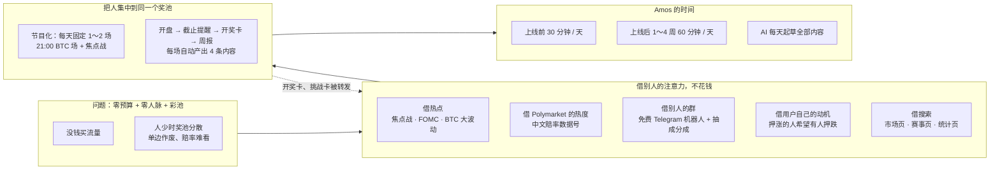
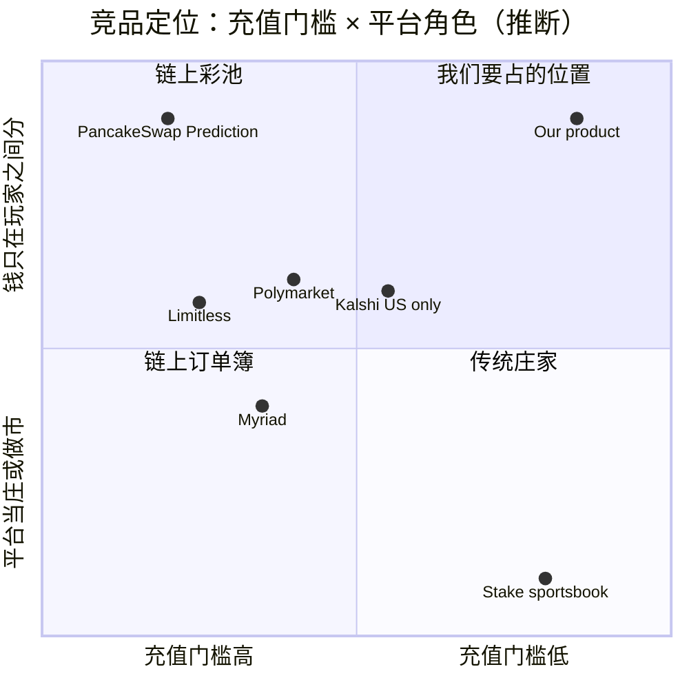
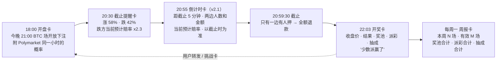
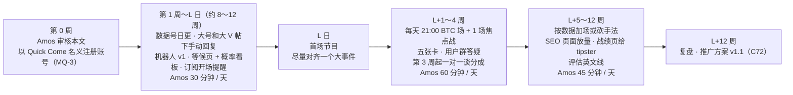
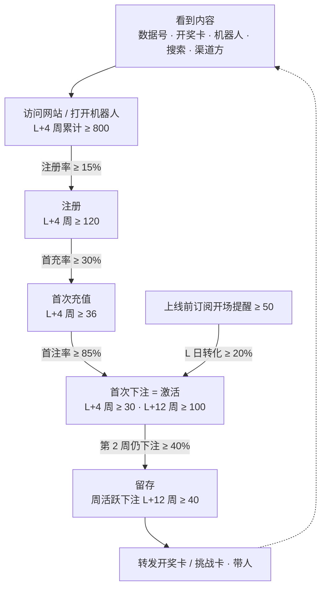
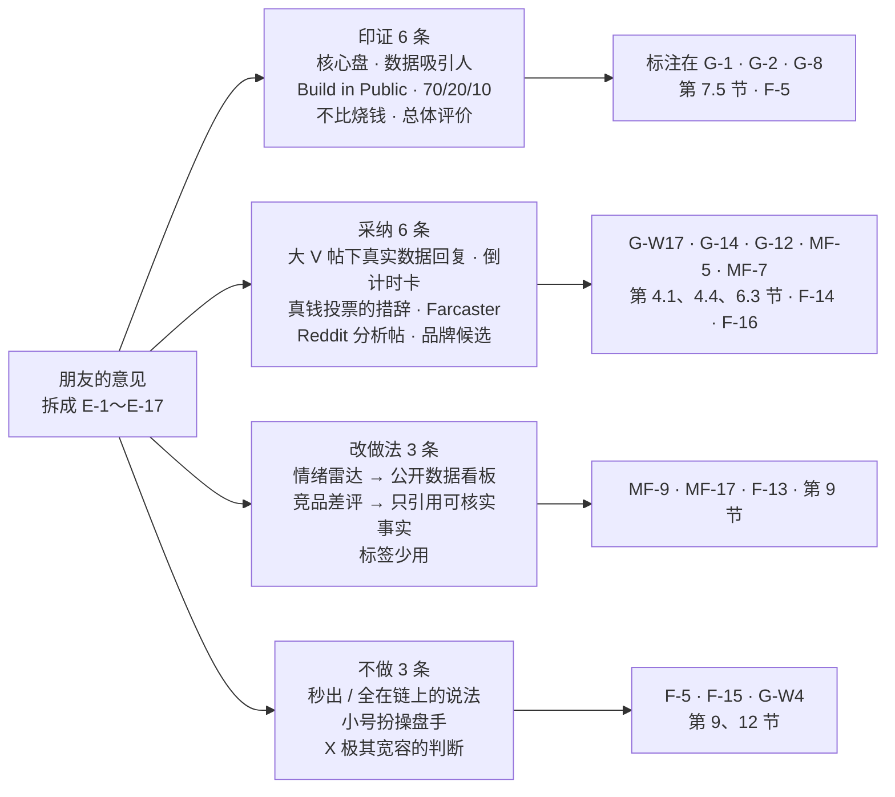

# forecast 市场调研与推广策略（v2）

- 版本：v2.2（2026-10-25，**Amos 审核通过**）
- 编写：市场经理
- 依据：agents main `bd492c9`（《协作总则》v0.12：可视化规范、C7、C53、C62、C66、C71、C73；《市场经理》v0.11）；agents PR 分支 `claude/c93-prelaunch-brand`（C93：上线前统一用工作名 Quick Come，PR 未合并，按 Amos 原话先执行）；forecast：`调研/v1-Polymarket调研报告.md` v1.2、`需求文档/v1-需求说明书.md` v1.1（第 0、1.4、3.3、3.6、3.7、3.10、3.11、4.2、7、8.2、12 节）、《项目地图》v0.6；Amos 对 v1.0 的批评（2026-10-24，见变更历史）
- 变更历史：
  - v1.0（2026-10-24）首次创建，交 PM 和 Amos。
  - **v2.0（2026-10-24）按 Amos 的批评重写。** Amos 原话："MQ 我认为做的不好，你要重新做，前期没有费用，不要想着非常正规的推广运营策略，我也没有朋友人脉没使用，费用和规则也没有降低的计划""做为运营经理，你要去找更真实、有效的，从0开始推广运营的策略方法""方案还是需要接着想，多点儿时间思考没问题，即便是'野路子'也可以尝试"。本次改动：
    1. **删掉**：Amos 人脉内测、付费群主合作、付费 KOL、2,000 USDT 预算、冷启动 30 天 0% 抽成、冷启动期调低单笔提现最小金额、获客成本指标；v1 的 MQ-1～MQ-9 全部作废，重新提出。
    2. **保留**：市场规模、竞品、定位、费率换算、广告政策（第 2～5、12 节），其中 X 付费合作政策按新查到的资料**更正**（2026-03-01 起已把博彩和加密从禁止类别里拿掉，见第 12 节）。
    3. **新增**：零预算冷启动的核心思路（第 6 节）、分阶段打法和 Amos 每天的时间（第 7 节）、渠道和手法清单 G-1～G-13 与野路子组 G-W1～G-W16（第 8 节）、"不做"清单（第 9 节）、冷启动案例调研（第 3.3 节）、Polymarket 公开接口实测数据。
    4. **重排**：推广功能 MF-1～MF-16 重新评估和编号（第 10 节，附 v1 编号对照）；指标改成零预算下的现实目标（第 11 节）；新 MQ-1～MQ-11（第 13 节）。
  - **v2.1（2026-10-25）整理一位运营从业者朋友的反馈（Amos 2026-10-25 转来）+ 按 C93 改品牌口径。** 逐条结论见**第 18 节"外部参谋意见"**，原文见**附录 A**（原样保存）。本次改动：
    1. **外部意见印证**（不改方向，只标注）：每天 1～3 个核心盘（MQ-1、G-1）、用数据和工具吸引人（G-2、MF-9）、Build in Public（G-8、MQ-9）、时间分配 70 / 20 / 10（第 7.5 节）。
    2. **采纳的新点子**：大 V 预测帖下用真实盘口数据回复（新增 **G-W17**）；封盘前倒计时卡，系统自动生成、只放真实数字、不用诱导措辞（第 6.3 节"四张卡"改为**五张卡**，MF-5、MF-7 更新）；定位措辞改为"散户用真钱投票的概率"，并写明换措辞不降低平台审核风险（第 4.1、12 节）；新渠道 Farcaster（新增 **G-14**）和 Reddit 交易员小版块发分析帖（G-12、G-W10 更新）；上线前品牌候选清单（新增**第 4.4 节**）。
    3. **不采纳或改做法**：智能合约秒出 / 全在链上 / 不留私房钱（和事实不符，改为 F-5 的如实说法，新增 **F-13～F-16**）；点名说竞品"客服装死"（只引用可核实的 Trustpilot 数据）；小号冒充"资深操盘手"（违反底线，改为公开身份，写进第 9 节）；爬取 X 情绪（改为零成本公开数据，新增 **MF-17 公开概率看板页**）；"X 极其宽容"（无规则原文，按保守做法）。
    4. **品牌口径按 C93**：上线前统一用工作名 Quick Come，品牌名不是阻塞问题；**MQ-3 改为"上线前用 Quick Come 名义注册数据号，还是等正式品牌再注册"**；MQ-2、MQ-4、MQ-6、MQ-8 按新内容微调；**没有新增 MQ**（提现人工复核时效的建议放进 F-5 的"需要确认的点"）。
    5. 第 7、9、10、12、14～17 节和跨角色反馈按上述内容同步；《项目索引》v0.8 同步本文的编号范围；《项目地图》不改（阶段和 MQ 范围没变）。
  - **v2.2（2026-10-25）Amos 审核通过，只记结论，策略正文不改。**
    1. **MQ-1～MQ-11**（Amos 2026-10-25 原话："MQ5 暂时不做返佣和分成 / MQ8 中英文都做 MQ 其他全部同意，另外需要写一个事件和文章自动化程序"，主会话记在《Amos 待办》"已完成"一栏）：**MQ-5 暂时不做返佣和分成**（渠道分成、用户邀请返佣都不做；来源统计 MF-1 保留，不带奖励，PM 判断，需求 v1.3 X-15）；**MQ-8 中英文都做**（不再是"华语为主、英文只做自动卡片"）；其余 9 条按建议。逐条见第 13 节"Amos 结论"一栏。
    2. **F-5、F-13、F-14 按建议**（Amos 2026-10-25 原话："AQ-23 我还是会用同一台服务器，但是在跑当前系统时，我会停掉原来cfd的项目 ，其他全部按建议"，《Amos 待办》v1.7 列的就是第 14 节的建议）：F-5 对外写"盈利提现需人工审核，冷静期结束后通常 24 小时内处理完"，做不到就不写具体时长；F-13 FAQ 只讲本平台的规则，竞品数据只在对比文章里引用、每次用前重新查；F-14 采用"散户用真钱投票的概率"，说明页仍照实写"用 USDT 押注、平台从赢家盈利里抽 5%"。F-10（渠道分成条款）因 MQ-5 不再使用。其余 F 在用到对应推广功能前逐条确认。
    3. **MF 的取舍**由 PM 写在需求说明书 v1.3 第 1.5 节（v1.3 已于 2026-10-25 由 Amos 审核通过）：MF-1、MF-3～MF-9、MF-10（只做 CSV 导出）、MF-11（提前到第一期）、MF-17 纳入；MF-2、MF-12～MF-16 不做。本文第 8.3 节分成算例、MF-2、MF-12 的设计作为记录保留，现在不执行。
    4. 跨角色反馈的状态按需求 v1.3 的答复更新。- 状态：**v2.2 Amos 审核通过（2026-10-25）**。MQ-1～MQ-11 已答复（第 13 节"Amos 结论"）；F-5、F-13、F-14 已确认，其余 F 在用到对应推广功能前逐条确认（第 14 节）；MF-1～MF-17 的取舍见需求说明书 v1.3 第 1.5 节。
- 读法：先看"一图看懂"和"一页结论"，再看第 6 节（核心思路）、第 7 节（分阶段打法）、第 13 节（MQ）。第 8 节是手法清单，第 10 节交 PM。**只想看 v2.1 改了什么**：看第 18 节。
- 不讨论的内容（Amos 已定）：面向全球、只收 USDT 三链、不做法币和积分版；律师、牌照、合规；彩池玩法；**赢家盈利抽成 5% 不打折；单笔提现最小 100 USDT 不改**；**现金预算为 0**；第一批品类；独立品牌、不和 Quick Come 的其他项目导流（**上线前按 C93 用工作名 Quick Come，正式上线时才换成独立品牌和域名**，见第 4.4 节）。本文的"风险"只写**推广渠道的平台规则**，不是法律意见。
- **对外发布由 Amos 本人操作（C73）**：本文里的发帖、回复、私信、建群、注册账号、提交目录，全部由 Amos 执行。AI 只起草，Amos 审核后发布。本文没有任何已发布的物料；第 14 节的事实性描述交 Amos 确认后才能用于对外内容。

> **标注约定（C66）**
> - 【证实】：本次实际打开了原文（官方文档、政策页、公开接口，或报道本身就是一手调查），链接见第 17 节。
> - 【二手】：只看到新闻、第三方文章或搜索摘要，没有打开原始出处；当线索用。
> - 【推断】：市场经理根据资料和计算得出的判断，不是查到的事实。
> - 【未查到】：查了没有找到。【未核实】：没有去查，需要后续核对。
> - "今天"指 2026-10-24（v2.1 新增的查询注明 2026-10-25）。金额单位不写时是美元；USDT 按 1 美元计。"L 日"= 正式开放真钱的那一天。

---

## 一图看懂



这张图想说明：没钱、没人脉，就只能"借"——借热点、借 Polymarket 的热度、借别人群里的位置（用免费机器人和抽成分成换）、借用户自己"希望有人站对面"的动机、借搜索流量；借来的人不能分散到几十个市场里，要**集中到每天固定时间的一两场"节目"**，每场开奖又自动变成下一轮传播的内容。Amos 每天只做审核和发布，内容全部由 AI 起草。

---

## 一页结论

| 问题 | 结论 | 依据 |
|---|---|---|
| **现实** | 零现金、零人脉、费率和提现规则不动，四大平台付费广告也走不通。能用的只有：**Amos 每天 30～60 分钟 + AI 无限起草 + 研发自己做功能**。所以策略只选"每投入一分钟能复用很多次"的手法。 | 第 6 节 |
| **核心思路** | ① **节目化**：冷启动期只开固定时间的 1～2 场（每天北京时间 21:00 的 BTC 1 小时场 + 一场焦点战），所有人押同一个池；② **开奖即内容**：每场自动产出开盘、截止提醒、封盘倒计时（v2.1）、开奖、周报五张卡；③ **对面空位**：彩池里押涨的人天然希望有人押跌，做"挑战卡"让用户自己去拉对手；④ **上线前就养号**：开发期 8～12 周做"中文预测市场数据号"，上线当天就有一批关注者；⑤ **抽成分成换渠道**：不预付一分钱，给带来用户的群主 / 频道主分平台抽成。 | 第 6 节 |
| **证据** | Polymarket 2020 年大选市场占当时成交的 **91%**【证实，The Block】；2026-10-24 Polymarket 公开接口实测：最热的一场英超（维拉 vs 曼城）24 小时成交约 **370 万**，同期一个 BTC 1 小时涨跌市场约 **1.6 万**，前 10 个事件占前 2,091 个事件成交的 **34%**【证实（接口实测）】——**连 Polymarket 的钱都集中在少数大事件上**。PancakeSwap Prediction 任何时刻只开一轮 5 分钟彩池【证实】。 | 第 3 节 |
| **前 4 周打法** | L 日前：以 Quick Come 名义注册数据号（MQ-3）、数据号日更、大 V 预测帖下用真实数据回复、做机器人、等候页和公开概率看板；L 日起：每天两场节目、每场五张卡（含封盘倒计时卡）、用户群答疑；第 3 周起：一对一联系 tipster 和群主谈抽成分成。 | 第 7 节 |
| **Amos 每天的时间** | 上线前 **30 分钟**；L 日～第 4 周 **60 分钟**；第 2～3 个月 **45 分钟**。超出就砍 P1 手法，不加时间（MQ-7）。 | 第 7 节 |
| **最值得试的 5 个手法** | G-1 节目化场次 + 自有频道；G-2 上线前中文预测市场数据号；G-3 免费 Telegram 机器人进别人的群；G-4 抽成分成渠道（tipster / 群主）；G-W1 在大号帖子下手动回复数据卡（野路子）。 | 第 8 节 |
| **不做** | 刷号水军、刷量、假奖池、平台或员工下注垫池、伪造评价和战绩、冒充 Polymarket 等机构、**用小号冒充"资深操盘手"等第三方身份（v2.1）**、**对外说"智能合约秒出 / 全在链上"等和事实不符的话（v2.1）**、点名贬损竞品、群发私信、承诺收益、进中国大陆平台（小红书 2026 年世界杯期间封了 4 万多个涉赌账号，明确包括"未经授权的预测投注"【证实】）。 | 第 9 节 |
| **产品功能** | 17 条，**第一期建议 10 条**：来源统计、渠道链接和分成报表、场次化、不登录可浏览且可被搜索收录、分享卡片（含挑战卡、倒计时卡）、公开开奖记录和周报、官方 Telegram 机器人、上线前等候页、内容数据工具、**公开概率看板页（v2.1 新增，和等候页同一页）**。 | 第 10 节 |
| **指标** | 零预算下的现实目标：L 日前 X 关注 ≥ 300、等候名单 ≥ 50；L+4 周激活 ≥ 30、每场中位下注人数 ≥ 5、有效市场率 ≥ 85%；L+12 周激活 ≥ 100、周活跃下注 ≥ 40。**比 v1 低**，因为 v1 假设了 2,000 USDT 的付费渠道。 | 第 11 节 |
| **外部参谋意见（v2.1）** | 一位运营从业者朋友的 6 部分建议，拆成 E-1～E-17 逐条给结论：**印证 6 条**（每天 1～3 个核心盘、数据吸引人、Build in Public、70 / 20 / 10 等）；**采纳 6 条**（大 V 帖下真实数据回复、封盘倒计时卡、"真钱投票的概率"措辞、Farcaster、Reddit 分析帖、品牌候选清单）；**改做法 3 条**（爬取 X 情绪 → 公开数据看板、点名说竞品"客服装死" → 只引用可核实事实、标签少用）；**不做 3 条**（"智能合约秒出 / 全在链上"和事实不符、小号冒充操盘手、"X 极其宽容"）。 | 第 18 节、附录 A |
| **待 Amos 决定** | MQ-1～MQ-11：节目化、自动发布授权、**上线前用 Quick Come 名义注册数据号（v2.1 改）**、数据号、分成比例、野路子取舍、时间上限、语种、创始人叙事、体育玩法偏好、上线日对齐事件。另有 F-1～F-16 对外事实性描述待确认。 | 第 13、14 节 |

---

## 1. 目标用户和使用场景

### 1.1 用户画像

| | **A 华语币圈短线玩家（主力）** | **B 华语体育球迷（主力）** | C 时事观点型（次要） |
|---|---|---|---|
| 是谁 | 20～35 岁，手里常年有 USDT（交易所或 TRC20 / BEP20 钱包），玩合约、Meme 币，盯盘时间长 | 25～45 岁，看英超、欧冠、NBA，在 Telegram 球迷群里聊盘口，部分人有 USDT | 关心美联储、通胀，习惯看 Polymarket 的赔率当新闻 |
| 典型场景 | 晚上盯盘时押"BTC 下一个小时涨还是跌"，10～50 USDT 一注 | 周末开赛前押胜平负或大小球，20～200 USDT 一注 | 议息前押一注，金额小 |
| 现在用什么 | 合约、交易所期权类产品、PancakeSwap Prediction（BNB 链 5 分钟彩池）、Polymarket 涨跌市场（要 USDC / Polygon） | 离岸体育博彩网站、球迷群私下盘口、tipster 频道 | Polymarket、Kalshi |
| 痛点 | 合约插针爆仓；Polymarket 要换币、连钱包、英文界面 | 庄家抽水高、赔率不透明；**赢了提不出来、赢多了被限注**；tipster 战绩真假难辨 | 中文内容少 |
| 我们能给什么 | USDT 三链直接充，押一注最多亏本金 | 平台不当庄、奖池和结果公开；**平台不因为你赢钱而限制你下注**（赢家的钱来自输家，不是平台） | 中文题目、概率 % 显示 |
| **零预算下去哪里找** | 华语加密 X（Crypto Twitter 中文圈）、华语加密 Telegram 群和频道、Polymarket 的中文讨论 | 华语 Telegram 球迷群、tipster 频道、足球数据账号的评论区 | X |
| 冷启动优先级 | **最高** | **高** | 低（只用 FOMC 这类大事件引流） |
| 标注 | 画像【推断】；Pew：Polymarket 典型用户每笔约 6.5 美元【证实，调研报告第 4.3 节】 | 体育占 Polymarket 成交 53.5%【二手】；"赢多了被限注"是体育博彩的常见抱怨【推断】 | 【推断】 |

### 1.2 两个门槛要提前讲清楚（不改规则，只改说法）【推断】

1. **单笔提现最小 100 USDT**：用户充 20 USDT 试玩，赢了也要攒到 100 才能提。不改规则，但所有对外内容和落地页**提前写明**"余额可以一直押，满 100 USDT 可以提现"，不要让用户在提现时才发现（Polymarket 的差评集中在提现，见第 3.1 节）。
2. **提现前要证件 + 人脸认证（L1）**：同样提前写明。对 A 类用户这是常态（交易所都要 KYC），对 B 类用户是顾虑，要在 FAQ 里说明"只在提现前需要"。

这两条决定了：冷启动的目标用户是**本来就打算充 100 USDT 以上、能接受 KYC 的人**，而不是"充 5 块钱试试"的人。内容的语气也按这个人群写。

---

## 2. 市场规模和趋势（沿用 v1）

| 指标 | 数字 | 时间 | 来源 | 标注 |
|---|---|---|---|---|
| Polymarket 月手续费 | 2026-09 约 9,361 万；近 30 天约 1.157 亿 | 2026-10-24 | DefiLlama 接口（调研报告第 4.4 节） | 【证实（第三方链上统计）】 |
| Polymarket 品类结构 | 体育 53.5%、加密 15.9%、政治 6.6% | 2026-09-24～10-23 | DefiRate（调研报告第 4.2 节） | 【二手】 |
| **Polymarket 当天最热的事件** | 维拉 vs 曼城 24 小时成交约 370 万；"10 月议息结果"约 281 万；BTC 1 小时涨跌（美东 8 点场）约 1.6 万；前 10 个事件约占前 2,091 个事件 24 小时成交的 34%，前 100 个约 72% | 2026-10-24 快照 | Polymarket 公开接口 `gamma-api.polymarket.com/events`（按 24 小时成交排序，接口最多翻到 2,091 个） | 【证实（接口实测）】；比例只覆盖接口能返回的前 2,091 个事件【推断】 |
| Kalshi 近 30 天成交 | 约 153 亿（只服务美国） | 2026-10-24 | DefiLlama（调研报告第 5 节） | 【证实（第三方链上统计）】 |
| **PancakeSwap Prediction（彩池涨跌）** | 近 30 天手续费 255,553，按"奖池的 3%"折算奖池约 850 万 / 月 | 2026-10-24 | DefiLlama 接口 | 手续费【证实】；奖池【推断】 |
| "Polymarket"搜索热度 | Google 搜索热度创历史最高；泛词"prediction markets"下降 | 2026 年初 | The Block | 【二手】 |
| Polymarket 流量来源 | 直接访问约 78%、Google 约 13%（2025-11 估算） | 2025-11 | Semrush 公开页 | 【二手（模型估算）】 |
| USDT 用户数 | 超过 6.5 亿 | 2026 Q2 | Tether CEO 口径 | 【二手】 |
| Telegram 月活 | "超过 10 亿" | 2025-03 | TechCrunch 转述 Durov | 【二手】 |
| 华语用户在预测市场的占比 | — | — | — | 【未查到】 |
| 中文"Polymarket / 预测市场"类关键词的搜索量 | — | — | — | 【未查到】（上线后用 Google Search Console 自己测） |

**趋势判断**【推断】：
1. 钱主要在**体育**，其次**加密**，和我们的第一批品类一致。
2. **注意力高度集中**：即使在 Polymarket，一场焦点战的成交是一个 BTC 1 小时市场的 200 多倍。我们的冷启动更要"少开、开在大事件上"。
3. 品牌词"Polymarket"热度在涨，泛词在降：用户先知道 Polymarket，再找"像 Polymarket 但用 USDT 更方便"的东西。**中文的 Polymarket 内容是我们能借的流量**（G-2、G-W2）。

---

## 3. 竞品和冷启动案例

### 3.1 竞品对比（沿用 v1）

| 维度 | **Polymarket（国际站）** | **PancakeSwap Prediction** | **Limitless** | **Stake 类加密体育博彩** | Kalshi | Myriad |
|---|---|---|---|---|---|---|
| 和我们的关系 | 品类、显示方式的标杆 | **玩法最接近**（彩池 + 短周期涨跌） | 链上小平台，有短周期涨跌和体育 | B 类用户现在的替代品 | 只服务美国 | 媒体内嵌的获客思路 |
| 玩法 | 订单簿 | **彩池**，每轮 5 分钟连续滚动 | 订单簿 | 庄家开赔率 | 订单簿 | AMM + 订单簿 |
| 资金 | USDC → pUSD（Polygon） | 链上钱包 | Base 链 | 多种加密货币 | 美元 | 多条链 |
| 收费 | 体育 p = 0.5 时约成交额 2.5% | **每轮奖池的 3%** | 未查到 | 赔率里含庄家利润 | 未查到 | 未查到 |
| 激励 | 邀请返佣：直接 10%、间接 5% 的净手续费，被邀请人注册后 30 天，邀请人要先有 1 万美元累计成交 | 活动奖池 | 积分、排行榜、代币 | 首充奖励、返水、VIP | — | — |
| 用户主要不满 | Trustpilot **1.3 / 5**：**提现被拒或延迟、账户被冻结、客服慢** | 未查到 | 未查到 | 未查到 | 未查到 | 未查到 |
| 标注 | 收费、返佣【证实：官方文档】；Trustpilot【证实】 | 【证实：官方文档】 | 【二手】 | 【二手 / 推断】 | 【二手】 | 【二手】 |

### 3.2 竞品定位图（沿用 v1）



这张图想说明：右上角（"USDT 直接充 + 平台不当庄"）目前没有成规模的玩家。坐标是市场经理的判断【推断】。

### 3.3 冷启动案例：别人是怎么从 0 起来的（本次新增）

| 案例 | 查到了什么 | 对我们有用的启示【推断】 | 标注 |
|---|---|---|---|
| **Polymarket 2020～2021** | 2020 年 6 月创办，创始人自述"一个人、几乎没钱"起步；早期题目围绕新冠和 2020 美国大选；**2020-11-03 大选相关市场成交 350 万以上，占平台总成交约 91%**；2020 年月活交易者"略多于 2,000"；早期拒绝了发币的压力；创始人早期上过政治预测圈的播客（Star Spangled Gamblers）。**它最早的用户具体怎么拉来的，没有找到一手说法。** | ① 早期就是**一个大事件撑起几乎全部成交**——集中比铺开重要；② 月活 2,000 也能活下来并被投资人看到；③ 早期用户来自一个**小而精的圈子**（政治预测爱好者），不是大众。我们的"圈子"就是华语加密 X 和球迷 Telegram 群。 | 91%【证实：The Block 原文】；2,000 月活【二手：MarketScreener 转引 Dune】；创办和播客【证实：维基百科、CoinDesk 原文】；早期获客方法【未查到】 |
| **Polymarket 2024～2026 的内容打法** | 推出网页、Substack、X 三种**赔率嵌入**，写作者贴一个链接就变成实时赔率小组件；官方 X 用"BREAKING + 概率"的新闻体发帖；与 X 合作成为"官方预测市场伙伴"；**Tow Center（2026-03）发现至少 11 个挂 Polymarket 联盟标识的"新闻号"，曝光是官方号的 3 倍多，但大量内容缺上下文或不实；纽约时报分析官方号有"数百条虚假或误导帖"** | ① "**赔率即新闻**"确实能拿到大量免费曝光；② 但新闻体很容易滑向夸张和不实，一旦被扒，"公开透明"的信任就毁了。**我们只发自己能验证的数据（自己的奖池、链上和公开接口的数），不发"BREAKING"式的二手新闻**。 | 嵌入【证实：Polymarket 帮助中心】；Tow Center【证实：CJR 原文】；纽约时报分析【二手，经 CJR 转述】 |
| **PancakeSwap Prediction** | 2021-04-29 上线 Beta，首日约 15,976 BNB 成交；彩池涨跌，**任何时刻只有一轮在接受下注，5 分钟一轮**；2024-09 推出 Telegram 预测机器人 Beta | ① **一次只开一个池**，是彩池人少时不分散的天然做法；② 它背后有 PancakeSwap 整个 DEX 的用户，我们没有——所以我们的"一轮"要更长（1 小时）、更少（每天 1～2 场），让分散在不同时间的人也能押进同一个池。 | 玩法【证实：官方文档（v1）】；首日成交【二手：Benzinga】；机器人【证实：Cointelegraph（v1）】 |
| **Myriad（Decrypt 母公司做的预测市场）** | 2025-03 上线，把预测市场嵌进新闻文章和社交内容；2025-10 自称 USDC 成交 1,850 万、500 万笔交易；联创说"未来是把 Myriad 作为协议嵌进各处" | **把市场放到用户已经在看的地方**。我们没有媒体，但可以放进别人的 Telegram 群（G-3 机器人）和博主的页面（MF-14 嵌入组件）。 | 【证实：Decrypt 原文（数字为公司自述）】 |
| **Azuro / Bookiebot（链上体育彩池 + Telegram 前端）** | Azuro 的输方资金分给 DAO、LP、**前端运营方**和数据方；Bookiebot 是做在 Azuro 上的 Telegram 投注机器人，靠分成赚钱；2024 年申请资料自称 20 多个前端、2 万用户 | **"谁带来用户，谁分平台收入"** 就能让别人替你做分发，不需要预付钱。我们的版本：群主加我们的机器人、频道主贴我们的链接，按带来用户产生的抽成分成（G-3、G-4）。 | 分成机制【二手：Token Terminal】；数字【二手：Arbitrum 论坛申请帖（自述）】 |
| **Limitless** | 2025 年 8～9 月成交涨 25 倍，主打 30 / 60 分钟短周期市场、即时结算；用了积分、排行榜和代币 | 短周期涨跌有需求；但它的量很大一部分靠代币激励，我们**不发币不发积分**，不能照搬。 | 【二手：Decrypt、The Defiant（公司新闻稿）】 |
| **predict.fun** | 2025-12 上线，YZi Labs（原币安实验室）支持；2026 年接入币安钱包，平台补贴 Gas，号称触达 2 亿钱包用户 | 靠大平台分发起量，我们没有这个条件；**不作为可学的路径**。 | 【二手：The Block、Trust Wallet】 |
| **pump.fun（零预算爆发的典型）** | 2024-01-19 上线，三个人做；发币几乎零成本、立刻能交易；**每个发币的人都会自己去 X / Telegram 推自己的币**；上线约半年手续费估计 6,000 万；2024 年加了直播功能，后因极端内容和未成年人事件暂停 | **产品本身让用户有动机去拉人**。彩池里的对应机制：**你押了涨，你就希望更多人押跌**（输方奖池越大你赢得越多）。把这个动机做成"挑战卡"（MF-5），用户会自己去群里找对手。直播类玩法容易失控，不学。 | 【证实：维基百科原文】 |
| **Hamster Kombat / Notcoin（Telegram 小游戏）** | 号称几个月上亿用户；靠邀请奖励、Telegram 里零下载、对代币空投的预期 | 邀请链路和"Telegram 里零摩擦"可以学；**它的动力是"白拿代币"的预期，我们没有也不做** | 【二手：Decrypt 等（开发方自述数字）】 |
| **Telegram tipster 频道** | 常见做法是免费频道 + 付费 VIP；行业文章认为**战绩不透明是 tipster 最大的信任问题**；营销供应商称运营好的体育博彩里 5%～15% 的新充值用户来自 tipster 和 Telegram 频道 | ① tipster 有现成的观众，缺的是**可信的战绩**；② 我们的公开开奖记录 + 可验证战绩页（MF-13）正好给他们一个"真押真记录"的证明，这是不花钱就能给的价值。 | 【二手：GOAL、Track360（供应商文章）】 |
| **HQ Trivia（定时直播答题）** | 每天固定 15:00、21:00（美东）开一场，峰值 238 万人同时在线；到点手机推送 | "**固定时间 + 到点提醒**"能把分散的人在同一分钟聚到一起——这就是彩池冷启动最需要的。 | 【二手：维基百科（经搜索摘要）、TechCrunch】 |

### 3.4 从竞品和案例得到的启示【推断】
1. **集中比铺开重要**：Polymarket 2020 年 91% 的成交在一个大选题上；今天它的钱也集中在少数焦点赛事。我们冷启动只开 1～2 场。
2. **到点开场比随时可玩更适合彩池**：PancakeSwap 一次只开一轮，HQ Trivia 定时开场。我们做"节目表"。
3. **让用户替你拉人，靠的是产品里的利益一致**：pump.fun 是"推自己的币"，我们是"给自己找对手"。
4. **分发靠分成，不靠预付**：Azuro 前端、Polymarket 邀请返佣，都是从平台收入里分。
5. **透明是我们唯一的品牌资产**：Polymarket 的新闻号被扒出大量不实内容；Trustpilot 差评集中在提现。我们只发能验证的数，提现规则先讲清楚。

---

## 4. 定位和差异化

### 4.1 一句话卖点
> **用 USDT 押球赛和币价：钱只在玩家之间分，平台不当庄，只从赢家的盈利里抽 5%。**

英文备选（草稿，Amos 确认后才能用）：*Bet USDT on matches and crypto moves. Players share the pool — we never take the other side. We only take 5% of winners' profit.*

（v1 的"上线 30 天 0 抽成"已删除：费率不打折。）

**定位措辞（v2.1，采纳外部参谋意见 E-13）**：对外介绍产品时用"**散户用真钱投票的概率**"来讲（例如数据卡标题"今晚 BTC 场：XX 人用真钱投票，看涨 58%"），不用"博彩、赌场、下注赢大钱"一类的词。英文备选 *Real-money crowd odds on crypto and sports*（草稿，F-14 待 Amos 确认）。
- 好处：内容读起来像数据和观点，更容易被转发，也和"不当庄"的卖点一致【推断】。
- **但要清楚：换措辞不会降低平台审核的风险**。X、Telegram、Google、Meta、YouTube 的规则看的是**实质**——用户是不是用真钱押注、拿真钱奖励（例如 Discord 的判定标准就是"真钱下注 + 真钱奖励 + 结果主要靠运气"【证实，第 12 节】）。所以广告依然不投（第 12 节），Telegram 机器人依然只给信息、不在 Telegram 里下注（G-3），第 12 节的每条风险判断**不因为换了措辞而下调**。
- 也不能反过来"藏实质"：说明页、等候页、机器人里要照实写"用 USDT 押注、赢了从输方奖池分钱、平台从赢家盈利里抽 5%"（F-1、F-2），不能让用户以为这是免费的数据工具。

### 4.2 支撑点

| 支撑点 | 我们 | 为什么竞品做不到或不愿做 | 标注 |
|---|---|---|---|
| **USDT 三链直接充** | ERC20 / BEP20 / TRC20 独立地址，扫块入账 | Polymarket 建在 Polygon + pUSD 上；PancakeSwap 要自己的钱包 | 【证实（调研报告）/ 推断】 |
| **平台不当庄** | 彩池，平台只抽成 | 体育博彩的利润来自当庄，不会放弃 | 【推断】 |
| **不因为你赢钱限制你下注** | 赢家的钱来自输家，平台对谁赢无所谓；下注限额对所有人一样（需求第 3.3 节） | 庄家对长期赢钱的客户常见做法是限注【推断，未查到一手统计】 | 【推断】；提现仍按统一规则审核，盈利客户的提现会转人工复核（需求第 8.2 节 R13），对外不能说"提现不审核" |
| **只对盈利抽成** | 5% × 盈利；五五开约等于奖池 2.5% | PancakeSwap 收奖池 3%；体育博彩抽水约 5～6% | PancakeSwap【证实】；体育博彩【二手】 |
| **结果和奖池公开** | 每个已结算市场公开结果、依据、奖池、派彩、抽成（MF-6） | 离岸博彩不公开 | 【推断】 |

### 4.3 短板（对外不回避）【推断】
- 奖池小时赔率波动大、最终赔率截止时才定。
- 下注后不能撤单、没有中途卖出。
- **单笔提现最小 100 USDT、提现前要 L1 认证**（第 1.2 节）。
- **只有一边有人押时全额退款**：冷启动期会发生。对外要把它讲成保护（"没人对赌就全额退，不收一分钱"），而不是故障。
- **提现不是"秒出"**（v2.1 补充）：新提现地址 24 小时后生效、2 小时冷静期、单笔 ≥ 3,000 USDT 延迟 6 小时、盈利客户的提现转人工复核（R13）；下注和结算记在平台账本上，**不上链**（第 14 节 F-5、F-15）。

### 4.4 上线前品牌候选清单（v2.1 新增，C93）

**口径**：按 C93，正式上线前一律用工作名 **Quick Come**（测试环境、原型用 `quickcome.online` 的子域名，由运维定）；**品牌名不是阻塞问题**，正式上线前由 PM 出品牌方案（需求 RQ-19）、Amos 定。这张清单只是把已经出现的候选名记下来，**不在现在做决定**。代码内部用代号 `forecast`，品牌名只放在前端品牌常量和消息模板里（C93），改名时成本低。

| 候选 | 来源 | 含义 | 撞名初查（2026-10-25，WebSearch + RDAP） | 市场的看法【推断】 |
|---|---|---|---|---|
| **ZeroHouse** | 外部参谋 | "无庄家"，把"不当庄"直接做成名字 | 搜"ZeroHouse"没有找到同名的加密或预测市场产品；最接近的是美国家电改造公司 **Zero Homes**（zerohomes.com，名字不同、行业不同）；`zerohouse.com`、`zerohouse.xyz` **已被注册**，`zerohouse.io` RDAP 返回未找到（可能未注册，**未核实**） | **PM 倾向**（见下） |
| PoolPulse | 外部参谋 | 彩池脉搏 | 没找到同名产品，泳池维护类 App 很多（PoolPlus、iopool 等），名字容易被当成泳池工具；`poolpulse.com` 已被注册 | "Pool"在英文里首先是泳池，搜索会被泳池内容淹没 |
| TickOdds | 外部参谋 | 分秒赔率 | 没找到同名产品；`tickodds.com` 已被注册 | 带"Odds"（赔率），名字本身就是博彩词，和第 4.1 节的定位措辞冲突；中文用户不好读 |
| OptiPool | 外部参谋 | — | 没找到同名产品；有 OpenPool（OPL 代币）、OptiToken 等近似名；`optipool.com` 已被注册 | 含义不清楚，和"不当庄、透明"没有关系 |
| OmniPool | 外部参谋 | — | **明显撞名**：HydraDX / Hydration（Polkadot）的 AMM 就叫 Omnipool，ZetaChain 上还有一个同名质押协议；`omnipool.com` 已被注册 | **不建议**：加密圈里已经有知名同名协议 |

**PM 倾向 ZeroHouse 的理由**（市场转述，最终由 PM 在品牌方案里写、Amos 定）：
1. 名字就是卖点："没有庄家"一句话讲完和体育博彩、和对赌平台的区别，不需要解释彩池。
2. 不带"bet / odds / casino"这类博彩词，符合第 4.1 节"真钱投票的概率"的定位。
3. 初查没有加密行业的同名产品。

**ZeroHouse 的风险**（正式定名前要查）：① `.com` 已被注册，要用其他后缀或加前后缀；② 只做了网页搜索，**商标库（USPTO、EUIPO、WIPO）和 X / Telegram 用户名是否可用【未核实】**；③ "House"在英文里也有"房子"的意思，和 Zero Homes 这类房产、能源公司的名字接近；④ 对华语用户需要一个中文名（候选未提，正式定名时一起出）。

**对推广的影响**：上线前的数据号以 Quick Come 名义注册还是等正式品牌，见 MQ-3。

---

## 5. 定价（沿用 v1 的计算，删除降费）

赢方选项的奖池占比是 p，平台收 5% × 输方奖池，**占总奖池的比例 = 5% × (1 − p)**【推断（计算），公式见需求第 3.5 节】。

| 赢的是哪一边 | p | 我们占奖池 | PancakeSwap | Polymarket 体育（按成交额） |
|---|---|---|---|---|
| 热门赢 | 80% | **1.0%** | 3% | 约 1.0% |
| 五五开 | 50% | **2.5%** | 3% | 约 2.5% |
| 冷门赢 | 20% | **4.0%** | 3% | 约 4.0% |

- 五五开押 100：我们派彩约 195，PancakeSwap 约 194。**不降费也不比竞品贵**，所以冷启动的卖点放在"不当庄、公开、USDT 直充"，不放在价格【推断】。
- 5% 是**抽成分成（G-4、MF-2、MF-12）的唯一资金来源**：分成从这 5% 里出，用户的费率不变。

---

## 6. 零预算冷启动的核心思路

### 6.1 先把约束想清楚【推断】

| 我们没有的 | 我们有的 |
|---|---|
| 现金（不能买广告、不能付钱给任何人、不能发奖励） | **AI 每天可以起草任意多的内容**：多语种帖子、数据卡、回复、私信草稿、SEO 页面、周报 |
| 人脉（没有熟人内测、没有群主朋友） | **研发自己做功能不花钱**：机器人、分享卡、统计页、等候页 |
| 价格优势（5% 不打折） | **"不当庄 + 公开"这个其他人给不了的信任点** |
| 品牌和粉丝（账号还没注册） | **开发期 8～12 周**：产品还没上线，正好用来养号【推断，依据调研报告第 7 节"6～10 周到测试环境"】 |
| Amos 的大量时间（他要亲自发布，C73） | 平台收入里可以拿出来分的那部分（抽成，事后分，不预付） |

所以每个手法都要过三道筛子：**① 不花钱；② Amos 每天几分钟能做完，且 AI 能把大部分工作做掉；③ 做一次能复用很多次**（一张开奖卡能在频道、X、群里、搜索页里各用一次）。

### 6.2 彩池冷启动最大的问题：人少时奖池分散

彩池跟订单簿不一样：**一个市场至少要两边都有人押才成立**，否则截止时全额退款（需求 E3）；而且一边人太少时，另一边赢了也几乎没得赚。v1 只说了"集中市场数量"，这次给出完整做法：

| 做法 | 具体 | 为什么有用 |
|---|---|---|
| **少：同时开放的市场 ≤ 2 个** | 冷启动期加密只开 **BTC 1 小时，每天 1 场**（北京时间 21:00～22:00，即 13:00～14:00 UTC），15 分钟和 ETH 全关；体育**每天最多 1 场焦点战**（周末最多 2 场），一场只开一种玩法 | 100 个用户分到 1～2 个池里，每个池才有足够的人。按需求现在的写法，BTC 1 小时市场每天会生成 24 个——要改成"只在指定时刻生成"（MF-3） |
| **准：固定时间，像节目一样** | "每晚 21:00 BTC 场""周六晚焦点战"；开盘、截止前 30 分钟、开奖都在固定时间；用户可以订阅开场提醒（MF-7） | 定时把分散的人在同一时段聚到一个池里（HQ Trivia 的做法）。21:00 是华语用户的晚间黄金时段，也接近美股开盘（夏令时 21:30） |
| **均：选天然五五开的题** | BTC 涨跌本来就接近五五开；体育优先开**大小球 2.5 / NBA 大小分**，少开强弱悬殊的胜平负（MQ-10） | 两边都有人押 → 不作废；赔率接近 2 倍 → 赢的人觉得值、愿意晒 |
| **看得见对面：挑战卡** | 押完后弹出"我押了涨，谁敢押跌？"卡片：显示当前两边的人数和**跌方如果赢的预计赔率**；"对面目前没人时，第一个押对面的人若赢，可以分走这边的整个奖池（扣 5% 抽成）；截止时还是只有一边有人押，全额退款" | 用户**自己有动机**去群里找对手（pump.fun 式的利益一致）；说的全是真实规则，不承诺收益 |
| **兜底说清楚** | 作废退款对外讲成"没人对赌就全额退，不收一分钱" | 作废不再是"押了个寂寞"，而是"平台不吃你的钱"的证据 |
| **加场有门槛** | 每场中位下注人数连续 2 周 ≥ 8 且有效市场率 ≥ 90%，才加第二个 BTC 时段（例如北京时间 9:00 早场）或第二场体育 | 先把一场做满，再开第二场 |
| **绝不垫池** | 平台、Amos、员工都不下注（需求第 3.3 节：员工账户不能下注） | "不当庄"是唯一的信任资产，垫一次池就全毁 |

### 6.3 开奖即内容：每场节目自动产出五张卡（v2.1：新增封盘倒计时卡）



这张图想说明：每场节目在固定时间自动生成五张卡（开盘、截止提醒、封盘倒计时、开奖、周报），同一张卡发到官方 Telegram 频道、X、机器人所在的群和网站的公开记录页。**Amos 不用每天想发什么**，只需要审核模板（MQ-2）和偶尔加一句评论。卡上所有数字都来自系统，不写评论性的"稳赚""必涨"。（本文其他地方说的"四张卡"在 v2.1 起都指这五张。）

**封盘倒计时卡（v2.1，采纳外部参谋意见 E-5，改了措辞）**
- **由系统在截止前 5 分钟自动生成**，数字全部来自当场奖池，不允许人工改数字。
- 模板（草稿，F-16 待 Amos 确认）：
  > 今晚 21:00 BTC 场 · 距截止 5 分钟
  > 看涨 12 人 · 680 USDT ｜ 看跌 8 人 · 520 USDT
  > 当前预计赔率：涨 ×1.73 · 跌 ×2.24（已扣 5% 抽成，最终以截止时为准）
  >
  > （示例数字。算法：涨方赢时每 1 USDT 拿回 1 + 520 × 95% ÷ 680 ≈ 1.73；跌方赢时 1 + 680 × 95% ÷ 520 ≈ 2.24，公式见需求第 3.5 节）
  > 截止时只有一边有人押，全额退款。
- **不写**："胜者瓜分对手的奖金""最后 3 分钟入场""别错过""稳赚"一类的诱导性收益措辞（C73：不承诺收益）。朋友原稿里的"多空比 1:1.5、总奖池 1,200 USDT"这类**真实数字可以写**；"胜者将瓜分对手的奖金"改成中性的规则说明"赢方按投入比例分输方奖池（扣 5% 抽成）"，只放在说明页，不放在倒计时卡上制造紧迫感。
- **人少时照实发**：对面 0 人就写"看跌目前 0 人；截止时仍为 0 人，全额退款"，不美化、不隐藏，也不因为数字难看就不发（否则会变成只挑好看的发）。
- 和"截止提醒卡"的分工：截止提醒卡（T-30 分钟）给还没决定的人留时间；倒计时卡（T-5 分钟）只是最后一次如实播报。同一场在同一个渠道不超过这两次提醒，避免刷屏（X 自动化规则，第 12 节）。

### 6.4 借别人的注意力（不花钱的五种"借法"）

| 借什么 | 怎么借 | 对应手法 |
|---|---|---|
| **借热点** | 焦点战、FOMC（2026-12-08/09、2027-01-26/27）、CPI、BTC 单日大波动、欧冠夜（联赛阶段第 8 轮 2027-01-27 共 18 场同时开赛）——热点当天只开**一个**相关市场，做一张数据卡 | G-1、G-9 |
| **借 Polymarket 的热度** | 上线前就做"中文预测市场数据号"：每天把 Polymarket 上体育、加密、经济类最热的题翻成中文、做成概率卡；上线后变成"Polymarket 说 63%，我们的奖池说 55%"的对照 | G-2、G-W3 |
| **借大 V 的观点（v2.1）** | 加密大 V、宏观 KOL 发"BTC 要涨 / 要跌"的预测时，手动在下面回一张**真实**的概率对照图：上线前用 Polymarket 同类市场的公开数据并注明来源，上线后用我们池子的真实人数和比例 | G-W17、MF-9 |
| **借别人的群** | 免费 Telegram 机器人：群主加进去，群里能查 BTC 价格、今晚焦点战两边的比例、Polymarket 概率；群里来的用户自动记为这个群带来的，按抽成分成给群主 | G-3、G-4 |
| **借用户自己的动机** | 挑战卡、开奖卡转发 | G-7 |
| **借搜索** | 每个市场页、每场焦点战一页、"BTC 每小时涨跌历史统计"、中文 Polymarket 教程和对比页，都能被搜索引擎收录 | G-6 |

### 6.5 为什么先养号、后上线【推断】
- 产品从架构方案到能开放还有 8～12 周。**这段时间什么都不做，上线当天就是零关注、零用户，节目表开出来两边都没人**。
- 数据号不需要产品就能做：Polymarket 公开接口免费可查【证实（接口实测）】，BTC K 线公开。AI 每天出 3 条，Amos 审 10 分钟。
- 上线前把"开场提醒"做成订阅（MF-8 等候页 + 机器人订阅），L 日第一场就能把订阅的人叫到同一个池里。

---

## 7. 分阶段打法

### 7.1 时间线



这张图想说明：从 Amos 审核本文到上线大约 8～12 周，这段时间只做"养号 + 做工具"；上线后前 4 周集中做"节目"，第 3 周起开始谈分成渠道；第 2～3 个月按数据决定加场还是砍掉没用的手法。

### 7.2 第 0 周到 L 日（上线前，约 8～12 周）

| 项目 | 内容 |
|---|---|
| **做什么、在哪做** | ① **注册账号**（MQ-3，v2.1 按 C93 改）：建议**以 Quick Come 名义**注册 X 账号、Telegram 频道（公告）、Telegram 用户群（答疑）、Telegram 机器人、GitHub 组织，各留一个备用名；正式品牌定了以后改显示名和用户名（X、Telegram 都支持改名，粉丝保留）。② **中文预测市场数据号**（G-2）：X + Telegram 频道，只发体育、加密、经济类题目，标明数据来源和"非 Polymarket 官方"。③ **大号评论区手动回复**（G-W1）：每天在 5～8 个华语加密 / 足球数据大号的新帖下，回一条有数据的内容（不放链接）；其中遇到大 V 发 BTC 涨跌预测的，用 Polymarket 公开数据做对照图回复并注明来源（G-W17，v2.1）。④ **Build in public**（G-8）：每周一篇"从 0 做一个不当庄的预测市场"中文长帖。⑤ **研发做**：MF-8 等候页 + MF-17 公开概率看板（同一页，v2.1）、MF-7 机器人 v1（查价、查概率、订阅开场提醒）、MF-9 内容数据工具。⑥ **目录收录**（G-10）：机器人和开源工具提交到 GitHub 上的预测市场工具清单、中文 Telegram 搜索机器人。⑦ **整理 tipster 和群主名单**（G-4 准备）：AI 从公开信息里整理 30～50 个华语足球 / 加密频道，只记录公开了商务联系方式的。 |
| **具体怎么做** | 每天 AI 在早上 8 点前交一份"今日草稿包"：3 条 X（2 条数据卡 + 1 条观点或进展）、1 条 Telegram 频道、5～8 条大号评论区回复草稿（附原帖链接）。Amos 改字、点发布或定时发布。每周日 AI 交周报（关注数、曝光、点击、订阅数）和下周热点日历。 |
| **Amos 每天的时间** | **约 30 分钟**：早上 10 分钟审稿和定时发布；晚上 15 分钟发评论区回复、回私信；其余 5 分钟机动。每周日加 30 分钟看周报和定下周节目表。一次性：注册账号约 1～2 小时，目录提交约 2 小时。 |
| **AI 负责** | 全部草稿（简中为主，繁中、英文自动出一份）；数据卡的数据核对（每条附数据来源链接给 Amos 看）；热点日历；大号名单和回复草稿；tipster 名单整理；周报。 |
| **预计效果**【推断】 | L 日时：X 关注 **300～800**；Telegram 频道 **100～300**；等候名单 / 开场提醒订阅 **50～150**；机器人被加进 **5～15** 个群。依据：新账号日更数据内容、每天在大号下回复，按 8～12 周估计；没有找到可对照的一手数据【未查到】。 |
| **风险** | ① 新号在 X 上曝光很低，前 4 周可能只有几十个关注；② 数据号如果发了政治、战争类 Polymarket 题目，会和我们"不做敏感题"的口径冲突，**只发体育、加密、经济**；③ 用 Polymarket 的名字做内容有商标投诉风险（G-W2）；④ Telegram 频道和机器人可能被举报（见第 12 节）。 |
| **怎么判断有没有用** | 每周看：X 关注增长、每条帖子的平均曝光、个人主页点击、频道订阅、等候名单数。**第 4 周检查点**：X 关注 < 80 且平均曝光 < 200 → 把评论区回复从 5～8 条加到 10 条、减少自己发帖；**第 8 周检查点**：关注 < 200 → 停掉 X 自己发帖，只保留评论区回复和 Telegram，把时间转去机器人进群（G-3）。 |

### 7.3 L 日到 L+4 周（上线后第 1～4 周）

| 项目 | 内容 |
|---|---|
| **做什么、在哪做** | ① **节目表**（G-1，MQ-1；外部参谋意见 E-4 印证）：每天北京时间 21:00 BTC 1 小时场；每天最多 1 场焦点战（周末最多 2 场），优先大小球 / 大小分。② **五张卡**：开盘、截止提醒、封盘倒计时（v2.1）、开奖、周报，发官方频道、X、机器人所在的群（群主开启了播报的）。③ **用户群答疑**：每个问题当天回复；每个作废、每个争议都在群里公开说明。④ **挑战卡**（G-7）：上线即有。⑤ **公开开奖记录 + 第一份周报**（G-5）。⑥ **L+3 周起一对一外联**（G-4、G-W5）：每天最多 5 个 tipster / 群主 / 频道主，手写、一对一、只联系公开了商务联系方式的；给他们看前两周的公开开奖记录。⑦ **热点快反**（G-9）：遇到大事件当天加一个相关市场（不超过同时开放 2 个的上限，必要时当天停焦点战）。 |
| **具体怎么做** | **L 日对齐一个大事件**（MQ-11）：例如 FOMC 或欧冠夜之前 3～7 天上线，让第一周就有一个大家都关心的题。每天流程：下午 AI 交当天草稿包 + 焦点战建议（附两边预计比例的理由）→ Amos 上架焦点战（`market:publish`）→ 卡片按模板自动发或 Amos 一键发 → 晚上 21:00～22:00 Amos 在用户群里在线 15 分钟 → 22:03 开奖卡自动出。 |
| **Amos 每天的时间** | **约 60 分钟**：上架焦点战、检查 BTC 场 5 分钟；审核和发布卡片 5～10 分钟（MQ-2 通过后接近 0）；用户群和私信答疑 15 分钟；X 内容和评论区回复 15 分钟；一对一外联 10 分钟（第 3 周起）；平台裁决类市场的确认按需 5 分钟。 |
| **AI 负责** | 每天的焦点战建议、全部卡片文案、群里常见问题的回复草稿、外联名单和每个人的个性化私信草稿（附对方频道最近的内容要点）、每天的数据小结（各来源注册、首充、首注、每场人数）。 |
| **预计效果**【推断】 | L+4 周：注册 **80～200**；**激活（首充 + 首注）30～60**；每场中位下注人数 **5～12**；有效市场率 **85%～95%**；谈成 **1～3** 个分成渠道。来源大致：等候名单转化 10～30、数据号和 X 10～20、机器人所在的群 5～10、分成渠道 0～10。 |
| **风险** | ① 前几场只有 2～3 个人押，开奖卡上的奖池很小——**照实发**，用"有效 / 作废"和人数讲故事，不美化；② 用户少时一个大户能把一边押满，另一边赔率很差 → 单客户单市场上限（加密 1 小时 2,000）冷启动期建议调低到 200～500（后台参数，不改需求）；③ 一对一私信被对方举报为垃圾信息 → Telegram 账号被限制（第 12 节）；④ Amos 某天没时间 → 节目照常自动跑，只是少了互动。 |
| **怎么判断有没有用** | 每周看：激活数、按来源的激活、**每场中位下注人数**、有效市场率、第 2 周仍下注比例。**放弃条件**：某个手法连续 2 周带来的激活为 0 且占用 Amos ≥ 10 分钟 / 天 → 停掉，时间转给带来激活最多的手法。**L+4 周总检查点**：激活 < 15 → 节目照跑，但暂停新手法，先做 10 个已注册未充值用户的回访（问为什么没充），按答案改落地页和说法。 |

### 7.4 L+5 到 L+12 周（第 2～3 个月）

| 项目 | 内容 |
|---|---|
| **做什么、在哪做** | ① **按门槛加场**（第 6.2 节）：达标才加第二个 BTC 时段或第二场体育。② **分成渠道放量**：把带来激活最多的那类渠道（群主还是 tipster）再找 10～20 个；推出可验证战绩页（MF-13）给 tipster。③ **SEO 放量**（G-6）：每场焦点战一页、BTC 每小时涨跌历史统计页、每周 2 篇中文教程 / 对比文章。④ **用户邀请返佣**（MF-12，如果 PM 放第二期）。⑤ **评估英文线**（G-12，MQ-8）：英文 SEO 页面的访问如果占总访问 ≥ 30%，开始在 X 英文和 Reddit 做少量人工运营。⑥ **可选**：每周一次 30 分钟 Telegram 语音或 X Spaces"周末焦点战"（G-13）。 |
| **具体怎么做** | 每两周一次"砍和加"：按第 8 节每个手法的放弃条件，列出要停的和要加的，交 Amos 一句话确认。 |
| **Amos 每天的时间** | **约 45 分钟**：节目和卡片 10 分钟；答疑 15 分钟；外联 10 分钟；X 10 分钟。SEO 文章由 AI 写，Amos 每周抽 20 分钟审 2 篇。 |
| **AI 负责** | 同上，另加 SEO 页面和文章草稿、渠道分成月报（每个渠道带来的激活、下注、抽成、应分金额）、英文草稿。 |
| **预计效果**【推断】 | L+12 周：累计激活 **80～150**；周活跃下注 **30～60**；每场中位下注人数 **8～20**；分成渠道 **5～10** 个，带来激活的 30% 左右；搜索自然访问 **20～60 / 天**。 |
| **风险** | ① 分成金额很小（见第 8.3 节算例），渠道方可能做两周就不做了；② SEO 一般要 3～6 个月才见效，第 3 个月可能还看不到；③ 加场太早会把每场人数稀释回去。 |
| **怎么判断有没有用** | L+12 周复盘，写推广方案 v1.1（C72）：按来源算激活、留存、每个手法占用的 Amos 时间，**算"每分钟带来多少激活"**，下一阶段只保留排名前 3～4 的手法。 |

### 7.5 Amos 时间汇总

| 阶段 | 每天 | 每周额外 | 主要花在哪 |
|---|---|---|---|
| 第 0 周 | 一次性约 3～4 小时 | — | 审核本文、以 Quick Come 名义注册账号（MQ-3） |
| 第 1 周～L 日 | **30 分钟** | 30 分钟 | 审稿发帖 10、评论区回复和私信 15、机动 5 |
| L～L+4 周 | **60 分钟** | 30 分钟 | 节目 10、卡片 5～10、答疑 15、X 15、外联 10 |
| L+5～L+12 周 | **45 分钟** | 50 分钟 | 节目和卡片 10、答疑 15、外联 10、X 10 |

**原则**：每天时间超出上限时，按优先级从低往高砍（先砍 P2、再砍 P1），**不砍节目和答疑**（MQ-7）。

**外部意见印证（v2.1，E-15）**：朋友建议单人创始人把时间拆成"70% 冷启动内容和分发、20% 产品核心流程和提现顺畅、10% 规则和极端风险"。和本节的分配一致：上表的 30～60 分钟几乎全部是"内容和分发"；"产品和提现"由研发和 PM 承担，不占 Amos 的推广时间。要补的一点是朋友强调的"**绝不能让第一个提现的人卡住**"：盈利客户的提现按 R13 会转人工复核，冷启动期第一批赢家的提现一定会走人工，**人工复核的处理时效**放在 F-5 交 Amos 确认，并在跨角色反馈里请 PM 写进运营要求。

---

## 8. 渠道和手法清单

> 优先级：**P0** = 现在就做；**P1** = 按阶段做；**P2** = 有余力再做；**不建议** = 列出来供 Amos 判断，市场不建议做。
> "Amos 时间"指稳定运行后每天的分钟数。所有封号可能性都是【推断】，平台规则依据见第 12 节。

### 8.1 常规手法（G-1～G-14）

| 编号 | 手法和真实案例出处 | 适合我们的程度 | Amos 时间 | 平台规则风险 | 优先级 |
|---|---|---|---|---|---|
| **G-1** | **节目化场次 + 自有频道**：每天固定时间 1～2 场，五张卡自动产出（第 6.2、6.3 节）。**外部意见印证**（E-4："每天只开 1～3 个核心主打盘，流量全部砸向这一个池子"）。案例：PancakeSwap 一次只开一轮【证实】、HQ Trivia 定时开场【二手】、Polymarket 2020 年 91% 成交在一个大事件【证实】 | **最高**：直接解决奖池分散；内容自动产出 | 10～15 | 低：发在自己的频道和账号。Telegram 频道被举报的可能性见第 12 节 | **P0** |
| **G-2** | **上线前中文预测市场数据号**：把 Polymarket 体育 / 加密 / 经济类最热的题做成中文概率卡，标明来源。案例：Polymarket 官方号"概率即新闻"拿到大量曝光，但被扒出大量不实帖【证实：CJR】——**我们只做数据，不做新闻体**。**外部意见印证（E-1、E-2）**：朋友建议做"全网情绪雷达 / 赔率聚合看板"每天发图；v2.1 改为零成本的数据组合（Polymarket 公开数据 + 币安行情 + 我们自己的池子），不爬 X（见第 18 节 E-1），数据由 MF-9 生成，公开页是 MF-17。每条帖子最多带 1～2 个相关标签（如 `#Bitcoin` `#PredictionMarket`），不堆标签（G-W11） | **高**：观众就是我们的目标用户；开发期就能做 | 10 | 低：自然发帖；X 对自然发布的博彩类内容没有查到专门限制【未查到】。Polymarket 接口的使用条款【未核实】 | **P0** |
| **G-3** | **免费 Telegram 机器人进别人的群**：群主把机器人加进群，群里可以用 `/btc`（价格 + 今晚 BTC 场两边比例）、`/今晚`（焦点战两边比例）、`/pm 关键词`（Polymarket 中文概率）；群主可以开启每晚开奖播报；**群里点进来的用户自动记为这个群带来的，按抽成分成给群主**。Telegram 支持 `startgroup` 深链把机器人加进群、`start` 参数带来源【证实：Telegram 官方文档】；机器人默认"隐私模式"只看发给它的命令【证实】。案例：Myriad"把市场嵌到用户已经在的地方"【证实：Decrypt】；Azuro 前端分成【二手】；Polycule 机器人加进群后自动把交易广播给群成员【二手】 | **高**：给群主真实的免费价值，再加分成；和群里的人直接接触 | 5（处理群主的问题） | 中：Telegram 开发者条款禁止机器人做"受监管或可疑的商品和服务"、禁止未经请求的消息【证实】；TG.Casino 曾被以违反服务条款为由封禁【二手】。缓解：机器人**只提供信息、不在 Telegram 里下注**，只回应命令和群主开启的播报 | **P0** |
| **G-4** | **抽成分成渠道**：华语足球 tipster、加密频道主、群主，按"其带来用户产生的平台抽成"的一定比例分成，**不预付、不保底**（MQ-5）。案例：Polymarket 邀请返佣 10% / 5%、30 天【证实】；Azuro 前端分成【二手】；tipster 渠道占运营好的体育博彩新充值用户 5%～15%【二手：供应商】 | **高**：唯一能"请别人帮忙"又不花钱的方式；但第一个月分成金额很小（第 8.3 节） | 10 | 中：外联私信见 G-W5；渠道方在 X 上发带分成链接的帖子要加"Paid Partnership"标签【二手】 | **P0（L+3 周起）** |
| **G-5** | **公开开奖记录 + 每周透明周报**：每个已结算市场的结果、依据、奖池、派彩、抽成、尾差、作废原因；每周汇总。对照：Polymarket 差评集中在提现和裁决【证实：Trustpilot】 | **高**：信任证据，同时是内容和 SEO 页面 | 0～5（自动） | 低 | **P0** |
| **G-6** | **内容 SEO**：每个市场页可被收录；每场焦点战一页（三语）；"BTC 每小时涨跌历史统计"；中文 Polymarket 教程、"USDT 预测市场对比"。依据："Polymarket"搜索热度创新高【二手】；Polymarket 约 13% 流量来自 Google【二手】 | 中高：慢（3～6 个月【推断】），但做一次长期有效 | 0～5（每周审 2 篇约 20 分钟） | 中：Google 把"为了操纵排名批量生成的页面"列为垃圾内容（scaled content abuse），把"为一组相似搜索词批量做的跳转页"列为 doorway abuse【证实】——**每个页面必须有独有的真实数据**（本场奖池、历史统计），不做空壳页 | **P1** |
| **G-7** | **挑战卡 / 开奖卡（用户自传播）**：押完生成"我押了涨，谁敢押跌"卡；赢了生成开奖卡（金额可隐藏）。案例：pump.fun 用户自己推自己的币【证实：维基百科】 | **高**：利益一致，零运营成本 | 0 | 低：用户自己转发；卡上只写真实规则和当前数字 | **P0（产品）** |
| **G-8** | **Build in public 创始人叙事**：每周一篇中文长帖，讲"为什么做彩池、为什么不当庄、这周数据和踩的坑"，用品牌下的创始人身份（可以是昵称、不露脸，MQ-9）。**外部意见印证（E-8）**：朋友建议单人创始人公开连载修了什么 Bug、冷启动赚亏、5% 抽成账目。v2.1 补充：抽成账目**直接引用 MF-6 公开周报里的数字**，不贴后台截图（截图要打码，C21）；"平台收入"只说抽成合计，不说成本和盈亏，除非 Amos 自己决定公开 | 中：建立信任、给数据号增加人味 | 每周 15～20 | 低 | **P1** |
| **G-9** | **热点快反**：BTC 单日波动超过 5%、FOMC、CPI、焦点战爆冷——当天出一张数据卡，必要时开一个相关市场（不超过同时开放 2 个） | 中高：热点当天曝光高 | 触发时 10 | 低 | **P1** |
| **G-10** | **免费目录和清单收录**：GitHub 上的预测市场工具清单（例如 Awesome-Prediction-Market-Tools，782 星，"欢迎 PR"【证实】），只提交我们的**开源工具和机器人**，不提交博彩站本身；中文 Telegram 搜索机器人（极搜等）【二手】；AlternativeTo 一类"替代品"站【未核实规则】；Telegram 小程序目录（只有做 Mini App 才适用，博彩类很可能被拒【未查到规则】） | 中：一次性工作，带来少量长尾流量和外链 | 一次性 2 小时 | 低：工具清单只收工具，硬塞博彩站会被拒 | **P1** |
| **G-11** | **嵌入组件**：给博主、小网站一段代码，嵌入某个市场的实时比例。案例：Polymarket 网页 / Substack / X 嵌入【证实】 | 低（冷启动没人用）→ 中（有内容合作方后） | 0 | 低 | **P2** |
| **G-12** | **英文线**：英文 X、Reddit（r/Polymarket、r/predictionmarkets 一类，先答问题、不放链接）。**v2.1 采纳外部意见 E-11**：避开 r/CryptoCurrency 这类大版（规矩多、容易被当成垃圾信息），找中等规模的**交易员版块**发**分析帖**，例如"统计了过去 1,000 个小时 BTC 每小时涨跌，发现……"——数据必须是真实的（币安公开 K 线可以真的拉 1,000 个小时，G-W8 的工具就能出），文末附数据来源；**能不能附我们的链接按该版版规，版规不允许就不附** | 低（冷启动期 Amos 时间不够） | 15 | 中：Reddit 各版规则【未查到原文】，常见说法是自我推广不超过 10%【二手】；交易员小版块的具体版规【未核实】（Reddit 对本环境返回 403，发帖前由 Amos 逐版看原文） | **P2（L+8 周后评估，MQ-8）** |
| **G-13** | **开奖夜语音**：每周一次 30 分钟 Telegram 群语音或 X Spaces，聊周末焦点战两边的比例 | 中：真人声音建立信任；占 Amos 时间 | 每周 30 | 低 | **P2（MQ-9）** |
| **G-14** | **Farcaster（v2.1 新增，外部意见 E-9）**：加密原生的去中心化社交网络。把 X 上已经发的英文数据卡**同步**发一份（不另写内容），关注预测市场、交易相关的频道 | 中低：用户是加密原生，和我们的人群重合；但以英文为主、规模比 X 小【推断】，和"华语为主"（MQ-8）不完全一致 | 5（同步发帖） | 低～中：Farcaster 对博彩类内容的规则【未查到】；发帖前由 Amos 看一次规则原文 | **P2（和英文线一起评估）** |

### 8.2 野路子组（G-W1～G-W17）

> 这一组是灰一点、非常规的做法。**每条写清违反或擦边的是哪条规则、被封的可能性**，由 Amos 判断。G-W11～G-W16 市场不建议做，列出来是为了说明为什么不做。G-W17 是 v2.1 采纳外部意见新增的，排在 G-W10 后面。

| 编号 | 手法 | 为什么值得 / 案例 | 擦边的规则 | 封号或处罚的可能性【推断】 | Amos 时间 | 优先级 |
|---|---|---|---|---|---|---|
| **G-W1** | **大号评论区手动回复数据卡**："reply guy"：在华语加密和足球数据大号的新帖下第一时间回一条有信息量的数据（"Polymarket 上这场客胜 41%"、"过去 30 天 BTC 21 点这一小时涨的比例 53%"），**不放链接**，靠头像和名字让人点进主页 | 新号最快获得曝光的办法；全部手动，内容有价值 | X 自动化规则：**按关键词自动回复是禁止的**，重复、刷屏的回复可能被从搜索里移除或封号【二手：X 官方规则页的搜索摘要】。手动、内容不重复则不违规 | **低**（手动、每天 ≤ 10 条、每条不同）；**中**（同一句话复制粘贴或带链接） | 15 | **P0** |
| **G-W2** | **蹭 Polymarket 品牌词**：中文内容和页面里用"Polymarket 中文""Polymarket 怎么玩""Polymarket 替代"做标题和标签 | 品牌词热度创新高，中文内容少【二手 / 推断】 | 商标：可以"说明性地提到"别人的品牌，但**不能让人以为我们是 Polymarket 或和它有关系**（不是法律意见）；Google 规则不禁止 | **低～中**：主要风险是 Polymarket 发商标或版权投诉，导致页面或账号被下架。缓解：每页写"非 Polymarket 官方，与其无关" | 0 | **P1**（只用在教程和对比内容里） |
| **G-W3** | **同题对照盘**：Polymarket 上最热的体育 / 加密 / 经济题，我们开同一道题，卡片上并排显示"Polymarket 63% · 我们的奖池 55%" | 借别人已经在讨论的题，天然有话题；对照本身就是内容 | 无明显平台规则问题；**不开政治、战争类题**（需求第 4.1 节） | **低** | 5 | **P0** |
| **G-W4** | **在别人的 Telegram 群里当"有用的人"**：加入华语加密 / 球迷群，回答问题、分享数据，**不发广告**；有人问"有没有 USDT 能押的"再私聊回答；问群主要不要免费机器人。**v2.1 明确：用 Amos 本人或官方账号、公开身份进群**（"我是 Quick Come 的开发者"），分享的多空数据注明来自我们的网站；**不用小号扮成"资深操盘手"之类的第三方**（外部意见 E-12 不采纳，见第 9 节） | 没有人脉时，只能自己进群混熟 | 大多数群禁止广告（群规）；被举报多了 Telegram 会限制账号发消息【推断：Telegram 有反垃圾机制，具体阈值未查到】 | **中**：被踢出群很常见；账号被限制的可能性取决于被举报次数 | 10 | **P1** |
| **G-W5** | **冷私信 tipster / 频道主谈分成**：一对一、手写、每天 ≤ 5 个、只联系频道简介里公开了商务联系方式的人；第一条消息就讲清"不预付，按抽成分成，附公开开奖记录链接" | 没钱买推广时，分成是唯一的筹码 | Telegram 服务条款禁止"发送垃圾信息"；开发者条款禁止"未经请求的消息"【证实】。一对一的商务联系不是群发，但**被对方举报为垃圾信息**仍会被限制 | **中**：少量、个性化、只联系公开商务联系的人时较低；**群发模板消息 = 不做**（第 9 节） | 10 | **P0（L+3 周起）** |
| **G-W6** | **频道和机器人名字关键词化 + 中文 TG 搜索机器人收录**：频道名带"BTC 涨跌 · 足球概率"这类词，提交到中文 Telegram 搜索机器人 | 中文用户找群找频道主要靠第三方搜索机器人【二手：知乎】 | 无明确规则；关键词堆砌过度可能被搜索机器人降权 | **低** | 一次性 | **P1** |
| **G-W7** | **币安广场发数据内容（不带链接）**：华语币圈最大的内容平台之一，只发 BTC 统计和预测市场数据，品牌只出现在图片水印和昵称上 | 华语加密用户集中 | 币安广场的官方提醒：**禁止把用户引到第三方平台、简介里放联系方式、推广第三方平台**【二手：官方置顶帖的转载】 | **中**：水印也可能被认定为推广第三方平台；被封后积累的粉丝全部归零 | 5 | **P2** |
| **G-W8** | **开源数据工具**：把"BTC 每小时涨跌统计""Polymarket 中文概率查询"做成开源小工具放 GitHub，提交到预测市场工具清单 | 开发者和数据爱好者的圈子；带来外链（SEO）和可信度 | 无问题；工具清单只收工具 | **低** | 一次性 | **P1** |
| **G-W9** | **"反向指标"系列**：用我们自己的奖池、PancakeSwap Prediction 链上每轮数据、Polymarket 涨跌市场，统计"大众押涨的时候，BTC 实际涨的比例" | 加密圈喜欢情绪指标和"反着买"的话题，容易被转发 | 无问题；**只用真实数据**，样本小时写明样本数，不暗示"跟着反着押能赚钱" | **低** | 5 | **P1（有 4 周数据后）** |
| **G-W10** | **Reddit 英文答疑**：在英文预测市场版块回答"USDT 能不能押""彩池和订单簿区别"，主页放链接。v2.1：分析帖的做法并入 G-12（交易员小版块、真实数据、按版规决定附不附链接） | 英文用户的长尾 | 各版自定规则，自我推广比例常见说法是 ≤ 10%【二手】；原文【未查到】（Reddit 对本环境返回 403） | **中～高**：新号带链接很容易被删帖封号 | 15 | **P2** |
| **G-W17** | **大 V 预测帖下的"真钱概率"对照回复（v2.1，外部意见 E-3）**：加密大 V、宏观 KOL 发"BTC 要暴涨 / 暴跌"之类的预测时，Amos 手动回一张对照图："目前 N 个人用真钱投票，看跌占 62%"。**数字必须真实**：上线前池子没人，用 Polymarket 同类市场（如 BTC 涨跌、"BTC 年底价格"区间）的公开数据，图上注明"数据：Polymarket 公开接口，查询时间 XX，非 Polymarket 官方"；上线后用我们池子的真实人数和比例，人少就写真实的人数（"7 个人"就写 7），不凑整、不放大。语气中性，用"供参考"代替"大 V 你怎么看"这类挑衅的说法；**不放链接** | 加密推特喜欢看"散户 vs 大 V"的对比【二手：外部意见】；在大 V 帖下回复比自己发帖曝光高（同 G-W1）；数据由 MF-9 一键出图 | 同 G-W1（X 自动化规则：按关键词自动回复禁止，重复刷屏可能被移除或封号）；另外反复回复同一个人可能被当成骚扰（X 规则原文【未查到】） | **低**（手动、每天 ≤ 3 条、同一个大 V 每周 ≤ 1 次、每条数据不同）；**中**（复制粘贴、带链接、语气挑衅） | 计入 G-W1 的 15 分钟 | **P0**（上线前用 Polymarket 数据即可开始） |
| G-W11 | 蹭 X 热门话题 / 标签（发和话题无关的内容） | 曝光 | X 平台操纵和垃圾信息规则【二手】 | **中～高**：限流 | — | **不建议** |
| G-W12 | YouTube / TikTok 直播开奖或发引流视频 | 视频曝光大 | YouTube：**"为未经认证的线上博彩网站提供访问途径"属于违规**，先警告、90 天内再犯记一次处罚，3 次可能封频道【证实】；TikTok：推广未经许可的博彩服务不允许【二手】 | **高** | — | **不建议** |
| G-W13 | 进中国大陆平台（小红书、抖音、B 站、贴吧、微博、知乎、虎扑） | 华语用户最多 | 小红书 2026 年 6 月起封禁 4 万多个账号，明确"网络赌博和**未经授权的预测投注**违反平台规则和中国法规"【证实：G3 Newswire】；其他平台的具体规则【未查到】 | **很高** | — | **不做** |
| G-W14 | 在 Polymarket、竞品的评论区或 Discord 里留链接 | 精准用户 | 平台规则【未查到】；Discord 社区准则禁止"组织或参与非法赌博"【证实】 | **高**：会被当成垃圾信息，还会被竞品社区记住 | — | **不建议** |
| G-W15 | AI 批量生成成千上万个"XX vs YY 预测"空壳页面 | 快速占搜索词 | Google"批量生成内容滥用""doorway abuse"【证实】 | **高**：整站被降权 | — | **不做**（只做有真实数据的页面，G-6） |
| G-W16 | 抢注"Polymarket 中文""Polymarket 官方华语"一类的账号名、频道名、域名 | 截流 | 冒充他人或机构 | **很高**，且违背本文底线 | — | **不做**（第 9 节） |

### 8.3 抽成分成到底有多少钱（给 G-4 一个现实的算例）【推断（计算）】

- 五五开的市场里，**每押 1 USDT，平台期望收到约 0.025 USDT 抽成**（5% × 输方奖池，输方约占一半）。
- 一个用户一个月押 200 USDT → 平台抽成约 5 USDT → 按 30% 分成，渠道方拿约 **1.5 USDT / 人 / 月**。
- 一个渠道带来 20 个活跃用户 → 约 30 USDT / 月。**数字很小**，所以：
  1. 对渠道方的说法要实事求是："现在量小，分成也小；但不预付、不设上限、按月结算、数据全公开"。
  2. 真正能打动 tipster 的**不是钱**，而是"**真押真记录的可验证战绩页**"（MF-13）和"**赢家不被限注**"——这是庄家给不了的。
  3. 分成从平台抽成里出，用户的费率不变（不是降费）；同一个人自己邀请自己（同 KYC / 同设备 / 同充值来源）不算（复用需求第 8 节关联账户识别）。

---

## 9. 不做的事

| 不做 | 原因 |
|---|---|
| 不刷假账号、不雇水军、不用小号互相点赞评论 | 违反所有平台的规则，被发现就是封号；更重要的是会毁掉"公开透明"的信任 |
| 不刷假下注量、不做假奖池，**平台、Amos、员工都不下注垫池** | "平台不当庄"是我们唯一的卖点；需求第 3.3 节已规定员工账户不能下注 |
| 不伪造用户评价、不编造战绩截图 | 欺诈；我们的战绩页必须来自真实下注记录 |
| 不冒充 Polymarket、媒体或任何机构，不抢注相似名字 | 冒充；也是商标和平台规则的高风险 |
| 不盗号、不买号、不群发垃圾私信、不往别人群里刷广告 | 违反 Telegram 服务条款"不得发送垃圾信息"；会让品牌账号被限制 |
| 不承诺收益，不写"稳赚""必中""保本""翻倍" | C73；YouTube 等平台对"保证回报"另有明确禁止【证实】 |
| 不发首充奖励、体验金、积分，不降费 | Amos 已定；也会招来羊毛党 |
| 不进中国大陆平台 | 见 G-W13 |
| 不做"BREAKING"式的二手新闻号 | Polymarket 的新闻号被扒出大量不实内容【证实：CJR】，我们承受不起 |
| **不用小号扮成"资深操盘手"、普通玩家等第三方身份去群里或评论区分享我们的数据（v2.1）** | 这就是水军，属于本节第一条"不雇水军、不用小号"的底线；一旦被认出来，"透明"的卖点就没了。改为 Amos 本人或官方账号公开身份分享（G-W4） |
| **不对外说"智能合约秒出""输赢全在链上""平台不留一分钱私房钱"（v2.1）** | 和事实不符：提现有白名单 24 小时、2 小时冷静期、≥ 3,000 USDT 延迟 6 小时、盈利客户人工复核（R13）；下注和结算记在平台账本上，不上链；平台从赢家盈利里抽 5%。能如实说的见 F-5、F-13～F-15 |
| **不点名说竞品"客服装死""提现慢"之类的评价（v2.1）** | 有诽谤风险（不是法律意见）。只引用可核实的事实：Polymarket 在 Trustpilot 1.3 分、差评集中在提现，附链接和查询日期（F-13）；或者只讲我们自己的规则 |
| **不爬取 X / 推特的数据做"情绪雷达"（v2.1）** | X 数据接口收费、条款限制未经许可的爬取，是业内常识【未核实：X 的条款和开发者政策页对本环境返回 403，本次没有打开原文】；不管哪种都和"零成本、不擦边"冲突。改用 Polymarket 公开接口、币安公开行情和我们自己的池子（MF-9、MF-17） |

---

## 10. 推广需要的产品功能清单（MF，交 PM 决定）

> 工作量：小 = 1～3 人天，中 = 4～10 人天，大 = 10 人天以上【推断，研发评估前不作为承诺】。
> "建议期次"是市场的建议；是否纳入、放哪一期由 PM 写进需求说明书 v1.2（C71）。
> 重新评估的标准只有一条：**零预算下，它能不能直接带来用户或让一个池里的人更多**。

| 编号 | 功能 | 作用 | 建议期次 | 工作量 |
|---|---|---|---|---|
| **MF-1** | **来源统计**：链接带 `src`（渠道）、`cmp`（活动）、`ref`（邀请人 / 渠道方）参数时记在浏览器里，注册时写进客户记录（首次来源、注册来源）；机器人的 `start` 参数同样记录 | 没有它就不知道哪个手法有用，也算不了分成 | **第一期** | 小 |
| **MF-2** | **渠道链接和分成报表**：后台给渠道方生成专属链接 / 机器人深链；按月统计每个渠道带来的激活、有效下注、平台抽成、应分金额（比例按 MQ-5）；排除同 KYC / 同设备 / 同充值来源；第一期**人工结算**（超管按报表把分成记到渠道方余额，高危操作、写审计） | 唯一不花钱的"请别人帮忙"方式（G-3、G-4） | **第一期** | 小～中 |
| **MF-3** | **场次化**：加密自动生成模板支持"只在指定的 UTC 时刻生成"（例如只生成 13:00～14:00 UTC 这一场）；参数"同时开放的市场数上限"（超过时上架时提示）；首页顶部"今日场次"（今天开哪几场、几点截止、几点开奖） | 冷启动集中奖池的核心（第 6.2 节）；需求现在要求"保证未来至少 3 个 1 小时窗口"，要改 | **第一期** | 小 |
| **MF-4** | **不登录可浏览 + 可被搜索引擎收录**：市场列表、市场详情、已结算市场不登录就能看；页面能被搜索引擎读取（服务端输出内容、三语各有独立地址、标题和描述按市场生成）；附一页"怎么玩、怎么充、怎么提（写明最小 100 和 L1）"的说明页 | 从卡片、搜索进来的人先看到内容；SEO 的前提 | **第一期** | 小～中 |
| **MF-5** | **分享卡片**：市场卡、开奖卡（金额可隐藏）、**挑战卡**（"我押了 X，谁敢押 Y"，显示两边人数、对面当前预计赔率和"只有一边时全额退款"）、**封盘倒计时卡**（v2.1：截止前 5 分钟系统自动生成，只放两边人数、金额、当前预计赔率和退款规则，模板见第 6.3 节，数字不能手改）；链接在 Telegram / X 里自动显示卡片图（Open Graph），自带 `src=share` 和分享人 `ref` | 用户自传播（G-7） | **第一期** | 中 |
| **MF-6** | **公开开奖记录和每周周报**：已结算市场列表（结果、依据、奖池、派彩、抽成、尾差、裁决人编号、作废原因）；每周自动生成周报卡 | 信任证据 + 内容 + SEO 页面（G-5） | **第一期** | 小 |
| **MF-7** | **官方 Telegram 机器人 v1**：① 按 Amos 审定的模板往官方频道自动发开盘、截止提醒、封盘倒计时（v2.1）、开奖、周报（MQ-2）；② 用户订阅"开场提醒"（主动订阅，可退订）；③ 命令 `/btc`、`/今晚`、`/pm 关键词`；④ 内联模式：在任何聊天里输入 `@机器人 BTC` 就能发市场卡（显示"via @机器人"【证实：Telegram 文档】）；⑤ `startgroup` 加进群、群主可开启开奖播报、群里来的用户记为该群来源。**不在 Telegram 里下注** | G-1、G-3 的载体；把分散的人在开场前叫回来。注意：需求第 7 节通知 #19"第一期不做营销推送"——这里是**用户主动订阅的某一场的提醒**，请 PM 判断是否冲突 | **第一期** | 中 |
| **MF-8** | **上线前等候页**：一页说明 + 订阅开场提醒（Telegram 机器人或邮箱）；L 日自动通知订阅的人第一场的时间 | 上线当天把人叫到同一个池 | **第一期（L 日前 6 周上线）** | 小 |
| **MF-9** | **内容数据工具（内部）**：从 Polymarket 公开接口、币安公开行情（BTC K 线）、我们自己的奖池拉数，按模板生成中文数据卡图片和草稿素材，给 AI 起草和 Amos 审核用。**v2.1 补充**（外部意见 E-1、E-3）：① 加一个"大 V 对照图"模板（输入一条预测和一个市场，出"N 人真钱投票 · 看涨 X%"对照图，自动印上数据来源和查询时间）；② 数据只来自上面三个零成本来源，**不接 X 数据接口、不爬取 X**；③ 数据管道和 MF-17 共用 | 让数据号（G-2）和大 V 对照回复（G-W17）每天 10 分钟就能做完；保证卡上每个数都有出处 | **第一期（L 日前尽早）** | 小 |
| MF-10 | **增长看板**：按注册周的漏斗、按来源拆分、每场下注人数、有效市场率（按作废原因）。第一期先做 **CSV 导出**，看板第二期 | 第 11 节指标的统计 | CSV 第一期，看板第二期 | 小（CSV）/ 中（看板） |
| MF-11 | **SEO 内容页**：每场焦点战一页（三语）、"BTC 每小时涨跌历史统计"、教程 / 对比文章（简单的内容管理） | G-6 | 第二期（L+4 周） | 中 |
| MF-12 | **用户邀请返佣（自动结算）**：普通用户也有邀请链接；被邀请人产生的平台抽成按比例（MQ-5）每周自动记到邀请人余额；只做一级 | 第 2～3 个月老用户带新用户 | 第二期 | 中 |
| MF-13 | **可验证战绩页**：用户可以选择公开自己的主页，展示真实的已结算下注（市场、选项、最终赔率、结果、命中率；金额可隐藏）；**只读真实记录，不能手填** | 给 tipster 一个"真押真记录"的证明（G-4 的核心筹码） | 第二期 | 中 |
| MF-14 | **嵌入组件**：一段代码嵌入某个市场的实时比例 | G-11 | 第三期 | 中 |
| MF-15 | **无奖金排行榜 / 名人堂**：周榜按命中率，要求当周 ≥ 10 笔、已 L1，不发奖金 | 给活跃用户回来的理由 | 第三期 | 中 |
| MF-16 | **Telegram 小程序（Mini App）** | 在 Telegram 里直接下注 | 第三期以后；平台封禁风险高（第 12 节） | 大 |
| **MF-17** | **公开概率看板页（v2.1 新增，外部意见 E-1 改做法）**：一个不登录就能看、可被搜索收录的公开页面，放三块真实数据：① BTC 实时价格和"过去 N 个小时 BTC 每小时涨跌的比例"（币安公开行情）；② Polymarket 上 BTC 涨跌、热门体育和经济题的当前概率（公开接口，注明"非 Polymarket 官方"和更新时间）；③ 我们今晚场次的实时两边人数和比例（上线前这一块显示"L 日开场"和订阅入口）。**和 MF-8 等候页做成同一个页面**：上线前它就是等候页 + 看板，上线后变成首页旁边的"数据"页。**不放 X 情绪数据** | 朋友"情绪雷达"的合规版：给数据号和大 V 回复一个可以点进来的落地页；有真实独有的数据，可以做 SEO（G-6 的要求）；上线前就能带来订阅 | **第一期（L 日前，和 MF-8 一起）** | 小～中（数据管道复用 MF-9） |
| — | 首充奖励、体验金、积分、降费 | — | **不做**（Amos 已定） | — |

**第一期建议：MF-1～MF-9、MF-17（10 条）+ MF-10 的 CSV 导出**。其中 MF-8、MF-9、MF-17 要在 L 日之前做好，请 PM 和研发排在开发计划的前面。

**为什么 MF-17 单列、不并进 MF-9**（v2.1）：MF-9 是给 AI 和 Amos 用的**内部**工具，出图、出草稿，不对外；MF-17 是**对外**页面，涉及前端、搜索收录、三语和订阅入口，验收标准和 MF-9 完全不同。两者共用数据管道，所以 MF-17 的工作量按"小～中"估；和 MF-8 同页，避免多做一个落地页。

**v1 编号对照**：v1 MF-1 → MF-1；v1 MF-2 → MF-2；v1 MF-3 → MF-5；v1 MF-4 → MF-4；v1 MF-5（落地页）→ 并入 MF-4 的说明页和 MF-8；v1 MF-6 → MF-7；v1 MF-7 → MF-6；v1 MF-8 → MF-10；v1 MF-9 → MF-12（渠道部分提前到 MF-2）；v1 MF-10（战绩分享卡）→ 并入 MF-5；v1 MF-11 → MF-15；v1 MF-12（合作方专属页）→ 去掉，用 MF-2 的专属链接代替；v1 MF-13 → MF-14；v1 MF-14 → MF-16；v1 MF-15、MF-16 → 不做。新增：MF-3、MF-8、MF-9、MF-11、MF-13。

---

## 11. 指标

### 11.1 获客漏斗



这张图想说明：前 30 个激活用户大约需要 800 次访问、120 个注册；**最容易掉人的一步仍是"注册 → 首充"**（要先换好 USDT、要接受最小提现 100 和 KYC）。上线前订阅开场提醒的人是转化最高的一批。目标值都是【推断】，上线后按真实数据修正。

### 11.2 指标、目标值和统计方法

| 指标 | 目标值 | 统计方法 | 依赖 |
|---|---|---|---|
| X 关注数 | L 日 ≥ 300 | X 账号后台 | — |
| Telegram 频道订阅 | L 日 ≥ 100 | 频道统计 | — |
| 等候名单 / 开场提醒订阅 | L 日 ≥ 50 | 订阅记录去重 | MF-8 |
| 机器人所在的群 | L 日 ≥ 5；L+12 周 ≥ 20 | 机器人记录（`startgroup` 加入、未被移出） | MF-7 |
| 访问数 | L+4 周累计 ≥ 800 | 带 `src` 的访问去重 | MF-1 |
| 注册数 | L+4 周 ≥ 120 | 注册表计数（扣员工和测试账户） | 已有 |
| **激活用户** | **L+4 周 ≥ 30；L+12 周 ≥ 100** | 首次充值入账且至少 1 笔有效下注（不含退回）的客户数 | 已有 + MF-10 |
| 注册 → 首充 | ≥ 30% | 按注册周分批 | MF-10 |
| 第 2 周仍下注 | ≥ 40% | 激活后第 8～14 天有下注 ÷ 该批激活用户 | MF-10 |
| 周活跃下注用户 | L+4 周 ≥ 20；L+12 周 ≥ 40 | 当周至少 1 笔有效下注的去重客户 | 后台仪表盘 |
| **每场中位下注人数** | L+4 周 ≥ 5；L+12 周 ≥ 8 | 每个已截止市场的去重下注人数取中位数（按场次类型分开看） | MF-10 |
| **有效市场率** | ≥ 85% | 已结算 ÷（已结算 + 因"只有一边有人押 / 没人押赢方"作废），不含比赛取消等外部原因 | MF-10（按作废原因分类） |
| 按来源的激活 | 每周看；L+12 周分成渠道占 ≥ 30% | 按首次来源（`src` / `ref`）拆分激活 | MF-1、MF-2 |
| **每分钟激活**（手法效率） | 每两周算一次 | 某手法带来的激活 ÷ Amos 在该手法上花的分钟数（Amos 每天花在哪个手法上，AI 每周问一次记下） | MF-1 + 记录 |
| 搜索自然访问 | L+12 周 ≥ 20 / 天 | Google Search Console、访问日志里 `src` 为空且来源是搜索引擎的 | MF-4 |
| 裁决争议率 | ≤ 2% | 有争议的平台裁决市场 ÷ 平台裁决市场 | 已有 |
| 提现投诉 | 0 起"超过规则时限未到账" | 客服记录 | 已有 |

- **看数的频率**：上线前每周一次；上线后每周一次周报，每两周一次"砍和加"；L+2 周写效果回顾，L+12 周写推广方案 v1.1（C72）。
- **数据来源**：只用产品自己的统计、各平台后台和 Amos 提供的截图，不凭感觉写。
- **为什么比 v1 低**：v1 的 100 个激活建立在 2,000 USDT 付费渠道上；现在零预算，前 4 周以 30 个为现实目标。

---

## 12. 风险：推广渠道的平台规则

> 只写平台规则和广告政策，不是法律意见。平台政策变化快，**每次在新平台开始做之前由 Amos 再看一次原文**。

| 平台 | 规则要点 | 对我们的影响 | 标注 |
|---|---|---|---|
| **X 广告** | 博彩广告只在指定国家、按限制允许，部分要事先授权 | 不投 | 【二手】（政策页 403） |
| **X 付费合作（更正 v1）** | v1 写"2026-02 起禁止博彩和加密"。新查到：2026-02 中旬 X 曾把博彩加入付费合作的禁止类别，**2026-03-01 又把博彩和加密从禁止类别里拿掉**；有商业报酬的自然帖子必须加"Paid Partnership"标签；欧盟仍禁止博彩和加密推广，英国要加披露 | 我们不付钱给任何人，影响很小；但**渠道方拿分成后在 X 上发我们的链接，要提醒他们加标签**（G-4） | 【二手：AffPapa（2026-03-03）、iGaming Expert 等；X 官方页 403】 |
| **X 自然发帖和自动化** | 按关键词自动回复他人帖子不允许；对方事先主动互动过才可以自动回复；重复刷屏的回复可能被从搜索里移除或封号；用于信息类的自动发帖一般允许 | 官方号的开奖卡可以自动发（信息类）；评论区回复必须手动（G-W1、G-W17）。**v2.1：外部意见说"X 极其宽容，只要不明目张胆诱导诈骗，账号很难被封"，这是经验之谈，没有规则原文支持（E-9）。早期按保守做法：评论区全部手动、每天回复数有上限、不刷屏、同一张卡同一渠道同一场最多两次提醒** | 【二手：X 自动化规则页的搜索摘要（原页 403）】；"X 宽容"【二手：外部意见，未核实】 |
| **Telegram Ads** | 禁止真钱博彩，明确包括体育投注、赔率和预测 | 不投 | 【证实（v1）】 |
| **Telegram 服务条款** | 不得"发送垃圾信息或诈骗"；不得从事"多数国家认定为非法的活动"；条款正文没有直接提到博彩 | 不群发私信；官方频道只发自己的内容 | 【证实：telegram.org/tos】 |
| **Telegram 机器人开发者条款** | 机器人不得用于"非法、盗版、**受监管或可疑的商品和服务**"；不得"未经请求骚扰或垃圾信息"；违规可临时或永久封禁，机器人会被移除 | 机器人**只提供信息和链接，不在 Telegram 里下注**；只回应命令和用户主动订阅的提醒；准备备用机器人 | 【证实：telegram.org/tos/bot-developers】 |
| **Telegram 的实际执法** | TG.Casino 机器人被以"违反服务条款"封禁；菲律宾、俄罗斯政府施压后，Telegram 对非法博彩内容"零容忍"、按月报告 | 频道、群、机器人都有被封的可能，**粉丝不能只放在一个地方**：X、频道、机器人、邮箱订阅分开存 | 【二手：SiGMA（403）、Vixio、CasinoBeats】；具体日期【未核实】 |
| **Google 广告** | 博彩要逐国认证；预测市场广告只开放给美国 CFTC 持牌平台 | 不投 | 【证实 / 二手（v1）】 |
| **Google 搜索（SEO）** | 搜索垃圾政策不针对博彩题材本身；禁止：批量生成内容操纵排名、doorway 页面、买卖链接、论坛签名里塞优化链接、借用别人网站的排名（site reputation abuse）、买过期域名做排名 | SEO 可以做，但每页要有真实独有的数据；不买链接、不在论坛刷链接 | 【证实：developers.google.com 垃圾政策页】 |
| **Meta（Facebook、Instagram）** | 博彩广告要事先书面授权和持牌证明，数字货币也算 | 不投；自然内容第一期也不做（华语加密用户主要不在这里【推断】） | 【证实（v1）】 |
| **YouTube** | "为未经认证的线上博彩网站提供访问途径"违规；"保证回报"不管是否认证都违规；第一次警告，90 天内再犯记处罚，3 次可能封频道 | 不做（G-W12） | 【证实：support.google.com/youtube/answer/9229611】 |
| **TikTok** | 社区准则限制博彩营销；推广未经许可的博彩服务不允许；广告要认证 | 不做 | 【二手】 |
| **Reddit** | 各版自定规则；自我推广常见说法是不超过 10%；v2.1：外部意见建议避开 r/CryptoCurrency、去中等规模的交易员版块发分析帖 | 第 2～3 个月再评估（G-12、G-W10）；每个版发帖前由 Amos 看一次版规原文 | 【二手】；Reddit 页面对本环境返回 403，原文【未查到】 |
| **Farcaster（v2.1）** | 去中心化社交网络，加密原生用户多；对博彩、预测市场类内容的规则 | 只同步英文数据卡，P2（G-14） | 【未查到】（本次没有打开 Farcaster 的规则原文） |
| **Discord** | 禁止"组织或参与非法赌博"；判定要同时满足：真钱下注、真钱奖励、结果主要靠运气、当地法律禁止 | 第一期不建 Discord（时间不够） | 【证实：discord.com 博彩政策说明】 |
| **币安广场** | 禁止把用户引到第三方平台、简介里放联系方式、推广第三方平台、推广未经验证的 Telegram 链接或机器人 | 只能做无链接的数据内容（G-W7，P2） | 【二手：官方置顶帖的转载】 |
| **Substack** | 不允许"主要目的是给外部产品做广告或导流"的出版物 | 不用 Substack 做主阵地 | 【二手：搜索摘要（2026-07-20 版准则）】 |
| **小红书等中国大陆平台** | 2026 年 6 月起封禁 4 万多个涉赌账号、删除 6.5 万条帖子；平台称网络赌博和未经授权的预测投注违反平台规则和中国法规 | 不进入（G-W13） | 【证实：G3 Newswire】 |
| **GitHub 工具清单** | Awesome-Prediction-Market-Tools："欢迎 PR，添加你的工具"，收录的主要是工具 | 只提交开源工具和机器人（G-10、G-W8） | 【证实：GitHub 页面】 |
| 所有渠道通用 | 不承诺收益；只面向 18 岁以上；Polymarket 屏蔽、或我们决定屏蔽的地区不主动推广。**v2.1：平台审核看实质**——把"下注"说成"真钱投票的概率"（第 4.1 节）不会让我们在广告条款、机器人条款里变成"非博彩类"，本节每一条风险判断都**不因为换措辞而下调** | 物料和渠道合作说明里写明 | 【推断】；Discord 的判定标准看实质【证实，见上】 |

---

## 13. 需要 Amos 决定的问题（MQ）

> 每题附建议。**Amos 2026-10-25 答复："MQ5 暂时不做返佣和分成 / MQ8 中英文都做 MQ 其他全部同意，另外需要写一个事件和文章自动化程序"**：MQ-5、MQ-8 按 Amos 的修改，其余按建议（"Amos 结论"一栏）。**不再问预算和降费。**

| 编号 | 问题 | 选项 | **建议** | 理由 | Amos 结论（2026-10-25） |
|---|---|---|---|---|---|
| **MQ-1** | 冷启动期是否"节目化"（只开固定场次） | 全部开 / 节目化 | **节目化**：加密每天只开 1 场 BTC 1 小时（北京时间 21:00～22:00）；体育每天最多 1 场焦点战（周末最多 2 场）；同时开放的市场 ≤ 2；每场中位下注人数连续 2 周 ≥ 8 且有效市场率 ≥ 90% 才加场。需要 MF-3 | 第 6.2 节；Polymarket、PancakeSwap、HQ Trivia 的经验 | 按建议 |
| **MQ-2** | 能不能让系统按审定的模板**自动**对外发布开盘、截止提醒、封盘倒计时（v2.1）、开奖、周报 | 每条 Amos 手动 / 模板审定后自动 | **模板审定后自动**：Amos 一次性审定 5 种卡片的模板（只含系统数据、无评论），之后系统自动发到官方 Telegram 频道和 X；模板改动、评论性内容、私信、回复仍由 Amos 逐条发 | 这是 Amos 每天能省 10～15 分钟的最大一项；C73 的"对外发布由 Amos 决定"以"审定模板"的方式落实 | 按建议 |
| **MQ-3** | **（v2.1 按 C93 改）上线前用 Quick Come 名义注册数据号，还是等正式品牌再注册** | A. 现在以 Quick Come 名义注册，正式品牌定了再改显示名和用户名 / B. 等正式品牌定了再注册 | **A，现在以 Quick Come 名义注册**：X 账号、Telegram 频道、用户群、机器人、GitHub 组织，各留一个备用；简介写"预测市场数据 · 产品开发中"；正式品牌定了以后改显示名和用户名，粉丝和历史帖子都保留。**品牌名不阻塞**，正式名按 C93 在上线前定（候选见第 4.4 节） | 上线前 8～12 周养号的前提，晚一周就少一周；等品牌就等于把养号推迟到上线前。X、Telegram 都支持改用户名【推断：两个平台都提供改名功能，改名后旧用户名的链接会失效，所以对外链接尽量用网站地址】；风险是 Quick Come 这个名字和 Amos 其他上线前项目同名，**数据号的简介和置顶帖要写清楚是哪个项目**（"Quick Come · 预测市场"），避免和其他项目混在一起 | 按建议：现在以 Quick Come 名义注册 |
| **MQ-4** | 上线前做不做"中文预测市场数据号"，用不用产品账号 | 不做 / 做，独立账号 / 做，就用产品账号 | **做，就用产品账号**（上线前名义是 Quick Come，见 MQ-3）；只发体育、加密、经济类题；每条标明数据来源；简介写"非 Polymarket 官方" | 上线当天直接转成产品账号，不用迁移粉丝；Amos 只维护一套账号 | 按建议 |
| **MQ-5** | 抽成分成的比例和期限 | 见建议 | **渠道方（群主、tipster、频道主）：其带来用户产生的平台抽成的 30%，从用户注册起 12 个月；前 10 家"早期渠道"40%**；每月结算到渠道方的平台余额（满 100 USDT 可提，按现有提现规则）；**用户邀请（MF-12）：10%，6 个月，第二期** | 不预付、只从已产生的收入里分；比 Polymarket（10%、30 天）给得多，因为我们没有别的筹码；金额现实情况见第 8.3 节 | **暂时不做返佣和分成**（渠道分成、用户邀请返佣都不做；只保留来源统计，不带奖励） |
| **MQ-6** | 野路子试哪些 | 逐条 | **试**：G-W1 大号评论区手动回复、**G-W17 大 V 预测帖下的真钱概率对照回复（v2.1）**、G-W3 同题对照盘、G-W4 进群当有用的人、G-W5 冷私信谈分成（每天 ≤ 5、只联系公开商务联系方式的）、G-W6 关键词化和中文搜索机器人收录、G-W8 开源工具、G-W9 反向指标系列；**暂缓**：G-W2（只用在教程和对比内容里）、G-W7 币安广场、G-W10 Reddit；**不做**：G-W11～G-W16 | 第 8.2 节逐条风险 | 按建议 |
| **MQ-7** | Amos 每天的时间上限 | 见建议 | **上线前 30 分钟，L～L+4 周 60 分钟，之后 45 分钟**；超出时从 P2、P1 往上砍，不砍节目和答疑 | 第 7.5 节 | 按建议 |
| **MQ-8** | 冷启动主攻哪个语种 | 华语 / 英文 / 同时 | **华语为主**（简中 + 繁中，X 中文圈和 Telegram）；英文只做系统自动的卡片和 SEO 页面，不做人工运营；L+8 周看英文页面访问占比，≥ 30% 再开英文人工运营（包括 v2.1 新增的 Reddit 交易员版分析帖 G-12、Farcaster 同步 G-14） | Amos 的时间只够一条主线 | **中英文都做**（卡片、数据卡、文章、帖子草稿都出中英文两份；英文单独开 X 号和 Telegram 频道，见自动化需求 EQ-3） |
| **MQ-9** | Amos 愿不愿意以"创始人"身份在 X 写 build in public、每周一次语音 | 都不做 / 只写 / 写 + 语音 | **只写**：品牌下的创始人身份，可以用昵称、不露脸，每周一篇；语音（G-13）第 2 个月再看 | 真人叙事是零预算产品建立信任最便宜的办法；语音占时间 | 按建议 |
| **MQ-10** | 冷启动期体育焦点战优先开哪种玩法 | 胜平负 / 大小球、大小分 / 都开 | **优先大小球 2.5、NBA 大小分**；强弱悬殊的比赛不开胜平负 | 更接近五五开 → 两边都有人、赔率接近 2 倍、少作废（第 6.2 节） | 按建议 |
| **MQ-11** | L 日要不要对齐一个大事件 | 不对齐 / 对齐 | **对齐，但不为此推迟超过 1 周**：L 日选在一个大事件前 3～7 天，例如 FOMC（2026-12-08/09、2027-01-26/27）或欧冠联赛阶段第 7、8 轮（2027-01-19/20、01-27）；首周的焦点战就用这个事件 | 第一周就有一个大家都在聊的题；开发进度以研发为准 | 按建议 |

另外两项不需要 Amos 决定、但请知悉（后台参数，不改需求）：冷启动期把**加密 1 小时市场的单客户单市场上限从 2,000 调到 200～500 USDT**，避免一个人把一边押满；用户少时这样更公平【推断】。

---

## 14. 需要 Amos 确认的事实性描述（C73）

下列说法会出现在卡片、等候页、说明页、渠道合作说明里。**每条由 Amos 确认属实后才能对外使用**。**2026-10-25 已确认 F-5、F-13、F-14（按建议，见"Amos 结论"一栏）**；F-10 因 MQ-5 不做分成，不再使用；其余在用到对应推广功能前确认。

| # | 描述 | 依据 | 需要确认的点 | Amos 结论 |
|---|---|---|---|---|
| F-1 | "钱只在玩家之间分，平台不当庄、不做市" | 需求第 0、3.5 节 | 对外是否用"不当庄" | 用到时确认 |
| F-2 | "只对赢家的盈利部分抽 5%，输了不收费" | 需求第 0、3.8 节 | 加"以每个市场页面显示为准" | 用到时确认 |
| F-3 | "支持 ERC20 / BEP20 / TRC20 USDT 直接充值" | 需求第 0 节 | — | 用到时确认 |
| F-4 | "每个已结算市场公开结果、依据、奖池和派彩" | 需求 G4；MF-6 | MF-6 纳入后才能说 | 用到时确认 |
| F-5 | 提现规则：**单笔最小 100 USDT**、提现前需要证件 + 人脸认证、**新提现地址加入白名单 24 小时后生效**、2 小时冷静期、**单笔 ≥ 3,000 USDT 延迟 6 小时**（v2.1 补）；盈利客户的提现会人工复核（R13） | 需求第 3.10、3.11、8.2 节 | ① 对外怎么表述"人工复核"；② **（v2.1）人工复核的处理时效对外说多少**。建议：冷启动期对外写"盈利提现需人工复核，冷静期结束后通常 24 小时内处理完"，Amos 每天节目结束后统一处理一次；**说不到就不写具体时长**。依据：朋友提醒"绝不能让第一个提现的人卡住"，而 R13 门槛默认 0（RQ-11），冷启动期第一批赢家的提现全部会走人工 | **按建议（2026-10-25）**：对外写"盈利提现需人工审核，冷静期结束后通常 24 小时内处理完"；做不到就不写具体时长 |
| F-6 | "最低 1 USDT 起押" | 需求第 3.3 节 | — | 用到时确认 |
| F-7 | "截止时只有一边有人押，全额退款，不收费" | 需求 E3 | — | 用到时确认 |
| F-8 | "平台不因为你赢钱而限制你下注" | 需求第 3.3 节（限额对所有人一样） | 以后若加针对个人的限额，这句要删 | 用到时确认 |
| F-9 | "平台和员工不下注" | 需求第 3.3 节、第 8 节 | — | 用到时确认 |
| F-10 | 渠道分成条款（比例、期限、结算方式、排除规则） | MQ-5 | MQ-5 定了才能用 | 不使用：MQ-5 暂时不做分成 |
| F-11 | 数据号的来源说明："数据来自 Polymarket 公开接口，非 Polymarket 官方，与其无关" | G-2 | Polymarket 接口使用条款【未核实】 | 用到时确认 |
| F-12 | 不能出现的说法 | C73 | 全部内容不出现"稳赚""必中""保本""翻倍"和任何承诺收益的表述；v2.1 补：倒计时卡等系统卡片不出现"胜者瓜分""最后入场""别错过"一类的诱导性收益措辞 | 用到时确认 |
| F-13 | （v2.1）竞品事实："截至 2026-10-25，Polymarket 在 Trustpilot 的评分是 1.3 / 5（654 条评价），差评主要集中在提现被拒或延迟"，附链接 https://www.trustpilot.com/review/polymarket.com 和查询日期 | 第 3.1 节；2026-10-25 重新打开【证实】 | ① 要不要在说明页 / FAQ 里提竞品；**市场建议**：FAQ 首页只讲我们自己的提现规则（F-5），竞品数据只在对比文章里引用，每次使用前重新查一次分数和日期；② 不用"客服装死""提现慢"这类自己的评价（第 9 节） | **按建议（2026-10-25）**：FAQ 只讲我们自己的规则；竞品数据只在对比文章里引用，每次用前重新查分数和日期 |
| F-14 | （v2.1）定位措辞："散户用真钱投票的概率"；英文草稿 *Real-money crowd odds on crypto and sports* | 第 4.1 节 | 是否采用；采用后说明页仍要照实写"用 USDT 押注、平台从赢家盈利里抽 5%" | **按建议采用（2026-10-25）**；说明页仍照实写"用 USDT 押注、平台从赢家盈利里抽 5%" |
| F-15 | （v2.1）**不能说的事实性描述**："智能合约秒出""自动化秒出""输赢全在链上""链上公开可查""平台不留一分钱私房钱" | 需求第 3.10、3.11、8.2 节；下注和结算记在平台账本上，不上链 | 这些都和事实不符，**不使用**。能如实说的替换说法：①"只从赢家的盈利里抽 5%，输了不收费"（F-2）；②"每个已结算的市场公开结果、依据、奖池、派彩和抽成"（F-4）；③"提现规则提前写清楚：最小 100 USDT、新地址 24 小时生效、2 小时冷静期、大额延迟、盈利提现人工复核"（F-5） | 用到时确认 |
| F-16 | （v2.1）封盘倒计时卡模板（第 6.3 节） | MF-5、MF-7 | 模板措辞；确认后按 MQ-2 自动发布 | 用到时确认 |

---

## 15. 超出要求的部分（C7）

下面这些是市场经理在本次任务要求之外加的，**Amos 确认前不当作已定的决定**：

| 编号 | 加了什么 | 理由 |
|---|---|---|
| MX-1 | **X 付费合作政策的更正**（v1 写"禁止"，实际 2026-03-01 已撤回） | v1 的结论不准确，影响渠道方在 X 上的做法 |
| MX-2 | **Polymarket 公开接口的实测数据**（单场焦点战 vs BTC 1 小时市场的成交、前 10 / 前 100 事件占比） | 给"集中"这个核心判断一个可验证的依据 |
| MX-3 | **"挑战卡 / 对面空位"机制**（第 6.2 节、MF-5） | 彩池特有的、利益一致的自传播方式，任务要求里没有提到 |
| MX-4 | **可验证战绩页**（MF-13）作为和 tipster 谈分成的筹码 | 分成金额太小，需要一个不花钱的额外价值 |
| MX-5 | **冷启动期调低单客户单市场上限**的提醒（第 13 节末） | 用户少时防一个人押满一边；只是后台参数 |
| MX-6 | **第 1.2 节"最小提现 100 和 KYC 的说法"** | 规则不改，但不提前讲清楚会变成第一批差评 |
| MX-7 | **"每分钟激活"指标**（第 11.2 节） | Amos 的时间是唯一稀缺资源，用它来决定砍哪个手法 |
| MX-8 | **"不做"清单**（第 9 节）扩展到"不做二手新闻号" | Polymarket 新闻号被扒的教训 |
| MX-9 | 更新 `CLAUDE.md`、`AGENTS.md` 第 4 条：指向本文第 13 节 MQ-1～MQ-11 | 节号和 MQ 范围变了（C53） |
| MX-10 | （v2.1）**F-5 新增"人工复核处理时效"的建议** | 朋友提醒"第一个提现的人不能卡住"；R13 门槛默认 0，冷启动期赢家提现全部走人工，这是"提现顺畅"最大的隐患 |
| MX-11 | （v2.1）**MF-17 和 MF-8 做成同一个页面** | 少做一个落地页；上线前就有一个能给数据号和大 V 回复引流的地方 |
| MX-12 | （v2.1）**品牌候选的撞名初查和域名 RDAP 查询**（第 4.4 节） | 任务要求"顺手查一下明显撞名"，域名查询是顺带做的；商标库没有查 |

---

## 16. 未查到和未核实的数据汇总

1. **Polymarket 2020～2021 年最早的用户具体怎么拉来的**【未查到】一手说法；只查到大选市场占比（【证实】）、2,000 月活（【二手】）、创始人播客（【证实】）。
2. **华语用户在预测市场的占比**、**中文预测市场相关关键词的搜索量**【未查到】。
3. **Reddit 各版规则原文**【未查到】（Reddit 对本环境返回 403）；10% 自我推广是第三方说法【二手】。
4. **X 的政策原文**（广告、付费合作、自动化规则）都打不开（403），内容来自报道和搜索摘要【二手】。
5. **Telegram 对频道和群里博彩内容的具体规则**：服务条款正文没有提博彩【证实】；实际执法来自报道【二手】；TG.Casino 被封的日期【未核实】。
6. **Telegram 小程序目录对博彩类的收录规则**【未查到】。
7. **币安广场社区准则原文**【未查到】，只看到官方置顶帖的转载【二手】。
8. **Polymarket 公开接口的使用条款**（能不能用于商业内容）【未核实】。
9. **AlternativeTo 等"替代品"目录对博彩类产品的规则**【未核实】。
10. **X 网页版免费账号能否定时发帖**【未核实】（影响 Amos 的操作方式，不影响时间估计）。
11. **tipster 渠道占体育博彩新充值用户 5%～15%**：营销供应商的说法【二手】。
12. **Limitless、predict.fun、Myriad、Hamster Kombat 的数字**都是公司自述或新闻稿【二手】。
13. **Bookiebot / Azuro 的分成比例和用户数**【二手】。
14. **新账号养号 8～12 周能到多少关注**：没有找到可对照的数据【未查到】，第 7 节的预计全部是【推断】。
15. 第 7 节各阶段的预计效果、第 8.3 节的分成算例、第 10 节的工作量、第 11 节的目标值：全部是【推断】，上线后按真实数据修正。
16. （v2.1）**Reddit 交易员类小版块的版规**【未核实】（Reddit 对本环境返回 403）。
17. （v2.1）**Farcaster 对博彩、预测市场类内容的规则**【未查到】。
18. （v2.1）**X 对爬取和数据接口的条款原文**【未核实】（原页 403）；"X 极其宽容"是外部意见的经验之谈【未核实】。
19. （v2.1）**品牌候选的商标注册情况**（USPTO、EUIPO、WIPO）、X / Telegram 用户名是否可用【未核实】；`zerohouse.io` 在 RDAP 返回"未找到"，是否真的可注册【未核实】。
20. （v2.1）外部意见里"加密推特用户喜欢看散户 vs 大 V 的数据"【二手：外部意见，没有找到统计】。

---

## 17. 来源

> 访问日期均为 2026-10-24。"已打开"= 本次实际读取了页面或接口；"搜索摘要"= 只看到搜索结果的摘要或页面打不开。

### 本次实际打开或调用
- 【公开接口】Polymarket Gamma API（按 24 小时成交排序的事件、涨跌市场列表）：https://gamma-api.polymarket.com/events （已调用）
- 【一手报道】The Block，2020-11-03，美国大选带动去中心化预测市场（Polymarket 大选市场 350 万以上、约 91%）：https://www.theblock.co/post/83520/u-s-2020-election-boosts-use-of-decentralized-prediction-markets （已打开）
- 【百科】Polymarket 维基百科（2020-06 创办、2022-01 CFTC 和解、付费网红和新闻号争议）：https://en.wikipedia.org/wiki/Polymarket （已打开）
- 【报道】CoinDesk，2024-12-10，Shayne Coplan（早期拒绝发币、Star Spangled Gamblers 播客）：https://www.coindesk.com/tech/2024/12/10/shayne-coplan-he-took-prediction-markets-mainstream （已打开）
- 【报道】MarketScreener，2024-10-31（转引 Dune：四年前月活交易者略多于 2,000）：https://ca.marketscreener.com/quote/cryptocurrency/BITCOIN-BTC-USD-45553945/news/Polymarket-s-2-4-Billion-Election-Boom-The-Web3-Prediction-Market-Gains-Traction-48224665/ （已打开）
- 【一手调查】CJR Tow Center，2026-03-25，Polymarket 联盟新闻号在 X 上传播不实信息：https://www.cjr.org/tow_center/polymarket-affiliates-are-spreading-misinformation-on-x.php （已打开）
- 【官方】Polymarket 帮助中心：嵌入（网页、X、Substack）：https://help.polymarket.com/en/articles/13364174-how-to-use-embeds （已打开）
- 【官方】Polymarket 邀请计划（10% / 5%、30 天、1 万美元门槛，2026-05-28 生效）：https://docs.polymarket.com/programs/referral-program （已打开）
- 【报道】Decrypt，2025-10-06，Myriad 联创"未来是把 Myriad 作为协议嵌进各处"：https://decrypt.co/343058/the-future-is-embedding-myriad-as-a-protocol-co-founder （已打开）
- 【百科】pump.fun 维基百科：https://en.wikipedia.org/wiki/Pump.fun （已打开）
- 【官方】Telegram 服务条款：https://telegram.org/tos （已打开）
- 【官方】Telegram 机器人开发者条款：https://telegram.org/tos/bot-developers （已打开）
- 【官方】Telegram 机器人功能（深链 `start` / `startgroup`、隐私模式）：https://core.telegram.org/bots/features （已打开）
- 【官方】Telegram 内联机器人：https://core.telegram.org/bots/inline （已打开）
- 【官方】Telegram 博客：相似频道推荐（2023-11-30）：https://telegram.org/blog/similar-channels （已打开）
- 【官方】Google 搜索垃圾政策：https://developers.google.com/search/docs/essentials/spam-policies （已打开）
- 【官方】YouTube 受监管商品和服务政策（线上博彩）：https://support.google.com/youtube/answer/9229611 （已打开）
- 【官方】Discord 博彩政策说明：https://discord.com/safety/gambling-policy-explainer （已打开）
- 【报道】G3 Newswire，2026-06-21，小红书世界杯期间封禁 4 万多个涉赌账号：https://g3newswire.com/xiaohongshu-bans-40000-accounts-in-world-cup-gambling-crackdown/ （已打开）
- 【报道】AffPapa，2026-03-03，X 把博彩和加密从付费合作禁止类别里拿掉：https://affpapa.com/x-reverses-its-gambling-content-rules-for-paid-partnerships/ （已打开）
- 【官方】美联储 FOMC 会议日程（2026、2027）：https://www.federalreserve.gov/monetarypolicy/fomccalendars.htm （已打开）
- 【官方】UEFA 2026/27 欧冠日程：https://www.uefa.com/uefachampionsleague/news/02a6-20d57cfcd03e-407c22a7f465-1000/ （已打开）
- 【GitHub】Awesome-Prediction-Market-Tools：https://github.com/aarora4/Awesome-Prediction-Market-Tools （已打开）
- v1 已打开、本版沿用：PancakeSwap Prediction 文档 https://docs.pancakeswap.finance/products/prediction ；DefiLlama 接口 https://api.llama.fi/summary/fees/pancakeswap-prediction ；Polymarket Trustpilot https://www.trustpilot.com/review/polymarket.com ；Telegram Ads 规范 https://ads.telegram.org/guidelines ；Google Ads 博彩政策 https://support.google.com/adspolicy/answer/6018017 ；Meta 博彩广告标准 https://transparency.meta.com/policies/ad-standards/restricted-goods-services/gambling-games ；Cointelegraph PancakeSwap 预测机器人 https://cointelegraph.com/news/pancakeswap-launches-prediction-telegram-bot

### v2.1 新增（访问日期 2026-10-25）
- 【评价平台】Polymarket Trustpilot 页（1.3 / 5，654 条评价，差评集中在提现被拒或延迟、客服回复慢、账户冻结）：https://www.trustpilot.com/review/polymarket.com （已打开）
- 【域名注册数据】RDAP 查询（rdap.org）：`zerohouse.com`、`zerohouse.xyz`、`poolpulse.com`、`tickodds.com`、`optipool.com`、`omnipool.com` 返回已注册记录；`zerohouse.io` 返回未找到 （已调用）
- 【搜索摘要】品牌撞名初查（WebSearch，只看了搜索结果）："ZeroHouse"——没有同名加密产品，最接近的是 Zero Homes（https://apps.apple.com/us/app/zero-homes/id6447383864）；"PoolPulse"——泳池类 App（https://apps.apple.com/us/app/poolplus-app/id6749871523）；"TickOdds"——无同名产品；"OptiPool"——近似名 OptiToken（https://coinmarketcap.com/currencies/optitoken）；"OmniPool"——Polkadot 上的 Omnipool AMM（https://promoteam.substack.com/p/omnipool-polkadot）和 ZetaChain 上的 Omnipool（https://defillama.com/protocol/omnipool）
- 【外部意见】一位运营从业者朋友的反馈，Amos 2026-10-25 转来，原文见附录 A（当线索用，里面的判断不算【证实】）

### 只看到搜索摘要或打不开
- 【X 官方 / 403】自动化规则：https://help.x.com/en/rules-and-policies/x-automation ；付费合作政策：https://help.x.com/en/rules-and-policies/paid-partnerships-policy ；博彩广告政策：https://business.x.com/en/help/ads-policies/ads-content-policies/gambling-content
- 【报道 / 403】iGaming Expert：X 重置付费合作规则：https://igamingexpert.com/regions/europe/x-twitter-gambling-paid-partner/ ；SBC Americas：https://sbcamericas.com/2026/02/19/x-bans-gambling-paid-partnerships/
- 【报道 / 403】SiGMA：Telegram 封禁 TG.Casino：https://sigma.world/news/telegram-shuts-down-tg-casino-over-policy-violations/ ；Vixio：Telegram 与菲律宾：https://www.vixio.com/articles/latest-gambling-news-telegram-averts-philippines-ban-targets-gambling-content-and-more ；CasinoBeats：俄罗斯要求下架俄语赌场群：https://casinobeats.com/2026/01/14/top-policymaker-ban-telegram-russian-language-casino/
- 【报道】Benzinga：PancakeSwap Prediction 上线首日：https://benzinga.com/z/20867698
- 【报道】Decrypt：Limitless 种子轮：https://decrypt.co/344982/limitless-prediction-market-closes-10m-seed-round-ahead-of-lmts-token-launch ；The Defiant：https://thedefiant.io/news/defi/limitless-token-rallies-as-monthly-volume-tops-usd200-million
- 【报道】The Block：币安测试 predict.fun 集成：https://www.theblock.co/post/395817/binance-tests-prediction-market-feature ；Trust Wallet：什么是 predict.fun：https://trustwallet.com/zh-CN/blog/academy/what-is-predict-fun
- 【第三方】Token Terminal：Azuro：https://tokenterminal.com/terminal/projects/azuro/learn ；Arbitrum 论坛 Azuro LTIPP 申请：https://forum.arbitrum.foundation/t/azuro-ltipp-application-final/21738 ；Bookiebot：https://www.coinmarketcap.com/currencies/bookiebot/
- 【第三方】Polycule（Polymarket 的 Telegram 交易机器人）：https://www.itiger.com/hans/news/2542387078 ；https://pm.wiki/uk/projects/polycule
- 【报道】Decrypt：Hamster Kombat 1.5 亿玩家：https://decrypt.co/235547/telegram-game-hamster-kombat-150-million-players
- 【第三方 / 供应商】Track360：tipster 和 Telegram 渠道：https://www.track360.io/blog/sports-betting-tipster-telegram-affiliate-channel-operator-guide-2026 ；GOAL Telegram tips：https://www.goal.com/en-in/news/goal-launches-new-telegram-tipping-service-smarter-football-insights-delivered-direct-your-phone/blt4c07dc6633e5dfe5
- 【百科 / 报道】HQ Trivia：https://en.wikipedia.org/wiki/HQ_(video_game)
- 【第三方】Semrush polymarket.com 流量：https://www.semrush.com/website/polymarket.com/overview/ ；The Block 搜索热度：https://www.theblock.co/post/386374/polymarket-mindshare-lead-prediction-market-searches-decline
- 【报道】Decrypt：Substack 加入 Polymarket 实时赔率：https://decrypt.co/242455/polymarket-embeds-on-substack
- 【第三方】Reddit 自我推广规则汇总：https://redship.io/blog/reddit-self-promotion-rules-2026
- 【官方转载】币安广场社区提醒、聊天室管理准则：https://www.binance.com/en/learn/biacrr
- 【第三方】Substack 内容准则摘要：https://substack.com/content
- 【第三方】TikTok 博彩政策摘要：https://ads.tiktok.com/help/article/tiktok-ads-policy-gambling-and-games
- 【第三方】Stake 联盟计划公式：https://statsdrone.com/affiliate-programs/stake-affiliates
- 【第三方】中文 Telegram 搜索机器人：https://www.zhihu.com/tardis/jm/art/2051328017843086762
- v1 已列的搜索摘要来源（Google 预测市场广告、Tether 用户数、Telegram 月活、KOL 报价、Stake 收入估算等）见 v1.0 第 14 节，本版只沿用其中的市场规模数字。

### 内部
- `调研/v1-Polymarket调研报告.md` v1.2
- `需求文档/v1-需求说明书.md` v1.1（第 0、1.4、3.3、3.6、3.7、3.10、3.11、4.1、4.2、7、8.2、12 节）

---

## 18. 外部参谋意见（v2.1 新增）

- **来源**：一位运营从业者朋友（加密和互联网营销背景）读了本文 v2.0 后给的反馈，Amos 2026-10-25 转来。原文**原样**保存在附录 A，不删改。
- **怎么用**：朋友的意见当**线索**（C66），里面的判断（例如"X 极其宽容""加密推特用户喜欢看散户 vs 大 V"）不算【证实】。每条意见下面给出结论：**印证**（和 v2.0 的方向一致，只标注）、**采纳**（新增或修改手法 / 功能）、**改做法**（目标认同，做法换成合规、真实的版本）、**不做**（违反底线或和事实不符）。
- **总体看法**【推断】：朋友的大方向和 v2.0 一致——集中流量到少数核心盘、用数据和工具吸引人、靠透明建立信任、创始人公开构建。分歧主要在"说法"上：几条建议用了和我们的事实不符的说法（秒出、全在链上），或者用了水军式的做法（小号扮操盘手），这些在"不当庄、公开透明"这个唯一卖点面前代价太大。



这张图想说明：朋友的意见拆成 17 条（E-9 一半采纳、一半不做，所以四类加起来是 18），大部分是印证或可以直接采纳的；需要改做法或不做的，问题都出在"说的是不是真的、身份是不是公开的"，目标本身我们认同。

| 编号 | 朋友的意见（摘要，原文见附录 A） | 结论 | 理由 | 落到哪里 |
|---|---|---|---|---|
| E-1 | 用 AI 做"全网情绪雷达 / 赔率聚合看板"，抓 BTC 价格、各社群和推特的多空情绪、我们的盘口概率 | **改做法** | 看板这个点子好，我们认同。但抓推特情绪：X 的数据接口收费，爬取违反条款【未核实原文，第 16 节第 18 条】，和"零成本、不擦边"冲突；而且"情绪"是推断出来的，不是能验证的数。改为零成本、可验证的数据组合：**Polymarket 公开数据 + 币安公开行情 + 我们自己的池子** | MF-9（数据管道、对照图模板）；**新增 MF-17 公开概率看板页**（和 MF-8 等候页同页，兼做落地页和 SEO 页）；第 9 节 |
| E-2 | 天天在 X 发"过去 1 小时，全网 300 个原生玩家对 BTC 涨跌的实时博弈概率图" | **印证** | 和 G-2 上线前数据号一致。补一条：图上的人数、金额必须是真实的，上线前用 Polymarket 数据就写"Polymarket 上 BTC 1 小时涨跌市场"，不写"全网 300 个玩家"这种无法验证的数 | G-2、MF-9 |
| E-3 | 大 V 预测 BTC 涨跌时，在评论区用我们的盘口数据做对比图回复（"50 个真实玩家用真金白银投票，看跌 62%"） | **采纳** | 在大 V 帖下回复曝光高，"真钱投票"的数据有说服力。条件：**数字必须真实**；上线前池子没人时，用 Polymarket 公开数据并注明来源；人少就写真实人数；手动发、不放链接、语气中性 | **新增 G-W17**；MF-9 对照图模板；第 6.4 节；MQ-6 |
| E-4 | 每天只开 1 个、最多 3 个核心主打盘，所有流量砸向这一个池子 | **印证** | 和 v2.0 的节目化（每天 21:00 BTC 场 + 1 场焦点战，同时开放 ≤ 2）一致 | MQ-1、G-1、第 6.2 节 |
| E-5 | 离封盘 5 分钟时发战报："多空比 1:1.5，总奖池 1,200 USDT，胜者将瓜分对手的奖金，最后 3 分钟入场！" | **采纳（改措辞）** | 倒计时战报有用，能把犹豫的人在最后几分钟拉进同一个池。改两点：① **由系统自动生成、只放真实数字**，不允许手改；② "胜者瓜分""最后入场"是诱导性的收益措辞，C73 要求不承诺收益，改成中性的规则说明（"当前预计赔率，以截止时为准""只有一边有人押时全额退款"） | 第 6.3 节（四张卡 → **五张卡**）；MF-5、MF-7；MQ-2；F-12、**F-16** |
| E-6 | 把 Polymarket 的 Trustpilot 1.3 分写进 FAQ 首页，说"它们提现慢、客服装死" | **改做法** | 点名说竞品"客服装死"是我们的评价，有诽谤风险（不是法律意见）。只引用可核实的事实：Trustpilot 1.3 / 5、654 条评价、差评集中在提现（2026-10-25 重新打开【证实】），附链接和查询日期；**市场建议 FAQ 首页只讲我们自己的提现规则**，竞品数据放在对比文章里 | **F-13**；第 9 节；MF-4 说明页 |
| E-7 | 承诺"单笔 100 USDT 起提，系统智能合约 / 自动化秒出，输赢全在链上 / 账目公开可查，平台不留一分钱私房钱" | **不做（和事实不符）** | 事实是：新提现地址 24 小时后生效；2 小时冷静期；单笔 ≥ 3,000 USDT 延迟 6 小时；盈利客户的提现走人工审核（R13）；下注和结算记在平台账本上，**不上链**；平台从赢家盈利里抽 5%。说了做不到的话，第一个提现的人就会发现，"透明"的卖点当场作废。能如实说的：只从赢家盈利里抽 5%、每场结算明细公开、提现规则提前写清楚 | **F-5（补全）、F-15（不能说的话 + 替换说法）**；第 4.3、9 节 |
| E-8 | Build in Public：创始人在 X 上连载修 Bug、冷启动赚亏、5% 抽成账目截图 | **印证** | 和 G-8、MQ-9 一致。补一条：抽成账目直接引用 MF-6 公开周报的数字，不贴后台截图（截图要打码，C21）；成本和盈亏公不公开由 Amos 自己决定 | G-8、MQ-9、MF-6 |
| E-9 | X / Farcaster "极其宽容"，只要不明目张胆诱导诈骗，账号很难被封 | **Farcaster 采纳为新渠道；"X 极其宽容"不采纳** | "宽容"是经验之谈，没有规则原文支持（X 规则页对本环境 403）。早期按保守做法：评论区全部手动、每天有上限、不刷屏。Farcaster 是加密原生的社交网络，用户和我们重合，但以英文为主、规模小，先同步英文数据卡，和英文线一起评估 | 第 12 节 X 行；**新增 G-14 Farcaster**（P2）；第 12 节 Farcaster 行；MQ-8 |
| E-10 | 善用标签 #Crypto #Bitcoin #PredictionMarket #Trading | **改做法（少用）** | 标签可以用，但每条最多 1～2 个、和内容相关；堆标签、蹭无关热门标签会被当成垃圾信息（G-W11） | G-2 |
| E-11 | Reddit：避开 r/cryptocurrency，去中等规模的交易员版块发分析报告（"统计了 1,000 次 15 分钟 BTC 盘口……"），文末附工具或数据来源链接 | **采纳** | 分析帖比答疑更容易被接受。条件：数据必须真实（币安公开 K 线可以真的拉 1,000 个小时）；附不附我们的链接按该版版规，不允许就不附；**各版规则原文打不开，标【未核实】**，发帖前由 Amos 看原文；英文线，按 MQ-8 在 L+8 周后评估 | G-12、G-W10；第 12 节 Reddit 行；第 16 节 |
| E-12 | 在 Telegram / Discord 免费 Alpha 群里用**小号以"资深操盘手"身份**分享我们网站的多空指数 | **不做（改为公开身份）** | 用小号扮成第三方身份推自己的产品，就是水军做法，违反 v2.0 第 9 节的底线；被认出来"透明"就没了。改为 Amos 本人或官方账号**公开身份**进群分享（"我是 Quick Come 的开发者，这是我们今晚场次的数据"） | G-W4；第 9 节；Discord 第一期仍不建（第 12 节） |
| E-13 | 定位不要说"赌坊 / 博彩"，改说"加密与宏观事件的散户情绪直通车"（The Crowd-Sourced Probability Engine） | **采纳措辞，并写明边界** | 对外措辞改为"**散户用真钱投票的概率**"，读起来像数据和观点，更好转发。但**平台审核看的是实质**：真钱下注、真钱奖励，换措辞不会降低广告条款和机器人条款的风险；说明页还要照实写"用 USDT 押注" | 第 4.1 节；第 12 节"所有渠道通用"行；**F-14** |
| E-14 | 品牌名建议：PoolPulse、TickOdds、OptiPool / OmniPool、ZeroHouse | **采纳为候选，不现在定** | 按 C93，上线前用工作名 Quick Come，品牌名不阻塞。候选记进清单，附撞名初查；PM 倾向 ZeroHouse（名字就是"不当庄"）；OmniPool 和 Polkadot 上的知名协议撞名，不建议 | **新增第 4.4 节**；MQ-3 |
| E-15 | 时间分配：70% 冷启动内容和分发、20% 产品核心流程和提现顺畅、10% 规则和极端风险；"绝不能让第一个提现的人卡住" | **印证 + 补一条** | 和第 7.5 节一致（Amos 的推广时间几乎都是内容和分发）。补的一条：R13 门槛默认 0，冷启动期第一批赢家的提现全部走人工复核，**人工复核的处理时效**要先定下来 | 第 7.5 节；**F-5 新增时效建议**；跨角色反馈（PM） |
| E-16 | 一句话总结：不和 Stake 比烧钱，不和 Polymarket 比名气，每天只推 1 个"全网闪电对决盘"，"提现极速、绝不当庄、绝对透明" | **印证（"提现极速"改说法）** | "不比烧钱、不比名气、集中一个盘、不当庄、透明"和 v2.0 一致。"提现极速"做不到（见 E-7），对外改为"**提现规则提前写清楚**" | 第 6 节；F-5、F-15 |
| E-17 | 对 v2.0 的评价：逻辑清晰、约束认知清醒，Polymarket 1.3 分是"生态缝隙" | **印证** | 不需要改动 | — |

**MQ 的处理**：上面的内容大部分是市场自己能落实的手法和草稿，或者交 PM 的功能（MF），不需要 Amos 新做决定。需要 Amos 表态的地方都并进了已有的问题或事实清单：G-W17 并入 **MQ-6**（野路子取舍）；倒计时卡并入 **MQ-2**（自动发布）；Farcaster、Reddit 分析帖并入 **MQ-8**（语种）；品牌并入改写后的 **MQ-3**；措辞和提现说法放进 **F-5、F-13～F-16**。所以 v2.1 **没有新增 MQ**。

---

## 跨角色反馈 / 分歧记录

| 编号 | 提出方 → 接收方 | 内容 | 状态 |
|---|---|---|---|
| — | 市场 → PM | MF-1～MF-17（v2.1 新增 MF-17）请逐条写"纳入 / 不做（理由）"，在需求说明书 v1.2 第 1.5 节写入（C71）；**MF-8、MF-9 需要在 L 日前完成**，请在开发计划里排前面 | 已答复：需求 v1.3 第 1.5 节（2026-10-25 Amos 审核通过） |
| — | 市场 → PM | MF-3 需要改需求第 4.2 节"系统保证未来至少有 4 个 15 分钟窗口和 3 个 1 小时窗口可以下注"的写法，改成"按模板配置的时刻生成" | 已答复：需求 v1.3 第 4.2 节"场次表" |
| — | 市场 → PM | MF-7 的"开场提醒"是用户主动订阅的单场提醒，请判断是否和第 7 节通知 #19"第一期不做营销推送"冲突 | 已答复：不冲突，纳入（需求 v1.3 通知 #23、X-16） |
| — | 市场 → PM | MF-2 的人工结算需要一个"超管给渠道方记分成"的后台操作（高危、写审计），请确认 falconx-lite 是否有可复用的余额调整功能 | 不需要：MQ-5 不做分成，MF-2 不做 |
| — | 市场 → PM + 市场 | ~~品牌方案（RQ-19）建议提前到本周（MQ-3）~~ v2.1 撤回：按 C93，上线前用 Quick Come，品牌方案在上线前做；第 4.4 节的候选清单（含 PM 倾向 ZeroHouse）留给品牌方案用 | MQ-3 按建议（2026-10-25）：现在以 Quick Come 名义注册 |
| — | 市场 → PM | （v2.1）MF-5、MF-7 新增**封盘倒计时卡**（截止前 5 分钟系统自动生成，数字不能手改，模板见第 6.3 节） | 已纳入：需求 v1.3 第 6.3 节五种卡片 |
| — | 市场 → PM | （v2.1）新增 **MF-17 公开概率看板页**，建议和 MF-8 等候页同一页、L 日前完成；数据管道和 MF-9 共用 | 已纳入：需求 v1.3 P13（和 MF-8 同一页） |
| — | 市场 → PM | （v2.1）R13 让冷启动期第一批赢家的提现全部走人工复核，请在运营要求里写明**人工复核的处理时效**（建议见 F-5），对外说法等 Amos 确认 F-5 | F-5 按建议（2026-10-25）；需求 v1.3 第 15 节 |
| — | 市场 → 研发 | 来源参数命名：`src`（渠道）、`cmp`（活动）、`ref`（邀请人或渠道方编号）；机器人深链 `start` 参数用同样的编码 | 已纳入：需求 v1.3 MF-1（只记来源，不分成） |

---

## 附录 A：外部参谋意见原文（v2.1）

> 一位运营从业者朋友的反馈，Amos 2026-10-25 转来。**原样保存，不删改**（放在代码块里，避免 Markdown 改变原文的格式）。逐条结论见第 18 节。

```text
你好！这份项目说明书我看完了。作为在加密圈和互联网营销里摸爬滚打过的人，我得先夸一句：这份文档的逻辑极度清晰，对约束条件的认知极其清醒，特别是注意到 Polymarket 在 Trustpilot 上只有 1.3 分（痛点在提现和客服）这个细节——这绝对是高人一眼能看到的"生态缝隙"。
在零预算、零人脉、不发奖励的极端地狱难度下，常规的营销手段全部失效。但正因为"不当庄、不和用户对赌、只抽 5% 盈利、透明彩池"，你手里的牌其实非常有极客美感（DeFi-native）。
针对你抛出的核心问题，我从营销实战和"野路子"的角度，给你一套破局组合拳：
一、 零预算前 100 个真实用户怎么来？——"数据特洛伊木马"战术
在没有人脉和预算时，不要去喊"来我这儿下注"，要用"工具/数据"把人勾引过来。
 * 利用 AI 打造一个"全网情绪雷达 / 赔率聚合看板"：
   * 一个人 + AI 完全可以快速搓出一个极简的网页看板，抓取 BTC 实时价格、各大社群/推特的多空情绪、以及你们平台上正在进行的唯一一个"闪电预测盘"的实时概率。
   * 把这个看板做成精美的图片或网页小工具，天天往 X（推特）上发："过去 1 小时，全网 300 个原生玩家对 BTC 涨跌的实时博弈概率图"。
 * 碰瓷加密大 V / 宏观 KOL 的预测：
   * 当某知名大 V（比如预测 BTC 接下来暴涨或暴跌）发言时，立刻用你们的盘口数据做一张对比图在评论区回复："目前我们池子里 50 个真实玩家用真金白银投票的结果是：看跌的概率占 62%，大 V 你怎么看？"
   * 这种带真实资金博弈（Skin in the game）的数据自带传播属性，很多加密推特用户喜欢看"散户 vs 大V"或者"多空对决"的数据。
二、 人少时怎么解决"流动性枯竭/作废"问题？——"限时集中爆破"规则
文档里最致命的隐患是：人少时如果题目开多了，就会导致"两边没人或者只有一边有人，频繁作废退款"，用户玩两次觉得没意思就走了。
 * 绝对不要搞"全天候、多品类自主下注"：
   * 刚开始时，全网每天只开 1 个或最多 3 个"核心主打盘"（例如：北京时间每天晚上 10:00 的 BTC 1小时涨跌"巅峰对决"）。
   * 把这一个小时变成全社群、全推特唯一的焦点。所有冷启动的流量、你自己发帖的引流，全部砸向这唯一的一个池子。
 * "倒计时冲刺"机制：
   * 制造 FOMO：离封盘还有 5 分钟时，在社群/推特发战报："当前多空比 1:1.5，总奖池已达 1,200 USDT，胜者将瓜分对手的奖金，最后 3 分钟入场！"用极致的集中度保证每一次开盘都有足够的人数。
三、 凭什么让第一批用户充 USDT？——"武器化"竞品的差评
既然不发体验金、不降费率，那就用信任和极致的透明度降维打击。
 * 把 Polymarket 的 1.3 分写进你的 FAQ 首页：
   * 可以在官网上做一个极其硬核的对比承诺，甚至大方展示："为什么不用大平台？因为它们提现慢、客服装死（参考 Polymarket Trustpilot 1.3分）。我们承诺：单笔 100 USDT 起提，系统智能合约/自动化秒出，输赢全在链上/账目公开可查，平台不留一分钱私房钱。"
 * "Build in Public"（公开构建）：
   * 作为一个单人创始人（Solopreneur），在 X 上用个人账号进行实名/半实名连载：今天修了什么 Bug、今天冷启动测算亏了还是赚了、平台收入的 5% 抽成账目公开截图。
   * 现在的 Web3 玩家极其尊崇"独立开发者/Indie Hacker"，真诚和公开是零预算下最好的信任催化剂。
四、 哪些平台比较宽容？"野路子"去哪发？
 * X（推特 / Farcaster）：
   * 极其宽容。只要你不发明目张胆的诱导诈骗，用"量化数据、预测概率、多空情绪、散户实验"的角度去发帖，账号很难被封。
   * 善用标签：#Crypto #Bitcoin #PredictionMarket #Trading。
 * Reddit 的小众垂直板块：
   * 避开 r/cryptocurrency（规矩多、容易被当成 Spam），去找一些中等规模的交易员板块、或者是特定山寨币/美股期权讨论区。
   * 绝对不能直接发链接说"来我这玩"，而是发分析报告："我统计了 1000 次 15 分钟 BTC 盘口数据，发现了一个有趣的规律……"在文章末尾顺便附上工具或数据来源链接。
 * Telegram / Discord 的免费 Alpha 频道：
   * 寻找那些野生的、没有严格禁言的交易交流群。用小号以"资深操盘手"的身份去分享你网站生成的实时多空指数，而不是发广告。
五、 品牌名与定位建议
 * 定位：千万不要把自己定位成"赌坊/博彩"（Casino/Betting），这会直接触发所有流量平台的合规红线，也把很多高知用户挡在门外。
 * 精准定位："加密与宏观事件的散户情绪直通车" (The Crowd-Sourced Probability Engine for Crypto & Macro)。面向的是觉得传统交易所无聊、喜欢做短线、喜欢对热点事件发表见解的"DeFi 弄潮儿与短线 Degen"。
 * 品牌名建议（偏向极客、冷酷、高效风格）：
   * PoolPulse（彩池脉搏）
   * TickOdds（分秒赔率）
   * OptiPool / OmniPool
   * ZeroHouse（无庄家——直接把"不当庄"作为核心心智）
六、 一个人（+ AI）时间有限，最该把时间花在哪一件事上？
作为一个单人创始人，你的精力是绝对核心的稀缺资源。建议把时间拆解为：
> 70% 的时间花在「冷启动内容与分发（X 账号运营 + 数据图表生成）」上。
> 20% 的时间花在「产品核心流程的丝滑与提现顺畅」上（绝不能让第一个提现的人卡住）。
> 10% 的时间花在「规则和防范极端风险」上。
一句话总结你的冷启动策略：
不要试图跟 Stake 比烧钱，也不要试图跟 Polymarket 比名气。用 AI 做最硬核的多空数据可视化内容，每天只推 1 个最聚拢人气的"全网闪电对决盘"，把"提现极速、绝不当庄、绝对透明"作为信仰，硬生生在巨头的缝隙里撕开一个口子。
祝你旗开得胜！这个项目如果能跑通冷启动，绝对是今年独立开发者圈子里最性感的案例。
```
