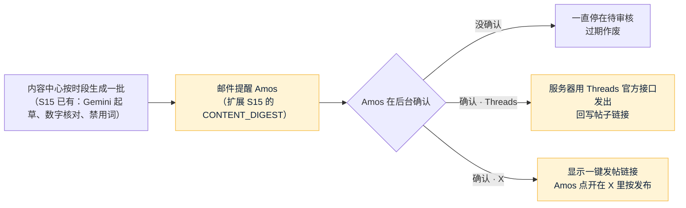

# forecast 内容发布和确认：给 PM 和研发的需求单
- 版本：v1.0（2026-10-28）
- 编写：营销统筹（marketing 项目，`dollar3651314/marketing`）
- 依据：Amos 2026-10-28 的答复（marketing 仓库 `需求文档/v3-本地发帖程序澄清问题.md` v3.1："Amos 的答复"和 B11、B12）；本仓库 `开发记录/S15-自动化程序.md`（内容中心、草稿箱、每日草稿包邮件、渠道开关占位）、`开发记录/S16-等候页和机器人.md`；`市场/v1-台湾第一期推广.md`（P1～P4）
- 用途：把营销的"生成待发内容 → 提醒 Amos → Amos 确认 → 发出"搬进本项目的后台。按 C113，这是市场提出的需求，**纳不纳入、排在哪个阶段、怎么做，由本项目的 PM 和研发决定**
- 变更历史：v1.0（2026-10-28）首次创建

## Amos 的原话（2026-10-28）
- "程序代码存放位置要在 forecast项目中 每此生成的待发送资料后通过 forecast项目的邮件功能提醒我，我会回到系统确认，确认后就发出去，不确认不可发"
- B11（确认后由谁发出）："选3"——Threads 用官方接口自动发；X 确认后给一键发帖链接，Amos 点一下发出（X 接口要花钱，预算是 0）。
- B12（在哪个环境发真帖）："同意建议"——开发和验收在测试环境，只用测试账号；真账号等生产环境建好再接，在那之前营销继续在聊天里给一键链接。

## 一图看懂
这张图想说明：从生成到发出，哪一步必须 Amos 点；黄色是要本项目新做的部分。

## 一、底线（所有需求都要满足）
- **不确认不发**：没有"自动发布"开关（和 EQ-1 一致）；确认是 Amos（`content:publish`）在后台的动作，写审计。邮件里不能有"一键确认"链接，要回到系统里确认（Amos 原话"我会回到系统确认"）。
- 令牌由 Amos 在后台填，后台只显示"已配置 / 未配置"，不进仓库、不进日志、不经过 AI（和 Telegram 机器人 token 一样）。
- 沿用 S15 的写作红线：数字核对、禁用词、倾向词；只写体育、加密、经济；上线前帖子不放链接、不提产品（营销"上线前运营计划"第 1 步）。
- 紧急停止（S15）对新渠道同样有效。

## 二、需求单（交 PM 决定）
| 编号 | 内容 | 现状（对照开发记录） | 要做的 | 优先级 |
|---|---|---|---|---|
| **P5** | 按时段生成待发内容 + 邮件提醒 | S15 有每日草稿包（00:00 UTC）和 `CONTENT_DIGEST` 邮件；帖子种类有"X 帖子"，没有 Threads | ① 帖子增加 **Threads 版**（500 字以内；X 版按 X 计数 280 以内，中文算 2）；② 生成时间可配置，营销现在用台湾时间 07:45、12:15、20:45 三次（对应 Amos 08:00、12:30、21:00 的操作时段）；③ **每生成一批发一封提醒邮件**，写明几条、什么时候过期，附后台草稿箱地址 | 高 |
| **P6** | Threads 官方接口发布 | 渠道开关是占位（S15 第 4.5 节） | Amos 确认后服务器调 Threads 接口：先建容器（`POST /{threads-user-id}/threads`，`media_type=TEXT`），再发布（`POST /{threads-user-id}/threads_publish`）；发布结果（帖子链接或失败原因）回写到草稿；Threads 渠道开关在后台能打开 | 高 |
| **P7** | X 一键发帖链接 | 草稿箱里 X 帖子只有"复制" | 确认后显示"去 X 发帖"按钮：`https://x.com/intent/tweet?text=<编码后的正文>`；点开后 Amos 在 X 里按发布；后台记"已点开"。以后有预算再改成 X 官方接口 | 高 |
| **P8** | 回复别人的帖子 | 草稿有"回复"种类，不发布 | Amos 在后台贴对方帖子的链接 → 起草回复 → 确认 → 给一键回复链接：X 是 `https://x.com/intent/tweet?in_reply_to=<帖子编号>&text=`，Threads 是 `https://www.threads.com/intent/post?reply_post_shortcode=<短码>&text=`。**回复先不走接口**：官方文档没查到用接口回复别人帖子的说明（见第三节） | 中 |
| **P9** | 繁中按台湾用语起草 | S15 的繁体由简体按固定规则转换（OpenCC `s2tw`） | 和 `市场/v1-台湾第一期推广.md` 的 P3 合并处理：X、Threads 繁中版直接按台湾用语起草（例如"聯準會""升息 1 碼""真錢機率"），营销提供词表和例句（来自 marketing 每天的内容包） | 中 |
| **P10** | 环境（B12） | 测试环境已上线，生产未建 | 开发和验收在测试环境，用 Threads **测试账号**（登记为应用的测试者，不用 Meta 审核，见第三节）；真账号 `@quickcome6` 的令牌等生产环境建好后由 Amos 填。之前营销继续在聊天里给一键链接 | — |

## 三、事实核对（C66）
| 事实 | 出处 | 判断 |
|---|---|---|
| Threads 文字帖分两步发：建容器、再发布；建好容器后建议等约 30 秒再发布 | [Meta：Threads Posts](https://developers.facebook.com/docs/threads/posts/)（2026-10-28 打开） | 证实 |
| Threads 文字帖最多 500 字；一个账号 24 小时最多用接口发 250 条 | 同上 | 证实 |
| 发帖要 `threads_basic` 和 `threads_content_publish` 两个权限；没有高级权限时只能给登记在应用里的测试者发 | 同上 | 证实（只给自己的账号发，把账号登记为测试者即可，推断） |
| Reply Management 接口是管理**自己帖子下的回复**；文档里没有找到用接口回复别人帖子的说明 | [Meta：Reply Management](https://developers.facebook.com/docs/threads/reply-management)（2026-10-28 打开） | 证实"没写"；能不能回复别人由研发再查 |
| X 官方接口 2026-02 起按次收费，发一条约 0.015 美元、带链接约 0.2 美元 | [postproxy](https://postproxy.dev/blog/x-api-pricing-2026)、[upload-post](https://www.upload-post.com/x-api-pricing/) | 线索（没打开 X 官方价格页；以后改接口前再核对） |
| X、Threads 的一键发帖链接（Web Intents）格式 | marketing 仓库 `团队手册.md` A6（2026-10-28 对照官方说明） | 已在营销中实际使用 |

## 跨角色反馈 / 分歧记录
| 编号 | 提出方 → 接收方 | 内容 | 状态 |
|---|---|---|---|
| F1 | 市场 → PM | 第二节 P5～P10 | 转 PM（Amos 2026-10-28 B11、B12 已答复） |
| F2 | 市场 → PM | P9 和 v1 的 P3 是同一件事，建议一起做 | 转 PM |
