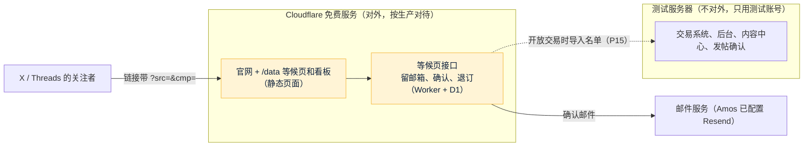

# forecast 公开部分先上线（Cloudflare 免费服务）：给 PM 和研发的需求单
- 版本：v1.0（2026-10-28）
- 编写：营销统筹（marketing 项目，`dollar3651314/marketing`）
- 依据：Amos 2026-10-28 的决定（marketing 仓库 `项目/forecast/上线前运营计划.md` v1.2 第六节、`Amos待办.md` C1）；本仓库 `开发记录/S16-等候页和机器人.md`（`/data` 等候页和看板）、`开发记录/S13-推广功能1.md`（来源统计）、`市场/v2-内容发布和确认.md`（P5～P10）；agents `平台规范/Cloudflare.md`
- 用途：把对外的部分先上线，配合运营；交易系统继续在测试环境。按 C113，纳不纳入、怎么做，由本项目的 PM、研发和运维决定
- 变更历史：v1.0（2026-10-28）首次创建

## Amos 的原话（2026-10-28）
- "1 同意拆分两次上线 2公开部分 现在就上 用来配合运营的工作 3还是不花钱"
- Oracle 免费服务器注册不下来（信用卡验证一直提示账单地址不匹配）；"实在没办法的话，就只能选3了"；C1 答复："3"——把官网和等候页改写到 Cloudflare 的免费服务。

## 一图看懂
这张图想说明：哪些放到 Cloudflare 对外，哪些留在测试服务器；黄色是要新做的。

## 一、底线
- **交易完全不在 Cloudflare 上**：没有注册、登录、充值、下注、提现的页面和接口，交易怎么都碰不到（这样也回答了"交易怎么关干净"）。
- **按生产对待**（C61）：这里收的是真实邮箱。要有退订、名单备份、只给 Amos 看（邮箱打码，同 S16），密钥由 Amos 在 Cloudflare 控制台填，不经过 AI。
- **0 费用**：只用免费额度；超出额度时宁可暂时不可用也不付费。
- 页面上不承诺收益、不用禁用说法（F-12、F-15）；上线前写"即将上线"（D-215、SQ-43 不变）。

## 二、需求单（交 PM 决定）
| 编号 | 内容 | 现状 | 要做的 | 优先级 |
|---|---|---|---|---|
| **P11** | 官网发布到 Cloudflare | `web/site` 在测试服务器上由 Nginx 提供；客户端地址是占位符 `__FC_CLIENT_URL__` | 官网构建成静态文件发布到 Cloudflare；交易开放前，"注册 / 登录 / 开始预测"类按钮改成去等候页（或隐藏），不指向测试环境 | 高 |
| **P12** | 等候页 `/data`（留邮箱） | S16 已做（Java `growth/waitlist/`、客户端 `pages/data/`）：双重确认、陷阱字段、按 IP 限次、重发间隔、不透露邮箱是否已在名单、免登录退订 | 在 Cloudflare 上实现同样的行为（Worker + D1，确认和退订邮件走 Amos 已配置的邮件服务）；界面尽量沿用 S16 的页面；**繁中（台湾用语）优先**，同时保留简中、英文 | 高 |
| **P13** | 看板 `/data`（数据） | S16 上线前显示 BTC 现价和过去 24 小时每小时涨跌比例（币安公开行情） | 同样的内容，带来源和更新时间；取数在 Cloudflare 上要能用（营销实测：币安接口在部分地区返回 451，OKX 公开接口可用，研发再核实）。是否加 Polymarket 的体育、加密、经济机率，等本项目 SQ-39 | 中 |
| **P14** | 来源统计 | S13：`?src=&cmp=&ref=` 在测试服务器记录 | 等候页记下订阅者进来时的 `src`、`cmp`；能按来源看订阅数（简单的导出即可） | 中 |
| **P15** | 名单迁移 | S16 的上线通知"全站只发一次"、只发给确认过的人 | 开放交易时，把 Cloudflare 上确认过的订阅者（含语言、来源、确认时间）导入本项目的 growth 模块，由 S16 的上线通知发出；导入可以重复运行、不重复发 | 中（开放交易前完成） |
| **P16** | 后台和内容中心 | 在测试服务器 | **不搬**：内容中心、发帖确认（P5～P10）留在测试服务器，只用测试账号（B12）；营销继续在聊天里给一键链接 | — |
| **P17** | 域名 | 约定 17：上线前用 quickcome.online 的子域名 | 公开部分用哪个子域名，由运维和 Amos 定 | — |

## 三、和 agents《平台规范/Cloudflare》的偏离（**请 Amos 确认**）
- 规范 K0："商业项目用 Workers Paid"（Free 每次请求只有 10 ms CPU，Paid 每月最低 5 美元）。
- 本需求按 Amos "还是不花钱"**先用 Free**。理由（推断）：公开部分只有静态页面和留邮箱，单次请求很轻；免费额度是 Workers 每天 10 万次请求、D1 每天写 10 万行、共 5 GB（[Cloudflare 价格页](https://developers.cloudflare.com/workers/platform/pricing/)，2026-10-28 打开，证实），上线前远远用不完。
- 研发评估时如果发现 10 ms 不够，写清楚哪一步不够，再交 Amos 决定。
- 规范的其他条目（K2 密钥在控制台填、K3 用 GitHub Actions 等 CI 绿了再部署、K7 健康检查和日志）照常适用。

## 跨角色反馈 / 分歧记录
| 编号 | 提出方 → 接收方 | 内容 | 状态 |
|---|---|---|---|
| F1 | 市场 → PM | 第二节 P11～P17 | 转 PM |
| F2 | 市场 → Amos | 第三节：偏离 Cloudflare 规范 K0，先用 Free | 转 Amos |
| F3 | 市场 → 运维 | Cloudflare 账号、域名在不在这个账号下、套餐截图（规范 K0 要求每个项目单独问 Amos） | 转运维 |
