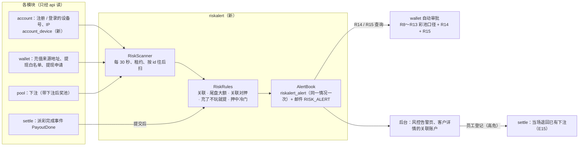

# S10 风控告警 + 提现自动审批 R8～R15 + 员工账户 + KYC 阈值：开发记录
- 阶段：开发 S10（`技术方案/v1-架构方案.md` 第 16 节 S10：`riskalert`；关联账户；自动审批 R8～R15 改造；员工账户；KYC 阈值；验收 AC-62～AC-68）
- 分支：`claude/s10-risk`（从 `origin/claude/integration-3` 开出，整合 3 = PR #24，包含 S1～S9）
- 日期：2026-10-25
- 角色：研发工程师
- 依据：需求说明书 **v1.3.2** 第 8 节（8.1 风险和措施、8.2 自动审批 R8～R15）、第 3.3 节（员工账户不能下注）、第 3.6 节 E15、第 3.10 节（KYC 阈值）、第 7 节（通知，风控告警发给管理员）、第 6.1 / 6.2 节（风控告警页、客户详情的员工和关联账户）、第 10 节 AC-62～AC-68；架构方案 v1.5 第 1.2 节（account ②④、wallet ③）、第 2.3 节、第 3.3 节（`riskalert_*`、`account_device`）、第 16 节；复制源的自动审批技术方案（只读）
- 协调者给的口径：**R13** 累计净盈利 > 0 转人工（门槛默认 0，RQ-11），净盈利 = 派彩 + 补偿 − 下注本金（扣掉退回的下注）− 抽成，写清口径和测试；**自动审批总开关默认关闭**（沿用复制源）；**SQ-19** 只有超管一个角色，风控告警发给超管，告警邮箱兜底；**员工账户**后台登记、取消登记写审计，登记后不能下注，漏登记补登的按 E15 把已有下注退回
- 名词：**线索** = 一个客户用过的设备号、IP、充值来源地址、提现白名单地址；**关联** = 两个客户有同一条线索；**扫描** = riskalert 每 30 秒按 id 往后读各模块的新数据；**有效下注** = 没退回的下注（`pool_bet.status = ACTIVE`）

## 一图看懂

这张图想说明：风控告警不改任何业务数据，只从各模块的 api 读新数据、写自己的表和员工邮件；提现自动审批反过来读风控的结果（R14、R15）；员工登记在后台做，登记时由 settle 当场退回下注。

## 1. 结论
- **`riskalert` 模块（新）**：关联账户（同设备、同注册 / 登录 IP、同充值来源地址、同提现地址）；四类告警：**尾盘大额**、**关联账户对押**、**新账户押中冷门**、**充了不玩就提**；同一情况只告警一次，新告警给有 `risk_alert:view` 的在职管理员（第一期就是超管，SQ-19）发邮件 `RISK_ALERT`，没有这样的人时发告警邮箱 `FC_RISK_ALERT_EMAILS`。后台"风控告警"页（菜单第 12 个一级菜单）可按类型、状态、客户筛选，标记已查看 / 已处理 / 误报（已处理、误报要写说明，写审计）；客户详情显示关联账户。
- **提现自动审批 R8～R15**：S1 的过渡口径（交易数据恒为 0）全部删掉，换成真实数据：R8 = 近 30 天充值以后的**有效下注本金**（S4 留好的 `PoolApi.effectiveStakeSince`）；R9、R10、R13 = **已结算的盈亏**（派彩 + 补偿 − 已结算本金 − 抽成，第 2.2 节）；新增 **R14 关联账户对押**、**R15 可疑押中**；R12 保留"彩池对账有未处理差异"。总开关仍默认关闭。
- **员工账户**：后台客户详情"登记为员工 / 取消员工登记"（`customer:edit`，高危，原因必填，审计记前 → 后和退回的笔数、金额）；登记后下注被拒（S4 已有的拒单 `BET_STAFF_ACCOUNT`，AC-67）；**补登时当场退回**结算还没开始的市场里的有效下注（E15），结算时的 E15 退回保留作兜底。
- **KYC 阈值**：下注时校验（S4）和 #7 通知（S9）已有；本步把阈值的参数页、修改审计和"改阈值以后按新值判断、等于阈值能下注、L1 通过后能下注"补了测试（AC-62、AC-66）。
- **没做的**：刷量告警（需求第 8.1 节写明第一期"不做专门措施"，按"需求 > 架构"不做，记在第 8 节 D-123、第 9 节 SQ-22）。
- 迁移：`V19__s10_riskalert.sql`（V1～V18 没有改）。
- 本地全部实际执行（第 5 节）。

## 2. 做了什么
### 2.1 riskalert 模块（`backend/src/main/java/com/forecast/app/riskalert/`）
| 包 | 类 | 作用 |
|---|---|---|
| `api` | `RiskAlertApi` | 给 wallet 的 R14（`linkedOpposite`：近 N 天本客户有派彩、且有关联账户押了其他选项的市场和这部分盈利）、R15（`openSuspiciousAlerts`：近 N 天没处理的押中冷门、尾盘大额告警条数） |
| `api` | `RiskAlertAdminApi` | 后台：告警列表、按类型状态计数、改状态、某客户的关联账户 |
| `core` | `RiskRules` | 判定（第 3 节）：线索 → 关联、四类告警 |
| `core` | `AlertBook` | 记告警（`INSERT IGNORE`，唯一 `(kind, user_id, ref_key)`）并在同一事务里发员工邮件；实现上面两个 api |
| `scan` | `RiskScanner` | 按 id 往后扫：设备和 IP（account）、充值来源地址、提现白名单、提现申请（wallet）、下注（pool）；一行一个事务（处理 + 推进进度），一行出错只记日志并跳过 |
| `scan` | `RiskScanJob` | 每 30 秒（启动 20 秒后），租约 `riskalert.scan`；`forecast.riskalert.scan-enabled` |
| `scan` | `PayoutDoneListener` | 结算收尾提交以后（`@TransactionalEventListener(AFTER_COMMIT)`，新事务）检查押中冷门；出错不影响结算 |
| `scan` | `E2eRisk` | `POST /api/e2e/riskalert/scan`（只在 e2e profile） |

**依赖方向**：riskalert 读 account、wallet、pool、settle、market、ledger 的 api；wallet 读 riskalert 的 api（R14、R15）。为避免 Spring 的循环依赖，riskalert 的 api 实现（`AlertBook`）只依赖 ledger、pool、market、notification，不依赖 wallet 的任何 bean；读 wallet 数据的 `WalletSignals` 也不依赖自动审批。settle 不依赖 riskalert：派彩完成用应用内事件 `SettleApi.PayoutDone` 通知。

**按 id 往后扫，怎样不跳过提交晚的行**：同一张表 id 小的事务可能比 id 大的晚提交。扫描只处理写入满 `scan-lag`（默认 10 秒）的行，遇到还没满的就停在那里，下一轮接着从这里读；充值表的写入时间是数据库时间（`wallet_deposit.created_at` 的默认值），所以由 wallet 用数据库的当前时间算好 `ripe`。写入时间比现在还晚 1 分钟以上的（端到端把时钟拨回去以后）直接处理，不让扫描停住。后端测试和端到端 `scan-lag = 0`（马上处理）。

### 2.2 提现自动审批（wallet，`AutoApprove`、`AutoApproveEngine`、`AutoApproveService`；后台 `web/admin/src/config/autoApprove.ts` 同步）
| 规则 | 现在的口径 | 数据 |
|---|---|---|
| R8 | 近 30 天入账的充值（扣冲正）D；从其中最早一笔入账起，**有效下注本金**合计 V（按服务器收到下注的时间；退回的——取消、作废、E14、E15、提前截止——和取消 / 作废市场里的不算）；V ≥ D × N 通过（N 默认 1）；近 30 天没有充值通过 | `PoolApi.effectiveStakeSince`（S4） |
| R9 | 累计提现（含本笔和进行中的）≤ 累计充值 + **已结算盈亏**（全部时间） | `CustomerFlowApi.realized(user, null).net()` |
| R10 | 近 7 天已结算盈利 ≤ 金额上限，或 ≤ 本金的 N% | `CustomerFlowApi.realized(user, 现在 − 7 天).net()` |
| R12 | 不变：热钱包余额够、彩池对账没有未处理的差异（S5） | `SettleApi.openPoolReconIssues` |
| R13 | 累计净盈利（从开户到现在）≤ 门槛（默认 0，等于门槛通过）；判定记录里写明组成（派彩、补偿、本金、抽成） | `CustomerFlowApi.realized(user, null)` |
| R14（新） | 近 N 天（默认 30）本客户**有派彩**的市场里，有关联账户押了**其他选项**的那些市场，本客户在这些市场的已结算盈亏合计 ≤ 门槛（默认 100 USDT，等于门槛通过）；没有这样的市场通过 | `RiskAlertApi.linkedOpposite` |
| R15（新） | 近 N 天（默认 7）没有**还没处理**（新、已查看）的"新账户押中冷门""尾盘大额"告警 | `RiskAlertApi.openSuspiciousAlerts` |

**已结算盈亏的口径（R9、R10、R13、R14 共用，`ledger/api/CustomerFlowApi`）**：

> 净盈利 = 派彩（`PAYOUT`，本金 + 盈利，可用 +）+ 补偿（`COMPENSATION`）− 已结算的下注本金（`BET_SETTLE` 赢的 + `BET_LOST` 输的，下注锁定 −）− 抽成（`FEE`）

- 等价于需求第 8.2 节的 Σ(派彩 − 本金)（派彩已扣抽成；输的记 −本金；退款记 0）+ 补偿：赢的持仓 b → +b + G − b − F = G − F；输的 → −b；退回的下注只有 `BET_LOCK` 和 `REFUND`，不进任何一项（= 0）。
- **"下注本金（扣掉退回的下注）"只算已经结算的**：还在"下注中"（没结算）的本金不扣（D-124）。理由：① 和需求 R9"已结算的持仓"一致；② 如果把没结算的下注当成本金扣掉，客户在提现前随手押一大笔就能把"净盈利"压到 0 以下，绕过 R13。
- 时间窗口按账本的记账时间（R10 近 7 天、R14 近 N 天按派彩的记账时间）。
- 例子（`AutoApproveS10Test`，真实结算）：A 押"是" 100、B 押"否" 300，"是"赢、费率 5%：A 派彩 400、本金 100、抽成 15 → 净盈利 285（R13 转人工，R9 上限 = 充值 + 285）；B → −300；只有取消市场退回的客户 → 0（等于门槛 0，通过）。

判定记录的数值键：R8 `volume`（有效下注本金）、`deposit`、`ratio`、`limit`；R13 `net`、`payout`、`compensation`、`stake`、`fee`、`limit`（复制源的 `realized`、`swap` 不再有）；R14 `profit`、`markets`、`linked`、`days`、`limit`；R15 `count`、`days`。后台的判定说明按这些键显示（`web/admin/src/pages/funds/AutoReview.tsx`、翻译 `autoRule.*`）。

### 2.3 员工账户（需求第 3.3、3.6 节 E15、第 8.1 节）
| 步骤 | 实现 |
|---|---|
| 登记 / 取消 | 后台 `POST /api/admin/customers/{id}/staff`（`customer:edit`，高危，原因必填）→ `CustomerAdminApi.setStaff`（锁客户行、改 `account_user.is_staff`）→ 登记时 `SettleAdminApi.refundStaffBets` → 审计 `customer.staff` / `customer.unstaff`（前 → 后、退回的市场数、笔数、金额） |
| 当场退回（E15） | `SettleService.refundStaffBets`：这个客户有有效下注的每个市场一个事务（READ COMMITTED）：锁市场行（排他，和下注、截止、结算排队）→ 结算阶段 NONE、状态是已上架 / 已暂停 / 截止 / 待裁决 / 公示中 / 争议中、此刻仍是员工 → 退回（和 E14 同样的单笔退款：账本 `REFUND`、下注标成 `STAFF`、同步扣持仓、选项奖池、截止后定格的奖池，对账仍然平）。员工的退回**没有客户通知**（需求第 7 节没有这一项，S5 的做法）|
| 不动的 | 结算已经开始（派彩中、结算异常）、已结算、已取消 / 作废（退款单全额退）的市场；已派的钱不回滚 |
| 兜底 | 和登记同时进行、没被当场退到的下注，结算时按 E15 再退（S5 已有） |
| 下注 | 登记后下注 400 `BET_STAFF_ACCOUNT`（S4） |
| 页面 | 客户详情：标题旁"员工"标记、黄色提示条、"登记为员工 / 取消员工登记"按钮（高危确认），登记后提示"已退回 N 个市场的 M 笔下注"；客户列表的状态列也显示"员工" |

### 2.4 KYC 阈值（需求第 3.10 节、AC-62、AC-66）
下注时：累计充值（扣冲正）> 阈值、没通过 L1 → `KYC_REQUIRED`（S4）；越过阈值发 #7（S9，`KycThresholdNotice`）。本步补的：参数设置页的阈值改动走高危确认、审计前 → 后、两个人同时改后保存的 409（`AdminRiskTest`）；改阈值以后按新值判断、等于阈值能下注、超过 0.01 不能、L1 通过后能下注、已有下注不受影响（`KycThresholdS10Test`）。

### 2.5 参数设置页"风控"一组（`betting_params:edit`，高危，迁移 V19 的默认值）
| 键 | 默认 | 含义 |
|---|---|---|
| `risk.lateBet.minutes` | 5 | 尾盘大额：截止前多少分钟内 |
| `risk.lateBet.poolPct` | 30 | 尾盘大额：单笔 ≥ 下注后奖池的百分之几 |
| `risk.longshot.accountDays` | 7 | 押中冷门：注册多少天内算新账户 |
| `risk.longshot.minAmount` | 1000 | 押中冷门：单笔不少于（USDT） |
| `risk.longshot.minOdds` | 5 | 押中冷门：赔率（扣费后）不低于 |
| `risk.link.maxUsersPerKey` | 10 | 关联账户：同一个值的客户超过这么多个时不再按它关联（超出要求，D-127） |

提现自动审批 R14、R15 的参数在"出金审核 → 自动审批规则"页（和其他规则一起，`withdrawal:auto_rule_edit`）。

### 2.6 其他
| 模块 | 改动 |
|---|---|
| account | `account_device`（`DeviceLog`）：注册、登录时记设备号的 SHA-256 和 IP（失败只记日志，不影响登录）；`AccountSignalsApi`；客户摘要和详情加 `staff` |
| wallet | `WalletSignalsApi`（`wallet/admin/WalletSignals`）：充值来源地址、白名单地址、提现申请，按 id 往后读 |
| pool | `PoolApi.betsAfter`（带下注后奖池）、`optionsOf`、`commonMarkets`、`activeBetsOn`；`PoolSettleApi.marketsWithActiveBets` |
| settle | `refundStaffBets`；派彩完成发布 `SettleApi.PayoutDone` |
| ledger | `CustomerFlowApi` 删掉过渡的 `realizedPnl`、`netProfit`、`openedNotionalSince`，换成 `realized`、`paidMarketsSince`（第 2.2 节） |
| admin | `RiskAdminController` + `RiskOps`（列表、数量、改状态、关联账户）；`POST /api/admin/customers/{id}/staff`；菜单 `risk-alerts`（`/risk/alerts`，`risk_alert:view`）；菜单角标 `riskAlerts`（待处理的告警数） |
| 客户端 | `web/client/src/api/device.ts`：本地存储 `fc.device` 的随机号，登录、注册时带 `X-Device-Id`（**新的本地存储键**，C55：老用户没有这个键时第一次登录生成，不影响别的数据） |
| 后台 | 风控告警页 `web/admin/src/pages/risk/RiskAlertsPage.tsx`（风格同 S9 的彩池对账页：分组带数量、状态切换、客户搜索、表格、说明弹窗）；客户详情的员工和关联账户；参数设置的"风控"组；自动审批 R14、R15；模拟层 `mocks/fc.ts`（26 条告警，超过一页）、`mocks/data/db.ts`（员工标记、风控参数、`risk_alert` 模板） |

## 3. 告警的判定（需求第 8.1 节；`RiskRules`）
| 告警 | 什么时候查 | 条件（默认值在参数设置可改） | 记在谁名下 | 同一情况 |
|---|---|---|---|---|
| 尾盘大额 `LATE_LARGE_BET` | 扫到新下注 | 收到下注的时间在 [截止 − N 分钟, 截止)，且单笔 × 100 ≥ 下注后奖池合计 × X（奖池取下注时的快照，含本笔；默认 5 分钟、30%） | 下注的客户 | 每个客户每个市场一条 |
| 关联账户对押 `LINKED_OPPOSITE` | 扫到新下注；新建关联时回看两人近 30 天都下过注的市场 | 同一市场里，本客户和关联账户的有效下注押了不同的选项（存在 x ≠ y） | 双方各一条 | 每个客户每个市场一条 |
| 新账户押中冷门 `NEW_ACCOUNT_LONGSHOT` | 派彩完成（提交后） | 赢方选项的赔率（扣费后，按结算单的 T、P_W、费率，同客户端显示的 `Odds.multiplier`）≥ 5，且赢方里单笔 ≥ 1,000、收到下注时注册不满 7 天的下注 | 那个客户 | 每个客户每个市场一条 |
| 充了不玩就提 `DEPOSIT_NO_BET` | 扫到新提现申请 | 近 30 天充值（扣冲正）D > 0，从最早一笔起的有效下注本金 < D × R8 的倍数（和 R8 同一口径、同一个倍数；倍数 0 不查；**R8 关着也照样告警**） | 申请人 | 每笔提现一条 |

关联的线索：同一个设备号（`account_device.device_hash`）、同一个注册 / 登录 IP（**只算公网 IP**：本机、内网、链路本地等不算，D-126）、同一个充值来源地址（链 + 地址，以太坊体系小写）、同一个提现白名单地址。同一个值的客户超过上限（默认 10）时不再按它关联（D-127）。

## 4. 迁移脚本
`V19__s10_riskalert.sql`：
- 新表 `account_device`、`riskalert_signal`、`riskalert_link`、`riskalert_alert`、`riskalert_cursor`（5 个来源的进度，初始 0）；
- `common_config`：风控参数 6 项（第 2.5 节）；提现自动审批 `R14.enabled / days / minProfit`、`R15.enabled / days`（不改配置版本号，复制源 R13 的做法）；
- `notify_template`：员工模板 `RISK_ALERT`（`staff_perms = risk_alert:view`，中英文）；
- `admin_menu`：`risk-alerts` 排序 95（资金之后、通知之前，`INSERT IGNORE`）。
- 空库从 V1 跑到 V19：后端全量、端到端两种形态都从空库开始，实际执行通过（第 5 节）。
- 回滚：只加表、加数据；回滚到 S9 的代码不读新表，新配置项和菜单行被忽略，数据库不需要回退。

## 5. 测试和本地验证
### 5.1 新增和改了的测试
| 测试 | 覆盖 |
|---|---|
| `riskalert/RiskAlertTest`（9，新） | 关联：同设备、同 IP、同充值来源地址（大小写）、同提现地址；内网 IP 不算；设备号格式不对当没带、只存哈希；上限；重复扫没有副作用。AC-68：关联账户对押（各一条、邮件、押同一个选项不算、再下注不重复、后来才关联的回看）；尾盘大额（窗口边界：截止前 6 分钟不算、5 分钟整算；比例差一点到 30%（857.14 / 2,857.14）不算、35.9% 算；参数改成 40% 后 30.9% 不算）；新账户押中冷门（赔率 4.16 不算、5.75 算；注册正好 7 天不算、金额正好 1,000 算）；充了不玩就提（有效下注差 0.01、R8 倍数 0 不查）；R14 / R15 读的数据；改状态和计数 |
| `wallet/withdraw/AutoApproveS10Test`（5，新） | AC-64：真实下注、结算、取消、关联、告警 → `precheck` 的判定：R8（取消退回的不算）、R9 / R10 / R13（赢 285、输 −300、退款 0；R9 正好等于 / 超 0.01）、R14（199.5 > 100 不通过；输家、没关联的通过）、R15（有新告警不通过，误报以后通过）、R12 保留 |
| `wallet/withdraw/AutoApproveEngineTest`（改） | 15 条；R13 的组成（派彩、补偿、本金、抽成）和边界；R14、R15 的通过、不通过、等于门槛、窗口、读不到、关闭；读不到已结算盈亏时 R9 / R10 / R13 一起"无法判定" |
| `settle/StaffAccountTest`（1，新） | AC-67、E15：已上架、截止（定格奖池）的市场当场退回，派彩中、已结算的不动；对账仍然平、账本无差异、没有客户通知；登记后下注被拒；再登记没有可退的；取消登记后能下注；剩下的下注结算守恒 |
| `pool/KycThresholdS10Test`（1，新） | AC-62：改阈值后按新值判断、等于阈值能下注、超过 0.01 不能、L1 通过后能、已有下注不受影响 |
| `admin/security/AdminRiskTest`（3，新） | 风控告警的权限（view / handle）、筛选、数量、菜单角标、已处理 / 误报说明必填、审计；客户详情的关联账户和 `staff`；员工登记要 `customer:edit`、原因必填、审计（含退回的笔数）、取消登记、客户不存在 404；AC-66：参数设置风控组的默认值、原因必填、范围、前 → 后审计、同时修改 409、KYC 阈值 |
| 改了的 | `AdminAutoApproveTest`、`AutoApproveFlowTest`（15 条；R13 的数值键）；后台 `autoApprove.test.tsx`（R13 的说明、15 条）、`config/menu.test.ts`（12 个一级菜单）；客户端 `api/real/real.test.ts`（登录、注册带设备号，别的接口不带） |
| 后台 `web/admin/src/s10.test.tsx`（14，新） | 风控告警页的五种状态（正常、空、超过一页、加载中、出错）、筛选、误报要写说明；四种判定依据的说明；菜单；客户详情员工登记（高危确认、退回提示）和关联账户（有 / 没有）；参数设置风控组；R14、R15 的定义和判定说明 |
| 端到端 `e2e/tests/risk.spec.ts`（新，两种形态） | 同一设备号登录的两个客户 → 截止前 2 分钟对押 → 扫描 → 风控告警页按客户筛出两条、标记误报 → 客户详情看到关联账户 → 登记员工（高危）当场退回 60 → 再下注 `BET_STAFF_ACCOUNT` |

### 5.2 本地验证（全部实际执行，2026-10-25）
环境：Docker 的 `mysql:8.4`（`fc-s10-mysql`，tmpfs）、`redis:7`（后端测试 `fc-s10-redis`、开发形态端到端另起 `fc-s10-redis-e2e`，不共用，避免验证码频率限制被用满），结束后连同卷删除；JDK 25；Node 22；Playwright 1.56（Chromium）。

| 项 | 命令 | 结果 |
|---|---|---|
| 后端全量（空库） | `forecast_test` 删掉重建、`target` 删掉后 `mvn -o -B -ntp verify`（V1 → V19） | **674 个测试，0 失败，5 个跳过**（真实数据源冒烟等默认跳过的），BUILD SUCCESS，18 分 24 秒。第一次全量跑出 `S9NotifyFlowTest` 2 个失败（员工模板名单、菜单默认顺序只查 V17），改测试后重跑全量通过 |
| 后台 | `npx eslint .`、`npx vitest run`、`npm run build`、`node ../../scripts/check-no-mocks.mjs src/mocks dist`、`node ../../scripts/check-brand.mjs dist`；原型模式 `VITE_API_MODE=mock npm run build` + 品牌检查 | lint 通过；**200 个测试通过**（新 `s10.test.tsx` 14 个）；构建通过；模拟层 566 个特有字符串都不在产物里；没有旧品牌名 |
| 客户端（改了 `http.ts`、`auth.ts`，新 `device.ts`） | lint、`vitest run`、`build`、check-no-mocks、check-brand | 通过；**148 个测试通过** |
| 官网 | `npm run build`（只为端到端） | 通过 |
| 端到端（开发形态，空库 `forecast_e2e`） | `bash e2e/start-backend.sh`（后端 8096）、`npx playwright test`（站点 4196 / 4197） | **12 passed、3 skipped**（只在部署形态跑的），含新的 `risk.spec.ts`；后端日志 1 行 ERROR 是监控告警"资金归集配置有问题（sweep.config）"（端到端环境没配归集，按设计报警，不是缺陷） |
| 端到端（部署形态） | 先确认没有 compose 项目 `forecast-e2e`、80 / 443 / 8080 空闲；`E2E_SKIP_BUILD=1 E2E_MVN_ARGS=-o bash e2e/run-deployed.sh` | **15 passed**（1.7 分钟）；内存 app 335 / 576 MiB、mysql 176 / 320 MiB；结束后 compose 项目和卷已删 |
| 端到端类型检查 | `npm run typecheck`（`e2e/`） | 通过 |
| 项目地图和索引 | `node scripts/check-project-index.mjs` | 通过（268 个文件，5 类名单） |
| 仓库旧品牌名 | `node scripts/check-brand.mjs --repo` | 通过 |
| 密钥扫描 | `gitleaks detect --no-banner -l warn --source <工作目录>`（提交以后） | 通过 |

## 6. 和方案不同的地方
| 方案 | 实际 | 原因 |
|---|---|---|
| 架构第 3.3 节 `riskalert_alert` 唯一 `(kind, user_id, market_id)` | 唯一 `(kind, user_id, ref_key)`，`ref_key` = `M:市场` 或 `W:提现` | "充了不玩就提"没有市场，按提现区分；MySQL 唯一键里的 NULL 不算重复 |
| 架构第 3.3 节 `riskalert_link.reason` | 同（DEVICE / IP / DEPOSIT_FROM / WITHDRAW_TO）；另加 `riskalert_signal`（线索）、`riskalert_cursor`（扫描进度） | 关联要按"值"找人，riskalert 不能直接读别的模块的表（约定 5），线索存一份在自己的表里 |
| 架构第 3.3 节 `account_kyc_gate`（#7 只发一次） | 没建 | S9 已按"这一笔充值越过阈值"发 #7（`KycThresholdNotice`，D-121），本步不改；见第 7 节遗留 |
| 架构第 1.2 节 account ② `account:staff` 权限点 | 用 `customer:edit` | 架构同一句写了"由 `customer:edit` 修改"；需求第 2.2 节没有 `account:staff`，不加新权限点 |
| 架构第 2.3 节依赖方向 `settle ← riskalert` 且 wallet 读 riskalert | wallet → riskalert.api（R14 / R15），riskalert → wallet.api（线索）；两边的实现类互不依赖 | ArchUnit 只限制"只能调 api 包"；Spring 不形成循环（第 2.1 节） |
| S4 计划"尾盘大额：下注事务提交后异步检查" | 扫描（最多晚 30 秒 + 10 秒） | 不在下注事务里加任何东西（下注 p99，约定 30）；告警晚几十秒不影响处理 |

## 7. 遗留问题
| 问题 | 计划 |
|---|---|
| 刷量告警没做 | 需求第 8.1 节第一期不做（SQ-22） |
| 进程在"结算提交"和"押中冷门检查"之间退出，这个市场不再检查 | 告警丢一条的风险；需要时加补扫（按已结算的结算单补查一次） |
| IP 关联：手机网络、公司网络多人共用 IP | 上限 10 个之内仍会关联，靠人工在告警里标误报；上线后按误报量调上限 |
| 关联账户只增不删（换了设备、IP 也不解除） | 第一期不做"解除关联"；误报在告警上标 |
| #7 越过阈值的判断按"这一笔"（S9）：后台调低阈值时已经超过新阈值的客户不会收到 #7（下注时仍会被拒并提示认证） | 需要时加 `account_kyc_gate`（架构第 3.3 节） |
| 报表按品类（S9 D-117） | 不在 S10 范围 |
| 客户端的"员工账户不能下注"提示文案 | S4 已有拒单原因和翻译；客户端页面在 S11 |

## 8. 研发的决定（待 PM / Amos 复核，D-123 起）
| 编号 | 问题 | 做法 | 理由 |
|---|---|---|---|
| D-123 | 刷量告警 | 不做 | 需求 v1.3.2 第 8.1 节："第一期没有返佣、分成、积分、排行榜，刷量没有直接收益 → 不做专门措施"；按"需求 > 架构" |
| D-124 | R13 的"下注本金" | 只算已结算的（赢 + 输），退回的、还没结算的不算 | 第 2.2 节：和 R9 的"已结算的持仓"一致；算上没结算的本金，客户提现前押一笔就能绕过 R13 |
| D-125 | 尾盘大额的"奖池" | 下注**后**这个市场的奖池合计（含本笔，取下注时的快照） | "单笔 ≥ 奖池 X%"按下注前算时第一笔一定是无穷大；含本笔时比例在 0～100% 之间 |
| D-126 | IP 线索 | 只算公网 IP | 本机、内网 IP 只会是测试或代理没配好，算进去会把所有客户连在一起 |
| D-127 | 同一线索的客户数上限 | 默认 10，参数设置可改 | 交易所的出金地址、公共网络会把大量无关客户连在一起（超出要求，见第 10 节） |
| D-128 | "新账户押中冷门"的赔率 | 扣费后的赔率（`Odds.multiplier`，客户看到的） | 和页面一致，运营核对时数字对得上 |
| D-129 | "新账户"的注册天数 | 按**收到下注时**的注册时长（不是结算时） | 内幕交易看的是下注那一刻 |
| D-130 | 员工补登时退回 | 当场退回（结算还没开始的市场），不等结算 | 协调者口径"补登的把已有下注退回"；当场退回奖池立即正确，客户端赔率不再包含员工的钱；结算时的 E15 保留兜底 |
| D-131 | 员工的退回通知 | 不发 | 需求第 7 节没有这一项（S5 同样） |
| D-132 | 充了不玩就提 | 每笔提现申请查一次，用 R8 的倍数；R8 关着也告警 | 需求第 8.1 节"复用 R8"；关了 R8 只是不拦提现，风控仍要看到 |
| D-133 | R14 的"这部分盈利" | 这些市场的净盈利合计（亏的市场抵扣） | 需求"这部分盈利"；按市场相加最直观 |
| D-134 | R15 的"未处理" | 状态"新""已查看"都算未处理；"已处理""误报"不算 | "已查看"只是看过，没有结论 |
| D-135 | 已处理、误报 | 处理说明必填 | 审计里要有结论 |

## 9. 需要 Amos 决定的新问题
| 编号 | 问题 | 建议 |
|---|---|---|
| SQ-22 | 协调者的 S10 范围里有"刷量告警"，但需求 v1.3.2 第 8.1 节写第一期不做（没有返佣、积分等激励，刷量没有收益）。要不要做？ | 建议维持需求：不做；以后加激励时再设计 |
| SQ-23 | 尾盘大额按需求是"截止前 5 分钟内单笔 ≥ 奖池 30%"。加密 15 分钟市场人少时，截止前第一笔、几十 USDT 的小注也会告警，邮件可能很多。要不要加一个"单笔至少 X USDT"的门槛？ | 建议加，默认 100 USDT（参数设置可改）；现在没有加（照需求） |
| SQ-24 | 关联账户：同一个设备 / IP / 地址的客户超过 10 个时不再按它关联（交易所出金地址、公共网络）。这是需求之外加的，可以吗？ | 建议保留，上线后按误报量调 |
| SQ-25 | 员工补登时，结算还没开始的市场里的下注**当场**退回（不等结算）。可以吗？ | 建议这样（D-130） |

## 10. 超出要求的部分（C7）
| 改动 | 理由 |
|---|---|
| 同一线索的客户数上限（参数 `risk.link.maxUsersPerKey`，默认 10） | 防止交易所地址、公共网络把大量客户连在一起（SQ-24） |
| 只算公网 IP | 同上（D-126） |
| 风控参数 6 项放进参数设置页 | 需求只写了尾盘大额"后台可调"；押中冷门的三个数字和关联上限放在同一组方便调 |
| 菜单角标"风控告警"（待处理条数） | 和 KYC、出金、待上架的角标一致 |
| 客户列表显示"员工"标记 | 一眼看出登记过的员工 |
| 告警处理说明必填（已处理、误报） | D-135 |

## 11. 跨角色反馈 / 分歧记录
| 编号 | 提出方 → 接收方 | 内容 | 状态 |
|---|---|---|---|
| F-25 | 研发 → PM | 第 8 节 D-123～D-135、第 9 节 SQ-22～SQ-25；`RISK_ALERT` 员工邮件文案（中英文）是研发初稿；后台告警页的说明文字 | 待 PM 复核 |
| F-26 | 研发 → 测试 | 新端到端 `risk.spec.ts`（两种形态）；后端 `RiskAlertTest`、`AutoApproveS10Test`、`StaffAccountTest`、`KycThresholdS10Test`、`AdminRiskTest`；后台 `s10.test.tsx` | 转 Amos |
| F-27 | 研发 → 运维 | 没有新环境变量（`forecast.riskalert.*` 有默认值，不用配）；新定时任务 `riskalert.scan`（每 30 秒，租约）；迁移 V19；客户端新的本地存储键 `fc.device` | 转 Amos |

## 12. 提交
| 提交 | 内容 |
|---|---|
| 本记录所在的提交 | S10 全部代码、迁移 V19、测试、开发记录、项目地图 v0.17、项目索引 v0.17、入口文件、《Amos 待办》v1.18 |
