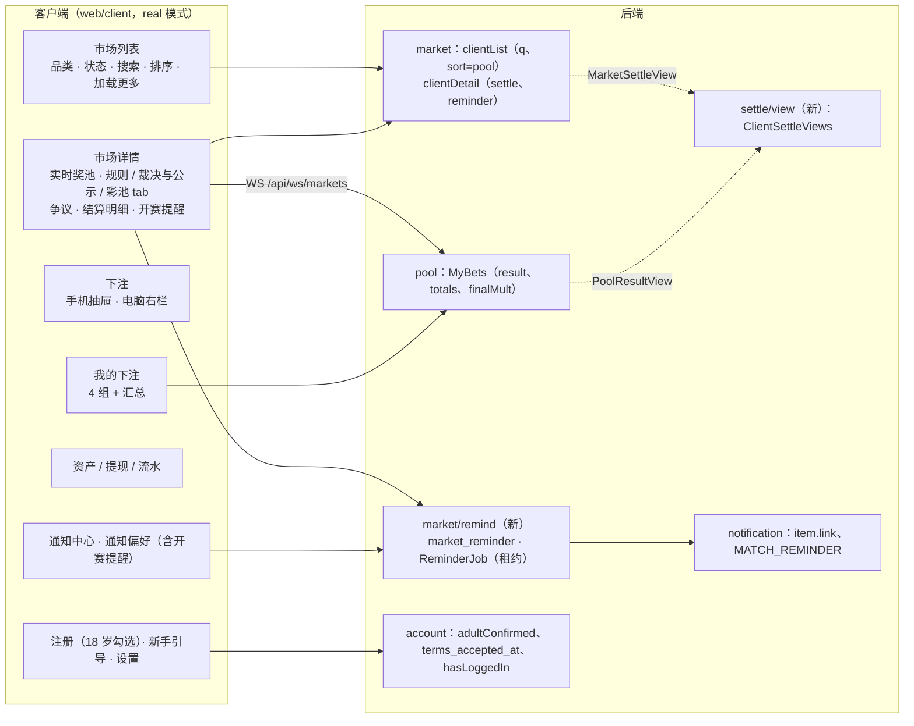

# S11 客户端真实页面、三语、主题、新手引导、官网内容：开发记录
- 阶段：开发 S11（`技术方案/v1-架构方案.md` 第 16 节 S11：客户端 P1～P10 接真实接口、三语、主题、新手引导、官网内容；验收 AC-50～AC-57）
- 分支：`claude/s11-client`（从 `origin/claude/s10-risk` 开出，S10 基于整合 3 = PR #24）
- 日期：2026-10-25
- 角色：研发工程师
- 依据：需求说明书 **v1.3.2** 第 5 节（P1～P10、P8 注册）、第 7 节（#23 开赛提醒、通知跳转）、第 10 节 AC-50～AC-57、第 14 节；架构方案 v1.5 第 2.3、2.5 节；M1 原型（`开发记录/M1-原型.md`）；协调者给的口径：PQ-1～PQ-5 按原型（加密涨跌绿红、其他中性；默认排序"快截止"；手机顶部显示"可用"；固定绿涨红跌；繁体待人工校对）、**SQ-20**（#23 只给注册后成功登录过至少一次的客户；在"通知偏好"订阅 / 退订；发到账户邮箱；要有订阅入口和带租约的定时发送）、主题跟随系统 + 手动、三语默认按浏览器、找不到回英文（C82）、新手引导（C83）、不闪（C84）、手机电脑分开设计（C64）、主按钮在首屏（C79）、共用框架位置稳定（C90）；MF 推广功能不在范围但要留位置
- 疑问的处理：按"需求 v1.3.2 > 架构 > 原型"自己定，记在第 8 节，没有停下来问

## 一图看懂

这张图想说明：客户端所有页面都走真实接口（模拟数据只在原型模式）；后端为客户端新加的东西都是"视图"：market 和 pool 通过自己 api 包里的接口读结算数据，由 settle 实现（ObjectProvider 插件，模块边界不变）；开赛提醒是 market 里的一个小子模块，到点由带租约的定时任务发邮件。

## 1. 结论
- **客户端 P1～P10 全部接真实接口**：市场列表（品类、状态、搜索、三种排序、一页 24 个"加载更多"、前 20 个卡片订阅奖池推送）、市场详情（实时奖池、规则 / 裁决与公示 / 彩池怎么算三个 tab、公示和争议、结算明细、取消退回、未开放市场的开赛提醒）、下注（手机抽屉、电脑右栏）、我的下注（进行中 / 待结果 / 已结算 / 已退回 + 汇总）、资产（三项余额、充值网络和合约地址 /"暂未开通"、提现最少 100、全部类型的流水）、通知中心（点击跳到相关页面）和通知偏好（含开赛提醒）、设置（语言、主题）、新手引导、注册（18 岁勾选）、KYC。
- **#23 开赛提醒（SQ-20）**：在还没开放下注的市场详情点"开放时提醒我"订阅，"通知偏好"里看和退订；只给注册后用邮箱密码成功登录过的客户；到开放时间由定时任务（每 30 秒，租约 `market.reminder`）给账户邮箱发一次 `MATCH_REMINDER`，邮件里有免登录的退订链接 `/unsubscribe?t=…`。
- **官网**：服务条款、隐私政策、风险披露三语正文（PM 初稿，标"需法务审核"，公司主体等写"待提供"），没有诱导词（F-12、F-15）；官网支持 `?lang=`（客户端"规则和条款"链接带语言过去）。
- 迁移：`V20__s11_client.sql`（V1～V19 没有改）。
- 本地全部实际执行（第 5 节）；截图 129 张（第 6 节），逐张看过，发现的问题都修了再截。

## 2. 做了什么
### 2.1 后端
| 位置 | 改动 |
|---|---|
| `market/core/MarketService.clientList` | 加 `q`（三语标题 `LIKE`，`!` 转义；或市场编号精确匹配；≤ 100 字）和 `sort=pool`（按奖池从大到小：先按条件取最多 2,000 个 id，用 `MarketPoolView.totals` 排序后分页）；`sort` 只能是 `closeAt`（默认）/ `newest` / `pool`，否则 400 |
| `market/core/MarketService.clientDetail` | 加 `settle`（已结算 / 已取消 / 已作废时的结算明细，`market.api.MarketSettleView`，settle 实现）和 `reminder`（开赛提醒状态）；卡片加 `winningOptionNo` |
| `market/remind/`（新） | `ReminderService`、`ReminderMapper`（+ XML）、`ReminderJob`、`ReminderController`、`E2eReminders`，见第 3 节 |
| `pool/core/PoolQueries.myBets` | 每条加 `category`、`finalMult`（截止后的最终赔率，扣费后）、`result`（已结算的：按持仓的派彩、抽成、本选项几笔合计）；整体加 `totals`（总下注不含退回的、总派彩含补偿、净盈亏 = 总派彩 − 已结算的下注）；数据来自 `pool.api.PoolResultView`（settle 实现） |
| `settle/view/`（新） | `ClientSettleViews` 实现上面两个视图；`SettleViewMapper`（+ XML）只读 |
| `account` | 注册加 `adultConfirmed`（必须 true，`ADULT_REQUIRED`）、后端也按出生日期（UTC 日期）校验满 18 周岁（`AGE_UNDER_18`，在消耗验证码之前）、记 `terms_accepted_at`；`AccountApi.hasLoggedIn`（`last_login_at` 不为空；注册后自动登录不算） |
| `notification` | 通知列表每条加 `link`（按类型和参数算：有 `marketNo` 的 → `/markets/<编号>`；提现 → `/assets/withdraw`；充值 → `/assets`；认证 → `/me/kyc`）；为此给下注、结算、退款、补偿、公示、改判、争议结论、补充说明、改费率的通知参数加了 `marketNo`；`toUser` 允许 `MATCH_REMINDER`（`USER_MAIL_TEMPLATES` 白名单，别的 ANY 模板仍不能发给客户）；e2e `GET /api/e2e/mail/last` |
| 其他 | `SessionFilter.PUBLIC` 加 `/api/reminders/unsubscribe`；错误码 `REMINDER_NOT_AVAILABLE` 409、`REMINDER_TOO_MANY` 409、`REMINDER_LOGIN_REQUIRED` 403；配置 `forecast.market.reminder-enabled`（默认 true，测试 false）、`forecast.client-url`（`FC_CLIENT_URL`，邮件里的链接用；部署工具包按 `https://${APP_DOMAIN}` 自动给） |

### 2.2 客户端（`web/client`）
| 页面 / 部件 | 改动 |
|---|---|
| `api/real/markets.ts`、`api/real/marketPush.ts`（新）、`api/markets.ts` | 列表分页、`q`、`sort`；奖池推送订阅（一次最多 20 个市场，原型模式空操作）；开赛提醒 4 个接口 |
| `hooks/usePaged.ts`、`components/AsyncView.tsx` 的 `LoadMore` | "加载更多"（追加，不跳页；刷新时重拉已加载的页；"已全部显示，共 n 条"）：市场列表、我的下注、通知中心、提现记录、资金流水 |
| `pages/markets/Markets.tsx` | 搜索（300 毫秒防抖）、无结果时"清除筛选"、手机显示"n 个市场"、列表里的前 20 个卡片实时更新奖池 |
| `pages/markets/MarketDetail.tsx` | 开赛提醒条、"开放下注"时间、结算中提示、结算明细（奖池、派彩、抽成、尾差、押中 / 未押中持仓数、我的本金 / 派彩 / 抽成 / 退款 / 补偿，守恒说明）、推送合并；**未开放的市场**：标签"未开放"、不显示押注按钮、电脑右栏显示开放时间 |
| `pages/bets/MyBets.tsx` | 汇总三格、已结算的派彩 / 抽成 / "本选项 n 笔合计"、最终赔率 |
| `pages/me/NotifyPrefs.tsx`、`pages/auth/Unsubscribe.tsx`（新，公开路由 `/unsubscribe`） | 开赛提醒列表（订阅中 / 已发 / 已退订 / 错过）、退订；邮件通知关着时提示"收不到"；邮件里的退订链接不用登录 |
| `pages/me/Notifications.tsx`、`components/PushListener.tsx` | 点通知跳到 `link`；正在看的市场详情不再弹同一市场的推送提示（页面上已经有"下注成功"） |
| `pages/auth/Register.tsx` | "我已年满 18 周岁，已阅读并同意《服务条款》《隐私政策》《风险披露》"（链接到官网，带语言）；一次提示全部错误 |
| `pages/me/Me.tsx`、`lib/siteUrl.ts`（新）、`index.html` | "规则和条款"（常见问题、三份法律文件）；官网地址由 Nginx 替换 `__FC_SITE_URL__`（`deploy/nginx/site.conf.template`），端到端由 `e2e/server.mjs` 替换 |
| `components/Layout.tsx` | 电脑顶栏"可用 / 下注中"可点到资产 |
| `components/Modal.tsx` | 打开时焦点：第一个输入框 → 标了 `data-autofocus` 的按钮 → 第一个按钮（之前新手引导会把焦点给"跳过"） |
| 样式 | `market.css` S11 一段；顶部预留的横幅位不透明（之前滚动时内容会从顶栏上方露出来）；手机上的两列明细改单列；删掉复制源留下的交易页样式（`components.css`、`pages.css`） |
| 翻译 | 新键三语齐全（`remind.*`、`md.res.*`、`myBets.*` 等）；英文单复数（`mk.people_one`、`md.mineLine_one`）；通知偏好说明去掉"成交、强平"；网络统一写"BSC（BEP20）" |

### 2.3 官网（`web/site`）
- `src/content/legal.ts`：三份法律文件的简体、繁体、英文正文重写（第一期的真实规则：100 USDT 起提、2 小时冷静期、只对盈利抽 5%、满 18 周岁、彩池玩法、平台不当庄），测试检查三语结构一致、关键事实、没有诱导词。
- `src/i18n/lang.ts`：`?lang=en|zh-CN|zh-TW` 优先（`langFromSearch`）。
- 首页文案小改（加密品类、费率标题默认 5%、法务审核提示）。

### 2.4 端到端和部署
- `e2e/tests/client.spec.ts`（新，两种形态都跑）：① 手机 390：注册（勾 18 岁）→ 充值 → 抽屉下注（量确认按钮在首屏，C79）→ 另一个客户下注后详情奖池 5 秒内变成 150.00（推送）→ 结算 → 我的下注"押中 / 派彩 145.00 / 净盈亏 +95.00"→ 详情 → 点通知跳回市场；② 电脑：开赛提醒（只注册没登录过的看到"需要登录过"，重新登录后能订阅；订阅两个、在通知偏好退订一个；拨到开放时间后连跑两次任务，**只收到一封**"场次提醒"邮件，链接正确；邮件里的退订链接（未登录）显示"已经发过"；无效链接提示）。
- `e2e/tests/api.ts` 注册带 `adultConfirmed`；`support.ts` 加 `mailLast`；`start-backend.sh` 给 `FC_CLIENT_URL`；`main-flow.spec.ts` 头部说明更新。
- `deploy/kit/docker-compose.yml` 给 app `FC_CLIENT_URL: https://${APP_DOMAIN}`；`deploy/nginx/site.conf.template` 客户端页面替换官网地址。

## 3. 开赛提醒（#23，SQ-20）
| 项 | 做法 |
|---|---|
| 谁能订阅 | 登录的客户，且**注册以后用邮箱密码成功登录过**（`last_login_at` 不为空；注册后自动登录不算，D-136）；否则 403 `REMINDER_LOGIN_REQUIRED`，页面提示"重新登录一次后可以订阅" |
| 订什么 | 一个**还没开放下注**的市场（已上架或暂停、开放时间在将来）；否则 409 `REMINDER_NOT_AVAILABLE`。一人同时最多 100 个订阅中（`REMINDER_TOO_MANY`） |
| 存哪 | `market_reminder`（每人每个市场一行；退订后再订改回 ACTIVE；32 位随机 token 用于邮件退订） |
| 怎么发 | `ReminderJob` 每 30 秒（租约 `market.reminder`，TTL 60 秒；`forecast.market.reminder-enabled`）→ `sendDue`：到了开放时间的 ACTIVE 一条一个事务：市场已不在可下注 / 暂停、已过截止、账户冻结 → `MISSED`（不发）；否则条件更新 ACTIVE → SENT，成功的才调 `notify.toUser(MATCH_REMINDER)`（同一事务，发一次）。邮件按客户的通知语言，题目按语言取 `match` / `matchEn` / `matchTw` |
| 退订 | 客户端 `DELETE /api/markets/{no}/reminder` 或通知偏好；邮件里的链接 `POST /api/reminders/unsubscribe {token}`（公开接口；token 格式不对、找不到 → 404；已发的返回"已经发过"） |
| 邮件通知关了 | 照常记 SENT，通知服务按偏好不发邮件（`SKIPPED`）；通知偏好页提示"邮件通知关着，收不到开赛提醒" |

## 4. 迁移脚本
`V20__s11_client.sql`：
1. 新表 `market_reminder`（唯一 `(user_id, market_id)`、唯一 `token`、索引 `(status, market_id)`、状态 CHECK）。
2. `account_user.terms_accepted_at`（注册时勾选的时间；之前注册的为空）。
3. `MATCH_REMINDER` 英文模板改用 `{matchEn}`，变量表加 `matchEn`、`matchTw`；只改仍是 V17 原始文字的行。

## 5. 测试和本地验证
### 5.1 新增和改了的测试
| 测试 | 覆盖 |
|---|---|
| 后端 `settle/S11ClientTest`（6，新） | 列表搜索（标题、编号、转义、太长）、按奖池排序、分页、`winningOptionNo`；已结算详情的 `settle`（守恒）、我的下注的 `result` / `totals` / `finalMult`、通知的 `link`；取消市场的全额退回明细；开赛提醒的资格（没登录过、已开放、上限）、订阅 / 退订 / 再订；到点只发一次、链接、token 退订；邮件关着 `SKIPPED`、市场取消 → `MISSED` |
| 后端改了的 | `AuthFlowTest`（18 岁勾选、未满 18、一次返回全部错误）；9 个测试文件的注册请求加 `adultConfirmed`；`MarketClientContractTest`、`PoolClientContractTest`（字段表）；`RateLimitTest`（提醒的两个写接口有限流）；`NotifyFlowTest`（ANY 模板只放行白名单） |
| 客户端 `src/s11.test.tsx`（24，新） | 列表搜索 / 排序 / 加载更多、详情三个 tab 和结算明细、未开放市场、开赛提醒的各状态、我的下注汇总和结果、通知跳转、通知偏好的提醒列表、退订页、注册 18 岁、规则和条款链接、`usePaged`；`markets.test.tsx`、`real.test.ts` 跟着改 |
| 官网 | `legal.test.ts`（三语结构一致、诱导词、关键事实）、`langFromSearch.test.ts`（新） |
| 端到端 | `client.spec.ts`（新，2 个用例，第 2.4 节） |

### 5.2 本地验证（全部实际执行，2026-10-25）
环境：Docker `mysql:8.4`、`redis:7`：后端测试 `fc-s11-mysql-test` / `fc-s11-redis-test`，开发形态端到端 `fc-s11-mysql-e2e` / `fc-s11-redis-e2e`（两个 Redis 不共用），结束后连同卷删除；JDK 25；Node 22；Playwright 1.56（Chromium）。

| 项 | 命令 | 结果 |
|---|---|---|
| 后端全量（空库） | `forecast_test` 删掉重建、Redis 清空后 `mvn -o -B -ntp verify`（V1 → V20） | **681 个测试，0 失败，5 个跳过**（真实数据源冒烟等默认跳过的），BUILD SUCCESS，19 分 9 秒（跑的过程中只改了 V20 的一行注释） |
| 客户端 | `npm run lint`、`npx vitest run`、`npm run build`、`node ../../scripts/check-no-mocks.mjs src/mocks dist`、`node ../../scripts/check-brand.mjs dist` | lint 通过；**173 个测试通过**（23 个文件）；构建通过；模拟层 217 个特有字符串都不在产物里；没有旧品牌名 |
| 后台 | 同上 | lint 通过；**200 个测试通过**；构建通过；check-no-mocks 566 个；没有旧品牌名 |
| 官网 | lint、vitest、build、check-brand | **33 个测试通过**；构建通过；没有旧品牌名 |
| 端到端（开发形态，空库） | `bash e2e/start-backend.sh` + `node e2e/server.mjs` + `npx playwright test`（先 `npx tsc --noEmit`） | **14 passed、3 skipped**（只在部署形态跑的），含新的 `client.spec.ts` 2 个 |
| 端到端（部署形态） | 先确认没有 compose 项目 `forecast-e2e`、本任务的后端已停；`E2E_MVN_ARGS=-o bash e2e/run-deployed.sh` | **17 passed**（2.2 分钟）；内存 app 373 / 576 MiB、mysql 179 / 320 MiB；结束后 compose 项目和卷已删 |
| 页面走查截图 | Playwright 接真实后端（e2e profile、空库开始），见第 6 节 | 129 张 + `report.json`；C79、C90、横向滚动全部通过 |
| 项目地图和索引 | `node scripts/check-project-index.mjs` | 通过（275 个文件，5 类名单） |
| 仓库旧品牌名 | `node scripts/check-brand.mjs --repo` | 通过 |
| 密钥扫描 | `gitleaks detect --no-banner -l warn --source <工作目录>`（提交以后） | 通过（no leaks found） |

## 6. 页面走查截图（不进仓库）
目录：`/tmp/claude-0/-home-user/8fe0f726-87bc-573f-911f-a95cbc1d2238/scratchpad/s11-shots/`（会话结束后清理；需要时按本节重跑）。脚本在同一个临时目录的 `shots-run/`（不进仓库）：空库起后端 → 用接口造数据（3 个客户、6 个市场：胜平负、二选一、加密涨跌未开放、已结算、公示中、已取消；30 个批量市场造"超过一页"）→ 截图 → 量。浏览器时钟对齐后端的可调时钟。

| 编号 | 内容 |
|---|---|
| 001～016 | 空状态 × 手机 / 电脑：市场列表、我的下注、资产、资金流水、通知偏好（开赛提醒）、提现（未认证）、身份认证（未提交）、通知中心 |
| 017～036 | 有数据（手机）：市场列表、已结束、详情（胜平负、二选一中性色、未开放 + 已订阅提醒、公示中可提交争议、争议弹窗、已结算押中、已取消全额退回）、下注抽屉押 100、我的下注（进行中 / 已结算 / 已退回）、资产、提现记录、资金流水、通知中心、通知偏好（有订阅）、我的 / 设置、身份认证已通过 |
| 037～056 | 同上（电脑，下注是右栏） |
| 057～072 | 超过一页（手机 / 电脑）："加载更多"和"已全部显示"：市场列表、我的下注、通知中心、资金流水 |
| 073～100 | 慢（加载中）和出错（重试）× 手机 / 电脑：市场列表、市场详情、我的下注、资产、资金流水、通知中心、通知偏好的开赛提醒 |
| 101～120 | 注册（勾选 18 岁、一次提示全部错误）、登录、深色（列表、详情、通知偏好）、英文（列表、已结算详情）、繁体（我的、未开放 + 开赛提醒）× 手机 / 电脑 |
| 121～124 | 新手引导第 1 步、第 4 步"去充值" × 手机 / 电脑 |
| 125 | 手机小屏 375×667 的下注抽屉：确认按钮在首屏 |
| 126～129 | 邮件里的退订链接：已经发过、无效 × 手机 / 电脑 |

**量的结果（`report.json`）**：
- C79 主按钮在首屏：电脑 1366×768 / 1366×658（扣地址栏）/ 1280×720 / 1280×610 右栏"确认押注"底边 667 / 648 / 667 / 600；手机 390×844 第一个押注按钮底边 385、抽屉确认按钮底边 830；375×667 → 385、653。全部在首屏。
- C90 共用框架：8 个页面（市场、详情、我的下注、资产、流水、我的、通知中心、通知偏好）的手机顶栏 `0,24,390,52`、底部导航 `0,784,390,60`，电脑顶栏 `0,24,1366,60`、菜单 `188,36,208,35`、余额区 `1054,34,118,40`，每个页面完全一样。
- 横向滚动：129 张都没有。

**看图发现并修掉的问题**（修完重截、再看）：手机"n 个市场"贴边；未开放的市场显示"可下注"和押注按钮；结算明细"押中 / 未押中持仓"换行；通知正文太长时压住右边的时间；电脑我的下注汇总说明被挤成窄列；滚动时内容从顶栏上方 24px 的预留位露出来；手机上两列的规则 / 结算明细太挤（英文尤其）；英文"1 bets / 1 bettors"；新手引导打开时焦点在"跳过"；退订结果框是黑边；充值网络有的地方写 BEP20、有的写 BSC；量 C79 时抽屉动画没放完（脚本和 `client.spec.ts` 都改成等对话框的动画放完再量）。

## 7. 和方案、原型不同的地方
| 项 | 原型 / 方案 | 现在 | 理由 |
|---|---|---|---|
| 列表分页 | 原型一次全部 | 一页 24 个，"加载更多" | 真实数据量；C52 |
| 我的下注"已结算" | 原型按单笔显示派彩 | 按持仓（同一选项几笔合计结算，写"本选项 n 笔合计"） | 结算按持仓算（S5），按单笔拆会有尾差、对不上 |
| 开赛提醒入口 | 需求只写了通知偏好 | 市场详情订阅 + 通知偏好里看和退订 | 需要知道订哪个市场；SQ-20"要有订阅入口" |

## 8. 研发的决定（待 PM / Amos 复核，D-136 起）
| 编号 | 问题 | 做法 | 理由 |
|---|---|---|---|
| D-136 | SQ-20"注册后登录过至少一次" | 看 `last_login_at`：只有用邮箱密码登录成功才算，注册后自动登录不算 | 按字面；目的是确认邮箱和密码都是本人在用（SQ-26 请 Amos 确认） |
| D-137 | 订阅的粒度 | 按市场（每个未开放的市场一个"开放时提醒我"） | 加密每天一场是不同的市场；体育一场比赛就是一个市场 |
| D-138 | 提醒邮件的语言 | 发送时客户的通知语言 | 和别的通知一致；订阅后改了语言按新的 |
| D-139 | 开放前市场取消、已过截止、账户冻结 | 记 `MISSED`，不发 | 发了也不能下注 |
| D-140 | 邮件通知关着 | 订阅照常；到点通知服务按偏好不发（`SKIPPED`），页面提示 | 客户自己的开关优先 |
| D-141 | 退订链接 | 免登录，只能退订这一条；已发的显示"已经发过" | 邮件退订的惯例 |
| D-142 | 满 18 周岁 | 勾选框必勾 + 后端按出生日期（UTC 日期）校验，记录勾选时间 | 需求 P8；勾选不能代替校验 |
| D-143 | 通知点击跳转 | 后端按类型算 `link`（各通知参数加 `marketNo`） | 前端不用猜；以后加类型只改后端 |
| D-144 | 下注成功的推送提示 | 正在看同一个市场详情时不弹 | 页面已显示"下注成功"，弹两次 |
| D-145 | 按奖池排序 | 最多取 2,000 个候选按奖池排 | 防止全表排序；第一期市场数远小于此 |
| D-146 | 我的下注汇总口径 | 总下注不含退回的；总派彩含补偿；净盈亏 = 总派彩 − 已结算的下注 | 和 R13 的已结算盈亏一致（S10 D-124） |
| D-147 | 未开放的市场 | 标签"未开放"、不显示押注按钮、显示开放时间和提醒 | 不能下注的不放按钮（C79 的反面：不放误导的主按钮） |
| D-148 | 充值网络名称 | 统一写"BSC（BEP20）" | 资产页写 BSC、引导写 BEP20，客户会以为是两个 |
| D-149 | 搜索 | 三语标题包含 + 市场编号精确；≤ 100 字 | 客户可能按任何一种语言搜；客服给的是编号 |
| D-150 | 法律页 | PM 初稿 + "需法务审核"提示保留；公司主体、联系方式写"待提供" | 不能编造主体信息 |

## 9. 需要 Amos 决定的新问题
| 编号 | 问题 | 建议 |
|---|---|---|
| SQ-26 | SQ-20 的"注册后登录过至少一次"：注册成功后系统自动登录，算不算？现在不算（要退出后再用邮箱密码登录一次才能订阅开赛提醒） | 建议维持（D-136）；如果觉得太绕，可以改成"注册即可" |
| SQ-27 | 三份法律文件是 PM 初稿，公司主体、注册地、联系方式写"待提供"，页面顶部有"需法务审核"提示。上线前谁来审、主体信息什么时候给？ | 上线前请法务审定稿，补主体信息后去掉提示 |
| SQ-28 | 客户端顶部预留了 24px 给"测试环境"标识条，生产没有标识条时这条是空白（现在改成不透明，不再透出内容）。生产要不要去掉这 24px？ | 建议生产构建去掉（标识条是测试环境才有的，可以在构建时决定，不会闪）；放到 S12 |
| SQ-29 | 裁决"依据"是裁决员填的一种语言，英文页面会显示中文依据。要不要三语？ | 建议第一期不改（裁决员工作量），英文页面加"原文"标记 |

## 10. 超出要求的部分（C7）
| 改动 | 理由 |
|---|---|
| 开赛提醒每人最多 100 个订阅中；列表只带最近 20 条历史 | 防滥用、控制页面长度 |
| 提醒的两个写接口加限流（`@UserWriteLimited`） | 和其他客户写接口一致 |
| 通知跳转 `link`、通知参数加 `marketNo` | D-143 |
| 推送提示去重 | D-144 |
| `terms_accepted_at` | 留证据：什么时候同意的条款 |
| 弹窗的初始焦点顺序 | 新手引导焦点在"跳过"不合适 |
| 删掉复制源留下的交易页样式 | 减少无用 CSS |

## 11. 遗留问题
- 繁体文案仍待人工校对（PQ-5）；三份法律文件待法务审核（SQ-27）。
- MF 推广功能不在本步范围：没有做；"我的"页按分组排、通知类型由后端给 `link`，以后加推广入口、推广通知不用改框架。
- 顶部 24px 预留位（SQ-28）；裁决依据单语（SQ-29）。
- 截图里手机整页图的底部导航出现在图中间：Playwright 整页截图对固定定位元素的画法，真实页面上底部导航固定在屏幕底部（C90 的测量是在视口里量的）。
- 部署形态端到端在本机构建的镜像 `forecast-app:e2e-local`、`forecast-web:e2e-local` 没删（`run-deployed.sh` 每次覆盖同一个标签，可能有别的任务在用）。

## 12. 跨角色反馈 / 提交
| 编号 | 提出方 → 接收方 | 内容 | 状态 |
|---|---|---|---|
| F-28 | 研发 → PM | 第 8 节 D-136～D-150、第 9 节 SQ-26～SQ-29；法律页三语初稿；客户端新增文案（开赛提醒、结算明细、注册 18 岁）；繁体待校对 | 待 PM 复核 |
| F-29 | 研发 → 测试 | 新端到端 `client.spec.ts`（两种形态）；后端 `S11ClientTest`；客户端 `s11.test.tsx`；截图走查脚本的做法（第 6 节） | 转 Amos |
| F-30 | 研发 → 运维 | 新环境变量 `FC_CLIENT_URL`（部署工具包按 `APP_DOMAIN` 自动给，不用另配）；Nginx 客户端页面替换 `__FC_SITE_URL__`；新定时任务 `market.reminder`（每 30 秒，租约）；迁移 V20 | 转 Amos |
