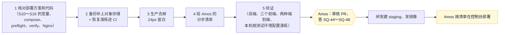
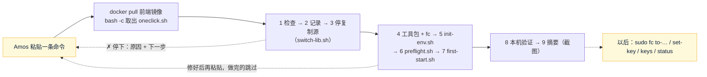

# S12 测试环境第一次部署的准备：开发记录
- 阶段：开发 S12（架构方案第 11 节；《测试环境和切换》v1.1 第 13 节的遗留；S11 的原 SQ-28 改成本阶段任务）
- 分支：`claude/s12-test-deploy`（从 main `133dcf0` 开出，整合 4 已合并）
- 日期：2026-10-26
- 角色：研发工程师、运维工程师
- 范围：**只准备，不部署**。智能体没有服务器权限，服务器上的操作由 Amos 在阿里云控制台执行（《云服务器》H1）；没有建 `staging` 分支、没有推镜像（SQ-44）。
- 依据：agents main `1f92bbc`（《协作总则》、《研发工程师》、《运维工程师》v0.11、《测试工程师》、《平台规范/云服务器》v0.4）；`部署方案/v1-测试环境与切换.md` v1.1；`部署方案/v1-归集合约部署.md`；`Amos待办.md` v1.25（T3～T16）；`开发记录/S11-客户端.md` 第 9 节（原 SQ-28）；`开发记录/S16-等候页和机器人.md` 第 11 节；架构方案第 11.4～11.7 节
- 标注：每项后面写【实际执行】【代码走查】【未验证】。研发的决定从 **D-235** 起（S16 用到 D-234），新问题从 **SQ-44** 起。

## 一图看懂

这张图想说明：本阶段把"部署之前能在开发环境做完的事"都做完并实测了；黄色两步要 Amos 做，之后才是真正的第一次部署。

## 1. 结论
- 部署方案、`deploy/` 和代码逐项核对，发现并改了 7 处不一致（第 2 节），其中两处会让 Amos 操作失败：①文档里让 Amos 改了 `.env` 后运行 `deploy.sh`，但它在版本没变时直接退出、配置不会生效 → 新脚本 `reload-env.sh`；②备份不含对象存储目录（证件、裁决截图）→ 已修。
- S10～S16 新增的环境变量都已经在 compose 和 `env.example` 里；`env.example` 现在每个变量都标了【必填·自动】【验收前填】【可选】，新检查 `scripts/check-deploy-env.mjs` 进了 CI，以后漏了会失败。可选的密钥全部空着时，按测试环境配置（不是 e2e profile）启动，健康检查 `status` 是 UP，对应功能显示"未开通 / 未配置"【实际执行】。
- 备份 = 数据库 + 对象存储文件包，恢复一起恢复；部署形态端到端每次最后用服务器上真正的 `backup.sh`、`restore.sh` 做一次演练，本机跑通【实际执行】。
- 客户端生产不再留 24px 顶部空白，测试环境照常显示标识条【实际执行：单元测试 + 两种形态的端到端】。
- 给 Amos 的分步清单：`部署方案/v1-测试环境第一次部署清单.md`（新开文件，《测试环境和切换》的操作步骤移过去，那份只留要点）。

## 2. 核对部署方案和代码（任务 1）

| # | 核对项 | 结果 | 改了什么 | 标注 |
|---|---|---|---|---|
| 1 | `application.yml` 的 58 个 `${FC_...}` 是否都传进了容器 | 都在 compose 的 app 环境里；6 个不用传（`FC_E2E_ENABLED`、`FC_HTTP_PORT`、`FC_MANAGEMENT_PORT`、`FC_REDIS_PORT`、`FC_STORAGE_DIR`、`FC_VERSION`，原因写在检查脚本里） | 新 `scripts/check-deploy-env.mjs`，CI 的 `checks` 运行 | 实际执行（脚本通过；故意删一行、改一个键名各试一次，都能报出来） |
| 2 | compose 引用的变量是否都在 `env.example`、是否标明必填 / 可选 | S15、S16 的 `FC_CONTENT_ENABLED`、`FC_GEMINI_*`、`FC_SOURCE_POLYMARKET_ENABLED`、`FC_TELEGRAM_BOT_TOKEN` 都在；`FC_WALLET_ERC20_CHAIN_ID`、`FC_WALLET_BSC_CHAIN_ID` 在 compose 里有默认值、`env.example` 里没有；**没有任何地方标必填 / 可选**；开头还写着"部署方案在 S14 写""密码用部署方案第 6 节的命令生成"（复制源的说法） | `env.example` 重写说明：每个变量标【必填·自动】（init-env.sh 生成）、【验收前填】（邮件、监控告警收件人）、【可选】（其余），补两项链 ID | 实际执行（检查脚本）+ 代码走查（每个可选项没填时的行为） |
| 3 | 缺了可选变量能否安全启动 | 能。按测试环境的 compose（非 e2e profile）、`init-env.sh` 生成的 `.env`、可选项全空启动：`status` UP、`env` test；`alerts` 里 DOWN 的是 `telegram.bot`、`source.football_data`、`source.balldontlie`、`source.thesportsdb`；日志只有三条预期的提示（邮件未配置只记录、Telegram 不启动、已建第一个超管） | 无 | 实际执行（第 5 节第 6 行） |
| 4 | 改了 `.env` 怎样生效 | 《测试环境和切换》第 13 节、《归集合约部署》第 9 节、待办 T9 写的是 `deploy.sh`：它只在 staging 有**新**版本时才动，版本没变直接退出，**`.env` 不会生效**；S16 开发记录写的 `start.sh` 能生效但会再跑一遍切换前检查、打开定时器 | 新脚本 `deploy/kit/reload-env.sh`（确认本项目在运行 → 等自动更新结束 → 当前版本 `compose up -d` → 健康检查 → 列出 DOWN 的项）；三处文档和待办 T9、T14、T16a 改成它 | 实际执行（本机按测试环境配置跑过一次） |
| 5 | 备份范围 | 只导出数据库，漏了对象存储目录（第 3 节） | 见第 3 节 | 实际执行 |
| 6 | `verify.sh` 是否覆盖 S13～S16 | 没有检查不登录可看的页面（S13 robots、sitemap、不存在的市场 404）、S16 数据页 `/data`；说明里的例子还是复制源的域名前缀 | 加这几项和 `/api/e2e/telegram/*` 被拦；例子改成 `fc-test*` | 实际执行（本机假域名，见第 5 节） |
| 7 | 文档、脚本里指向不存在章节的引用 | compose、`first-start.sh`、`init-env.sh`、Nginx 模板、`verify.sh` 写"部署方案第 14 节"（复制源的官网章节，本项目没有）；compose 写"第 19 节"（复制源的事故章节） | 改成本项目的第 8 节（新增"证书里缺域名时"的命令）、第 3 节；`first-start.sh` 的提示语同步 | 代码走查 |
| 8 | 内存总账和 S15、S16 | 第 3.2 节还写"自动化程序（还没开发）没算在里面"；实际内容程序、Telegram 机器人都在 `app` 进程里，compose 的注释已说明在 576 MB 以内 | 第 3.2 节改正；本次部署形态跑完全部 30 个用例后 `app` 373 / 576 MB（64.8%），见第 5 节 | 实际执行（开发环境，不是测试服务器） |
| 9 | `preflight.sh` | 上限 992 MB 和 compose 一致；检查项和部署方案一致 | 无 | 代码走查（依赖服务器的 systemd 和另一个项目，开发环境只能做语法检查） |
| 10 | Nginx | S13 的 SSI、robots、sitemap、`/m/`，S15 的 `/insights`，S16 的 `/data` 都在；`/api/e2e/` 正则拦住 S16 新加的 `/api/e2e/telegram/**`；机器人只往外连、不用改 Nginx | 无 | 实际执行（部署形态端到端、`verify.sh`） |
| 11 | CI 的 `publish-staging` | 注释写"S14 建 staging"；等待测试环境换版本用 `FC_STAGING_APP_URL`，两个项目轮流用一台服务器时会误报（SQ-46） | 注释改成 S12；变量先不设，交 Amos（SQ-46） | 代码走查 |

## 3. 备份补上对象存储（任务 2）

**漏了什么**（代码走查）：`ObjectStorage` 的实现 `LocalObjectStorage` 写在 `FC_STORAGE_DIR`（镜像里固定 `/data/storage`，compose 挂到服务器 `/opt/forecast/data/storage/`），只有两类数据：`kyc/<用户>/<申请>-*.jpg|png`（KYC 证件，`KycService`）、`resolve/<市场编号>/<截图编号>.*`（裁决存档截图，`ResolveDesk`，只增不改、永久保留）。原来的 `backup.sh` 只 `mysqldump`。分享卡片（S14 `CardService`）、内容程序的数据卡和对照图（S15 `ToolService`）都是按数据现画、放在内存缓存里，不落盘，不用备份；Redis 只有限流计数和推送广播，不备份。

**备份目标按部署方案现有设计**（第 7 节、架构方案第 11.6 节"文件随数据库备份一起打包"）：服务器本机 `/opt/forecast/backup/`，保留 7 天，权限 600。架构方案第 11.4 节还写了"测试环境每天也上传 R2 测试桶"，部署方案和脚本里都没有、R2 也没开通，这次不做，交 Amos（SQ-47）。

**改法**：
- `backup.sh`：先导出数据库（`.sql.gz`），再打包对象存储目录（同一前缀的 `.storage.tgz`）。文件只增不改，晚打包只会多、不会少，数据库引用的文件都在。打包用后端镜像临时起一个容器（`compose run --rm --no-deps --entrypoint tar app`）：和后端同一个用户 uid 10001、同一个挂载，后端停着也能做，不启动 Java。备份名字只允许字母、数字和 `._-`；7 天清理两种文件都清。
- `restore.sh`：参数给 `.sql.gz`（给 `.storage.tgz` 也认）；同一前缀的文件包在就一起恢复（同样用后端镜像解包，属主是 10001），不在就提示"S12 以前的备份只有数据库"；恢复前照旧先备份一次 `before-restore`。文件"补回、换回"，不删备份之后新增的文件（数据库已经不引用它们，删了反而可能丢掉 before-restore 之后才发现需要的证据）。健康检查等的版本号改成当前镜像里记录的提交号（服务器上和 `state/image.env` 一样；开发机演练时镜像标签不是提交号）。
- `lib.sh`：`FC_DIR`、`FC_PROJECT`、`FC_COMPOSE_OVERRIDE` 可以用环境变量换掉，只用于开发机演练；服务器上 `sudo`、systemd 不带这些变量，用默认值（D-235）。

**恢复演练进 CI**（D-236）：`e2e/run-deployed.sh` 在全部用例通过后，把 `deploy/kit/` 的脚本拷到临时目录（和服务器 `/opt/forecast` 一样的布局），用真正的 `backup.sh`、`restore.sh` 做：放一个演练文件 → 备份（核对两个文件都在、权限 600、gzip 完整、文件包里的文件数和目录一致）→ 改坏（数据库多一张表、删掉一个客户；删掉演练文件和一个用例上传的文件、改坏另一个）→ 恢复（输入 `RESTORE`）→ 核对：有 before-restore 备份、多出来的表没了、四张表的行数和迁移版本回到备份前、全部文件的 sha256 一致、属主 10001、经 Nginx 的健康检查 UP。CI 的 `e2e-deployed` 每次都会跑。

**结果**【实际执行，本机】：备份前 8 个文件（用例上传的证件和裁决截图 + 演练文件）；客户 29、证件申请 2、裁决截图 1、员工 1、迁移 27；备份 128K + 8.0K；恢复后全部一致，健康检查 UP（第 5 节第 5 行）。另外在测试环境配置（非 e2e）下跑了一次 `backup.sh`：52K + 文件包（空目录），权限 600【实际执行】。**在测试服务器上没有执行过**【未验证】：第一次每天备份后请 Amos 截 `ls -lh /opt/forecast/backup/`（部署方案第 9 节）。

## 4. 生产去掉 24px 留白（任务 3）
- 原因【代码走查】：客户端 `--banner-h` 固定 24px，页面 `padding-top`、手机顶栏 `.mbar`、电脑顶栏 `.topnav` 都按它下移；测试标识条只在健康检查返回 `env` 时出现，生产（不设 `FC_ENV_LABEL`）没有标识，这 24px 就是空白（S11 把它改成了不透明，但没去掉）。
- 改法（D-237）：和后台的做法一样。真实接口模式启动时根元素加 `no-proto` → `--banner-h: 0px`；`EnvBanner` 拿到非空 `env` 时加 `env-on` → 恢复 24px；原型模式不加，原型横幅照常。代码 `web/client/src/lib/bannerSpace.ts`、`main.tsx`、`EnvBanner.tsx`、`styles/layout.css`。
- 为什么不在构建时决定：测试环境和生产用同一套构建流程（`publish-staging` 的镜像就是以后生产要用的那种），环境只由后端的 `FC_ENV_LABEL` 区分；在构建时分开要多一套镜像，测试环境验收的就不是生产要上的那个包。代价：测试环境第一次打开页面时，健康检查返回前顶部是 0，返回后下移 24px（一次，几十毫秒，后台一直是这样）；生产没有任何移动。
- 测试：单元测试 `EnvBanner.test.tsx` 加 4 个断言（生产不加 `env-on`、测试环境加、真实 / 原型模式的根元素类、CSS 规则本身）；端到端 `client.spec.ts` 新用例：改写健康检查的 `env`，在同一个后端上造出生产和测试环境两种情况，手机 390、电脑 1366 各量一次（生产：没有标识条、顶栏贴顶 0px、`.app` 的 `padding-top` 0px；测试环境：标识条可见、顶栏在 24px、标识条底边 ≤ 24px；都没有横向滚动）。两种形态都通过【实际执行】。

## 5. 验证（全部实际执行，2026-10-26，开发环境）

| # | 项目 | 命令 / 做法 | 结果 |
|---|---|---|---|
| 1 | 后端 | `JAVA_HOME=/usr/lib/jvm/java-25-openjdk-amd64 mvn -o -B -ntp verify`（离线可用；本机 MySQL 8.4 容器、Redis 7 容器 6379，端到端另用一个 Redis 6380） | **BUILD SUCCESS**：792 个测试，失败 0、错误 0、跳过 5（真实数据源冒烟测试等默认跳过的）。本阶段没有改后端代码 |
| 2 | 三个前端 | 各自 `npm run lint`、`npx vitest run`、`npm run build`、`check-brand.mjs dist`；客户端、后台再 `check-no-mocks.mjs src/mocks dist` | 客户端 lint 通过、219 个测试通过、构建通过、品牌通过、模拟层 281 个字符串不在产物里；后台 239 个测试通过，其余同上（722 个字符串）；官网 33 个测试通过，其余同上 |
| 3 | 端到端（开发形态，`server.mjs`） | 新库 `forecast_e2e`、Redis 6380，`bash e2e/start-backend.sh` 后 `npx playwright test` | **27 通过**，3 个部署形态专用的跳过（3.4 分钟）；含新用例"顶部横幅的预留高度"。第 4 行改了这个用例以后，在同一个库上只重跑 `client.spec.ts`，另外两个用例失败：一个卡在等验证码（Redis 里按 IP 的发验证码计数 `fc:code:ip:127.0.0.1` 是 33，超过每小时 30 次，即项目索引第 8 节 S2 那一条：同一个小时里重复跑）；清掉计数后另一个卡在等 TRC20 充值到账（同一个库重启后端后重跑，链替身的状态和库里的扫块进度对不上【推断，没有深究】）。**换新库、清空自己的 Redis 后用最终代码重跑全部：27 通过、3 跳过（3.1 分钟）** |
| 4 | 端到端（部署形态第一次） | `E2E_SKIP_BUILD=1 E2E_IMAGE_TAG=s12-e2e bash e2e/run-deployed.sh`（compose 项目 `forecast-e2e`，跑之前确认这个项目和 80 / 443 / 8080 都没人用） | 29 通过、**1 失败**：新用例在路由里用 `route.fetch()` 转发健康检查，那是测试进程（Node）发的请求，解析不了浏览器才认识的假域名（`ENOTFOUND test-app.e2e.test`）。根因在测试写法，改成先从后端取一次真实响应、路由里只改 `env` 返回 |
| 5 | 端到端（部署形态，改后） | 同上 | **30 通过**（3.4 分钟）；跑完内存 `web` 4.2 / 32、`app` 373 / 576（64.8%）、`mysql` 183.7 / 320（57.4%）、`redis` 3.6 / 64 MB；**备份恢复演练通过**（第 3 节）。脚本收尾删了自己的容器、卷和临时目录 |
| 6 | 按测试环境配置演练（不是 e2e profile） | 本地脚本（不进仓库）：临时目录照服务器布局放 `deploy/kit/`，`init-env.sh`（三个 `fc-test*` 域名）→ 可选项全空 `compose up` → `reload-env.sh` → `verify.sh`（`/etc/hosts` 临时指向本机、信任自签名证书）→ `backup.sh` → 删掉自己的 compose 项目 `fc-s12-staging` 和目录，`/etc/hosts` 恢复 | `init-env.sh` 生成 11 项、重复运行 `.env` 不变、权限 600；健康检查 UP、`env` test，DOWN 的告警见第 2 节第 3 行；`reload-env.sh` 通过并列出 DOWN 的项；`verify.sh` 除端口三项外全部 ✓（39 项）；**端口 3306、6379、8080 报"对外开放"是本机的情况**：本机用 127.0.0.1 访问，我自己的 MySQL / Redis 容器开着 3306 / 6379，后端本来就绑在 127.0.0.1:8080，在服务器上从外部看不到这三个端口，要在第一次部署后从外部再跑一次；内存 `app` 312 / 576、`mysql` 166 / 320 MB |
| 7 | 部署脚本 | `bash -n`、`shellcheck -S warning deploy/kit/*.sh deploy/verify.sh e2e/run-deployed.sh` | 没有问题 |
| 8 | 仓库检查 | `node scripts/check-project-index.mjs`、`node scripts/check-brand.mjs --repo`、`node scripts/check-deploy-env.mjs` | 通过（结果见 PR 的 CI） |
| 9 | 密钥扫描 | gitleaks（本机 `ghcr.io/gitleaks/gitleaks` 镜像，扫本分支相对 main 的提交）；CI 的 `checks` 里也有 | 见 PR 说明 |

**没有在测试服务器上执行的**【未验证】：`preflight.sh`、`first-start.sh`（certbot、systemd）、`start.sh`、`stop.sh`、停复制源那一侧的命令、证书签发方、从外部看端口、服务器出站访问、服务器上的内存。第一次部署时按清单每一步的"怎么确认做好了"核对，结果写进《测试环境和切换》第 9 节。

## 6. 研发的决定（待 PM / Amos 复核）
- **D-235** 部署脚本的目录、compose 项目名、额外覆盖文件允许用环境变量换（`FC_DIR`、`FC_PROJECT`、`FC_COMPOSE_OVERRIDE`），只为在开发机和 CI 上用**同一份**脚本演练；服务器上的 `sudo`、systemd 都不带这些变量。已有的 `FC_OFFLINE_TEST` 也是这种用法。
- **D-236** 备份恢复演练放进 `run-deployed.sh`（CI 的 `e2e-deployed` 每次跑，约多 25 秒），而不是只在开发记录里跑一次：脚本以后改了，演练会跟着失败。
- **D-237** 生产去掉留白在运行时按健康检查决定，不在构建时（第 4 节）。
- **D-238** 给 Amos 的清单新开一个文件，原来《测试环境和切换》第 4、5.2、5.3、6 节的操作步骤移过去，那份只留要点和"为什么"，避免两处写同一组命令。
- **D-239** 清单里第 5 步"申请证书并启动"是一个脚本：Nginx 没有证书起不来，所以先申请证书再启动容器（任务说明里的顺序是"启动 → 申请证书"，实际只能这样合在一起）；清单里把证书和启动分开核对。
- **D-240** `e2e/run-deployed.sh` 的镜像标签可以用 `E2E_IMAGE_TAG` 换：这台开发机上已经有别的会话留下的 `e2e-local` 镜像，本次用 `s12-e2e`，不覆盖别人的标签；跑完删除自己的。

## 7. 需要 Amos 决定的问题（SQ-44 起，已写进《Amos 待办》）
| 编号 | 问题 | 建议 |
|---|---|---|
| SQ-44 | 本 PR 合并后由研发从 main 建 `staging` 并推送（触发完整 CI 和 `publish-staging`，镜像推到 ghcr.io；服务器还没装，不会自动部署）；以后上测试环境都是 main → staging 的 PR | 同意；staging 也设分支保护（`ci-ok` 必须通过） |
| SQ-45 | 第一次部署测试环境，要不要开外部定时探测（《运维工程师》3.7） | 先不开：两个项目轮流用一台服务器，切走时会一直报警；生产时再问 |
| SQ-46 | 要不要设仓库变量 `FC_STAGING_APP_URL`（发布后等测试环境换上新版本，15 分钟没换上就标红） | 先不设：切到复制源期间会误报；每次合并 staging 后研发从外部核对版本号（C76） |
| SQ-47 | 架构方案写"测试环境备份每天也上传 R2 测试桶"，部署方案和脚本没有、R2 没开通 | 测试环境先只备份到本机；R2 加密上传随生产部署方案一起做，再在测试环境演练一次；测试环境不要上传真实证件 |
| SQ-48 | 架构方案写"S12 给 Nginx 加 Cloudflare 真实 IP、打开代理和后台 Access"；这次按灰色云直连，没做 | 测试环境验收通过、写生产部署方案时一起做 |

## 8. 遗留事项
- 第一次部署后补《测试环境和切换》第 9 节的服务器实测（`free -m`、`docker stats`、出站访问、外部 `verify.sh`、备份文件、切换一次）。
- Cloudflare 代理、真实 IP、后台 Access（SQ-48）；R2 备份（SQ-47）；生产部署方案。
- `RealSourcesSmokeTest`、`RealScoreSourcesSmokeTest`（真实数据源）在开发环境没有跑：要外网和 key，按部署方案第 13 节在第一次部署前后跑（体育的要 Amos 先填 key）。
- 测试环境首次打开页面时标识条出现会让内容下移 24px 一次（第 4 节），生产没有；如果验收时觉得明显，可以再加"记住上次的环境"之类的处理。

## 9. 跨角色反馈 / 提交
- 给运维（Amos 执行）：`部署方案/v1-测试环境第一次部署清单.md`；前提是本 PR 合并和 SQ-44。
- 给测试：新用例 `client.spec.ts` 的"顶部横幅的预留高度"两种形态都跑；`run-deployed.sh` 的备份恢复演练在用例全部通过后才做（`E2E_SKIP_BACKUP_DRILL=1` 可以跳过，CI 不跳过）。
- 给 PM：《Amos 待办》v1.27（T18、SQ-44～SQ-48、T9 / T14 / T16a 改用 `reload-env.sh`）。
- 提交：分支 `claude/s12-test-deploy`，PR 到 main，不合并，等 Amos 审核。

## 10. 一键部署（2026-10-27，分支 `claude/s12-oneclick`）

来由：Amos 看了分步清单 v1.0："你写的部署清单太复杂了，我需要操作很久，可以有简单点儿的操作方式吗，最好是一键式操作"。依据：agents main `60f0a70`（《运维工程师》v0.12、《平台规范/云服务器》v0.4）。研发的决定接着 D-240 编号，新问题从 SQ-49 起。

这张图想说明：Amos 只做黄色的两件事；脚本按原清单第 1～7 节的顺序调用已有脚本，任何一步失败都能修好后用同一条命令接着做。

### 10.1 做了什么

| 项 | 内容 | 标注 |
|---|---|---|
| 一条命令 | `sudo docker pull ghcr.io/dollar3651314/forecast-web:staging && sudo bash -c "$(sudo docker run --rm --entrypoint cat ghcr.io/dollar3651314/forecast-web:staging /forecast-kit/oneclick.sh)"`（仓库私有，`curl` 拿不到；脚本在前端镜像的工具包里） | 实际执行（开发环境，命令的第二段原样运行；第一段 `docker pull` 用本机镜像代替） |
| `deploy/kit/oneclick.sh`（新） | 第 1～9 步：①检查内存、磁盘、80/443/8080 被谁占、DNS（三个域名解析到这台的公网 IP，公网 IP 自动查，查不到只提醒）、crontab、有没有不认识的容器；②记录切换前状态到 `/opt/forecast/logs/before-switch-*.txt`；③停复制源；④取工具包、`server-setup.sh`（只第一次）、装 `/usr/local/bin/fc`；⑤`init-env.sh`；⑥`preflight.sh`；⑦`first-start.sh`；⑧本机验证（容器、健康检查 UP / env test / 版本、三个域名按域名访问本机并校验证书、HTTP 跳转、证书 SAN 和剩余天数、两个定时器）；⑨摘要（版本和 staging 镜像比对、网址、容器、`free -m`、`docker stats`、没填的可选密钥名）。屏幕每步一行 ✓ / ✗，脚本的详细输出只进日志 `/opt/forecast/logs/oneclick-<时间>.log`；失败时给日志最后几行、原因、下一步和"截图发我（先遮住密钥）" | 实际执行（演练） |
| 可以重复运行 | 复制源已停 → 跳过；工具包没变 → 跳过；`.env` 必填项齐全 → 不覆盖；forecast 已在运行、版本对、证书在、定时器开 → 跳过第 7 步 | 实际执行（演练 ②③） |
| 只在危险时停下 | `.env` 没有数据库密码、`data/mysql` 里却有数据（生成新密码会打不开原来的库）；发现不止一个"另一个项目"；复制源自己的备份失败（不停它的容器、恢复它的定时器） | 第 1、3 项实际执行（演练 ⑥）；`.env` 那一项代码走查 |
| `deploy/kit/fc.sh`（新，`/usr/local/bin/fc`） | `fc status`；`fc to-<复制源>`（子命令名运行时从 systemd 得到，也可以 `to-other`）：`stop.sh` → 端口空 → 复制源 `compose up -d` → 健康检查（版本对它的 `state/image.env`）→ 按停之前的样子打开它的定时器；`fc to-forecast`：停复制源 → `start.sh`；`fc keys`；`fc set-key 变量名`：只收 6 个可选密钥和 2 个收件人，`read -s` 从 `/dev/tty` 读，去掉首尾空白，拒绝空格、引号、`$`、反引号、反斜杠，值经环境变量交给 awk 写进 `.env`（不出现在命令行），权限 600，`reload-env.sh` 生效，报告健康检查和对应的 `alerts` 项；变量名小写或少了 `FC_` 时提示正确写法 | 实际执行（演练 ④⑤⑥） |
| `deploy/kit/switch-lib.sh`（新） | 找复制源、停它、原样启动它、端口占用；脚本里不写它的名字（品牌检查） | 实际执行（演练） |
| `first-start.sh`、`init-env.sh`、`lib.sh` | 见 10.2 D-246、D-244；证书提醒邮箱可以空着（SQ-50） | 实际执行（演练） |
| `e2e/oneclick-drill.sh`（新）+ CI | 见 10.3；CI 的 `e2e-deployed` 在部署形态端到端之后运行（PR 上改了 `deploy/` 或这个脚本时跑，staging 上每次跑），超时 20 → 30 分钟 | 本机实际执行；CI 结果见 PR |
| 清单 v2.0 | `部署方案/v1-测试环境第一次部署清单.md`：一页正文 + 附录 A（v1.0 的分步命令和对照表）；《测试环境与切换》v1.3 引用跟着改 | 文档 |

### 10.2 研发的决定（待 PM / Amos 复核）
- **D-241** 用 `sudo bash -c "$(sudo docker run … cat …/oneclick.sh)"`，不用"`| sudo bash`"：管道时脚本本身从标准输入读，中途 `docker compose exec`（复制源的 `backup.sh` 用它）会把后面的脚本内容当输入吃掉。脚本另外把全部代码包在 `main` 里、所有子命令 `< /dev/null`，用管道也安全。
- **D-242** 复制源按 systemd 的 `<名字>-deploy.timer` 找（目录取 `<名字>-deploy.service` 的 ExecStart，要有 `lib.sh`、`backup.sh`），记在 `/opt/forecast/state/other-project.env`；`fc to-<名字>` 的子命令名也是运行时得到的。原因：`deploy/kit/` 里不写复制源的名字（`scripts/brand-check.json`），也不把这几个脚本加进排除名单。
- **D-243** `fc set-key` 在 6 个可选密钥之外还收 `FC_ALERT_EMAILS`、`FC_RISK_ALERT_EMAILS`（验收前要填，不是密钥，省得 Amos 为它们开 nano）；填 `FC_MAIL_PASSWORD` 时 `FC_MAIL_HOST`、`FC_MAIL_USERNAME`、`FC_MAIL_FROM` 空着就填 Resend 的公开值（`smtp.resend.com`、`resend`、`noreply@fc-email.quickcome.online`，《Amos 待办》T3），否则只填密码邮件还是发不出去。区块链、合约地址不收（按《归集合约部署》用 nano）。
- **D-244** `FC_OFFLINE_TEST=1`（只在开发机、CI 演练）时 `prune_images` 直接返回：它会 `docker image prune -f`，演练不能清同一台机器上别人的镜像。服务器上不设，行为不变。
- **D-245** 屏幕只显示每步一行，子脚本的输出只进日志：Amos 要截图的屏幕短；失败时贴日志最后 10～20 行（这些脚本都不打印密钥的值）。
- **D-246** `first-start.sh` 改成可以重复运行：证书已有跳过；`deploy.sh` 之后用记录的版本 `compose up -d` 并等健康检查（版本已记录时 `deploy.sh` 直接退出、不会把停着的容器拉起来）；续期已是 webroot 的不再 `reconfigure`。`oneclick.sh` 在还没有运行成功的版本时删掉 `state/skip` 再试（第一次启动失败过的版本被记成"跳过"，重新运行就是要再试一次；C77）。
- **D-247** 演练用真实路径（`/opt/forecast`、`/usr/local/bin/fc`、`/etc/letsencrypt/live/forecast`、`/etc/systemd/system`），只替换 systemctl、certbot、apt-get、swapon、sysctl；不碰已存在的东西，结束时删掉自己建的。比给脚本再加一堆目录变量更接近服务器。

### 10.3 验证（2026-10-27，开发环境）

| # | 项目 | 做法 | 结果 | 标注 |
|---|---|---|---|---|
| 1 | 部署形态端到端（改了 web 镜像里的工具包） | `E2E_IMAGE_TAG=oneclick-e2e E2E_MVN_ARGS=-o bash e2e/run-deployed.sh`（JDK 25；跑之前确认 `forecast-e2e` 项目和 80/443/8080 没人用） | **30 通过**（3.2 分钟），备份恢复演练通过；`app` 374 / 576 MB、`mysql` 225 / 320 MB。脚本收尾删了自己的容器和临时目录 | 实际执行 |
| 2 | 一键部署演练（全部场景） | `E2E_IMAGE_TAG=oneclick-e2e bash e2e/oneclick-drill.sh`（root；镜像用第 1 行构建的，工具包是最终代码） | **全部通过**：①非容器程序占 80 → 停在第 1 步，复制源（演练里叫 oldproj）的容器和定时器没动、没生成 `.env`；②证书失败 → 停在第 7 步，复制源已按"定时器 → 它的备份 → 容器"停掉、`.env` 已生成；修好再运行 → 第 3、5 步跳过，走到第 9 步；③再运行 → 第 3、4、5、7 步跳过，`app`、`mysql` 容器的启动时间不变；④`fc to-oldproj` → forecast 备份并停止、oldproj 4 个容器和两个定时器起来、健康检查是它的版本；`fc to-forecast` → oldproj 备份并停止、定时器停用、forecast 用原来的版本起来；⑤`fc keys`、`fc set-key`（伪终端模拟粘贴）：小写变量名、`FC_DB_PASSWORD`、带空格的值都被拒绝；正确的值写进 `.env`（600），后端容器按新配置重建、容器里拿到新值、健康检查 UP；⑥oldproj 备份失败 → `fc to-forecast` 停下，oldproj 容器还在运行、定时器恢复；修好后切换成功。生成的 5 个密码和 set-key 的值都没有出现在任何屏幕输出和日志里（脚本逐个 grep 检查） | 实际执行 |
| 3 | 干净的首次运行 | `E2E_ONECLICK_CLEAN=1` 再跑一次 | 通过；这次的屏幕输出放进了清单第 3 节当样例 | 实际执行 |
| 4 | 演练收尾 | 跑完检查 `/opt`、`/usr/local/bin/fc`、`/etc/letsencrypt/live`、`/etc/hosts`、容器、镜像标签 | 都恢复原样，只剩本次构建的 `oneclick-e2e` 镜像（最后手动删除） | 实际执行 |
| 5 | shellcheck | `shellcheck -S warning deploy/kit/*.sh deploy/verify.sh e2e/run-deployed.sh e2e/oneclick-drill.sh`；`bash -n` 逐个 | 没有问题 | 实际执行 |
| 6 | 仓库检查 | `node scripts/check-project-index.mjs`、`node scripts/check-deploy-env.mjs`、`node scripts/check-brand.mjs --repo` | 通过 | 实际执行 |
| 7 | 密钥扫描 | gitleaks（本机镜像，扫本分支相对 main 的提交） | no leaks found（1 个提交）；CI 的 `checks` 里也有 | 实际执行 |
| 8 | 后端全量、三个前端单元测试 | 没有改后端和前端代码 | 没有跑（部署形态端到端里构建并跑了全部主流程） | 未执行（不需要） |

**没有验证的**【未验证】：
- 真实的 systemd 和 certbot：演练用替身。没验证到的是 `systemctl list-unit-files … '*-deploy.timer'`、`systemctl show -p ExecStart --value` 在服务器上的真实输出格式（替身按 systemd 255 的格式写）、`certbot certonly --register-unsafely-without-email`、Let's Encrypt 真实签发；定时器真的每分钟触发 `deploy.sh`。
- 真实的复制源：演练用的 oldproj 只模仿了它的布局（`/opt/<名字>/lib.sh` 的 `compose` 函数、`backup.sh before-switch`、`state/image.env`、两个定时器、4 个容器占 80/443/8080），没有用它的真实脚本。服务器上它的 `deploy.service` 的 ExecStart 是不是 `/opt/<名字>/deploy.sh`，以 Amos 第一次运行时第 1 步打印的"另一个项目：…（目录 …）"为准。
- DNS 和公网 IP：演练用 `/etc/hosts` 和 `FC_PUBLIC_IP=127.0.0.1`；服务器上自动查公网 IP（阿里云元数据 → api.ipify.org 等），查不到时只提醒、不拦。
- `server-setup.sh` 的 apt 安装、交换分区、Docker 日志轮转：演练里 apt-get、swapon、sysctl 是替身（服务器上这些已经有了，脚本本来就会跳过）。
- 阿里云控制台"远程连接"终端里 `read -s` 的表现（演练用 `script` 伪终端）。
- 服务器的内存：演练机器 16 GB；1,613 MB 的机器上以第 9 步的截图为准。

### 10.4 需要 Amos 决定的问题（SQ-49 起）
| 编号 | 问题 | 建议 |
|---|---|---|
| SQ-49 | 那条命令用的是 staging 镜像里的 `oneclick.sh`，现在的 staging（`c722523`）里还没有。本 PR 合并到 main 后，要再从 main 开一个 PR 合并到 staging，CI 全绿、`publish-staging` 推出新镜像后才能粘贴；那时的提交号不再是 `c7225239…` | 同意：合并后研发开 main → staging 的 PR（合并到测试分支不需要另外同意，C34），镜像发布后告诉你新提交号，你再粘贴 |
| SQ-50 | 证书到期提醒邮箱：以前要你在命令里写，现在默认不留（证书自动续期，只是收不到 Let's Encrypt 的提醒邮件；浏览器推送的联系方式改用 `https://fc-test.quickcome.online`） | 不留；想留就把命令里的 `sudo bash -c` 改成 `sudo FC_CERT_EMAIL=你的邮箱 bash -c` |
| SQ-51 | `fc set-key` 在终端里用隐藏输入让你粘贴 key。《平台规范/云服务器》第三节的做法是"需要输入密钥时用 nano 编辑 `.env`"（防的是控制台 AI 助手接管交互输入、向你要密钥） | 保留 `set-key`：只要在"远程连接"终端里运行、不用 AI 助手，就和 nano 一样不经过任何对话框；提示语里写了"不要用控制台的 AI 助手"，nano 照旧可以用。同意的话我另开 agents 仓库的 PR，在《云服务器》第三节补一句 |
| SQ-52 | 命令名 `fc` 和 bash 自带的内建命令 `fc` 同名：带 `sudo` 没问题（清单里都带了），不带 `sudo` 直接敲会运行那个内建命令（打开历史命令编辑） | 保持 `fc`，所有地方都写 `sudo fc`；如果你更想要一个不会撞名的名字（例如 `fcx`），告诉我，改一个名字就行 |

### 10.5 遗留事项
- SQ-49 答复后：main → staging，看 staging 那一次 CI 和发布（C76），告诉 Amos 新提交号；Amos 粘贴命令后，按截图补《测试环境与切换》第 9 节，并从外部跑 `deploy/verify.sh`。
- 第一次在服务器上运行时，核对第 1 步找到的另一个项目和目录对不对；第 3 步之后的 `free -m`（没有容器时 ≤ 450 MB）。
- 《Amos 待办》由 PM 按本节和 PR 更新（T13 改成"粘贴一条命令"、SQ-49～SQ-52）。
