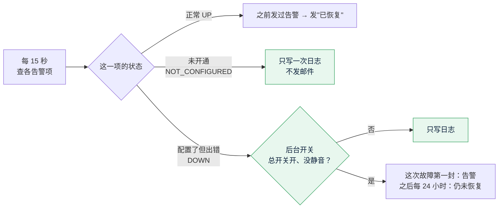

# S12b 告警邮件控制：开发记录
- 阶段：开发 S12b（测试环境部署后的第一个调整；S12 的后续）
- 分支：`claude/alert-mail-control`（从 main `1f91d9e` 开出）
- 日期：2026-10-27
- 角色：研发工程师（代 PM 记录需求说明书的轻量变更，v1.4.1 第 20 节）
- 出处：Amos 2026-10-27（主会话转来）："告警邮件，我可以在什么地方控制 是否发送，否则在测试阶段我收到很多 没有的邮件，不想这样"。
- 依据：agents main `60f0a70`；《项目地图》v0.26、《项目索引》v0.26；需求说明书 v1.4。
- 标注：每项后面写【实际执行】【代码走查】【未验证】。研发的决定从 **D-248** 起（之前用到 D-247），新问题从 **SQ-53** 起。

## 一图看懂

这张图想说明：绿色是这次新加的。"未开通"和"出错"分开了，只有出错才可能发邮件；发不发再看后台"参数设置 → 告警邮件"的两个开关。健康检查 `/api/health` 的 `alerts` 不受任何影响，照样列出每一项。

## 1. 改之前和改之后

| 情况 | 改之前 | 改之后 |
|---|---|---|
| 没配 key 的可选功能（测试环境的 `telegram.bot`、`source.football_data`、`source.balldontlie`、`source.thesportsdb`） | 当成故障，各发一封告警；应用每重启一次又各发一封 | **不发邮件**，只在第一次看到时写一行日志；健康检查照样 DOWN |
| 配置了但出错 | 发一封；恢复发一封 | 不变 |
| 一直没恢复 | 不再发（直到恢复或重启） | **每 24 小时提醒一封"仍未恢复"**（`forecast.alert.remind-every`，默认 24h，0 = 不提醒） |
| 30 分钟内反复断开又恢复 | 节流期内新的异常不发；持续到节流期满再发 | 不变 |
| 后台控制 | 没有 | 参数设置"告警邮件"：总开关、不发邮件的告警项（权限点 `alert_params:edit`，高危、写审计） |

**关于"每 30 分钟再发一封"**【代码走查】：任务描述里说异常一直持续时每 30 分钟再发一封。按改之前的代码（`AlertMonitor.update`：这次异常发过以后 `mailed = true`，不会再发）和原来的单元测试（`异常时发一次告警_持续异常不重复_...`：45 分钟后不再发），**持续异常本来只发一封**。30 分钟节流只管"反复断开又恢复"。测试环境每小时收到约 8 封，更可能是**应用重启**（状态只在内存里，每次重启四个未开通的项各发一封，两次重启就是 8 封）或者反复部署 / 自动更新造成的。【未验证】没有服务器权限，没看到测试环境的日志和容器重启次数；Amos 可以在服务器上看 `docker ps` 的 STATUS（Up 多久）或 `sudo fc status`。这次改完以后，无论什么原因，未开通的项都不会再发。

## 2. 实现

### 2.1 "未开通"是一个明确的状态，不靠文字判断【实际执行】
- `common/health/AlertCheck.Item` 原来只有 `ok`（boolean）。加了 `Status`（`UP` / `DOWN` / `NOT_CONFIGURED`），原来的构造方法（`ok` → UP / DOWN）保留，新加 `Item.notConfigured(...)`；`ok()`、`notConfigured()` 是方法。
- 健康检查 `HealthController` 仍按 `ok()` 输出 UP / DOWN，**未开通照样显示 DOWN**（部署脚本 `deploy/kit/lib.sh`、`reload-env.sh`、`fc` 按 DOWN 列出"没填的可选功能"，D-248）。
- 现有 9 个 `AlertCheck` 实现逐个看过（`grep -rn "implements.*AlertCheck"`）：

| 告警项 | 来源 | 未开通的情况 | 改了吗 |
|---|---|---|---|
| `telegram.bot` | `growth/telegram/TelegramAlert` | 没配 `FC_TELEGRAM_BOT_TOKEN` | 改成 `notConfigured`；连续失败仍是 DOWN |
| `source.football_data` / `balldontlie` / `thesportsdb` | `resolve/source/SourceAlerts` | 打开了但没配 key 或地址（原来 detail 以"未开通"开头） | 改成 `notConfigured`；配了 key 以后熔断打开仍是 DOWN |
| `deposit.evm` | `wallet/address/EvmDepositAlert` | 要扫以太坊 / BSC，但四个归集合约地址**一个都没填** | 改成 `notConfigured`；填了一部分、格式不对、和链上对不上仍是 DOWN（SQ-53） |
| `source.binance` / `okx` / `coinbase` | `SourceAlerts` | 关掉的不出现 | 不用改 |
| `scan.*`、`node.*` | `wallet/deposit/ChainMonitor` | 没配的链不出现 | 不用改 |
| `mail` | `notification/service/MailHealth` | 没配邮件服务器不出现 | 不用改 |
| `sweep.config`、`sweep.operator.*`、`sweep.failed.*`、`sweep.outflow` | `wallet/sweep/SweepMonitor` | 只在填了任何一个合约地址时出现（填了就是要用） | 不用改 |
| `hot.*`（例如 `hot.ERC20.usdt`） | `wallet/withdraw/HotBalanceMonitor` | 下限是 0 时不出现 | 不用改 |
| `board.binance` | `growth/board/BtcBoard` | 刷新关掉时不出现 | 不用改 |
| `cards.font` | `market/card/CardFonts` | 字体是镜像里装的，缺了是镜像问题 | 不用改（仍是 DOWN） |

### 2.2 告警邮件的规则（`notification/service/AlertMonitor`）【实际执行】
- 未开通：只写一次 INFO 日志，不发；原来出错、后来变成未开通（key 被去掉）的项按"不再检查"处理：清掉状态、不发恢复。
- 出错：这次故障发一封 `OPS_ALERT`；之后距离上一封满 `remind-every`（默认 24 小时）发一封 `OPS_STILL_DOWN`（新模板，迁移 V28）；恢复时发 `OPS_RECOVERED`（只在这次发过告警时）。
- 节流（30 分钟，反复断开又恢复）的处理不变；提醒也会更新"上一封的时间"。
- 后台开关（`common/health/AlertMailSwitch`，实现 `common/config/AlertMailConfig` 读 `common_config`，5 秒缓存，后台改了本机立即清缓存）：总开关关掉或这一项被静音时只写日志（每次故障一行），告警、提醒、恢复都不发。**重新打开时，还在出错、这次还没发过告警的项按节流规则补发一封**（D-249：不然关掉期间发生的故障打开后就永远收不到）。
- 读后台设置出错时按默认（发），宁可多发也不漏（D-250）。

### 2.3 后台"参数设置 → 告警邮件"【实际执行】
- `ConfigKey.ALERT_MAIL_ENABLED`（`alert.mail.enabled`，BOOL，默认 `true`）、`ConfigKey.ALERT_MAIL_MUTED`（`alert.mail.muted`，TEXT，逗号分隔的告警项名字，默认空）；新分组 `Params.ALERT`；迁移 `V28__s12b_alert_mail.sql`（main 上到 V27，下一个空闲是 V28，已确认）。
- 权限点 `alert_params:edit`（params 模块、高危）：查看和修改都要它（和费率、下注参数一样）；超管自动拥有（SQ-19：超管的权限不存表，按枚举全部给，`AdminSystemTest.SQ19_...` 覆盖）。权限点共 58 个。
- 接口：`GET /api/admin/params/alert`、`PUT /api/admin/params/alert/{key}`（走原来的 `SystemService.updateParam`：原因必填、审计 `params.update` 记前 → 后、`expected` 冲突 409）、`GET /api/admin/params/alert/items`（现在所有的告警项：名字、中英文说明、状态、是否静音；已静音但现在不检查的项也列出来，方便取消）。
- 静音的名字保存时校验（字母、数字、点、下划线、横线，最多 200 个）、去重、排序（`AlertMailConfig.normalizeMuted`）。名字不要求现在就存在：有的项只在配置了以后才出现（例如某条链的节点），可以提前静音（D-251）。
- 页面 `web/admin/src/pages/params/ParamsPage.tsx` 加"告警邮件"一张卡片：总开关用单选（开（发邮件）/ 关（只写日志））；不发邮件的告警项用勾选列表，每项显示中文说明、名字和状态标签（正常 / 出错 / 未开通）；保存都走原来的高危确认弹窗。中英文翻译（后台只有中英文，项目地图第 8 节；繁体见 SQ-54）。
- 菜单不变：参数设置菜单仍按 `fee:edit` 显示（超管都有；以后建只管告警邮件的角色时要同时给 `fee:edit` 才看得到菜单，见第 5 节遗留）。

### 2.4 邮件模板（迁移 V28）【实际执行】
- 新模板 `OPS_STILL_DOWN`（员工，中英文）："仍未恢复：{itemZh}"，正文写开始时间、每 {hours} 小时提醒一次、在后台哪里关。
- `OPS_ALERT` 正文的"同一项 30 分钟内不重复发送"改成新规则，**只改仍是原始默认文字的**（后台改过的不覆盖，同 V8、V17 的做法）。

### 2.5 端到端【实际执行】
- 新替身接口 `POST /api/e2e/alerts/check {"email"}`（`notification/service/E2eAlerts`，只在 e2e profile）：用真实的告警检查、真实的后台开关、真实的邮件链路查一遍，收件人换成请求里的邮箱（端到端环境没配 `FC_ALERT_EMAILS`）；每个邮箱一个独立状态，第一次调用就像应用刚启动。
- 新用例 `e2e/tests/alert-mail.spec.ts`（两种形态都跑）：Telegram 去掉 token（未开通）→ 后台告警项列表里是"未开通"→ 出错的项各发一封、未开通的不发、再查一遍不重复 → **在后台页面**关掉总开关 → 邮件替身里一封都没有 → 在页面上把一项勾进"不发邮件的告警项"、打开总开关 → 这一项不发、别的照常补发。
- 24 小时提醒没放进端到端：要把共用的 e2e 时钟拨 24 小时，会让同一个后端里别的定时逻辑（市场截止、结算等）一起跑，影响后面的用例；提醒由后端单元测试（可调时钟）和集成测试（经过任务表和 SMTP）覆盖（D-252）。

## 3. 研发的决定
| 编号 | 决定 | 理由 |
|---|---|---|
| D-248 | 健康检查里"未开通"仍显示 DOWN，不加新的值 | 部署脚本、`fc` 命令、`verify.sh`、端到端都按 DOWN 列"没填的可选功能"；任务要求"照样显示"；只改邮件 |
| D-249 | 总开关从关到开时，还在出错、这次还没发过的项补发一封 | 否则关掉期间发生的故障打开后永远收不到 |
| D-250 | 读后台设置出错时按"发"处理 | 告警邮件宁可多发不能漏 |
| D-251 | 静音的名字不要求现在就存在 | 有的项只在配置后出现；接口另外列出"已静音但现在不检查"的项，方便取消 |
| D-252 | 24 小时提醒不放进端到端 | 共用 e2e 时钟，拨 24 小时会影响别的用例；后端单元 + 集成测试覆盖 |
| D-253 | 提醒间隔做成配置项 `forecast.alert.remind-every`（application.yml），不放后台 | 任务要求后台加的是"总开关"和"不发邮件的告警项"两样；间隔要改时改配置（SQ-55 问 Amos 要不要放后台） |

## 4. 验证

本机：MySQL 8.4、Redis 7 容器（后端测试和端到端各用一个 Redis：`fc-amc-redis`、`fc-amc-redis-e2e`），JDK 25。

| 检查 | 命令 | 结果 | 标注 |
|---|---|---|---|
| 后端全量 | `JAVA_HOME=/usr/lib/jvm/java-25-openjdk-amd64 mvn -o -B -ntp verify`（离线可用） | 807 个，第一次跑 1 个失败：`AdminSecurityTest` 里写死的权限点个数 57（新加了 `alert_params:edit`，改成 58）；改后单独重跑 `AdminSecurityTest`、`AlertMailControlTest` 通过。提交后在新的空库上再跑一次全量：**807 个，0 失败，5 个默认跳过**，空库从 V1 迁移到 V28 | 实际执行 |
| 新的后端测试 | `AlertMailControlTest`（8 个）、`AdminAlertMailTest`（3 个）、`AlertMailFlowTest`（2 个）、`TelegramAlertTest`、`SportsGatewayTest`、`Create2Test` 的新断言、`AdminSystemTest`（权限点和前端一致、超管拥有全部） | 全部通过 | 实际执行 |
| 后台前端 | `npm run lint`、`npx vitest run`、`npm run build`、`check-no-mocks.mjs src/mocks dist`、`check-brand.mjs dist` | lint 通过；248 个测试通过（第一次 `sweepNextPhase.test.tsx` 写死的权限点个数 57 失败，改成 58 后全部通过）；构建、两项检查通过 | 实际执行 |
| 端到端（开发形态） | `bash e2e/start-backend.sh` + `npx playwright test`（空库） | 28 通过、3 跳过（只在部署形态跑的 `deployed.spec.ts`），含新的 `alert-mail.spec.ts` | 实际执行 |
| GitHub CI（PR #43） | `checks`、`backend`、`web (admin)`、`e2e`、`sweep-anvil`、`ci-ok` | 全部成功；`e2e-deployed`、`contracts`、`web (client)`、`web (site)` 按改动路径跳过（部署形态本机跑过） | 实际执行 |
| 端到端（部署形态） | `E2E_SKIP_BUILD=1 E2E_IMAGE_TAG=amc-alert bash e2e/run-deployed.sh`（跑之前确认没有 `forecast-e2e` 项目、80 / 443 / 8080 空闲） | 31 通过，备份恢复演练通过；脚本自己 `down -v` 删了容器和卷，镜像 `amc-alert` 跑完手动删除 | 实际执行 |
| 仓库检查 | `node scripts/check-project-index.mjs`、`node scripts/check-brand.mjs --repo` | 通过 | 实际执行 |
| 密钥扫描 | gitleaks（`ghcr.io/gitleaks/gitleaks` 镜像，扫本分支的提交） | no leaks found | 实际执行 |
| 端到端环境里出错的告警项 | 日志 | 只有 `sweep.config`（端到端不配发起账户，见 `application-e2e.yml`），所以"静音一项、别的照常"在端到端里只能验证"这一项不发"；用例最后取消静音、同一邮箱马上收到这一项的告警作为对照。"别的照常"由后端单元测试覆盖 | 实际执行 |
| 测试环境上收到的邮件 | — | 没有服务器权限，没在测试环境上验证；合并、发布到 staging 后需要 Amos 在测试环境看是否还收到"未开通"的邮件 | 未验证 |

## 5. 遗留事项
- 告警状态仍只在内存里：应用重启后，**仍在出错（DOWN）**的项会再发一封告警（未开通的项已经不发）。要不要存到 Redis 让重启不重复见 SQ-55。
- `OPS_AUTO_APPROVE_SWITCH`（提现自动审批总开关变更）也发到 `FC_ALERT_EMAILS`，但它不是监控告警，不受"告警邮件"总开关控制。【代码走查】
- 参数设置菜单仍按 `fee:edit` 显示；Amos 以后建"只管告警邮件"的角色时，要同时给 `fee:edit` 才能从菜单进去（第一期只有超管，不影响）。
- 《项目索引》里 `OPS_ALERT`、`OPS_RECOVERED` 的收件人原来写成 `FC_RISK_ALERT_EMAILS`，实际是 `FC_ALERT_EMAILS`（`AlertMonitor` 用 `AlertProperties.recipients()`），这次顺手改正。

## 6. 需要 Amos 决定的问题
| 编号 | 问题 | 建议 |
|---|---|---|
| **SQ-53** | `deposit.evm`：要扫以太坊 / BSC、但四个归集合约地址一个都没填时，这次算"未开通"、**不发告警邮件**（填了一部分或填错仍发）。生产上如果忘了部署合约，就只能从健康检查和客户端"暂未开通"看出来，不会收到邮件 | 按"未开通"处理（和 Telegram、体育数据源一致）；上线清单里已有"部署合约、填四个地址"一步，生产验收时 `verify.sh` 会列出 `alerts` 里 DOWN 的项 |
| **SQ-54** | 任务要求后台前端"中文、英文、繁体翻译都要有"，但后台目前只有中文和英文两种界面（项目地图第 8 节"后台：中英文"；员工邮件模板也只有中英文），没有繁体可选 | 这次只做中英文；后台是员工用的，不加繁体。如果要加，是给整个后台加一种语言（所有页面的翻译），单独做 |
| **SQ-55** | ① 提醒间隔（默认 24 小时）现在是服务器配置项，要不要也放进后台参数设置？② 要不要把告警状态存到 Redis，让应用重启后仍在出错的项不重复发？ | ① 先不放（很少改）；② 先不做：未开通已不发，生产重启少；上线后如果重启时的重复邮件仍然多再做 |
