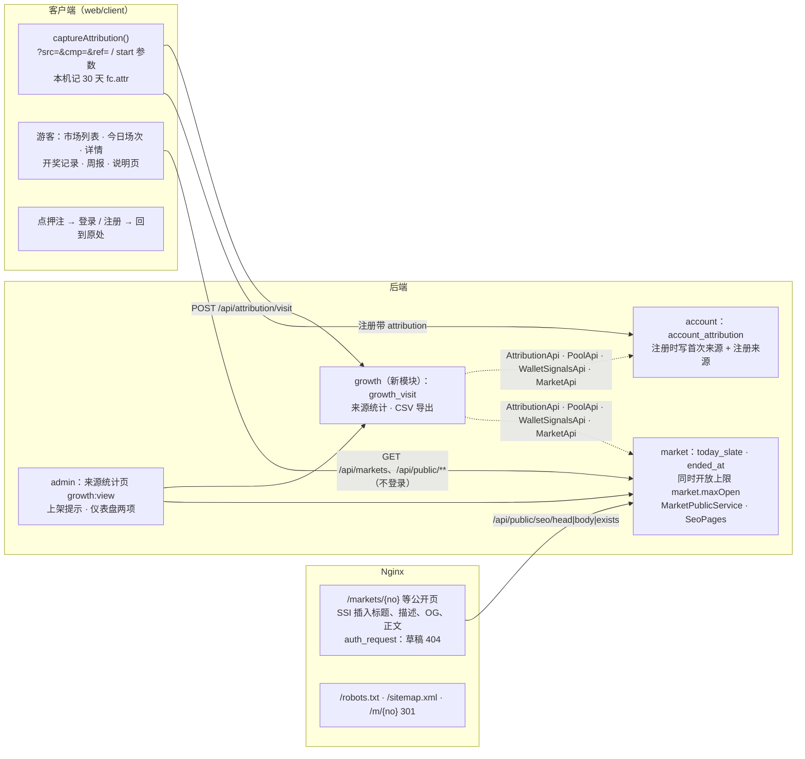

# S13 推广功能第一批（来源统计、场次化、不登录可浏览、公开开奖记录和周报、CSV 导出）：开发记录
- 阶段：开发 S13（需求说明书 v1.3.2 第 1.5 节 MF-1、MF-3、MF-4、MF-6、MF-10；第 4.2 节；第 5.2 节 P1、P2、P8、P11、P12、P14；第 6.2 节；NF-14；AC-80～AC-88、AC-94）
- 分支：`claude/s13-growth1`（从 `origin/claude/s11-client` 开出）
- 日期：2026-10-25
- 角色：研发工程师
- 依据：需求说明书 **v1.3.2**（优先）；架构方案 v1.5 第 18 节（扩展点 `captureAttribution()`、`/m/{publicNo}`、`forecast.public-browse.enabled`）；推广自动化文档的 MF-6 部分；S9 开发记录 SQ-21（仪表盘的"同时开放上限 / 今日场次"留给 MF-3）
- 不在范围：MF-5（周报卡片图片）、MF-7、MF-8 / MF-17、MF-9 / MF-11；分成（MQ-5：只记来源，不带任何奖励）；SQ-22
- 疑问的处理：按"需求 v1.3.2 > 架构"自己定，记在第 8 节（D-151 起），新问题第 9 节（SQ-30 起），没有停下来问

## 一图看懂

这张图想说明：来源在客户端记下、注册时交给 account；访问计数和统计在新的 growth 模块，它只通过别的模块的 `api` 包读数据；公开页给搜索引擎的版本由 Nginx 在同一个 `index.html` 里插入（SSI），浏览器里仍是同一个单页应用，没有另起一套服务端渲染。

## 1. 结论
- **MF-1 来源统计**：链接上的 `src`、`cmp`、`ref`（以及 Telegram 机器人 `start` 参数 `s-<src>__c-<cmp>__r-<ref>`）在客户端记下（首次来源 30 天、最近一次来源），每次带参数打开网站记一次访问（同一设备同一天同一来源只记一次）；注册时把两个来源交给后端，写 `account_attribution`。后台新菜单"来源统计"（`growth:view`）：按注册周 × 来源看访问、注册、首充、激活（首次下注）、第 2 周仍下注；按周的市场情况（有效市场率、每场下注人数中位数）、作废和取消原因、结束的市场。不带任何奖励（MQ-5）。
- **MF-3 场次化**：S6 的场次表核对过，补上"只在星期几"（`13:00@1,6,7`，AC-80 的"每周几场"）；参数"同时开放的市场数上限"（默认 2，0 = 不限），上架后会超过时提示"当前已开放 X 个，上限 Y 个"，要勾"仍要上架"（不硬拦，审计记下）；市场"列入今日场次"标记（编辑草稿、上架时勾；已上架的可以加入 / 移出；场次表生成的自动带上）；客户端市场页顶部"今日场次"（按客户所在时区的今天，没有时写下一场，不闪）；后台仪表盘"同时开放 X / 上限 Y""今日场次 N"（SQ-21）、市场列表"只看今日场次"。
- **MF-4 不登录可浏览**：市场列表、详情、已结束的市场、开奖记录、周报、P14 说明页不登录可看（开关 `forecast.public-browse.enabled` / `FC_PUBLIC_BROWSE_ENABLED`，默认开，需求第 5.2 节）；点押注、提醒等去登录，登录 / 注册后回到原来的地址（含 `?opt=` 选中的选项，手机直接弹出下注抽屉）。搜索引擎：公开页在服务器上就有标题、描述、规范地址、三种语言的 `hreflang`、分享卡片（OG、Twitter）和一段正文；草稿、不存在的市场返回 404；`robots.txt`、`sitemap.xml`；短链接 `/m/{编号}` 301。公开接口不返回任何客户的个人信息（裁决人只给编号、没有下注人）。
- **MF-6 公开开奖记录和周报**：P12 开奖记录（已结算、已作废、已取消；结果、依据、奖池、派彩、抽成、尾差、裁决人编号、作废 / 取消原因；按品类、状态、时间筛选，一页 20 个"加载更多"）；周报（UTC 的 ISO 周：场数、有效场数、作废 / 取消场数和原因、奖池合计、派彩合计、抽成合计、尾差、退款合计；本周写"截至现在"；历史周可翻看）。周报卡片图片是 MF-5，不做。
- **MF-10 CSV 导出**：来源统计页导出三种 CSV（按来源、按市场、按客户），服务器生成（UTF-8 带 BOM，Excel 直接打开；防公式注入），写审计 `growth.export`；文件里只有客户编号，没有邮箱、地址、证件信息（AC-94）。
- 迁移：`V21__s13_growth.sql`（V1～V20 没有改）。
- 本地全部实际执行（第 5 节）；截图第 6 节。

## 2. 做了什么
### 2.1 后端
| 位置 | 改动 |
|---|---|
| `common/attribution/Attribution`（新） | 来源参数的清洗（`[A-Za-z0-9._~-]{1,64}`，不合规的丢掉）、`start` 参数解析（URL 参数优先）、时间（不能在将来、最多 31 天前） |
| `account/api/AttributionApi`、`account/attribution/`（新） | 注册的同一事务写 `account_attribution`（首次来源、注册来源）；`registrations(from, to, limit)` 给统计用 |
| `account/auth` | `Register` 加可选的 `attribution {first, last}`（旧客户端不带也能注册） |
| `growth/`（新模块） | `VisitController`：`POST /api/attribution/visit`（公开，设备号 `X-Device-Id` 或 IP 的 sha256 去重，任何情况都回 204）；`GrowthService`：来源统计、三种 CSV；`growth/api/GrowthAdminApi` |
| `admin/ops/GrowthAdminController`、`GrowthOps`（新） | `GET /api/admin/growth/report`、`GET /api/admin/growth/export`（`growth:view`，导出写审计） |
| `market` | `today_slate`、`ended_at`（状态跳到已结算 / 已取消 / 已作废的同一条 SQL 写）；上架加 `todaySlate`、`overLimit`（超过上限不勾时 400 `overLimit:required`）；`POST /api/admin/markets/{no}/today-slate`；`GET /api/admin/markets/open-limit`；列表 `todaySlate` 筛选；仪表盘 `slate`；`GET /api/markets/today`（客户端今日场次）；场次表支持星期（`AutogenWindows.Slot`） |
| `market/core/MarketPublicService`、`market/pub/`（新） | 开奖记录、周报、站点地图的数据；`SeoPages`（标题、描述、规范地址、`hreflang`、OG、正文；草稿和不存在的 `exists=false`）；`PublicContent`（说明页三语文字 `resources/content/public-pages.json`，数字取参数的当前值）；`PublicController`（`/api/public/**`） |
| `MarketSettleView.totals`、`PoolApi.activity`、`WalletSignalsApi.firstCredited` | 周报的派彩 / 抽成 / 尾差 / 退款合计、统计用的首注和下注天、首次充值入账时间（各模块自己实现，growth 只调 `api`） |
| `SessionFilter`、`CurrentUser.optional()`、`PoolPushConfig` | 开关打开时，列表、详情、今日场次、开奖记录、周报、说明页、奖池推送的 GET / 握手不登录也放行；别的接口照旧 401 |
| 权限、菜单、配置 | 权限点 `growth:view`（54 个）；菜单"来源统计"（报表后面）；参数 `market.maxOpen`（"场次"一组）；`forecast.public-browse.enabled`、`forecast.public.brand-name` |

### 2.2 客户端（`web/client`）
| 页面 / 部件 | 改动 |
|---|---|
| `lib/attribution.ts`（新） | `captureAttribution()`：首次来源（30 天）和最近一次来源；注册成功后清掉；每次带来源参数打开记一次访问 |
| `App.tsx`、`components/Layout.tsx` | 公开路由（列表、详情、开奖记录、周报、说明页、`/m/:publicNo`）；游客顶栏"登录 / 注册"（位置和登录后的余额区一样，C90）；只有登录才有的部件（未读数、推送、新手引导）不对游客加载 |
| `components/market/TodaySlate.tsx`（新） | 市场页顶部今日场次（客户时区的今天；没有时写下一场；刷新只换数字，C84） |
| `pages/markets/MarketDetail.tsx` | 游客：电脑右栏"登录后押注 / 没有账户？注册"，手机点选项去登录；登录后回来选中的选项不变 |
| `pages/results/`（新）、`pages/HowTo.tsx`（新） | P12 开奖记录（手机卡片、电脑表格）、周报列表和一周、P14 说明页 |
| `pages/auth/Login.tsx`、`Register.tsx` | 回到来的地方；注册带来源 |
| `index.html` | SSI 占位（Nginx 插入标题、OG 和正文；JS 跑起来后正文隐藏，避免重复） |
| 翻译 | 新键三语齐全（`guest.*`、`slate.*`、`pub.*`、`res.*`、`wk.*`） |

### 2.3 后台（`web/admin`）
| 页面 | 改动 |
|---|---|
| 新建 / 编辑 / 检查上架 | "列入今日场次"；右栏"当前已开放 X 个，上限 Y 个"，超过时提示并要勾"仍要上架（超过上限）" |
| 市场详情、列表 | "今日场次"标记；已上架 / 已暂停的"加入 / 移出今日场次"；列表"只看今日场次" |
| 加密自动生成 | 场次表每行一个 UTC 时刻 + 星期（不选 = 每天），同时显示北京时间（跨天写"次日"） |
| 仪表盘 | "场次"两项：同时开放 / 上限（超过标红）、今日场次 |
| 参数设置 | "场次"一组 |
| 来源统计（新，`/growth`） | 合计、按注册周 × 来源、按周的市场情况、作废 / 取消原因、结束的市场；按首次来源 / 注册来源切换；日期范围；导出三种 CSV（页头，首屏可见） |

### 2.4 部署和端到端
- `deploy/nginx/site.conf.template`：`/__seo/*` 内部请求转后端（超时 2～3 秒，失败时照常给页面）；`/markets/{no}`、`/results/weekly/{w}` 先 `auth_request` 问后端存不存在，不存在 404；`ssi on`；`/robots.txt`、`/sitemap.xml`；`/m/{no}` 301。`deploy/kit` 加 `FC_PUBLIC_BROWSE_ENABLED`。
- `e2e/server.mjs` 模拟同样的 SSI、404、robots、sitemap、短链接（开发形态和部署形态用同一套用例）。
- `e2e/tests/growth.spec.ts`（新，3 个用例，两种形态都跑）：① 手机游客浏览列表、今日场次、详情 → 点押注 → 登录 → 回到原市场、抽屉打开且选中"否"；② 带来源打开网站 → 页面注册（请求带来源，注册后本机清掉）→ 后台来源统计这个来源 1 次访问 1 个注册 → 导出"按客户"CSV（没有邮箱）、有审计；③ 不跑 JS 看市场页（标题、规范地址、`hreflang`、OG、正文、英文版）、草稿和不存在的 404、`robots.txt`、`sitemap.xml`、`/m/` 301、开奖记录、周报、说明页。
- 已有用例：上架请求加 `overLimit: true`（端到端的库里开放的市场多）；`admin-pages.spec.ts` 检查"当前已开放 X 个"并在超过时勾"仍要上架"。

## 3. 搜索引擎怎么看到内容（AC-85）
| 项 | 做法 |
|---|---|
| 为什么不用服务端渲染 | 客户端是 Vite 单页应用，另起 Node 渲染要多一个服务和一套部署；SSI 只在 Nginx 加几行，后端拼一段 HTML（全部转义） |
| 插什么 | `<head>`：标题、描述、规范地址、`hreflang`（en、zh-CN、zh-TW、x-default，`?lang=`）、OG、Twitter；`<body>`：一段 `seo-static` 正文（导航 + 题目、选项、结果 / 开奖记录 / 周报 / 说明页）。浏览器里 JS 跑起来后正文隐藏 |
| 404 | `/markets/{no}`：草稿、已删除、不存在的 → 404（不收录）；`/results/weekly/{w}` 格式不对或在将来 → 404 |
| 后端不可用时 | `ssi_silent_errors`、超时 2～3 秒、5xx 时照常返回 `index.html`，页面本身不受影响 |
| robots | 允许公开页；禁止登录后才能看的页（`/me`、`/bets`、资产页 `/assets$` 等，`/assets/` 下的构建文件不挡）、登录注册页、`/api/`、`/admin/`；开关关掉时 `Disallow: /` |
| sitemap | 首页、市场列表、开奖记录、周报、说明页、最近的公开市场（最多 10,000 个） |

## 4. 迁移脚本
`V21__s13_growth.sql`：
1. `market_question.today_slate`、`ended_at` 和两个索引；已有终点市场按状态历史补 `ended_at`；已有的场次表生成的市场 `today_slate = 1`。
2. 参数 `market.maxOpen` = 2。
3. 新表 `account_attribution`（每个带来源注册的客户一行：首次来源、注册来源各 src / cmp / ref / start / 时间）、`growth_visit`（按 UTC 日期 + 访问者 + 来源去重）。
4. 菜单 `growth`（排在报表后面）。

## 5. 测试和本地验证
### 5.1 新增和改了的测试
| 测试 | 覆盖 |
|---|---|
| 后端 `admin/security/AdminGrowthTest`（新） | AC-81 同时开放上限（超过要勾、审计记下数量和上限、截止过的不算、0 = 不限）；今日场次（草稿勾、上架勾、列表筛选、仪表盘、上架后加入 / 移出、审计、权限、结束的不能改）；参数"场次"一组；来源统计的权限、导出审计、文件里没有邮箱；菜单 |
| 后端 `growth/S13PublicTest`（新） | AC-82 不登录浏览；AC-88 开奖记录和周报的数字、隐私（公开接口没有客户信息）；AC-85 SEO 头部、正文、404、转义；访问去重；AC-94 来源统计口径 |
| 后端 `growth/S13PublicBrowseOffTest`（新） | 开关关掉时公开接口 401、robots 全部禁止 |
| 后端 `market/pub/PublicContentTest`、`common/attribution/AttributionTest`（新） | 说明页三语结构和数字取参数；来源清洗、`start` 解析、时间 |
| 后端改了的 | `AuthFlowTest`（注册带来源）；`CryptoAutogenTest`（AC-80 场次表生成的自动列入今日场次、星期）；`AutogenWindowsTest`（星期）；`MarketClientContractTest`（不登录浏览、卡片字段）；`PoolPushTest`（游客握手）；`AdminSecurityTest`（54 个权限点）；`S9NotifyFlowTest`（菜单在 V21）；`AdminMarketTest`、`AdminSportsTest`（上架带 `overLimit`）；`ModuleRules`（加 growth 模块） |
| 客户端 `src/s13.test.tsx`（新） | 来源捕获、游客浏览和去登录、今日场次、开奖记录、周报、说明页；`real.test.ts` 新接口；`s11.test.tsx` 跟着改 |
| 后台 `src/s13.test.tsx`（新，13 个） | 上架时的上限提示和"仍要上架"、今日场次的勾选 / 标记 / 加入移出 / 筛选、仪表盘、参数、场次表星期、来源统计（正常、按注册来源、空、出错）、真实接口的路径和参数、导出 |
| 端到端 | `growth.spec.ts`（新，3 个，第 2.4 节） |

### 5.2 本地验证（全部实际执行，2026-10-25）
环境：Docker `mysql:8.4`、`redis:7`：后端测试 `fc-s13-mysql-test` / `fc-s13-redis-test`，开发形态端到端 `fc-s13-mysql-e2e` / `fc-s13-redis-e2e`（两个 Redis 不共用），结束后连同卷删除；JDK 25；Node 22；Playwright（Chromium）。

| 项 | 命令 | 结果 |
|---|---|---|
| 后端全量（空库） | `forecast_test` 删掉重建、Redis 清空后 `mvn -o -B -ntp verify`（V1 → V21） | **700 个测试，0 失败，5 个跳过**（真实数据源冒烟等默认跳过的），BUILD SUCCESS，21 分 53 秒。之前两轮：第一轮 1 个失败（`S9NotifyFlowTest` 核对菜单只看 V17 / V19，补上 V21 和新的一级菜单顺序），第二轮全过后又改了取消 / 作废市场的下注人数（D-169），第三轮全过 |
| 客户端 | `npm run lint`、`npx vitest run`、`npm run build`、`node ../../scripts/check-no-mocks.mjs`、`node ../../scripts/check-brand.mjs dist` | lint 通过；**191 个测试通过**（24 个文件）；构建通过；模拟层 240 个特有字符串都不在产物里；没有旧品牌名 |
| 后台 | 同上 | lint 通过；**213 个测试通过**（26 个文件）；构建通过；check-no-mocks 586 个；没有旧品牌名。（和后端全量同时跑的那一次有 3 个用例因为机器忙超时，空闲时重跑全过） |
| 官网 | lint、vitest、build、check-brand | **33 个测试通过**；构建通过；没有旧品牌名 |
| 端到端（开发形态，空库） | `bash e2e/start-backend.sh` + `npx playwright test`（先 `npx tsc --noEmit`） | **17 passed、3 skipped**（只在部署形态跑的），含新的 `growth.spec.ts` 3 个 |
| 端到端（部署形态） | 先确认没有 compose 项目 `forecast-e2e`；`E2E_SKIP_BUILD=1 E2E_MVN_ARGS=-o bash e2e/run-deployed.sh` | 第一次 1 个失败：**真实 Nginx 里 SSI 没有生效**（`/__seo/`、`/robots.txt`、`/sitemap.xml` 三个 location 的 `rewrite … break` 写在 `include proxy.inc` 前面，`set $forecast_app` 没执行，子请求 "invalid URL prefix"）——改成先 include 再 rewrite；第二次 19 passed、1 个 `crypto.spec.ts` 失败（自动裁决的原始返回多了一组，定时任务和用例触发同时跑，和本次改动无关，见第 11 节）；第三次 **20 passed**（2.3 分钟），Nginx 日志没有错误；内存 app 376 / 576 MiB、mysql 178 / 320 MiB；结束后 compose 项目和卷已删 |
| 页面走查截图 | Playwright 接真实后端（e2e profile），第 6 节 | 40 张 + `report.json` |
| 项目地图和索引 | `node scripts/check-project-index.mjs` | 通过 |
| 仓库旧品牌名 | `node scripts/check-brand.mjs --repo` | 通过 |
| 密钥扫描 | `gitleaks detect --no-banner -l warn --source <工作目录>` | 通过（no leaks found） |

## 6. 页面走查截图（不进仓库）
目录：`/tmp/claude-0/-home-user/8fe0f726-87bc-573f-911f-a95cbc1d2238/scratchpad/s13-shots/`（会话结束后清理；脚本是放在 `e2e/shots13/` 的临时用例，跑完删除、不进仓库）。数据：开发形态端到端跑完的库 + 脚本用接口造的已结算 / 已取消 / 已作废市场、今日场次两个、带来源的客户、待上架草稿。

| 编号 | 内容 |
|---|---|
| 001～012 | 手机 390×844 游客：市场列表（今日场次）、市场详情、开奖记录、只看已作废、周报列表、一周的周报、说明页、不存在的周、点押注到登录页、英文开奖记录、繁体说明页、深色市场列表 |
| 013～024 | 同上（电脑 1366×768；详情右栏"登录后押注"） |
| 025～028 | 登录的客户：市场列表（今日场次）、"我的"（开奖记录、周报入口）× 手机 / 电脑 |
| 029～031 | 不跑 JS（搜索引擎看到的）：市场页、开奖记录、说明页 |
| 032～040 | 后台：仪表盘"场次"两项、来源统计（按首次来源、导出菜单）、上架时超过同时开放上限、市场列表只看今日场次、市场详情的今日场次标记和"移出今日场次"、参数设置"场次"一组、自动生成的场次表星期、手机上的来源统计 |

**量的结果（`report.json`）**：
- 横向滚动：40 张都没有（表格在卡片里自己横向滚动）。
- C79：电脑 1366×768 游客详情右栏"登录后押注"底边 307；后台检查上架页"检查后上架"按钮底边 727（视口 900）。都在首屏。
- C90：手机游客 4 个页面（列表、详情、开奖记录、说明页）顶栏 `0,24,390,52`、"登录 / 注册" `272,34,110,32` 完全一样；登录后顶栏位置不变；电脑游客和登录后的顶栏、菜单位置看图一致（S11 的测量方法量的是登录后的菜单 `188,36,208,35`，本次一样）。

**看图发现并修掉的问题**（修完重截、再看）：开奖记录里平台作废的"依据"显示代码 `MANUAL`（加三语翻译"平台按规则作废"）；取消 / 作废的市场下注人数显示 0（D-169）；新手引导盖住登录后弹出的下注抽屉（D-170，端到端发现）；登录后被带回首页而不是原市场（D-171，端到端发现）。

## 7. 和方案不同的地方
| 项 | 方案 | 现在 | 理由 |
|---|---|---|---|
| 搜索引擎版本 | 架构第 18 节写"预渲染或服务端渲染" | Nginx SSI + 后端拼一段 HTML | 不加服务；第 3 节 |
| 场次表 | S6 只能"每天的几个时刻" | 加"只在星期几" | 需求第 4.2 节、AC-80"每周几场" |
| 访问计数 | 架构只写了注册时记来源 | 另记带来源的访问（`growth_visit`） | 需求第 6.2 节来源统计要"访问" |

## 8. 研发的决定（待 PM / Amos 复核，D-151 起）
| 编号 | 问题 | 做法 | 理由 |
|---|---|---|---|
| D-151 | 客户端"今天" | 客户所在时区的今天（浏览器换成 UTC 范围传给后端）；后台仪表盘按 UTC | 客户看的是自己的日历；后台和别的统计一样用 UTC |
| D-152 | 同时开放的数怎么数 | 已上架或已暂停、截止时间还没到的市场 | 截止后不再接受下注，不算"同时开放" |
| D-153 | 超过上限 | 只提示、勾"仍要上架"后照常上架（审计记下当时数量和上限）；自动生成的不受限 | 需求第 4.2 节"建议"；热点快反要能临时多开 |
| D-154 | 今日场次标记谁能改 | `market:publish`；草稿、已上架、已暂停的能改，结束了的不能改 | 和上架同一权限；结束的没有意义 |
| D-155 | 周报的周 | UTC 的 ISO 周（周一 00:00 起）；市场归到 `ended_at` 所在的周 | 和后台统计一致；结束时间唯一 |
| D-156 | 周报的奖池合计、派彩、抽成 | 只算这一周**已结算**的市场；作废、取消的退款单列"退款合计" | 作废、取消的奖池全部退回，算进奖池合计会误导 |
| D-157 | 作废场数 | 显示已作废、已取消分开的数和原因 | 需求写"作废场数和原因"，取消也属于"没开出结果" |
| D-158 | 公开作废 / 取消原因 | 公开后台填写的原因原文（作废的标准原因按三语翻译） | AC-88 要求公开原因；后台填写时就应当按公开文字写（SQ-31） |
| D-159 | 裁决人 | 只公开裁决人编号（管理员 id），不公开名字；公开接口不返回任何客户信息 | 隐私；需求 P12 "裁决人编号" |
| D-160 | 注册周 | 按 `account_user.created_at`（UTC） | 唯一可靠的注册时间 |
| D-161 | 第 2 周仍下注 | 注册后第 8～14 天（UTC 日期）下过注；第 2 周还没过完的客户不算进分母 | 避免本周注册的人把比例拉低 |
| D-162 | 访问去重 | 同一访问者（设备号的 sha256，没有设备号用 IP 的 sha256）同一天同一来源只记一次；不存原始设备号和 IP | 统计够用、少存个人数据 |
| D-163 | 来源的有效期 | 首次来源 30 天（客户端本机），注册时交给后端；注册成功后本机清掉 | 推广常用口径；同一台设备注册的下一个账户不再算这个来源 |
| D-164 | 来源参数格式 | 每项 1～64 位字母数字和 `._~-`，不合规的丢掉；Telegram `start` 参数 `s-<src>__c-<cmp>__r-<ref>`，URL 参数优先 | `start` 只能用这些字符；防注入 |
| D-165 | 不登录的奖池推送 | 开关打开时游客也能连 `/api/ws/markets`（只收公开的奖池数字） | 列表、详情的奖池要实时，推送里本来就没有个人数据 |
| D-166 | 内部和测试调用上架 | 旧的三参数 `publish(no, checked, adminId)` 不受上限阻止 | 只有后台接口按页面的勾选走；端到端的上架请求带 `overLimit: true` |
| D-167 | robots | 允许公开页，禁止私有页和接口；开关关掉时全部禁止 | 第 3 节 |
| D-168 | 说明页的文字 | 研发写的三语初稿（`public-pages.json`），数字取参数的当前值 | 需求 P14 的事实都来自参数；文字待 PM 定稿（F-31） |
| D-169 | 取消、作废市场的奖池和下注人数 | 开奖记录、来源统计按"收到过的下注"算（含已退回的，`MarketPoolView.placed`）；已结算的仍按结算时的有效持仓 | 退款后持仓清零，按持仓算会显示 0 人，和事实不符（截图走查发现） |
| D-170 | 新手引导和"登录后回到原处" | 新客户在市场详情页不自动弹新手引导（回到列表等页面再弹） | 游客点押注 → 登录 → 回到市场时下注抽屉直接打开，引导会盖住它（端到端发现） |
| D-171 | 登录后去哪里 | 来自"押注 / 提醒"等的跳转：回到原地址（含 `?opt=`）；客户自己点"退出登录"后再登录：到首页 | 登录页、注册页的"已登录就离开"原来固定去首页，和登录页自己的跳转抢先后（端到端发现）；主动退出时回到"我的"不合理 |

## 9. 需要 Amos 决定的新问题
| 编号 | 问题 | 建议 |
|---|---|---|
| SQ-30 | 搜索引擎版本用 Nginx SSI（第 3 节），不另起服务端渲染。可以吗？ | 建议先这样；以后做内容页（MF-7 文章）再评估 |
| SQ-31 | 作废、取消的原因是后台填的原文，会公开在开奖记录和周报里（AC-88）。后台填写时是否要求三语、是否需要审核？ | 建议第一期公开原文，后台取消 / 作废的原因输入框加提示"会公开显示" |
| SQ-32 | 周报"奖池合计"只算已结算的市场（D-156），作废、取消的退款单列。和推广文档里的口径是否一致？ | 建议维持 |
| SQ-33 | "同时开放上限"默认 2：加密场次表每天一场 + 体育热门，常常会超过；超过时只提示。要不要把自动生成的也算进来提示？ | 现在自动生成的不受限，只算数；建议维持 |
| SQ-34 | 不登录可浏览的开关默认开（需求第 5.2 节）。测试环境、生产都开吗？ | 建议都开；需要时用 `FC_PUBLIC_BROWSE_ENABLED=false` 关 |

## 10. 超出要求的部分（C7）
| 改动 | 理由 |
|---|---|
| 已上架市场的"加入 / 移出今日场次" | 只在上架时勾不够用（体育临时加场） |
| 短链接 `/m/{编号}` | 架构第 18 节的扩展点，分享到 Telegram 时更短 |
| CSV 防公式注入（`=`、`+`、`-`、`@`、制表符开头的加 `'`） | Excel 打开导出文件的常见风险 |
| 访问只存哈希 | D-162 |

## 11. 遗留问题
- 部署形态端到端有一次 `crypto.spec.ts` 失败：自动裁决的原始返回记录多了一组（定时任务和用例的 `/api/e2e/resolve/tick` 同时取数），重跑通过；和本次改动无关，建议测试角色看是否要让 e2e profile 关掉加密自动裁决的定时任务（F-32）。
- 端到端环境里冷静期、新地址生效时间是 0，说明页会写"0 小时冷静期"；正式环境按参数显示（2 小时等）。值为 0 时的说法待 PM 定稿时一起看。
- 部署形态端到端在本机构建的镜像 `forecast-app:e2e-local`、`forecast-web:e2e-local` 没删（`run-deployed.sh` 每次覆盖同一个标签，可能有别的任务在用）。
- 说明页、开奖记录和周报的公开文字是研发初稿，待 PM 定稿（F-31）；繁体待人工校对（PQ-5）。
- 周报卡片图片（MF-5）、文章（MF-7）、Telegram 机器人（MF-8 / MF-17）不在本步。
- 来源统计一次最多算 53 周、5 万个注册客户，超过时页面提示"缩小范围"（`truncated`）。

## 12. 跨角色反馈 / 提交
| 编号 | 提出方 → 接收方 | 内容 | 状态 |
|---|---|---|---|
| F-31 | 研发 → PM | 第 8 节 D-151～D-171、第 9 节 SQ-30～SQ-34；说明页、开奖记录、周报、游客提示的三语文案初稿 | 待 PM 复核 |
| F-32 | 研发 → 测试 | 新端到端 `growth.spec.ts`（两种形态）；后端 `AdminGrowthTest`、`S13PublicTest`、`S13PublicBrowseOffTest`；前端 `s13.test.tsx` | 转 Amos |
| F-33 | 研发 → 运维 | 新环境变量 `FC_PUBLIC_BROWSE_ENABLED`（默认 true）；Nginx 模板加 SSI、`auth_request`、`/robots.txt`、`/sitemap.xml`、`/m/`（需要 Nginx 带 `ngx_http_auth_request_module`，官方镜像有）；迁移 V21 | 转 Amos |
