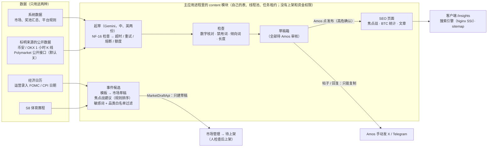

# S15 事件和文章自动化程序（第一期）和分享码：开发记录
- 阶段：开发 S15（`需求文档/v1.3-事件和文章自动化.md` 全文、EQ-1～EQ-8 按建议；需求说明书 v1.3.2 第 6.3、6.4 节、MF-9、MF-11；架构方案第 18 节、NF-15、NF-16）+ 小改动：分享链接的 `ref` 改用随机分享码（S14 的 SQ-36）
- 分支：`claude/s15-automation`（从 `origin/claude/s14-cards` 开出，提交 `ba6dfff`）
- 日期：2026-10-26
- 角色：研发工程师
- 依据的优先级（任务里定的）：自动化需求 > 需求说明书 > 架构方案；有冲突时按这个顺序自己定，记在第 8 节（D-193 起），新问题第 9 节（SQ-37 起），没有停下来问
- 不在范围：热点新闻候选（EQ-2：第一期不做）；自动发到 Telegram / X（MF-7，等 SQ-22 和账号，"渠道开关"只放了占位）；Gemini 第二层的"敏感分类"（只有热点新闻要用，第一期没有热点新闻）
- **测试里从来不连真实的 Gemini**：后端测试用本机 HTTP 替身，端到端用后端自己的替身接口（只在 e2e profile 存在）

## 一图看懂

这张图想说明：程序做两件事——把赛程和经济日历变成**市场草稿**（停在"待上架"，要有上架权限的人检查后上架），把系统数据和公开行情交给 Gemini 起草**文字草稿**（全部进草稿箱）。每条文字草稿都带"引用的数据"清单，数字核对、禁用词、倾向词任何一项不过都标红、不能发布。网站上的 SEO 页面和文章只有 Amos 点"发布"才出现；X、Telegram 的帖子和回复只有"复制"，程序不发任何东西出去。

## 1. 结论
- **分享码**：每个客户一个随机分享码（10 位小写字母和数字，去掉容易看错的 i、l、o、0、1；唯一约束；第一次分享时生成，以后不变）；分享链接的 `ref` 改用它，**链接里不再出现客户编号**。来源统计照样按人：后台"来源统计"和导出的 CSV 把分享码换算成分享人的客户编号（新列）；**旧链接兼容**：`src=share` 而 `ref` 是纯数字的（S14 发出去的链接）原样当成客户编号统计。分享弹窗的说明改成"链接里带一个随机分享码（不是你的客户编号）……"。
- **自动化程序第一期**：经济日历（FOMC、美国 CPI，EQ-6）按题型模板生成市场草稿（发布前 7 天；选项可判定、覆盖全部情况），直接进"待上架"；S8 赛程统一进"事件候选"，给焦点战建议（规则排的，附理由）；敏感词 + 品类白名单过滤，命中的记原因。文字草稿：赛前前瞻、赛后简报、SEO 页面说明、文章、X 帖子、Telegram 帖子、回复，**每种都是中文、英文两份**（繁体由程序从简体按固定规则转换）；全部进草稿箱，Amos 一键发布（高危确认，写审计）；SEO 页面和文章发布在网站上（`/insights`），帖子和回复只有"复制"按钮（复制的链接带 `src=x|tg&cmp=post-…`）。卡片仍用 S14 的模板（程序画图，不用 AI）。
- **写作红线**：每个数字都要在"引用的数据"里找得到（四舍五入、向下取整都算），找不到的标红、不能发布；禁用词、倾向词在保存时检查（有就不保存），发布时再查一遍；Gemini 起草不合格先自动重写一次。
- **Gemini**：key 只从环境变量 `FC_GEMINI_API_KEY` 来（Amos 填），后台只显示"已配置 / 未配置"；超时、最多重试 2 次（间隔递增）、熔断、429 暂停 10 分钟、401 / 403 发告警（C81）；每天上限可在后台改（默认 300，和体育比分解析共用，文章起草最多用到 80%，比分解析优先）；发出前检查提示里没有邮箱、链上地址、IP、key 等（NF-16，有就整次不发、记日志）；没有 key 时 AI 起草不可用，市场草稿、数据卡、页面数据照常。
- **数据工具（MF-9）**：数据卡（市场奖池 / BTC 每小时涨跌）、大 V 对照图（观点 + 市场 + 可选的 Polymarket 同类题；**Polymarket 公开接口默认关闭**）；图片由程序按模板画，印数据来源和查询时间，只能下载和复制。
- **SEO 页面（MF-11）**：每场焦点战一页（实时奖池）、一个 BTC 每小时涨跌统计页、文章页（每周最多 2 篇，EQ-7）；每天新页面最多 5 个；进 S13 的站点地图和 Nginx SSI（不跑 JS 也能读到正文）。
- **进程和内存**：**内容程序跑在主应用进程里，不另起容器**——另起一个 JVM 至少 150 MB，C75 的余量只有 171 MB（第 3 节）；隔离靠自己的表、自己的有界线程池、自己的任务租约、总开关 `FC_CONTENT_ENABLED`、只能经 `MarketDraftApi` 建草稿（ArchUnit 强制）、Gemini 调用不在数据库事务里。容器内存上限不变。
- 迁移：`V23__s15_share_code.sql`、`V24__s15_content.sql`（V1～V22 没有改）。
- 本地全部实际执行（第 5 节）；截图第 6 节。

## 2. 分享码（S14 的 SQ-36）
| 项 | 做法 |
|---|---|
| 表 | `account_share_code`（`user_id` 主键、`code` 唯一、`created_at`），V23 |
| 生成 | `account/sharecode/ShareCodeService`：先普通读；没有就 `INSERT IGNORE`（随机码，`SecureRandom`）再读（约定 34：不对不存在的行加锁读）；码撞了换一个，最多 8 次。同一个客户同时两次分享只有一个码（`S15ShareCodeTest`） |
| 格式 | `ShareCodeApi.FORMAT`：`[a-hj-km-np-z][a-hj-km-np-z2-9]{9}`（首位是字母，和纯数字的旧 `ref` 区分得开） |
| 链接 | `CardController`：登录了带 `ref=<分享码>`；没登录不带 |
| 统计 | `GrowthService.refCustomer`：分享码 → 它的客户；`src=share` 的纯数字 → 旧链接，原样；别的渠道的 `ref`（例如 `kol_amy`）不当成客户。报表 `cohorts[].refCustomer`；来源 CSV 加 `ref_customer_no`（中文表头"分享人客户编号"），客户 CSV 加 `first_ref_customer_no`、`reg_ref_customer_no` |
| 后台 | "来源统计"的来源列多一个标签"分享人 {客户编号}" |

## 3. 进程和内存（C75）
- 测试服务器（2 核 2 GB，`free -m` 1,613 MB）：容器上限合计 992 MB + 系统 450 MB = 1,442 MB，余量 **171 MB**，规则要求余量不少于 150 MB。单独一个 Java 进程（Spring Boot + MyBatis + 连接池）实测最小也要 150～200 MB，放不下；换成别的语言要多维护一套数据库访问和部署，第一期的量（每天几十次 Gemini 调用、几个页面）也用不着。
- 所以**在主应用进程里**，用这些办法做到需求要的"独立运行、不影响下注和资金"（NF-15、AC-117）：
  1. 模块 `content` 只读写自己的表（`content_*`）；只能经 `market.api.MarketDraftApi` 建市场草稿（这个接口里没有上架、改状态的方法），经 `MarketPublicApi` 读公开快照，经 `resolve.api.MarketDataApi` 读行情；**不依赖 ledger、wallet、pool、settle、resolve 的写接口**（ArchUnit `ContentIsolationTest` 3 条）。
  2. 自己的线程池（2 个线程、队列 50、满了直接拒绝并记"排队已满"），Gemini 调用和画图都在这里，不占 Tomcat 线程；`GeminiClient` 在数据库事务里被调用会直接报错（测试"不能在数据库事务里调用"）。
  3. 自己的定时任务和租约 `content.job`（每分钟一轮）；总开关 `FC_CONTENT_ENABLED=false` 时定时任务不跑、手动生成返回 503，已发布的页面照常显示。
  4. 行情取数用独立的熔断名（`BINANCE_1H`、`OKX_1H`），内容程序取数失败不会让加密自动裁决的熔断跳闸。
  5. 测试"Gemini 慢的时候下注照常，不等它"：替身每次 1.5 秒，期间下注 < 1 秒完成。
- 进程里多出来的内存：2 个工作线程（约 1 MB 栈，在 compose 说明里"约 110 个线程"之内）；堆里同时最多 2 张 1200 × 630 的图（约 6 MB）；Gemini 的请求和返回几 KB；繁体转换表 248 KB。**容器上限、JVM 参数都不变**（`deploy/kit/docker-compose.yml` 加了说明）。部署形态端到端跑完后的实测见第 5.3 节。
- 这和架构方案第 18.3 节"单独的进程（单独的容器）"不同，见第 7 节和 SQ-37。

## 4. 自动化程序
### 4.1 事件候选（自动化需求第 3 节）
- **经济日历**：后台录入（类型、期间 `YYYY-MM`、UTC 发布时间、上一期的值、官网链接）；CPI 必须填上个月公布的同比（题目的分界线），发布时间要在 1 小时 10 分钟以后，同一类型同一时间不能重复。定时任务在发布前 N 天（默认 7，后台可改）生成草稿，也可以"立即生成"。草稿：品类 MACRO、平台裁决、开放 = 生成时、截止 = 发布前 1 小时、事件结束 = 发布后 1 小时；题目、规则、三个选项和判定条件按模板（三语），来源用官网。**生成的市场草稿直接"提交上架"**（进"待上架"、提醒有 `market:publish` 的人），上架仍要人检查后点（AC-102，D-197）。
- **题型模板**（后台"模板"可改，改了只影响以后生成的）：FOMC"降息 / 维持 / 加息"（按目标区间上限和会前比）；CPI"高于 / 等于 / 低于 {上月同比}%"（按首次公布的 CPI-U 同比，1 位小数）。模板保存时检查禁用词和不认识的变量。
- **焦点战建议**：从 S8 赛程（未来 7 天）按规则排：联赛优先级、开赛时间对华语用户是否方便、两个数据源的对应是否已确认、是否已有市场；每天给 1～3 场，附理由；**只是建议**，生成市场草稿仍在"体育赛程"由人操作（MQ-1、MQ-10）。
- **过滤**：品类白名单（体育、经济、加密）+ 敏感词表（后台可加；内置选举、战争、未成年人等）；命中的不生成，记"已过滤"（来源、对象、原因、命中的词）。

### 4.2 文字草稿（自动化需求第 4 节）
| 种类 | 对象 | 去哪里 | 过期 |
|---|---|---|---|
| 赛前前瞻 PREVIEW | 已上架的市场 | 焦点战页 + 可复制 | 截止下注时 |
| 赛后简报 BRIEF | 已结算的市场 | 复制 | 24 小时 |
| SEO 页面说明 SEO_INTRO | 焦点战页 / BTC 统计页 | 网站页面 | — |
| 文章 ARTICLE | 主题（只能写引用数据里有的：平台规则、BTC 统计） | 网站 `/insights/article-…` | — |
| X / Telegram 帖子 | 已上架的市场 | 复制（带 `src=x|tg&cmp=post-…` 的链接） | 24 小时 |
| 回复 REPLY | 工具里的观点 + 市场 | 复制 | 24 小时 |
- 每次生成一组：中文、英文各一条（`group_no`），各自审核、各自发布；繁体在发布时按固定规则从简体转换（`check/Hant`，表来自 OpenCC，Apache-2.0，`content/s2tw.txt`）。
- 起草：拼提示（规则、任务、"数据（来源，时间）"清单）→ NF-16 检查 → Gemini → 解析 JSON → 检查；不合格把原因写进提示重写一次；仍有禁用词 / 缺内容 → "生成失败"；只是数字对不上 / 太长 → 待审核但标红（留给人改）。
- 草稿状态：生成中 → 待审核 → 已发布 / 已驳回 / 已过期 / 生成失败；改动都是带版本号的条件更新；生成中断（进程重启）的 10 分钟后标"生成失败"。
- 每日草稿包（00:00 UTC，可关）：给今天的场次起草，邮件 `CONTENT_DIGEST` 提醒有 `content:publish` 的人审核。
- 紧急停止：发布和复制都停，草稿照常生成。

### 4.3 Gemini（自动化需求第 6 节）
- 配置 `forecast.content.gemini`：`api-key`（`FC_GEMINI_API_KEY`）、`model`（`FC_GEMINI_MODEL`，默认 `gemini-2.5-flash-lite`）、连接 5 秒 / 读取 30 秒、最多 3 次（重试 2 次，2 秒、8 秒）、连续 5 次失败熔断 60 秒、429 暂停 10 分钟。key 放在请求头 `x-goog-api-key`，不出现在地址和日志里。
- 用量表 `content_ai_day`：每天的调用次数（文章起草 / 比分解析分开）、token、连续失败、告警记录；每天上限和占比在后台改；本月费用按付费档价格估算，超过提醒线发一封 `CONTENT_ALERT`。
- 比分解析（`Purpose.SCORE`）的额度预留了接口，S8 的体育抓取现在用的是数据源接口、还没有用 Gemini 解析页面，所以现在只有文章起草在用。

### 4.4 页面（MF-11）
- `/insights`（列表）、`/insights/btc-hourly`、`/insights/focus-<市场编号>`、`/insights/article-<编号>`；后端 `GET /api/public/insights`、`/api/public/insights/{slug}`（跟"不登录也能看"的开关），搜索引擎版本由 `InsightsProvider` 实现 S13 的 `PublicPageProvider`（标题、描述、hreflang、正文），站点地图加这些页面；Nginx 和端到端的 `server.mjs` 把 `/insights/<slug>` 加进"先问存不存在"的规则（不存在 404）。
- 焦点战页：列入今日场次的体育市场上架后自动建（每天新页面上限 5），数据部分实时取；说明文字和赛前前瞻审核发布后才显示，某种语言没发布就只显示数据。
- BTC 统计页：币安 1 小时 K 线（取不到用 OKX），过去 7 天 168 根；收盘 ≥ 开盘算涨（和本站加密市场一样）；每天更新一次，后台可手动刷新；写明来源、时间、原始返回的 sha256。
- 文章页：发布时才建；中文、英文分别发布。
- 后台"页面"可以隐藏 / 显示（高危）。

### 4.5 后台"内容中心"
菜单"内容中心"（在"来源统计"后面）：草稿箱、事件候选、页面、模板、工具、日志、用量和设置。权限点 `content:view`、`content:edit`、`content:publish`（高危：发布、设置、紧急停止、词表、页面显示隐藏）。草稿抽屉左右两栏是中文和英文：标题、正文（可改）、预览（对不上的数字标红）、检查结果、引用的数据；生成中每 2 秒刷新。设置页只显示 key"已配置 / 未配置"；没有"自动发布"开关（EQ-1）；"渠道开关"是占位（X、Telegram 关着、不能打开，等 MF-7）。

### 4.6 客户端
- `/insights`、`/insights/:slug`（三语，不登录可看，页脚加"数据和文章"入口）。
- 分享弹窗的说明改为分享码。

## 5. 测试和本地验证
### 5.1 新增和改了的测试
| 测试 | 覆盖 |
|---|---|
| 后端 `content/S15DraftsTest`（10） | AC-106 每种草稿中英两条、引用数据、过期时间、待审核、没有自动发布；帖子审核后才能复制、链接带来源参数、回复没有发布；AC-107 数字对不上标红不能发布、改正后能发布；AC-108 禁用词重写一次仍有就生成失败、人工加的禁用词和倾向词不能保存；AC-111 过期；AC-114 没有 key；AC-116 提示里没有个人数据、塞进邮箱的被拦下；AC-118 紧急停止、日志、用量；每周文章上限；每日草稿包 |
| 后端 `content/GeminiClientTest`（11） | 成功计用量、key 在请求头；500 / 断开重试 2 次间隔递增；读取超时；429 暂停；401 告警；没有 key 不调用；每天上限和 80%；连续失败告警一天一封；个人数据整次不发；不能在事务里调用；Gemini 慢时下注照常 |
| 后端 `content/S15EconTest`（6） | AC-100 FOMC、CPI 提前 7 天生成三语草稿、只是草稿、直接进"待上架"并提醒；录入检查；AC-103 敏感词过滤；来不及生成的标过期；没有 key 照常；模板检查 |
| 后端 `content/S15PagesTest`（5） | AC-112 焦点战页数据一致、说明审核前不显示、三语、不跑 JS 能读到、市场编号是字符串；BTC 统计和手算一致；BTC 取不到；每天页面上限；文章页 |
| 后端 `content/ContentChecksTest`（5）、`content/draft/PromptsTest`（2）、`content/ContentAppendOnlyTest`（1） | 数字核对、词表、NF-16 检查、繁体转换和 OpenCC 一致、BTC 统计；双语数值在提示里按语言取；日志只增不改 |
| 后端 `arch/ContentIsolationTest`（3）、`admin/security/AdminContentTest`（3）、`growth/S15ShareCodeTest`（2） | 隔离（AC-117）；权限、审计、菜单；分享码和来源统计 |
| 后端（改） | `ModuleRules` 加 content；`S14CardsTest`（ref 是分享码）；`S9NotifyFlowTest`（员工模板、菜单）；`StubHttp` 能记请求体 |
| 后台 `src/s15.test.tsx`（13） | 权限点；草稿箱标红、不能发布、改好保存后能审核通过、通过后才能复制；保存时禁用词；没有 key 的提示；英文界面；设置（只显示已配置、没有自动发布、渠道占位关着、紧急停止和恢复）；事件候选；页面；工具（只有下载和复制）；日志；来源统计的分享人；真实接口的路径和参数（高危带 reason 和 checked） |
| 客户端 `src/s15.test.tsx`（7）、`api/real/real.test.ts`（+1） | 列表、空、出错；焦点战页、BTC 页、文章页（英文）、找不到；分享说明；接口地址 |
| 端到端 `e2e/tests/content.spec.ts`（新，2 个，两种形态） | ① 经济日历 → 市场草稿进"待上架"；后台生成文章 → 替身起草 → 检查通过 → 发布（高危确认）→ 客户端 `/insights` 和文章页（手机 390、没有横向滚动）、不跑 JS 的版本、规范地址、英文版、404、站点地图；替身写错数字 → 标红、按钮不可用、接口发布被拒、改掉后通过；② 没有 key：状态"未配置"、AI 起草返回"暂时用不了"、替身一次也没被调用、经济日历和 BTC 页照常、后台提示 |
| 端到端 `cards.spec.ts`（改） | `ref` 是分享码、不是客户编号；来源统计换算成分享人 |

### 5.2 本地验证环境
Docker `mysql:8.4`、`redis:7`：后端测试 `fc-s15-mysql-test` / `fc-s15-redis-test`，开发形态端到端 `fc-s15-mysql-e2e` / `fc-s15-redis-e2e`（两个 Redis 不共用）；部署形态用共用的 compose 项目 `forecast-e2e`（跑之前确认没有别人在用）；JDK 25；Node 22；Playwright（Chromium）。

### 5.3 结果（全部实际执行，2026-10-26）
| 项 | 命令 | 结果 |
|---|---|---|
| 后端全量（空库） | `forecast_test` 删掉重建、Redis 清空后 `mvn -o -B -ntp verify`（V1 → V24） | 第一次：764 个里 1 个失败——`AdminSecurityTest` 的权限点总数还是 54（S15 加了 3 个），改成 57；改后再删库重跑：**764 个测试，0 失败，5 个跳过**（默认跳过的真实数据源冒烟等），BUILD SUCCESS，22 分 50 秒 |
| 后台 | `npm run lint`、`npx vitest run`、`npm run build`、`node ../../scripts/check-no-mocks.mjs src/mocks dist`、`node ../../scripts/check-brand.mjs dist` | lint 通过；**226 个测试通过**（27 个文件；和后端全量同时跑的那一次 S13 的一个用例超时（20 秒），单独重跑通过，后端跑完后全量重跑 226 个全过）；构建通过；模拟层 703 个特有字符串都不在产物里；没有旧品牌名 |
| 客户端 | 同上 | lint 通过；**207 个测试通过**（26 个文件）；构建通过；check-no-mocks 258 个；没有旧品牌名 |
| 官网（没有改动） | lint、vitest、build、check-brand | **33 个测试通过**；构建通过；没有旧品牌名 |
| 端到端（开发形态，空库） | `bash e2e/start-backend.sh` + `npx playwright test` | `content.spec.ts` 单独：第一次 2 个失败（替身写错数字时我以为是"生成失败"，实际按设计是"待审核但标红"；没有 key 时先撞到每周文章上限）——改用例；之后通过。全量：**23 passed、3 skipped**（只在部署形态跑的），3.0 分钟 |
| 端到端（部署形态） | 先确认没有 compose 项目 `forecast-e2e`；`E2E_SKIP_BUILD=1 E2E_MVN_ARGS=-o bash e2e/run-deployed.sh` | **26 passed**（2.7 分钟），含 `content.spec.ts` 2 个、改过的 `cards.spec.ts`；跑的过程中每 5 秒记一次 `docker stats`：**app 最高 382 MiB（上限 576）**，mysql 182 MiB（上限 320），redis 4 MiB（S14 时 app 345～365 MiB）；结束后 compose 项目和卷已删 |
| 项目地图和索引 | `node scripts/check-project-index.mjs` | 通过（298 个文件，5 类名单） |
| 仓库旧品牌名 | `node scripts/check-brand.mjs --repo` | 通过 |
| 密钥扫描 | `gitleaks detect --no-banner -l warn --source <工作目录>` | 通过（no leaks）；另外加 `--no-git` 扫了工作目录（含没提交的构建产物）：只在 `web/admin/dist`（不进仓库）里有 1 处误报（antd 的 `onColumnResize`） |

## 6. 截图走查（不进仓库）
目录：`/tmp/claude-0/-home-user/8fe0f726-87bc-573f-911f-a95cbc1d2238/scratchpad/s15-shots/`（会话结束后清理）。由 `content.spec.ts` 在设了 `E2E_SHOTS_DIR` 时截（开发形态端到端的新库）。每张都逐张看过；看图发现并改了：
- 英文草稿里出现中文（引用数据的值"不能 / No"、来源"本站奖池"原样给了英文提示）：数值和来源改成"中文 / English"，提示按语言取一边（`Prompts.side`，`PromptsTest`）。
- 客户端文章页"更新于 … UTC UTC"：时间函数自带 UTC，去掉翻译里多的一个；更新时间那行没有左右留白，补上。
- 日志的"种类"列显示 `BTC_STATS` 原文：补了日志里出现的种类翻译。
- 截图时抽屉、表格还在动画 / 加载中（半透明）：截图前等加载和动画结束。

## 7. 和方案不同的地方
| 项 | 方案 | 现在 | 理由 |
|---|---|---|---|
| 进程形态 | 架构第 18.3 节：单独的进程（单独的容器）；开发前写单独的技术方案交 Amos | 主应用进程里的 `content` 模块，靠表、线程池、租约、开关、ArchUnit 隔离 | 第 3 节：C75 余量放不下另一个 JVM；需求要的"挂了不影响下注和资金"用别的办法做到了并有测试。请 Amos 确认（SQ-37；整合 4 注：Amos 2026-10-26 按建议） |
| Gemini key 给谁 | 架构第 18.3 节：自动化程序的 key | 主应用的环境变量 `FC_GEMINI_API_KEY` | 同一个进程 |
| 经济日历日程 | 自动化需求第 3.1 节："官方日程每月检查 1 次（可以用 Gemini 解析），运营也可以手动录入" | 只有运营手动录入 | 美联储、劳工统计局的日程页是 HTML，格式会变，解析错了会开错题；第一期每年 8 次 FOMC + 12 次 CPI，手动录入一次几十秒。见 SQ-41 |
| 市场草稿进哪里 | 自动化需求第 3.3 节："有 market:publish 的人检查后上架" | 程序建好草稿后直接"提交上架" | 不提交的话草稿不在"待上架"里、没人会看到；上架仍然要人检查（D-197） |
| 敏感分类第二层（Gemini） | 第 3.4 节 | 没做 | 只用于热点新闻（EQ-2 第一期不做） |
| 一键发到 Telegram（AC-109） | 第 4.4 节 | 没做，只有复制 | MF-7、SQ-22 和账号还没有；任务明确"X/TG 只出草稿 + 复制" |
| AC-105 草稿预检 | 第 3.3 节 | 沿用市场管理已有的必填检查（提交上架时检查） | 程序生成的草稿直接提交上架，提交时就跑这一套检查，不合格的不会进"待上架"（经济日历标"生成失败"并写原因） |

## 8. 研发的决定（待 PM / Amos 复核，D-193 起）
| 编号 | 问题 | 做法 | 理由 |
|---|---|---|---|
| D-193 | 分享码长什么样 | 10 位，小写字母和 2～9，首位字母 | 不会和旧的纯数字 `ref` 混；去掉 i、l、o、0、1 好抄；31^10 不会撞 |
| D-194 | 分享码什么时候生成 | 第一次分享时（取卡片接口） | 不给从来不分享的客户建行 |
| D-195 | 旧链接（`ref` = 客户编号） | `src=share` 且纯数字的照旧算到这个客户 | S14 发出去的链接还会被点；别的渠道的 `ref` 是渠道自己的编号，不当成客户 |
| D-196 | 进程形态 | 主应用进程内（第 3 节） | C75 |
| D-197 | 经济日历草稿是否自动提交上架 | 提交（进"待上架"、发 `MARKET_SUBMITTED` 提醒） | 程序没有人去"提交"；上架仍要人检查 |
| D-198 | CPI 题目的分界线 | 上个月公布的同比（运营录入，1 位小数），"高于 / 等于 / 低于"三个选项 | 覆盖全部情况、可判定；"等于"按 1 位小数比较 |
| D-199 | FOMC 题目 | 按目标区间上限和会前比："降息 / 维持 / 加息" | 覆盖全部情况；降多少不分，避免选项太多 |
| D-200 | 市场草稿的截止时间 | 发布前 1 小时；事件结束 = 发布后 1 小时 | 公布前停止下注，避免抢跑 |
| D-201 | 数字核对的口径 | 引用数据里的每个数字，原样、四舍五入到更少位数、向下取整都算；百分号、千分位、正负号都认；年份、日期、时刻也要在引用数据里 | 需求"每个数字都能在引用数据里找到"；放宽到四舍五入是因为写文章时常写"约 58%" |
| D-202 | 起草不合格怎么办 | 重写一次；仍有禁用词 / 缺内容 → 生成失败；只是数字 / 长度 → 待审核但标红 | AC-108 要求禁用词"生成失败"；数字问题人改一下就行，不浪费额度 |
| D-203 | 繁体 | 只起草简体和英文，繁体按 OpenCC 的 s2tw 表转换（字 + 词组） | 需求第 4.5 节"中英文"；省一半调用；固定规则可以测试 |
| D-204 | 草稿过期 | 赛前前瞻到截止下注；帖子、简报、回复 24 小时；文章和 SEO 说明不过期 | AC-111 |
| D-205 | Gemini 模型 | 默认 `gemini-2.5-flash-lite`（可改） | 免费档额度最多、够写短文；价格按付费档估 |
| D-206 | 每天上限怎么分 | 文章起草最多用到上限的 80%，比分解析能用满 | 需求第 6.1 节"比分解析优先" |
| D-207 | 熔断和 429 | 连续 5 次失败停 60 秒；429 暂停这一类 10 分钟；401 / 403 不重试并发告警（一天一封） | C81 |
| D-208 | 焦点战页什么时候建 | 列入今日场次的体育市场上架后，每轮任务建，每天最多 5 个 | EQ-7；只有被节目化的比赛才值得一页 |
| D-209 | 文章能写什么 | 只能用平台规则和 BTC 统计这两组引用数据 | 需求第 5 节"只用两种数据"；别的主题没有可核对的数字 |
| D-210 | 页面的地址 | `/insights/...` | 不和客户端已有路由冲突；三语共用一个地址（`?lang=`） |
| D-211 | 公开快照里的市场编号 | JSON 里是字符串 | 雪花编号超过 JavaScript 能精确表示的范围（S3 的约定），看图前发现 |
| D-212 | Polymarket | 公开接口 `gamma-api.polymarket.com/markets?slug=`，默认关闭（`FC_SOURCE_POLYMARKET_ENABLED`），引用时必须写"数据来自 Polymarket 公开接口，非 Polymarket 官方"（检查项） | 使用条款没核实（SQ-39） |
| D-213 | 日志 | 表 `content_log` 只增不改；后台筛选、导出 CSV（写审计） | 第 7 节"日志" |
| D-214 | 内容中心菜单位置 | "来源统计"后面 | 都是推广相关 |

## 9. 需要 Amos 决定的新问题（整合 4 更新：已处理）
> **Amos 答复**：《Amos 待办》v1.23"已完成"（2026-10-26，"SQ-37、40～42 按建议"）：SQ-37 内容程序先放在主程序里（上线时再评估拆分，已写进架构方案 v1.6 第 18.3 节）；SQ-40 模板、`/insights` 说明、禁用词和写作规则先按草稿用；SQ-41 经济日历手动录入日期；SQ-42 生成的草稿直接进待上架并提醒。SQ-38 并入《Amos 待办》T4（Gemini key 由 Amos 自己填）；SQ-39（Polymarket 条款）留到打开该数据源前再问（v1.22）。

| 编号 | 问题 | 现在的做法 | Amos 结论（出处见上） |
|---|---|---|---|
| SQ-37 | 架构方案第 18.3 节写的是"自动化程序单独一个进程（容器）、开发前先交技术方案"。测试服务器的内存余量只有 171 MB，放不下另一个 Java 进程，所以这次做在主应用进程里（第 3 节，隔离办法和测试都在）。是否同意？不同意的话，选项是：测试环境只跑替身、生产（4 核 16 GB）再单独起进程；或换一台更大的测试服务器 | 进程内；`FC_CONTENT_ENABLED=false` 可以随时整块关掉 | 按建议：先放主程序里，上线时再评估 |
| SQ-38 | Gemini 的 key：请在 Google AI Studio 申请（免费档），填进测试环境和生产 `.env` 的 `FC_GEMINI_API_KEY`（不经过 AI、不进仓库）。注意免费档的数据条款（Google 可能用请求内容改进模型；我们只发公开和汇总数据，NF-16 已检查） | 没填时后台显示"未配置"，AI 起草不可用，其他照常 | 并入待办 T4 |
| SQ-39 | Polymarket 公开接口的使用条款没核实（是否允许商用引用、有没有频率限制）。核实后决定是否打开 `FC_SOURCE_POLYMARKET_ENABLED` | 默认关闭；工具里的输入框是灰的 | 打开该数据源前再问 |
| SQ-40 | 对外文字要你确认：经济日历两个题型模板（后台"模板"页，三语题目、规则、选项）、客户端 `/insights` 页面的说明文字（"本页只陈述数据，不预测结果，也不构成任何建议"等）、内置的禁用词和倾向词表（后台"用量和设置 → 词表"）、AI 起草的提示规则（`content/draft/Prompts.java`） | 研发初稿在用；措辞问题直接在后台改模板和词表，页面文字改翻译文件 | 按建议：先按草稿用 |
| SQ-41 | 经济日历第一期只做运营手动录入，不自动解析美联储和劳工统计局的日程页（第 7 节）。是否接受？需要的话以后加"每月检查一次日程页，结果给人确认" | 手动录入（每年约 20 次） | 按建议：手动录入 |
| SQ-42 | 经济日历生成的市场草稿直接进"待上架"，并给有上架权限的人发"草稿待上架"邮件（和人工提交一样）。还是希望停在草稿、由运营先看一眼再提交？ | 直接提交（D-197） | 按建议：直接进待上架并提醒 |

## 10. 超出要求的部分（C7）
| 改动 | 理由 |
|---|---|
| 市场公开快照的编号改成字符串输出 | 原来是数字，客户端会丢精度（D-211） |
| 后台错误提示：没登记翻译的业务错误显示后端的说明 | 内容中心的错误（例如"今天新增页面已到上限（5 个）"）要让人看到原因 |
| 草稿抽屉生成中自动刷新 | 起草要几秒到几十秒 |

## 11. 遗留问题
- 自动发到 X / Telegram（MF-7、AC-109）：等 SQ-22 和账号；"渠道开关"是占位。**整合 4 注**：SQ-22 已答复（Telegram 公开频道只推开奖卡），S16 的机器人做了；"Telegram 机器人"页并进内容中心，"用量和设置"的发布渠道只读显示 Telegram 频道状态；X 和草稿箱里的帖子仍只复制。
- 热点新闻候选（EQ-2）、Gemini 敏感分类第二层：第一期不做。
- 经济日历的日程自动检查（SQ-41：Amos 按建议，第一期手动录入）。
- 比分解析用 Gemini（`Purpose.SCORE`）：额度留了，S8 现在没用到。
- 中文、繁体的模板、提示、页面文字是研发初稿，待 PM 定稿（SQ-40 Amos 已答复：先按草稿用）；繁体转换是机器规则，待人工抽查（PQ-5）。
- 真实 Gemini 没有调过（测试一律用替身）；测试环境填了 key 以后，看一次真实返回的格式和质量（尤其数字核对的通过率）。
- 焦点战页的数据是打开页面时的快照，没有接奖池推送（需求 AC-112 写"随推送更新"）；客户端页面有"去看这个市场"，市场详情是实时的。

## 12. 跨角色反馈 / 提交
| 编号 | 提出方 → 接收方 | 内容 | 状态 |
|---|---|---|---|
| F-37 | 研发 → PM | 第 8 节 D-193～D-214、第 9 节 SQ-37～SQ-42；模板、页面说明、词表、提示规则初稿 | 待 PM 复核 |
| F-38 | 研发 → 测试 | 新端到端 `content.spec.ts`（替身 Gemini：`/api/e2e/gemini/mode`）；`cards.spec.ts` 改成分享码 | 转 Amos |
| F-39 | 研发 → 运维 | 迁移 V23、V24；新环境变量 `FC_CONTENT_ENABLED`、`FC_GEMINI_API_KEY`、`FC_GEMINI_MODEL`、`FC_SOURCE_POLYMARKET_ENABLED`（`deploy/kit/env.example`）；Nginx `/insights/<slug>` 的存在检查；容器上限不变 | 转 Amos |
