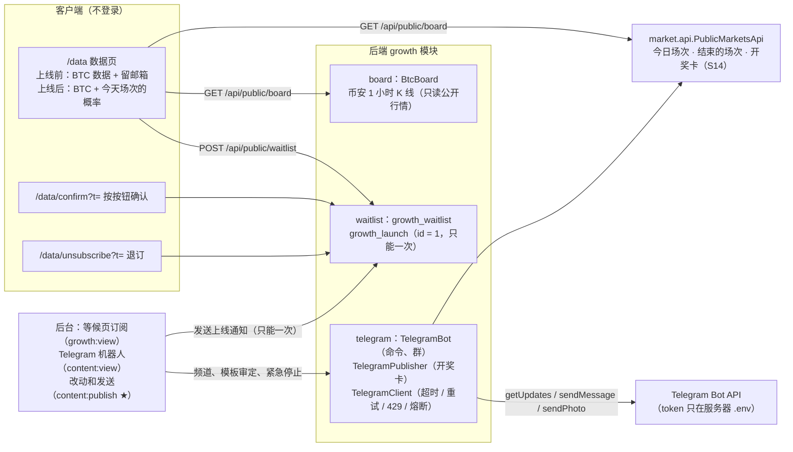

# S16 等候页和公开概率看板、Telegram 机器人 v1、SQ-24、SQ-27：开发记录
- 阶段：开发 S16（需求说明书 v1.3.2 第 1.5 节 MF-7、MF-8、MF-17；第 5.2 节 P13；第 6.3 节；AC-89～AC-93、AC-95、AC-96 的相关部分；Amos 2026-10-26 对 SQ-22、SQ-23、SQ-24、SQ-25、SQ-26、SQ-27、SQ-28、SQ-29、SQ-35 的答复）
- 分支：`claude/s16-tg-waitlist`（从 `origin/claude/s14-cards` 开出）
- 日期：2026-10-26
- 角色：研发工程师
- 依据：需求说明书 **v1.3.2**（优先）；架构方案 v1.5 第 18 节；Amos 2026-10-26 的答复和 S16 任务说明（只发一封"正式上线了"、Polymarket 不接、不在 Telegram 里下注也不绑账户、token 由 Amos 自己填）
- 不在范围：MF-9 内容中心（S15 在另一条分支做）；开奖卡以外的四种卡片自动发布（开盘卡、截止提醒卡、倒计时卡、周报，MQ-2）；X 渠道；Telegram 内联模式、`/pm`、机器人私聊订阅开场提醒
- 和 S15 同时进行：迁移从 **V40** 起（S15 用 V23 起）；新问题从 **SQ-43** 起（S15 用了 SQ-37～SQ-42）；研发的决定从 **D-201** 起（避开 S15 可能用的 D-193～D-200）
- 疑问的处理：按"需求 > 架构"自己定，记在第 8 节（研发的决定）和第 9 节（待确认），新问题第 10 节，没有停下来问

## 一图看懂

这张图想说明：等候页和看板是同一页 `/data`，数据只来自我们自己的池子和币安公开行情；邮件确认、退订、上线通知都在 growth 模块，上线通知靠一行 `growth_launch` 保证全站只发一次；Telegram 机器人也在 growth，只经 market 的 `api` 拿场次和开奖卡，只往打开了的频道和开了播报的群发，没有 token 时整个机器人不启动。

## 1. 结论
- **SQ-24 尾盘大额加单笔最低金额**：参数 `risk.lateBet.minAmount`（参数设置"风控"一组，默认 **100 USDT**，0 = 不限）；单笔低于它的下注不算尾盘大额。后台告警详情写出"单笔 ≥ 100"。
- **SQ-27 注册后自动登录也算登录过**：注册成功时同时写 `last_login_at`；老账户里登录时间为空、但有过会话的，V40 按第一次会话的时间补上。开赛提醒的资格（约定 55）跟着变：刚注册的客户直接就能订阅。后端测试、端到端 `client.spec.ts` 同步改（注册完直接订阅，不再先退出再登录）。
- **MF-8 / MF-17 等候页和公开概率看板**：同一页 `/data`，不登录可看，有搜索引擎版本（SSI）和 sitemap。上线前显示 BTC 现价、过去 24 小时每小时涨跌的比例（币安公开行情，带来源和更新时间）、"即将上线"和留邮箱；留邮箱要点邮件里的链接、再在页面上按"确认订阅"才算（双重确认）；防刷（陷阱字段、按 IP 每小时 10 次、确认邮件重发有间隔和上限、不透露邮箱是否已经在名单里）；邮件里免登录退订。上线以后同一页显示我们今天场次的人数和概率，不再收邮箱。后台"等候页订阅"能看到名单（邮箱打码）、各状态数量；"发送上线通知"是高危按钮（原因 + 勾选），**全站只能按一次**，只发给确认过的人，每人一封"正式上线了"。Polymarket 一块**不接**（接口返回关，页面不显示），等 S15 的开关。
- **MF-7 Telegram 机器人 v1**：token 只从 `FC_TELEGRAM_BOT_TOKEN` 来（**Amos 自己在 BotFather 建好填进服务器**）；没填时机器人不启动、不发帖，健康检查 `alerts` 的 `telegram.bot` 提示"未配置"，**`status` 不受影响**。命令：`/start`（带参数时记来源，链接带回来源参数）、`/help`、`/btc`（BTC 现价、过去 24 小时涨跌比例、今天 BTC 场的两边比例）、`/today`（今天的场次）；群管理员 `/broadcast_on`、`/broadcast_off` 开关群播报。今日场次的市场结束后，开奖卡（S14 的图片）发到打开的中文 / 英文频道和开了播报的群。**模板默认草稿、频道默认关**，Amos 在后台看过预览、审定、填频道编号并打开以后才发；紧急停止一键全停。**机器人里不下注、不绑账户**。外部调用有超时、重试、429 `retry_after`、熔断（C81）；测试全部用替身，不连真实 Telegram。
- 给 Amos 的待办在第 11 节（建机器人填 token、建公开频道并把机器人设为管理员、后台填频道编号、审定模板打开开关），每一步写了怎么确认做好了。

## 2. 做了什么
### 2.1 SQ-24、SQ-27
| 改动 | 位置 |
|---|---|
| 参数 `risk.lateBet.minAmount`（USDT，0～10 亿，2 位小数，组 `risk`，`betting_params:edit`） | `common/config/ConfigKey.java`、V40 |
| 尾盘大额判定先看单笔金额，告警详情加 `limitAmount` | `riskalert/core/RiskRules.java`；后台 `pages/risk/RiskAlertsPage.tsx` 和翻译 `ra.detail.late_large_bet` |
| 注册成功时 `touchLogin` | `account/auth/AuthService.java` |
| 老账户补登录时间（第一次会话的 `created_at`） | V40 |
| 开赛提醒的提示文字改成"只开放给登录过的账户"，注释和文档同步 | `market/remind/ReminderService.java`、`ReminderController.java`、`account/api/AccountApi.java`、客户端翻译 |

### 2.2 等候页和看板（MF-8、MF-17）
- 后端 `growth/board/`：`BtcBoard` 每 60 秒取币安 `BTCUSDT` 1 小时 K 线 25 根，用已经收盘的 24 根算"收 ≥ 开 = 涨"的比例，价格用最新一根的收盘价；失败重试、连续失败熔断，告警项 `board.binance`（只进 `alerts`）；取不到时页面写"暂时取不到"，其他照常。`BoardService` 拼看板：是否已上线、是否还收邮箱、Telegram 链接；**上线后**才加今日场次（经 `market.api.PublicMarketsApi.todaySlate()`，和市场详情同一份数）。`DataPage` 实现新的 `market.api.PublicPageView`，SSI 的标题、描述、正文和 sitemap 由 `SeoPages` 统一出（market 不依赖 growth）。
- 后端 `growth/waitlist/`：`WaitlistService` 留邮箱（`INSERT IGNORE` 按邮箱；已存在时按状态决定重发确认 / 重新订阅 / 什么也不做，返回同样的结果）、确认（PENDING → CONFIRMED，过期 410）、退订（任何状态 → UNSUBSCRIBED，重复也成功）、上线通知（插 `growth_launch` id = 1 成功才开始；`LaunchNoticeJob` 每 15 秒带租约，每人一个事务：条件更新 CONFIRMED → NOTIFIED 成功才发 `WAITLIST_LAUNCH`）。
- 客户端 `pages/data/`：`DataPage`（手机、电脑两种排版；五种状态）、`Confirm.tsx`（打开不自动确认，按按钮才确认）、`Unsubscribe.tsx`；公开导航加"数据"；三种语言。
- 后台 `pages/growth/WaitlistPage.tsx`：状态筛选、分页、邮箱打码、来源；"发送上线通知"（高危确认框写明"全站只能发一次"）；发过以后按钮换成"上线通知已发：谁、什么时候、原因、发了多少"。

### 2.3 Telegram 机器人（MF-7）
- `TelegramClient`：`ExternalHttp` 发 JSON / multipart（`sendPhoto`）；连接 3 秒、读 15 秒超时；IO 错误、5xx、408 重试 2 次；429 读 `retry_after`，≤ 5 秒原地等，否则记"限流"下一轮再发；连续 5 次失败熔断 60 秒；在数据库事务里调用直接报错；**错误信息里不带 token**。
- `TelegramBot`：`getUpdates` 长轮询 25 秒（租约 `growth.telegram.poll`，位置存在 `growth_tg_state`，不用 webhook）；命令见第 1 节；`my_chat_member` 记机器人进群 / 被踢；群播报只有群管理员（`getChatMember`：creator / administrator）能开关；`/start` 参数按 S13 的格式 `s-<src>__c-<cmp>__r-<ref>` 记一次带来源访问，回复里的链接带 `src=telegram&cmp=bot|group` 和来源参数。
- `TelegramPublisher`：每 10 秒（租约 `growth.telegram.publish`）。把**打开频道以后**、最近 24 小时内结束的今日场次市场 × 打开的频道和开了播报的群排进 `growth_tg_post`（唯一键防重复）；发之前依次检查：紧急停止（STOPPED）、开关（SKIPPED）、这种语言的模板已审定且指纹没变（SKIPPED + 邮件提醒重新审定）、超过 24 小时（不补发）、**发前重新生成一次卡片，和第一次不一致就不发**（AC-93）；同一频道 / 群两次至少隔 3 秒、所有发帖至少隔 1 秒；成功记消息编号和帖子链接；频道连续 3 次失败自动关闭并发 `TELEGRAM_ALERT` 给有 `content:publish` 的管理员。
- `TelegramAlert`：告警项 `telegram.bot`（没配 token、熔断中、机器人取不到消息时 DOWN，只进 `alerts`）。
- 后台 `pages/telegram/TelegramPage.tsx`：机器人状态（不显示 token）、两个频道（编号 + 开关，高危）、模板（预览图片和文字 → "我确认按这个模板自动发布"，带指纹）、群（可以替群关播报）、发布记录（状态筛选、原因、帖子链接）、紧急停止 / 恢复。

### 2.4 公共部分
- `market.api.PublicMarketsApi`（今日场次、自动生成的当前 BTC 市场、结束的场次、开奖卡、卡片模板指纹）、`market.api.PublicPageView`；`CardTexts.fingerprint`。
- 新权限点 `content:view`、`content:publish`（高危），模块 `content`（和需求第 2.2 节"内容中心"一致，S15 合并时去重，见第 7 节）；菜单 `waitlist`（`growth:view`）、`telegram`（`content:view`），排在"来源统计"后面。
- 错误码 `WAITLIST_CLOSED`（409）、`WAITLIST_LINK_EXPIRED`（410）、`LAUNCH_ALREADY_SENT`（409）、`TELEGRAM_NO_PREVIEW`（404）、`TELEGRAM_TEMPLATE_CHANGED`（409）。
- `SessionFilter.PUBLIC` 加 `/api/public/board`、`/api/public/waitlist/**`；robots 不收录 `/data/confirm`、`/data/unsubscribe`。
- `E2eGuard`：e2e profile 下 `forecast.telegram.api-url` 不是本机地址就拒绝启动（防止端到端打到真实 Telegram）。
- 部署：`deploy/kit/env.example`、`docker-compose.yml` 加 `FC_TELEGRAM_BOT_TOKEN`（默认空）。

## 3. 安全和"不会多发"
| 风险 | 做法 | 测试 |
|---|---|---|
| 上线通知发两次 | `growth_launch` 只能有 id = 1 一行（主键 + CHECK），插入成功的那次才开始；每人先条件更新再发信，同一个事务 | `S16WaitlistTest`（按第二次、任务再跑一轮都不重发）、`S16AdminTest`、端到端 |
| 刷邮箱 / 探测名单 | 陷阱字段、按 IP 每小时 10 次、确认邮件 10 分钟内不重发、最多 5 封；已存在和新邮箱返回一样 | `S16WaitlistTest` |
| 邮件预取误确认 | 打开链接只显示按钮，`POST` 才确认 | 客户端 `s16.test.tsx`、端到端 |
| token 泄露 | 只从环境变量来；后台接口、日志、错误信息里都没有 | `S16AdminTest`（返回里没有 token）、`S16TelegramTest` |
| 没审定就发 / 发错 | 模板默认草稿、频道默认关；审定带预览时的指纹；紧急停止；发前重算卡片 | `S16TelegramTest` |
| 端到端打到真实 Telegram | e2e profile 要求 api-url 是本机，否则拒绝启动 | `E2eProfileTest` |

## 4. 迁移脚本
| 脚本 | 内容 |
|---|---|
| `V40__s16_sq24_sq27.sql` | 参数 `risk.lateBet.minAmount` = 100；补老账户的 `last_login_at` |
| `V41__s16_waitlist.sql` | `growth_waitlist`、`growth_launch`；模板 `WAITLIST_CONFIRM`、`WAITLIST_LAUNCH`（任意地址，简体、繁体、英文）；菜单 `waitlist` |
| `V42__s16_telegram.sql` | `growth_tg_state`、`growth_tg_target`（`CHANNEL_ZH`、`CHANNEL_EN`，关）、`growth_tg_chat`、`growth_tg_template`（开奖卡 × 简体 / 英文，草稿）、`growth_tg_post`；员工模板 `TELEGRAM_ALERT`；菜单 `telegram` |

编号从 V40 起，跳过 V23～V39 留给 S15。Flyway 默认 `outOfOrder=false`：**如果 S16 先部署、S15 后合并，S15 的 V23+ 会因为比已执行的 V42 小而不执行**，所以合并时按第 7 节处理。

## 5. 测试和本地验证

### 5.1 新增和改了的测试
| 测试 | 覆盖 |
|---|---|
| 后端 `growth/S16WaitlistTest`（新，7 个） | 留邮箱 → 确认邮件 → 确认 → 上线通知只发给确认过的人、每人一封、按订阅时的语言、只能按一次、任务再跑不重发、之后等候页关闭；陷阱字段、IP 限次、重发间隔和上限、已存在邮箱返回一样；过期 410；上线后 409；退订（免登录、重复）；三语邮件 |
| 后端 `growth/S16BoardTest`（新，4 个） | AC-96：涨跌比例和同一段 K 线手算一致、只算已收盘；币安不可用时"暂时取不到"、其他照常；上线前不显示场次、上线后的场次和市场详情一致；Polymarket 关；`/data` 的搜索引擎版本和 sitemap |
| 后端 `growth/S16TelegramTest`（新，7 个） | `/btc`、`/today`、`/start` 参数记来源；群管理员才能开播报；AC-90 中英文频道各发各的语言、没有今日场次标记的不发、不重复；AC-91 草稿不发、指纹变了不发并提醒；AC-92 紧急停止记"已停止"、关频道只停那个、连续 3 次失败自动关并邮件；AC-93 发前数据不一致不发、超过 24 小时不补发；429 `retry_after`、5xx 重试、熔断；没有下注入口 |
| 后端 `growth/telegram/TelegramAlertTest`（新，3 个） | 没有 token：机器人不启动、`telegram.bot` DOWN、`status` 仍是 UP；配了以后 UP |
| 后端 `admin/security/S16AdminTest`（新，2 个） | 两个页面的权限点、原因和勾选必填、上线通知第二次 409、频道编号校验、审定指纹、审计；返回里没有 token |
| 后端 `riskalert/RiskAlertTest`（改） | SQ-24：低于最低金额不告警、等于时告警、0 = 不限 |
| 后端 `account/auth/AuthFlowTest`、`settle/S11ClientTest`（改） | SQ-27：注册后 `last_login_at` 不为空、能直接订阅开赛提醒 |
| 后端 `AdminRiskTest`、`AdminSecurityTest`、`S9NotifyFlowTest`、`E2eProfileTest`（改） | 新参数、56 个权限点、新模板（`WAITLIST_*` 任意地址、`TELEGRAM_ALERT` 员工）和菜单顺序、e2e 不能指向真实 Telegram |
| 后台 `src/s16.test.tsx`（新，12 个） | 菜单和权限点；等候页订阅五种状态、发送上线通知（原因必填、只能一次）；Telegram 页：状态、改频道（字段错误）、预览 → 审定、紧急停止、空、出错；参数设置的新参数；真实接口的路径和请求体 |
| 客户端 `src/s16.test.tsx`（新，9 个）、`api/real/board.test.ts`（新） | `/data` 上线前 / 上线后、留邮箱（格式、陷阱字段、限流提示、已关闭）、确认（按按钮才确认、过期）、退订、五种状态、三语 |
| 端到端 `e2e/tests/waitlist-telegram.spec.ts`（新，3 个，两种形态） | 第 1.9 节索引条目 |
| 端到端 `client.spec.ts`（改） | SQ-27：注册后直接订阅开赛提醒 |
| 端到端 `risk.spec.ts`（改） | SQ-24：两个客户只充了 100、A 押 60，低于默认的 100 不再算尾盘大额；用例先把参数调成 50、结束改回 100（经后台参数接口，带原因） |
| 后端 `resolve/SportsResolverTest`（改，S14 的用例，C80） | "两个触发同时到"在全量测试里失败过一次：机器忙时第二个触发在第一个做完以后才查，市场已经不到时间，结果是"-"而不是"busy"。两种都只取了一次数（用例本来要检查的），断言改成 busy 或 -；单独连跑 4 次通过 |

### 5.2 本地验证（全部实际执行，2026-10-26）
环境：Docker `mysql:8.4`、`redis:7`：后端测试 `fc-s16-mysql-test` / `fc-s16-redis-test`，开发形态端到端 `fc-s16-mysql-e2e`（tmpfs）/ `fc-s16-redis-e2e`（两个 Redis 不共用）；部署形态用共用的 compose 项目 `forecast-e2e`（跑之前确认 `docker compose ls -a` 里没有、本机 80 / 443 / 8080 空闲）；JDK 25；Node 22；Playwright（Chromium）。

| 项 | 命令 | 结果 |
|---|---|---|
| 后端全量（空库） | `forecast_test` 删掉重建、Redis 清空后 `mvn -o -B -ntp verify`（V1 → V22、V40 → V42） | **741 个测试，0 失败，5 个跳过**（真实数据源冒烟等默认跳过的），BUILD SUCCESS，21 分 37 秒。之前两次全量：第一次 740 个里 2 个失败（`AdminSecurityTest` 权限点数量没改成 56；`S16TelegramTest` 的 AC-92 被同一个库里别的测试类留下的今日场次市场排进队列、提前到了 3 次失败——用例里先把别的待发记录标成没发），修好；第二次 741 个里 1 个失败（S14 的 `SportsResolverTest` 并发用例，见第 5.1 节），改断言；第三次（最后的代码）全过 |
| 客户端 | `npm run lint`、`npx vitest run`、`npm run build`、`node ../../scripts/check-no-mocks.mjs src/mocks dist`、`node ../../scripts/check-brand.mjs dist` | lint 通过；**209 个测试通过**（27 个文件）；构建通过；模拟层 265 个特有字符串都不在产物里；没有旧品牌名 |
| 后台 | 同上 | lint 通过；**225 个测试通过**（27 个文件）；构建通过；check-no-mocks 605 个；没有旧品牌名 |
| 官网（没有改动） | lint、vitest、build、check-brand | **33 个测试通过**；构建通过；没有旧品牌名 |
| 端到端（开发形态，空库） | `bash e2e/start-backend.sh` + `npx playwright test`（先 `npx tsc --noEmit`） | 第一次：新的 `waitlist-telegram.spec.ts` 3 个全过，`risk.spec.ts` 1 个失败（SQ-24 的预期变化，见第 5.1 节，改用例）；改完在同一个库上单独重跑 `risk.spec.ts` 被验证码按 IP 限次挡住（本机反复注册，和改动无关），换空库、清 Redis 后全量：**24 passed、3 skipped**（只在部署形态跑的）。最后的代码（看图改了客户端以后）再换空库全量跑一次：**24 passed、3 skipped** |
| 端到端（部署形态） | `E2E_SKIP_BUILD=1 E2E_MVN_ARGS=-o bash e2e/run-deployed.sh` | **27 passed**（2.7 分钟，含 `waitlist-telegram.spec.ts` 3 个）；跑完的内存 app 351 MiB（上限 576）、mysql 180 MiB（上限 320）；结束后 compose 项目和卷已删 |
| 项目地图和索引 | `node scripts/check-project-index.mjs` | 通过（301 个文件，5 类名单） |
| 仓库旧品牌名 | `node scripts/check-brand.mjs --repo` | 通过 |
| 密钥扫描 | `gitleaks detect --no-banner -l warn --source <工作目录>` | 提交后（git 模式，含本次提交）：**no leaks found**；另用 `--no-git` 扫整个工作目录（含没提交的文件）：只有 1 处，在后台的构建产物 `web/admin/dist/` 里第三方库的压缩代码（误报，`dist` 不进仓库） |

测试用的 token 都是 `ci_only_` 开头的假值（`application-test.yml`、`application-e2e.yml`），e2e 的 Telegram 地址只能是本机替身（`E2eGuard`），没有连过真实的 Telegram。

## 6. 截图走查（不进仓库）
在开发形态端到端的后端上用临时脚本截图（脚本用完删了），放在 `/tmp/claude-0/-home-user/8fe0f726-87bc-573f-911f-a95cbc1d2238/scratchpad/s16-shots/`，每张都看过：

| 截图 | 看到的 |
|---|---|
| `01-data-上线前-手机390.png`、`02-data-上线前-电脑1440.png`、`03-data-上线前-英文-手机.png` | BTC 现价、过去 24 小时涨 15 / 跌 9（62.5% / 37.5%，和替身 K 线手算一致）、来源和更新时间；"即将上线"和留邮箱；没有 Polymarket；手机无横向滚动、按钮在首屏；英文没有中文残留 |
| `04-data-邮箱格式错-手机.png`、`05-data-留邮箱成功-手机.png` | 字段下面的错误提示；成功后说明"去邮箱确认"，不说邮箱是否已经在名单里 |
| `06-确认页-按钮-手机.png`、`07-确认页-已确认-手机.png`、`08-确认页-链接无效-手机.png` | 打开不自动确认、按按钮才确认；无效链接要按了才提示（和真实链接一样不先查） |
| `09-后台-等候页订阅.png`、`10-后台-发送上线通知-高危确认.png`、`11-后台-上线通知已发.png` | 各状态数量、邮箱打码；高危确认框写"全站只能发一次"、原因和勾选；发过以后按钮换成结果说明 |
| `12-退订-已退订-手机.png` | 免登录退订 |
| `13-data-上线后-手机390.png`、`14-data-上线后-电脑1440.png` | 上线后显示"我们今天的场次"，每场的状态、两边人数和概率、奖池 |
| `15-后台-Telegram机器人.png`、`16-后台-开奖卡模板预览.png` | 机器人已配置（不显示 token）、频道、模板（已审定 / 草稿）、群、发布日志（已发带帖子链接、没发写原因）；预览图片和说明文字、审定按钮 |
| `17-后台-参数设置-尾盘大额最低金额.png` | 风控一组里的"尾盘大额：单笔最低金额（0 = 不限）"100.00 USDT |

看图改了两处（改后重新截图看过）：① 没有频道链接时"官方 Telegram："后面多一个"·"，改成只在两个链接之间加分隔；② 上线后今日场次里已取消 / 已作废的市场看不出状态，和首页"今日场次"一样加了状态标签。

## 7. 和 S15 内容中心合并
- **迁移编号**：S16 用 V40～V42。合并时如果 S15 的最大号小于 V40，两边都不改（Flyway 按号排，V23～V3x 在 V40 前执行）——**前提是两边都还没部署到任何环境**。如果测试环境已经执行过其中一边，再加另一边号更小的脚本会被跳过：那时把后部署的一边改成比已执行的最大号大的新号（只改文件名，不改内容）。
- **权限点**：S16 新加 `content:view`、`content:publish`（模块 `content`）。S15 内容中心如果也加了同名的点，合并时保留一份（`Permission.java`、`permissions.ts`、翻译），`AdminSecurityTest` 的数量按合并后的实际数改。
- **渠道开关**：S16 的频道开关、模板审定、紧急停止放在 `growth/telegram/` 自己的表（`growth_tg_target`、`growth_tg_template`、`growth_tg_state`）和后台"Telegram 机器人"页，**故意没有做成通用的"渠道"**。合并到 S15 的内容中心时两种做法：① 内容中心的"发布渠道和开关"把 Telegram 频道当成一个渠道，读写都经 `growth.api.TelegramAdminApi`（接口已经按"渠道 + 开关 + 审定"设计），后台把 Telegram 页并进内容中心的标签页；② 如果 S15 已经有通用的渠道表，把 `growth_tg_target` 的两行迁过去，`TelegramPublisher.enqueue` 改成读内容中心的开关（只改这一处），紧急停止合成一个。两种都不用改发帖队列和客户端。
- **Polymarket 开关**：看板接口里 `polymarket.enabled` 固定是 false；S15 的开关合进来以后由 `BoardService` 读它，页面那一块已经留了位置（关着时不显示）。
- **菜单**：S16 的 `waitlist`、`telegram` 排在 `growth` 后面（V41、V42 写了 `admin_menu` 的顺序）；合并后跑 `S9NotifyFlowTest` 的菜单检查和后台 `menu.test.ts`，按实际顺序改。

## 8. 研发的决定（待 PM / Amos 复核，D-201 起）
- **D-201** 等候页和看板是同一个地址 `/data`：上线前收邮箱、不显示我们的场次（需求"上线前显示 L 日开场"，L 日还没定，写"即将上线"）；"是否已上线"= 后台已经发过上线通知（`growth_launch` 有记录），不另加开关。
- **D-202** 确认链接打开后要按按钮才确认（防邮件服务商的链接预取把所有人都确认了）；确认链接 7 天有效；上线以后不再接受新邮箱和确认（409）。
- **D-203** 防刷：陷阱字段 `website`（有值就假装成功，什么也不做）、按 IP 每小时 10 次、同一个邮箱 10 分钟内不重发确认邮件、最多 5 封；没有加图形验证码（需要第三方服务，第一期不加）。
- **D-204** 留邮箱的接口对新邮箱、已在名单里的邮箱都返回"去邮箱确认"（不透露谁在名单里）；退订过的再留会重新走确认。
- **D-205** 上线通知只发给点过确认的人（PENDING 的不发）；发信是后台任务一人一个事务，中途重启接着发；后台能看到发了多少。
- **D-206** 查看等候页名单用 `growth:view`（和来源统计一样）；发上线通知、Telegram 的所有改动用新的高危权限点 `content:publish`，查看 Telegram 用 `content:view`（需求第 2.2 节内容中心的权限，S15 也会用）。
- **D-207** BTC 涨跌：取最近 25 根 1 小时 K 线，只算已经收盘的 24 根，收盘价 ≥ 开盘价算涨；价格是最新一根的收盘价（最多晚 60 秒，页面写更新时间）。
- **D-208** 看板只用自有数据和币安公开行情；Polymarket 不接，接口返回 `enabled=false`，页面不显示那一块（不显示"暂时取不到"，免得像出了故障）。
- **D-209** Telegram 收消息用 `getUpdates` 长轮询，不用 webhook：不用改 Nginx、不用公网回调地址和密钥，单台服务器足够；多实例时靠租约只有一个在取。
- **D-210** 第一版自动发布只做**开奖卡**（S14 的图片 + 说明文字 + 链接），发在今日场次的市场结束以后；开盘卡、截止提醒卡、倒计时卡、周报的自动发布留给内容中心（S15 之后），队列和表已经按"市场 + 种类 + 目标"设计好。
- **D-211** 模板审定：模板 = `content/cards.json` 的开奖卡文字 + `content/growth.json` 的帖子文字，审定时记下指纹。需求 AC-91 写"审定后修改一个字，模板变回草稿，之后仍按上一个已审定版本发"——这里模板是代码里的文件，没有保存旧版本，所以改成：**文字一改（指纹变了）就不发，邮件提醒重新审定**，比按旧版发更保守。后台改模板文字等 S15 内容中心。
- **D-212** 频道只发"打开以后结束"的市场，不补发以前的；结束超过 24 小时还没发出去的不再发（AC-93 的"不补发"）。
- **D-213** 群播报：只有群管理员能用 `/broadcast_on`、`/broadcast_off`；语言按命令参数（`en` / `zh`），不写时按开启的人的 Telegram 语言；后台可以替群关掉（例如被投诉刷屏），不能替群打开。
- **D-214** 需求里的 `/今晚` 做成 `/today`（Telegram 命令只能用英文小写字母）；`/pm`（Polymarket）不做（D-208）。
- **D-215** `/start` 参数沿用 S13 的格式 `s-<src>__c-<cmp>__r-<ref>`，私聊打开就记一次带来源的访问（按 Telegram 用户编号的哈希去重）；回复里的链接带上同样的来源，客户点进来注册时由 S13 的 `captureAttribution()` 记成注册来源。不在 Telegram 里绑账户。
- **D-216** 没有 token：不启动取消息和发帖两个任务，后台页显示"还没有配置"，健康检查只在 `alerts` 里提示（约定 11 的做法），不发告警邮件（这是预期的状态，不是故障）。
- **D-217** 频道连续 3 次发送失败自动关闭频道并发邮件（AC-92），最终没发出去的每个频道每小时最多再提醒一封；群连续 3 次失败关掉这个群的播报、机器人被移出群时记"已离开"，群的失败不发邮件（群是别人的，不需要我们处理）。
- **D-218** 发帖频率：同一个频道 / 群两次至少隔 3 秒、全部至少隔 1 秒（Telegram 的公开上限是同一个群每分钟 20 条、总共每秒 30 条）；按现在每天最多几场今日场次，实际远低于上限。
- **D-219** SQ-27 老账户的补数按第一次会话的时间（只补为空的），不按注册时间：没有会话的账户（例如测试数据）仍然算没登录过。
- **D-220** SQ-24 的参数允许 0（= 不限，回到以前的口径），放在"风控"一组，权限沿用 `betting_params:edit`。

## 9. 待确认（研发先这样做了，Amos / PM 有空时看一眼）
- 等候页上线前写"即将上线"，没有写具体日期（D-201）；如果要写"L 日开场"的具体日期，见 SQ-43。
- 上线通知只有邮件一种；AC-95 里"用 Telegram 机器人订阅开场提醒"按 Amos 2026-10-26 "只发一封正式上线了"没有做（D-210）。
- 模板改了字以后是"停发等重新审定"，不是"按上一个审定版继续发"（D-211）。
- 群播报只发开奖卡，频率见 D-218；如果群主反映太多，后台可以替群关。

## 10. 需要 Amos 决定的新问题
| 编号 | 问题 | 建议 |
|---|---|---|
| SQ-43 | 等候页上要不要写具体的上线日期（需求写"L 日开场"）？现在写"即将上线"。 | 日期定了再告诉研发，改一处文字（`content/growth.json` 和客户端翻译）；定之前保持"即将上线" |

## 11. 给 Amos 的待办
按顺序做，每一步都有"怎么确认做好了"。**token 不要发给任何人（包括 AI），只填进服务器。**

1. **在 BotFather 建机器人，把 token 填进服务器**
   - 做法：Telegram 里找 `@BotFather` → `/newbot` → 起名字和用户名（以 `bot` 结尾，例如 `quickcome_bot`）→ 复制它给的 token；在服务器上编辑 `/opt/forecast/.env`，加一行 `FC_TELEGRAM_BOT_TOKEN=<token>`，然后重启后端（测试环境 `sudo bash /opt/forecast/start.sh`）。建议顺手在 BotFather 里 `/setjoingroups` 保持允许、`/setprivacy` 保持默认（开启，机器人在群里只收命令）。
   - 怎么确认：后台"Telegram 机器人"页顶部显示"已配置"和机器人用户名；后台域名的健康检查 `alerts` 里 `telegram.bot` 是 UP；私聊机器人发 `/btc`，几秒内收到 BTC 价格和链接。
2. **建公开频道，把机器人设为管理员**
   - 做法：建中文频道（公开，例如 `@quickcome_cn`）；需要英文时再建英文频道；频道设置 → 管理员 → 添加机器人，只给"发布消息"权限。
   - 怎么确认：频道的管理员列表里有机器人。
3. **在后台填频道编号并打开**
   - 做法：后台"Telegram 机器人" → 频道"中文频道" → 编辑 → 频道编号填 `@频道用户名`（私有频道填 `-100` 开头的数字编号）→ 打开 → 写原因 → 确认。
   - 怎么确认：频道一行显示编号和"已打开"、打开时间；这一步只打开开关，模板还是草稿时不会发任何东西。
4. **审定模板、打开自动发布**
   - 做法：同一页"模板" → 中文开奖卡"预览"（用最近一个结束的市场生成的图片和文字）→ 看过没问题点"我确认按这个模板自动发布"（写原因）；英文频道打开时同样审定英文模板。需要停的时候按"紧急停止"。
   - 怎么确认：模板状态是"已审定"；下一个今日场次的市场结束后 1 分钟内，频道里出现开奖卡，后台"发布记录"里是"已发"并带帖子链接。没有出现时按 `项目索引.md` 第 8 节"结束的市场没有发到 Telegram 频道"那一行查。

## 12. 遗留问题
- 开奖卡以外的四种卡片（开盘卡、截止提醒卡、倒计时卡、周报）的自动发布、X 渠道、后台改模板文字：等 S15 内容中心合并后再做（D-210、D-211）。
- Telegram 内联模式、`/pm`、机器人私聊订阅开场提醒（AC-89、AC-95 的这几项）没做。
- Polymarket 一块：接口和页面留了位置，开关默认关，不接数据（D-208）。
- 等候页的具体上线日期（SQ-43）。
- 真机验收（AC-89 的"真机"部分）要等 Amos 做完第 11 节的 1～4 步，在测试环境走一遍。

## 13. 跨角色反馈 / 提交
- 给测试：新用例 `e2e/tests/waitlist-telegram.spec.ts` 两种形态都跑；Telegram 全部用替身（`/api/e2e/telegram/**`），真机部分等 Amos 做完第 11 节后在测试环境验收。`risk.spec.ts` 因为 SQ-24 改了（先调参数）。
- 给运维：新环境变量 `FC_TELEGRAM_BOT_TOKEN`（`deploy/kit/env.example`、`docker-compose.yml` 已加，默认空 = 不启动机器人）；机器人只往外连 `api.telegram.org`，不需要开放入站端口、不改 Nginx；看板往外连 `data-api.binance.vision`（S6 起已经在用）。
- 给 PM：第 8、9 节的决定；SQ-43。
- 提交：分支 `claude/s16-tg-waitlist`，一个提交，已推送；没有开 PR、没有合并。
