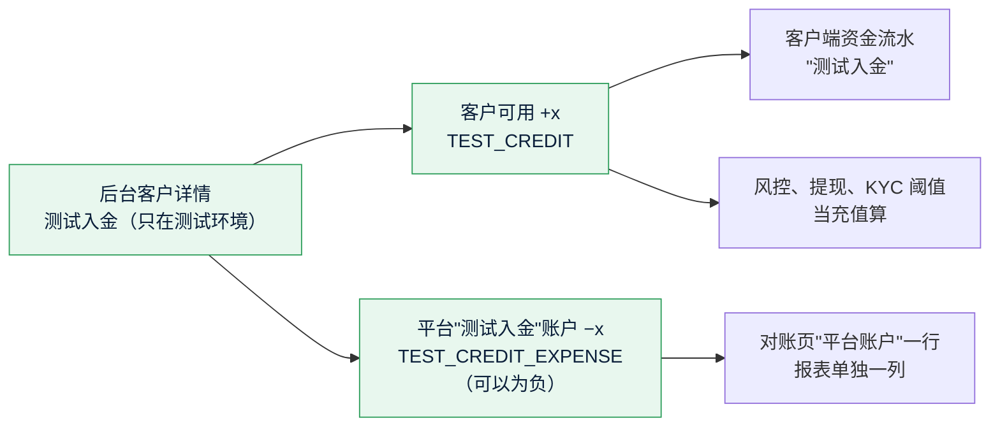

# S17 测试入金和人工调账：开发记录
- 阶段：开发 S17（测试环境部署后的调整）。分两个独立的 PR：**A 测试入金**（只在测试环境存在，先做，Amos 要用它测试）、**B 人工调账**（生产可用，需求变更）。
- 分支：A `claude/s17a-test-credit`（从 main `d6c43e2` 开出）；B `claude/s17b-manual-adjust`（从 A 开出，A 合并后合进 main，见第 2 节）。
- 日期：2026-10-27
- 角色：研发工程师（B 兼任产品经理，代写需求说明书的轻量变更）
- 出处：Amos 2026-10-27（主会话转来）："我需要给客户调整资金"；主会话列了两个方案，Amos 回复"A、B 两个都要"。
- 背景：测试环境的充值合约还没部署（WQ-1），客户充不了钱，下注到提现的整条流程测不了；系统没有任何人工调整余额的功能（需求当初定的是不做，需求说明书"跨角色反馈"第 1564 行附近"不需要余额调整功能"，S1 删掉了复制源的"调余额"和 `customer:adjust_balance`）。
- 依据：agents main `60f0a70`；《项目地图》v0.28、《项目索引》v0.28；需求说明书 v1.4.1。
- 标注：每项后面写【实际执行】【代码走查】【未验证】。研发的决定从 **D-257** 起（之前用到 D-256），需要 Amos 决定的问题从 **SQ-56** 起。

## 一图看懂

这张图想说明：测试入金是"平台出钱给客户"，写法和补偿（E13）一样——客户一条、平台对手方一条，同一个事务，账本保持平衡；平台对手方是一个新的平台账户，不和平台收入、补偿支出、真实充值混在一起。

---

## 1. PR A：测试入金（只在测试环境存在）

### 1.1 Amos 怎么用【实际执行：端到端部署形态】
1. 测试环境后台 → 左侧"客户" → 找到客户 → "详情"。
2. 页面右上角 **"测试入金"**（只在测试环境显示；要权限点 `balance:test_credit`，超管自动拥有）。
3. 弹窗里填"入金金额（USDT）"、"操作原因"，勾"我已核对操作对象和影响"，点"确认入金"。
4. 提示"已入金 X USDT，可用余额 A → B"。客户在客户端"资产"看到余额、"资金流水"里是"测试入金"。
5. 单笔上限默认 10,000 USDT：后台"参数设置 → 余额调整 → 测试入金单笔上限"（`betting_params:edit`）可改。

### 1.2 只在测试环境：判断依据和证明【实际执行】
- 判断依据用**现有的环境标识** `forecast.env-label`（环境变量 `FC_ENV_LABEL`）。部署工具包 `deploy/kit/docker-compose.yml` 给测试环境固定写了 `FC_ENV_LABEL: test`，生产不设（S20 的测试环境标识、约定 61 同一个变量）。**没有新加开关**，不存在"能在生产上被误开"的配置项（D-257）。
- 三道检查：
  1. 控制器 `admin/ops/TestCreditAdminController` 带 `@ConditionalOnProperty(forecast.env-label = test)`：生产上这个类不存在，`POST /api/admin/customers/{id}/test-credit` 和任何不存在的路径一样是 **404**（超管、没登录都一样，不暴露接口存在）。
  2. `admin/ops/CustomerOps.testCredit`：不是测试环境抛 `NOT_FOUND`。
  3. 账本 `ledger/adjust/TestCreditService.credit`：不是测试环境抛 `NOT_FOUND`（只认去掉空格后正好是 `test`）。
- 后台按钮：客户详情接口多一个字段 `testCredit`，测试环境是 `{ "maxAmount": "10000" }`，**生产是 `null`**；后台只在它不为空时显示按钮（不靠前端自己读健康检查，按钮和接口由同一个后端配置决定，D-258）。
- 证明（后端测试）：`AdminTestCreditProdTest`（默认测试配置 = 生产：没有 `FC_ENV_LABEL`）——接口 404、`code = NOT_FOUND`、控制器没有注册、详情的 `testCredit` 为 `null`、直接调服务也拒绝、没有入金单和审计；`AdminTestCreditTest`（`FC_ENV_LABEL=test`）走通全部功能。后台单元测试 `s17a.test.tsx`："生产（后端 testCredit 为空）：不显示按钮"。端到端 `test-credit.spec.ts` 在默认形态（不设 `FC_ENV_LABEL`）证明没有按钮、接口 404。

### 1.3 账本【实际执行】
- 新流水类型（`ledger/api/LedgerEntryType`）：
  - `TEST_CREDIT`：客户账户，可用 +；
  - `TEST_CREDIT_EXPENSE`：新平台账户 `PLATFORM_TEST_CREDIT`（"测试入金"），可用 −，**可以为负**（余额 = −累计测试入金），和补偿支出账户同一个做法。
- 迁移 `V29__s17a_test_credit.sql`：`ledger_account` 的两个 CHECK（`ck_ledger_account_kind`、`ck_ledger_account_nonneg`）加上新种类（按 V6 的写法先删后加），插入平台账户一行（生产也有这一行，余额永远是 0）；新表 `ledger_test_credit`（测试入金单：金额、入金前后的可用余额、原因、请求号、操作人，**只增不改**，`LedgerAdjustAppendOnlyTest`）；参数 `adjust.testCreditMax` = 10000。
- 一个事务（READ COMMITTED）：锁客户账户行 → 按请求号查重 → 写入金单 → 客户 `TEST_CREDIT`（幂等键 `TEST_CREDIT : 入金单 id`）→ 平台 `TEST_CREDIT_EXPENSE`（同一个幂等键，最后锁平台账户行，和补偿同一个顺序，约定 35）。提交后推 `{"type":"account"}` 给客户，客户端刷新余额。
- 账本平衡：每一笔客户 +x、平台 −x，合计 0（`AdminTestCreditTest` 按入金单核对；`LedgerQueryApi.mismatches()` 为空）。
- 先锁一行确定存在的行（客户账户）再普通读请求号，不对可能不存在的行加锁读（约定 34）。

### 1.4 幂等【实际执行】
- 后台每次打开确认框生成一个请求号（`web/admin/src/utils/adjust.ts` 的 `newRequestId`，`[A-Za-z0-9._-]{8,64}`，和追踪号同一个规则）。同一个请求号再提交：返回第一次的结果，`duplicate = true`，余额不变、只有一条流水；同一个请求号换了金额或客户：409 `ADJUST_REQUEST_REUSED`。
- 并发：同一个请求号同时来 8 次，只入一次（`AdminTestCreditTest` 的并发用例：同一客户在账户行锁上排队，第二个一定读到第一个写的单子；不同客户用同一个请求号由唯一键 `uk_ledger_test_credit_req` 挡住）。

### 1.5 对账和报表：单独一行【实际执行】
- 对账页（后台"资金 → 对账"）热钱包下面加一张"平台账户"表：平台收入、平台补偿支出、**测试入金**各一行，余额、账本合计、记录数、是否一致（新接口 `GET /api/admin/recon/platform-accounts`，`recon:view`）。
- 报表（后台"结算 → 报表"）：合计多一张"测试入金"卡片（金额、笔数），按天的表和 CSV 多一列"测试入金"；**不进平台收入，也不冲减补偿支出**（`settle/run/SettleAdmin.report` 经 `ledger.api.AdjustReportApi` 取数）。
- 钱包对账（充值 ↔ 账本 ↔ 链上）只看 `DEPOSIT` 类型，测试入金不会被当成"账本里有入账但没有对应充值"（D-259）。

### 1.6 风控和提现怎么对待测试入金
- **风控：当作充值算**（按主会话的建议，D-260）【实际执行】。`CustomerFlowApi.depositsSince`（账本 `depositsSince` 的 SQL）把 `TEST_CREDIT` 和 `DEPOSIT` 一起算，所以：
  - "充了不玩就提"（`DEPOSIT_NO_BET`）：测试入金后不下注就提现，会告警；
  - 提现自动审批 R8（近 30 天充值后的有效下注）、R9、R10 的"充值"口径都包括测试入金；
  - 下注时的 KYC 阈值（累计充值超过阈值要先认证）也包括测试入金——测试环境入金超过阈值，下注前要先完成 KYC，和真实充值一样。
  - 不包括：充值到账通知（#3 `DEPOSIT_CREDITED`）、充值后的 KYC 提醒邮件（`KycThresholdNotice` 只在链上充值入账时触发）。测试入金不发任何通知（D-261）。
- **提现：允许发起，走完审批流程**【代码走查】。测试入金进的是可用余额，可提金额 = 可用余额，所以能发起提现，冷静期、自动审批、人工审核都照常。链上发出这一步按测试环境现有的行为：配了这条链的热钱包（测试网）就在测试网上发出；没配的链提现停在"已审核待上链"（`wallet/withdraw/WithdrawSenders`："没有广播器的链，提现停在已审核待上链"）。代码没有为测试入金改提现的任何规则。【未验证】测试环境热钱包配了哪些链要看服务器上的 `.env`。

### 1.7 端到端：e2e profile 下怎么模拟测试环境（D-262）【实际执行】
- 测试入金不看 Spring profile，只看 `FC_ENV_LABEL`。`e2e/tests/test-credit.spec.ts` 先读健康检查的 `env`，按后端的实际配置走两条路：
  - **测试环境**：部署形态 `e2e/compose.deployed.yml` 本来就和测试环境一样写了 `FC_ENV_LABEL: test`（S20 的测试环境标识用它），CI 的 `e2e-deployed` 走这条：后台页面入金（金额、原因、勾选）→ 提示前后余额 → 重复提交只入一次 → 客户端登录后资产页的余额、资金流水里两条"测试入金"、没有"充值" → 对账页"平台账户"测试入金一行一致 → 报表有"测试入金"卡片。
  - **生产形态**：默认形态的后端（`e2e/start-backend.sh`）不设 `FC_ENV_LABEL`，和生产一样，CI 的 `e2e` 走这条：客户详情没有按钮，同源调接口 404，余额是 0。
  - 本地两种都跑过：默认形态不设和设 `FC_ENV_LABEL=test` 各跑一次（见 1.9 验证）。
- 不新加 e2e 专用的开关或替身接口（`/api/e2e/**` 里没有测试入金）：测试入金本来就是测试环境的正式功能，端到端用和测试环境一样的配置去测它。

### 1.8 改了哪些文件
- 后端：`ledger/api/AccountKind`（`PLATFORM_TEST_CREDIT`）、`LedgerEntryType`（`TEST_CREDIT`、`TEST_CREDIT_EXPENSE`）、`TestCreditApi`、`AdjustReportApi`、`LedgerAdminApi.platformAccounts`、`CustomerFlowApi` 的说明；`ledger/adjust/`（`TestCreditService`、`AdjustReports`、`AdjustMapper` + `mapper/ledger/AdjustMapper.xml`）；`ledger/service/LedgerController.LEDGER_TYPES`（客户端流水类型 `testCredit`）、`LedgerQueries`、`LedgerMapper.xml`（`depositsSince` 加 `TEST_CREDIT`、`platformAccounts`）；`admin/ops/TestCreditAdminController`、`CustomerOps`（详情的 `testCredit`、`testCredit` 操作、流水类型）、`FundsOps` / `OpsController`（平台账户）；`admin/security/Permission`（`BALANCE_TEST_CREDIT`）；`common/config/ConfigKey`（`TEST_CREDIT_MAX`）；`common/web/GlobalExceptionHandler`（`ADJUST_REQUEST_REUSED` 409）；`settle/api/SettleAdminApi`、`settle/run/SettleAdmin`（报表）；迁移 V29。
- 后台：`CustomerDetailPage`（按钮和弹窗）、`ReportsPage`、`ReconPage`、`ParamsPage`（"余额调整"一组）、`hooks/useConfirmDialogs`（`successText: ''` 时由调用方自己提示）、`utils/adjust.ts`、`api/*`、`mocks/*`、`config/permissions.ts`、中英文翻译、`s17a.test.tsx`、`sweepNextPhase.test.tsx`（权限点 59 个）。
- 客户端：流水类型 `testCredit`（`api/types.ts`、`LedgerList`、三种语言），`LedgerList.test.tsx`。客户端的流水筛选里**没有**加"测试入金"一项（生产上没有这种流水，不让生产客户看到这个选项；"全部"里能看到，D-263）。
- 端到端：`e2e/tests/test-credit.spec.ts`。

### 1.9 验证（A）
见第 4.1 节的表。

---

## 2. PR B：人工调账（生产可用，需求变更）

（B 的记录在分支 `claude/s17b-manual-adjust` 上补充。）

---

## 3. 需要 Amos 决定的问题

| 编号 | 问题 | 建议 | 现在怎么做的 |
|---|---|---|---|
| SQ-56 | 测试入金的单笔上限 | 10,000 USDT（够测大额提现的延迟和人工审核；需要更大时在参数设置改） | 默认 10,000，参数设置"余额调整"可改（`betting_params:edit`） |

---

## 4. 验证结果

### 4.1 PR A（2026-10-27，本机：MySQL 8.4、Redis 7 容器 `fc-s17-*`，JDK 25，Node 22）

| 项目 | 命令 | 结果 | 标注 |
|---|---|---|---|
| 后端全量 | 新建的空库上 `JAVA_HOME=/usr/lib/jvm/java-25-openjdk-amd64 mvn -o -B -ntp verify` | **816 个，0 失败，5 个跳过（原有的手动冒烟测试），BUILD SUCCESS**（新加 `AdminTestCreditTest` 5 个、`AdminTestCreditProdTest` 1 个、`LedgerAdjustAppendOnlyTest` 1 个，`LedgerBucketsTest` 加了断言） | 实际执行 |
| 后端全量（第一次） | 同上，但库里先跑过单独的 `LedgerInvariantTest` | `AdminSettleTest` 2 个失败：`LedgerInvariantTest` 的随机账本记录用市场 id 1～5 做标签，先跑它再建市场时撞上了真实的市场 4（"账本里这个市场的下注锁定 ≠ Σ有效下注"）。和本次改动无关，是已有测试之间的数据隔离问题；CI 每次是新库、按包名顺序先跑后台测试，不会遇到。换新库重跑全部通过（上一行） | 实际执行 |
| 后台 | `npm run lint`、`npx vitest run`、`npm run build`、`check-no-mocks`、`check-brand` | lint 0 问题；**265 个测试通过**（新加 `s17a.test.tsx` 11 个）；构建通过；产物里没有模拟层、没有旧品牌名 | 实际执行 |
| 客户端 | 同上 | lint 0 问题；**221 个测试通过**（`LedgerList.test.tsx` 加 2 个）；构建、两项检查通过 | 实际执行 |
| 端到端（开发形态，生产配置） | 后端 `SPRING_PROFILES_ACTIVE=e2e`、不设 `FC_ENV_LABEL`，独立的 Redis（`fc-s17-redis-e2e`）和库 `forecast_e2e`；`npx playwright test` | **29 个通过、3 个跳过**（部署形态专用的用例）；`test-credit.spec.ts` 走"生产形态"：没有按钮、接口 404 | 实际执行 |
| 端到端（开发形态，测试环境配置） | 同上但 `FC_ENV_LABEL=test`，只跑 `tests/test-credit.spec.ts` | **1 个通过**：页面入金 → 重复提交只入一次 → 客户端余额和两条"测试入金" → 对账、报表。第一次跑在全量之后，注册发验证码碰到按 IP 的限次（429 `CODE_TOO_FREQUENT`，Redis 里的计数），清掉端到端用的 Redis 后重跑通过 | 实际执行 |
| 端到端（部署形态） | `bash e2e/run-deployed.sh` | 见 4.3（A、B 一起在 B 的分支上跑） | — |
| 仓库检查 | `node scripts/check-project-index.mjs`、`node scripts/check-brand.mjs --repo`、`node scripts/check-deploy-env.mjs` | 都通过 | 实际执行 |
| gitleaks | `docker run zricethezav/gitleaks:v8.21.2 git --log-opts=origin/main..HEAD` | no leaks found | 实际执行 |
| CI | PR 页面 | 见 PR | — |

---

## 5. 研发的决定
- **D-257** 测试环境的判断依据用现有的 `FC_ENV_LABEL`（等于 `test`），不新加开关：生产没有这个变量，没有可以误开的配置项；和"测试环境"标识条、邮件标题的"[测试]"同一个来源。
- **D-258** 后台按钮由后端详情接口的 `testCredit`（测试环境才有）决定，不让前端自己读健康检查：按钮显不显示和接口在不在由同一个后端配置决定，不会出现"有按钮、点了 404"。
- **D-259** 测试入金不是充值：不写钱包的充值表，钱包对账只看 `DEPOSIT`，不会报"账本有入账但没有对应充值"；流水类型、客户端流水、报表、对账都单列。
- **D-260** 风控和提现把测试入金当充值（`depositsSince` 加 `TEST_CREDIT`），测试时能走到"充了不玩就提"、R8～R10、KYC 阈值。生产没有测试入金，这条 SQL 对生产没有影响。
- **D-261** 测试入金不发客户通知（不是真实充值，不发"充值已到账"）；只推一个账户变化事件让客户端刷新余额。
- **D-262** 端到端不新加 e2e 专用开关：同一个用例按后端的 `env` 走"测试环境"或"生产形态"两条路，部署形态（和测试环境同样的配置）走第一条，默认形态（和生产同样不设）走第二条。
- **D-263** 客户端流水筛选不加"测试入金"一项（生产不该看到），"全部"里显示。
