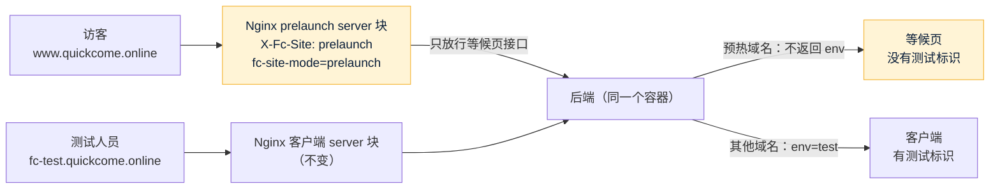

# S18 台湾预热：开发记录
- 阶段：开发 S18（台湾第一期推广的预热准备）
- 分支：`claude/s18-taiwan-prelaunch`（从 main `a648edd` 开出），PR 到 main
- 日期：2026-10-28
- 角色：研发工程师、运维工程师，兼产品经理的落地（P2 的位置和结构、P3 的范围）
- 出处：市场需求单 `市场/v1-台湾第一期推广.md`（P1～P4）、`市场/v2-内容发布和确认.md`（P9 和 P3 合并做）；Amos 2026-10-28："**P1 选 A，排期同意，Threads 清单写**"——P1 用测试环境的 `/data` 对外，配好记的域名 `www.quickcome.online`，这个域名上不显示"测试环境"标识；S18 做 P1 + P2 + P3 / P9，S19（内容发布 P5～P8、P10）另开任务
- 依据：agents main `6552c1d`（C53、C66、C98、C102、C105、C108）；《项目地图》v0.30、《项目索引》v0.30
- 编号：迁移用 **V31**；需要 Amos 决定的问题从 **SQ-61** 起（主会话指定；按 C105 本应先在《Amos 待办》登记，本任务约定不改那份文件，主会话汇总时登记）；研发的决定从 **D-269** 起
- 标注：每项后面写【实际执行】【代码走查】【未验证】

## 一图看懂
这张图想说明：同一套测试环境的容器，多了一个对外的域名；哪些东西靠服务器配置区分。



## 1. P1：`www.quickcome.online` 对外显示等候页

### 1.1 Amos 要做的两件事【实际执行：开发机演练】
1. **Cloudflare**：`quickcome.online` → DNS → Records → Add record：类型 **A**、名称 **`www`**、内容 **测试服务器的 IP**（和 `fc-test` 那条一样，见《测试环境第一次部署清单》第 4.3 节）、代理状态 **仅 DNS（灰色云）**、TTL Auto。（已查过 `www.quickcome.online` 现在没有记录。）
2. **服务器**（本 PR 合并、发布到 staging、服务器自动更新到这个版本以后），在阿里云控制台"远程连接"终端粘贴一条命令（C98）：
   ```bash
   sudo fc add-domain www.quickcome.online
   ```
   它做：①检查 DNS 已经指向本机（没指好就停，什么都不改）②用 webroot 把域名加进现有的 `forecast` 证书（Nginx 不停，续期方式不变）③写进 `.env` 的 `PRELAUNCH_DOMAIN` ④`reload-env.sh`（只重建 web、app 两个容器，数据库不动）⑤按这个域名在本机访问一遍（首页是等候页、没有 `env`、`/login` 跳回首页、`/api/me/session` 404、http 跳 https）。每步一行 ✓ / ✗，可以重复运行（做完的步骤跳过，证书不重复申请）；已经配了别的预热域名、forecast 没在运行、版本太旧时都会停下说明。输出里没有密钥。
3. 从外部确认：`bash deploy/verify.sh fc-test.quickcome.online fc-test-admin.quickcome.online "" fc-test-www.quickcome.online www.quickcome.online`。

### 1.2 Nginx：新的 server 块【实际执行：部署形态端到端】
`deploy/nginx/site.conf.template` 末尾的 prelaunch 块（`server_name ${PRELAUNCH_DOMAIN}`，没有配时是占位域名 `prelaunch-not-configured.invalid`，这一段不生效、Nginx 照常启动）：

| 路径 | 处理 | 理由 |
|---|---|---|
| `/`、`/index.html` | 客户端的 `index.html`，SSI 插入后端给的头部和正文，`__FC_SITE_MODE__` 换成 `prelaunch` | 根路径直接是等候页，不跳 `/data`（地址好记、分享出去就是根路径） |
| `/data/confirm`、`/data/unsubscribe` | 同上（页面） | 确认、退订邮件的链接（见 1.5） |
| `/data` | 301 → `/`（参数保留） | 同一个页面只留一个地址 |
| `/assets/*.*`、根目录的 png / svg / js / webmanifest | 静态文件，找不到 404 | 构建产物、图标、分享图、Service Worker |
| `/robots.txt`、`/sitemap.xml` | Nginx 直接给：允许收录根路径，`Disallow: /data/`、`/api/`；站点地图只有根路径的三种语言 | 希望被收录（P1），只收录这一页 |
| `/api/health` | 转发（后端看 `X-Fc-Site` 不返回 `env`，也拿不到告警） | 客户端启动时问一次标识 |
| `/api/public/board`、`/api/public/waitlist`、`…/confirm`、`…/unsubscribe`、`/api/public/pages/how-to-play`、`/api/attribution/visit` | 转发（精确匹配，带分号的进不来），按 IP 限流 | 看板、留邮箱、确认、退订、台湾入金教程、来源统计（P4：LINE 群链接带 `?src=line&cmp=seed`） |
| 其他 `/api/`、`/actuator` | 404 | 注册、登录、下注、资产、WebSocket、后台、端到端接口一律不经过这个域名 |
| 其他页面路径（`/login`、`/register`、`/markets`、`/assets`、`/me`、`/m/1`、`/how-to-play`、`/admin/`……） | 302 → `/` | 这个域名上没有这些页面；302（不是 301），上线时这个域名可能改成别的用途 |

安全头和别的域名一样（`security.inc`：HSTS 1 天、`X-Frame-Options DENY`、`nosniff`、`Referrer-Policy`）。测试环境的其他三个域名的 robots、站点地图、标识都不变【实际执行】。

### 1.3 测试环境标识：靠服务器配置，不靠域名字符串【实际执行】
- Nginx：`map $server_name $fc_site { default ""; "${PRELAUNCH_DOMAIN}" prelaunch; }`——按**哪一个 server 块接的请求**（配置里的名字，不是客户端发来的 Host）；`proxy.inc` 总是 `proxy_set_header X-Fc-Site $fc_site`，客户端自己带的同名头传不到后端（空值 = 不发）。
- 后端：`common/web/PrelaunchSite.is(req)`；`HealthController` 对预热域名不返回 `env`。客户端的标识逻辑一行没改：没有 `env` → 和生产一样不显示标识条、顶部也不留 24px（约定 61）。
- 客户端：页面里的 `<meta name="fc-site-mode">` 只有 prelaunch 块会填成 `prelaunch`（`lib/siteMode.ts`）；其他域名、本地开发、原型都保留占位符 = 平常的客户端。前端没有任何地方按域名判断。
- 部署形态端到端核对：预热域名上 `env-banner` 不存在、`--banner-h` 是 `0px`、健康检查没有 `env`；同一个用例里客户端域名照常显示标识条。

### 1.4 客户端：预热形态只有等候页【实际执行】
`web/client/src/app/PrelaunchApp.tsx`：路由只有 `/`（等候页）、`/data/confirm`、`/data/unsubscribe`，其余回根路径（Nginx 已经 302；这里是 Service Worker 接管页面后的兜底，来源参数保留）。不问后端登录状态（那个域名上 `/api/me/session` 是 404），登录状态固定"没登录"。顶部只有品牌和语言，页面标题"{品牌} 即将上线"，页脚是风险提示和官网的服务条款、隐私、风险披露（官网仍是测试环境的 `fc-test-www`）。`DataPage` 在预热形态下不显示进入产品的链接（市场、注册、开奖记录等页脚入口）；上线后（`launched`）的场次也只显示、不链到市场。

**想进产品的人跳不跳 `fc-test.quickcome.online`？建议不跳（SQ-61）**：测试环境的钱是测试入金、充值合约还没部署（WQ-1），数据不会迁到生产（订阅以外），公开引流过去会让真实用户在测试库里注册、充值；预热期只做"看数据 + 留邮箱"，上线时一封邮件把确认过的人带到生产。已按建议实现（没有任何链接到客户端域名）。

### 1.5 等候页邮件的链接【实际执行】
新配置 `forecast.prelaunch-domain`（`FC_PRELAUNCH_DOMAIN`，compose 按 `.env` 的 `PRELAUNCH_DOMAIN` 给）：配了时，确认邮件和上线通知里的"确认""退订"链接用 `https://www.quickcome.online/data/…`（不带测试标识）；没配时和 S16 一样用 `FC_CLIENT_URL`。上线通知里"去看看"的链接仍是 `FC_CLIENT_URL/markets`（上线时那是生产）。域名只认合法写法（`WaitlistService.prelaunchBase`，和 `fc add-domain` 同一个正则，C108）。

### 1.6 搜索收录和 Open Graph【实际执行】
- 后端 `SeoPages.prelaunchHead` / `prelaunchBody`：根路径用数据页（`/data`）的标题、描述、正文；`canonical`、三种语言互相标注、`og:url` 都指向 `https://www.quickcome.online/`（按请求的 Host，不用 `client-url`）；正文不带客户端的导航；确认、退订页照常 `noindex`。
- 分享图 `web/client/public/og-prelaunch.png`（1200 × 630，品牌 + "即將上線 · Launching soon" + "BTC 每小時漲跌 · 公開機率看板"，静态图，没有数字和收益说法；Playwright 从一页 HTML 截出来的），`og:image`、`twitter:card summary_large_image`。

### 1.7 证书【实际执行：一键部署演练】
- 同一张 `forecast` 证书，用 webroot 扩展（`certbot certonly --cert-name forecast --expand --webroot -w /var/www/certbot -d <原有的全部> -d <新域名> --deploy-hook "docker exec forecast-web-1 nginx -s reload"`）：Nginx 不停，80 端口对任何域名都回答 `/.well-known/acme-challenge/`；续期方式（webroot）不变。
- `first-start.sh`：`.env` 里已经有 `PRELAUNCH_DOMAIN` 时第一次申请证书一起带上（新服务器）；已经部署好的服务器用 `fc add-domain`。
- 演练（`e2e/oneclick-drill.sh` 第 ⑦ 步）：DNS 没指好 → 停在第 1 步、`.env` 和证书都没动；指好后 → 证书包含四个域名、续期方式还是 webroot、`.env` 权限 600、数据库容器没有重启、预热域名是等候页没有 `env`、三个测试域名照旧；再运行 → 证书不重新申请、配置跳过；换另一个域名 → 停下说明。

### 1.8 订阅数据以后迁到生产【代码走查；没有实现脚本】
订阅在测试库的 `growth_waitlist`（S16，双重确认）。生产建好、上线通知发出之前迁过去。**只迁这一张表**，不迁 `growth_launch`（生产要自己按一次"发送上线通知"）。步骤（写给以后的运维，生产部署方案里再细化成一条命令，C98）：
1. 测试环境：`sudo fc status` 确认 forecast 在运行；在 mysql 容器里用 `mysqldump` 只导出这一张表的数据、只要没退订的（`--no-create-info --where="status IN ('PENDING','CONFIRMED')" forecast growth_waitlist`，root 密码从容器自己的环境变量取，不打印），输出到 `/opt/forecast/backup/` 下的文件（权限 600）。以后做成 `sudo fc export-waitlist` 一条命令（C98）。
2. 搬到生产服务器（`scp`，不经过任何对话框；文件里是邮箱，属于个人信息）。
3. 生产：先确认表是空的（`SELECT COUNT(*) FROM growth_waitlist`），再导入。`id` 会和生产冲突时去掉 `id` 列（用 `INSERT … SELECT` 经临时表导入）；邮箱、语言、状态、两个 token、来源、`ip_hash`、时间都原样保留——**token 原样保留，已经发出去的确认 / 退订链接在生产照样能用**（前提：生产的 `PRELAUNCH_DOMAIN` 指向生产，或者预热域名改指生产）。
4. 核对：两边 `SELECT status, COUNT(*) … GROUP BY status` 一致；随机挑一个 token 在生产点退订链接能用。
5. 迁完删掉两边的导出文件；测试环境的表留着（测试环境不再对外后由 Amos 决定是否清空）。
- PENDING 的也迁：他们点确认链接时生产照样能确认（链接 7 天有效，从发出时算）。
- 上线前一天停止测试环境上的等候页（预热域名改指生产，或 Nginx 显示"即将上线"静态页），避免迁移后还有人在测试库留邮箱。具体时间点随上线日定（SQ-66）。

## 2. P2：台湾版 USDT 入金教程

### 2.1 位置和结构【实际执行】
- 说明页 `/how-to-play` 的"怎么充"后面加一段"在台灣用新台幣買 USDT（MAX、BitoPro）"（`id = deposit-tw`），**只在繁中**（SQ-62 建议：简中、英文用户多半不用新台币；三种语言都放会让非台湾用户困惑）。搜索引擎版本的说明页同一段。
- 文字放在后端 `backend/src/main/resources/content/public-pages.json` 新的 `local` 节点（只在某一种语言显示的段落，`after` 指插在哪一段后面，`draft` 标"待市场定稿"、页面不显示），`PublicContent.howTo` 合并；三种语言的主体结构不变（`PublicContentTest` 照旧检查键一致），`local` 另有检查：`after` 指的段落存在、没有诱导词、变量都认识、**教程里不出现数字**（链名 TRC20 等除外，C66：不写没核实的手续费、时效）、不提"运彩"。
- 文案：研发占位草稿，**待市场定稿**，放在 `市场/v1-台湾入金教程-待定稿.md`（含写作约束、事实核对、正文），市场改好后研发合入。

### 2.2 等候页上能不能看到这个教程（SQ-63）【实际执行】
建议能：预热期最大的门槛是"没有 USDT"。已实现：等候页（`/data` 和预热域名的首页）**上线前、繁中界面**多一块可展开的"先準備 USDT"，内容就是说明页的那一段（同一个接口，后端改一处两边都变），加一句"正式上線後才會有你自己的充值地址"（还没上线，现在没有充值地址）。简中、英文不显示；上线以后不显示（那时去说明页看）。

## 3. P3 + P9：繁中改用台湾用语

### 3.1 现在用的是什么【代码走查】
- S15 的繁体转换在 `backend/src/main/java/com/forecast/app/content/check/Hant.java`，**不是调用库**：转换表 `content/s2tw.txt` 是 S15 用 opencc-js 1.0.5 的 cn → tw 生成的（STCharacters、STPhrases、TWVariants，只换字形，**没有台湾用语词组**——"數據""默認""網絡""軟件"都照旧）。用在 `/insights` 页面、文章、BTC 统计、数据卡（`PageService`、`Insights`、`ToolService`）。
- Gemini 只起草简体和英文（D-203），繁体在发布时转换；数字核对只核对简体原稿。

### 3.2 改成什么【实际执行】
`Hant.convert` 改成三步（和 opencc-js 1.0.5 的 cn → twp 一样是两遍最长匹配，再加一张优先的词表）：
1. 自定义词表 `content/tw-terms.txt`（**市场可以直接改**；简体 → 最终的台湾繁体）：美联储 → 聯準會、加息 → 升息、加息 25 个基点 → 升息 1 碼（50 / 75 / 100 个基点、降息、有没有空格都列了）、通胀 → 通膨、账 → 帳、身份 → 身分、邮箱 → 電子信箱、二维码 → QR Code、渠道 → 管道；还有一组"保持原词"，挡住 OpenCC 在本站语境里换错的：通过（→ 透過）、审核（→ 稽覈）、窗口（争议窗口 → 爭議視窗）、文件（法律文件 → 法律檔案）、绑定、查看、打开、发送。命中的部分不再经过后两步。
2. `content/s2tw.txt`（S15 的表，不变）。
3. `content/tw-phrases.txt`（新，OpenCC 的 TWPhrasesIT、TWPhrasesName、TWPhrasesOther，`scripts/gen-tw-phrases.mjs` 生成，500 条）。

同一套规则的 Node 版本 `scripts/tw-terms.mjs`（不用装依赖）：市场改词表后 `--test` 自查；`"简体"` 看程序会写成什么；`--localize "繁体"` 只换台湾用语。两边跑同一组用例 `backend/src/test/resources/content/tw-vectors.json`（没有命中词表的和 opencc-js cn → twp 逐字一致；命中的按词表）。我还把客户端、官网的 995 条简体用两边各转一遍对比：不同的 74 条全部是词表命中的地方（帳、身分、電子信箱、通過……），其余和 OpenCC twp 一致。

注意：词表右边的数字和左边不一样时（25 个基点 = 1 碼），只能写固定换算的说法；繁体是发布时转换的，**S15 的数字核对只核对简体原稿**。

### 3.3 Gemini 的提示要不要改成直接按台湾用语起草（SQ-64）
建议分两类：
- **网站页面（`/insights`、文章、SEO 说明）**：保持"简体起草 + 程序转台湾繁体"。理由：省一半调用、结果可测试（固定规则）、数字核对只做一次；台湾用语靠词表持续补。**本次没改提示词**。
- **帖子（S19 的 X、Threads 繁中版，P9）**：建议 S19 改成 Gemini **直接按台湾用语起草繁中**（提示里附 `tw-terms.txt` 和营销的例句），繁中稿单独过数字核对、禁用词（`NumberCheck` 不分语言，可以直接用）。帖子短、语气重要，转换出来的"书面繁体"不够口语。

### 3.4 客户端、官网、通知模板、卡片模板的繁体【实际执行】
- 这些繁体是人工维护的（S9、S11 时自动转换再人工改过），不能整段重新转换，所以只对已有的繁体**换词**（`localize`：词表的繁体写法 + OpenCC 台湾用语），再人工检查，加三条人工修正："认证 / 审核 / 已 透過" → "通過"（"透過郵箱驗證碼"这种"经由"的意思保留）、"稽覈" → "審核"、"後臺" → "後台"。
- 改了：客户端 `web/client/src/i18n/zh-TW.json`、官网 `web/site/src/i18n/zh-TW.json`、`public-pages.json`、`growth.json` 共 67 处；通知模板 1 处（`WAITLIST_CONFIRM`，迁移 V31，只改仍是默认文字的）。卡片模板 `cards.json` 检查过没有要换的；员工通知模板只有中英文。
- 没大面积改语义：产品术语"充值""提现"（台湾交易所多说"入金""儲值""提領"）、"押注""獎池"没改，交市场定（SQ-65）。
- 对照表（原文 → 新文，68 处）：`市场/v1-台湾用语对照表-待校对.md`，**待市场校对**。

## 4. 改了哪些文件
- 后端：`common/web/PrelaunchSite.java`（新）、`HealthController`、`market/pub/SeoPages`、`PublicController`、`PublicContent`、`growth/waitlist/WaitlistService`、`content/check/Hant`；`application.yml`（`forecast.prelaunch-domain`）；资源 `content/tw-terms.txt`、`tw-phrases.txt`（新）、`public-pages.json`、`growth.json`；迁移 `V31__s18_tw_terms.sql`；测试 `growth/S18PrelaunchTest`（新）、`HealthControllerUnitTest`、`ContentChecksTest`、`PublicContentTest`、`src/test/resources/content/tw-vectors.json`（新）。
- 客户端：`index.html`（`fc-site-mode`）、`main.tsx`、`app/PrelaunchApp.tsx`（新）、`lib/siteMode.ts`（新）、`pages/data/DataPage.tsx`、`styles/market.css`、三语翻译（`prelaunch.*`）、`mocks/markets.ts`、`public/og-prelaunch.png`（新）、`s18.test.tsx`（新）。官网：`zh-TW.json`。
- 部署：`deploy/nginx/site.conf.template`、`proxy.inc`、`deploy/kit/docker-compose.yml`、`env.example`、`fc.sh`（`add-domain`）、`first-start.sh`、`deploy/verify.sh`（第五个参数）。
- 端到端：`e2e/run-deployed.sh`（第四个假域名 `www.e2e.test`）、`playwright.config.ts`、`tests/targets.ts`、`tests/deployed.spec.ts`、`e2e/oneclick-drill.sh`（第 ⑦ 步）。
- 脚本：`scripts/tw-terms.mjs`、`scripts/gen-tw-phrases.mjs`（新）。
- 文档：本文件、`市场/v1-台湾入金教程-待定稿.md`、`市场/v1-台湾用语对照表-待校对.md`（新）、`部署方案/v1-测试环境与切换.md` v1.4、`部署方案/v1-测试环境第一次部署清单.md` v2.1（第 4.3 节）、《项目地图》v0.31（约定 65）、《项目索引》v0.31；截图 `assets/v1/s18/`。

## 5. 需要 Amos 决定的问题
| 编号 | 问题 | 建议（本 PR 已按建议做） |
|---|---|---|
| SQ-61 | `www.quickcome.online` 上想进产品的人，要不要跳到测试环境 `fc-test.quickcome.online`？ | **不跳**。测试环境是测试资金、充值合约没部署、数据不迁生产（订阅除外），公开引流过去会让真实用户在测试库注册充值；预热页只做"看数据 + 留邮箱"，上线时用上线通知把人带到生产。www 上不开放注册、登录、下注、资产，那些路径 302 回首页 |
| SQ-62 | 台湾入金教程只在繁中显示，还是三种语言都显示？ | **只在繁中**。简中、英文用户多半不用新台币和 MAX、BitoPro；以后做别的市场时按同样的 `local` 方式加当地的教程 |
| SQ-63 | 等候页上要不要看到这个教程？ | **要**（繁中、上线前、可展开）：预热期最大的门槛是没有 USDT，先让种子用户准备好；注明"上线后才有自己的充值地址" |
| SQ-64 | 自动化程序的繁体：Gemini 要不要直接按台湾用语起草？ | **网站页面不改**（简体起草 + s2twp + 词表，可测试、省调用、数字核对一次）；**S19 的 X / Threads 繁中帖子改成直接按台湾用语起草**（提示附词表和营销例句，繁中稿单独过数字核对） |
| SQ-65 | 产品术语要不要换成台湾交易所的说法："充值"→"入金 / 儲值"、"提现"→"提領"？ | **等市场校对对照表时一起定**（本 PR 没改，避免大面积改语义）；定了以后改词表和翻译文件，是一次小改动 |
| SQ-66 | 上线时 `www.quickcome.online` 怎么办：改指生产的首页，还是保留等候页加"进入产品"按钮？订阅数据哪天迁 | 建议上线前一天：迁订阅（第 1.8 节）→ www 改指生产（等候页的确认、退订链接在生产照样能用）→ 按"发送上线通知"。随上线日定 |

## 6. 截图（原型给 Amos 看）【实际执行：部署形态，Playwright】
`assets/v1/s18/`（部署形态：真实的 Nginx 镜像、预热域名 `www.e2e.test`、后端 e2e profile 的行情替身；没有测试标识）：
- `01-www-桌面-繁中.png`：P1 预热页，电脑（1440 宽），繁中
- `02-www-手机-繁中.png`：P1 预热页，手机（390 宽），繁中，"先準備 USDT"展开
- `03-www-手机-简中.png`：P1 预热页，手机，简中（没有台湾入金教程）
- `04-说明页-台湾入金-繁中-手机.png`：P2 说明页"怎麼充"后面的台湾入金教程（客户端域名，测试环境标识照常显示）
- `05-分享图.png`：Open Graph 分享图（`og-prelaunch.png` 原图）

## 7. 验证结果
2026-10-28 本机：MySQL 8.4、Redis 7 容器 `fc-s18-mysql`、`fc-s18-redis`（后端测试）、`fc-s18-redis-e2e`（端到端），JDK 25，Node 22，Docker；全部【实际执行】。

| # | 项目 | 命令 | 结果 |
|---|---|---|---|
| 1 | 后端全量 | `JAVA_HOME=/usr/lib/jvm/java-25-openjdk-amd64 mvn -o -B -ntp verify`（离线可以） | **829 个，0 失败，5 个跳过**（手动冒烟和压测，默认跳过），BUILD SUCCESS；新增 `S18PrelaunchTest` 4 个、`PublicContentTest` 1 个、`HealthControllerUnitTest` 1 个，`ContentChecksTest` 的繁体用例改成共用用例 |
| 2 | 客户端 | `npm run lint`、`npm test`、`npm run build`、`check-no-mocks`、`check-brand dist` | lint 0 警告；**231 个全过**（新增 `s18.test.tsx` 8 个）；构建、两个检查通过 |
| 3 | 后台 | 同上 | lint 通过；**279 个全过**；构建、两个检查通过（本 PR 没改后台） |
| 4 | 官网 | `npm run lint`、`npm test`、`npm run build`、`check-brand dist` | lint 0 警告；**33 个全过**；构建、检查通过 |
| 5 | 端到端（开发形态） | `bash e2e/start-backend.sh`（库 `forecast_e2e`、Redis `fc-s18-redis-e2e`）→ `npx playwright test` | **30 个通过，4 个跳过**（只在部署形态跑的） |
| 6 | 端到端（部署形态） | `E2E_IMAGE_TAG=s18-local bash e2e/run-deployed.sh`（compose 项目 `forecast-e2e`，跑之前确认没有这个项目；四个假域名含预热域名 `www.e2e.test`） | **34 个全过**（含新的"对外预热域名"用例：等候页、没有标识条和空白、健康检查没有 `env`、只开放等候页接口、注册登录等 302 回根路径、`/data` 301、robots / sitemap / 分享图；同一用例里客户端域名照常显示标识条）；之后备份恢复演练通过。用 `E2E_KEEP=1` 留着容器截了第 6 节的图，截完 `docker compose -p forecast-e2e down -v` 并删掉临时目录、删掉自己打的镜像 `forecast-*:s18-local` |
| 7 | 一键部署演练 | `sudo E2E_IMAGE_TAG=s18-local bash e2e/oneclick-drill.sh` | **演练全部通过**，含新的第 ⑦ 步 `fc add-domain`（见 1.7）。第一次跑在第 ⑦ 步失败：用例检查"测试环境三个域名还能打开"时没跟随后台域名的 302（脚本本身没问题，CI 同样报的这一处），改成跟随跳转后通过 |
| 8 | Nginx 配置 | 用 `nginx:1.27-bookworm` 按模板替换后 `nginx -t` | 第一次报 `invalid variable name`：robots.txt 里写了 `Allow: /$`（`$` 被当成变量），改成 `Allow: /` 后通过 |
| 9 | 仓库检查 | `node scripts/check-project-index.mjs`、`check-deploy-env.mjs`、`check-brand.mjs --repo`、`node scripts/tw-terms.mjs --test` | 都通过（索引 343 个文件以上；品牌检查第一次拦下了文档里的测试服务器 IP，改成"见清单第 4.3 节"） |
| 10 | shellcheck | `shellcheck -S warning deploy/kit/*.sh deploy/verify.sh e2e/run-deployed.sh e2e/oneclick-drill.sh`；`bash -n` 逐个 | 没有问题 |
| 11 | gitleaks | `docker run zricethezav/gitleaks:v8.21.2 detect --log-opts=origin/main..HEAD` | no leaks found |
| 12 | 繁体转换和 OpenCC 对比 | 客户端、官网 995 条简体：`Hant` 规则 vs opencc-js 1.0.5 cn → twp | 不同的 74 条全部是自定义词表命中的地方，其余一致 |
| 13 | CI | PR #55 | 第一次 `e2e-deployed` 红：`page.request` 不走浏览器的假域名解析（`ENOTFOUND www.e2e.test`），改成页面里的同源请求；第二次红：上面第 7 行的演练检查；都已修复，结果见 PR |

`deploy/verify.sh` 的第五个参数【代码走查】：测试服务器还没有 `www` 记录，没法从外部跑；同样的检查在部署形态用例和 `fc add-domain` 第 4 步里实际跑过。

## 8. 默认关着、要做了才生效的（C102）
| 什么 | 为什么默认关 | 怎么打开 | 打开以后怎么确认 |
|---|---|---|---|
| 对外预热域名 `www.quickcome.online` | 要先有 DNS 记录和证书；`.env` 没有 `PRELAUNCH_DOMAIN` 时 Nginx 那一段用占位域名、不生效 | Cloudflare 加 `www` A 记录（仅 DNS）→ `sudo fc add-domain www.quickcome.online` | 命令第 4 步全是 ✓；外部 `deploy/verify.sh` 第五个参数 |
| 等候页邮件的链接用预热域名 | 同上（`FC_PRELAUNCH_DOMAIN` 空时用客户端域名） | 同上（`fc add-domain` 写 `.env`） | 在 www 留一个邮箱，确认邮件里的链接是 `https://www.quickcome.online/data/confirm?t=…` |
| 台湾入金教程、等候页"先準備 USDT" | 不是开关：繁中界面、上线前自动显示 | — | 繁中打开说明页 / 等候页 |
| 台湾用语 | 不是开关：新版本一上线，自动化程序之后发布的繁体就是台湾用语；**已经发布的 `/insights` 页面不会自动重新转换**（下次修改、重新发布时才换） | — | `node scripts/tw-terms.mjs "美联储加息 25 个基点"` |

## 9. 遗留
- 文案：台湾入金教程待市场定稿；台湾用语对照表待市场校对；SQ-65 的产品术语待定。
- 官网（`fc-test-www`）的三份法律文件在预热页页脚里链过去，官网本身仍显示测试环境标识（不在 P1 范围）。
- 订阅迁移只有步骤（第 1.8 节），脚本等生产部署方案一起写。
- 已经发布的 `/insights` 繁体页面要重新发布才会换成台湾用语。

## 10. 研发的决定
| 编号 | 决定 | 理由 |
|---|---|---|
| D-269 | 预热域名判断用 Nginx `map $server_name` + 请求头 `X-Fc-Site`，客户端用页面里的 meta | 任务要求靠服务器配置；按 server 块（不是客户端 Host）判断，伪造不了；客户端的测试标识逻辑不用改 |
| D-270 | 预热域名的 `robots.txt`、`sitemap.xml` 由 Nginx 直接给 | 只有一页、内容固定，不经过后端 |
| D-271 | 一个预热域名（`PRELAUNCH_DOMAIN` 一个值），`fc add-domain` 换域名时停下 | 需求只有一个；换域名是少见的操作，停下来确认 |
| D-272 | 繁体转换的词表放成单独的文本文件，优先于 OpenCC，Java 和 Node 两份实现、一组共用用例 | 市场能直接改；Node 版让市场不用装 Java 就能自查 |
| D-273 | 人工维护的繁体只换词，不重新整段转换 | 保留 S9、S11 人工改过的地方，不大面积改语义 |
