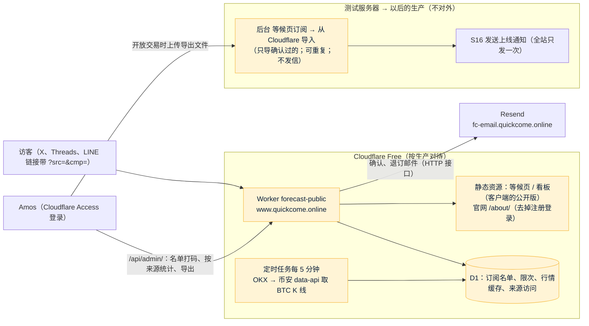

# S19 公开部分上 Cloudflare：开发记录
- 阶段：开发 S19（公开部分先上线；需求单 `市场/v3-公开部分先上线.md` P11～P17）
- 分支：`claude/s19-cloudflare-public`（从 main 开出；S18 的 PR #55 合并后又把 main `def0c1b` 合进来，见第 3 节），PR 到 main
- 日期：2026-10-28
- 角色：研发工程师、运维工程师
- 出处：Amos 2026-10-28："先做 Cloudflare 版，做好再对外"；不用测试服务器过渡（PR #55 里 `www.quickcome.online → 测试服务器` 的做法先不启用）；不花钱，用 Free 套餐（偏离 Cloudflare 规范 K0，Amos 已确认："C2 可以"）；交易系统、后台、内容中心继续留在测试服务器（P16）
- 依据：agents main `6552c1d`（`平台规范/Cloudflare.md` v0.1.1 的 K0～K8；C53、C54、C66、C98、C102、C103、C104、C106、C107、C108）；《项目地图》《项目索引》v0.32；`开发记录/S16-等候页和机器人.md`（等候页的全部行为）、`开发记录/S18-台湾预热.md`（预热页、台湾用语）、`开发记录/S13-推广功能1.md`（来源参数）
- 编号：需要 Amos 决定的问题从 **SQ-67** 起；研发的决定从 **D-274** 起（S18 用到 D-273）；**没有新的数据库迁移**（后端只加接口，不改表）
- 命名：S18 开发记录里把"内容发布 P5～P8、P10"预留成"S19"；本任务由主会话指定为 S19，内容发布那一块以后换个编号（见第 9 节）
- 标注：每项后面写【实际执行】【代码走查】【未验证】；要真实 Cloudflare 账号才能确认的一律【未验证】（智能体没有 Cloudflare 账号，K1）

## 一图看懂
这张图想说明：对外的只有 Cloudflare 上的一个 Worker（静态页面 + 等候页接口 + 定时取行情），数据在 D1；交易系统仍在测试服务器，开放交易时由 Amos 在后台把确认过的名单导进去，上线通知仍由 S16 只发一次。

## 1. 结论
- **托管**：Workers 静态资源一体化（一个 Worker 同时给页面、接口、定时任务），不用 Pages + Workers 两件套（理由见 2.1）。代码在新目录 `cf/`。
- **页面**：直接用客户端（`web/client`）S16 / S18 的等候页组件，另做一个"公开版"构建入口，只打包 `PrelaunchApp`（等候页、确认、退订），**构建产物里没有注册、登录、下注、资产的代码**；官网（`web/site`）构建成公开版放在 `/about/`，"注册 / 登录"按钮换成"加入等候名单"（回到首页的等候页）。构建后有检查脚本，产物里出现任何交易入口就失败（P11 底线）。
- **接口**：Worker 实现和 S16 **同一套接口和返回**（`/api/public/board`、`/api/public/waitlist`、`…/confirm`、`…/unsubscribe`），所以页面一行不用改就能用；行为和 S16 一样：双重确认、陷阱字段、按 IP 每小时 10 次、确认邮件 10 分钟内不重发且最多 5 封、不透露邮箱是否已在名单、免登录退订、确认链接 7 天有效、打开链接不自动确认。邮件走 Resend 的 HTTP 接口（Workers 不能直接用 SMTP 的 587 端口发信更稳妥，见 2.5）。
- **看板**：定时任务每 5 分钟取一次 BTC 1 小时 K 线（OKX 优先，取不到换币安 `data-api.binance.vision`），算法和 S16 的 `BtcBoard` 一样，结果存 D1；页面请求只读缓存，**每次请求不调外部接口**。页面写明来源（OKX / Binance）和更新时间。
- **来源统计**：订阅时记 `src`、`cmp`、`ref`、`start`（规则同 S13）；带来源的访问另记按天的计数；Amos 在 `/api/admin/` 看按来源的订阅数和访问数，可下载 CSV。
- **名单**：只给 Amos 看（Cloudflare Access 只放他的邮箱 + Worker 自己再验一次 Access 的签名），列表里邮箱打码；完整名单只有"迁移用导出"一个出口。
- **迁移（P15）**：后台"等候页订阅"加"从 Cloudflare 导入"（高危：原因 + 勾选，写审计）：只导确认过的，同时把 Cloudflare 上退订的人在后台标成退订；可以重复导入，**导入本身不发任何邮件**；之后按 S16 的"发送上线通知"（全站只能一次）发信，每人一封。
- **部署**：GitHub Actions 在 CI 全绿后部署：推到 `staging` 部署测试版 Worker（`forecast-public-staging`，workers.dev 地址，Access 保护），推到 `main` 部署正式 Worker（`forecast-public`）。D1 的创建和迁移都在 CI 里自动做，Amos 只需要填两个 GitHub Secret。正式 Worker 不开 workers.dev 地址，**Amos 在控制台把 `www.quickcome.online` 绑成自定义域名之前，外面访问不到**——这一步就是"做好再对外"的开关。
- **0 费用**：估算见 2.11；Free 的每次请求 10 ms CPU 够用（页面是静态资源，不进 Worker；接口只做少量 D1 读写和 JSON）。

## 2. 方案

### 2.1 托管方式：Workers 静态资源一体化【代码走查；平台行为未验证】
| | Workers 静态资源（选这个） | Pages + Workers |
|---|---|---|
| 部署件数 | 一个 Worker：页面、接口、定时任务、D1 绑定都在一份 `wrangler.toml` | Pages 项目一份 + Worker 一份（或 Pages Functions），接口要另配路由或同源转发 |
| 静态页面费用 | 访问静态资源**不收费、不限次**，不算进每天 10 万次请求（文档，[billing-and-limitations](https://developers.cloudflare.com/workers/static-assets/billing-and-limitations/)，2026-10-28 打开） | 同样免费 |
| 定时任务（Cron） | Worker 原生支持 | Pages Functions 不支持 Cron，要另建 Worker |
| 发布 | `wrangler deploy` 一条命令，CI 里等检查全绿后执行（K3） | 两条发布命令，两套版本 |
| 回滚 | 控制台或 `wrangler rollback`（K4），页面和接口一起回滚，不会出现新页面配旧接口 | 页面和接口各回各的 |
| 规范 | `平台规范/Cloudflare.md` 第二节"建议"：Vite 构建的前端作为静态资源 + 轻量路由放在一个 Worker | — |

- 只有 `/api/*` 先进 Worker（`run_worker_first = ["/api/*"]`），其他路径直接给静态文件；找不到的页面回到 `index.html`（单页应用，`not_found_handling = "single-page-application"`），由前端回到首页（S18 的 `PrelaunchApp` 已经这样做）。文档提醒：Free 超过每天请求上限时，`run_worker_first` 匹配的请求返回 429，其余静态资源照常（同上文档）——超额时页面照常打开，只有留邮箱和看板暂时不可用，符合"宁可暂时不可用也不付费"。

### 2.2 代码位置【实际执行】
| 位置 | 内容 |
|---|---|
| `cf/wrangler.toml` | Worker 配置：正式（顶层）和 `env.staging`；静态资源目录 `cf/dist`；D1 绑定 `DB`；Cron；`observability`；变量（不含密钥） |
| `cf/src/` | Worker 代码（TypeScript，不引入第三方运行时依赖）：`index.ts` 路由，`waitlist.ts`，`mail.ts`、`mailTexts.ts`，`board.ts`，`ratelimit.ts`，`attribution.ts`，`access.ts`（Access 签名校验），`admin.ts`，`health.ts`，`http.ts` |
| `cf/migrations/` | D1 迁移（`0001_init.sql`），`wrangler d1 migrations apply` 执行，只往前走（K4） |
| `cf/scripts/` | `build.mjs`（构建客户端公开版、官网公开版，合成 `cf/dist`）、`check-dist.mjs`（P11 底线检查）、`ensure-d1.mjs`（CI 里没有 D1 就建、把编号写进本次部署用的配置）、`e2e-local.sh`（本机 `wrangler dev` 端到端） |
| `cf/test/` | Worker 单元和集成测试（vitest + Miniflare，真实的 D1 本地实现） |
| `web/client/` | 公开版入口 `public.html`、`src/public-main.tsx`、`vite.public.config.ts`；看板显示数据来源（`btc.source`） |
| `web/site/` | 公开版开关 `VITE_PUBLIC_SITE`：注册 / 登录按钮换成"加入等候名单" |
| `backend/` | 后台"从 Cloudflare 导入"接口：`growth/waitlist/WaitlistImport`、`admin/ops/WaitlistOps`、`WaitlistAdminController` |
| `web/admin/` | "等候页订阅"页的导入按钮和对话框 |
| `.github/workflows/ci.yml` | 新 job `cf`（检查）、`deploy-cf`（部署，只在 push 到 `staging` / `main` 并且全绿时） |

### 2.3 页面：复用和"公开版"（P11 底线）【实际执行】
- **客户端公开版**：新入口 `web/client/public.html` → `src/public-main.tsx`，只渲染 S18 的 `PrelaunchApp`（根路径是等候页兼看板，`/data/confirm`、`/data/unsubscribe` 是邮件里的链接，其他路径回首页）。用单独的 `vite.public.config.ts` 构建到 `web/client/dist-public/`：
  - 入口文件里只 import `PrelaunchApp`，Rollup 只打包它用到的模块；**交易页面（登录、注册、市场、下注、资产、我的）的代码不在产物里**（不是"隐藏"，是没有）。
  - 不打包 Service Worker（PWA）：公开站不需要离线和推送，也避免以后同一个域名换成交易客户端时旧的 Service Worker 接管页面。
  - 站点形态固定为 `prelaunch`（页面里直接写好 `fc-site-mode=prelaunch`，不再靠 Nginx 替换）。
  - 官网链接（服务条款、隐私、风险披露）指向同一个域名的 `/about/terms` 等（`fc-site-url` 允许写同站的路径，见 `lib/siteUrl.ts`）。
- **官网公开版**：`web/site` 用 `SITE_BASE=/about/`、`VITE_PUBLIC_SITE=true` 构建（`/site/` 这种子路径原型站就在用，S1 起有）。公开版里：顶部、首屏、页底、手机底部固定栏的"注册""登录"按钮换成**一个"加入等候名单"**，链接回首页的等候页（带当前语言）；其他内容（玩法、费率、安全、FAQ、法律页）不变。
- **P11 检查**（`cf/scripts/check-dist.mjs`，CI 的 `cf` job 每次跑）：在 `cf/dist` 的全部 html / js 里查交易入口——接口路径（`/api/auth`、`/api/me`、`/api/bets`、`/api/wallet`、`/api/account`、`/api/markets` 等）、页面路径（`/login`、`/register`、`/markets/`、`/assets`、`/me`）、测试环境域名（`fc-test`）和占位符（`__FC_CLIENT_URL__`）；出现任何一个就失败。另外检查必须有的东西：等候页接口、`fc-site-mode` 是 `prelaunch`、三种语言的翻译都在。
- **繁中优先**（P12）：繁中用的是 S18 已经换成台湾用语的翻译；公开版页面的 `<html lang>`、标题、描述、分享卡片（`og:*`）默认是繁中；语言选择沿用 Amos 2026-10-21 定的规则（跟浏览器：台湾、香港等用繁中，其他中文用简中，取不到用英文；地址栏 `?lang=` 优先），**没有改成"其他语言也默认繁中"**，是否要改见 SQ-67。确认邮件按订阅时页面的语言发，繁中邮件用台湾用语。

### 2.4 域名（P17）【未验证：要 Amos 在控制台操作】
- **对外地址：`www.quickcome.online`**（S18 已经在宣传材料里用这个，P4 的 LINE 链接也是）。官网**不另用子域名**，放在同一个域名的 `/about/`：一个 Worker、一张证书、一个 Access 应用；分享出去的链接只有一个域名；官网的法律页和等候页互相链接不跨域（不需要 CORS）。测试环境的官网 `fc-test-www` 不变。
- **要怎么换**：Amos 在 2026-10-28 加的那条 `www` A 记录（指向测试服务器 47.251.87.158，仅 DNS）**要先删掉**，然后在 Worker 的 **Settings → Domains & Routes → Add → Custom domain** 填 `www.quickcome.online`。Cloudflare 会自己建一条指向 Worker 的记录（代理状态）并签证书（文档，[custom-domains](https://developers.cloudflare.com/workers/configuration/routing/custom-domains/)）。不用 Pages 的自定义域名，也不用"改成代理状态的 A 记录 + 路由"（那样要一条指向假地址的记录和一条路由，两处要对上）。
- 文档写的是"已有 CNAME 记录的主机名不能建自定义域名"，A 记录是否同样冲突文档没写【推断：会冲突，所以先删】。删记录和加自定义域名之间那几分钟，`www` 打不开，影响很小（现在还没对外）。
- 自定义域名**不写进 `wrangler.toml`**：这样部署用的令牌不需要域名（Zone）权限，令牌只要账户级的三项（第 2.10 节）；而且正式 Worker 部署了也不会自动对外。wrangler 在配置里没有 `routes` 时不改动已有的路由和自定义域名【代码走查：wrangler 4.149.0 的部署代码，见第 5 节】。
- `quickcome.online` 根域名、`fc-email` 子域名（Resend）不受影响。

### 2.5 等候页接口（P12）【实际执行：Miniflare 和本机 wrangler dev】
接口、参数、返回和错误码和 S16 一样（`WaitlistController`），页面不用改：

| 接口 | 行为（和 S16 相同的地方不再重复写） |
|---|---|
| `POST /api/public/waitlist` `{email, lang, website, attribution:{first,last}}` | ① 等候页关着（变量 `WAITLIST_OPEN=false`，开放交易后用）→ 409 `WAITLIST_CLOSED`；② 邮箱规则和页面**同一份代码**（直接引用 `web/client/src/lib/validators.ts` 的 `validateEmail`，C108），不合法 400 `VALIDATION_FAILED`，字段 `email`；③ 按 IP 每小时 10 次（陷阱字段有值也算一次），超过 429 `RATE_LIMITED` + `Retry-After` + `cooldownSeconds`；④ 陷阱字段 `website` 有值：照样回答"请查收邮件"，什么都不做；⑤ 新邮箱：插入（`INSERT … ON CONFLICT DO NOTHING`，唯一键兜底）并发确认邮件；已有：待确认的 10 分钟后才重发、最多 5 封（带旧次数的条件更新，同时两次提交只发一封）；退订过的 10 分钟后重新走确认（新确认链接）；已确认的什么都不发；⑥ **总是**回答 `{"status":"check_email"}` |
| `POST /api/public/waitlist/confirm` `{token}` | 32 位十六进制，不对 404；待确认 → 已确认；超过 7 天 410 `WAITLIST_LINK_EXPIRED`；等候页关着 409；重复确认没有效果；返回 `{status, lang}`（不返回邮箱） |
| `POST /api/public/waitlist/unsubscribe` `{token}` | 任何状态 → 已退订，重复也成功；不用登录 |

- **不透露邮箱是否已在名单**：除了回答相同，**发信放在回答之后**（`ctx.waitUntil`），新邮箱和老邮箱的回答时间一样，不能靠快慢判断。
- **确认链接**：`{PUBLIC_BASE_URL}/data/confirm?t=…`，打开只显示按钮，按了才确认（S16 D-216，防邮件服务商预取）；退订链接 `{PUBLIC_BASE_URL}/data/unsubscribe?t=…`。邮件头带 `List-Unsubscribe`（退订页的地址）。
- **IP**：取 `CF-Connecting-IP`（Cloudflare 填的，客户端改不了）；只存 sha256（和 S16 同样的算法，导入后端时原样带过去）。
- **邮件**：Resend 的 HTTP 接口 `POST https://api.resend.com/emails`（Bearer key），不是 SMTP。理由：Workers 只能用 `connect()` 建 TCP 连接，要自己实现 SMTP 和 STARTTLS，代码多、CPU 也多；HTTP 接口一次请求就发，错误码清楚（403 = key 没有这个发信域名的权限，C104）。超时 10 秒；5xx、429 重试 1 次；失败写日志（不含邮箱全文，打码）。key 是 Worker 的密钥 `RESEND_API_KEY`，Amos 在控制台填（K2）；**没填时**照样记下订阅、不发信，健康检查显示 `mail: not_configured`（"未开通"，不是故障，C103），填好以后用户再提交一次（10 分钟后）就会收到。
- **邮件文字**：三种语言，和 S16 的 `WAITLIST_CONFIRM` 模板（繁中用 S18 改过的台湾用语版 V31）一字不差，放在 `cf/src/mailTexts.ts`；测试检查和迁移脚本里的文字一致（改了一边另一边会失败）。发信地址 `MAIL_FROM` 是变量（默认 `Quick Come <noreply@fc-email.quickcome.online>`，和测试环境的 `FC_MAIL_FROM` 应该一样，Amos 核对，见操作清单）。
- **三种语言**：`lang` 按 S16 的规则规范成 `zh-TW` / `zh-CN` / `en`（`zh-HK`、`zh-Hant` 算繁中），邮件按它发，导入后端时带过去。

### 2.6 看板（P13）【实际执行：本机取数；Cloudflare 出口未验证】
- **口径**和 S16 `BtcBoard.compute` 一样：最近 25 根 1 小时 K 线，只算已经收盘的 24 根，收盘 ≥ 开盘算涨，比例 1 位小数四舍五入，现价是最新一根的收盘价（2 位小数）。测试用同一段 K 线和 S16 的手算结果对照。
- **数据源实测**（2026-10-28，本机网络，美国出口）【实际执行】：

  | 接口 | 结果 |
  |---|---|
  | 币安 `api.binance.com/api/v3/klines` | **451**（"restricted location"） |
  | 币安 `data-api.binance.vision/api/v3/klines`（S16 在用的地址） | 200 |
  | OKX `www.okx.com/api/v5/market/candles?instId=BTC-USDT&bar=1H` | 200 |
  | Coinbase `api.exchange.coinbase.com/products/BTC-USD/candles` | 200（BTC-USD，不是 USDT，不用） |

  **从 Cloudflare Workers 出口访问的结果【未验证】**：本机不是 Cloudflare 的出口；Cron 在哪个机房跑由 Cloudflare 决定（文档没写固定地区），币安按地区返回 451，所以按"可能被拒"设计。部署到 staging 后看 `/api/health` 的 `board` 一项（每个源最近一次的状态码和时间）就知道实测结果，写回本节。
- **做法**：OKX 优先（营销实测可用，返回带 `confirm` 字段直接说明是否收盘），失败（超时 8 秒、非 200、格式不对）换币安 `data-api.binance.vision`；两个都失败保留上一次的数据和它的更新时间（页面照实写），从没取到过时页面显示"暂时取不到"（S16 同样）。两个都连续失败 3 次健康检查的 `board` 为 `down`。
- **CPU**：每 5 分钟一次 Cron（Free 每个账户 5 个 Cron，这里正式、测试各用 1 个），一次解析 25 根 K 线、写一行 D1。页面的 `GET /api/public/board` 只读 D1 一行（同一个 Worker 实例 30 秒内复用），带 `Cache-Control: public, max-age=30`。**每次请求的 CPU 远低于 10 ms**【实际执行：本机 wrangler dev 计时，见第 5 节；Cloudflare 上的实际 CPU 时间部署后在 Workers Logs 看，未验证】。
- **Polymarket** 不接（`polymarket.enabled=false`，SQ-39 不变）；Telegram 频道链接由变量 `TG_CHANNEL_ZH`、`TG_CHANNEL_EN`、`TG_BOT` 给（空 = 不显示）。

### 2.7 来源统计（P14）【实际执行】
- 订阅时把页面传来的 `attribution.last`（没有时用 `first`）的 `src`、`cmp`、`ref`、`start` 按 S13 的规则清洗（`[A-Za-z0-9._~-]{1,64}`，`start` 解码 `s-…__c-…__r-…`，规则和后端 `common/attribution/Attribution.java` 同一套测试向量）后记在订阅上。
- 带来源参数的访问（页面已有的 `POST /api/attribution/visit`）按"天 + src + cmp"计数，只用于算"访问 → 订阅"的转化；不记 IP、不记设备号。
- Amos 在 `/api/admin/` 看到：各状态数量、按 `src` / `cmp` 的订阅数（待确认、已确认、已退订）和访问数；可下载 `sources.csv`。

### 2.8 名单只给 Amos 看【实际执行：Miniflare（签名用测试密钥）；Access 本身未验证】
- 路径 `/api/admin/`（页面）、`/api/admin/waitlist.csv`（邮箱打码）、`/api/admin/sources.csv`、`/api/admin/export.json`（**完整邮箱**，只用于 P15 导入）。
- 两道门：① Cloudflare Access（Zero Trust 免费版）应用，路径 `www.quickcome.online/api/admin`，策略只放 Amos 的邮箱；② Worker 自己校验 Access 加在请求头的 `Cf-Access-Jwt-Assertion`（RS256 签名、`aud` 等于 `ACCESS_AUD`、`iss` 等于 `ACCESS_TEAM_DOMAIN`、没过期），不通过 403。第②道是因为：带静态资源的 Worker 拿不到 `ctx.access`（文档，[cloudflare-access](https://developers.cloudflare.com/workers/configuration/cloudflare-access/)），而且万一 Access 应用配错路径，Worker 仍然挡住。
- `ACCESS_TEAM_DOMAIN`、`ACCESS_AUD` 没填时整个 `/api/admin/` 返回 404（默认关）。
- 打码规则和 S16 一样：`a***@example.com`。
- 备用：Amos 也可以在自己电脑上用 `npx wrangler d1 execute` 查（需要先 `wrangler login`），写在操作清单附录，不作为主要做法。

### 2.9 名单迁移（P15）【实际执行：后端测试、后台测试】
- **导出**：`/api/admin/export.json`：`{"format":"fc-cf-waitlist-v1", "exportedAt", "items":[…]}`，只含**已确认**和**已退订**的；每项有邮箱（小写）、语言、状态、`src` / `cmp` / `ref` / `start`、留邮箱时间、确认时间、退订时间、退订随机串、IP 的 sha256。待确认的不导（没确认的不能发上线通知，D-219）。
- **导入**：后台"等候页订阅" → **从 Cloudflare 导入**（`content:publish` ★，原因必填、勾"我确认导入"，写审计）→ 选文件 → 结果：新增 n、已在名单 n、标成退订 n、跳过 n（原因）。接口 `POST /api/admin/waitlist/import`。规则：

  | Cloudflare 上 | 后台没有这个邮箱 | 后台是待确认 | 后台已确认 / 已通知 | 后台已退订 |
  |---|---|---|---|---|
  | 已确认 | 新增为**已确认**（时间、语言、来源照搬） | 改成已确认 | 不动 | **不动**（退订优先，不替人重新订阅） |
  | 已退订 | 不新增（不保存退订者的邮箱） | 改成已退订 | 改成已退订 | 不动 |

  - 可以重复导入：第二次同一个文件全部是"已在名单"，什么都不变【实际执行：测试】。
  - **导入不发任何邮件**；上线通知仍由 S16 的"发送上线通知"发，`growth_launch` 一行保证全站只按一次，每人 CONFIRMED → NOTIFIED 的条件更新保证只发一封。导入时上线通知**正在发**：新导入的已确认会被任务接着发到；**已经发完**：新导入的不会再收到，结果里单独写出数量并提示（D-277）。
  - 退订链接：新增的行用 Cloudflare 上的退订随机串，Cloudflare 发出去的退订链接以后指向生产时仍然有效；冲突时换新的。
  - 文件格式不对、邮箱不合法（同一份规则）、语言不认识的行逐行报错（"第 n 行：错在哪"，C108），合法的照常导入。
- **切换的顺序**（开放交易那天，写进操作清单第 6 节）：Cloudflare 关等候页（`WAITLIST_OPEN=false`）→ 导出 → 后台导入 → 按"发送上线通知"。之后 `www` 继续由 Cloudflare 提供（官网、看板），等候页那一块显示"已上线"。

### 2.10 部署（K3）、D1 一键、健康检查和日志（K7）【CI 部分实际执行；Cloudflare 上未验证】
- **CI**：新 job `cf`（PR 改到 `cf/`、`web/client/`、`web/site/` 时跑；push 到 staging / main 全跑）：装依赖 → 类型检查 → Worker 测试 → 客户端、官网公开版构建 → `check-dist` → `wrangler deploy --dry-run`（检查配置能打包，不连 Cloudflare）。加进 `ci-ok`。
- **部署 job `deploy-cf`**：只在 push 到 `staging` / `main`，`needs` 全部检查（和 `publish-staging` 同样的写法：任何一个失败、取消或跳过都不部署）。步骤：`ensure-d1.mjs`（按名字查 D1，没有就建，把编号写进本次用的配置；**可以重复运行**）→ `wrangler d1 migrations apply --remote`（只执行没执行过的）→ `wrangler deploy`（带 `--var VERSION:<提交号>`）→ 等 30 秒内健康检查返回这个版本（正式 Worker 没绑域名前跳过这一步，只看部署成功）。**没填 `CLOUDFLARE_API_TOKEN` 时整个 job 只打印"还没配置 Cloudflare，跳过部署"并成功**（没配置不等于故障，C103），不让 main 变红。
- **Amos 只填两个 GitHub Secret**：`CLOUDFLARE_API_TOKEN`、`CLOUDFLARE_ACCOUNT_ID`。令牌用"自定义令牌"，只给三项账户级权限：**Workers Scripts：Edit**、**D1：Edit**、**Account Settings：Read**，账户只选这个账户，不给任何域名（Zone）权限（不用"Edit Cloudflare Workers"模板，它带了 KV、R2、路由等用不到的权限，也没有 D1；C104）。
- **健康检查** `GET /api/health`：`status`、`environment`（production / staging）、`version`（提交号）、`checks`：`db`（D1 能读）、`board`（每个源最近一次结果、数据多久以前）、`mail`（`ok` / `not_configured`）、`admin`（Access 配了没有）。staging 额外返回 `env: "staging"`，页面顶部显示测试标识条（S12 的做法）；正式版不返回 `env`。
- **日志**：`[observability] enabled = true`（Workers Logs，Free 每天 20 万条、保留 3 天，文档，[workers-logs](https://developers.cloudflare.com/workers/observability/logs/workers-logs/)）；日志里邮箱打码、不打印 key。
- **外部定时探测和告警邮件**（K7 后半句）：本次没做，见 SQ-70。
- **回滚**：控制台 Deployments → Rollback 或 `wrangler rollback`（K4）；D1 迁移只往前走，`0001` 之后的迁移要兼容上一版代码。

### 2.11 免费额度和 10 ms【推断，按文档算】
| 项目 | Free 额度（文档，2026-10-28 打开） | 本项目用量估算 |
|---|---|---|
| Worker 请求 | 每天 10 万次 | 只有 `/api/*` 算：每个访客约 2 次（看板 + 可能的访问记录），留邮箱 1 次；每天 1 万访客也只有 3 万次 |
| 静态资源 | 免费不限次 | 页面、图片 |
| D1 读 | 每天 500 万行 | 看板每次读 1 行（30 秒内存缓存）；名单页按需 |
| D1 写 | 每天 10 万行 | Cron 每天 288 次 × 约 3 行；每次留邮箱约 3～5 行（含索引） |
| D1 存储 | 共 5 GB，单库 500 MB | 一万个订阅不到 10 MB |
| Cron | 每个账户 5 个 | 正式、测试各 1 个 |
| CPU | 每次请求 10 ms、每次 Cron 10 ms | 看板请求只读一行 + 拼 JSON；Cron 解析 25 根 K 线；名单页一次最多 200 行。Access 签名校验（RSA 验签）一次约 1 ms 以内【推断】。不会到 10 ms【本机实测见第 5 节；Cloudflare 上未验证】 |
| 邮件 | Resend 免费档（Amos 现有账号的额度） | 每个订阅 1～5 封 |

超出时：请求超过 10 万次 → 接口 429，页面照常；D1 超额 → 写入失败，留邮箱返回"服务器出错，请稍后再试"。都不会产生费用（Free 不能透支）。

### 2.12 安全【代码走查】
- 页面和接口都在同一个域名，接口只接受 `Content-Type: application/json` 的 POST（浏览器跨站提交表单发不出这种请求）；不设 CORS 头。
- 安全头：`X-Content-Type-Options: nosniff`、`X-Frame-Options: DENY`、`Referrer-Policy: strict-origin-when-cross-origin`、HSTS 1 天（和测试环境 `security.inc` 一样），静态资源用 `_headers` 文件，接口在代码里加。
- `preview_urls = false`（不生成每个版本的预览地址），正式版 `workers_dev = false`；测试版的 workers.dev 地址用 Access 保护整个 Worker（操作清单第 3 步）。
- 健康检查不返回任何密钥或订阅数据。
- 测试里的假 key 用 `ci_only_` 开头（gitleaks 不误报）。

## 3. 和 S16、S18 的关系
- S18（PR #55）已经合并进 main（`def0c1b`）。公开版直接复用它的 `PrelaunchApp`、`siteMode`、台湾用语翻译和 V31 的邮件文字。
- PR #55 里"`www.quickcome.online` → 测试服务器"的部分（Nginx prelaunch server 块、`sudo fc add-domain`）**代码保留、不启用**：只有 Amos 在服务器上运行 `sudo fc add-domain www.quickcome.online` 才会生效，本方案不让他运行这条命令；操作清单第 1 步要删的就是 S18 让加的那条 A 记录。以后这部分代码是否删除，见 SQ-68。
- S16 的后端等候页（测试服务器上的 `/data`）照常存在，只在测试域名上，不对外；两边的订阅在开放交易时由 P15 合在一起（测试服务器上的 `growth_waitlist` 只有测试数据）。

## 4. 研发的决定（待 PM / Amos 复核，D-274 起）
- **D-274** 一个 Worker（Workers 静态资源），不用 Pages（2.1）。
- **D-275** 官网放在同一个域名的 `/about/`，不另开子域名（2.4）。
- **D-276** 自定义域名由 Amos 在控制台绑，不写进 `wrangler.toml`：令牌不需要域名权限，绑域名就是"对外"的开关（2.4、2.10）。
- **D-277** 导入只导确认过的；退订以两边任何一边的退订为准；上线通知已经发完以后导入的不会再收到通知，结果里提示（2.9）。
- **D-278** 看板 OKX 优先、币安 `data-api.binance.vision` 备用，每 5 分钟（S16 是每分钟；Free 的 Cron 和 D1 写入额度更紧，5 分钟对"每小时涨跌"足够），页面写实际来源（2.6）。
- **D-279** 邮件用 Resend HTTP 接口，不用 SMTP（2.5）。
- **D-280** 没填 Resend key 时照样收订阅、不发信，健康检查"未开通"（2.5，C103）。
- **D-281** 公开版不打包 Service Worker（2.3）。

## 5. 测试和验证
（实现后填写）

## 6. 需要 Amos 决定的问题
（实现后填写）

## 7. 给 Amos 的操作清单
单独一页：`部署方案/v1-公开部分Cloudflare操作清单.md`。

## 8. 默认关着的功能（C102）
（实现后填写）

## 9. 遗留
（实现后填写）
