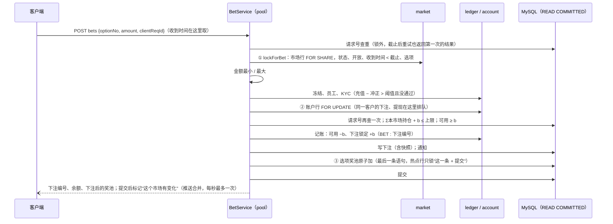

# S4 下注、奖池、赔率、推送：开发记录
- 阶段：开发 S4（`技术方案/v1-架构方案.md` 第 16 节 S4：`pool` 的下注事务、拒单原因、赔率计算（共用向量）、WebSocket 推送；验收 AC-15～AC-19、AC-70 预压测）
- 分支：`claude/s4-pool`（从 `claude/s3-market` 的 `eecb417` 开出，`git ls-remote` 核对过远程，C68）
- 日期：2026-10-25
- 角色：研发工程师
- 依据：agents main `1f92bbc`（本步开始时重新拉取；《研发工程师》v0.12.1，C37、C53、C63、C81）；需求说明书 v1.2 第 3.3～3.6、3.9、3.10、5.2、7、8 节和 AC-15～AC-19、AC-37、AC-39、AC-62、AC-67、AC-70；架构方案 v1.1 第 2.3、2.4、3.3、4.1、4.2、4.5、5.2、7、16、17 节；S3 留下的接口（`开发记录/S3-市场.md` 第 2.4 节）
- 名词：**复制源**同 S1（代码和本文件里不写它的名字）。

## 1. 结论
- 新模块 `pool`：**下注事务**（一笔下注一个事务，三把锁固定顺序：市场行共享锁 → 客户账户行排他锁 → 选项奖池原子加；READ COMMITTED；账本记"下注锁定"；保存下注后的奖池快照；请求号 `clientReqId` 幂等；需求第 3.3 节的 **11 种拒单原因**全部实现，客户端按错误码显示中英文）、**持仓**（同一客户同一选项合成一个）、**赔率和预计回报**（后端 `PoolMath` / `Odds`，客户端 `lib/pool.ts`，**共用测试向量** `pool-vectors.json`：需求第 3.5 节两个例子、费率 8%、AC-19 边界和 500 组随机，三份独立实现逐分一致）。
- 实现了 S3 留下的 **`MarketPoolView`**：上架时建奖池行、**截止时定格奖池**（`final_amount`）并数有效选项（E3、E4 作废照常）、**下注客户名单**（#22 费率修改通知现在发给真实的下注客户）、状态副本、客户端接口里的奖池。
- **WebSocket 推送** `/api/ws/markets`：订阅时先推一次；下注、截止、改费率、状态变化提交后标记，**每个市场每秒最多推一次**（合并），从变化到推出 ≤ 约 1.2 秒（AC-17 实测：后端测试、端到端两种形态都在 2 秒内收到）；多实例经 Redis 广播。
- 客户端接口：下注、我的下注（四个分组和汇总）、市场列表和详情的 `pool` 字段（详情带本人持仓、限额）、资金流水显示下注（带市场编号和题目，AC-39 的下注部分）；后台接口：某个市场的下注明细（`bet:view`）。**页面都没有做**（等原型确认）。
- S2 遗留的 R8：`pool_bet.status` / `refund_reason` / `refunded_at` 和 `PoolApi.effectiveStakeSince`（有效下注本金，退回的、取消 / 作废市场里的不算）已经准备好，规则改造在 S10。
- 迁移：`V11__pool.sql`（4 张 pool 表 + 通知模板 `BET_PLACED`）、`V12__bet_checks.sql`（`account_user.is_staff`、`ledger_entry` 按类型的索引）。V1～V10 没有改。
- 并发（真实 MySQL 8.4）：AC-18 两项（余额、上限）恰好 10 笔成功；截止竞争 5 轮 400 笔，定格的奖池正好等于截止前提交的下注；下注 + 提现 + 改费率 + 暂停恢复混合跑 **60 秒没有死锁**（InnoDB 死锁计数不变），账本合计 = 余额、每个市场 Σ下注 = Σ奖池 = Σ持仓 = 账本锁定。
- **预压测**（单机 4 核，应用、MySQL、Redis、压测程序同一台）：预热后 **200 笔/秒 × 60 秒，单市场 100 笔/秒，12,000 笔全部成功，p50 45 毫秒、p95 119 毫秒、p99 180 毫秒**，对账一致。不预热直接上 200 笔/秒会积压（p99 约 5 秒），见第 6 节和 SQ-7。
- 本地实际执行：后端 394 个测试（新加 38 个），0 失败、2 个跳过（同 S1～S3）；客户端 lint、137 个单元测试、真实和原型构建；后台 lint、162 个单元测试、构建；端到端两种形态全部通过（含新加的下注用例）；索引检查、仓库品牌检查、gitleaks 通过。详见第 5 节。
- 预压测时发现复制源留下的一个问题：**很多新客户同时第一次取充值地址（或同时注册）会在 `AddressService` 死锁**，偶发 500。和下注无关，没有在本步修，见第 7 节、SQ-8。

## 2. 做了什么
### 2.1 数据（迁移 V11、V12）
| 表 / 数据 | 说明 |
|---|---|
| `pool_bet` | 下注：对外编号（账本幂等键 `BET : 编号`）、客户、市场、选项、金额、请求号（唯一 `(user_id, client_req_id)`）、**服务器收到时间**（到毫秒，截止判定和 E14 退回只看它）、状态 ACTIVE / REFUNDED、退回原因 CANCELLED / VOIDED / LATE_BET / STAFF 和退回时间（S5 起写）、下注后的奖池快照（JSON：各选项奖池、合计、当时的费率，只做展示）。CHECK：金额 &gt; 0、状态两种、"ACTIVE ⇔ 没有退回原因"。索引按架构方案第 3.3 节，另加 `(user_id, received_at)`（R8 按时间合计） |
| `pool_position` | 持仓：唯一 `(market_id, option_id, user_id)`；金额、笔数。CHECK 不为负 |
| `pool_option_total` | 选项奖池 Pᵢ、人数；截止时定格的 `final_amount`、`final_bettors`、`frozen_at`；选项的对外编号和顺序（上架时从 market 抄过来，之后不变，推送和客户端接口不用再去问 market） |
| `pool_market` | 已上架市场的登记和**状态副本**（market 每次跳转同一事务同步）：我的下注按"进行中 / 待结果 / 已结算 / 已退回"分组要按市场状态筛选，pool 不能读 market 的表（架构方案里没有这张表，第 9 节） |
| `account_user.is_staff` | 员工账户不能下注（需求第 3.3、8.1 节；架构方案第 3.3 节原计划在 S10 加，S4 要做"员工账户"这个拒单原因，提前加列；后台登记员工在 S10） |
| `ledger_entry` 索引 `(account_id, entry_type, id)` | 下注时对没通过 KYC 的客户合计"充值 − 冲正"，原来只能扫这个客户的全部流水（下注多了以后越来越慢） |
| 通知模板 `BET_PLACED`（#8） | 只发站内信；变量 `market`、`marketEn`、`option`、`optionEn`、`amount`、`betNo`；文案是研发初稿，PM 在 S9 定稿 |

### 2.2 pool 模块（`backend/src/main/java/com/forecast/app/pool/`）
| 包 / 类 | 说明 |
|---|---|
| `api/PoolMath` | 下注金额（&gt; 0、最多 2 位小数、不舍入）、盈利 G（向下取整到 0.01）、抽成 F（四舍五入）、持仓按奖池结算 `payout`（S5 的 `SettleMath` 用同样的舍入） |
| `api/Odds` | 概率（列表 0 位、详情 1 位；`<1%`、`>99%`、`—` 按精确值判断）、预计赔率（向下取整，Pᵢ = 0 是 `—`）、本注预计回报 |
| `api/PoolApi` | 给其他模块：`effectiveStakeSince`（R8）；退回原因代码 |
| `api/PoolAdminApi` | 后台：某个市场的下注明细 |
| `bet/BetService` | 下注事务（第 4 节）、11 种拒单原因 `REJECT_CODES`、幂等、上架前就有的市场补奖池行 |
| `bet/PoolMarketView` | `MarketPoolView` 的实现（market 的事务里调用） |
| `bet/PoolQueries` | 奖池视图（列表、详情、推送、下注结果共用一份）、我的下注、后台明细、R8；市场人数缓存 1 秒 |
| `bet/PoolViews` | 客户端字段（契约） |
| `push/PoolPush`、`PoolChanges`、`PoolPushConfig` | `/api/ws/markets`：订阅、合并推送（每 200 毫秒看一次，同一市场距上次不满 1 秒就等）、提交后标记、Redis 发布订阅（频道 `fc:pool:changed`，发布在单独的线程，Redis 不可用 30 秒内不再试） |
| `web/BetController` | `POST /api/markets/{publicNo}/bets`（`@UserWriteLimited`，收到时间在这里取）、`GET /api/me/bets` |

### 2.3 规则怎么落到代码
| 需求 | 实现 |
|---|---|
| 截止判定（AC-15） | `lockForBet`（S3）只看收到时间：`openAt ≤ receivedAt < closeAt`；下注拿市场行共享锁，截止任务拿排他锁，截止时奖池里只有截止前已提交的下注 |
| 拒单原因（AC-16） | 市场未开放 `MARKET_NOT_OPEN`、已截止 `MARKET_CLOSED`、已暂停 `MARKET_PAUSED`、已取消 `MARKET_CANCELLED`、低于最小 `BET_BELOW_MIN`、高于最大 `BET_ABOVE_MAX`、超过本市场上限 `BET_OVER_USER_CAP`、余额不足 `INSUFFICIENT_FUNDS`、需要先完成身份认证 `KYC_REQUIRED`、账户已冻结 `USER_FROZEN`（403）、员工账户 `BET_STAFF_ACCOUNT`。后端返回错误码（`message` 是中文，给排查用）；客户端 `errors.ts` 按错误码显示中英文（繁体随 S11 三语一起加）。字段格式错误一次列出（C56） |
| 下注限额 | 单笔最小 / 最大、单客户单市场上限按参数设置（S3 的 `common_config`，5 秒缓存）；上限按这个客户在本市场**所有选项**的持仓合计 |
| KYC（第 3.10 节、AC-62） | 没通过 KYC 的客户，账本"充值 − 冲正"&gt; 阈值（默认 1,000）就拒：1,000 能下、1,000.01 不能 |
| 冻结、员工（AC-67） | 下注时查（冻结的客户正常登录不进来，这里防"登录后被冻结"） |
| 幂等（X-3） | 请求号先在锁外查一次（截止以后的网络重试也返回第一次的结果），账户行锁之后再查一次（并发的同一请求排在锁上，第二个看到第一个）；数据库唯一键兜底。换了市场、选项或金额 409 `BET_REQUEST_REUSED` |
| 持仓 | 同一客户同一选项合成一个（`bet_count` 计笔数）；人数只在新建持仓时 +1 |
| 赔率（第 3.4 节、AC-19） | 列表、详情、推送、下注结果的 `pool` 字段都按 `Odds` 算好字符串；用当前费率；截止后用定格的奖池（费率改了按新费率重算赔率，测试覆盖） |
| 预计回报（例子 2：162.29） | `Odds.expectedReturn`；详情里"我的持仓"另给 `ifWin`（这个选项赢了按现在的奖池结算能拿回多少，截止后就是最终派彩） |
| 推送（AC-17、NF-02） | 第 2.2 节；连上（含重连）时先推一次现在的奖池，不会漏掉连上前的变化 |
| 截止（E3、E4） | `freezeAndCountActiveOptions`：定格、数 `amount > 0` 的选项；&lt; 2 个由 market 同一事务作废 |
| 守恒（第 3.9 节第 2 条） | Σ有效下注 = Σ选项奖池 = Σ持仓 = 账本里这个市场的下注锁定：每个测试、预压测都核对；后台明细给"有效下注合计"和奖池合计 |
| 通知 #8 | 下注事务里调 `NotifyApi`（回滚就不发），只发站内信 |
| E14 | 只记收到时间（到毫秒）；退回在 S5 |

### 2.4 其他模块的改动
| 地方 | 改法 |
|---|---|
| `market/api/MarketPoolView` | 加 `open`（上架时建奖池行）、`changed`（状态副本 + 推送）、`clientPools`（客户端接口里的奖池，结构由 pool 定） |
| `market/api/MarketApi` | `BetTarget` 带市场和选项的对外编号、题目、选项文字（通知 #8）；`MarketRef` 带题目、开放时间、费率、上限；加 `findById`、`refs`、`options`、`optionsById` |
| `market/core/MarketService` | 每次状态跳转、改费率、提前截止后通知 pool；上架时让 pool 建奖池行；客户端列表、详情加 `pool` 字段；实现 ledger 的 `MarketLabels` |
| `ledger/api/MarketLabels`（新）、`LedgerController` | 客户端流水加 `bet` 类型（BET_LOCK 的"可用 −b"那一条）和 `market`（对外编号和三语题目）；ledger 不依赖 market，由 market 实现这个接口 |
| `account/api/AccountApi` | 加 `isStaff` |
| `common/web/GlobalExceptionHandler` | `BET_REQUEST_REUSED` → 409 |
| `admin/ops/BetAdminController`（新） | `GET /api/admin/markets/{publicNo}/bets`（`bet:view`），补上客户邮箱和姓名 |
| `application.yml` | `forecast.pool.push.*` 的默认值写在代码里（`@Value`）；MySQL 驱动 `useLocalSessionState: true`（第 6 节） |
| 测试替身 `support/MarketTestDoubles.Pool` | 标 `@Primary`，market 的测试照旧用替身；pool 的测试不 import 它，用真实实现 |

### 2.5 前端
| 地方 | 改法 |
|---|---|
| `web/client/src/lib/pool.ts`（新） | 概率、预计赔率、本注预计回报、持仓结算；bigint 精确计算（不用 `decimal.ts` 的 18 位四舍五入），费率百分比 → 小数 |
| `web/client/src/lib/pool.test.ts`（新） | 读 `backend/src/test/resources/pool/pool-vectors.json` 逐分核对；另写死需求的例子 |
| `web/client/src/api/errors.ts`、翻译 | 下注拒单原因的错误码和中英文 |
| 资金流水 | `LedgerType` 加 `bet`，`LedgerItem.market`；流水列表显示市场题目（按当前语言）；类型筛选加"下注" |
| `.github/workflows/ci.yml` | `web (client)` 的路径过滤加 `backend/src/test/resources/pool/**`（客户端测试读后端的向量） |

后台前端没有改（`bet:view` 权限点 S3 已加；下注明细页面在 S9）。

## 3. 迁移脚本
| 脚本 | 内容 |
|---|---|
| `V11__pool.sql` | `pool_bet`、`pool_position`、`pool_option_total`、`pool_market`；通知模板 `BET_PLACED` |
| `V12__bet_checks.sql` | `account_user.is_staff`（默认 0）；`ledger_entry` 索引 `idx_ledger_entry_account_type` |

- 编号：架构方案第 3.4 节原计划 `V7__pool.sql`；S2、S3 用了 V6～V10，S4 顺延为 V11、V12（第 9 节）。
- 新项目没有已有数据（需求第 14 节）；V12 的新列有默认值（已有客户一律"不是员工"），新索引不改数据。S3 期间（S4 之前）上架的市场在彩池里没有奖池行：第一次下注时补（`BetService.ensureOpened`，单独的小事务），测试覆盖。
- 实际验证：后端测试前把 `forecast_test` 删掉重建，从 V1 迁移到 V12；端到端两种形态都是空库。

## 4. 并发设计和测试

这张图想说明：一笔下注三把锁，顺序固定；截止任务（市场行排他锁）、提现（只锁账户行）、改费率和暂停（市场行排他锁）都是这个顺序的前缀，所以没有环。

- **为什么 READ COMMITTED**：上限求和、请求号查重必须读到"拿到账户行锁时"最新提交的数据。可重复读的快照建在事务里第一次普通读（`lockForBet` 里查选项就是一次普通读），早于账户行锁，并发时会少算别人刚提交的持仓（上限被突破）；改成锁定读又会在持仓的二级索引上加间隙锁，挡住别的客户。READ COMMITTED 两个问题都没有。
- **热点行**：一个市场 100 笔/秒打在 2～3 个选项上，选项奖池行是热点。把它放在最后一步（通知、持仓都在它前面），这一行的锁只持有"最后一条 UPDATE + 提交"。
- **奖池行预先建好**：上架时建（`MarketPoolView.open`），下注只做 UPDATE，不在下注事务里 INSERT（避免并发插入同一个新键的间隙锁）。

| 测试（`backend/src/test/java/com/forecast/app/`） | 证明什么 |
|---|---|
| `pool/PoolMathTest`（7 个） | 需求原文的数：60% / 15% / 25%、1.63 / 6.38 / 3.85、162.29、Alice 163.33 / Bob 4,083.33 / Carol 5,553.33、费率 8% 时 1.61 和 Alice 161.33、AC-19 的 `<1%` / `—`、正好 1% 和 99%、合成持仓只舍入一次、金额格式 |
| `pool/PoolMathVectorsTest`（2 个） | 511 组向量、6,000 多项逐分一致；向量里确实有两个例子和 8% |
| `pool/BetFlowTest`（10 个） | 一个事务里的记账（两条流水同一个幂等键、带市场）、下注和快照、持仓合并、人数、守恒、`mismatches()` 为空、通知 #8 只发站内信；幂等（重复返回同一笔、只扣一次、换内容 409、截止后重试仍返回第一次、不同客户互不影响）；**AC-15**（T − 1 毫秒成功、T 和 T + 1 拒绝，收到时间到毫秒）；**AC-16**（11 种拒单原因各触发一次，被拒的不动钱）；**AC-14**；字段错误一次列出、市场或选项不存在；S4 之前上架的市场第一次下注时补奖池行；参数设置改限额立即生效；**AC-39 的下注部分**（流水带市场）；**R8 的数据**（有效下注本金，取消市场、退回的不算） |
| `pool/BetConcurrencyTest`（6 个） | **AC-18**：余额 100、20 线程各押 10，恰好 10 笔成功，余额 0、下注中 100、奖池 100、一个持仓 100/10 笔；上限 100、20 线程跨两个选项各押 10，恰好 10 笔成功；同一请求号 10 个线程只下一次；30 个客户同时押同一选项（120 笔）奖池 300、人数 30；**截止竞争**：5 轮、每轮 80 笔下注和截止任务同时开始，定格的奖池 = 成功的下注、之后奖池不再变（本地这次：截止前提交 185 笔、截止后拒绝 215 笔）；**死锁检查**（第 5 节） |
| `pool/PoolPushTest`（5 个，真实启动、真实握手） | 订阅时先推一次；**下注提交后 2 秒内推到**（AC-17）；40 笔连续下注合并推送、两次推送间隔 ≥ 1 秒、最后一次是最新奖池；改费率推送（赔率按 8%）、截止推送（已定格）；另一个实例经 Redis 广播的变化也推；没登录握手被拒、草稿和不存在的订阅不到 |
| `pool/PoolCloseTest`（4 个） | 上架建奖池行、状态副本；截止定格、之后不能下注、截止后改费率按新费率重算赔率和"赢了拿回"；E3 / E4 作废（定格照做）、作废市场的下注在"已退回"分组；**AC-37 的通知部分**：#22 发给真实的下注客户（押两个选项的也只发一次） |
| `pool/PoolClientContractTest`（3 个） | 下注结果、列表和详情的 `pool`、我的下注的字段名、顺序、格式；AC-19 的列表显示；本人持仓、限额；没人押的市场全 `—` |
| `admin/security/AdminBetTest`（1 个） | 下注明细：奖池汇总、有效下注合计、收到时间到毫秒、客户邮箱、筛选、只有 `market:view` 403 |
| 原有测试的修改 | `MarketClientContractTest`（字段多了 `pool`）、`LedgerControllerTest`（流水有下注了）、`RateLimitTest`（下注接口在按客户限流的名单里）、`AdminOpsTest`（模板按编号排序，`BET_PLACED` 排第一）、`MarketTestDoubles`（`@Primary`、新方法） |
| 端到端 `e2e/tests/bet.spec.ts` | 接口级：上架 → 两个客户经链替身充值 → B 订阅推送 → A 押 30（2 秒内推到）→ B 押 20（概率 60.0% / 40.0%、赔率 1.63 / 2.42）→ 详情持仓（赢了拿回 49.00）、我的下注、资金流水、后台明细 → 拨时钟、跑截止任务 → 推送"已截止、奖池定格 50.00"，之后下注 400 `MARKET_CLOSED`；`e2e/tests/api.ts` 是从 `market.spec.ts` 抽出的公共部分 |

## 5. 本地验证（全部实际执行，2026-10-25）
环境：JDK 25（`JAVA_HOME=/usr/lib/jvm/java-25-openjdk-amd64`）、Maven 离线、Docker 里的 `mysql:8.4`（8.4.11）和**两个** `redis:7`（后端测试一个、端到端一个）、Node 22、Playwright 1.56.1（Chromium）。容器是本步新建的（`fc-s4-*`），没有用别的步骤的。

| 检查 | 命令 | 结果 |
|---|---|---|
| 后端编译和全部测试 | `mvn -o -B -ntp verify -Dpool.mixedSeconds=60`（`forecast_test` **删掉重建的空库**，从 V1 迁移到 V12；后端测试专用的 Redis） | 394 个，0 失败、0 错误、2 个跳过（同 S1～S3：真实节点、anvil 没设环境变量），BUILD SUCCESS |
| 死锁检查（上面这次的一部分） | `BetConcurrencyTest` 的混合用例跑 **60 秒**（CI 默认 15 秒） | 20 个线程：下注 5,972 笔、提现提交 + 撤销 667 次、改费率 436 次、暂停 / 恢复 310 次（被暂停挡住的下注 1,701 次、费率没变被拒 6 次，都是业务拒绝）；**InnoDB 死锁计数没有增加**，没有锁等待超时；账本合计 = 余额，3 个市场 Σ下注 = Σ奖池 = Σ持仓 = 账本锁定，提现冻结都回到 0 |
| 共用向量 | 后端 `PoolMathVectorsTest`、客户端 `npx vitest run src/lib/pool.test.ts` | 两边都通过（511 组） |
| 客户端 | `npm ci`、`npm run lint`、`npm test`、`npm run build` + `check-brand` + `check-no-mocks`、`VITE_API_MODE=mock npm run build` + `check-brand` | 全部通过：19 个文件 137 个测试 |
| 后台 | `npm ci`、`npm run lint`、`npm test`、`npm run build` + `check-brand` + `check-no-mocks` | 全部通过：23 个文件 162 个测试（后台没有改代码） |
| 官网 | `npm ci`、`npm run build`（只为端到端） | 构建通过（没有改代码，lint 和单元测试本步没有跑） |
| 端到端（server.mjs 形态） | `mvn package -DskipTests`、三个前端真实构建、空库 `forecast_e2e`、单独的 Redis、`bash e2e/start-backend.sh`、`npx playwright test`；`npm run typecheck` | 下注、主流程、市场、官网 4 个通过，部署形态专用的 3 个按设计跳过；最后的代码（第 6 节的优化之后）在新建的空库上又跑一次，同样 4 个通过 |
| 端到端（部署形态） | `E2E_SKIP_BUILD=1 bash e2e/run-deployed.sh`（镜像 + Nginx + HTTPS + 三个假域名；下注用例的 WebSocket 直接连后端 127.0.0.1:8080，和 `/api/e2e/**` 一样） | 7 个全部通过（下注、Nginx 两个、Service Worker、主流程、市场、官网），用时 78 秒；应用容器内存 363 MiB / 768 MiB |
| 项目地图和索引 | `node scripts/check-project-index.mjs` | 通过 |
| 仓库旧品牌名和复制残留 | `node scripts/check-brand.mjs --repo` | 通过（Quick Come 按设计不检查） |
| 密钥扫描 | `gitleaks detect --no-banner -l warn --source <工作目录>` | 通过：没有发现泄露（全部提交以后执行） |

没有执行的：GitHub Actions 上的 CI（不开 PR）；合约和资金归集本地链端到端（本步没有改合约、归集）；官网的 lint 和单元测试、`npm audit`（依赖没有变）。

### 5.1 收尾时的检查
- 提交以后在**新建的空库**上又完整跑了一次后端（混合用例按 CI 默认 15 秒）：394 个，0 失败、2 个跳过，BUILD SUCCESS；截止竞争这次是截止前提交 150 笔、截止后拒绝 250 笔，死锁检查 15 秒下注 1,484 笔、提现提交撤销 162 次，没有死锁。
- 端到端两种形态都在第 6 节的最后一次优化之后、用最终的 jar 跑过（第 5 节表格）；之后没有再改代码，只改了文档。
- 预压测时这台机器上的数据库是端到端用的库（`forecast_e2e`），压测以后为了端到端重新建了空库，没有留下压测数据。

## 6. 预压测（AC-70 的预演；正式压测在 S12 的测试环境）
- 脚本：`e2e/load/bet-load.mjs`（第 2 节）。对一个 e2e profile 的后端：SQL 建 1,000 个客户和会话 → 链替身给每人充值 1,000 USDT（真实入账代码）→ 建 3 个市场 → 先按 100 笔/秒预热 20 秒 → **开环**每秒 200 笔（不等上一笔返回）× 60 秒，一半打在同一个市场（单市场 100 笔/秒）→ 统计 → 对账。
- 机器：这台开发机 4 个 vCPU、16 GB；**应用、MySQL、Redis、压测程序都在同一台**（压测程序自己占 40% 左右的一个核）。应用直接连 MySQL / Redis 容器的地址（和部署时 compose 网络里一样，不经过 Docker 的端口转发进程）；默认 JVM 参数，连接池 30。

| 次数 | 条件 | 实际速率 | 结果 |
|---|---|---|---|
| 1 | 第一版代码，经 Docker 端口转发连数据库，不预热 | 约 113 笔/秒（12,000 笔用了 106 秒） | 全部成功、对账一致；积压，p99 46.6 秒。CPU 吃满：mysqld 150%、java 110%、**Docker 端口转发进程 60%** |
| 2 | 下注事务调整（通知挪到奖池更新之前、下注结果不再回查、市场人数缓存 1 秒），仍经端口转发，不预热（400 个客户） | 约 141 笔/秒 | p99 25.5 秒 |
| 3 | 直接连容器地址，不预热 | 约 183 笔/秒 | p99 7.4 秒；每笔下注 45.7 条 MySQL 语句，其中约 10 条是驱动在每条写语句前查 `@@session.transaction_read_only` |
| 4 | MySQL 驱动 `useLocalSessionState=true`，不预热 | 200 笔/秒（60.4 秒） | p50 3.3 秒、p99 5.0 秒：前几秒 JIT 还没热，积压以后一直在满负荷，消化很慢；后半段进行中的请求在下降。每笔 35.5 条语句 |
| **5** | **同 4，先按 100 笔/秒预热 20 秒** | **200 笔/秒（60.0 秒）** | **12,000 笔全部成功，0 错误；p50 45.2 / p95 119.1 / p99 180.1 / 最大 453.4 毫秒；3 个市场 Σ下注 = Σ奖池 = Σ持仓 = 账本锁定，没有余额为负的账户** |

- 结论：在这台和别的进程共用的 4 核机器上，**服务热起来以后** 200 笔/秒（单市场 100）p99 180 毫秒，满足 NF-01 的 500 毫秒；刚启动、JIT 没热时直接上满负荷会积压。正式结论以 S12 在测试环境按架构方案第 17 节（同样的镜像和 compose、绑核）压 5 分钟为准，见 SQ-7。
- 每笔下注约 35 条语句（含登录会话、请求号查重、通知 #8 的 4 条、账本的锁和幂等检查）。再要省的话：通知的模板和偏好可以缓存、`LedgerService.applyAll` 对同一账户重复加锁可以去掉（S2 的代码，本步没动）。

## 7. 遗留事项
| 事项 | 什么时候处理 |
|---|---|
| 客户端市场列表、详情、下注抽屉、我的下注页面；后台市场管理、下注明细页面 | 原型确认以后（客户端 S11、后台 S9）；接口和字段已定 |
| 结算、取消和作废的全额退款、E14 晚于开赛的退回、提前截止后退回新截止时间之后的下注（`MarketListener.onCloseAdvanced`）。**在 S5 之前，取消、作废的市场里下注的钱一直锁在"下注中"** | S5 |
| 客户端资金流水的派彩、抽成、退款、补偿 | S5、S7 |
| 员工的后台登记、E15 退回员工下注；累计充值跨过 KYC 阈值的通知 #7（`account_kyc_gate`） | S10（S4 只在下注时检查） |
| 提现自动审批 R8 改成"有效下注本金"（数据和查询已准备：`PoolApi.effectiveStakeSince`） | S10 |
| 补充说明通知 #18（下注客户名单已有：`MarketPoolView.bettors`） | S9 |
| 每日彩池对账（Σ有效下注 = Σ奖池 = 账本锁定，S4 的测试和预压测已按这个口径核对） | S5 |
| 尾盘大额告警（下注事务提交后异步检查） | S10 |
| 繁体中文的拒单原因、`BET_PLACED` 文案定稿 | S11、S9 |
| `BetConcurrencyTest` 的混合用例在 CI 上默认跑 15 秒（每个 PR 都跑，1 分钟太长）；本地验收用 `-Dpool.mixedSeconds=60` | 已知 |
| **复制源的 `AddressService.allocateAddresses` 并发首次分配会死锁**：先 `SELECT … FOR UPDATE` 一个不存在的行（可重复读下是间隙锁）再插入，两个不同客户互相等对方的插入；预压测准备阶段 20 个并发取地址时出现，返回 500。注册时也会分配地址，同时注册的人多时可能碰到。预压测脚本先改成串行取地址 | 见 SQ-8（建议单独一个小 PR 修，不放进 S5） |
| 正式压测（AC-70：5 分钟、测试环境规格）和 10,000 持仓结算压测（AC-71） | S12、S5 |
| S2 的 SQ-2、SQ-3、SQ-4，S3 的 SQ-5、SQ-6 仍待答复 | Amos |

## 8. 待确认（文档没写清楚的地方，按"需求 &gt; 架构"取口径，研发先这样做）
| 编号 | 地方 | 研发的做法 | 理由 |
|---|---|---|---|
| D-19 | 拒单原因"中英文" | 后端返回错误码（`message` 是中文，给排查看），客户端按错误码显示中文或英文（翻译文件，C6）；繁体随 S11 | 用户能看到的文案不写死在代码里（C6），和已有接口一致 |
| D-20 | 拒单的检查顺序（同时满足几种时报哪一种） | 市场（不存在、取消、截止、暂停、未开放、选项）→ 金额 → 冻结 → 员工 → KYC →（锁账户）→ 上限 → 余额 | 先报和客户无关的原因；余额、上限要在锁内判断 |
| D-21 | 同一个请求号换了内容 | 409 `BET_REQUEST_REUSED`，不下注 | 架构方案只写了"重复请求返回第一次的结果"；换了内容不是重复请求，悄悄返回第一笔会让客户以为第二笔成功了 |
| D-22 | 截止以后用同一个请求号重试 | 返回第一次的结果（成功），不报"已截止" | 第一次在截止前已经成功；网络重试不应该变成失败 |
| D-23 | KYC 阈值怎么算 | 账本"充值 − 冲正"（`CustomerFlowApi.netDeposits`）严格大于阈值才拦；KYC 已通过的不算 | 需求第 3.10 节"累计充值（扣冲正）&gt; 1,000"；AC-62 |
| D-24 | 冻结账户的错误码 | 沿用 `USER_FROZEN`（403），客户端已有"账户已被冻结"的文案 | 复用已有错误码和翻译 |
| D-25 | 概率的 `<1%`、`>99%` 按什么判断；详情 1 位小数 | 按精确值判断（0.6% 显示 `<1%`，不是四舍五入后的 1%）；详情保留 `.0`（"60.0%"） | 需求"&gt; 0 但 &lt; 1% 显示 &lt;1%"说的是实际值；同一页数字位数一致 |
| D-26 | "人数" | 选项：在这个选项有持仓的客户数；市场：不重复的客户数（推送、下注结果里缓存 1 秒，有新下注客户时作废） | 需求没定义；一人押两个选项在市场人数里算一次 |
| D-27 | 我的下注的分组 | 退回的下注、取消 / 作废市场里的下注 → 已退回；已结算 → 已结算；已上架 / 已暂停 → 进行中；截止下注～争议中 → 待结果 | 需求第 5.2 节只列了四个分组名；S5 退款前，取消作废市场的下注也应该在"已退回"里看到 |
| D-28 | 下注结果里的"新的奖池" | 事务里读到的奖池 + 这一笔（不含同一瞬间并发提交的别人的下注）；最新的奖池 1 秒内由推送给出 | 不在热点行锁里再查一次；第 3.3 节"返回下注编号；实时推送新的奖池" |
| D-29 | 下注时的奖池快照存什么 | 下注**后**各选项奖池、合计和当时的费率；"我的下注"用它显示下注那一刻的赔率 | 需求"含下注时的奖池快照，只做展示" |
| D-30 | 已有持仓的客户再押同一选项，"本注预计回报"怎么算 | 按需求公式只算这一注（不和已有持仓合并）；结算时按合并后的持仓只舍入一次，可能差 0.01，页面写"约" | 需求第 3.4 节公式就是单注的；持仓的"赢了拿回"另外给（`ifWin`） |
| D-31 | 彩池接口里金额的格式 | 一律 2 位小数字符串（"6000.00"）；市场接口的金额（单客户上限）沿用 S3 的去掉末尾 0 | 奖池、下注金额业务上就是 2 位小数，客户端显示和本地计算都方便；S3 的字段不改（契约已定） |
| D-32 | 推送要不要登录、订阅上限 | 要登录（和市场列表一样，不登录浏览待 MF 结论）；每个连接最多订阅 20 个市场；推送不含本人的持仓 | 架构方案第 2.4 节"同市场列表"；本人的持仓走详情接口 |
| D-33 | 通知 #8 下注成功 | S4 就发（站内信，和下注同一事务），文案研发初稿 | 需求第 7 节 #8 是下注的一部分；S9 定稿 22 个模板时一起改文案 |
| D-34 | 员工账户 | S4 加 `account_user.is_staff` 列并在下注时拒绝；登记入口在 S10 | AC-16 要求 11 种拒单原因都能触发 |

## 9. 需要 Amos 决定的新问题
| 编号 | 问题 | 建议 |
|---|---|---|
| SQ-7 | NF-01（200 笔/秒 p99 ≤ 500 毫秒）按什么口径判定？本地预压测：服务热起来以后 p99 180 毫秒；刚启动（JIT 没热）就直接上满负荷会积压，p99 到 5 秒（第 6 节）。生产上新版本发布后几秒内就碰上开赛前高峰的可能性不大，但不是没有 | **按"服务已运行"的口径判定**（S12 压测前先预热，和本地一样）；另外发布流程（S14）尽量避开整点 / 开赛前几分钟，发布后用健康检查之外加一次"预热请求"。如果要求"刚启动也满足"，需要加启动预热或提高服务器规格，到 S12 实测后再定 |
| SQ-8 | 复制源的充值地址分配有并发死锁（第 7 节）：很多人同时注册或同时第一次打开充值页时，少数请求会 500（客户重试一次就好，钱不会出错）。要不要现在单独修？ | **建议 S5 之前单独开一个小 PR 修**（改成不先加间隙锁、或死锁时重试一次），加一个并发测试；改动只在 `wallet/address`，不影响下注 |

## 10. 和架构方案不同的地方
| 架构方案 | 实际 | 理由 |
|---|---|---|
| 第 3.4 节：`V7__pool.sql` | `V11__pool.sql`、`V12__bet_checks.sql` | S2、S3 用了 V6～V10 |
| 第 3.3 节 pool 的三张表 | 多一张 `pool_market`（状态副本）；`pool_option_total` 多 `option_no`、`seq`、`final_bettors`、`frozen_at`；`pool_bet` 多 `refunded_at` 和 `(user_id, received_at)` 索引 | 我的下注要按市场状态分组、pool 不能读 market 的表；推送和客户端接口要选项编号；R8 按时间合计 |
| 第 3.3 节：`account_user.is_staff` 在 S10 | S4 加列 | 第 8 节 D-34 |
| 第 4.2 节时序图：先写下注、持仓、奖池，通知在后 | 通知 #8 挪到奖池更新之前；事务用 READ COMMITTED（架构方案没写隔离级别） | 第 4 节："选项奖池原子加放在最后"才成立；可重复读下上限会算错 |
| 第 4.2 节：死锁检查"混合下注、结算、提现" | 混合下注、提现、改费率、暂停 / 恢复 | 结算在 S5；S5 加进同一个混合用例 |
| 第 4.5 节注释："如果 60、40 分别算：39.99 + 26.66 = 66.65" | 算错了：60 × 4,000 ÷ 6,000 = 40.00 正好整除，分别算也是 66.66。"合成一个持仓只舍入一次"的规则不变，分别算会差的例子：两笔 0.01 各自算 0、合成 0.02 算 0.01（`PoolMathTest`） | 计算核对（转 PM / 架构文档下次修订时改，F-6） |
| 第 7 节：推送内容 `{options:[{no, amount, pct, mult}], total, bettors, ts}` | `{type:"pool", marketNo, status, ts, pool:{total, bettors, frozen, feeRate, options:[{optionNo, seq, amount, bettors, pct, pctList, mult}]}}` | 和市场详情的 `pool` 字段同一个结构，客户端一份代码；带状态，截止时客户端能切到"最终赔率" |
| 第 2.3 节：截止时 market 发事件，pool 订阅 | market 同一事务同步调 `MarketPoolView`（S3 定的） | 截止要拿到"有效选项个数"决定是否作废 |

## 11. 超出要求的改动（C7）
| 改动 | 理由 |
|---|---|
| MySQL 驱动 `useLocalSessionState=true`（`application.yml`，影响全部模块） | 预压测实测每笔下注省掉约 10 条语句；状态只经驱动改，代码里没有 `SET SESSION`（项目地图约定 33 写明以后也不能有） |
| 下注预压测脚本 `e2e/load/bet-load.mjs` | 任务要求做预压测；S12 的正式压测可以直接用（换成测试环境的地址和速率） |
| 赔率向量的生成脚本 `scripts/gen-pool-vectors.py`（第三份独立实现） | 向量如果由后端代码生成，前后端一致只说明"客户端和后端一样"，不说明"后端对"；手写的需求例子另外写死核对 |
| `pool_market` 状态副本、`ledger/api/MarketLabels` | 我的下注分组、资金流水带市场（AC-39）都需要 market 的信息，又不能违反模块边界 |
| `ledger_entry` 按类型的索引 | 下注时的 KYC 判断要合计充值；客户下注越多，不加索引越慢 |
| 下注表、持仓表、奖池表的 CHECK（金额不为负、状态和退回原因对应） | 应用之外的兜底，和 S2、S3 的做法一样 |
| 409 `BET_REQUEST_REUSED` | D-21 |
| 市场人数缓存 1 秒 | 热门市场每笔下注都 `COUNT(DISTINCT)` 太贵（预压测） |
| `e2e/tests/api.ts`（从 `market.spec.ts` 抽出公共部分） | 下注用例要用同样的登录、注册、Cookie 处理 |

## 12. 跨角色反馈 / 分歧记录
| 编号 | 提出方 → 接收方 | 内容 | 状态 |
|---|---|---|---|
| F-6 | 研发 → PM / 架构 | 架构方案第 4.5 节"60、40 分别算 66.65"的注释算错了（应为 66.66，规则不受影响）；需求第 3.4 节"本注预计回报"对已有持仓的客户只按单注算（D-30），页面上请写"约" | 转 Amos |
| F-7 | 研发 → 测试 | 并发和推送的测试入口见第 4 节；预压测脚本和本机数据见第 6 节；AC-16 的"账户已冻结"在接口层触发不了（冻结后登录立即失效），后端测试直接调业务 | 已采纳（流程说明） |
| F-8 | 研发 → 运维 | 压测和生产都要让应用直接连 MySQL / Redis 的容器网络（预压测里 Docker 的端口转发进程占了 60% 的一个核）；发布后先预热再迎高峰（SQ-7）；`forecast.pool.push.*` 的默认值不用配 | 转 Amos |
