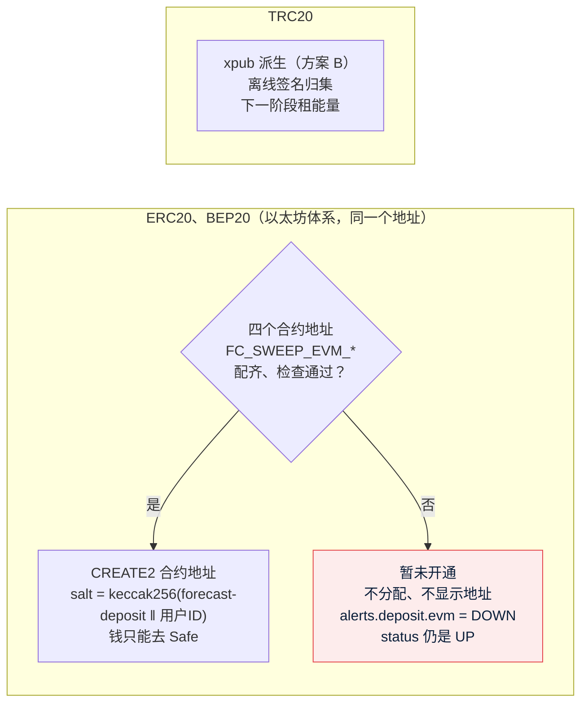

# 钱包：ERC20、BEP20 充值地址只用合约地址（CREATE2 转发合约）
- 版本：v1.0（2026-10-25）
- 角色：研发工程师 + 运维工程师
- 分支：`claude/wallet-create2`（基于 `claude/s5-settle`；不开 PR、不合并，由主会话合并）
- 起因：Amos 2026-10-25 原话："钱包地址的产生和分配，用我们之前已经调研过的智能合约方案"。
- 依据：复制源的半自动归集方案第一阶段（BitGo eth-multisig-v4 的 ForwarderV4 / ForwarderFactoryV4 原样部署 + 我们写的 `SweepBatcher.sol`，Amos 10-20 已审核）；本项目 S1 原样复制了这套代码（盐前缀 `forecast-deposit`、变量前缀 `FC_`，`开发记录/S1-复制骨架.md`）。
- 部署操作说明：`部署方案/v1-归集合约部署.md`（新写）。

## 一图看懂

这张图想说明：以太坊体系**只有一条路**——配好合约就是合约地址，没配好就"暂未开通"，**不再退回 xpub 派生**；TRON 不变。

## 1. 改之前的现状（代码走查 + 测试实际运行）

| 项 | 改之前 |
|---|---|
| ERC20、BEP20 地址怎么生成 | `wallet/address/AddressService.allocateAddresses`：`ForwarderSchemes.current()` 有值（四个合约地址都配了、格式对、parent 不是 USDT 合约 / 热钱包 / 我们的充值地址）时用 `Create2.forwarderAddress(factory, implementation, parent, batcher, Create2.salt(用户ID))`；**否则用 `FC_WALLET_ETH_XPUB` 按 BIP44 `m/44'/60'/0'/0/{用户ID}` 派生**（scheme = `XPUB`） |
| 开关 | `FC_SWEEP_EVM_FACTORY`、`FC_SWEEP_EVM_IMPLEMENTATION`、`FC_SWEEP_EVM_PARENT`、`FC_SWEEP_EVM_BATCHER` 四个**都配了**才切到合约地址；一个都没配 → xpub；只配一部分或格式错 → 当作没配（xpub），告警项 `sweep.config` 报出来 |
| 什么时候分配 | 注册事务里 `WalletApi.allocateAddresses`；第一次打开充值页（`GET /api/wallet/addresses` → `addressOf`）时补分配；配好合约后启动时 `SweepSetup` → `migrateAll()` 把已有的 xpub 地址停用（继续扫块 30 天，SW-9）、换成合约地址 |
| 没配合约时 | **静默用 xpub 地址**，客户端照常显示；`sweep.config` 告警只在"配了一部分"时出现，一个都没配时健康检查什么也不报 |
| 后端测试、端到端 | 默认测试配置和 `application-e2e.yml` 都配了 `eth-xpub`、没配合约：**除了 sweep 包的几个测试，全部用例的以太坊体系地址都是 xpub 地址**；主流程端到端只充 TRC20 |
| 没配 xpub 时 | `GET /api/wallet/addresses` 三条链里任何一条没地址就整个返回 `WALLET_NOT_READY`，客户端三条链都显示"充值暂未开通" |

## 2. 设计

| 决定 | 内容 | 理由 |
|---|---|---|
| D-1 以太坊体系只用合约地址 | `AddressService` 删掉以太坊体系的 xpub 分支；`WalletProperties` 删掉 `ethXpub`（`FC_WALLET_ETH_XPUB` 不再读取，`application.yml`、`deploy/kit/docker-compose.yml`、`deploy/kit/env.example` 一起删）；`Addresses.eth`（公钥 → 以太坊地址）只被这个分支用，一起删 | Amos 原话；不保留 xpub 作为以太坊体系的生产路径，代码里也就没有"静默退回"的可能 |
| D-2 没配齐 = 暂未开通 | `AddressService.open(chain)`：以太坊体系要 `ForwarderSchemes.current()` 有值，TRON 要配了 xpub。没开通的链 `addressOf` 返回空、注册时不分配；`GET /api/wallet/addresses` **只返回已开通的链**（三条都没开通时仍是 `WALLET_NOT_READY`，和以前一样）；客户端 `DepositCard` 选到没返回的链显示"充值暂未开通"，TRC20 照常 | 部署合约之前测试环境照样能验收 TRC20；ERC20、BEP20 不会给客户一个将来要换的地址 |
| D-3 只告警，不进 status | 新告警项 `deposit.evm`（`wallet/address/EvmDepositAlert`）：合约地址参数没配好时 `DOWN`，在健康检查 `alerts` 里和告警邮件里出现；**不实现 `HealthCheck`**，`status` 和 HTTP 状态码不变 | 项目地图约定 11、复制源约定：`status` 变 DOWN 会让部署脚本回滚，缺配置换版本解决不了。按 `AlertCheck` 的约定"只检查配置了的东西"：以太坊或 BSC 配了 USDT 合约（要扫块）、或者填了任何一个合约地址时才出现，本机什么都没配时不出现 |
| D-4 配错的原因 | 原来的 `sweep.config`（只在填了任何一项时出现）照旧写具体原因；`ForwarderSchemes` 日志、后台归集设置页的提示文字改成"ERC20、BEP20 充值暂未开通（不会退回 xpub 地址）" | 运维排查时一眼看出后果 |
| D-5 本机开发和 CI 用 anvil 部署出的合约参数 | `application-e2e.yml` 配 `contracts/script/anvil-e2e.sh` 在 anvil 上用 `Deploy.s.sol` 部署出的四个地址（anvil 0 号公开测试账户 nonce 0、1、2 → 实现合约、工厂、批量合约，地址固定；parent 是 anvil 1 号账户）；后端测试默认配置（`application-test.yml`）配和 `SweepContextSupport` 相同的四个假地址（库里只登记一套参数） | 端到端的链替身不需要链上真的有合约：后端按 CREATE2 公式算地址，替身只记"向这个地址转了多少"，扫块入账走真实代码。合约本身（部署、CREATE2 地址和链上一致、归集到 parent）由 `anvil-e2e.sh` + `SweepAnvilTest` 在 anvil 真链上测（CI 的 `sweep-anvil`）。这样不用为了测试保留 xpub |
| D-6 TRON 不变 | 方案 B：xpub 派生 + 离线签名归集，下一阶段加租能量（TronSave） | 见第 5 节 |

## 3. 改动清单

| 文件 | 改动 |
|---|---|
| `backend/src/main/java/com/forecast/app/wallet/WalletProperties.java` | 删 `ethXpub`；类说明写明以太坊体系只用合约地址 |
| `backend/src/main/java/com/forecast/app/wallet/address/AddressService.java` | 以太坊体系只走 `useForwarder`，没有合约参数时不分配；新增 `open(Chain)`；`addressOf` 没开通返回空；`derive` 改成只派生 TRON 的 `deriveTron`；类说明重写 |
| `backend/src/main/java/com/forecast/app/wallet/address/Addresses.java` | 删 `eth(ECPoint)` |
| `backend/src/main/java/com/forecast/app/wallet/address/EvmDepositAlert.java` | **新增**告警项 `deposit.evm` |
| `backend/src/main/java/com/forecast/app/wallet/address/ForwarderSchemes.java`、`wallet/sweep/SweepService.java`、`wallet/SweepEvmProperties.java`、`wallet/api/WalletApi.java`、`account/auth/AuthService.java` | 说明和日志文字："继续用 xpub" → "暂未开通" |
| `backend/src/main/java/com/forecast/app/wallet/web/WalletController.java` | `GET /api/wallet/addresses` 只返回已开通的链，三条都没开通才 `WALLET_NOT_READY` |
| `backend/src/main/java/com/forecast/app/wallet/deposit/E2eChain.java` | `POST /api/e2e/wallet/deposit` 的返回加 `scheme`（收款地址是 `FORWARDER` 还是 `XPUB`），端到端用例核对 |
| `backend/src/main/resources/application.yml` | 删 `eth-xpub`；归集一段的说明改成"没配齐 = 暂未开通" |
| `backend/src/main/resources/application-e2e.yml` | 删 `eth-xpub`，加 anvil 部署出的四个合约地址 |
| `backend/src/test/resources/application-test.yml` | 删 `eth-xpub`，加四个假合约地址（和 `SweepContextSupport` 相同） |
| `backend/src/test/java/com/forecast/app/wallet/deposit/EvmContractOnlyTest.java` | **新增**：没配合约时 ERC20、BEP20 暂未开通、不分配 xpub 地址、TRC20 照常、接口只返回 TRC20；健康检查 `status` UP、HTTP 200、`deposit.evm` DOWN；表里以前的以太坊体系地址不显示但照常入账 |
| `backend/src/test/java/com/forecast/app/wallet/deposit/DepositFlowTest.java` | AC-06 用例加：以太坊体系地址 = 按测试配置的合约参数算出的 CREATE2 地址、表里是 `ETH:FORWARDER` / `TRON:XPUB`、`deposit.evm` UP |
| `backend/src/test/java/com/forecast/app/wallet/address/AddressConcurrencyTest.java` | SQ-8 并发测试：以太坊体系断言 `FORWARDER`，TRON 断言 `XPUB` |
| `backend/src/test/java/com/forecast/app/wallet/address/AddressDerivationTest.java` | 只测 TRON 派生（以太坊体系的 xpub 向量删掉）；其余测试的 `WalletProperties` 构造参数少一个 |
| `web/client/src/pages/assets/DepositCard.tsx`、`web/client/src/api/errors.ts` | 选到没返回的链显示"充值暂未开通"；新增 `DepositPartialOpen.test.tsx` |
| `web/admin/src/i18n/zh-CN.json`、`web/admin/src/i18n/en.json` | 归集设置页的配置提示改成"ERC20、BEP20 充值暂未开通" |
| `e2e/tests/main-flow.spec.ts`、`e2e/tests/support.ts` | 主流程加一步：ERC20、BEP20 各充一笔到合约地址（`scheme` 必须是 `FORWARDER`），确认数够了到账，余额 1,030 |
| `deploy/kit/docker-compose.yml`、`deploy/kit/env.example` | 删 `FC_WALLET_ETH_XPUB`；归集一段说明改成"没填齐 = ERC20、BEP20 暂未开通" |
| `部署方案/v1-归集合约部署.md` | **新增**：forecast 自己的合约部署操作说明 |
| `项目地图.md`、`项目索引.md` | 约定 7、22 改写，新增约定 38；索引的文件、接口、环境变量、测试、外部服务、文档各处 |
| `CLAUDE.md`、`AGENTS.md` | 入口加一句：钱包改成合约地址的记录和部署说明在哪里 |

数据库：**不加迁移**。`wallet_address.scheme` 的 `XPUB` / `FORWARDER` 两种值原样保留（TRON 用 `XPUB`；以太坊体系以前留下的 `XPUB` 行见第 4 节）。

## 4. 已经用 xpub 分配过的以太坊体系地址

- forecast 还没有上线，生产没有客户、没有存量数据；测试服务器还没有建（《项目索引》：`publish-staging` 还不会触发，S1～S5 只在本机和 CI 跑，每次都是空库），**实际上没有已发出的以太坊体系 xpub 地址**。
- 万一某个环境里有（例如以后从备份恢复了改方案之前的库），代码仍然能让这些地址**继续入账**，不需要 xpub：
  - 扫块认地址靠表 `wallet_address`（`AddressService.userOf` / `owner`），不重新派生，所以不需要 `FC_WALLET_ETH_XPUB`；
  - 合约参数没配时：这些行仍是"正在用"，**照常扫块入账，但不再给客户显示**（客户端显示暂未开通）——`EvmContractOnlyTest` 实际测过；
  - 合约参数配好后：启动时 `migrateAll()` 把它们停用（继续扫块 30 天、照常入账，SW-9，`SweepFlowTest` 原有用例），客户端只显示合约地址。
- 这些地址里的钱由 Amos 用助记词离线处理（和复制源的 xpub 地址一样，充值方案 D2）。

## 5. TRON 为什么不用这套合约（维持方案 B）

1. **BitGo 这套合约是 EVM 合约**，部署、CREATE2 地址公式（`0xff` 前缀）、`TransferHelper` 的代币转账判断都按以太坊的规则写；我们的约定是 `contracts/lib/` 下的源码一行不改（项目地图约定 22），改了就不再是"生产上用了多年的同一份代码"。
2. TRON 上没有找到成熟、开源、审计过的同类合约；BitGo 自己在 TRON 上也不用合约转发器（它的文档把 TRON 列在"手动归集"）。
3. 移植的已知坑（复制源半自动归集方案第 3.5 节）：TRON 的 CREATE2 前缀是 `0x41`（两份官方文档说法矛盾）；**TRON 上的 USDT 转账成功时也返回 false**，BitGo 的 `TransferHelper` 会回滚；转原生 TRX 不一定触发合约的 receive，"收到原生币自动转给 parent"不成立。
4. TRON 每个地址的手续费几种做法差不多（USDT 合约本身就要约 6.4 万能量），合约做法省不了多少；省钱靠租能量。
5. 所以 TRON 维持方案 B：xpub 派生普通地址（服务器只有公钥）+ Amos 离线签名归集；下一阶段加 TronSave 租能量。复制源方案 SW-13：上线 3 个月后按 TRON 归集的频率和离线签名的工作量再定要不要移植。

## 6. 本机开发和 CI 怎么跑到合约地址

| 场景 | 怎么做 |
|---|---|
| 后端测试（`mvn verify`） | `application-test.yml` 默认配了四个假合约地址：所有用例的以太坊体系地址都是 CREATE2 地址；没配合约的情况由 `EvmContractOnlyTest` 单独起上下文测 |
| 合约 + 后端真链（`contracts/script/anvil-e2e.sh`，CI 的 `sweep-anvil`） | anvil 上用和主网同一个 `Deploy.s.sol` 部署 → `VerifyDeployment.s.sol` 核对 → `SweepAnvilTest`：CREATE2 地址和链上 `forwarderAddress` 一致 → 转 USDT → 扫块入账 → 归集 → 冷钱包收到 |
| 端到端（server.mjs 形态、部署形态） | `application-e2e.yml` 配的就是 anvil 部署出的四个地址（固定）。链替身（`E2eChain`）**不模拟合约**，只记转账：后端按 CREATE2 公式算地址，扫块入账走真实代码；主流程用例核对收款地址的 `scheme` 是 `FORWARDER` 并且到账。端到端里没有发起账户（e2e 不允许配私钥，`E2eGuard`），所以 `sweep.config` 告警是 DOWN，不影响用例 |
| 本机手动跑后端（不带 e2e） | 什么都不配时 ERC20、BEP20 暂未开通、`deposit.evm` 不出现（没配 USDT 合约）；要看合约地址，先跑 `anvil-e2e.sh` 或照抄 `application-e2e.yml` 的四个地址 |

## 7. 本地验证（全部实际执行）

环境：本机 Docker 起 MySQL 8.4、Redis 7（本次专用容器，跑前删库重建），JDK 25，Maven 离线，forge 1.5.1，Node 22，Playwright Chromium。

| 检查 | 命令 | 结果（2026-10-25 实际执行） |
|---|---|---|
| 后端 | 空库 `forecast_test`，`mvn -o -B -ntp -f backend verify` | **459 个，0 失败，3 个跳过**（`SettleLoadTest` 要 `-Dsettle.load=true`；`SweepAnvilTest`、`HotBalanceRealNodeTest` 没设 anvil / 真实节点变量时跳过），BUILD SUCCESS，3 分 36 秒。S5 时 457 个：新增 `EvmContractOnlyTest` 3 个，删掉以太坊体系 xpub 派生向量 1 个 |
| 合约 | `cd contracts && forge test` | **30 个全部通过**（`SweepBatcherTest` 25、不变量 4、`VectorsTest` 1） |
| 合约 + 后端真链 | 空库，`bash contracts/script/anvil-e2e.sh` | **通过**：部署后核对"全部通过"；`SweepAnvilTest` 1 个通过（CREATE2 地址和链上一致 → 转 USDT → 入账 → 归集 → 冷钱包收到；首次部署 + 归集 gasUsed 157,128、已部署再归集 50,230）。anvil 上部署出的地址和 `application-e2e.yml` 一致（实现合约 `0x5FbDB2315678afecb367f032d93F642f64180aa3`、工厂 `0xe7f1725E7734CE288F8367e1Bb143E90bb3F0512`、批量合约 `0x9fE46736679d2D9a65F0992F2272dE9f3c7fa6e0`）。注意：这个脚本要**空库**（`verify` 跑完后库里的扫块游标停在几万，直接接着跑会因为 anvil 的区块号小而扫不到，第一次就是这样失败的；CI 的 `sweep-anvil` 每次是新库） |
| 端到端（server.mjs 形态） | 空库 `forecast_e2e`，jar + 三个前端构建，`e2e/start-backend.sh`，`npx playwright test` | **6 个通过、3 个跳过**（部署形态专用的 3 个）；主流程里新加的一步通过：ERC20、BSC 的收款地址 `scheme` 都是 `FORWARDER`，到账后余额 1,030。后端日志：`以太坊体系充值地址用合约转发地址：第 1 套（工厂 0xe7f1…0512）`；`sweep.config` 告警（没配发起账户）只记日志 |
| 端到端（部署形态） | `bash e2e/run-deployed.sh`（镜像 + Nginx + HTTPS，新库） | **9 个全部通过**（1.1 分钟） |
| 客户端 | `web/client`：`npm run lint`、`npx vitest run`、`npm run build`、`check-brand.mjs dist`、`check-no-mocks.mjs` | lint 通过；**139 个通过**（新增 `DepositPartialOpen.test.tsx` 1 个）；构建、两项产物检查通过 |
| 后台 | `web/admin`：`npm run lint`、`npx vitest run`、`npm run build`、产物检查 | lint 通过；**162 个**：前两次分别有 3 个、1 个用例超时失败（`pages.test.tsx`、`v2.test.tsx`，不同的用例，当时机器上同时在跑端到端和别的会话的测试），第三次 162 个全部通过；本次只改了两条翻译文字。构建、产物检查通过 |
| 端到端类型检查 | `npx --prefix e2e tsc -p e2e/tsconfig.json --noEmit` | 通过 |
| 仓库检查 | `node scripts/check-project-index.mjs`、`node scripts/check-brand.mjs --repo` | 都通过（索引 201 个文件、5 类名单） |
| gitleaks | 提交后 `gitleaks detect --no-banner -l warn --source <工作目录>` | **没有发现泄露**（退出码 0；47 个提交、约 7.07 MB） |

## 8. Amos 要做的事（主会话写进《Amos 待办》）

按顺序；测试网先做完、测试环境验收通过后再做主网。详细命令见 `部署方案/v1-归集合约部署.md`。

| # | 做什么 | 怎么确认做好了 |
|---|---|---|
| 1 | **建 Safe 冷钱包**（forecast 专用，和复制源的分开，NF-11）：app.safe.global 新建 2-of-3，同时选以太坊和 BSC（测试网先 Sepolia + BSC 测试网；BSC 测试网建不了时先用一个新的普通地址演练） | Safe 网页里两条网络是同一个地址、3 个签名人、阈值 2 |
| 2 | **建部署账户**（新的普通账户，只用来部署）：两条链都没发过交易，各领一点手续费币 | 区块浏览器上两条链都是 0 笔交易、有余额 |
| 3 | **建发起账户**（新的普通账户，不是热钱包，服务器用它付归集手续费）：两条链各领一点手续费币 | 区块浏览器上两条链都有余额；地址和热钱包不同 |
| 4 | **部署合约**：在自己电脑上按部署说明第 1～8 步（装 Foundry → 核对源码和测试 → 模拟 → 正式部署（终端里输入部署账户私钥）→ 验证源码 → Safe 签 `acceptOwnership` → 链上核对 → BSC 再做一遍） | 两条链 `VerifyDeployment` 都打印 `== 全部通过`、没有"Safe 还没有接受所有权"；**两条链的三个合约地址完全一样**；把 5 行 `FC_SWEEP_EVM_…` 地址和核对输出发给研发（都是公开地址） |
| 5 | **在服务器 `.env` 里填变量**：`sudo nano /opt/forecast/.env`，填 `FC_SWEEP_EVM_FACTORY`、`FC_SWEEP_EVM_IMPLEMENTATION`、`FC_SWEEP_EVM_PARENT`、`FC_SWEEP_EVM_BATCHER`、`FC_SWEEP_EVM_OPERATOR_ADDRESS`、`FC_SWEEP_EVM_OPERATOR_KEY`（**私钥只由你填**），并确认两条链的节点和 USDT 合约已填；然后 `sudo /opt/forecast/deploy.sh` | 服务器上 `curl -s http://127.0.0.1:8080/api/health`：`status` UP，`alerts` 里 `deposit.evm` UP、`sweep.config` UP；客户端充值页 ERC20、BSC 显示同一个地址（不再是"暂未开通"）；后台归集设置页没有黄色提示 |
| 6 | **测试网验收**：部署说明第 10 节（ERC20 充 150 测试 USDT → 到账 → 执行归集 → Safe 收到；BSC 再做一遍） | 批次"已完成"、Safe 余额增加、地址显示已部署 |
| 7 | **主网**：测试网验收通过后，用新的部署账户、主网 Safe、主网发起账户重做第 1～5 步，填进生产 `.env` | 同第 4、5 步，在生产上确认 |

另外：**不再需要 `FC_WALLET_ETH_XPUB`**（《Amos 待办》里如果有"生成以太坊体系 xpub"可以划掉）；TRON 仍然要 `FC_WALLET_TRON_XPUB`。

## 9. 给架构方案的修改建议（主会话合并 `claude/arch-v1.2` 时并进去）

本分支基于 S5，架构方案在 `claude/arch-v1.2` 上有一份改了一半的 v1.2，这里**不改架构方案正文**，只列要改的段落和建议写法（节号按 v1.1.1；v1.2 如果调整了节号，按段落内容找）：

| 位置（v1.1 的段落） | 现在写的 | 建议改成 |
|---|---|---|
| 第 1.2 节"后端逐个模块"表格 `wallet` 一行，"④⑤"两点 | ④CREATE2 盐前缀改 `forecast-deposit`；⑤独立的 xpub、热钱包、归集合约地址（NF-11），全部由 Amos 在服务器上填 | 在 ④ 后加："⑥**ERC20、BEP20 的充值地址只用 CREATE2 合约地址**（Amos 2026-10-25："钱包地址的产生和分配，用我们之前已经调研过的智能合约方案"）：合约地址参数没配齐时这两条链'暂未开通'，不退回 xpub 派生；删除以太坊体系的 xpub（`FC_WALLET_ETH_XPUB`）；TRON 仍用 xpub 派生 + 离线签名归集（方案 B），下一阶段加租能量"。⑤ 改成"独立的 TRON xpub、热钱包、归集合约（新的 Safe、部署账户、发起账户，NF-11），全部由 Amos 在服务器上填" |
| 第 1.3 节"前端、合约、测试、部署"表格 `contracts` 一行 | 部署由 Amos 在自己电脑上做，新合约地址（独立冷钱包 NF-11） | 加："操作说明 `部署方案/v1-归集合约部署.md`；**合约部署是 ERC20、BEP20 充值开通的前提**（测试环境验收以太坊体系充值前要先部署到 Sepolia、BSC 测试网）" |
| 第 11.4 节"测试环境和生产环境"表"链"一行 | 测试网：测试热钱包、测试 xpub；生产：Amos 的生产热钱包、xpub、归集合约 | 测试网："测试热钱包、TRON 测试 xpub、测试网归集合约（Sepolia + BSC 测试网，测试 Safe）"；生产："Amos 的生产热钱包、TRON xpub、主网归集合约（主网 Safe）" |
| 第 13 节"安全"表"充值地址"一行 | 服务器只有 xpub（沿用）；合约充值地址只能把钱转进 Amos 的 Safe 冷钱包（沿用归集第一阶段） | "ERC20、BEP20：只用 CREATE2 合约地址，钱只能转进 Amos 的 Safe 冷钱包，服务器只有发起账户（只付手续费，私钥被偷也转不走钱）；TRC20：服务器只有 xpub。以太坊体系没有 xpub" |
| 第 13 节"环境变量清单""钱包"一行 | 列了 `FC_WALLET_ETH_XPUB` | 删掉 `FC_WALLET_ETH_XPUB` |
| 第 13 节"环境变量清单""归集"一行 | 六个 `FC_SWEEP_EVM_*` | 加说明："前四个没填齐 = ERC20、BEP20 暂未开通（健康检查 `alerts.deposit.evm` DOWN，`status` 不变）；填了以后不改" |
| 第 12.1 节 CI 表 `sweep-anvil` 一行 | anvil 本地链上真实合约 + 后端充值入账和归集 | 不变；可以加一句"端到端（`e2e`、`e2e-deployed`）的以太坊体系地址也是 CREATE2 地址（`application-e2e.yml` 用 anvil 部署出的固定地址，链替身只记转账）" |
| 第 19 节"需要 Amos 决定的问题" | — | 加第 11 节的 WQ-1、WQ-2（或者注明"见开发记录/钱包-合约地址方案.md"） |

## 10. 遗留问题

| # | 问题 | 处理 |
|---|---|---|
| L-1 | 测试环境部署合约之前，ERC20、BEP20 一直是"暂未开通"，`deposit.evm` 告警一直是 DOWN；配了告警邮箱后会收到一封"异常"邮件（同一项 30 分钟内不重复，状态不变不再发） | 预期行为。Amos 部署合约、填 `.env` 后恢复，会收到一封"恢复" |
| L-2 | 端到端的链替身不模拟合约（只记转账），合约本身的行为只在 `sweep-anvil` 里测 | 有意如此（第 6 节）；`sweep-anvil` 在改到合约、钱包、迁移时跑 |
| L-3 | `wallet_address` 表的 `scheme` 仍有 `XPUB` 值（TRON 在用），以太坊体系理论上还可能有以前的 `XPUB` 行 | 不加迁移、不删数据；第 4 节 |
| L-4 | 复制源的 `contracts/README.md` 正文里引用的方案和部署文档名是复制源的 | 本次不改合约目录；以 `部署方案/v1-归集合约部署.md` 为准 |

## 11. 需要 Amos 决定的问题

| # | 问题 | 建议 |
|---|---|---|
| WQ-1 | 测试环境开放给你验收以太坊体系充值的前提是先把合约部署到 Sepolia 和 BSC 测试网（第 8 节第 1～5 步）。在那之前测试环境只能验收 TRC20 充值。可以吗？ | 可以。测试网部署不花真钱，和测试环境第一次上线同时做 |
| WQ-2 | 测试网和主网用不用同一个部署账户、同一个发起账户？ | **不用**：测试网、主网各建一套（Safe、部署账户、发起账户），测试网的私钥在电脑上放得更随意，不能和主网共用 |
