# forecast 架构方案（v1）

- 版本：v1.1.2（2026-10-25）
- 变更历史：
  - v1.0（2026-10-24）首次创建，交 Amos 审核
  - v1.1（2026-10-25，轻量变更，和需求说明书 v1.2 同步，开发 S2 时修改）：品牌名和域名口径改为"**上线前沿用 Quick Come 名称和 quickcome.online 子域名；正式上线前改为独立品牌和域名，隔离要求（服务器、数据库、钱包、发信域名等）不变**"（Amos 2026-10-25 原话见第 15 节）。改了第 15 节和第 19 节 AQ-5，第 11.4、11.7 节的测试环境域名加了指向第 15 节的说明。第 1.3 节、第 1.4 节 ⑦、第 20 节 X-11、第 21 节里"检查 Quick Come 不能出现"的说法，在正式上线改名之前不适用：`scripts/brand-check.json` 里 Quick Come 的检查保持关闭，改名时再打开（FalconX 的检查一直打开）。另外，第 3.4 节的迁移编号已顺延：S2 用了 V6～V8（`开发记录/S2-账本拆分.md`），S3 起的新表从 V9 开始编号；以代码和《项目索引》为准
  - v1.1.1（2026-10-25，开发 S5 时修改：一处计算注释、记下 AQ-3 的结论）：第 4.5 节用例注释"如果 60、40 分别算：39.99 + 26.66 = 66.65"算错了（S4 发现，`开发记录/S4-下注奖池.md` F-6）：60 × 4,000 ÷ 6,000 = 40.00 正好整除，分别算也是 40.00 + 26.66 = **66.66**，和合成一个持仓算的结果相同；"合成一个持仓只舍入一次"的规则不变，分别算会差的例子换成"两笔 0.01 各自算盈利 0、合成 0.02 算 0.01"。**AQ-3 已定：B**（Amos 2026-10-25 回复"AQ3 同意"）：先算好、落结算单，再分批派彩。S5 的实现：每批持仓数是参数 `forecast.settle.batch-size`（`FC_SETTLE_BATCH_SIZE`），**默认 500**；0（计算和派彩在同一个事务里一次完成）保留为可配置项；两种模式的测试和 10,000 持仓对比数据见 `开发记录/S5-结算.md`。改了第 4.3 节开头、第 19 节 AQ-3、第 1 节决定表第 3 行、第 21 节 F-1 的状态
  - v1.1.2（2026-10-25，开发 S6 时补记，不改已审核的决定）：加第 6.4 节"加密部分的实现"——MQ-1 节目化（自动生成按场次配置、默认 BTC 1 小时每天 13:00 UTC、滚动保留为可切换的选项）、resolve 和 settle / market 之间的接口、网关的重试和熔断细节、判定规则的细化、2026-10-25 的真实接口实测；细节见 `开发记录/S6-加密自动化.md`
- 编写：研发工程师（兼运维工程师：第 11、12 节和第 13 节的服务器部分）
- 状态：**待 Amos 审核**（合并节点 ①）。第 19 节 AQ-1～AQ-14 待答复（AQ-3 已定：B）；第 20 节"超出要求的部分"待确认。
- 依据：
  - agents main `bd492c9`（《协作总则》v0.12、《研发工程师》v0.12.1、《运维工程师》v0.11、《测试工程师》v0.11.1、《平台规范/云服务器》v0.4、`模板/`、`工具/check-project-index.mjs` v1）；本阶段开始时重新拉取过，和需求阶段读的是同一个提交（C62）。
  - `需求文档/v1-需求说明书.md` v1.1（Amos 审核通过，以它为准）、线框图 `assets/v1/wireframes/` W1～W4、`调研/v1-Polymarket调研报告.md` v1.2 的"Amos 审核结论"（FQ-1～FQ-14）。
  - 参考项目 falconx-lite（只读）：远程 `staging` 分支 `2583328`（和需求里引用的 `3cc5021` 文件内容相同，用 `git diff` 核对过），包括 `00-架构方案.md`、`技术方案/` 下的充值、提现、提现自动审批、通知、后台、数据库设计，`部署方案/v1-部署方案.md`（含第 19 节内存事故、第 21 节 CI 精简），`.github/workflows/ci.yml`、`deploy/`，以及后端、`web/client`、`web/admin`、`web/site` 的代码结构。
  - 市场经理的《市场调研与推广策略》还在修改（不在 main 上），本方案只引用其中的竞品清单（PancakeSwap Prediction、Stake）做风格参考；推广功能（MF）**一律"待 MF 结论"**，见第 18 节。
- 当前状态以《项目地图》《项目索引》和代码为准；本文件是架构阶段的记录（C53）。
- 读法：先看"一图看懂"，再看第 19 节"需要 Amos 决定的问题"和第 20 节"超出要求的部分"。

> **标注约定（C66）**：【实测】本次在开发环境实际执行过（写明日期和方法）；【证实】实际打开了一手资料；【二手】只看到搜索摘要或第三方；【推断】研发的判断；【未核实】还没核对，由 Amos 或上线前实测确认。

---

## 一图看懂

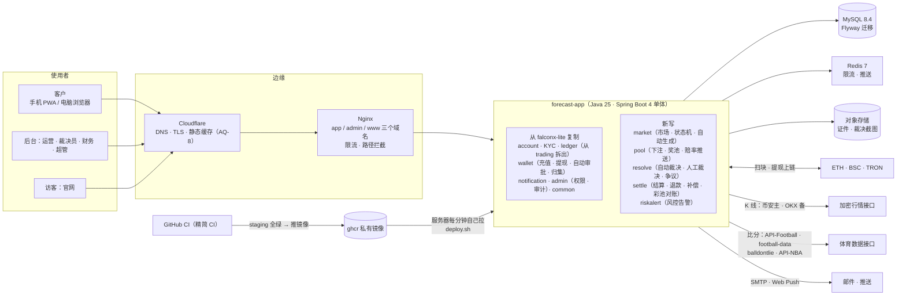

这张图想说明：
- 系统还是 falconx-lite 那种"一个 Java 应用 + MySQL + Redis + Nginx"的形态，部署方式也原样沿用（服务器自己拉镜像、起不来自动换回）。
- 资金进出、账户、KYC、通知、后台权限从 falconx-lite 复制；差价合约的行情、下单、持仓、风控全部删掉；新写市场、彩池、裁决、结算四块。
- 所有外部接口（链、行情、比分、邮件、推送）都有超时、重试上限和降级（C81，第 6.3 节）；数据源出问题只会让市场转人工裁决，不会影响下注和资金。

**本方案最重要的 6 个决定**：

| # | 决定 | 在哪里 |
|---|---|---|
| 1 | 账本从 falconx-lite 的 `trading` 拆成独立的 `ledger` 模块，账户三项改为 **可用余额 / 下注锁定 / 提现冻结**；平台另有"收入"和"补偿支出"两个账户 | 第 1.2、3.2 节 |
| 2 | 下注：**市场行共享锁 → 客户账户行排他锁 → 选项奖池原子加**，同一客户排队、不同客户并行，单市场 100 笔/秒够用 | 第 4.2 节 |
| 3 | 结算：先在一个事务里算完并通过守恒校验、落"结算单"，再分批派彩，每一步幂等、可续跑（和需求"同一个事务"的写法不同，**AQ-3 已定：B**） | 第 4.3 节 |
| 4 | 状态机只允许 17 条边（需求第 3.2 节的图），每次跳转是"带旧状态的条件更新"；定时任务用数据库租约防多实例重复 | 第 5 节 |
| 5 | 赔率推送沿用 falconx-lite 的 WebSocket，每个市场每秒最多合并推送一次 | 第 7 节 |
| 6 | 内部代码名统一叫 `forecast`（包名、表、镜像、环境变量 `FC_*`），品牌名只出现在前端和通知模板里（**AQ-4**） | 第 1.3、15 节 |

---

## 0. 和需求说明书的对照（本方案覆盖了什么）

| 需求章节 | 本方案 |
|---|---|
| 第 3 节 彩池规则（下注、赔率、结算公式、边界 E1～E15、时间、费率、账本） | 第 3、4、5 节 |
| 第 4 节 市场创建、自动裁决、公示争议 | 第 2.3、5、6 节 |
| 第 5、6 节 客户端、后台页面 | 第 9 节（页面结构、技术）、第 10 节（风格方向） |
| 第 7 节 通知清单（C86） | 第 8 节 |
| 第 8 节 风控、自动审批 R8～R15 | 第 1.2、2.3 节（`riskalert`、wallet 修改） |
| 第 9 节 非功能 NF-01～NF-13 | 第 4.2（NF-01）、7（NF-02）、4.3（NF-03）、11（NF-04、05、10、11）、6.3（NF-13）节 |
| 第 10 节 验收标准 | 第 17 节测试策略，逐条对应 |
| RQ-19 品牌和域名 | 第 15 节 |
| 第 11 节 风格调研（C65、C85） | 第 10 节 |

---

## 1. 从 falconx-lite 复制什么、怎么改

### 1.1 复制源和原则
- **复制源**：falconx-lite 远程 `staging` `2583328`（2026-10-24 用 `git ls-remote` 核对，C68）。只复制文件，**不带 git 历史、不带任何数据和配置值**（需求第 14 节）。
- **不抽共享库**（FQ-10）：复制以后两个项目各自演进。
- **复制后第一件事是删除**，删到能编译、剩下的测试全绿，再开始改和新写（第 16 节 S1）。
- falconx-lite 的"不能破坏的约定"里和保留部分相关的（资金一致性、只认配置的 USDT 合约、提现只在确定没上链时退款、通知和业务同一事务、只向推送服务地址发推送、每个后台接口声明权限点、跨站检查、限流、健康检查分两层、对外编号雪花 ID、追踪号、日期输入、提现自动审批、归集合约原样源码、精简 CI、默认语言），**原样带进 forecast 的《项目地图》第 5 节**，编号重排。

### 1.2 后端逐个模块

| falconx-lite 包 | 处理 | forecast 里的包 | 要改什么 |
|---|---|---|---|
| `common`（`config` 系统配置、`error`、`health`、`id` 雪花、`money`、`ratelimit`、`schedule`、`storage`、`task` 任务表、`time`、`trace`、`web` 跨站检查、`e2e` 守卫） | **原样复制**，小改 | `common` | ①新增 `common/job/JobLease`（定时任务租约，第 5.3 节）；②`storage` 增加对象存储实现（falconx-lite 只有本机磁盘实现，生产要换，见第 11 节）；③`ratelimit` 的 `@UserWriteLimited` 新增下注接口；④配置前缀 `falconx.` → `forecast.` |
| `trading/ledger` + `trading/api` 里的 `LedgerApi`、`LedgerCommand`、`LedgerResult`、`LedgerEntryType`、`Bucket`、`AccountSnapshot`、`LedgerQueryApi`、`FundsApi`、`CustomerFlowApi`、`UserEventsApi` | **复制后修改**：搬成独立模块 | `ledger` | ①`Bucket` 改为 `AVAILABLE` / `BET_LOCKED` / `WITHDRAW_FROZEN`（删 `ORDER_FROZEN`）；②`LedgerEntryType` 删交易类型，新增 `BET_LOCK`、`BET_SETTLE`、`BET_LOST`、`PAYOUT`、`FEE`、`REFUND`、`COMPENSATION`，平台侧 `FEE_INCOME`、`SETTLE_DUST`、`COMPENSATION_EXPENSE`；③账户表加 `kind`（客户 / 平台收入 / 平台补偿支出，第 3.2 节）；④`FundsApi.withdrawable` 简化为"可用余额"（不再有持仓保证金和浮动盈亏）；⑤`CustomerFlowApi` 的 R8～R13 口径按需求第 8.2 节改（有效下注本金、Σ(派彩 − 本金) + 补偿）；⑥账本记录加 `ref_market_id`（客户流水能点到市场，AC-39；彩池对账按它合计）；⑦`UserEventsApi`（推给本人的实时事件）搬到 `ledger.api` 旁边的 `common.push`（它和账本无关，只是当初放在 trading） |
| `trading/order`（下单、撮合引擎、持仓、部分平仓、隔夜费、追保、交易推送、交易控制器） | **删除** | — | 下单的"先锁账户行再检查"写法参考进 `pool` 的下注；追保 `MarginCallMonitor`、`SwapService`、`MatchingEngine` 全删 |
| `market`（报价源 AllTick / iTick / 币安 WebSocket、`QuoteProcessor`、K 线、交易时段、品种、公开行情、行情推送） | **删除** | — | 只保留两处经验：`market/quote/feed/WsFeed` 的"心跳 + 退避重连"写法（forecast 的 HTTP 数据源不需要长连接）；`WebSocketConfig` 的握手限流写法搬进 `pool/web` |
| `risk`（净敞口、自动禁开、风控开关） | **删除** | — | 需求第 8 节的告警由新写的 `riskalert` 实现 |
| `account`（`auth` 注册登录、`profile`、`kyc`、`admin` 客户后台接口、`api`） | **复制后修改** | `account` | ①注册勾选"已满 18 周岁并同意服务条款"、L1 审核校验年龄（X-13）；②客户加"员工账户"标记（`account:staff` 由 `customer:edit` 修改，写审计）；③KYC 分级：累计充值（扣冲正，经 `CustomerFlowApi.netDeposits`）> 阈值（默认 1,000，`common_config`）且不是 L1 → `AccountApi.canBet()` 返回 `KYC_REQUIRED`；跨过阈值时发通知 #7（只发一次，状态记在 `account_kyc_gate`）；④关联账户需要的设备指纹：登录、注册时记录前端传的设备指纹哈希和 IP（新表 `account_device`）；⑤删掉交易相关的客户字段（如有） |
| `wallet`（`address` 派生和 CREATE2、`chain` 链客户端、`deposit` 扫块入账冲正、`withdraw` 提现和自动审批、`recon` 入金对账、`sweep` 归集、`admin`、`web`、`api`） | **复制后修改** | `wallet` | ①冲正只扣"可用余额"（原来是"可自由动用的钱"）；②**单笔提现最小金额**（RQ-16）：全局值 `withdraw.minAmount` 默认 100，保存时校验"大于每条链的提现手续费"，客户端提现页显示；③自动审批：R8、R9、R10、R12、R13 按需求第 8.2 节改口径，新增 R14（关联账户对押）、R15（可疑押中，读 `riskalert.api`），R12 去掉报价偏差和交易全局暂停、加"彩池对账没有未处理差异"（读 `settle.api`）；④CREATE2 盐的前缀 `"falconx-deposit"` 改为 `"forecast-deposit"`，Java、合约测试、测试向量三处一起重新生成（falconx-lite 约定 30 ③）；⑤独立的 xpub、热钱包、归集合约地址（NF-11），全部由 Amos 在服务器上填 |
| `notification`（`NotifyApi`、`MailApi`、`NotifyWorker`、Web Push 加密、`AlertMonitor`、`EnvLabel`、`Render`） | **原样复制**，换模板 | `notification` | ①模板换成需求第 7 节的 22 类（第 8 节），旧的交易模板（开仓、平仓、追保、强平、成交）不建；②模板加繁体中文一列（RQ-18）；③`EnvLabel` 测试环境前缀加繁体"[測試] " |
| `admin`（`security` 登录、IP 白名单、权限点、审计；`system` 管理员、角色、菜单、系统配置；`ops` 各业务后台接口） | **复制后修改** | `admin` | `security`、`system` **原样**；`ops` 里客户、KYC、资金、通知、归集、自动审批、任务、对账**原样**；`TradingOps`、`RiskOps`、`MarketOps`、`MonitorController`、`AdjustMapper`（调余额改为补偿流程，见下）**删除**；新增市场、裁决台、争议、结算补偿、彩池对账、风控告警、报表、参数设置的 `ops`；权限点按需求第 2.2 节：删 `order:*`、`position:*`、`pending:*`、`risk:*`、`symbol:*`、`params:*`、`fx:view`、`session:*`（交易时段），加 `market:*`、`resolve:*`、`dispute:*`、`settle:compensate`、`bet:view`、`fee:edit`、`betting_params:edit`、`report:view`、`pool_recon:*`、`risk_alert:*`；菜单 12 个一级（需求第 6.1 节）；**"一个有权限的人就能完成"**（RQ-17）：不加任何"提议人不能确认"的检查 |
| （无） | **新写** | `market` | 市场、选项、规则模板、状态机、补充说明、费率修改记录、加密自动生成、赛程生成草稿（第 2.3、5 节） |
| （无） | **新写** | `pool` | 下注、持仓、选项奖池、赔率计算、推送（第 4、7 节） |
| （无） | **新写** | `resolve` | 数据源适配器、自动裁决、人工提议和确认、公示、争议、原始返回存档（第 6 节） |
| （无） | **新写** | `settle` | 结算、退款（取消 / 作废 / E14 / E15）、补偿、彩池对账、平台收入报表（第 4.3 节） |
| （无） | **新写** | `riskalert` | 关联账户、三类告警（尾盘大额、关联账户对押、新账户押中冷门）（需求第 8.1 节） |

### 1.3 前端、合约、测试、部署

| 目录 | 处理 | 要改什么 |
|---|---|---|
| `web/client`（客户端 PWA） | **复制后修改** | 保留：`api/` 两种模式（real / mock）、`http.ts`、`ws.ts`（断线重连后重拉）、`errors.ts`、`envLabel`、Web Push、`app/` 的 Auth / Account / Theme / Toast Provider、`components/` 的 Layout、Modal、Form、AsyncView、LangSelect、Onboarding、EnvBanner、InstallPrompt、QrCode、DateFields、PushListener、`hooks/` 的 useAsync、usePaged、useCountdown、useMediaQuery、useOnboarding、useServerEvent、useUnread、`lib/` 的 decimal、format、validators、dateParts、notify、brand、`pages/auth`、`pages/assets`（充值、提现、白名单、流水）、`pages/me`。**删除**：`pages/Trade`、`Markets`、`Positions`，`components/` 的 KChart、OrderPanel、OrderSheet、order/、PositionDialogs、PositionsTabs、SymbolList、WatchRail、HotTicker，`hooks/` 的 useQuotes、useOrderForm、useChartPrefs、useFavorites、useWatchMode、useSymbolFilter，`lib/` 的 trading、indicators、symbol，`app/SymbolsProvider`，依赖 `lightweight-charts`。**新写**：市场列表、市场详情、下注（电脑右栏 / 手机抽屉）、我的下注、提交争议、规则说明（第 9 节）；`i18n/zh-TW.json` |
| `web/admin`（后台） | **复制后修改** | 保留框架、登录、系统、客户、KYC、资金（含归集、自动审批规则页）、通知、任务；删除 `pages/trading`、`pages/risk`、`pages/market`、`pages/params`（旧参数）；新写市场管理、待上架、裁决台（W4）、公示与争议、结算与补偿、彩池对账、风控告警、报表、参数设置；`config/permissions.ts`、`menu.tsx` 和后端权限点保持一致（falconx-lite 约定 16） |
| `web/site`（官网） | **复制后修改** | 保留工程、两套结构、语言规则、法律页框架；删除公开行情（`useQuotes`、`/api/public/quotes`）；首页内容改为彩池玩法说明（文案由 PM 管，C6；落地页范围待 MF 结论，第 18 节） |
| `contracts`（Foundry，归集合约） | **原样复制** | 只改 CREATE2 盐前缀并重新生成 1,000 个测试向量；`lib/` 下 BitGo、OpenZeppelin 源码一行不动（`SHA256SUMS` 核对）；部署由 Amos 在自己电脑上做，新合约地址（独立冷钱包 NF-11） |
| `e2e`（Playwright） | **复制后修改** | 保留 `server.mjs`、部署形态 `run-deployed.sh`、`compose.deployed.yml`、替身注入接口的写法、`E2eGuard`；主流程改成"注册 → 充值 → 下注 → 加密市场自动结算 → KYC → 提现"，加平台裁决、争议、作废退款流程；`e2e/load/` 改成下注压测和大市场结算压测（AC-70、AC-71） |
| `deploy`（`app.Dockerfile`、`web.Dockerfile`、`nginx/`、`kit/` 的 `deploy.sh`、`rollback.sh`、`backup.sh`、`restore.sh`、`init-env.sh`、`first-start.sh`、`server-setup.sh`、`systemd/`、`verify.sh`、`manual-publish.sh`） | **复制后修改** | 镜像名 `forecast-app`、`forecast-web`；服务器目录 `/opt/forecast`；compose 项目名 `forecast`；环境变量 `FX_*` → `FC_*`；删除报价源变量；JVM 和容器内存按第 11.3 节重算；Nginx 三个域名的路径拦截规则照搬（后台接口只在后台域名、`/api/e2e/` 永远拦截、分号路径正则） |
| `scripts`（`check-project-index.mjs`、`check-no-mocks.mjs`、`check-brand.mjs`、`build-prototype.sh`） | **复制后修改** | `check-project-index.mjs` 从 agents `工具/` 复制（本 PR 已建）；`check-brand.mjs` 改为检查 **FalconX 和 Quick Come 都不能出现**；新增 `check-i18n.mjs`（三种语言键名一致，NF-12、AC-53） |
| `.github/workflows/ci.yml` | **复制后修改**（本阶段只写方案，第 12 节） | — |
| `vercel.json`（原型预览） | 复制后修改 | 原型站点名；Vercel 项目由 Amos 决定（AQ-12） |

### 1.4 复制的具体步骤（S1 一个 PR 完成）

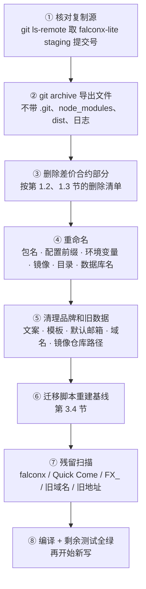

| 步骤 | 做法（命令为计划，S1 执行时以实际为准） |
|---|---|
| ① 复制源 | `git ls-remote https://github.com/dollar3651314/falconx-lite refs/heads/staging`，记下提交号写进 PR 描述 |
| ② 导出 | `git -C falconx-lite archive <提交号> backend web contracts e2e deploy scripts .dockerignore .gitmodules \| tar -x -C forecast/`（`contracts/lib/forge-std` 是子模块，按 `.gitmodules` 重新 `git submodule add`）；**不复制** `需求文档/`、`技术方案/`、`测试报告/`、`部署方案/`、`交付记录/`、`Amos待办.md`、`00-架构方案.md`、`项目地图.md`、`项目索引.md`（它们是 falconx-lite 的记录） |
| ③ 删除 | 按第 1.2、1.3 节清单删；删完跑 `mvn -f backend compile` 找出所有引用，逐个改到新接口或删除 |
| ④ 重命名 | 目录 `backend/src/main/java/com/falconx/lite` → `com/forecast/app`（`git mv`）；`sed` 全量替换：`com.falconx.lite` → `com.forecast.app`、`FalconxLiteApplication` → `ForecastApplication`、配置前缀 `falconx.` → `forecast.`、`FX_` → `FC_`（只替换环境变量名，用 `\bFX_[A-Z]` 匹配）、指标前缀 `fx_` → `fc_`、本地存储键 `fx.` → `fc.`、`artifactId falconx-lite` → `forecast`、数据库 `falconx` → `forecast`、镜像 `falconx-lite-app` → `forecast-app`、服务器目录 `/opt/falconx` → `/opt/forecast`、compose 项目 `falconx` → `forecast`、Nginx 内部头 `X-Fx-Health-Alerts` → `X-Fc-Health-Alerts` |
| ⑤ 品牌和旧数据 | 品牌常量只放 `web/*/src/lib/brand.ts` 和通知模板，其他地方不写品牌名；删除默认告警邮箱 `info@quickcome.online`（改成必须由 Amos 填）；删除 `deploy/` 里的旧域名示例、旧 IP；`simulated-prices.csv` 删除；前端 `mocks/` 里的旧客户和地址数据重写 |
| ⑥ 迁移 | 第 3.4 节：不复制 V1～V32，按保留下来的表重建 V1 基线 |
| ⑦ 残留扫描 | `git grep -n -i -E 'falcon ?x\|quick ?come\|quickcome\|\bFX_[A-Z]\|fx_[a-z]\|47\.251\.' -- . ':!技术方案/v1-架构方案.md'` 结果必须为空（本方案文件里出现这些字是在讲复制过程，排除）；CI 的 `check-brand.mjs`（前端产物）和后端 `BrandTextTest`（模板和代码里的固定文字）同时检查 FalconX、Quick Come 两个旧名 |
| ⑧ 测试 | 剩下的账户、KYC、钱包、通知、后台测试全部在真实 MySQL 上通过（C37）；ArchUnit 模块边界测试改成新模块名 |

---

## 2. 技术栈和代码结构

### 2.1 技术栈（沿用 falconx-lite）

| 层 | 选型 | 版本 | 说明 |
|---|---|---|---|
| 后端 | Java、Spring Boot（webmvc、websocket、jdbc、data-redis、flyway、validation、mail、actuator） | Java 25、Spring Boot 4.1.x（falconx-lite 用 4.1.1） | 单体，一个镜像 |
| 数据访问 | MyBatis（XML）、Flyway | 沿用 falconx-lite 的版本 | 表名以模块名开头，只由该模块读写 |
| 数据库 | MySQL | 8.4 | 金额 `DECIMAL(24,8)`，时间 `DATETIME(3)` UTC |
| 缓存 | Redis | 7 | 限流计数、多实例时的推送广播；**不存任何资金状态** |
| 前端 | React 18、TypeScript、Vite、react-i18next；后台加 Ant Design | 沿用 | 三个应用各自构建 |
| 测试 | JUnit 5、ArchUnit、GreenMail（邮件替身）、Vitest、Playwright | 沿用 | 守恒性质测试用固定种子的随机生成（不新增依赖，第 17 节） |
| 链 | web3j、BouncyCastle（沿用）；Foundry（合约） | 沿用 | |

### 2.2 仓库目录和归属角色

```
forecast/
├── backend/                 研发   Spring Boot 单体（Maven，artifactId forecast）
├── web/client/              研发   客户端 PWA（手机、电脑两套结构）
├── web/admin/               研发   管理后台（路由前缀 /admin）
├── web/site/                研发   官网（首页、服务条款、隐私、规则说明）
├── contracts/               研发   归集合约（Foundry，lib/ 原样源码）
├── e2e/                     测试   Playwright 端到端、部署形态、压测（e2e/load/）
├── deploy/                  运维   Dockerfile、Nginx、服务器工具包 kit/
├── scripts/                 研发   索引检查、品牌检查、翻译键检查、原型构建
├── .github/workflows/       运维   CI（审核通过后建，第 12 节）
├── 调研/ 需求文档/ 市场/ 技术方案/ 测试报告/ 部署方案/ 交付记录/   各角色的文档
└── assets/v1/               线框图、风格方向图、效果图
```

PM 可以改 `web/*/src/i18n/*.json` 和通知模板的文案，不改结构（总则第三节）。

### 2.3 后端包结构

```
backend/src/main/java/com/forecast/app/
├── ForecastApplication.java
├── common/        config · error · health · id · money · ratelimit · schedule · job(新) · storage · task · time · trace · web · e2e · push(新：UserEvents)
├── ledger/        api（LedgerApi · Bucket · LedgerEntryType · CustomerFlowApi · PlatformLedgerApi）· service · mapper
├── account/       api · auth · profile · kyc · device(新) · admin
├── wallet/        api · address · chain · deposit · withdraw（含 AutoApprove R1–R15）· recon · sweep · admin · web
├── notification/  api · service（模板、站内信、邮件、Web Push、告警邮件）
├── admin/         security · system · ops（客户、KYC、资金、通知、市场、裁决、争议、结算、对账、告警、报表、参数）
├── market/        api（MarketApi · MarketAdminApi · MarketStatus · MarketView）
│                  core（MarketService · MarketStateMachine · FeeService · Clarification）
│                  autogen（CryptoAutogenJob）· fixture（赛程生成草稿）· jobs（MarketClockJob）· web
├── pool/          api（PoolApi · PoolMath · Odds）· bet（BetService）· push（PoolPush · WsConfig）· web
├── resolve/       api（ResolveApi）· source（CandleSource：Binance、Okx、Coinbase；ScoreSource：ApiFootball、FootballData、Balldontlie、ApiNba；SourceArchive；CircuitBreaker）
│                  auto（CryptoResolver · SportsResolver）· manual（ProposalService）· dispute · jobs · web
├── settle/        api（SettleApi · SettleMath）· run（SettlementService · PayoutWorker）· refund · compensation · recon（PoolReconJob）· report
└── riskalert/     api · links（关联账户）· rules（尾盘大额、关联对押、新账户押中）
```

- **模块边界**（沿用 falconx-lite 约定 7）：每个模块的 `api` 子包是对外接口，其他模块只能依赖 `api` 包，ArchUnit 测试 `ModuleBoundaryTest` 强制。
- **依赖方向**（不能有环）：`common` ← `ledger` ← `account` ← `wallet` / `market` ← `pool` ← `resolve` ← `settle` ← `riskalert`；`notification` 只被调用；`admin` 只调各模块的 `*AdminApi`。`market` 不依赖 `pool`：市场状态变化需要奖池信息时（截止时判断有效选项数），由 `market` 发应用内事件，`pool` 和 `settle` 订阅（或由 `settle` 的任务驱动），避免环。
- **每个"现在"都注入 `Clock`**（沿用 `common/time`），截止判定、窗口时间、公示期满都能用可调时钟测试（AC-15、AC-31）。

### 2.4 主要接口（客户端）

| 接口 | 作用 | 登录 |
|---|---|---|
| `GET /api/markets`（品类、状态、排序、分页） | 市场列表 | 现在要求登录；不登录可浏览**待 MF 结论**（第 18 节，接口已按"公开 / 私有"拆开，改一个配置即可） |
| `GET /api/markets/{publicNo}` | 详情：选项、奖池、概率、预计赔率、规则、补充说明、费率记录、裁决公示 | 同上 |
| `POST /api/markets/{publicNo}/bets` `{optionNo, amount, clientReqId}` | 下注（`@UserWriteLimited`） | 是 |
| `GET /api/me/bets?tab=` | 我的下注（进行中、待结果、已结算、已退回）和汇总 | 是 |
| `POST /api/markets/{publicNo}/disputes` | 提交争议 | 是 |
| `WS /api/ws/user`（沿用 `/api/ws/trading` 改名） | 推给本人：余额、通知、充值、提现、结算结果 | 是 |
| `WS /api/ws/markets` | 订阅市场的奖池变化（每个市场每秒最多一次） | 同市场列表 |
| 复用：`/api/auth/**`、`/api/me/**`、`/api/wallet/**`、`/api/notifications/**`、`/api/health` | | |

后台接口全部在 `/api/admin/**`，每个接口声明权限点（falconx-lite 约定 16）。

---

## 3. 数据库设计

### 3.1 约定（沿用 falconx-lite）
- 表名以模块名开头，只由该模块读写；跨模块只调 `api`。
- 金额 `DECIMAL(24,8)`（NF-07）；下注金额、派彩、抽成在业务上只有 2 位小数（第 4.1 节），数据库仍用 8 位，方便和 falconx-lite 的钱包、账本共用。
- 时间 `DATETIME(3)`，UTC。
- 对外编号用雪花 ID 列 `public_no`（字符串返回，falconx-lite 约定 25）；内部主键自增 `id`。
- **只增不改**的表（审计类）：`market_status_log`、`market_fee_change`、`market_clarification`、`resolve_record`、`resolve_source_fetch`、`settle_item` 的金额列、`ledger_entry`、`admin_audit_log`：应用里没有对应的 UPDATE / DELETE 语句，测试扫描 Mapper XML 检查。
- 状态字段用 `VARCHAR(24)` + 应用里的枚举；每张有状态的表带 `version INT`。

### 3.2 账本（从 falconx-lite 的 `trading_account`、`trading_ledger` 改）

**`ledger_account`**（每个客户一行；平台另有两行）

| 列 | 类型 | 说明 |
|---|---|---|
| `id` | BIGINT PK | |
| `kind` | VARCHAR(24) | `USER` / `PLATFORM_REVENUE`（抽成 + 尾差）/ `PLATFORM_COMPENSATION`（补偿支出） |
| `user_id` | BIGINT NULL | 客户的用户 id；平台账户为空 |
| `available` | DECIMAL(24,8) | 可用余额 |
| `bet_locked` | DECIMAL(24,8) | 下注锁定（客户端"下注中"） |
| `withdraw_frozen` | DECIMAL(24,8) | 提现冻结 |
| `created_at`、`updated_at` | | |

- 唯一：`uk_ledger_account_user (user_id)`、`uk_ledger_account_kind_platform`（平台账户每种只有一行：`kind` 上的唯一键配合 `user_id IS NULL`，用生成列 `platform_key = IF(user_id IS NULL, kind, NULL)` 加唯一键）。
- CHECK：`kind = 'PLATFORM_COMPENSATION' OR (available >= 0 AND bet_locked >= 0 AND withdraw_frozen >= 0)`：补偿支出账户允许为负（平台自己掏钱，余额是累计支出的相反数），其他一律不能为负。

**`ledger_entry`**（沿用 `trading_ledger`，加一列）

| 列 | 说明 |
|---|---|
| `id`、`account_id`、`bucket`、`entry_type`、`amount`、`value_after`、`biz_type`、`biz_id VARCHAR(128)`、`remark`、`created_at` | 沿用（`biz_id` 已是 128，falconx-lite V29） |
| `ref_market_id BIGINT NULL` | 新增：和哪个市场有关（下注、派彩、退款、补偿） |

- 唯一：`uk_ledger_entry_idem (biz_type, biz_id, entry_type, bucket)`（幂等键，沿用）。
- 索引：`idx_ledger_entry_account (account_id, id)`、`idx_ledger_entry_market (ref_market_id, entry_type)`（彩池对账、AC-39）。

**流水类型和账户变动**（一张表看完所有钱怎么走）

| 业务 | 客户账户 | 平台账户 | 幂等键（biz_type : biz_id） |
|---|---|---|---|
| 下注 | `available −b`（BET_LOCK）、`bet_locked +b`（BET_LOCK） | — | `BET : 下注 id` |
| 结算·赢 | `bet_locked −b`（BET_SETTLE）、`available +(b+G)`（PAYOUT）、`available −F`（FEE） | `REVENUE.available +F`（FEE_INCOME） | `SETTLE : 结算明细 id` |
| 结算·输 | `bet_locked −b`（BET_LOST） | — | 同上 |
| 结算·尾差 | — | `REVENUE.available +D`（SETTLE_DUST） | `SETTLE_RUN : 结算单 id` |
| 退款（取消、作废、E14、E15） | `bet_locked −b`、`available +b`（REFUND） | — | `REFUND : 退款明细 id` |
| 补偿（E13） | `available +x`（COMPENSATION） | `COMPENSATION.available −x`（COMPENSATION_EXPENSE） | `COMP : 补偿明细 id` |
| 充值、冲正、提现冻结 / 解冻 / 出账 | 沿用 falconx-lite（只把"余额"换成 `available`） | — | 沿用 |

**守恒在账本上的样子**：一个已结算市场，Σ(客户 `bet_locked` 的减少) = T；Σ(客户 `available` 的增加 PAYOUT − FEE) + Σ(平台 FEE_INCOME + SETTLE_DUST) = T。彩池对账（第 4.4 节）按 `ref_market_id` 直接从账本合计核对。

### 3.3 新增表

#### market 模块

**`market_question`（市场）**

| 列 | 类型 | 说明 |
|---|---|---|
| `id`、`public_no` | BIGINT | 对外编号雪花 |
| `category` | VARCHAR(24) | `FOOTBALL` / `NBA` / `CRYPTO_15M` / `CRYPTO_1H` / `MACRO` |
| `title_en`、`title_zh_cn`、`title_zh_tw` | VARCHAR(300) | 三种语言（RQ-18） |
| `rules_en`、`rules_zh_cn`、`rules_zh_tw` | TEXT | 判定条件、取消作废条件、数据修正（模板生成后可改，上架后只读） |
| `resolution_mode` | VARCHAR(16) | `AUTO` / `PLATFORM` |
| `source_primary`、`source_backup` | VARCHAR(300) | 裁决来源文字（规则区显示） |
| `source_ref` | JSON | 自动裁决用的结构化参数：加密 `{symbol, windowStart, windowEnd}`；体育 `{fixtureRefs: {apiFootball, footballData}}` |
| `status` | VARCHAR(24) | 第 5.1 节 10 个状态 |
| `submitted_for_listing` | TINYINT | 运营"提交上架"标记（RQ-17：不是状态） |
| `settle_phase` | VARCHAR(16) | `NONE` / `CALCULATED` / `PAYING` / `DONE` / `ABNORMAL`（第 4.3 节；不是需求状态机里的状态） |
| `open_at`、`close_at`、`event_start_at`、`event_end_at` | DATETIME(3) | 时间先后在保存时校验（需求 3.7 第 3 条，AC-11） |
| `actual_start_at` | DATETIME(3) NULL | 裁决员填的实际开赛时间（E14） |
| `fee_rate` | DECIMAL(6,4) | 当前费率，0.0500 = 5%（0%～20%，最多 2 位百分比小数） |
| `user_cap` | DECIMAL(24,8) | 单客户本市场上限（默认按品类，可调低） |
| `dispute_window_min` | INT | 争议窗口分钟数（平台裁决） |
| `winning_option_id` | BIGINT NULL | 定下来的结果 |
| `resolved_by` | VARCHAR(32) NULL | 裁决人编号（管理员的对外编号）或 `AUTO` |
| `dispute_deadline_at` | DATETIME(3) NULL | |
| `void_reason`、`cancel_reason` | VARCHAR(500) NULL | |
| `autogen_id` | BIGINT NULL | 由哪个自动生成模板生成 |
| `cover_path` | VARCHAR(300) NULL | 封面图（对象存储路径） |
| `created_by`、`listed_by` | BIGINT | 管理员 id |
| `version`、`created_at`、`updated_at` | | |

- 唯一：`uk_market_public_no (public_no)`；`uk_market_autogen_window (autogen_id, event_start_at)`（同一模板同一窗口只生成一个，多实例也不会重复）。
- 索引：`idx_market_status_close (status, close_at)`（截止任务）、`idx_market_status_end (status, event_end_at)`、`idx_market_status_deadline (status, dispute_deadline_at)`、`idx_market_list (status, category, close_at)`（列表）。

**`market_option`（选项）**：`id`、`public_no`、`market_id`、`seq`（1～10）、`label_en`、`label_zh_cn`、`label_zh_tw`、`win_condition`（三语 JSON）、`created_at`。唯一：`uk_market_option_seq (market_id, seq)`；上架后不能改（应用层检查 + `market_question.status` 不是草稿时 Mapper 不提供更新语句）。

**`market_status_log`（状态历史，只增）**：`id`、`market_id`、`from_status`、`to_status`、`actor`（管理员 id / `SYSTEM` / `AUTO`）、`reason`、`created_at`。索引 `(market_id, id)`。

**`market_clarification`（补充说明，只增）**：`id`、`market_id`、`text_en`、`text_zh_cn`、`text_zh_tw`、`created_by`、`created_at`。

**`market_fee_change`（费率修改记录，只增）**：`id`、`market_id`、`old_rate`、`new_rate`、`reason`、`changed_by`、`changed_at`、`notified`（是否已发 #22）。索引 `(market_id, id)`。品类默认费率的修改不在这里，在 `common_config` 的审计里。

**`market_template`（规则文本模板）**：`id`、`category`、`name`、`rules_*`（含变量）、`default_options`（JSON）、`enabled`、`version`。

**`market_autogen`（加密自动生成模板）**：`id`、`symbol`（BTCUSDT / ETHUSDT）、`period`（15M / 1H）、`lead_open_min`（60 / 180）、`close_before_sec`（30）、`template_id`、`fee_rate`、`user_cap`、`enabled`、`checked_by`、`checked_at`（启用前检查人，`market:publish`）、`version`。唯一 `(symbol, period)`。

**`market_fixture`（赛程缓存、两个数据源的比赛对应关系）**：`id`、`sport`、`league`、`home`、`away`、`kickoff_at`、`ref_primary`、`ref_backup`（两个数据源的比赛编号）、`mapping_confirmed_by`（运营生成草稿时确认两个编号是同一场，X-12）、`fetched_at`。唯一 `(sport, ref_primary)`。

#### pool 模块

**`pool_bet`（下注）**

| 列 | 说明 |
|---|---|
| `id`、`public_no` | |
| `user_id`、`market_id`、`option_id` | |
| `amount` | 2 位小数（存为 DECIMAL(24,8)） |
| `client_req_id` | 客户端生成的请求号（UUID），重复提交只算一次（X-3） |
| `received_at` | 服务器收到请求的时间（截止判定、E14） |
| `status` | `ACTIVE` / `REFUNDED`（取消、作废、E14、E15） |
| `refund_reason` | `CANCELLED` / `VOIDED` / `LATE_BET` / `STAFF` |
| `snapshot` | JSON：下注时各选项奖池、当前费率（只展示，不参与结算） |
| `created_at` | |

唯一：`uk_pool_bet_req (user_id, client_req_id)`、`uk_pool_bet_public_no`。索引：`idx_pool_bet_market (market_id, status, received_at)`（E14 退回、对账）、`idx_pool_bet_user (user_id, id)`（我的下注）。

**`pool_position`（持仓）**：`id`、`user_id`、`market_id`、`option_id`、`amount`（有效下注合计）、`bet_count`、`updated_at`。唯一：`uk_pool_position (market_id, option_id, user_id)`；索引 `(user_id, market_id)`（单市场上限）、`(market_id, option_id)`（结算）。

**`pool_option_total`（选项奖池）**：`option_id` PK、`market_id`、`amount`（Pᵢ）、`bettors`（人数）、`final_amount`（截止时定格，NULL = 未截止）、`updated_at`。索引 `(market_id)`。只有下注事务和退款事务修改。

#### resolve 模块

**`resolve_record`（裁决记录，只增）**：`id`、`market_id`、`kind`（`AUTO_RESULT` / `AUTO_FAILED` / `PROPOSE` / `RETURN` / `CONFIRM` / `VOID` / `DISPUTE_UPHOLD` / `DISPUTE_OVERTURN` / `DISPUTE_VOID`）、`option_id`、`actual_start_at`、`evidence_url`、`attachment_paths`（JSON，对象存储路径）、`note`、`actor`（管理员 id 或 `AUTO`）、`created_at`。索引 `(market_id, id)`。"当前待确认的提议"= 最近一条 `PROPOSE` 之后没有 `RETURN` / `CONFIRM`。

**`resolve_source_fetch`（数据源原始返回存档，只增，永久保留 NF-09）**：`id`、`market_id`、`source`（`BINANCE` / `OKX` / `COINBASE` / `API_FOOTBALL` / `FOOTBALL_DATA` / `BALLDONTLIE` / `API_NBA`）、`request_url`（去掉密钥参数）、`http_status`、`body`（MEDIUMTEXT，原文）、`body_sha256`、`parsed`（JSON：开始价、结束价 / 比分、比赛状态）、`error`、`fetched_at`、`elapsed_ms`。索引 `(market_id, source, id)`。

**`resolve_dispute`（争议）**：`id`、`public_no`、`market_id`、`user_id`、`claimed_option_id`、`reason`（≤ 1,000 字）、`link`、`status`（`OPEN` / `UPHELD` / `OVERTURNED` / `VOIDED`）、`decision_note`（公开）、`handled_by`、`handled_at`、`created_at`。唯一：`uk_resolve_dispute_user (market_id, user_id)`（每人每市场 1 次，AC-32）。

#### settle 模块

**`settle_run`（结算单 / 退款单，每个市场每种只有一张）**

| 列 | 说明 |
|---|---|
| `id`、`market_id`、`kind` | `PAYOUT`（结算）/ `REFUND`（取消、作废的全额退款） |
| `winning_option_id`、`fee_rate` | 结算时的结果和**当时的费率** |
| `pool_total`（T）、`winner_pool`（P_W）、`loser_pool`（L） | |
| `sum_gross`（ΣG）、`sum_fee`（ΣF）、`dust`（D）、`sum_payout`（ΣPay） | |
| `winner_positions`、`loser_positions` | |
| `conservation_ok` | 计算时校验结果 |
| `status` | `CALCULATED` / `PAYING` / `DONE` / `ABNORMAL` |
| `abnormal_reason`、`calculated_at`、`done_at`、`version` | |

唯一：`uk_settle_run_market (market_id, kind)`（**同一市场只能结算一次**的数据库保证，AC-23）。

**`settle_item`（结算明细，每个持仓一行）**：`id`、`run_id`、`position_id`、`user_id`、`option_id`、`stake`（b）、`gross`（G）、`fee`（F）、`payout`（Pay）、`status`（`PENDING` / `DONE`）、`done_at`。唯一：`uk_settle_item (run_id, position_id)`；索引 `(run_id, status, user_id)`。

**`settle_refund_item`（单笔退款，E14、E15 和取消作废共用）**：`id`、`run_id`（取消作废时）或 NULL、`bet_id`、`user_id`、`amount`、`reason`、`status`、`done_at`。唯一 `uk_settle_refund_bet (bet_id)`。

**`settle_compensation`（补偿单）**：`id`、`public_no`、`market_id`、`correct_option_id`、`reason`、`total_amount`、`status`（`PREVIEW` / `CONFIRMED` / `PAID`）、`confirmed_by`、`confirmed_at`。**`settle_compensation_item`**：`id`、`compensation_id`、`user_id`、`should_payout`（按正确结果的派彩）、`actual_payout`、`amount`（只取 > 0）、`status`。唯一 `(compensation_id, user_id)`。

**`settle_pool_recon_issue`（彩池对账差异）**：`id`、`market_id`、`check_date`、`kind`（`POOL_VS_BETS` / `POOL_VS_LEDGER` / `CONSERVATION`）、`expected`、`actual`、`diff`、`status`（`OPEN` / `RESOLVED`）、`resolved_by`、`note`。唯一 `(market_id, check_date, kind)`。

#### riskalert、account、common

- **`riskalert_alert`**：`id`、`kind`（`LATE_LARGE_BET` / `LINKED_OPPOSITE` / `NEW_ACCOUNT_LONGSHOT`）、`user_id`、`market_id`、`amount`、`detail`（JSON）、`status`（`NEW` / `SEEN` / `HANDLED` / `FALSE_POSITIVE`）、`handled_by`、`created_at`。唯一 `(kind, user_id, market_id)`（同一情况只告警一次）。
- **`riskalert_link`**（关联账户）：`user_a`、`user_b`（a < b）、`reason`（`DEVICE` / `IP` / `DEPOSIT_FROM` / `WITHDRAW_TO`）、`evidence`、`first_seen_at`。唯一 `(user_a, user_b, reason)`。
- **`account_device`**：`user_id`、`device_hash`、`ip`、`kind`（注册 / 登录）、`created_at`。索引 `(device_hash)`、`(ip)`。
- **`account_kyc_gate`**：`user_id` PK、`crossed_at`、`notified_at`（#7 只发一次）。
- `account_user` 加列 `is_staff`、`adult_confirmed_at`。
- **`common_job_lease`**（定时任务租约，第 5.3 节）：`name` PK、`owner`、`lease_until`、`updated_at`。
- **参数**：品类默认费率、下注限额、截止提前量、开放提前量、争议窗口、裁决时限、KYC 阈值、单笔提现最小金额都放在 falconx-lite 的 `common_config`（带版本号、保存冲突提示、高危审计，AC-66），不建新表。

### 3.4 Flyway 迁移规划
- **不复制 falconx-lite 的 V1～V32**（AQ-9）：它们里面有大量差价合约的表和后来删掉、改名的列。做法：在一个空 MySQL 上跑 falconx-lite 的 V1～V32，用 `mysqldump --no-data` 导出要保留的表，按上面的修改（改名、删列、加列）整理成 forecast 的基线，再用一次"按基线建库"和"按 falconx-lite 迁移建库后手工改"的结构对比（`mysqldump --no-data` 文本比对）确认没漏。内置数据（菜单、权限点、通知模板、系统配置默认值）同样整理。
- 新项目从空库开始，没有已有数据（需求第 14 节），所以重建基线不涉及数据迁移（C55 不适用）。

| 脚本 | 内容 | 所属步骤 |
|---|---|---|
| `V1__common_ledger.sql` | `common_task`、`common_config`、`common_job_lease`、`ledger_account`、`ledger_entry`，平台两个账户 | S1、S2 |
| `V2__account.sql` | 用户、会话、验证码、资料、安全事件、KYC 申请、`account_device`、`account_kyc_gate` | S1 |
| `V3__notification.sql` | 模板（三语）、偏好、站内信、记录、推送订阅；22 个客户模板和管理员模板的初始文案 | S1、S9 |
| `V4__admin.sql` | 管理员、角色、权限点、菜单（12 个一级）、审计、会话；内置角色 | S1 |
| `V5__wallet.sql` | 地址、方案、游标、nonce、充值、挂账、提现、白名单、提现事件和交易、对账问题、自动审批（规则 R1～R15、锁、判定记录）、归集各表 | S1 |
| `V6__market.sql` | `market_*` 各表 | S3 |
| `V7__pool.sql` | `pool_*` 各表 | S4 |
| `V8__settle.sql` | `settle_*` 各表 | S5 |
| `V9__resolve.sql` | `resolve_*` 各表 | S6、S7 |
| `V10__riskalert.sql` | `riskalert_*` | S10 |
| `V11__params.sql` | 第一期参数默认值（费率 5%、限额、窗口、阈值 1,000、最小提现 100） | S3 |

已合并的脚本不再修改（falconx-lite 约定 9）；改内置模板文案用新迁移、只改仍等于原文的（falconx-lite 约定 22 的做法）。

---

## 4. 彩池核心实现

### 4.1 金额：scale 和舍入

| 量 | 类型 / scale | 舍入 | 代码 |
|---|---|---|---|
| 下注金额 b | `BigDecimal`，scale ≤ 2，> 0 | **不舍入**：多于 2 位小数直接拒绝（`AMOUNT_SCALE`） | `PoolMath.checkStake` |
| 费率 r | `BigDecimal`，存 `DECIMAL(6,4)`（5.25% = 0.0525） | 后台输入百分比最多 2 位小数，换算时不舍入 | `FeeRate` |
| 中间计算 | `BigDecimal` 精确值，**不用 `double`，不用 `MathContext` 截断** | 只在下表三处舍入 | |
| 盈利 Gⱼ | scale 2 | `b.multiply(L).divide(P_W, 2, RoundingMode.DOWN)`（`divide` 带 scale 时按精确商舍入，等于"向下取整到 0.01"） | `SettleMath.gross` |
| 抽成 Fⱼ | scale 2 | `G.multiply(r).setScale(2, RoundingMode.HALF_UP)`（四舍五入） | `SettleMath.fee` |
| 派彩 Payⱼ | scale 2 | `b + G − F`，不再舍入 | |
| 尾差 D | scale 2 | `L − ΣG` | |
| 概率 %（显示） | 列表 0 位、详情 1 位 | `HALF_UP`；>0 且 <1% 显示"<1%"，>99% 且 <100% 显示">99%"，T = 0 显示"—" | `Odds.percent`（前后端各一份，共用测试向量） |
| 预计赔率 x（显示） | 2 位 | `(Pᵢ + (T − Pᵢ)(1 − r)) / Pᵢ` 用 `divide(.., 2, DOWN)`（向下取整，不夸大），Pᵢ = 0 显示"—" | `Odds.multiplier` |
| 本注预计回报（显示） | 2 位 | 把本注加进奖池后按 G、F 的舍入规则算 | `Odds.expectedReturn` |

- **一份公式，前后端共用测试向量**：`backend/src/test/resources/pool/pool-vectors.json`（例如需求第 3.5 节的两个例子 + 随机生成的 500 组），后端 `PoolMathVectorsTest` 和客户端 `lib/pool.test.ts` 都读它，结果必须逐分一致（客户端的预计回报不能和后端算的不一样）。
- 客户端用已有的 `lib/decimal.ts`（字符串定点小数），不用 JS `number` 算钱。

### 4.2 下注和并发

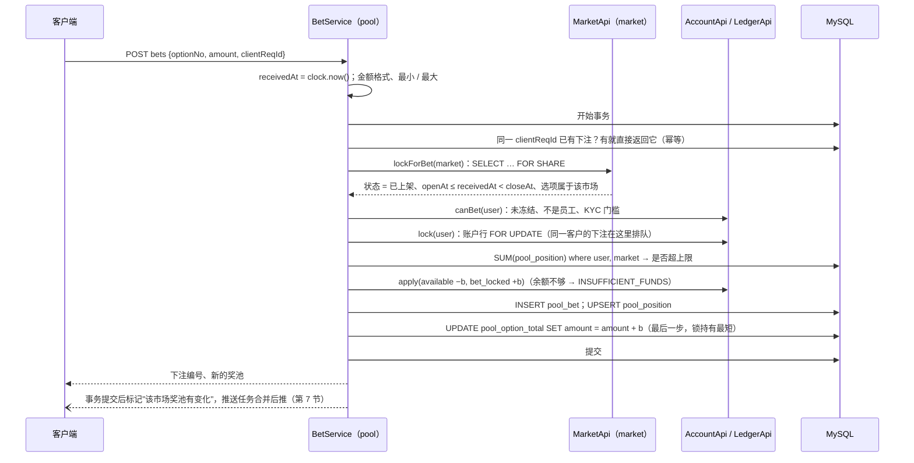

这张图想说明：一次下注就是一个事务；三把锁固定顺序（市场行共享锁 → 客户账户行 → 选项奖池行），不会死锁；同一客户的并发下注在账户行上排队，所以余额和单市场上限都不会超（AC-18）。

**为什么这样选**：

| 问题 | 做法 | 理由 |
|---|---|---|
| 选项奖池并发加 | **悲观锁：原子更新** `UPDATE pool_option_total SET amount = amount + ? WHERE option_id = ?`，放在事务最后 | 乐观锁（版本号）在 100 笔/秒打同一个选项时会大量冲突重试；原子更新只锁一行、持有时间只有"最后一条语句 + 提交"（约 1～3 毫秒【推断】），100 笔/秒分到 2～3 个选项，每行每秒锁住的时间约 15%～30%，有余量 |
| 单客户单市场上限 | 在**客户账户行锁**之内求和 `pool_position`（最多 10 行，走 `(user_id, market_id)` 索引） | 上限是"按客户"的，用客户自己的行锁串行化即可，不需要单独的锁；不同客户互不影响 |
| 余额不超卖 | `LedgerApi.apply` 沿用 falconx-lite：锁账户行、不能为负（数据库 CHECK 兜底） | 已在 falconx-lite 验证 |
| 截止和下注的竞争 | 下注拿市场行**共享锁**；截止任务拿**排他锁**（第 5.2 节） | 截止任务要等进行中的下注提交后才能定格奖池；排他锁排队期间新来的下注会等在后面，拿到锁时看到状态已变，按"已截止"拒绝 |
| 重复提交（双击、网络重试） | `client_req_id` 唯一键，重复请求返回第一次的结果（X-3） | 下注不能撤销（RQ-2），重复扣钱是严重问题 |
| 截止判定 | 只用 `receivedAt`（请求进入应用时的服务器时间）`< close_at`；等于截止时间的拒绝（AC-15） | 需求 3.7 第 4 条 |

**锁顺序和死锁检查**：所有涉及多把锁的操作都按"市场行 → 客户账户行（按 user_id 升序）→ 选项奖池行 / 平台账户行"的顺序。下注（市场 S、一个账户 X、一个选项 X）、截止（市场 X、只读奖池）、结算派彩（市场 X、多个账户按 user_id 升序、平台账户最后）、退款（同结算）、提现（一个账户）之间没有环【推断，S4 用并发测试验证：20 线程混合下注、结算、提现跑 1 分钟无死锁、无超卖】。

**性能估算（NF-01：200 笔/秒，单市场 100 笔/秒，p99 ≤ 500 毫秒）**【推断，AC-70 压测验证】：
- 每笔下注约 8 条 SQL（查幂等、市场共享锁、账户锁、求和、2 条账本、下注、持仓、奖池）+ 1 次提交；200 笔/秒 ≈ 1,600 条语句/秒、200 次提交/秒，MySQL 8.4 在 2 核以上的云盘上可以承受。
- 应用侧：Tomcat 默认线程 200、Hikari 连接池 30（单实例）；单笔服务端耗时目标 < 30 毫秒。
- 风险：同一客户在同一秒连发几十笔（机器人）会在账户行上排队 → 有 `@UserWriteLimited`（每客户每分钟 60 次）挡住。

### 4.3 结算：幂等和事务边界

需求第 3.5 节写的是"同一个事务、幂等"。一个市场最多 10,000 个持仓（NF-03），如果放在一个事务里，要同时锁住最多 10,000 个客户账户行几秒到十几秒【推断】，这期间这些客户在别的市场的下注、提现都会卡住，和 NF-01 的 p99 冲突。所以**分三段**（**AQ-3 已定：B**，Amos 2026-10-25；每批持仓数 `forecast.settle.batch-size` 默认 500，0 = 一个事务完成保留为可配置项）：

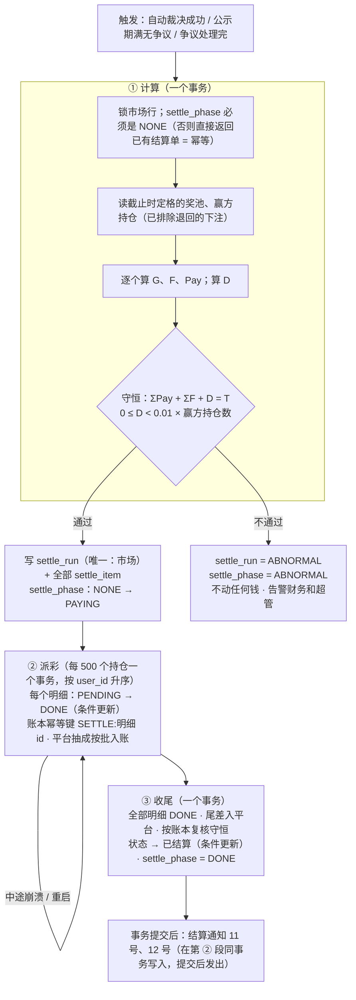

这张图想说明：钱动之前，所有人的派彩已经算好并通过守恒校验、落在结算单里；之后的派彩可以分批、可以中断后接着做，每一步都只做一次。

**幂等的三道保证**：①`settle_run` 唯一键 `(market_id, kind)`；②`settle_item` 状态条件更新 `UPDATE … SET status='DONE' WHERE id=? AND status='PENDING'`，更新 0 行就跳过；③账本幂等键 `SETTLE : 明细 id`（重复调用返回第一次的结果）。三道任何一道都能挡住重复派彩（AC-23 用三次并发触发测试）。

**结算伪代码**：

```java
// settle/run/SettlementService.java（伪代码）
SettleRun calculate(long marketId, long winningOptionId, String resolvedBy) {
  return tx(() -> {
    Market m = marketApi.lockForSettle(marketId);              // SELECT … FOR UPDATE
    if (m.settlePhase() != NONE) return runs.byMarket(marketId, PAYOUT);   // 幂等
    require(m.status() in [PENDING_RESOLUTION /*自动*/, PUBLICIZING /*期满*/, DISPUTED /*处理完*/]);
    refunds.refundLateAndStaffBets(m);                          // E14、E15：先退，奖池同步减少
    Map<Long, BigDecimal> pool = poolApi.finalTotals(marketId); // 截止时定格（减去退回的）
    BigDecimal T = sum(pool.values());
    BigDecimal PW = pool.getOrDefault(winningOptionId, ZERO);
    if (PW.signum() == 0) return voidMarket(m, "NO_WINNER");    // E1：作废、全额退款
    BigDecimal L = T.subtract(PW);
    BigDecimal r = m.feeRate();                                  // 当时的费率
    List<Position> winners = poolApi.positions(marketId, winningOptionId);
    List<Item> items = new ArrayList<>();
    BigDecimal sumG = ZERO, sumF = ZERO, sumPay = ZERO;
    for (Position p : winners) {
      BigDecimal G = p.amount().multiply(L).divide(PW, 2, RoundingMode.DOWN);
      BigDecimal F = G.multiply(r).setScale(2, RoundingMode.HALF_UP);
      BigDecimal pay = p.amount().add(G).subtract(F);
      items.add(Item.win(p, G, F, pay));
      sumG = sumG.add(G); sumF = sumF.add(F); sumPay = sumPay.add(pay);
    }
    for (Position p : poolApi.positionsExcept(marketId, winningOptionId)) items.add(Item.lose(p));
    BigDecimal D = L.subtract(sumG);
    boolean ok = sumPay.add(sumF).add(D).compareTo(T) == 0
        && D.signum() >= 0
        && D.compareTo(new BigDecimal("0.01").multiply(BigDecimal.valueOf(winners.size()))) < 0;
    SettleRun run = runs.insert(m, PAYOUT, winningOptionId, r, T, PW, L, sumG, sumF, D, sumPay, ok);
    if (!ok) { marketApi.markSettleAbnormal(m); alerts.settleAbnormal(m, run); return run; }
    items.insertAll(run, items);
    marketApi.casSettlePhase(m, NONE, PAYING, winningOptionId, resolvedBy);
    return run;
  });
}

void payBatch(SettleRun run) {                    // PayoutWorker 每 2 秒拉一次 PAYING 的结算单
  List<Item> batch = items.pending(run.id(), 500); // 按 user_id 升序
  tx(() -> {
    BigDecimal batchFee = ZERO;
    for (Item it : batch) {
      if (items.casDone(it.id()) == 0) continue;   // 别的实例已做
      String biz = "SETTLE:" + it.id();
      ledger.apply(it.userId(), BET_LOCKED, it.stake().negate(), it.win() ? BET_SETTLE : BET_LOST, biz, run.marketId());
      if (it.win()) {
        ledger.apply(it.userId(), AVAILABLE, it.stake().add(it.gross()), PAYOUT, biz, run.marketId());
        ledger.apply(it.userId(), AVAILABLE, it.fee().negate(), FEE, biz, run.marketId());
        batchFee = batchFee.add(it.fee());
      }
      notify.toUser(it.userId(), it.win() ? "SETTLE_WON" : "SETTLE_LOST", vars(it, run));
    }
    platform.apply(PLATFORM_REVENUE, batchFee, FEE_INCOME, "SETTLE_BATCH:" + run.id() + ":" + firstId(batch), run.marketId());
  });
}

void finish(SettleRun run) {
  tx(() -> {
    require(items.countPending(run.id()) == 0);
    platform.apply(PLATFORM_REVENUE, run.dust(), SETTLE_DUST, "SETTLE_RUN:" + run.id(), run.marketId());
    require(ledgerQuery.marketConservation(run.marketId()).equals(run.poolTotal()));  // 按账本复核
    marketApi.casStatus(run.marketId(), currentStatus, SETTLED);
    runs.casStatus(run.id(), PAYING, DONE);
  });
}
```

- `require` 失败会让本次事务回滚、结算单标 `ABNORMAL`、告警，钱停在那一步（已派的不回滚，因为每一笔都已在明细里，人工核对后可以继续）。
- 取消、作废的**全额退款**走同样的三段（`kind = REFUND`，每个有效下注退 b，不收费）。
- **结算期间改费率被拒**：`FeeService` 改费率时检查 `settle_phase = NONE`（需求 3.8 第 3 条"结算开始后不能改"）。
- 客户端在 `settle_phase = PAYING` 时显示"结算中"（几秒钟），见 X-2。

**性能（NF-03：10,000 个持仓 ≤ 60 秒；加密市场窗口结束 3 分钟内结算完）**【推断，AC-71 压测验证】：计算段 10,000 行内存计算 + 批量插入约 1～2 秒；派彩 20 批，每批 500 个持仓 × 约 4 条语句（批量执行）约 0.5～1 秒，合计 10～20 秒。加密市场：窗口结束 + 60 秒取 K 线（需求 3.7），取价成功后几秒内结算完，3 分钟有余量。

### 4.4 守恒校验和彩池对账
三个时点都校验：
1. **结算计算时**（上面第 ① 段）：不通过不派彩，市场停在"结算异常"（需求 3.5）。
2. **结算收尾时**（第 ③ 段）：按账本 `ref_market_id` 合计复核：Σ客户 `bet_locked` 减少 = T，Σ(PAYOUT − FEE) + Σ平台(FEE_INCOME + SETTLE_DUST) = T。
3. **每天 UTC 00:30 彩池对账**（`settle/recon/PoolReconJob`，需求 3.9）：未结算市场检查 Σ有效下注 = Σ`pool_option_total.amount` = 账本里这个市场的 BET_LOCK − REFUND；已结算市场检查守恒。不一致写 `settle_pool_recon_issue`、邮件告警财务和超管；有未处理差异时提现自动审批 R12 不通过（AC-38）。

### 4.5 单元测试用例：需求第 3.5 节的例子

```java
// backend/src/test/java/com/forecast/app/settle/SettleMathExampleTest.java（计划）
class SettleMathExampleTest {
  // 曼城 vs 利物浦：主胜 6,000（Alice 60+40、Bob 2,500、Carol 3,400）、平 1,500（Dave）、客胜 2,500（Eve 2,000、Frank 500）
  static final Map<String, BigDecimal> POOLS = Map.of("HOME", dec("6000"), "DRAW", dec("1500"), "AWAY", dec("2500"));
  static final List<Pos> POSITIONS = List.of(
      pos("alice", "HOME", "100.00"),   // 两笔 60 + 40 先合成一个持仓（结算按持仓算，只舍入一次）
      pos("bob", "HOME", "2500.00"), pos("carol", "HOME", "3400.00"),
      pos("dave", "DRAW", "1500.00"), pos("eve", "AWAY", "2000.00"), pos("frank", "AWAY", "500.00"));

  @Test void 第35节例子_费率5_逐分相等() {
    Result r = SettleMath.settle(POOLS, POSITIONS, "HOME", dec("0.05"));
    assertThat(r.payout("alice")).isEqualByComparingTo("163.33");
    assertThat(r.payout("bob")).isEqualByComparingTo("4083.33");
    assertThat(r.payout("carol")).isEqualByComparingTo("5553.33");
    assertThat(r.gross("alice")).isEqualByComparingTo("66.66");
    assertThat(r.fee("bob")).isEqualByComparingTo("83.33");
    assertThat(r.sumFee()).isEqualByComparingTo("199.99");
    assertThat(r.dust()).isEqualByComparingTo("0.02");
    assertThat(r.platformIncome()).isEqualByComparingTo("200.01");
    assertThat(r.sumPayout()).isEqualByComparingTo("9799.99");
    for (String loser : List.of("dave", "eve", "frank")) assertThat(r.payout(loser)).isEqualByComparingTo("0");
    assertThat(r.sumPayout().add(r.sumFee()).add(r.dust())).isEqualByComparingTo("10000.00");   // 守恒
  }

  @Test void 两笔合成一个持仓_不是分别舍入() {
    // 这个例子里 60、40 分别算是 40.00 + 26.66 = 66.66，和合并算的相同（v1.1.1 改正：原注释写成 39.99 + 26.66 = 66.65 是算错了）；
    // 分别算会差的例子：两笔 0.01 各自算盈利 0，合成 0.02 算 0.01（L = 1、P_W = 2）。规则不变：结算按持仓，只舍入一次
    assertThat(SettleMath.gross(dec("100"), dec("4000"), dec("6000"))).isEqualByComparingTo("66.66");
  }

  @Test void 例子2_本注预计回报() {   // Grace 押主胜 100：主胜 6,100、T = 10,100
    assertThat(Odds.expectedReturn(POOLS, "HOME", dec("100"), dec("0.05"))).isEqualByComparingTo("162.29");
  }

  @Test void 最终赔率显示() {         // AC-19
    assertThat(Odds.multiplier(POOLS, "HOME", dec("0.05"))).isEqualTo("1.63");
    assertThat(Odds.multiplier(POOLS, "DRAW", dec("0.05"))).isEqualTo("6.38");
    assertThat(Odds.multiplier(POOLS, "AWAY", dec("0.05"))).isEqualTo("3.85");
    assertThat(Odds.percentList(POOLS)).containsExactly("60%", "15%", "25%");
  }

  @Test void 费率改成8_按新费率结算() {  // AC-37：Alice 161.33
    Result r = SettleMath.settle(POOLS, POSITIONS, "HOME", dec("0.08"));
    assertThat(r.payout("alice")).isEqualByComparingTo("161.33");   // 100 + 66.66 − 5.33
    assertThat(r.sumPayout().add(r.sumFee()).add(r.dust())).isEqualByComparingTo("10000.00");
  }
}
```

`SettleMath`、`Odds` 是纯函数（不碰数据库），`SettlementService` 只负责事务和落库；纯函数测试 + 真实数据库上的流程测试分开（第 17 节）。

---

## 5. 状态机实现

### 5.1 状态和允许的跳转
状态（`MarketStatus`）：`DRAFT` 草稿、`LISTED` 已上架、`PAUSED` 已暂停、`CLOSED` 截止下注、`PENDING_RESOLUTION` 待裁决、`PUBLICIZING` 公示中、`DISPUTED` 争议中、`SETTLED` 已结算、`CANCELLED` 已取消、`VOIDED` 已作废。

`MarketStateMachine.ALLOWED`（只有这些边，其余一律抛 `ILLEGAL_TRANSITION`，AC-10）：

| # | 从 → 到 | 谁触发 | 权限 / 条件 |
|---|---|---|---|
| 1 | DRAFT → LISTED | 上架接口；加密自动生成 | `market:publish` + 勾选检查清单；自动生成要求模板已检查 |
| 2 | LISTED → PAUSED | 暂停 | `market:pause`（高危） |
| 3 | PAUSED → LISTED | 恢复 | `market:pause` |
| 4 | LISTED → CLOSED | 截止任务 | `now ≥ close_at` |
| 5 | PAUSED → CLOSED | 截止任务 | 同上（需求 3.2 第 2 条） |
| 6 | LISTED → CANCELLED | 取消 | `market:cancel`（高危），退款 |
| 7 | PAUSED → CANCELLED | 取消 | 同上 |
| 8 | CLOSED → VOIDED | 截止任务 | 有效选项 < 2（E3、E4），退款 |
| 9 | CLOSED → PENDING_RESOLUTION | 事件结束任务 | `now ≥ event_end_at` |
| 10 | PENDING_RESOLUTION → SETTLED | 自动裁决成功 | 经结算三段 |
| 11 | PENDING_RESOLUTION → PUBLICIZING | 确认结果 | `resolve:confirm`（高危） |
| 12 | PUBLICIZING → SETTLED | 公示期满任务 | 窗口到期且没有争议 |
| 13 | PUBLICIZING → DISPUTED | 客户提交争议 | 有下注、窗口内、每人一次 |
| 14 | DISPUTED → SETTLED | 处理争议（维持 / 改判） | `dispute:handle`（高危） |
| 15 | PENDING_RESOLUTION / PUBLICIZING / DISPUTED → VOIDED | 作废 | `resolve:void` 或 `dispute:handle`；系统（E1、E6 超 48 小时、E10 无法判定） |

（第 15 行是 3 条边，合计 17 条边；E1 没人押赢方在结算计算时发现，按第 15 行作废。）

- **实现**：每次跳转是一条条件更新 `UPDATE market_question SET status=:to, version=version+1, … WHERE id=:id AND status=:from`，同一事务写 `market_status_log`；更新 0 行 = 别人已经改过 → 返回"状态已变化"，不重复执行后续动作。所以重复触发、多实例同时触发都是安全的。
- 进入 SETTLED 只在结算第 ③ 段；进入 CANCELLED、VOIDED 时同一事务建退款单（`settle_run kind=REFUND`），退款由同一个派彩任务执行。
- 题目、选项、截止时间、裁决来源上架后不能改：Mapper 的更新语句带 `AND status='DRAFT'`；截止时间只能**提前**的单独接口 `advanceClose`（需求 3.2 第 4 条），提前后新截止时间之后收到的下注由 E14 同样的逻辑退回。

### 5.2 定时任务

| 任务 | 频率 | 做什么 | 验收 |
|---|---|---|---|
| `MarketClockJob.close` | 每 5 秒 | `status IN (LISTED, PAUSED) AND close_at ≤ now` 的市场：锁市场行（排他）→ 定格 `pool_option_total.final_amount` → 跳到 CLOSED；同一事务判断有效选项数 < 2 → VOIDED + 退款单 | AC-14、AC-24（1 分钟内） |
| `MarketClockJob.eventEnd` | 每 15 秒 | `CLOSED AND event_end_at ≤ now` → PENDING_RESOLUTION | |
| `CryptoResolver` | 每 15 秒 | 加密市场 `PENDING_RESOLUTION` 且窗口结束 + 60 秒：取两源 K 线（第 6 节），一致 → 结算；不一致或取不到 → 每分钟重试，30 分钟后转人工 | AC-27、AC-29 |
| `SportsResolver` | 每 5 分钟 | 体育市场：两源都"完赛"且完赛后满 30 分钟、比分一致 → 结算；延期、腰斩、不一致 → 转人工；原定开赛 + 48 小时仍未完赛 → 作废（E6） | |
| `PublicityJob` | 每 15 秒 | `PUBLICIZING AND dispute_deadline_at ≤ now AND 没有争议` → 结算 | AC-31（1 分钟内） |
| `PayoutWorker` | 每 2 秒 | 推进 `settle_run` 的派彩和收尾（结算、退款） | AC-23 |
| `CryptoAutogenJob` | 每分钟 | 每个启用的模板保证未来至少 4 个 15 分钟窗口、3 个 1 小时窗口已上架或待开放；唯一键防重复 | AC-28 |
| `ResolveTimeoutJob` | 每 5 分钟 | 待提议、待确认、争议处理超时：标红并邮件提醒（同一项不重复） | AC-36 |
| `FeeChangeNotifier` | 事件驱动（修改费率的事务里写通知） | #22 只发给有有效下注的客户 | AC-37 |
| `PoolReconJob` | 每天 UTC 00:30 | 第 4.4 节 | AC-38 |
| `RiskAlertJob` | 每分钟（尾盘大额在下注事务提交后异步检查） | 需求第 8.1 节三类告警 | AC-68 |
| 复用 | | 扫块、提现推进、对账、归集、通知发送、任务回收、告警检查 | |

- **服务停机后恢复**（NF-05）：所有任务按"条件已满足"扫描，不按"到点触发一次"，停机期间到期的市场在恢复后第一轮处理；截止时间之后不可能收到下注（判定只看 `receivedAt`）。
- 截止任务的"共享锁屏障"：截止任务在排他锁下读奖池，所有在它之前开始的下注都已提交；之后进来的下注拿到共享锁时状态已是 CLOSED。代价是：极少数在 `close_at` 之前收到、但因为排队在截止任务之后才拿到锁的下注会被拒绝（需要排队超过截止任务的 5 秒周期，正常 p99 下不会发生）【推断】。

### 5.3 多实例时任务不重复
第一期**单实例**部署（沿用 falconx-lite 的取舍，AQ-11），但代码按多实例写：
1. **租约**：`common_job_lease`：任务开始前 `UPDATE common_job_lease SET owner=:me, lease_until=now+30s WHERE name=:job AND (lease_until < now OR owner=:me)`，更新到 1 行才执行；运行中每 10 秒续约。实例异常退出后最多 30 秒由别的实例接手。不引入 ShedLock 依赖（它对 Spring Boot 4 的支持【未核实】，自己写约 60 行）。
2. **条件更新**：即使租约失效（例如 GC 停顿超过 30 秒）两个实例同时跑，状态跳转、结算明细、账本都有条件更新或唯一键，重复执行没有效果（第 4.3、5.1 节）。
3. 推送多实例时经 Redis 发布 / 订阅广播"某市场奖池变化"（第 7 节）；单实例时走内存。
4. `FC_ID_NODE`（雪花节点号）多实例时必须不同（沿用 falconx-lite 约定 25）。

---

## 6. 自动裁决

### 6.1 数据源适配器

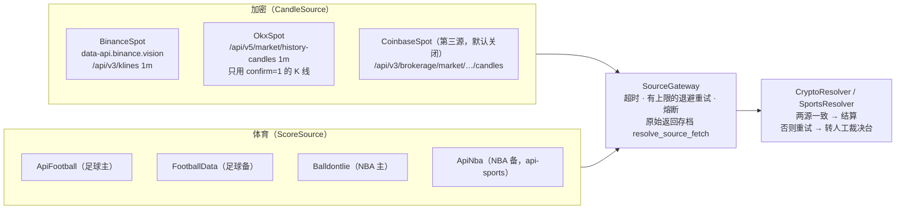

这张图想说明：每个数据源是一个小适配器，只负责"取数据、解析"；超时、重试、熔断、存档在网关里统一做；判定规则（两源一致）在裁决器里，和数据源无关。

| 适配器 | 接口和用法 | 判定 | 实测 / 依据 |
|---|---|---|---|
| `BinanceSpot`（主） | `GET https://data-api.binance.vision/api/v3/klines?symbol=BTCUSDT&interval=1m&startTime=<窗口开始>&endTime=<窗口结束−1>`：第一根的开盘价、最后一根的收盘价 | 收盘 ≥ 开盘判"涨"（E9） | 【实测 2026-10-24，开发环境出口】`api.binance.com` 返回 **HTTP 451**（"restricted location"），`data-api.binance.vision` 返回 200 和 K 线。**生产服务器所在地要再实测一次**（C39）；接口文档【证实：需求 4.3 已打开】 |
| `OkxSpot`（备） | `GET https://www.okx.com/api/v5/market/history-candles?instId=BTC-USDT&bar=1m&after=…&before=…`：每根带 `confirm`（1 = 已收盘），只用已收盘的 | 同上；方向和币安比较 | 【实测 2026-10-24】返回 200，字段 `[ts, o, h, l, c, vol, volCcy, volCcyQuote, confirm]`；限频【未核实】 |
| `CoinbaseSpot`（可选第三源，默认关） | `GET https://api.coinbase.com/api/v3/brokerage/market/products/BTC-USD/candles?granularity=ONE_MINUTE` | 只在主备一方拿不到时补位（X-7） | 【实测 2026-10-24】返回 200；注意是 BTC-USD 不是 BTC-USDT |
| `ApiFootball`（足球主） | `fixtures?date=`（一天的全部比赛，一次调用）、`fixtures?id=`（单场状态和比分） | 状态 `FT`（90 分钟完赛）且完赛后 30 分钟，90 分钟比分（不含加时点球） | 价格和限额【二手】，官网定价页 403 打不开 |
| `FootballData`（足球备） | `GET /v4/matches?dateFrom=&dateTo=`（批量） | 状态 `FINISHED`、`score.fullTime` | 定价【证实：football-data.org/pricing（工具摘要）】，免费档每分钟 10 次、12 个赛事、比分有延迟；是否允许商用【未核实】 |
| `Balldontlie`（NBA 主） | `GET /v1/games?dates[]=`（批量） | 状态 Final，比分 | 定价【证实：balldontlie.io 首页（工具摘要）】：Free 5 次/分、All-Star 9.99 美元/月 60 次/分；各档包含哪些接口【未核实】 |
| `ApiNba`（NBA 备） | api-sports 的 NBA 接口 | 状态 Finished，比分 | 【二手】；需求原写"Sportradar（询价）"，这里建议换成 API-NBA（AQ-7） |

- **两个体育源的比赛编号对应**：运营"从赛程生成草稿"时，系统按队名 + 开赛时间在备用源里找候选，运营确认后写进 `market_fixture.ref_backup`（X-12）。没有确认对应的市场，自动裁决只有一个源 → 一律转人工（RQ-15）。
- **数据许可**：falconx-lite 约定 28 记录了"币安公开数据是非商业许可"【二手：falconx-lite 文档】。本项目用 K 线做裁决依据并在详情页公开开始价、结束价和来源，不转售数据流【推断：风险较低】；第三源 Coinbase 可以在需要时打开。这条只作提示，不作为待决问题。
- **时事**：平台裁决，裁决员在裁决台上传截图、填依据链接（一手官方页面）。

### 6.2 自动裁决规则

| 品类 | 什么时候取 | 一致的定义 | 不一致 / 失败 |
|---|---|---|---|
| 加密 15 分钟 / 1 小时 | 窗口结束 + 60 秒 | 两源的"涨 / 跌"方向相同（价格不必相同）；"正好相等"两源方向不同时以币安为准（需求 4.3） | 每分钟重试；30 分钟后仍不行 → 记 `AUTO_FAILED`、转裁决台"自动裁决失败"（显示两源原始数据），邮件裁决员和超管（AC-29） |
| 足球 / NBA | 首选源报告完赛后，等 30 分钟 | 两源都完赛、比分完全相同 | 比分不同、只有一个源、延期、腰斩、状态异常 → 转人工；原定开赛后 48 小时未完赛 → 作废（E6） |

### 6.3 外部调用清单（C81）

所有外部调用走 `common` 里统一的 HTTP 客户端（JDK `HttpClient`，每个调用单独设超时），**不在数据库事务或持有锁的时候调用**（裁决器先在事务外取数据、存档，再开事务结算）。

| 外部调用 | 连接超时 | 读取超时 | 重试（有上限、退避） | 熔断 | 降级 | 告警 |
|---|---|---|---|---|---|---|
| 币安 K 线 | 3 秒 | 5 秒 | 单次取数 3 次（1、2、4 秒）；整体每分钟一轮，最多 30 分钟 | 连续 5 次失败打开 60 秒，半开放 1 次探测 | 转人工裁决台 | `alerts.source.binance`（只进 alerts，不让健康检查 DOWN，falconx-lite 约定 24） |
| OKX K 线 | 3 秒 | 5 秒 | 同上 | 同上 | 同上 | `alerts.source.okx` |
| Coinbase K 线（可选） | 3 秒 | 5 秒 | 同上 | 同上 | 不补位 | — |
| API-Football | 3 秒 | 10 秒 | 3 次（2、4、8 秒）；结果轮询每 5 分钟一轮 | 同上 | 转人工；赛程生成页显示"数据源暂时不可用，请重试" | `alerts.source.api_football` |
| football-data.org | 3 秒 | 10 秒 | 同上；遵守每分钟 10 次（令牌桶） | 同上 | 只有一个源 → 转人工 | `alerts.source.football_data` |
| balldontlie | 3 秒 | 10 秒 | 同上；遵守每分钟限额 | 同上 | 同上 | `alerts.source.balldontlie` |
| API-NBA | 3 秒 | 10 秒 | 同上 | 同上 | 同上 | `alerts.source.api_nba` |
| 区块链节点（ETH、BSC、TRON） | 沿用 falconx-lite | 沿用 | 沿用（扫块下一轮重扫；提现"连不上不等于失败"） | — | 扫块停滞告警 | 沿用 `node.*`、`scan.*` |
| SMTP | 沿用（5 秒 / 10 秒） | | 任务表重试 5 次 | — | 记"失败"，不影响业务 | `alerts.mail` |
| Web Push | 沿用 | | 429、5xx 任务表重试 5 次；404、410 删订阅 | — | 站内信照常 | — |
| 对象存储（生产） | 3 秒 | 30 秒（上传） | 2 次 | — | 上传失败返回明确原因（C48） | — |
| Redis | 沿用（命令超时 2 秒） | | — | 30 秒内不再访问 | 限流放行、推送退回单实例内存 | — |

**原始返回存档**：每次调用（成功、失败、超时）都写一行 `resolve_source_fetch`：去掉密钥后的请求地址、状态码、原文、原文 sha256、解析结果、耗时（X-13）。裁决台"自动裁决失败"直接显示这些行；已结算市场的详情页公开开始价、结束价和来源（AC-27）。数据量：每天约 240 个加密市场 × 2～3 条 × 约 2 KB ≈ 1.5 MB/天【推断】，永久保留可以接受。

**测试**（C81、《测试工程师》C81）：每个适配器用本地 HTTP 替身测慢响应（超过读取超时）、连接拒绝、500、返回格式不对、K 线未收盘；检查有上限的重试、熔断打开和恢复、转人工、调用方没有卡住。

### 6.4 加密部分的实现（S6，v1.1.2 补记）
S6 按第 6.1～6.3 节实现了加密部分，细节和测试结果见 `开发记录/S6-加密自动化.md`；当前状态以《项目地图》《项目索引》和代码为准。和上面写法不同或补充的地方：

| 项 | 实现 |
|---|---|
| 自动生成（第 3.3、5.2 节；MQ-1 节目化，Amos 已同意） | `market_autogen` 按"场次"配置：SCHEDULE（默认，`slots` 里每个 UTC 窗口开始时间每天一场，开放前 `generate_ahead_min` 分钟生成）/ ROLLING（保证未来至少 N 个窗口，AC-28）。新库默认 BTC 1 小时、每天 13:00 UTC 一场、关闭（启用要 `market:publish` 检查一次）。开放、截止提前量用参数设置、费率用品类默认值，模板里不设（不让 `market:autogen` 绕过 `betting_params:edit`、`fee:edit`）；启用中的模板不能改 |
| 依赖方向（第 2.3 节） | resolve 定义 `ResultHandler`（结果定了以后结算），settle 实现；market 定义 `MarketResolutionView`（客户端详情的开始价、结束价、来源），resolve 实现；market 进入待裁决时经 `MarketListener.onStatusChanged` 让 resolve 建进度 `resolve_auto_task` |
| 网关（第 6.3 节） | 公共的 `common/http/ExternalHttp`（连接超时、读取超时按读完响应体的总时长算、响应体上限 1 MB、不跟随跳转）+ `resolve/source/SourceGateway`（一轮最多 3 次、间隔 1、2 秒，只重试超时、连不上、断开、5xx、429、408；格式错误、其他 4xx 不重试；"K 线还不全"不重试也不计入熔断；连续 5 次失败熔断 60 秒、半开放 1 次探测；每次调用和每次熔断跳过都存档，存档失败当作取数失败；在数据库事务里调用直接报错） |
| 判定（第 6.2 节） | 主备并行取；方向一致 → 结算；方向不同但有一边收盘 = 开盘 → 以首选（币安）为准；Coinbase 只在主备一方拿不到时补位（不做三取二）；第一次取数 = 窗口结束 + 1 分钟，之后每分钟一次，第一次取数后 30 分钟仍不行 → 进度 MANUAL + 裁决记录 AUTO_FAILED + 员工告警 `RESOLVE_AUTO_FAILED`，市场留在待裁决（S7 裁决台接手） |
| 实测（C39，2026-10-25） | `data-api.binance.vision`、OKX `history-candles`（`after` = 窗口结束、`before` = 窗口开始 − 1 正好返回窗口里的 K 线）、Coinbase 对 BTC、ETH 的 1 小时和 15 分钟窗口全部 200、根数齐、方向一致；`api.binance.com` 仍 451。生产服务器所在地上线前再测 |

### 6.7 体育部分的实现（S8 补记，不改已审核的决定）
S8 按 AQ-17、AQ-18（Amos 已同意，main 上 v1.3 第 6.1、6.4、6.5 节）和 MQ-10 实现了体育部分，细节和测试结果见 `开发记录/S8-体育自动化.md`；当前状态以《项目地图》《项目索引》和代码为准。和上面写法不同或补充的地方：

| 项 | 实现 |
|---|---|
| 数据源（AQ-17） | 足球主源 `FootballData`（football-data.org v4，请求头 `X-Auth-Token`，`/v4/matches?dateFrom&dateTo` 赛程、`/v4/matches/{id}` 单场）；NBA 主源 `Balldontlie`（`Authorization`，`/v1/games?start_date&end_date` 翻页、`/v1/games/{id}`）；两者的备源 `TheSportsDb`（key 在路径里，`lookupevent.php` 单场、`eventsday.php?l=` 按联赛 + 日期、`searchevents.php?e=主队_vs_客队&d=` 按队名 + 日期找候选）。两个来源是不同网站。football-data 的赛事代码 → TheSportsDB 联赛编号的对照表 2026-10-25 逐个实测核对。第一期不建抓取程序、不用 Gemini（AQ-18）：加来源 = 加一个 `ScoreSource` 实现、在 `SportsSources` 里按品类挂上 |
| 网关（第 6.3 节） | 加密的 `SourceGateway` 改成通用的 `call(SourceRequest)`（加密的 `fetch` 不变）：每个来源可以覆盖超时和重试（体育读取 10 秒、退避 2 / 4 秒）；**限频排队**（滑动窗口，football-data 8、balldontlie 4、TheSportsDB 25 次每分钟，同一网站的接口共用；排队超过 30 秒这一轮不调用 `THROTTLED`，不算故障）；429 按 `Retry-After` / `X-RequestCounter-Reset` 暂停；**没配 key = 未开通**（不调用，健康检查 alerts 显示 DOWN）；存档地址不带 key；同一次调用给几个市场用时每个市场各存一行 |
| 赛程和对应（第 3.3 节 `market_fixture`、X-12） | 表放在 resolve 模块 `resolve_fixture`（赛程来自 resolve 的数据源，market 不能依赖 resolve）；每 4 小时同步未来 7 天；系统按队名（去掉 FC 等、别名表、词重合 + 字母二元组相似度）+ 开赛时间给候选打分、标"推荐"，**由运营确认**（开赛以前可改）；主客队写反的标 `swapped` |
| 生成草稿（需求 4.2、MQ-10） | 玩法 FOOTBALL_1X2 / FOOTBALL_OU（默认 2.5）/ NBA_ML / NBA_TOTAL（分界线必填，.5 结尾，E8）；规则文本模板 `resolve_sports_template`（三语，含变量）；截止 = 开赛 − 参数 `sports.closeLeadMinutes.*`（5），事件结束 = 开赛 + `sports.eventMinutes.*`（足球 120、NBA 180）；草稿照常提交上架、由 `market:publish` 的人上架 |
| 判定（第 6.2 节） | 进入待裁决（事件结束）后每 5 分钟看主源；**主源第一次报告完赛后等 30 分钟**，再取主源（仍完赛）和备源比较：比分（主客对调时对调）一致 → 按玩法定结果、结算；不一致、备源状态异常、足球加时点球、判定结果、取消 → 转人工；备源拿不到或没完赛 → 再等最多 30 分钟后转人工；事件结束 6 小时主源还没完赛 → 转人工。**延期 → 转人工并自动标记 E6 等待（原定开赛后 48 小时），中断 / 腰斩 → E7 等待（48 小时）**，和裁决台手工标记同一个入口（`ResolveDesk.systemHold`），到期没解除由 S7 的任务作废 |
| E14 | 实际开赛时间按数据源（主源的开赛时间，交给结算）；任何一个来源的开赛时间早于截止时间时，两个来源要相差不超过 15 分钟才自动退回之后的下注，否则转人工确认；同步时开赛时间变了、有还没结束的市场 → 邮件提醒运营提前截止 |
| 外部调用清单（第 6.3 节体育三行） | 连接 3 秒、读取 10 秒；一轮 3 次（2、4 秒）；连续 5 次失败熔断 60 秒；降级：转人工（自动裁决）/ 同步结果返回 failed、disabled（后台）；告警 `alerts.source.football_data`、`source.balldontlie`、`source.thesportsdb`（含"未开通"） |

---

## 7. 实时推送

**选 WebSocket，沿用 falconx-lite**（`/api/ws/trading` 和 `/api/ws/market` 的握手限流、断线重连后重拉、Nginx 配置都已在测试环境验证过）。SSE 在单向推送上更简单，但要重新写 Nginx 配置、断线逻辑和测试，而且客户端已有的 `ws.ts`、`useServerEvent` 可以直接用【推断】。

| 通道 | 内容 | 做法 |
|---|---|---|
| `WS /api/ws/user`（登录后） | 本人的余额、通知、充值、提现、结算结果 | 沿用 `UserEventsApi`：事务提交后推送；连上时（含重连）客户端重新拉取账户和未读数（falconx-lite 已踩过"连上前的变化漏掉"的坑） |
| `WS /api/ws/markets` | 订阅 `market:{publicNo}`，收到 `{options:[{no, amount, pct, mult}], total, bettors, ts}` | 下注事务提交后只把市场标"有变化"；`PoolPush` **每秒最多推一次**最新快照（合并），满足"2 秒内"（AC-17）；数字由前端直接替换，不做闪色（C84） |

**高峰并发估算**【推断，交付前压测】：

| 假设 | 数值 |
|---|---|
| 同时在线（WebSocket 连接） | 3,000（第一期上线后数月的高估） |
| 同时在看的市场 | 100 个，平均每个 30 人；热门市场 1,000 人 |
| 推送频率 | 每个市场最多 1 次/秒 |
| 消息大小 | 约 300 字节（10 个选项以内） |
| 推送量 | 平常 3,000 条/秒、约 0.9 MB/秒（约 7 Mbit/秒）；热门市场单个 1,000 条/秒 |
| 内存 | 每个连接约 30～50 KB（会话、缓冲区），3,000 个约 150 MB，已计入第 11.3 节 JVM 的堆和直接内存 |
| Nginx | 沿用 WebSocket 只限握手不限长连接（falconx-lite 约定 21）；`FC_NGINX_WS_CONN` 每 IP 同时 500 |

带宽：服务器出口带宽要按 ≥ 20 Mbit/秒峰值准备（第 11.2 节），静态资源由 CDN 承担（AQ-8）。

---

## 8. 通知

完全复用 falconx-lite 的通知模块（C86）：业务模块在自己的事务里调用 `NotifyApi.toUser(用户, 模板编号, 变量)`；站内信始终发、推送和邮件按客户开关；每个渠道一条通知记录（"不发"的渠道记"跳过"或不写，AC-58）；**文案全部在后台可改的模板里**，代码只传变量（C6）。模板加繁体中文一列。

| # | 模板编号 | 站内信 / 推送 / 邮件 | 触发位置 | 变量 |
|---|---|---|---|---|
| 1 | `WELCOME` | 发 / 不发 / 不发 | `AuthService.register`（复用） | — |
| 2 | `EMAIL_CODE` | 不发 / 不发 / 发 | 复用 | `code` |
| 3 | `DEPOSIT_CREDITED` | 发 / 发 / 发 | 复用 | `amount`、`chain` |
| 4 | `DEPOSIT_BELOW_MIN` | 发 / 不发 / 不发 | 复用 | `amount`、`min` |
| 5 | `WITHDRAW_STATUS` | 发 / 发 / 发 | 复用（客户自己提交、撤销不发） | `orderId`、`status`、`reason` |
| 6 | `KYC_APPROVED`、`KYC_REJECTED` | 发 / 发 / 发 | 复用 | `reason` |
| 7 | `KYC_REQUIRED_TO_BET` | 发 / 发 / 发 | 充值入账跨过阈值时（`account_kyc_gate` 保证只发一次） | `threshold` |
| 8 | `BET_PLACED` | 发 / 不发 / 不发 | 下注事务 | `market`、`option`、`amount` |
| 9 | （截止下注） | 不发 / 不发 / 不发 | 不建模板 | — |
| 10 | `RESULT_PUBLICIZED` | 发 / 发 / 不发 | 确认结果事务（只对平台裁决） | `market`、`option`、`deadline` |
| 11 | `SETTLE_WON` | 发 / 发 / 不发 | 派彩批次事务 | `market`、`payout`、`fee`、`feeRate`、`overturned` |
| 12 | `SETTLE_LOST` | 发 / 发 / 不发 | 同上 | `market`、`stake`、`overturned` |
| 13 | `MARKET_REFUNDED` | 发 / 发 / 发 | 取消、作废退款批次 | `market`、`amount`、`reason` |
| 14 | `LATE_BET_REFUNDED` | 发 / 发 / 发 | E14 退款 | `market`、`amount` |
| 15 | `DISPUTE_DECIDED` | 发 / 发 / 发 | 争议处理事务 | `market`、`decision` |
| 16 | `RESULT_OVERTURNED` | 发 / 发 / 不发 | 改判（结算通知里也带 `overturned`） | `market`、`option` |
| 17 | `COMPENSATION_PAID` | 发 / 发 / 发 | 补偿入账 | `market`、`amount` |
| 18 | `MARKET_CLARIFIED` | 发 / 不发 / 不发 | 发补充说明（只发给有下注的） | `market` |
| 19 | （新市场、热门推荐） | 不发 | 不建模板（第一期不做营销推送） | — |
| 20、21 | （改密码、冻结） | 不发 | 沿用 falconx-lite | — |
| 22 | `FEE_CHANGED` | 发 / 不发 / 不发 | 改费率事务（上架后、只发给有有效下注的） | `market`、`old`、`new`、`at` |

管理员通知（只发邮件 + 通知记录，沿用）：`ADMIN_LISTING_SUBMITTED`、`ADMIN_PROPOSAL_PENDING`、`ADMIN_RESOLVE_TIMEOUT`、`ADMIN_AUTO_RESOLVE_FAILED`、`ADMIN_NEW_DISPUTE`、`ADMIN_SETTLE_ABNORMAL`、`ADMIN_POOL_RECON_DIFF`、`ADMIN_RISK_ALERT`，以及复用的热钱包余额、冲正挂账、入金对账、自动审批总开关。收件人按权限点（有 `market:publish` / `resolve:confirm` / `dispute:handle` 的管理员）和财务角色取，不写死。

**频率提醒**：加密 15 分钟市场的 #11 / #12 推送很频繁，客户可以在偏好里关推送（需求已写）；推送任务每台设备一个、失败重试有上限（沿用）。

---

## 9. 前端

### 9.1 三个应用

| 应用 | 域名（示例，按品牌定） | 主要页面 | 手机 / 电脑 |
|---|---|---|---|
| 客户端 `web/client` | `app.<域名>` | 市场列表、市场详情、下注、我的下注、资产（复用）、通知（复用）、我的 / 设置、注册登录（复用）、新手引导、提交争议、规则说明 | **两套结构**，宽度 1024 切换（沿用 `useIsDesktop`）：手机底部 4 个导航、列表单列、详情 → 底部抽屉下注；电脑顶栏导航、卡片 3～4 列网格、详情左栏 + 右栏固定下注（W1～W3，C64） |
| 后台 `web/admin` | `admin.<域名>`（生产加 IP 白名单） | 需求第 6 节 12 个一级菜单；裁决台按 W4 | 只做电脑（沿用） |
| 官网 `web/site` | `www.<域名>` 和根域名 | 首页（玩法、费率、提现规则说明）、服务条款、隐私、规则说明 | 两套结构（沿用） |

**两套界面共用一份逻辑**（C64）：`hooks/useBetForm.ts`（金额、快捷金额、上限、余额、预计回报、校验、提交）+ `lib/pool.ts`（和后端同一份测试向量）；`BetPanel`（电脑右栏）和 `BetSheet`（手机抽屉）只负责布局。市场卡片 `MarketCard` 一份，列表 / 网格由布局决定。

**主操作按钮在首屏内**（C79）："确认押注"在电脑右栏用 `position: sticky` 固定在栏底（falconx-lite `.op-sticky` 的做法），手机抽屉按钮固定在抽屉底部；e2e 在 1366×768、1280×720、390×844、375×667 检查（AC-52）。**共用框架不跳动**（C90）：顶栏、底部导航在各页面位置一致，用脚本量位置比较。

### 9.2 多语言（C82、RQ-18）
- 三种语言：`en.json`、`zh-CN.json`、`zh-TW.json`；后台保留中英文（只给员工用）。
- 选择顺序（沿用 falconx-lite `pickLang`，加繁体）：地址栏 `?lang=` → 用户选过的（`fc.lang`）→ 浏览器语言：`zh-TW`、`zh-HK`、`zh-MO`、`zh-Hant*` 用繁体，其他 `zh*` 用简体，其他语言或取不到用**英文**。下拉框显示当前语言。
- 切换语言时告诉后端（`PUT /api/me/notify-lang`），推送和邮件用这个语言；站内信打开时按界面语言生成（沿用）。
- 市场题目、选项、规则、补充说明三种语言都由运营填（模板生成），缺一种不能提交上架（AC-11）。
- CI：`scripts/check-i18n.mjs` 检查三个前端每种语言的键名一致（NF-12、AC-53）；`check-brand.mjs` 检查旧品牌名。

### 9.3 主题（C85、RQ-1）
- 默认**跟随系统**（`prefers-color-scheme`），系统切换时页面跟着变；"我的 → 设置"可选跟随系统 / 浅色 / 深色，选过的记住（`fc.theme`，读写包 try/catch）。
- `index.html` 里先设 `data-theme` 防止白屏一闪（沿用后台的写法）。颜色只用 CSS 变量（第 10 节的 token），两套都定义；新增样式不写死颜色值。
- 新项目没有老用户本地存储，不涉及 C55 的旧值兼容。

### 9.4 新手引导（C83）、不闪动（C84）
- 新手引导沿用 `Onboarding` + `useOnboarding`：首次登录 4 步（这里押什么 → 赔率怎么算、只对盈利抽成 → 认证 → 充值），终点在充值页；可跳过，"我的"里能重看；"看过"记在 `fc.onboarding.v1:<用户号>`（AC-54）。
- 不闪动：不渲染跑马灯、滚动的最新下注；赔率更新只换数字，没有颜色过渡动画。e2e 检查市场列表、详情、下注页面的计算样式里没有 `animation-name`（除了加载中的转圈）（AC-55）。

### 9.5 原型
架构审核通过后做高保真原型（总则 4.5），沿用 falconx-lite 的 mock 模式（`VITE_API_MODE=mock`、原型横幅、场景面板），部署到 Vercel 预览（AQ-12）；包含空状态（没有市场、没有下注）、奖池为 0、单选项有人押等场景（C32）。原型前先按 Amos 选定的风格方向用 HTML/CSS 画关键页面效果图（市场列表、详情 + 下注、我的下注、裁决台；电脑和手机）。

---

## 10. 主题风格方向（C65、C85）

依据：需求第 11 节的竞品调研（Polymarket、Kalshi、Limitless、predict.fun、Myriad），市场经理补充的竞品 PancakeSwap Prediction（彩池涨跌）、Stake（体育）。三个方向都遵守：默认跟随系统、浅色深色两套、概率为主倍数为辅、不闪动。下面三张图都是**示意**：同一份 W1 内容（市场列表），电脑浅色、手机浅色、手机深色，下方是浅色和深色两套 token。全部文字和背景、主色按钮的对比度已用脚本按 WCAG 公式计算，**18 组（每个方向浅深各 9 组）都 ≥ 4.5**（最低 4.97：方向 A 浅色"涨"色在卡片上）。

### 方向 A 清爽数据（推荐）
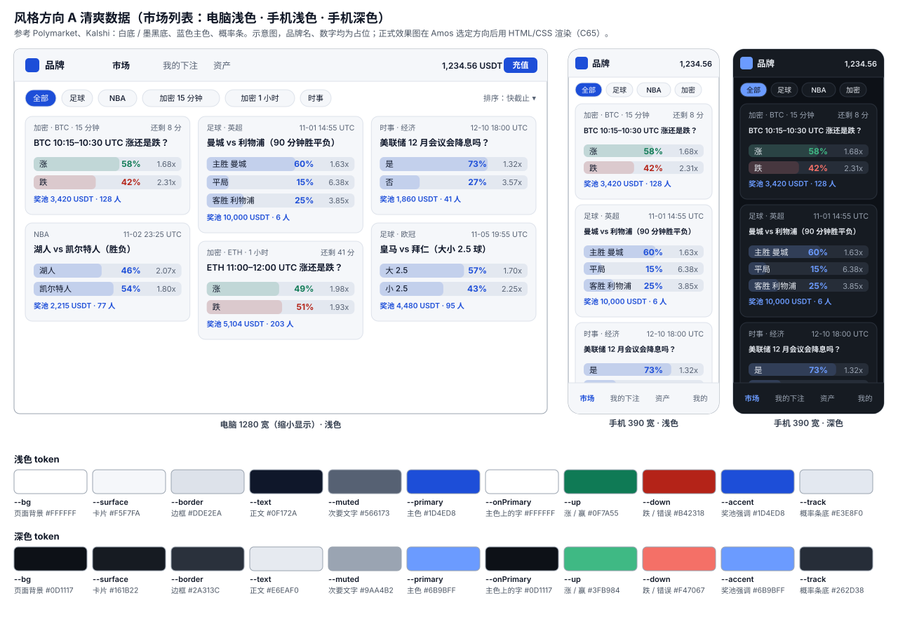

| token | 浅色 | 深色 | 用途 |
|---|---|---|---|
| `--bg` | `#FFFFFF` | `#0D1117` | 页面背景 |
| `--surface` | `#F5F7FA` | `#161B22` | 卡片、顶栏 |
| `--border` | `#DDE2EA` | `#2A313C` | 边框 |
| `--text` | `#0F172A` | `#E6EAF0` | 正文 |
| `--muted` | `#566173` | `#9AA4B2` | 次要文字 |
| `--primary` | `#1D4ED8` | `#6B9BFF` | 主色、选中、概率 |
| `--on-primary` | `#FFFFFF` | `#0D1117` | 主色按钮上的字 |
| `--up` | `#0F7A55` | `#3FB984` | 涨、赢、成功 |
| `--down` | `#B42318` | `#F47067` | 跌、错误 |
| `--accent` | `#1D4ED8` | `#6B9BFF` | 奖池金额 |
| `--track` | `#E3E8F0` | `#262D38` | 概率条底色 |

- 适合：面向全球大众、体育和时事用户（不只是币圈）。
- 优点：和 Polymarket、Kalshi 的"数据产品"观感一致，用户一眼认得；蓝色主色和涨跌色（绿、红）不冲突，多选项市场的概率条不会被误读成"涨跌"；深色底 `#0D1117` 接近 Polymarket 的 `#0c0e13`【证实：需求 11.1】。
- 缺点：辨识度一般，需要靠 Logo 和品牌色补；奖池金额没有特别突出。

### 方向 B 赛场活力
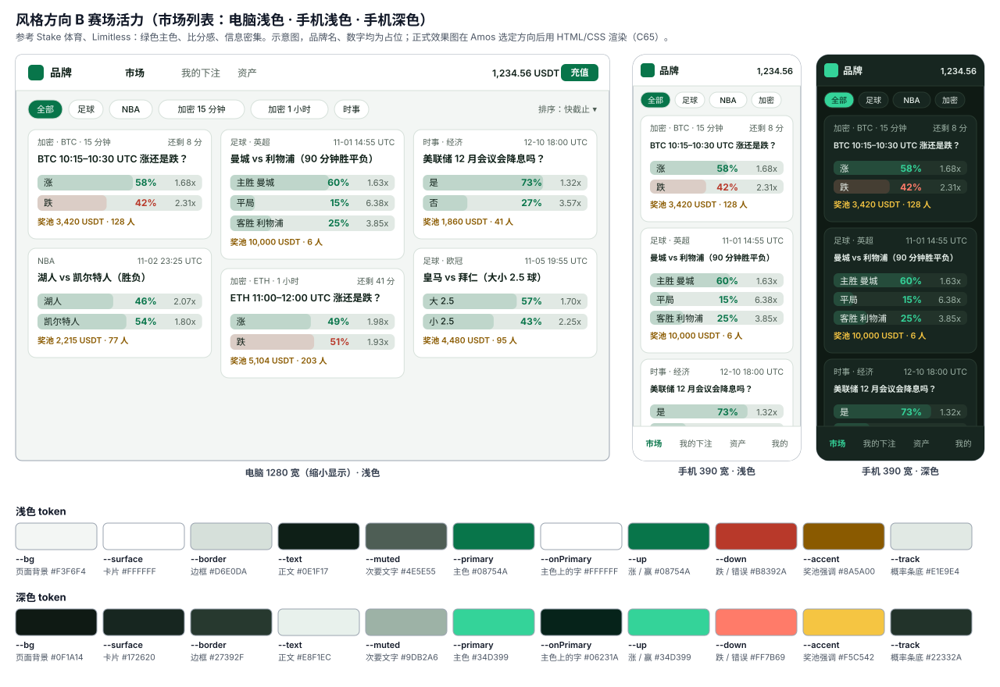

| token | 浅色 | 深色 |
|---|---|---|
| `--bg` | `#F3F6F4` | `#0F1A14` |
| `--surface` | `#FFFFFF` | `#172620` |
| `--border` | `#D6E0DA` | `#27392F` |
| `--text` | `#0E1F17` | `#E8F1EC` |
| `--muted` | `#4E5E55` | `#9DB2A6` |
| `--primary` | `#08754A` | `#34D399` |
| `--on-primary` | `#FFFFFF` | `#06231A` |
| `--up` | `#08754A` | `#34D399` |
| `--down` | `#B8392A` | `#FF7B69` |
| `--accent` | `#8A5A00` | `#F5C542` |
| `--track` | `#E1E9E4` | `#22332A` |

- 适合：以足球、NBA 为主的用户（Stake 体育一类的习惯）。
- 优点：球场绿 + 金色奖池，体育气氛强；深色版很有"夜场"感。
- 缺点：**主色和"涨 / 赢"是同一个绿**，多选项市场里所有概率条都是绿色，容易被理解成"都会赢"；加密涨跌市场里"涨"和主色无法区分；和博彩站的观感接近，可能影响"平台不当庄"的定位。

### 方向 C 温暖奖池
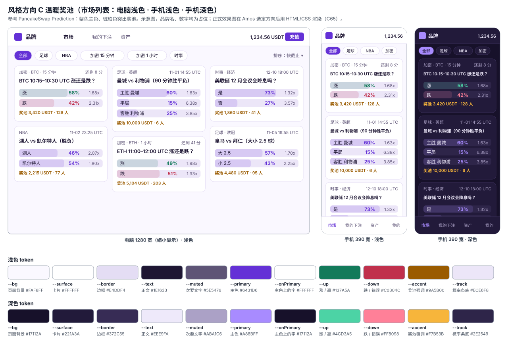

| token | 浅色 | 深色 |
|---|---|---|
| `--bg` | `#FAF8FF` | `#17112A` |
| `--surface` | `#FFFFFF` | `#221A3A` |
| `--border` | `#E4DDF4` | `#372C55` |
| `--text` | `#1E1633` | `#EEE9FA` |
| `--muted` | `#5E5476` | `#ABA1C6` |
| `--primary` | `#6431D6` | `#A88BFF` |
| `--on-primary` | `#FFFFFF` | `#17112A` |
| `--up` | `#137A5A` | `#4CD3A5` |
| `--down` | `#C0304C` | `#FF8098` |
| `--accent` | `#9A5B00` | `#F7B53B` |
| `--track` | `#ECE6F8` | `#2E2549` |

- 适合：加密短周期为主、熟悉 PancakeSwap Prediction 的用户。
- 优点：紫色 + 琥珀突出"奖池"概念，和其他预测市场区分明显；深色版好看。
- 缺点：偏币圈、偏娱乐，体育和时事用户（尤其白天浅色）观感一般；紫色主色在部分安卓屏幕上偏色【推断】。

### 推荐
**推荐方向 A 清爽数据**（AQ-6）。理由：①目标用户是全球大众、体育和加密都有，A 最中性；②主色（蓝）和涨跌色（绿红）分开，彩池的多选项市场不会被颜色误导；③和头部产品的观感一致，降低学习成本；④品牌辨识度靠 Logo 和品牌名补（第 15 节）。Amos 选定后，研发按选定方向用 HTML/CSS 画关键页面的效果图（电脑、手机，浅色、深色），再进入原型。品牌主色由 PM 定（总则"视觉设计归属"），上面的主色是研发的建议值，PM 可以改，研发只派生实现用的色值。

---

## 11. 部署（运维）

### 11.1 部署拓扑

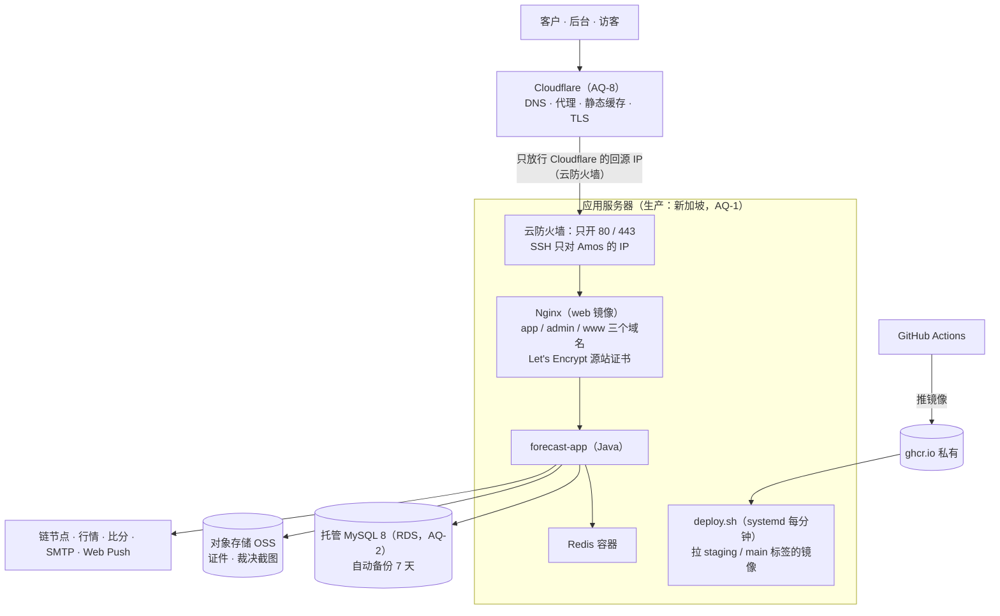

这张图想说明：生产和测试环境用同一套镜像和工具包；服务器自己拉镜像，GitHub 和智能体都不能登录服务器；生产的数据库和文件放在云厂商的托管服务里。

### 11.2 服务器规格和费用（H0，需 Amos 确认）

| 环境 | 建议 | 规格 | 每月费用 | 依据 |
|---|---|---|---|---|
| 测试 | 阿里云轻量应用服务器（SWAS） | 2 核 4 GB、80 GB、峰值 15 Mbit/秒、每月 4 TB 流量 | **19 美元** | 【证实：alibabacloud.com/en/product/swas/pricing（工具摘要），实际下单价和地区差价【未核实】】；falconx-lite 的 2 核 2 GB 只够测试且发生过内存事故，这里升一档 |
| 生产（推荐 P1） | 阿里云 ECS 4 核 8 GB + RDS MySQL 8.0/8.4 2 核 4 GB（高可用版）+ OSS，同一地区同一 VPC | | ECS 约 70～120、RDS 约 80～160、OSS 约 1～5 美元/月【未核实】 | 托管数据库自动备份、主备切换，符合《云服务器》H6 默认；RDS 是否已支持 8.4【未核实】，不支持时用 8.0（代码用到的 SQL 两个版本都支持【推断】） |
| 生产（备选 P2） | SWAS 4 核 16 GB，MySQL 跑在容器里 | 320 GB、30 Mbit/秒、6 TB | **70 美元**【证实：同上，【未核实】实际价格】 | 便宜、和测试环境同构；但单机，数据库备份要自己做（每天导出到 OSS），偏离 H6 默认 |

- 地区：建议**新加坡**（AQ-1）。面向全球、华语用户多；SWAS 超额流量新加坡 0.081 美元/GB、香港 0.153 美元/GB【证实：同上】；**币安主站接口对部分地区限制**（开发环境实测 451），`data-api.binance.vision` 可用，**选定地区后在服务器上实测一次三个 K 线接口和三个体育接口**（C39），结果写进部署方案。
- 账号和配置先问 Amos、截图确认（C27），不推断。

### 11.3 内存预算（C75）

按《云服务器》第二节算总账：容器上限 ≥ 程序各部分上限之和；全部容器 + 系统和 Docker 明显低于 `free -m` 的可用内存；`memswap_limit = mem_limit`；JVM 参数在镜像里写死，不让 JVM 自己推算。**可用内存是估计值，开机后请 Amos 截 `free -m`，按实测重算**。

**测试环境（2 核 4 GB，可用内存估计约 3,500 MB）**

| 容器 | 各部分上限 | 合计 | `mem_limit` |
|---|---|---|---|
| `web`（Nginx） | — | — | 64 MB |
| `app` | 堆 `-Xmx512m` + 元空间 `-XX:MaxMetaspaceSize=160m` + 代码缓存 `-XX:ReservedCodeCacheSize=64m` + 直接内存 `-XX:MaxDirectMemorySize=96m` + 线程栈 `-Xss512k` × 约 200 线程 = 100 MB + 其他本地内存（GC、`MALLOC_ARENA_MAX=2`）约 60 MB | 992 MB | **1,024 MB** |
| `mysql` | `innodb_buffer_pool_size=384M` + 连接（60 × 约 3 MB）+ 其他约 150 MB，`performance_schema=OFF` | 约 720 MB | **768 MB** |
| `redis` | `maxmemory 64mb` + 进程约 10 MB | 74 MB | **96 MB** |
| 容器合计 | | | **1,952 MB** |
| 系统 + Docker | 约 600 MB（falconx-lite 实测：系统已用约 958 MB 里含 MySQL 和后端，【推断】系统本身 400～600 MB） | | 600 MB |
| 合计 / 可用 / 余量 | | | **2,552 / 约 3,500 / 约 950 MB** |

**生产 P1（应用服务器 4 核 8 GB，数据库在 RDS；可用内存估计约 7,300 MB）**

| 容器 | 各部分上限 | 合计 | `mem_limit` |
|---|---|---|---|
| `web` | — | — | 128 MB |
| `app` | 堆 2,048 + 元空间 256 + 代码缓存 128 + 直接内存 256（WebSocket 缓冲）+ 线程栈 1 MB × 400 = 400 + 其他本地内存约 300 | 3,388 MB | **3,584 MB** |
| `redis` | `maxmemory 256mb` + 进程 | 约 280 MB | **384 MB** |
| 容器合计 | | | **4,096 MB** |
| 系统 + Docker | 约 700 MB | | 700 MB |
| 合计 / 可用 / 余量 | | | **4,796 / 约 7,300 / 约 2,500 MB**（发布时 `deploy.sh` 先停旧容器再起新的，不会两份同时在） |

**生产 P2（4 核 16 GB，MySQL 在容器里；可用约 15,000 MB）**：在 P1 基础上加 `mysql`：`innodb_buffer_pool_size=4G` + 连接 150 × 约 4 MB + 其他约 600 MB ≈ 5,200 MB，`mem_limit` 5,632 MB；合计 9,728 + 系统 800 = 10,528 MB，余量约 4,500 MB。

压测（AC-70）时用 `docker stats` 记录各容器峰值，写进部署方案；超过上限的 80% 再调。

### 11.4 测试环境和生产环境

| 项 | 测试 | 生产 |
|---|---|---|
| 分支 / 镜像标签 | `staging` | `main`（合并节点 ② 之后） |
| 服务器 | 独立一台（不和 falconx-lite 共用，NF-11） | 独立 |
| 数据库 | 容器 MySQL，每天备份到本机、保留 7 天 | RDS（P1）或容器 + 每日导出到 OSS（P2） |
| 链 | Sepolia、BSC 测试网、TRON Nile；测试热钱包、测试 xpub | 主网；Amos 的生产热钱包、xpub、归集合约 |
| 数据源 | 替身或免费档；加密可以直连真实公开接口 | 付费档（第 14 节） |
| 邮件、推送 | 独立的发信子域名和 VAPID 密钥对；标题带"[测试]" | 独立 |
| 页面标识 | 顶部"测试环境"标识条（`FC_ENV_LABEL=test`） | 不设 |
| 后台 IP 白名单 | 不加（同 falconx-lite 测试环境的决定） | **加**（NF-10）；Amos 的出口 IP 由他提供 |
| 域名 | 上线前用 `quickcome.online` 的子域名（v1.1，第 15 节；建议 `fc-test` 前缀，不能和 falconx-lite 的 `test-app` 等重复），具体由运维在部署方案里定 | 正式上线前换成独立域名：`app`、`admin`、`www` / 根域名 |

### 11.5 镜像和发布流程（沿用 falconx-lite）

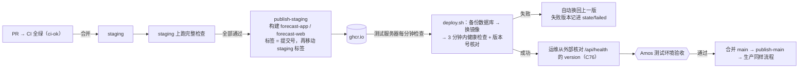

- 发布、回滚、手动发布（Actions 不可用时 `deploy/manual-publish.sh`）全部沿用 falconx-lite（部署方案第 10、20 节）。
- **被跳过的失败版本怎样重新部署**（C77）：失败记录在服务器 `/opt/forecast/state/failed`，环境问题修好后删掉对应行，`deploy.sh` 下一分钟会再试；遇到新版本一直没上线时第一时间告诉 Amos。
- **数据库迁移只往前走**：每次更新前自动备份；迁移脚本要兼容上一版代码（回滚到上一版镜像时还能运行）。
- **合并后确认发布成功**（C76）：每次合并到 staging / main 后，看那一次 CI 运行和推镜像的结果，再从外部核对健康检查的 `version`。
- 生产发布的触发（推 `main` 标签后服务器自己拉）在生产首次部署前写进部署方案，交 Amos 确认。

### 11.6 备份

| 数据 | 测试 | 生产 |
|---|---|---|
| MySQL | 每天凌晨 + 每次更新前，本机保留 7 天（沿用 `backup.sh`） | RDS 自动备份（保留 7 天、可按时间点恢复）+ 每天一次逻辑导出到 OSS，保留 30 天；**上线前做一次恢复演练**（恢复到临时实例，跑对账） |
| 对象存储（证件、截图） | 本机目录 | OSS 开版本控制，删除保留 30 天 |
| 服务器 `.env` | 由 Amos 自己保存在密码管理器 | 同左 |
| 镜像 | 保留最近 10 个版本 | 同左 |

彩池、账本、裁决记录永久保留（NF-09），不做按时间清理。

### 11.7 外部探测、域名、TLS、CDN
- **外部可用性探测**：现在不开；**第一次部署测试环境、第一次部署生产环境时各问 Amos 一次**（《运维工程师》3.7），说明它是 GitHub 定时访问健康检查、失败发邮件，默认每 15 分钟。
- **域名**（NF-11、第 15 节 v1.1）：上线前用 `quickcome.online` 的子域名（测试环境建议 `fc-test` 前缀，不和 falconx-lite 已用的重复）；正式上线前换成独立域名，由 Amos 注册；子域名 `app`、`admin`、`www`（根域名跳 `www`）；发信用子域名 `email.<域名>`，发信地址必须用邮件服务商里验证过的那个域名（falconx-lite 踩过的坑）。
- **TLS**：源站 Let's Encrypt 证书（certbot 自动续期，沿用）；开 Cloudflare 代理时设 "Full (strict)"。
- **CDN**（AQ-8）：建议 Cloudflare 免费版开代理：静态资源（三个前端的 JS、CSS、图片）缓存在边缘，全球用户首屏更快（NF-04）；WebSocket 经 Cloudflare 代理可用【二手：Cloudflare 文档，未在本项目实测】。开代理后：Nginx 用 `set_real_ip_from`（Cloudflare 公布的 IP 段）+ `real_ip_header CF-Connecting-IP` 取真实 IP，**再**用 `$remote_addr` 覆盖 `X-Forwarded-For`（沿用安全基线）；云防火墙 80/443 只放行 Cloudflare 的 IP 段，否则别人可以绕过 CDN 直连伪造来源。不开代理时和 falconx-lite 一样只用 Cloudflare 的 DNS。
- **NF-04 首屏 ≤ 3 秒的测法**：上线测试环境后，用 WebPageTest 之类的公开测速（4G 档）从服务器所在地以外的至少 2 个地区（例如东京、法兰克福）各测 3 次市场列表首屏，取中位数，写进测试报告【推断：具体工具在测试方案里定】。

---

## 12. CI（C74，只写方案，不建 workflow 文件）

### 12.1 job 结构（`.github/workflows/ci.yml` 草案，按 `agents/模板/ci.yml` 和 falconx-lite `ci.yml` v0.10）

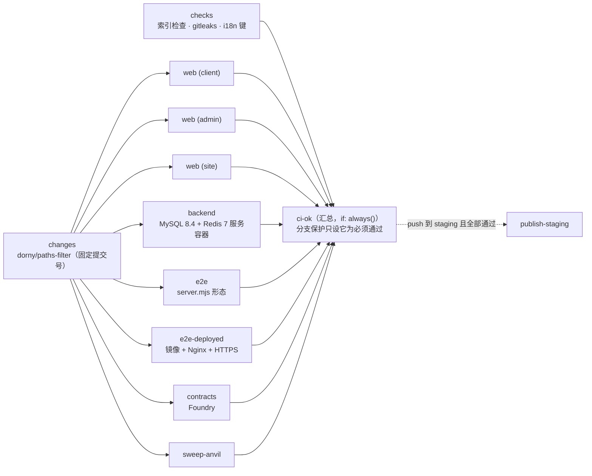

| job | 做什么 | 什么时候跑（PR 上） | 超时 |
|---|---|---|---|
| `changes` | 判断改动路径 | 每次 | 5 分钟 |
| `checks` | `node scripts/check-project-index.mjs`；gitleaks（`gitleaks/gitleaks-action@v2`，`fetch-depth: 0` 扫 PR 的提交）；`node scripts/check-i18n.mjs` | 每次（只改文档时只跑它） | 10 分钟 |
| `web (client)` / `web (admin)` / `web (site)` | `npm ci`、lint、vitest、real 构建、`check-no-mocks.mjs`、`check-brand.mjs`、mock 构建（原型） | 改到对应前端或共用脚本 | 15 分钟 |
| `backend` | `mvn -B -ntp verify`（单元测试、真实 MySQL 上的集成测试、ArchUnit 模块边界、`BrandTextTest`、守恒性质测试） | 改到 `backend/`、`deploy/`、`contracts/` | 25 分钟 |
| `e2e` | 后端 e2e profile + 两个前端 real 构建 + Playwright 主流程（替身数据源、替身链） | 改到后端、部署、合约、`e2e/` | 30 分钟 |
| `e2e-deployed` | 构建两个镜像，按 `deploy/kit/docker-compose.yml` + `e2e/compose.deployed.yml` 启动，经 Nginx、HTTPS 跑同一份用例 + 路由检查 | 改到 `deploy/`、`.dockerignore`、`e2e/run-deployed.sh`、`e2e/compose.deployed.yml` | 30 分钟 |
| `contracts` | `check-vendor.sh`、`forge test`、覆盖率 100% | 改到 `contracts/` | 15 分钟 |
| `sweep-anvil` | anvil 本地链上真实合约 + 后端充值入账和归集 | 改到 `contracts/`、`backend/**/wallet/**`、迁移脚本 | 20 分钟 |
| `ci-ok` | 任何一项 failure / cancelled 就失败；跳过算通过 | 每次 | 2 分钟 |
| `publish-staging` | 只在 push 到 staging、前面全部真正通过时；推镜像、保留 10 个版本、等测试环境换版本（最多 15 分钟） | 不在 PR 上 | 30 分钟 |

- **路径过滤**：在同一个 workflow 里用 `changes` job 判断，**不用顶层 `paths:`**；改到 `.github/**` 时全部都跑；push 到 `staging`、`main` 和手动运行时不看路径、全部都跑（C74）。
- **缓存**：Maven（`setup-java` 的 `cache: maven`）、npm（`setup-node` 的 `cache: npm`，三个 lock 文件）、Playwright 浏览器（`actions/cache`）、Docker 构建层（buildx `type=gha`，`e2e-deployed` 和 `publish-staging` 共用 scope）。
- **并发**：PR 按分支分组、新推送取消旧运行；push / 手动按分支分组、**不取消**（正在发布的不会被打断，沿用 falconx-lite 的写法）。
- **不需要任何密钥**：外部服务用替身；数据库用 CI 的服务容器（C37）；测试里的假值用 `ci_only_` 前缀，避免被 gitleaks 误报（falconx-lite 踩过的坑）。
- **定时任务**：不开。外部探测见第 11.7 节。
- **Actions 用量**：仓库公开还是私有由 Amos 处理（FQ-12）；私有时每月检查一次用量，超过 70% 提醒 Amos（C74 第 6 条）。

### 12.2 本阶段已建的部分
- `scripts/check-project-index.mjs`：从 agents `工具/` **原样复制**（v1，2026-10-01），本地 `node scripts/check-project-index.mjs` 跑通【实测 2026-10-24】。
- `项目索引.config.json`：现在检查全部文档、`assets/`、`scripts/`；数据库表和环境变量两类名单已配好（来源是将来的 `backend/src/main/resources/db/migration/` 和 `deploy/`，现在为空，所以通过）。
- `ci.yml` 在架构审核通过后的第一个代码 PR（S1）里建，第一次运行变绿后由运维分步指导 Amos 设分支保护（只设 `ci-ok`，勾选"不允许绕过"，开小 PR 检验），仓库是否能开分支保护由 Amos 处理（FQ-12）。

### 12.3 代码建立后索引检查要补的
`files.include` 补 `backend/pom.xml`、`backend/src/main/resources/**`、`web/*/package.json`、`e2e/**`（测试代码按文件列）、`deploy/**`、`contracts/src/**`、`contracts/script/**`；业务代码按模块和包列在《项目索引》里，不放进 include（C53 v0.9）。`lists` 补：接口（`@(Get|Post|Put|Delete)Mapping`）、权限点（`@RequiresPermission`）、定时任务（`@Scheduled` 所在类）、通知模板编号（迁移里的 `INSERT INTO notify_template`）。

---

## 13. 安全

| 项 | 做法 |
|---|---|
| 热钱包和密钥 | 热钱包私钥、归集发起账户私钥、VAPID 私钥、SMTP 密码、数据源 key、数据库密码**只由 Amos 填进服务器 `.env`**（权限 600，root 可读），不进仓库、不经过 AI、不进日志和审计（C21）；需要 Amos 输入时用 `nano` 编辑 `.env`，不用会被控制台 AI 助手接管的交互提示（falconx-lite 踩过的坑）。截图前提醒打码 |
| 充值地址 | 服务器只有 xpub（沿用）；合约充值地址只能把钱转进 Amos 的 Safe 冷钱包（沿用归集第一阶段） |
| 后台 | 独立域名、独立 Cookie；IP 白名单（生产）；登录按 IP 15 分钟 20 次；权限点每个接口必须声明；高危操作原因必填、勾选确认、写审计（前 → 后）；首次登录强制改密码；2FA 推迟（需求 1.4） |
| 一个人完成（RQ-17） | 不做"提议人不能确认"的检查；每一步都写审计，平台裁决照常公示和争议 |
| 限流 | 沿用 Nginx 外层 + 后端三层（IP 每分钟 600、WebSocket 握手每分钟 120、按客户写接口每分钟 60、后台登录）；下注、提交争议加 `@UserWriteLimited`；Redis 不可用时放行 |
| 跨站和路径 | 沿用 `CrossSiteGuard`（写请求只接受本站页面、路径不能带分号）；Nginx 正则拦截后台接口和 `/api/e2e/` |
| 审计 | 沿用 `Audit.run`；上架、提议、确认、退回、争议、作废、补偿、费率修改、参数修改的业务记录本身只增不改（第 3.1 节） |
| 端到端替身 | 只在 e2e profile；`E2eGuard` 发现真实密钥、节点、SMTP 时拒绝启动（沿用） |
| 数据源 key | 只在请求头里传（API-Football 的 `x-apisports-key` 等），存档的请求地址不带 key |
| 依赖 | `npm audit`、Maven 依赖检查，没有已知高危漏洞 |

**环境变量清单**（只写变量名；值由 Amos 填。复制时 falconx-lite 的 `FX_*` 全部改为 `FC_*`）：

| 类别 | 变量 | 谁填 |
|---|---|---|
| 域名和证书 | `APP_DOMAIN`、`ADMIN_DOMAIN`、`WWW_DOMAIN`、`CERT_EMAIL` | Amos |
| 数据库、Redis | `FC_DB_URL`（生产 RDS 地址）、`FC_DB_USERNAME`、`FC_DB_PASSWORD`、`MYSQL_ROOT_PASSWORD`（只有容器 MySQL 时）、`FC_REDIS_HOST`、`FC_REDIS_PASSWORD` | Amos（`init-env.sh` 可生成随机值） |
| 应用 | `FC_ENV_LABEL`（只在测试环境）、`FC_VERSION`（镜像构建时写入）、`FC_ID_NODE`、`FC_COOKIE_SECURE`、`FC_ADMIN_INIT_USERNAME`、`FC_ADMIN_INIT_PASSWORD`、`FC_ADMIN_IP_ALLOWLIST`（生产后台白名单；名字以复制后的代码为准） | Amos |
| 邮件 | `FC_MAIL_HOST`、`FC_MAIL_PORT`、`FC_MAIL_SECURITY`、`FC_MAIL_USERNAME`、`FC_MAIL_PASSWORD`、`FC_MAIL_FROM`、`FC_ALERT_EMAILS`、`FC_RISK_ALERT_EMAILS` | Amos |
| 推送 | `FC_PUSH_VAPID_PUBLIC_KEY`、`FC_PUSH_VAPID_PRIVATE_KEY`、`FC_PUSH_VAPID_SUBJECT` | Amos（测试、生产各一对） |
| 存储 | `FC_STORAGE_DIR`（测试）；`FC_OSS_ENDPOINT`、`FC_OSS_BUCKET`、`FC_OSS_ACCESS_KEY_ID`、`FC_OSS_ACCESS_KEY_SECRET`（生产，用只能访问这个桶的 RAM 子账号） | Amos |
| 钱包 | `FC_WALLET_ETH_XPUB`、`FC_WALLET_TRON_XPUB`、`FC_WALLET_ETH_RPC_URL`、`FC_WALLET_BSC_RPC_URL`、`FC_WALLET_TRON_RPC_URL`、`FC_WALLET_ERC20_USDT_CONTRACT`、`FC_WALLET_BSC_USDT_CONTRACT`、`FC_WALLET_TRC20_USDT_CONTRACT`、`FC_WALLET_ERC20_CHAIN_ID`、`FC_WALLET_BSC_CHAIN_ID`、`FC_WALLET_ETH_HOT_KEY`、`FC_WALLET_TRON_HOT_KEY`、`FC_WALLET_ETH_HOT_ADDRESS`、`FC_WALLET_TRON_HOT_ADDRESS` | Amos（私钥只由 Amos） |
| 归集 | `FC_SWEEP_EVM_FACTORY`、`FC_SWEEP_EVM_IMPLEMENTATION`、`FC_SWEEP_EVM_PARENT`、`FC_SWEEP_EVM_BATCHER`、`FC_SWEEP_EVM_OPERATOR_ADDRESS`、`FC_SWEEP_EVM_OPERATOR_KEY` | Amos（合约地址是公开地址；发起账户私钥只由 Amos） |
| 数据源 | `FC_SRC_API_FOOTBALL_KEY`、`FC_SRC_FOOTBALL_DATA_TOKEN`、`FC_SRC_BALLDONTLIE_KEY`、`FC_SRC_API_NBA_KEY`、`FC_SRC_BINANCE_BASE_URL`（默认 `https://data-api.binance.vision`）、`FC_SRC_OKX_BASE_URL`、`FC_SRC_COINBASE_ENABLED`（默认 false） | Amos（key）；地址有默认值 |
| Nginx 限流 | `FC_NGINX_API_RATE`、`FC_NGINX_API_BURST`、`FC_NGINX_API_CONN`、`FC_NGINX_WS_RATE`、`FC_NGINX_WS_BURST`、`FC_NGINX_WS_CONN` | 镜像里有默认值，不用填 |
| CI | `FC_STAGING_APP_URL`（GitHub 仓库 Variables，不是密钥） | Amos 在仓库设置里填 |
| **不能设** | `SPRING_PROFILES_ACTIVE=e2e`、`FC_E2E_ENABLED` | — |

---

## 14. 数据源和第三方费用核算

### 14.1 调用量估算【推断】

| 数据源 | 用途 | 估算方法 | 每天 | 每月 |
|---|---|---|---|---|
| 币安 K 线 | 加密裁决（主） | 2 币种 × (96 个 15 分钟 + 24 个 1 小时) = 240 个市场/天，每个 1 次（失败重试另计，按 ×1.5） | 约 360 | 约 1.1 万 |
| OKX K 线 | 加密裁决（备） | 同上 | 约 360 | 约 1.1 万 |
| API-Football | 足球赛程 + 结果 | 赛程：每天 7 次（未来 7 天按日期取）；结果：按日期批量取，比赛日每 5 分钟一次、按每天约 10 小时有比赛算 120 次；单场补查约 50 次 | 约 180（高峰日约 300） | 约 5,500 |
| football-data.org | 足球结果（备） | 按日期批量取，每 5 分钟一次、约 10 小时 | 约 120 | 约 3,600 |
| balldontlie | NBA 赛程 + 结果（主） | 赛季期间按日期批量取，每 5 分钟一次、约 8 小时 + 赛程 | 约 110 | 约 3,300 |
| API-NBA | NBA 结果（备） | 同上 | 约 100 | 约 3,000 |
| 邮件 | 验证码、充值、提现、KYC、退款等（结算不发邮件） | 1,000 个活跃客户，每人每月约 5 封【推断】 | — | 约 5,000 封 |

### 14.2 每月费用

| 项 | 档位建议 | 每月 | 依据 |
|---|---|---|---|
| 币安、OKX、Coinbase K 线 | 公开接口，不要 key | 0 | 【实测 2026-10-24】可访问；限频【未核实】，按上表用量远低于常见限额【推断】 |
| API-Football | Pro：每天 7,500 次（免费档每天 100 次不够） | 约 19 美元 | 【二手：api-football.com 新手指南（搜索摘要）】；官网定价页 403 打不开；是否允许商用、比分修正规则【未核实】 |
| football-data.org | 先用免费档（每分钟 10 次、12 个赛事，比分有延迟）；需要更多赛事时 Standard €49 | 0（或 €12～49） | 【证实：football-data.org/pricing（工具摘要）】；免费档比分延迟多久、是否允许商用【未核实】 |
| balldontlie | All-Star（每分钟 60 次） | 9.99 美元 | 【证实：balldontlie.io（工具摘要）】；免费档是否包含比分接口【未核实】 |
| API-NBA（api-sports） | 免费档每天 100 次够用；不够时 Pro | 0（或约 15～19 美元） | 【二手：RapidAPI 列表（搜索摘要）】 |
| 邮件服务商 | 例如 Resend（falconx-lite 在用） | 0～20 美元 | 免费额度和价格【未核实】 |
| 链节点（Alchemy、TronGrid） | 免费档起步 | 0～49 美元 | 【未核实】；falconx-lite 在用 |
| 测试服务器 | SWAS 2 核 4 GB | 19 美元 | 第 11.2 节 |
| 生产 | P1：ECS + RDS + OSS | 约 150～285 美元 | 【未核实】 |
| | P2：SWAS 4 核 16 GB | 70 美元 | 【证实：官网定价页（工具摘要）】，实际价格【未核实】 |
| Cloudflare | 免费版 | 0 | |
| 域名 | .com | 约 1 美元（每年约 10～15 美元） | 【未核实】 |
| GitHub | 公开仓库或现有套餐 | 0 | FQ-12 |
| **合计**（不含服务器） | | **约 30～110 美元/月** | 和需求 4.3"每月 30～100 美元"的估计一致 |
| **合计**（含 P1 生产 + 测试） | | **约 200～415 美元/月** | |

数据源**商用授权**由 Amos 购买前看各家的条款（需求第 15 节），研发在 S6、S8 接入时把实际限额、比分修正方式实测一次写进技术方案（C39）。

---

## 15. 品牌名和域名方案（RQ-19）

**v1.1 口径（Amos 2026-10-25，需求说明书 v1.2）：上线前沿用 Quick Come 名称和 quickcome.online 子域名；正式上线前改为独立品牌和域名，隔离要求（服务器、数据库、钱包、发信域名等）不变。**
Amos 原话："我有起名困难症，所以很多项目在上线前我都会用 quick come这个名字，域名也会用quickcome.online的子域名，只有正式上线时，才需要改名和域名，这点可以记下来 我总会这样做"。

| 阶段 | 品牌名 | 域名 | 说明 |
|---|---|---|---|
| 原型、测试环境（上线前） | **Quick Come** | `quickcome.online` 的子域名，具体由运维在部署方案里定（S12）。建议用 `fc-test` 前缀，例如 `fc-test.quickcome.online`（客户端）、`fc-test-admin.quickcome.online`（后台）、`fc-test-www.quickcome.online`（官网）；**不能和 falconx-lite 已用的 `test-app` 等子域名重复** | 代码里的品牌名已改（S2）：`web/*/src/lib/brand.ts`、各 `index.html`、PWA 名称、`push-sw.js`、通知模板（迁移 V8）。`scripts/brand-check.json` 里 Quick Come 的检查关闭，FalconX 的检查打开 |
| 正式上线 | 独立品牌（下面的候选，正式上线前再定） | 独立域名 | 改名步骤见 `web/client/src/lib/brand.ts` 的说明；改完把 Quick Come 的检查打开 |

上线前和 falconx-lite 用同一个上级域名时要注意的地方：
- **隔离要求不变**（NF-11、AC-73）：服务器、数据库、热钱包和冷钱包、推送密钥都和 falconx-lite 分开；发信域名也要分开（例如 `fc-email.quickcome.online` 之类，由运维在部署方案里定，邮件服务商里单独验证），不能用 falconx-lite 正在用的发信子域名。
- 浏览器把同一上级域名下的子域名都当成"同站"：登录 Cookie 的 SameSite 挡不住 falconx-lite 页面发起的请求。本项目已有两道保护：Cookie 只发给本域名（不设 Domain，名字是 `fc_session` / `fc_admin_session`，和 falconx-lite 不同），写请求只接受本站页面发起（`common/web/CrossSiteGuard` 按 `Sec-Fetch-Site` / `Origin` 判断，项目地图约定 14）。不要给 Cookie 加 `Domain=quickcome.online`。
- 证书按子域名单独申请（certbot），不和 falconx-lite 共用证书文件。

正式上线用的品牌候选（v1.0 时研发按 RQ-19 先给，**PM 和市场经理可以替换**；正式上线前再定）。选名原则：好读、和"奖池"有关、不暗示"庄家"、.com 看起来没被注册。

| 方案 | 品牌名 | 含义 / 标语草稿 | 域名 | 撞名检查 |
|---|---|---|---|---|
| ①（推荐） | **Poolsay** | "Pool + say：奖池说了算"。标语草稿 *Let the pool decide.* / "奖池说了算，平台不坐庄" | `poolsay.com`；备选 `poolsay.io`、`poolsay.app` | 网页搜索 "Poolsay" 没有同名产品或公司（只有不相关的 Poolsafe、Poolify）【证实：2026-10-24 搜索】；`.com`、`.io`、`.app` 注册局 RDAP 查询都返回"不存在"（404）【实测 2026-10-24】；`.xyz` 已被注册 |
| ② | **Larkpool** | "Lark（云雀，也有'乐子'的意思）+ pool"，轻松、不像博彩 | `larkpool.com`；备选 `larkpool.app`、`larkpool.xyz` | 搜索没有同名产品（只有利物浦 Lark Lane 等地名）【证实：2026-10-24 搜索】；`.com`、`.app`、`.xyz` RDAP 返回 404【实测】；`.io` 查询被限流，未知 |
| ③ | **Poolvane** | "Pool + vane（风向标）：看奖池就知道风向"，和"概率为主"的显示呼应 | `poolvane.com`；备选 `poolvane.io`、`poolvane.app` | 搜索没有同名（只有泳池清洁器叶片 Powervane 等）【证实：2026-10-24 搜索】；`.com`、`.io`、`.app`、`.xyz` RDAP 返回 404【实测】 |

- **能不能注册、价格多少【未核实】**：RDAP 返回 404 只说明注册局里还没有这个名字，可能是保留词或溢价域名；**请 Amos 在注册商（例如 Cloudflare Registrar、Namecheap）实际查询并注册**，注册后 DNS 放在 Cloudflare（第 11.7 节）。
- 商标是否可用不在本方案范围（合规问题不讨论）。
- 还查过、.com 已被注册的：parimo、poolcall、callpool、pickpool、tallypool、potcall、oddpool、sharepool、parifi、poolwise、fairpool 等 40 多个（RDAP 返回 200）。
- 推荐 Poolsay：最短、读音直接、"奖池说了算"正好对应"平台不当庄、赔率由奖池决定"的卖点；中文可以叫"池说"或只用英文名（PM 定）。
- 代码里不写品牌名（AQ-4）：品牌只在 `web/*/src/lib/brand.ts`、PWA 名称、通知模板、官网文案里，换品牌只改这几处。

---

## 16. 开发计划

按分步执行模式（C63）：每步一个分支、一个 PR，合并到 staging 前 CI 全绿。**主线"充值 → 押注 → 结算 → 提现"在 S5 打通**（S5 时结果由超管手工确认，自动裁决在 S6 之后接上）。工作量是估计（小 1～3 人天、中 4～10、大 10 以上）。


| 步骤 | 内容 | 主要验收 | 工作量 |
|---|---|---|---|
| M0 | 本架构方案；项目地图 / 索引、索引检查脚本 | Amos 审核（合并节点 ①） | — |
| M1 | 按选定风格画效果图（HTML/CSS 截图）；客户端、后台、官网 mock 原型部署到 Vercel 预览 | Amos 原型确认 | 大 |
| S1 | 第 1.4 节复制步骤；`ci.yml`；基线迁移 V1～V5；残留扫描；分支保护 | 剩余测试全绿、品牌检查通过 | 中 |
| S2 | `ledger` 模块；`Bucket`、流水类型；平台账户；提现、冲正改口径 | 账本合计 = 余额；AC-60 原有测试 | 中 |
| S3 | `market`：表、状态机 17 条边、上架检查、补充说明、提前截止、费率修改 + 记录、截止和事件结束任务、租约 | AC-10～AC-14、AC-37 前半 | 中 |
| S4 | `pool`：下注事务、拒单原因、赔率计算（共用向量）、WebSocket 推送 | AC-15～AC-19、AC-70 预压测 | 中 |
| S5 | `settle`：结算三段、退款、E1/E3/E4/E14/E15、彩池对账、平台收入；**超管手工填结果直接结算**（临时入口，S7 换成正式裁决台）；主线 e2e | AC-20～AC-26、AC-38、AC-39、AC-71 | 大 |
| S6 | 加密自动生成模板；`CandleSource` 三个适配器；网关（超时、重试、熔断、存档）；自动裁决 | AC-27～AC-29 | 中 |
| S7 | 裁决台（提议、确认、退回、作废、结算预览）；公示期满；争议；补偿 | AC-30～AC-36 | 大 |
| S8 | 赛程生成草稿；两源编号对应；体育自动裁决；E6、E7 | 体育部分的 AC-29 | 中 |
| S9 | 22 个客户模板 + 管理员模板（三语）；后台通知页 | AC-58、AC-59 | 中 |
| S10 | `riskalert`；关联账户；自动审批 R8～R15 改造；员工账户；KYC 阈值 | AC-62～AC-68 | 中 |
| S11 | 客户端接真实接口：列表、详情、下注（两套结构）、我的下注、争议、资产改动、三语、主题、新手引导；官网内容 | AC-50～AC-57 | 大 |
| S12 | 测试环境（按第 11 节）；部署形态 e2e；下注压测、大市场结算压测；首次部署问 Amos 外部探测 | AC-70～AC-73、测试环境验收 | 中 |

---

## 17. 测试策略

| 层 | 内容 | 在哪里跑 |
|---|---|---|
| 单元（纯函数） | `SettleMath`、`Odds`、`PoolMath`（第 4.5 节的例子、费率 8%、尾差边界）；`MarketStateMachine`（17 条边通过、其余 10×10 − 17 种组合全部拒绝，AC-10）；三种语言选择规则；前端 `lib/pool.ts`（共用 `pool-vectors.json`） | CI `backend`、`web (client)` |
| **性质测试（守恒）** | 固定种子随机生成 1,000 个市场（2～10 个选项、1～500 个下注、金额 1～5,000 两位小数、费率 0%～20%），每个市场：Σ派彩 + Σ抽成 + 尾差 = T；0 ≤ 尾差 < 0.01 × 赢方持仓数；平台变动 = 抽成 + 尾差 ≥ 0；没人押赢方 → 作废（AC-21、AC-22）；另加 10 万个市场的长跑版（本地和 staging 运行，不在每个 PR 上跑） | CI `backend` |
| 集成（真实 MySQL 8.4，C37） | 下注并发：同一客户余额 100、20 线程各押 10 → 恰好 10 笔成功（AC-18），上限同理；截止竞争（可调时钟，`T−1 ms` 成功、`T` 拒绝，AC-15）；结算幂等：3 次并发触发只派一次（AC-23）；结算中途"崩溃"（在第 N 批抛异常）后重启续跑，结果和一次跑完相同；死锁检查（混合下注、结算、提现 1 分钟）；彩池对账发现人为篡改（AC-38）；多实例租约（两个应用上下文同时跑任务） | CI `backend` |
| 外部调用（C81） | 每个数据源适配器的超时、断开、5xx、格式错误、熔断、存档；两源不一致转人工（AC-29） | CI `backend` |
| 端到端（Playwright，C67、C79、C80） | 主流程：390 宽手机注册 → 替身链充值到账 → 新手引导 → 押加密市场 → 替身数据源触发自动结算 → KYC → 提现；电脑上平台裁决 → 公示 → 争议 → 改判 → 补偿；取消 / 作废退款；首屏按钮检查（四种尺寸）；三语和主题切换；不闪动；共用框架位置一致（C90） | CI `e2e`（server.mjs 形态）、`e2e-deployed`（镜像 + Nginx + HTTPS） |
| 部署后 e2e | 和 falconx-lite 一样：`publish-staging` 等测试环境换上新版本后，运维从外部跑 `deploy/verify.sh`（版本号、HTTPS、三个域名路由、后台接口在客户端域名被拦、管理端口不通）；测试工程师在测试环境跑自动化检查后交 Amos 验收（C34） | staging 合并后 |
| 压测 | `e2e/load/`：下注 200 笔/秒 × 5 分钟（单市场 100），p99、错误率、结束后对账（AC-70）；10,000 持仓市场结算 ≤ 60 秒（AC-71）；同样的镜像和 compose，容器绑核模拟服务器规格 | 本地 / 压测机，不在 CI |
| 页面走查（C42～C45、C50） | 每个页面 5 种状态（空、有数据、超过一页、慢、出错）；数字和数据库核对；角色走查（客户、运营、裁决员、财务、超管） | 测试阶段 |

AC 和测试的对应在测试方案（测试工程师）里逐条列出；本方案保证每条 AC 都有可测的入口（可调时钟、替身数据源、替身链、`/api/e2e/**` 注入）。

---

## 18. 推广功能占位（待 MF 结论）

市场策略还在重写，推广功能（MF）没有定。架构里**只留扩展点，不做功能、不建表**：

| 扩展点 | 现在怎么留 | 以后可能用于 |
|---|---|---|
| 来源统计 | 客户端路由层有一个 `captureAttribution()` 钩子（现在什么都不做）；注册接口的请求体允许带可选的 `attribution` 对象（现在后端忽略，不存） | MF-1 来源统计、MF-2 渠道码 |
| 分享卡片 | 预留 `/m/{publicNo}` 这个对外链接格式（现在跳市场详情）；Nginx 留一段 location，以后由后端生成 Open Graph 页面和分享图 | MF-3 市场分享卡片、MF-10 战绩卡 |
| 不登录浏览 | 市场列表、详情接口按"公开 / 需登录"拆开写，开关 `forecast.public-browse.enabled` 默认关（需求现在要求登录） | MF-4 |
| 已结算公开记录 | 结算单、裁决记录已经有全部数据（第 3.3 节），以后加一个只读列表接口即可 | MF-7 |
| 渠道推送 | 通知模块的渠道是可扩展的（现在只有站内信、推送、邮件） | MF-6 Telegram 频道 |
| 返佣、排行榜 | 账本流水类型可以新增（例如 `REFERRAL_REWARD`），不影响奖池和守恒 | MF-9、MF-11 |

**待 MF 结论**：以上都不在第一期范围内（需求第 1.4、1.5 节），等 PM 按市场经理的结论修订需求后再进入开发。

---

## 19. 需要 Amos 决定的问题

| 编号 | 问题 | 选项 | 建议 | 理由 |
|---|---|---|---|---|
| **AQ-1** | 服务器的云厂商和地区（H0） | 新加坡 / 香港 / 东京 / 美国 | **阿里云新加坡** | 面向全球、华语用户延迟可接受；流量单价比香港低约一半；美国访问币安主站受限（实测 451）。选定后在服务器上实测各数据源接口 |
| **AQ-2** | 生产数据库 | P1 托管 RDS + OSS / P2 单机容器 MySQL | **P1** | 资金系统，托管数据库有自动备份、按时间点恢复、主备切换；符合《云服务器》H6 的默认 |
| **AQ-3** | 结算的事务边界（需求 3.5 写"同一个事务"） | A 一个事务派完 / B 先算好落结算单、再分批派彩（第 4.3 节） | **B**（**已定：B**，Amos 2026-10-25 回复"AQ3 同意"；S5 默认每批 500，A 保留为 `batch-size = 0`） | 10,000 个持仓放一个事务会锁住所有赢家的账户十几秒，期间他们在别的市场下注、提现都会卡住；B 在钱动之前已经算好并通过守恒校验，每一步幂等、可续跑；代价是客户在几秒内看到"结算中"（X-2） |
| **AQ-4** | 内部代码名 | 用 `forecast`（包 `com.forecast.app`、表、镜像、`FC_*`）/ 用品牌名 | **`forecast`** | 品牌可能变；falconx-lite 改品牌时内部名字没改，造成了两套名字。品牌只放前端和模板 |
| **AQ-5** | 品牌名 | **v1.1 已定（Amos 2026-10-25）：上线前沿用 Quick Come 名称和 quickcome.online 子域名；正式上线前改为独立品牌和域名，隔离要求（服务器、数据库、钱包、发信域名等）不变**。正式品牌的候选：Poolsay / Larkpool / Poolvane（第 15 节） | 正式品牌到上线前再定；v1.0 时的建议是 **Poolsay**（`poolsay.com`） | 短、好读、"奖池说了算"对应卖点；正式上线前请 Amos 在注册商确认能注册 |
| **AQ-6** | 主题风格方向（C65） | A 清爽数据 / B 赛场活力 / C 温暖奖池（第 10 节） | **A** | 最中性，主色和涨跌色分开，和头部产品一致 |
| **AQ-7** | 体育数据源 | 足球：API-Football Pro（主）+ football-data.org 免费档（备）；NBA：balldontlie All-Star（主）+ API-NBA 免费档（备） | **按左边**；NBA 备用源由需求里的 Sportradar（企业询价）改为 API-NBA | 两源一致才自动结算（RQ-15）；这一组每月约 30 美元；Sportradar 要询价、太重。Amos 购买前看商用条款 |
| **AQ-8** | CDN | 开 Cloudflare 代理 / 只用 DNS（同 falconx-lite） | **开代理** | 全球用户的静态资源走边缘，满足首屏 3 秒（NF-04）；源站 IP 不公开。需要 Nginx 改取真实 IP 的方式（第 11.7 节） |
| **AQ-9** | 迁移脚本 | 重建基线 V1～V5 / 复制 falconx-lite 的 V1～V32 再删表 | **重建基线** | 新库没有数据；32 个脚本里有大量差价合约表和改名，复制过来只会留下噪音 |
| **AQ-10** | 邮件服务商 | 新开一个 Resend 账号（falconx-lite 在用的同一家）/ 其他 | **新开 Resend 账号**，发信子域名 `email.<域名>` | 和 falconx-lite 完全隔离（NF-11），沿用已踩过坑的配置方法；账号和套餐请 Amos 确认（C27） |
| **AQ-11** | 第一期部署几个后端实例 | 1 个 / 2 个 | **1 个**（代码按多实例写） | 和 falconx-lite 相同；发布时约 30 秒到 1 分钟不可用，客户端自动重连；租约和条件更新已为多实例准备好 |
| **AQ-12** | 原型放在哪里 | 沿用 falconx-lite 用的 Vercel 团队（免费版）新建项目 / 其他 | **沿用同一个 Vercel 团队，新建项目** | 原型只给 Amos 看，用 mock 数据，不连任何后端；套餐请 Amos 确认 |
| **AQ-13** | 加密 K 线来源 | 币安 `data-api.binance.vision`（主）+ OKX（备）+ Coinbase（第三源，默认关）/ 只用币安和 OKX | **按左边，第三源默认关** | 实测三家都能访问；第三源只在主备一方长时间不可用时打开，减少转人工 |
| **AQ-14** | 生产后台 IP 白名单的来源 | Amos 固定出口 IP / 不加白名单改用 2FA | **加白名单**（NF-10 已写） | 需要 Amos 提供常用的出口 IP；IP 经常变时再讨论 |

---

## 20. 超出要求的部分（C7）

下面是研发在需求和 Amos 要求之外加的东西，**未经 Amos 确认前不当作已定的决定**：

| 编号 | 加了什么 | 理由 |
|---|---|---|
| X-1 | 账本账户加"平台收入""平台补偿支出"两个系统账户，补偿支出账户允许为负 | 抽成、尾差、补偿要能在账本里对上；补偿是平台自掏的钱，早期收入可能不够付 |
| X-2 | 结算分三段，市场上加内部字段 `settle_phase`，客户端在派彩的几秒内显示"结算中"（不是需求状态机里的新状态） | 见 AQ-3 |
| X-3 | 下注请求带 `clientReqId`，重复提交只算一次 | 下注不能撤销，双击或网络重试重复扣钱的后果严重 |
| X-4 | 奖池推送每个市场每秒最多一次（合并） | 高峰时每秒 100 笔下注，逐笔推送没有意义，也不满足"不闪动" |
| X-5 | 数据源熔断（连续 5 次失败停 60 秒） | 外部长时间故障时不反复打满超时，C81 的降级更快 |
| X-6 | 定时任务租约表 `common_job_lease` | 需求要求"多实例时任务不能重复"，第一期虽然单实例，代码先按多实例写 |
| X-7 | Coinbase 作为加密 K 线第三源（默认关闭） | 主备一方长时间不可用时可以手动打开，减少转人工 |
| X-8 | `ledger_entry.ref_market_id` 列 | 客户流水点到市场（AC-39）、彩池对账按市场合计 |
| X-9 | 截止任务用"市场行排他锁"做屏障，下注拿共享锁 | 保证截止时定格的奖池包含所有已接受的下注 |
| X-10 | 前后端共用一份赔率和结算的测试向量文件 | 防止客户端显示的预计回报和后端算的不一样 |
| X-11 | 新增 `scripts/check-i18n.mjs`（三语键名一致）；`check-brand.mjs` 同时查 FalconX 和 Quick Come | NF-12、FQ-9（不和 Quick Come 互相导流，页面上不能出现旧品牌） |
| X-12 | 两个体育数据源的比赛编号，由运营在生成草稿时确认对应关系 | 两源自动比较的前提；不确认就只能转人工 |
| X-13 | 原始返回存 sha256 和耗时 | 证明存档没被改过；排查数据源变慢 |
| X-14 | 推广扩展点（第 18 节）：注册接口可选 `attribution`、`/m/{publicNo}` 链接、公开浏览开关 | 只留接口形状，不做功能，等 MF 结论 |
| X-15 | 测试服务器从 2 核 2 GB 升到 2 核 4 GB | falconx-lite 2 核 2 GB 发生过内存耗尽卡死；本项目多了定时任务和推送 |

---

## 21. 风险和技术债

| 风险 | 影响 | 缓解 |
|---|---|---|
| 生产地区访问币安受限 | 加密自动裁决退化为单源 → 转人工 | 用 `data-api.binance.vision`；选地区后实测；OKX 备、Coinbase 第三源 |
| 体育两个源的比赛编号对不上 | 自动裁决失败多，人工量大 | 生成草稿时人工确认对应；上线后统计自动裁决成功率 |
| 单实例发布时短暂不可用 | 截止前 1 分钟内发布会让部分客户下不了注 | 发布安排在没有加密窗口截止的时刻做不到（每 15 分钟一次），所以**发布要快**（目标 < 60 秒）；客户端自动重连、重拉 |
| 热门市场 WebSocket 扇出 | 带宽 | 合并推送、CDN 承担静态资源、带宽按 20 Mbit/秒以上准备 |
| 复制时遗漏旧品牌或旧配置 | 客户看到 Quick Come / FalconX，或连到旧服务 | 第 1.4 节残留扫描 + CI 品牌检查 + 部署清单核对（AC-73） |
| 本方案的性能数字都是推断 | AC-70、AC-71 不达标 | S4、S5 就做小规模压测，不等到 S12 |

---

## 22. 未核实事项汇总

| 内容 | 由谁、什么时候核实 |
|---|---|
| 阿里云 SWAS、ECS、RDS、OSS 的实际价格和地区差价；RDS 是否支持 MySQL 8.4 | Amos 下单前；运维在部署方案里记录 |
| 服务器实际可用内存（`free -m`） | 开机后 Amos 截图 |
| 生产地区访问币安、OKX、Coinbase、API-Football、football-data、balldontlie、API-NBA 是否通、延迟 | 选定地区后在服务器上实测（C39） |
| OKX、币安公开接口的限频 | S6 接入时查文档并实测 |
| API-Football 价格（官网 403）、商用条款；football-data.org 免费档比分延迟和商用；balldontlie 各档包含的接口；API-NBA 价格 | Amos 购买前；研发 S6、S8 实测 |
| 邮件服务商、链节点的价格 | Amos 确认账号时 |
| 品牌域名能否注册、价格 | Amos 在注册商查询 |
| Cloudflare 代理下 WebSocket 的行为和超时 | S12 测试环境实测 |
| 下注、结算的性能数字 | S4、S5 小压测，S12 正式压测（AC-70、AC-71） |
| ShedLock 对 Spring Boot 4 的支持（本方案不用它） | 不需要 |

---

## 跨角色反馈 / 分歧记录

| 编号 | 提出方 → 接收方 | 内容 | 状态 |
|---|---|---|---|
| F-1 | 研发 → Amos | 需求第 3.5 节"结算同一个事务"和 NF-01 / NF-03 一起满足有困难，建议分批派彩 | 已定（AQ-3：B） |
| F-2 | 研发 → PM | 需求 4.3 体育备用源写的 Sportradar 需要企业询价，建议改为 API-NBA；PM 修订需求时同步 | 转 Amos（AQ-7） |
| F-3 | 研发 → PM | 品牌名候选（第 15 节）由研发先给，按总则品牌方向归 PM，PM 和市场经理可以替换或补充标语、色系 | 转 Amos（AQ-5） |
| F-4 | 研发 → PM | 第 10 节的主色是研发建议值；品牌主色定下后，研发按它重新派生两套 token 并重算对比度 | 已采纳（流程说明） |
| F-5 | 研发 → 测试 | 第 17 节的测试入口（可调时钟、替身数据源、`/api/e2e/**`）请在测试方案里逐条对应 AC | 已采纳（测试阶段跟进） |
