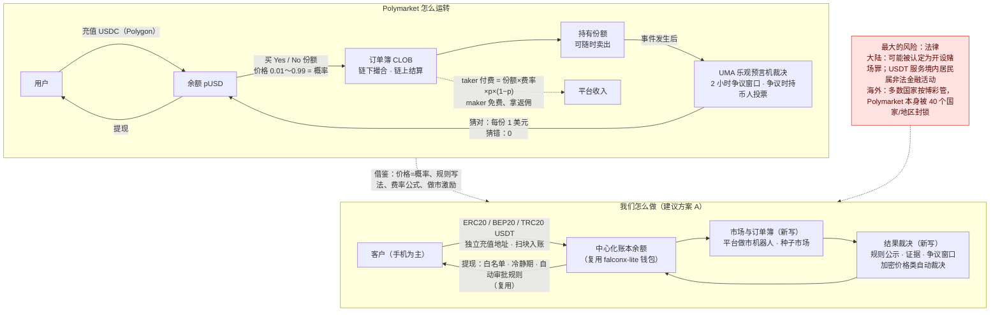
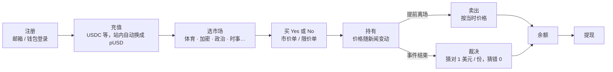
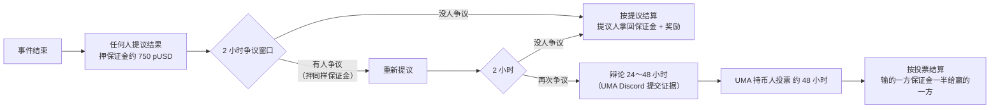
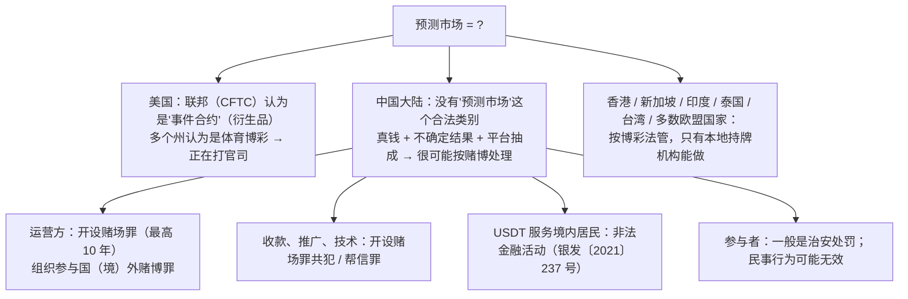
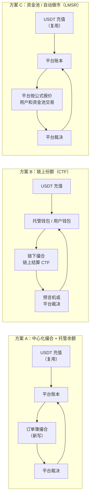
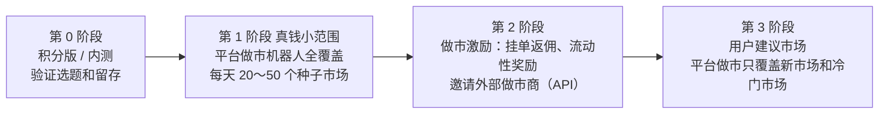
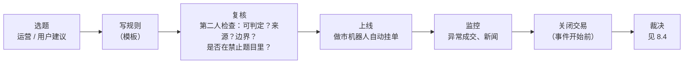

# Polymarket 调研分析报告（v1）

- 版本：v1.0（2026-10-24）
- 编写：产品经理（兼研究员）
- 依据：agents main `bd492c9`（《协作总则》v0.12、《产品经理》v0.12：C65 竞品调研、C66 调研标明出处、C82～C86 新项目默认做法、C73 对外发布由 Amos 决定）
- 需求来源：Amos 原话——"调研一下polymarket这个网站，我要做一个和它一样的，客户使用和falconx-lite项目相同的充值方式 充入稳定币 就可以在网站上参与预测游戏了。你调研一下这个网站，给我一个分析报告和一些方向，如何运营"
- 阶段：**调研**（还没有进入需求说明书、架构方案；本报告里的方向都是待 Amos 决定的建议）
- 变更历史：v1.0（2026-10-24）首次创建
- 读法：先看"一图看懂"和"一页结论"，再看第 9 节"需要 Amos 决定的问题"。其余章节是依据。

> **标注约定（C66）**
> - 【证实】：本次实际打开了一手或可靠来源的原文（链接见第 10 节）。
> - 【二手】：只看到了新闻、聚合站或搜索摘要，没有打开原始出处；当线索用。
> - 【推断】：根据资料推出来的判断，不是查到的事实。
> - 【未查到】：查了没有找到。
> - 所有日期按资料原文；"今天"指 2026-10-24。金额单位不写时是美元。
> - **本报告不是法律意见。** 第 6 节只列事实和选项，结论要以律师意见为准。

---

## 一图看懂

这张图想说明：Polymarket 的核心就是"用稳定币买卖 Yes/No 份额、价格即概率、事件发生后按结果兑付"。我们用 falconx-lite 的充值和提现做资金进出，中间新写市场、订单簿和裁决；技术不难，**难在法律和流动性**。

---

## 一页结论

| 问题 | 结论 | 依据 |
|---|---|---|
| **能不能做（技术）** | **能，而且快。** falconx-lite 已经有账户、KYC、三链充值、提现（白名单、冷静期、自动审批）、归集、账本、通知、后台权限审计。预测市场要新写的是：市场管理、二元份额的订单簿和结算、结果裁决、前端。按 falconx-lite 的节奏估计，方案 A 做到可在测试环境验收约 **6～10 周**【推断】。 | 第 7 节 |
| **能不能做（生意）** | **赛道已被验证，但头部集中、增速在换手。** Polymarket 2026 年 3 月月成交约 106 亿美元（DefiRate 口径）、年化收入超过 10 亿美元（公司对 CNBC 说，2026-06）；Kalshi 在受监管市场占约 75～79%，2026-09 起成交和估值都超过 Polymarket。链上小平台（Opinion、predict.fun、Limitless、Myriad）月成交从几千万到几亿美元不等，且有刷量质疑。新平台的机会在**细分用户（中文用户、手机、短周期、体育）和运营**，不在技术。 | 第 4、5 节 |
| **怎么做** | 建议 **方案 A：中心化撮合 + 托管余额**（最接近 falconx-lite，开发最快、体验最好）；流动性用 **"订单簿 + 平台自营做市机器人 + 种子市场"** 冷启动；裁决用 **"自己裁决 + 规则公示 + 争议窗口 + 加密价格类自动裁决"**。链上份额（方案 B）和资金池庄家模式（方案 C）作为后续选项。 | 第 7 节 |
| **怎么运营** | 第一批品类：**足球 / NBA 体育 + 15 分钟 / 1 小时加密涨跌 + 少量国际时事与娱乐**；**不做中国政治、不做涉及个人隐私和暴力的题目**。获客靠中文 KOL 和社群、"赔率即新闻"内容、邀请返佣；留存靠短周期市场、积分和排行榜。风控重点：内幕交易、操纵、刷量刷返佣、洗钱。 | 第 8 节 |
| **最大的风险** | **法律，尤其是面向中国大陆用户。** ①中国法律没有"预测市场"这个合法类别；用真钱对未来事件下注、平台抽成，很可能被认定为**赌博**，平台方面临**开设赌场罪**（情节严重 5～10 年）；帮着收款、推广、做技术的人可能按**共犯**或**帮信罪**处理。②用 USDT 向境内居民提供服务，按 2021 年人民银行等十部门的通知属于**非法金融活动**，境内员工和营销、支付、技术服务方要担责。③海外：新加坡、泰国、台湾、法国、英国等 40 个国家/地区被 Polymarket 自己封锁；印度 2026-05 封了 Polymarket；香港投资者及理财教育委员会 2026-04 公开提示可能属非法赌博；美国联邦和州在打官司。**Curaçao 等离岸博彩牌照不能让"向中国大陆提供服务"变合法。** | 第 6 节 |
| **建议的下一步** | ① 先找**中国刑事律师 + 离岸博彩律师**各出一份意见（FQ-1、FQ-2）；② 律师意见出来之前，只做**原型和"积分版（不用真钱）"**，不开放真钱充值；③ Amos 确认第 9 节 FQ 后，PM 写需求澄清问题和需求说明书，市场写《市场调研与推广策略》（C71）。 | 第 9 节 |

---

## 1. 调研范围和方法

- 范围：Polymarket 国际站（polymarket.com）和美国站（Polymarket US），以及 Kalshi、Limitless、Opinion、predict.fun、Myriad 五个竞品；中国大陆、香港、新加坡、美国、欧盟、印度的法律定性；离岸牌照选项。
- 方法：读 Polymarket 官方文档（docs.polymarket.com、help.polymarket.com）、CFTC 公告、最高人民法院 / 地方政府网站转载的法律文件；成交量和手续费用 DefiLlama 公开接口（2026-10-24 实际调用）和 DefiRate 统计页；其余用新闻交叉核对。
- 打不开的：DefiLlama 网页、predictionnews.com、bitcoinke.io、spp.gov.cn、gov.cn 原文页（403 或重定向循环），Kalshi 费率表 PDF（429）。这些已在第 10 节标出，改用其他来源或标【二手】。
- **局限**：沙箱出网在美国，没有从中国大陆、香港网络实际访问各平台；没有注册账号、没有实际下单；用户规模只有零星数据。

---

## 2. Polymarket 是什么、怎么玩

### 2.1 一句话
Polymarket 是一个用稳定币交易"事件结果"的市场：每个问题（例如"某队能否夺冠"）有 Yes 和 No 两种份额，价格在 0～1 美元之间，**价格就是市场认为这件事发生的概率**；事件结束后，猜对的份额每份兑付 1 美元，猜错的归零。【证实：help.polymarket.com 裁决页"Holders of winning shares receive $1 per share"】

### 2.2 用户流程

| 步骤 | 说明 | 标注 |
|---|---|---|
| 充值 | 2026-04-28 起，交易抵押品从 USDC.e 换成 **pUSD**（Polygon 上的 ERC-20，按 1:1 由 USDC 支持）；网站会自动把充值包装成 pUSD；充值、提现 Polymarket 本身不收费，但中间商可能收费。 | 【证实：手续费页"no fees for depositing or withdrawing"；pUSD 迁移见官方帮助中心标题 + 多家二手报道】 |
| 选市场 | 品类包括政治、体育、加密、金融、经济、文化、天气、科技、地缘政治、"Mentions"（某人是否会说某词）、组合（Combos，串关）等。 | 【证实：手续费页的品类表】 |
| 买 Yes / No | 订单簿交易，可挂限价单（maker）或吃单（taker）。 | 【证实】 |
| 价格 = 概率 | 例如 Yes 0.62 = 市场认为 62% 会发生。买 Yes 花 0.62，猜对得 1，赚 0.38；猜错亏 0.62。 | 【证实（机制）】 |
| 卖出 | 结算前随时可以按订单簿价格卖出，锁定盈亏。 | 【证实】 |
| 结算 | 由 UMA 乐观预言机裁决（见 3.3）；加密涨跌类用 Chainlink 价格自动裁决。 | 【证实：docs.polymarket.com/concepts/resolution】 |
| 提现 | 提回 USDC（pUSD 解包）。 | 【证实】 |

### 2.3 市场类型

| 类型 | 说明 | 例子 | 标注 |
|---|---|---|---|
| 二元市场 | 一个问题，Yes / No。 | "BTC 年底前会不会超过 X？" | 【证实】 |
| 多选（Negative Risk）市场 | 一个事件下多个互斥结果（只有一个会发生），每个结果是一个二元市场；系统把它们关联起来，**一份 No 可以换成其他所有结果的 Yes**，提高资金效率。 | "谁会赢得冠军？"（每支球队一个 Yes/No） | 【证实：CTF 文档 Negative risk 一节】 |
| 短周期加密涨跌 | 15 分钟（2025-10 国际站上线）、5 分钟（2026-02）比特币等涨跌；用 Chainlink 价格裁决，不走 UMA；**美国站 2026-09 也上线了 15 分钟比特币涨跌**。 | "BTC 接下来 15 分钟涨还是跌？" | 15 分钟、Chainlink 裁决【证实：官方裁决文档提到 Chainlink TWAP Up-Down】；上线日期【二手】 |
| 组合（Combos / 串关） | 多个市场打包成一注，统一费率 0.05、不返佣。DefiRate 统计 2026-09-24～10-23 组合类成交约 41 亿美元（按"实付金额"口径另算）。 | 体育串关 | 费率【证实】；成交【二手】 |
| 体育 | **成交最大的品类**：DefiRate 统计 2026-09-24～10-23 体育占 Polymarket 成交 53.5%（25 亿美元），加密 15.9%，政治只有 6.6%。 | 足球、NBA、NFL、世界杯 | 【二手：DefiRate 统计页，2026-10-24 更新】 |

---

## 3. 产品和机制拆解

### 3.1 订单簿和做市
- **混合式 CLOB**：订单在链下撮合（速度快、可撤单），成交在 Polygon 链上结算；2026-04-28 升级到 CTF Exchange V2，2026-10～11 正在推 Protocol V2（PositionManager 统一管理所有份额，支持二元、多选、组合三类模块；2026-11-02 计划把新市场切到 V2）。【证实：docs.polymarket.com CTF 概览、V2 迁移页；V2 时间表【二手：Cointelegraph】】
- **做市**：Polymarket 自己不做庄，流动性来自外部做市商和挂单用户；官方用两套激励吸引做市（见 3.6）。【证实】
- **启示**【推断】：订单簿要靠做市商才有深度。Polymarket 有大量专业做市商和 API 交易者；新平台没有，冷启动只能**自营做市**或改用资金池（见第 7 节方案 C）。

### 3.2 份额定价和"1 Yes + 1 No = 1"
- 底层是 Gnosis 的**条件代币框架（CTF）**：每个结果是一种 ERC-1155 代币。
  - **拆分（split）**：1 pUSD → 1 Yes + 1 No；
  - **合并（merge）**：1 Yes + 1 No → 1 pUSD；
  - **兑付（redeem）**：裁决后，赢的那一种每份换 1 pUSD。
  【证实：docs.polymarket.com/developers/CTF/overview。注意：文档写的是 pUSD，没有直接写"=1 USDC"，但 pUSD 按 1:1 由 USDC 支持，所以等价于"1 Yes + 1 No = 1 美元"】
- **为什么 Yes 价格 + No 价格 ≈ 1**：任何时候都可以花 1 拆出一对、或者把一对合回 1，所以两边价格之和偏离 1 就有无风险套利，被套利者拉回来。【推断（标准机制）】
- **撮合时的"铸造"**：买 Yes 的人出 0.62、买 No 的人出 0.38，两单可以直接配对，系统用这 1 美元拆出一对份额分给两人——这就是订单簿里"Yes 的买单 = No 的卖单"。【推断（CTF 交易所的通用做法）】
- **对我们的意义**：方案 A 不需要真的上链发代币，但**账本里要保持同样的守恒关系**：每个市场里"Yes 总份数 = No 总份数 = 锁定的抵押金额"，这是对账的核心约束（类似 falconx-lite 的账本守恒）。【推断】

### 3.3 结果裁决和争议
【证实：docs.polymarket.com/concepts/resolution、help.polymarket.com 裁决页】

- 投票结果可以是：提议方赢、争议方赢、"太早了"（事件还没结束）、"无法判断 / 50-50"（每份按 0.5 兑付，少见）。
- 时间：无争议约 2 小时；有争议总共 4～6 天。
- **规则高于标题**：每个市场以订单簿下方的"规则"为准（裁决来源、截止时间、边界情况）；平台可以发布"补充说明（Additional context）"，但不能改变问题的基本含义，补充说明会上链，UMA 投票人要参考。用户在 Discord `#market-review` 申请澄清。【证实：help.polymarket.com 澄清页（搜索摘要）+ 裁决文档】
- **公信力事件**：2025-03 "乌克兰是否同意美国矿产协议"市场（成交约 700 万美元）在协议没签的情况下被裁成 Yes，有报道指一个 UMA 大户用 3 个账户投了约 500 万枚 UMA（约占 25% 票数）；Polymarket 称"前所未有"，但**不退款**，理由是"不是市场故障"。【二手：The Block、The Defiant、Cointelegraph】
- **启示**【推断】：预言机投票并不天然公正，大户可以影响结果；我们自己裁决时，**公信力来自规则写清楚、证据公开、流程可申诉**，而不是"去中心化"这个标签。

### 3.4 市场怎么创建、规则怎么写
- **只有 Polymarket 的市场团队能建市场**，用户只能提建议；好的建议要写明标题、裁决来源、有交易需求的证据。【证实：help.polymarket.com"How Are Markets Created?"（搜索摘要）】
- 规则的写法（从官方说明归纳）【推断（归纳）】：
  1. 问题：一句话、可以明确判定真假；
  2. 裁决来源：首选哪个官方来源，次选什么（例如"以联赛官网为准，官网未公布时以 ESPN 为准"）；
  3. 时间：截止时间（含时区）、什么时候算"发生"；
  4. 边界情况：延期、取消、平局、数据修正、多个来源冲突时怎么处理；
  5. 多选市场还要写"其他"选项和"都没有发生"怎么算。
- 新市场数量：有报道称 2026-10 Polymarket 新上线 38,270 个市场（主要是短周期和体育自动生成）【二手：Startup Fortune，可信度低，见 4.1】。

### 3.5 手续费和收入模式
【证实：docs.polymarket.com 手续费页，2026-10-24 读取】

- **公式：手续费 = 份额数 × 费率 × p × (1 − p)**，p 是成交价；只收 **taker**（吃单方），**maker（挂单方）永远不收**；按 USDC/pUSD 收，成交时扣。
- 费用在 p = 0.5 时最高，越接近 0 或 1 越低（例：加密市场 100 份、价格 0.5，手续费 = 100 × 0.07 × 0.25 = 1.75 美元）。
- 各品类费率和返给 maker 的比例：

| 品类 | taker 费率 | maker 费率 | maker 返佣比例 |
|---|---|---|---|
| 加密 | 0.07 | 0 | 20% |
| 体育 | 0.05 | 0 | 15% |
| 金融 / 政治 / Mentions / 科技 | 0.04 | 0 | 25% |
| 经济 / 文化 / 天气 / 其他 | 0.05 | 0 | 25% |
| 组合（串关） | 0.05 | 0 | 0% |
| **地缘政治 / 世界事件** | **0（免费）** | 0 | — |

- 换算成名义费率【推断（计算）】：在 p = 0.5 时，费用占成交金额（份额 × p）的 `费率 × (1 − p)` = 加密 3.5%、体育 2.5%、政治 2%；在 p = 0.9 时只有 0.7%、0.5%、0.4%。**比体育博彩的抽水低，比加密现货交易所高。**
- 收费时间线：2026-01 先对加密市场收费，随后体育，**2026-03-30 扩展到大多数品类**；2025 年全年基本不收交易费。【二手：Sacra、KuCoin 快讯；与 DefiLlama 月度手续费曲线（2026-01 才开始有数）一致】
- 另外还有 taker 分级返佣计划。【证实：手续费页提到 Taker Rebate Program，细则未读】
- 其他收入：ICE（纽交所母公司）成为 Polymarket 事件数据的全球分发方（数据授权收入）。【证实：ICE 2025-10-07 公告（搜索摘要）】

### 3.6 激励手段

| 激励 | 规则 | 标注 |
|---|---|---|
| **Maker 返佣** | taker 手续费的 15%～25% 每天返给做市商（按品类，见上表）。 | 【证实】 |
| **流动性奖励** | 给挂在中间价附近的限价单发奖励：每个市场设最大价差、最小挂单量、奖励池；**二次方打分**（离中间价越近分越高）；双边挂单优先（单边挂单在 0.10～0.90 之间按 1/3 计分，极端价位只算双边）；约每分钟随机采样一次，每天 UTC 0 点直接发到地址，**不足 1 美元不发**。 | 【证实：docs.polymarket.com/cn/programs/liquidity-rewards】 |
| **持仓奖励** | 对指定市场的持仓按年化发奖励（随机每小时采样持仓价值、每天发放）。**官方两页文档的利率不一致：一页写 4.00%，另一页写 3.25%**；可随时调整、可能设总额上限。 | 【二手：搜索摘要显示两页数字不同，未逐页打开】 |
| 赞助市场奖励 | 第三方可以出钱给某个市场加奖励。 | 【二手：help.polymarket.com 标题】 |
| 代币 / 空投预期 | 业界普遍认为 Polymarket 会发币，这是很多用户刷量的动机；官方帮助中心有"Does Polymarket have a token?"一页。 | 【未查到官方确切说法（页面重定向未读）】 |

**启示**【推断】：Polymarket 的激励几乎都是**给做市商和持仓者**的，目的是"让订单簿有深度"。对新平台来说，同样的钱更应该花在**自营做市**上（直接控制深度），对外的激励先做"邀请返佣 + 积分"，做市商激励等有外部做市商时再开。

---

## 4. 数据

### 4.1 成交量

**先说口径**：不同统计源差异很大。DefiRate 按"份额面值（每份 1 美元）"算；DefiLlama 的 Polymarket 国际站按链上成交额算；Kalshi 常用"名义合约量"和"实付金额"两个口径（Kalshi 平均每 1 美元合约实付约 24～32 美分）。**跨平台比较时只能同一来源、同一口径比。**

| 月份 | Polymarket（DefiRate，面值口径） | Polymarket 国际站 + 美国站（DefiLlama，链上成交额口径） | Kalshi（DefiLlama） |
|---|---|---|---|
| 2025-08 | 11 亿 | — | — |
| 2025-10 | 41 亿 | 15.1 亿 | 19.9 亿 |
| 2025-12 | 53 亿 | 23.2 亿 | 26.8 亿 |
| 2026-01 | 77 亿 | 35.3 亿 | 37.2 亿 |
| 2026-03 | **106 亿**（首次破 100 亿） | 50.9 亿 | 52.6 亿 |
| 2026-05 | 73 亿 | 39.5 亿 | 61.5 亿 |
| 2026-06 | **113 亿**（世界杯，最高） | 59.5 亿 | 94.0 亿 |
| 2026-07 | 86 亿 | 57.0 亿 | 123.7 亿 |
| 2026-08 | 50 亿 | 39.7 亿 | 114.1 亿 |
| 2026-09 | 47 亿 | 46.3 亿 | 135.2 亿 |
| 2026-10（到 10-23/24，未满月） | 34 亿 | 41.4 亿 | 119.3 亿 |

- 来源：DefiRate Polymarket 统计页（2026-10-24 更新）【二手（统计站，可直接打开）】；DefiLlama 接口 `api.llama.fi/summary/dexs/polymarket`、`/kalshi`（2026-10-24 实际调用）【证实（第三方链上统计）】。DefiLlama 的 "polymarket" 汇总里包含哪些子项（国际站、美国站、组合）没有逐项核对；另一个接口显示近 30 天国际站约 22.5 亿、美国站约 30.7 亿、组合约 0.24 亿。
- **你给的线索"2026-03 月成交约 105 亿"：基本证实**（DefiRate 106 亿；Motley Fool、bitcoinke.io 报道 105.7 亿【二手】）。
- **趋势**【推断】：Polymarket 国际站 2026 年上半年见顶（3 月、6 月），下半年回落；Kalshi 从 2026-05 起持续超过 Polymarket，并在 2026-09 创新高。体育（尤其串关）是两家增长的主要来源。DefiRate 同一页显示 Polymarket 2026 年至 10-22 累计约 752 亿美元【二手】。
- 一篇 2026-10-21 的文章称"Polymarket 10 月成交 30.2 亿、2～8 月每月不到 10 亿"，**和其他所有来源矛盾，判定为不可靠，不采用**【二手：Startup Fortune】。

### 4.2 品类结构
- 2026-09-24～10-23（DefiRate）：体育 53.5%、加密 15.9%、其他 14.1%、政治 6.6%、世界 3.4%、天气 1.6%、经济 1.5%、科技 1.0%、Mentions 0.9%、金融 0.6%、文化 0.4%。【二手】
- Pew 研究中心（2026-07-22）抽样 11,989 个活跃账户：成交几乎全部来自**体育、政治、加密**；典型用户 3/4 的交易集中在一个品类。【证实】
- 你给的线索"体育已成为成交量最大的品类"：**证实**（DefiRate + Pew）。

### 4.3 用户规模和用户画像

| 指标 | 数字 | 时间 | 来源 | 标注 |
|---|---|---|---|---|
| 月活跃用户 | 67.9 万（创新高） | 2026-02-17 | Token Terminal（经 MEXC 新闻转述） | 【二手】 |
| 月活跃交易者 | 47.8 万（"创新高"） | 2026-10（月中） | Startup Fortune 称引自 The Block | 【二手，可信度低：同文的"前高 46.26 万（1 月）"与 The Block 2025 年数据吻合，疑似混用年份】 |
| 典型用户 | 中位数 6 周内 46 笔交易、10 个交易日；**平均每笔 6.5 美元**；平均投入约 600 美元、净亏不到 2 美元；约 56% 账户亏钱、44% 赚钱；58% 盈亏在 100 美元以内；最活跃用户（1000 笔以上，占 11%）中 33% 亏超 1000 美元 | 2026-05-07～06-19 | Pew 研究中心（抽样，不含美国站） | 【证实】 |
| 注册用户总数 | — | — | — | 【未查到】 |
| 中国 / 华语用户占比 | — | — | — | 【未查到】 |

**启示**【推断】：主力用户是**小额高频**（每笔几美元），这和"短周期加密涨跌、体育"高度匹配；产品要为"手机上几秒钟下一注"优化。

### 4.4 收入

| 指标 | 数字 | 时间 | 来源 | 标注 |
|---|---|---|---|---|
| 月手续费 | 2026-01：370 万；03：1,162 万；04：4,058 万；06：7,156 万；07：8,866 万；09：**9,361 万**；10（到 24 日）：9,083 万 | 2026 | DefiLlama 接口 `summary/fees/polymarket`（2026-10-24 调用） | 【证实（第三方链上统计）】 |
| 近 30 天手续费 | 约 1.157 亿 → **年化约 13.9 亿美元** | 截至 2026-10-24 | 同上（年化是 ×12 的推算） | 【证实 + 推断】 |
| 累计手续费 | 约 5.2 亿 | 截至 2026-10-24 | 同上 | 【证实】 |
| 公司口径 | "年化收入远超 10 亿美元" | 2026-06 对 CNBC | CoinDesk 转述 | 【二手】 |
| 对比：Kalshi | 近 30 天手续费约 1.53 亿；The Information 报道年化收入超过 20 亿 | 2026-10 | DefiLlama 接口；The Block 转述 | 【证实（DefiLlama）/ 二手】 |

注：DefiLlama 记录的是 taker 手续费总额，没有扣掉返给 maker 的 15%～25%，**平台净收入更低**【推断】。

### 4.5 估值和融资

| 时间 | 事件 | 估值 | 标注 |
|---|---|---|---|
| 2022-01-03 | CFTC 和解，罚款 140 万美元 | — | 【证实：CFTC 公告 8478-22】 |
| 2025-07 | 以 1.12 亿美元收购 QCEX（持有 CFTC 指定合约市场 QCX 和清算所），QCX 于 2025-07-09 获 CFTC 指定 | — | 【二手：多家报道；CFTC 申报文件可查】 |
| 2025-10-07 | ICE（纽交所母公司）宣布投资最多 20 亿美元 | 投前约 80 亿；Polymarket 自称投后约 90 亿 | 【二手：ICE 公告 PDF 标题 + 搜索摘要】 |
| 2026-03/04 | ICE 追加 6 亿美元；本轮约 150 亿估值 | 150 亿 | 【二手：CoinDesk 2026-08-04】 |
| 2026-08-04 | 彭博：寻求 200 亿以上估值融资 | 200 亿+（目标） | 【二手：CoinDesk 转述彭博】 |
| 2026-09-01 | 报道：约 10 亿美元新一轮，1789 Capital 领投（加投约 3 亿），尚未正式完成 | 约 210 亿 | 【二手：Cryptonomist，转述彭博、WSJ】 |
| 对比：Kalshi | 2026 上半年约 220 亿（Coatue 领投 10 亿+）；2026-09-30 路透：洽谈 400 亿估值 | 220 亿 → 400 亿（洽谈） | 【二手】 |

- 你给的线索"2025-10 ICE 投资时约 80～90 亿；2026 年有 150 亿、200 亿以上的说法"：**基本证实**，并补充最新一轮约 210 亿（未完成）。

---

## 5. 竞品对比

| 维度 | **Polymarket（国际站）** | **Polymarket US** | **Kalshi** | **Limitless** | **Opinion** | **predict.fun** | **Myriad** |
|---|---|---|---|---|---|---|---|
| 监管身份 | 无牌照，屏蔽 40 个国家/地区（含美国） | CFTC 指定合约市场（QCX LLC） | CFTC 指定合约市场 | 无牌照；美国子公司在申请 CFTC 指定 | 无牌照 | 无牌照（PDF Labs Limited） | 无牌照（Decrypt 母公司 Dastan） |
| 链 / 资金 | Polygon，pUSD（USDC 支持） | 美元，受监管清算 | 美元 | Base | BNB 链 | BNB 链；**抵押品存到 Venus 生息** | Abstract、Linea、BNB 链等 |
| 撮合模式 | 混合 CLOB | CLOB | CLOB | CLOB（早期 AMM） | CLOB | CLOB | **AMM + CLOB** |
| 裁决 | UMA；加密类 Chainlink | 交易所自己按规则 | 交易所自己按规则 | 自有 + 预言机 | 未查到 | UMA | 未查到 |
| 背景 | ICE、1789 Capital 等 | 同左 | Sequoia、Coatue 等 | Coinbase Ventures、DCG 等，种子约 1,000 万 | YZi Labs（原币安实验室）；已发 OPN 代币 | YZi Labs，币安钱包集成 | 媒体内嵌（新闻页、X 插件里直接下注） |
| 近 30 天成交（DefiLlama，2026-10-24） | 约 22.5 亿 | 约 30.7 亿 | **约 153 亿** | 约 0.02 亿（DefiLlama 口径；另有报道称 2026-04 月成交 16.6 亿名义量） | 约 2.7 亿（2025-12～2026-01 曾达每月 28～33 亿，之后骤降） | 约 3.7 亿 | 约 0（DefiLlama 口径；自称累计 1.5 亿+、51 万用户） |
| 特点 / 可借鉴 | 品类最全、全球知名度、数据被 ICE 分发 | 用受监管牌照回美国 | 体育串关是增长引擎；受监管份额约 75～79%（2026-09，不同来源） | CEO 认为"不会有一家独大" | 靠代币激励冲量，**有刷量质疑**（DefiRate） | 资金生息、交易所流量 | **把市场嵌进内容**，获客思路值得学 |
| 标注 | 【证实/二手】 | 【二手】 | 【二手】 | 【二手】 | 【二手】 | 【二手】 | 【二手】 |

- 你给的线索"Kalshi 受监管市场份额约 79～83%"：**部分证实**——Stifel 称 2026-08 为 86%、09 为 79%；另一家称 09 为 75.1%（原文 403 打不开）【二手】。
- **对我们的启示**【推断】：
  1. 大平台的护城河是**流动性 + 品牌 + 牌照**，新平台在这三点上都打不过；
  2. 链上小平台（Opinion、Limitless）靠代币激励冲量，激励停了成交就掉（Opinion 从每月 30 亿掉到 3 亿），**"刷出来的量"不等于用户**；
  3. Myriad 的"把下注嵌到内容里"和 predict.fun 的"本金生息"是可以借鉴的差异化点；
  4. 华语、手机优先、USDT 三链直接充值（不用懂钱包和 Polygon）是我们和 Polymarket 比**唯一明显的体验优势**。

---

## 6. 合规和法律风险（重点）

> **本节只列事实和选项，不做法律判断。任何真钱上线之前，必须找律师出书面意见。** 法条摘录来自政府网站转载或官方解读，引用前请律师核对现行有效版本。

### 6.1 总图

### 6.2 中国大陆（最需要讲清楚）

#### 6.2.1 预测市场在中国法律下可能被怎么定性
- **可能被认定为赌博**【推断（需律师确认）】：中国刑法和司法解释没有给"预测市场 / 事件合约"单独的合法地位。司法实践中判断赌博的核心是"以财物为注、结果不确定、输赢由偶然事件决定"，平台从中抽取费用（"抽头渔利"）。Polymarket 模式是：用户拿钱买某个结果，结果由未来事件决定，猜对拿钱、猜错归零，平台按成交收手续费——**形式上和网络体育投注、"押大小"高度相似**。"价格由用户之间交易形成、平台不坐庄"这个区别，在中国法下是否有意义，没有查到判例。
- **也可能被认定为非法期货 / 非法金融活动**【推断】：如果按"金融衍生品"看，在中国开展期货交易需要国务院期货监管机构批准；无证经营可能涉及**非法经营罪**（刑法第 225 条）。两种定性都不是合法的。
- 已有先例：新加坡赌博监管局、泰国警方、印度 MeitY 都明确把 Polymarket 当作非法赌博处理（见 6.3）；**没有查到任何司法辖区因为"它是预测市场"而豁免赌博法**，美国也只是在联邦层面按衍生品监管、州层面仍在争议。【证实/二手】

#### 6.2.2 对运营方的风险（刑法第 303 条）
【二手：最高人民检察院理论文章、《刑法修正案（十一）》解读（搜索摘要）；条文以全国人大官方文本为准】

| 罪名 | 内容 | 刑罚 |
|---|---|---|
| **开设赌场罪**（第 303 条第 2 款） | 2010 年网络赌博意见列举：建立赌博网站并接受投注；建立赌博网站并提供给他人组织赌博；为赌博网站担任代理并接受投注；参与赌博网站利润分成。 | 《刑法修正案（十一）》（2021-03-01 施行）后：**5 年以下**有期徒刑、拘役或管制，并处罚金；**情节严重的 5 年以上 10 年以下**，并处罚金。 |
| **组织参与国（境）外赌博罪**（第 303 条第 3 款，修正案十一新增） | 组织中国公民参与国（境）外赌博，数额巨大或有其他严重情节。 | 依照开设赌场罪处罚。 |
| 赌博罪（第 303 条第 1 款） | 以营利为目的聚众赌博或以赌博为业。 | 3 年以下。 |

**"情节严重"的门槛很低**【证实：最高人民法院网站《关于办理网络赌博犯罪案件适用法律若干问题的意见》理解与适用（公通字〔2010〕40 号）】：
- 抽头渔利累计 **3 万元**以上，或赌资累计 **30 万元**以上，或参赌人数累计 **120 人**以上；
- 建立赌博网站提供给他人或参与利润分成，违法所得 3 万元以上；
- 为赌博网站**招募下级代理**并由其接受投注，或**招揽未成年人**参赌。
- 赌资认定：网上投注或赢取的点数 × 每点代表的金额；**兑换成虚拟货币用于投注的，按购买虚拟货币实际支付的资金认定**。
- 参赌人数一般按会员账号数认定。

【推断】按 Polymarket 的规模（每月几十亿美元），一个中等规模的仿制平台**一天的成交就足以超过"情节严重"的门槛**。

2020 年最高法、最高检、公安部另有《关于办理跨境赌博犯罪案件若干问题的意见》（公通字〔2020〕14 号），专门针对境外赌场和网络赌博团伙招揽中国公民。【二手：只核实了文号和主要内容范围，细则未读到原文】

#### 6.2.3 对收款、推广、员工、技术的风险
【证实：同上 2010 年意见"共同犯罪"一节；帮信罪为二手】

| 角色 | 可能的罪名 | 门槛（明知是赌博网站的前提下） |
|---|---|---|
| **收款 / 资金结算**（包括 OTC 承兑商、代收代付、U 商） | 开设赌场罪共犯 | 收取服务费 **1 万元**以上，或帮助收取赌资 **20 万元**以上 |
| **推广**（投放广告、KOL、发展会员） | 开设赌场罪共犯 | 为 10 个以上赌博网站投放含网址、赔率的广告，或累计 100 条以上；或服务费 2 万元以上 |
| **技术**（开发、服务器托管、互联网接入、技术支持） | 开设赌场罪共犯 | 服务费 2 万元以上 |
| 以上任何帮助（达不到共犯、或不明知具体犯罪时） | **帮助信息网络犯罪活动罪**（第 287 条之二，3 年以下） | 情节严重 |
| 资金流转 | 洗钱罪 / 掩饰隐瞒犯罪所得罪 | — |

- "明知"可以推定：收到主管机关告知后仍继续、收费明显异常、调查时销毁或修改数据账本等。【证实】
- **代理返佣层级**：发展下级代理接受投注直接属于"情节严重"——**多级返佣 / 代理制度在中国法下风险特别高**【证实（条文）+ 推断（对返佣设计的影响）】。
- **员工**【推断】：在境内工作的员工（包括远程办公的开发、客服、运营）可能被认定为共犯；"人在境外、服务器在境外"不当然免责，实践中按"中国公民在境外犯罪"或"犯罪结果发生在境内"都可以管辖。

#### 6.2.4 用 USDT 充值带来的额外风险
【证实：湖南省政府网转载《关于进一步防范和处置虚拟货币交易炒作风险的通知》（银发〔2021〕237 号，2021-09-15）】
- 第一部分（二）：法币与虚拟货币兑换、虚拟货币之间兑换、作为中央对手方买卖虚拟货币、为虚拟货币交易提供信息中介和定价服务、虚拟货币衍生品交易等，**一律严格禁止、坚决依法取缔**。
- 第一部分（三）：**境外虚拟货币交易所通过互联网向我国境内居民提供服务同样属于非法金融活动**；对境外交易所的**境内工作人员**，以及明知或应知其从事虚拟货币相关业务仍为其提供**营销宣传、支付结算、技术支持**等服务的单位和个人，依法追究有关责任。
- 第一部分（四）：参与虚拟货币投资违背公序良俗的，相关民事法律行为无效，损失自行承担。
- 【推断】用 USDT 下注，同时叠加了"赌博"和"虚拟货币非法金融活动"两条线；而且 2010 年意见明确"兑换成虚拟货币投注按实际支付资金计赌资"，**用稳定币不能规避赌资认定**。

#### 6.2.5 和 falconx-lite 的对比
【推断】falconx-lite（USDT 差价合约，客户以大陆为主）本身也在"非法期货 / 虚拟货币衍生品 / 境外平台服务境内居民"的风险范围内；**预测市场多了一层"赌博"定性，而赌博类罪名的入罪门槛更低、打击更常态化**（跨境赌博是公安部多年的专项重点）。所以"falconx-lite 能做，预测市场也能做"这个类比**不成立**，需要单独的法律意见。

### 6.3 其他主要地区

| 地区 | 对预测市场 / 博彩的定性 | 对 Polymarket 的态度 | 标注 |
|---|---|---|---|
| **香港** | 《赌博条例》（第 148 章）禁止授权渠道（赛马会、六合彩等）以外的赌博，对"向香港人提供投注服务、推广境外投注"长期执法。2026-04，证监会下属的**投资者及理财教育委员会**公开提示 Polymarket、Kalshi 这类平台**可能构成非法赌博**，预测市场合约不是投资产品、不受《证券及期货条例》保护；**目前没有判例或正式指引**。 | 不在 Polymarket 的封锁名单里 | 【二手：Hogan Lovells、JD Supra、Sigma（搜索摘要）】 |
| **新加坡** | 《2022 年赌博管制法》；Singapore Pools 是唯一获授权的线上博彩机构。 | 2025-01 赌博监管局（GRA）以"非法赌博网站"为由封锁 Polymarket；**用户**可被罚款最高 1 万新元或监禁最高 6 个月；运营者处罚更重。 | 【二手：Decrypt、Finance Magnates、Gambling Insider】 |
| **美国** | 联邦：CFTC 认为事件合约是衍生品（互换），只能在指定合约市场（DCM）交易；2026-10-09 发布暂行最终规则（把赌场类博彩排除在"互换"之外）和配套提案（把体育、政治、文化、天气事件合约纳入"互换"，归 CFTC 专属管辖）。州：多个州认为体育事件合约就是体育博彩；**巡回法院意见分裂**（第 3 巡回支持 CFTC；第 6、9 巡回支持州）；CFTC 2026 年起诉了至少 9 个州；纽约州总检察长 2026-09-24 起诉 Polymarket（无牌经营体育投注、允许 21 岁以下用户，均为指控）；Polymarket US 2026-10-16 起诉俄亥俄州。 | 国际站屏蔽美国（2022 年 CFTC 和解后）；2025-07 收购 QCX，2026 年起以 **Polymarket US** 身份在美国受监管运营（2026-02 起自认证上新合约）。 | CFTC 2022 和解、2026-10-09 规则【证实：cftc.gov】；州诉讼【二手】 |
| **欧盟** | **没有统一的博彩牌照**，各国自己发牌（法国 ANJ、荷兰 KSA、德国 GGL 等）；MiCA 管加密资产服务，不管博彩。 | Polymarket 完全屏蔽：比利时、法国、德国、意大利、爱尔兰、马耳他、荷兰、波兰、斯洛伐克等；葡萄牙监管机构 2026-01 要求其 48 小时内退出。 | 封锁名单【证实：Polymarket 帮助中心，2026-08-14】；葡萄牙【二手】 |
| **印度** | 《2025 年网络游戏促进和监管法》（PROGA）把预测市场归入被禁止的"真钱游戏"；2026-04-25 MeitY 发布点名 Polymarket 的通知，并警告 VPN 服务商；**2026-05-21 发布封锁令**；2026-10-22 Polymarket 的 X 账号在印度被屏蔽。监管还关注用户把卢比换成 USDC 绕过封锁。 | 封锁 | 【二手：Yogonet、MediaNama、CryptoTimes】 |
| **台湾、泰国** | 按博彩法管；泰国警方以"用加密货币提供非法网络赌博"为由行动。 | Polymarket 屏蔽 / 只能平仓 | 【证实（名单）/ 二手】 |
| **日本、韩国、澳大利亚、英国** | 博彩受严格许可管理。 | Polymarket 屏蔽（日本、英国、澳大利亚在完全屏蔽名单；韩国在开发者文档"前端只能平仓"名单） | 【证实（名单）】 |

**Polymarket 自己的完全屏蔽名单（2026-08-14 帮助中心，40 行）**：澳大利亚、比利时、白俄罗斯、巴西、布隆迪、中非、刚果（金）、古巴、德国、埃塞俄比亚、法国、英国、爱尔兰、伊朗、伊拉克、意大利、日本、朝鲜、黎巴嫩、利比亚、缅甸、马耳他、尼加拉瓜、荷兰、新西兰、波兰、俄罗斯、新加坡、斯洛伐克、索马里、南苏丹、苏丹、叙利亚、台湾、泰国、美国本土外小岛屿、美国、委内瑞拉、也门、津巴布韦。**中国大陆、香港、印度不在这份名单里**（印度是政府主动封锁）。另有"只能平仓"：新加坡、波兰、泰国、台湾。【证实】

【推断】Polymarket 没有屏蔽中国大陆，**不代表在中国合法**；更可能是因为中国大陆本来就访问困难，且 Polymarket 不主动在中国推广、没有境内员工和收款渠道。我们如果**主动用中文面向大陆推广、在大陆收款或雇人**，处境完全不同。

### 6.4 可以选的牌照或注册地

| 选项 | 是什么 | 成本和时间（第三方资料） | 利 | 弊 | 标注 |
|---|---|---|---|---|---|
| **库拉索（Curaçao）CGA 牌照** | 2024-12-24 起施行新的《博彩法》（LOK），旧的"主牌照 + 子牌照"制度 2025-01-01 结束、过渡期 2025-10-15 结束，现在只认 CGA 直接发的牌照。B2C 牌照覆盖线上赌场、体育投注、扑克。 | 申请费约 4,592 欧元；B2C 年费约 47,450 欧元；本地公司股本约 5 万欧元；要本地董事、实体办公室、本地员工、合规官（CGA 批准）、平台认证；8～16 周；第一年总预算估计 7.5～10 万欧元。 | 加密友好、业内最常见；有正式监管机构；能开银行和支付通道的机会比安儒昂大。 | **不授权服务欧盟等有本地牌照制度的国家**；要真 KYC/AML、链上交易监控，匿名加密平台会被拒；**预测市场是否在牌照范围内，没有查到**（体育投注在）；**不能让服务中国大陆变合法**。 | 【二手：Zitadelle AG 2026-10-21 更新等咨询机构；未读 CGA 官网】 |
| **安儒昂（Anjouan，科摩罗）** | 安儒昂离岸金融局发的博彩牌照，登记册上约 1,500 家，很多是加密赌场。 | 费用"很低"、4～8 周（都是代办商的宣传，没有官方费率表）。 | 便宜、快、对加密宽松。 | **合法性有争议**：科摩罗中央银行称其"滥用科摩罗名义"、属反洗钱隐患；科摩罗政府请英国帮忙；监管自己承认罚款几乎收不上来；被大量用于无牌市场。支付和银行渠道会把它当高风险。 | 【二手：Gambling.com、iGaming Expert、SBC News】 |
| 马耳他 MGA、马恩岛等 | 欧洲正规博彩牌照 | 成本和合规要求远高于库拉索 | 公信力高 | 贵、慢；对加密和预测类产品接受度未知；同样不能服务中国 | 【未查到（本次未调研）】 |
| 菲律宾、柬埔寨等亚洲牌照 | — | — | — | 菲律宾 2024 年宣布全面禁止面向境外的离岸博彩（POGO），柬埔寨 2019 年禁止网络赌博；**都不适合面向中国用户** | 【未核实（凭以往了解，需律师确认）】 |
| 美国 CFTC 指定合约市场 | Kalshi、Polymarket US 的路子 | 需要美国实体、数年申请（QCX 2023-11 提交、2025-07 获批），或者收购现成牌照（Polymarket 花了 1.12 亿美元） | 唯一"预测市场本身合法"的路径 | 只能服务美国合规用户；不现实 | 【二手】 |
| **"协议 + 前端"去中心化** | 合约链上部署、平台只做前端（Polymarket 2020～2022 的做法） | — | 弱化"平台运营者"身份 | Polymarket 照样被 CFTC 处罚；中国法下"建立网站接受投注"不看技术形态；而且和"复用 falconx-lite 托管余额"矛盾 | 【推断】 |
| **积分版 / 不用真钱** | 用户用免费积分预测，排行榜给实物或荣誉奖励（Myriad 早期、很多媒体用这种方式） | 低 | 不以财物为注，**赌博定性风险最低**；可以验证选题、运营和用户兴趣；可作为获客工具 | 没有交易收入；**积分如果能买卖、兑现、或奖品价值过高，又会回到赌博或抽奖的风险**（需律师划线） | 【推断】 |

### 6.5 KYC / AML、未成年人保护、地区屏蔽

| 事项 | Polymarket 的做法 | 我们的建议 | 标注 |
|---|---|---|---|
| KYC | 国际站：钱包或邮箱即可交易，**基本不做 KYC**；美国站：受监管、要 KYC。纽约州指控 Polymarket 让 21 岁以下的人使用。 | 复用 falconx-lite 的 KYC 模块，做**分级 KYC**：注册 + 小额（例如累计充值 ≤ 某金额）只要邮箱；超过要证件 + 人脸；提现前必须完成 KYC。库拉索牌照本身要求 KYC。 | Polymarket 做法【二手】；建议【推断】 |
| AML | 2026 年 Maduro 内幕交易案后，Polymarket 请 Chainalysis 做链上实时监控。 | 充值地址做链上风险评分（被盗资金、制裁地址、混币器来源拦截并人工处理）；**充值后不交易直接提现**设规则（和 falconx-lite 自动审批的"充提比"类似）；大额、频繁、多账户同一来源报警。 | 【二手 / 推断】 |
| 未成年人 | 不明 | 注册勾选 + KYC 年龄校验（18+，部分地区 21+）；不在面向未成年人的渠道推广；**招揽未成年人参赌在中国直接属于"情节严重"**。 | 【证实（中国条文）/ 推断】 |
| 地区屏蔽 | 按"所在位置"而不是"居住地"判断，提供 `polymarket.com/api/geoblock` 接口；三档：完全屏蔽、前端+API 只能平仓、只有前端只能平仓。 | 按律师意见确定屏蔽名单；IP + KYC 国籍 + 充值来源三重判断；做"只能平仓"状态（政策变化时让存量用户安全离场）。 | 【证实 / 推断】 |
| 负责任博彩 | — | 自我限额（每日 / 每周最大投入）、冷静期、自我排除、亏损提醒；库拉索牌照要求"负责任博彩"。 | 【推断 / 二手】 |

---

## 7. 我们怎么做（方向）

### 7.1 falconx-lite 能复用什么
【证实：读了 `/home/user/falconx-lite/项目地图.md` v0.71 和 `技术方案/` 目录】

| 模块 | falconx-lite 现状 | 预测市场里怎么用 |
|---|---|---|
| 账户、登录、KYC | `account` 模块；客户端 HttpOnly 会话；KYC 审核 | 直接复用 |
| **充值** | 每个客户三条链独立地址（ERC20 / BEP20 / TRC20 USDT），服务器只有 xpub，扫块入账、冲正挂账；以太坊体系用 BitGo 转发合约的 CREATE2 地址 | 直接复用（`技术方案/v1-充值方案.md`） |
| **提现** | 白名单 24 小时生效、2 小时冷静期、单笔 / 当日限额、≥3,000 延迟 6 小时、人工审核、热钱包签名广播、失败退回 | 直接复用（`技术方案/v1-提现方案.md`） |
| **提现自动审批** | 13 条可调规则，总开关默认关，只决定"要不要人工看" | 复用；规则要改：R13"盈利客户"改成按预测市场的已实现盈亏；新增"短时间大额押中"一类内幕交易信号 |
| **资金归集** | BitGo 转发合约 + Safe 冷钱包 + 批量合约，后台手动执行；TRON 下一阶段（离线签名） | 直接复用（`技术方案/v2-半自动归集.md`） |
| 账本、对账 | 资金流水、余额守恒、对账 | 复用框架；新增"市场抵押锁定、份额、兑付"几类流水和"Yes = No = 抵押"守恒检查 |
| 通知 | 站内信、Web Push、邮件，后台可改模板 | 复用；新增市场结算、价格提醒、裁决公告 |
| 后台 | 权限点、高危确认、审计、系统配置、仪表盘、风控看板 | 复用框架；新增市场管理、裁决、做市监控 |
| 行情 | LP、币安报价源 | 短周期加密市场的价格源和自动裁决可以复用币安 / AllTick 报价 |
| 撮合引擎、持仓、隔夜费、强平 | 差价合约专用 | **不能复用**（预测市场没有杠杆、没有强平、没有隔夜费）；订单簿要新写 |
| 部署、CI、监控告警、限流、追踪号 | 全套 | 直接复用 |

### 7.2 三个方案

| 维度 | **A 中心化撮合 + 托管余额** | **B 链上结算 / CTF 份额** | **C 资金池 / LMSR / AMM** |
|---|---|---|---|
| 一句话 | 和 falconx-lite 一样：钱进平台账本，订单簿在服务器里撮合，份额只是账本记录 | 学 Polymarket：份额是链上代币，成交上链，用户可以自己提走份额 | 不需要对手方：平台用公式（例如 LMSR）随时报价，用户直接和资金池买卖 |
| 复用 falconx-lite | **最多**：充值、提现、自动审批、归集、账本、KYC、通知、后台、部署 | 充值、提现、KYC、通知、后台；**账本要改成"链上为准"，对账逻辑大改** | 和 A 一样多 |
| 新写的东西 | 市场管理、二元订单簿（含多选市场的关联）、结算兑付、裁决后台、做市机器人、前端 | A 的全部 + 合约（可直接用 Gnosis CTF 和 Polymarket 开源的交易所合约，需要审计）+ 链上结算服务 + Gas 管理 + 用户代理钱包 | 市场管理、定价公式和风险上限、结算兑付、裁决后台、前端（**不需要订单簿和做市机器人**） |
| 体验 | 最好：即时成交、无 Gas、手机友好 | 较差：上链确认、Gas（可以代付）、钱包概念 | 好：任何时候都能成交，但大单滑点大 |
| 冷启动流动性 | **差**：没人挂单就没价格；要靠平台做市机器人和做市激励 | 差（同 A） | **好**：从第一天起每个市场都有价格 |
| 平台资金风险 | 自营做市有存货风险（可控：限额、对冲、价差） | 同 A | **平台是对手方**：每个二元市场最大亏损 = b × ln2（b 是流动性参数）；市场多了要做总风险预算 |
| 公信力 | 用户要信任平台账本和裁决 | 份额链上可查、可以自己托管——**透明度最高** | 同 A |
| 法律定性【推断】 | 平台"接受投注、抽成"——和网络赌场形式相似 | 技术形态不改变"建网站接受投注"的认定，中国法下帮助不大 | **平台就是对手方（坐庄）**，比 A 更像"庄家"，赌博定性风险最高 |
| 结果裁决 | 自己裁决（+ 公示 + 争议窗口）；加密价格类自动 | 可以接 UMA（有大户操纵先例）或自己裁决、链上公示 | 同 A |
| 大致工作量【推断，按 falconx-lite 的节奏】 | 约 6～10 周到测试环境验收 | 约 14～20 周（含合约审计） | 约 5～8 周（比 A 少订单簿和做市机器人） |
| 风险 | 流动性不足、平台信任 | 工期长、合约安全、Gas 和链上运维、用户门槛 | 平台亏损风险、"庄家"定性、大单滑点 |

### 7.3 建议
- **推荐方案 A**，撮合形态用 **"订单簿 + 平台自营做市机器人"**：
  - 和 falconx-lite 的架构一致（Java 单体加模块：新增 `market`/`prediction` 模块，替换差价合约的 `trading`），复用最多、上线最快；
  - 订单簿是 Polymarket、Kalshi 用户熟悉的玩法（"价格 = 概率"、可以挂单），也为以后接外部做市商留了接口；
  - 冷启动的流动性问题，用做市机器人解决：对每个市场在中间价两侧挂单（短周期加密市场按币安价格算公允概率；体育按主流博彩赔率去掉水位后的概率），设每市场、每品类、全平台的敞口上限。
- **方案 C 作为备选**：如果 Amos 希望"任何时候都能成交、少维护做市机器人"，或者长尾市场（冷门话题）太多，可以在 A 的账本上加 LMSR 资金池模式，二者可以共存（热门市场订单簿、冷门市场资金池）。但要注意平台直接坐庄的法律含义更重。
- **方案 B 不建议第一期做**：工期翻倍，而透明度带来的好处在"中心化托管余额"的前提下有限；可以作为以后"公信力增强"手段（例如定期把账本快照和裁决记录的哈希上链）。

### 7.4 结果裁决：自己、预言机还是混合
| 方式 | 适合 | 做法 | 风险 |
|---|---|---|---|
| **自动裁决** | 加密价格、可接口获取的体育比分 | 规则写明数据源（例如"币安 BTCUSDT 在 X 时刻的 1 分钟收盘价"），到点自动结算，结果和原始数据截图 / 接口返回存档公示 | 数据源出错、延迟——规则要写备用源和"数据修正"怎么算 |
| **平台裁决** | 时事、娱乐、多数体育 | 裁决员按规则 + 证据提议 → 公示 N 小时争议窗口 → 无争议结算；有争议由另一名裁决员 + 主管复核；**双人复核、审计日志、不能裁决自己参与做市的市场** | 用户不信任；内部人员作弊 |
| UMA 等预言机 | 想要"去中心化"背书 | 需要链上市场（方案 B） | 大户操纵（2025-03 乌克兰矿产案）；我们托管余额下接 UMA 意义不大 |
| **建议** | 自动 + 平台裁决的混合 | 第一期不接 UMA | — |

---

## 8. 怎么运营（重点）

> 按 C71，正式的《市场调研与推广策略》由市场经理写；本节是 PM 视角的运营方向，供 Amos 定方向、供市场后续细化。所有对外发布（发帖、KOL、投放、付费）由 Amos 执行或同意（C73）。

### 8.1 冷启动和流动性

| 手段 | 做法 | 成本 / 风险 |
|---|---|---|
| **自营做市（必须）** | 每个市场默认挂 Yes/No 双边报价，价差 2～6 个百分点；短周期加密按币安价格 + 波动率实时算概率，体育按主流赔率去水后的概率；单市场、单品类、全平台敞口上限；新闻突发时自动拉宽价差或暂停 | 需要一笔做市资金（建议单列预算）；存货风险；**做市账户和普通用户必须隔离、可审计**，不能看到用户隐私订单信息以外的东西 |
| 种子市场 | 每天固定上线：当天所有重要足球 / NBA 比赛的胜负、24 小时 BTC/ETH 涨跌、每 15 分钟 / 1 小时加密涨跌（自动生成）；每周 3～5 个热点时事 | 运营人力（选题、写规则） |
| 做市激励 | 学 Polymarket：maker 免费 + taker 费返佣 + 流动性奖励（二次方打分、双边优先）；有外部做市商以后再开 | 激励被刷（自成交），见 8.7 |
| 首充奖励 / 体验金 | 首充送"只能用于交易、盈利可提"的体验金 | **在中国法下属于诱导参赌**，大陆方向慎用；被羊毛党刷 |

### 8.2 选题策略
| 品类 | 为什么 | 例子 | 注意 |
|---|---|---|---|
| **体育（主力）** | Polymarket 成交 53.5% 来自体育；高频、天然有结果、可自动裁决；华语用户偏好足球（英超、欧冠、世界杯）、NBA、电竞 | 比赛胜负、总进球大小、冠军多选市场 | 体育是各国博彩监管最敏感的品类；串关吸金但更像传统博彩 |
| **加密（主力）** | 我们的用户本来就持有 USDT；15 分钟 / 1 小时涨跌高频、自动裁决、和 falconx-lite 行情复用 | BTC 15 分钟涨跌、ETH 周线收在多少区间 | 短周期涨跌本质是"二元期权"，监管上可能被当作二元期权（多国禁止） |
| 娱乐 | 社交传播性强 | 颁奖、选秀、票房 | 涉及具体个人的私人生活不做 |
| 国际时事 / 经济 | 内容价值高（"赔率即新闻"） | 美联储议息、海外选举、油价 | Polymarket 对地缘政治免手续费，就是为了公信力和避免"发战争财"的舆论 |
| **不做** | — | **中国政治、领导人、台港议题；战争伤亡、暗杀、灾害死亡人数；涉及未成年人；可以被单个人操纵结果的题目（例如某小主播会不会说某个词）** | 法律、舆论和操纵风险 |

### 8.3 新市场上线的流程和规则写法

**规则模板（每个市场必须填齐才能上线）**：
1. **问题**：一句话，能判真假（"曼城会在 2026-11-01 对阵利物浦的英超比赛中获胜吗？"）。
2. **判 Yes 的条件**：……；**判 No 的条件**：其余情况。
3. **裁决来源**：首选 ……（例如英超官网），备用 ……；来源冲突时以首选为准。
4. **时间**：交易截止（含时区，例如北京时间）；结果以 …… 时刻为准；比赛延期 / 取消 / 腰斩怎么算（例如"48 小时内补赛按补赛结果，否则 50/50 退回"）。
5. **数据修正**：结果公布后多久内的修正算数。
6. **多选市场**：列出全部选项和"其他"。
7. **补充说明**：上线后只能澄清、不能改变问题含义；补充说明要公告并留痕。

### 8.4 结果裁决的公信力
- **公开**：每个已结算市场显示：裁决结果、依据（链接 + 截图存档）、裁决时间、裁决员编号；
- **争议窗口**：提议结果后公示 2～24 小时（短周期自动裁决的市场除外），期间用户可以提交争议和证据；
- **复核**：有争议由另一名裁决员 + 主管复核，结论写明理由；
- **利益冲突**：员工和做市账户不能参与自己负责的市场；
- **兜底规则**：确实无法判定时按 50/50 结算（Polymarket 也有这一档）；
- **可验证**【推断，可选】：每天把"已结算市场列表 + 结果"的哈希写到链上，用户可以核对平台事后没改记录。

### 8.5 获客
| 渠道 | 做法 | 注意 |
|---|---|---|
| **"赔率即新闻"内容** | 把市场价格做成可分享的图卡和短内容："市场认为美联储 12 月降息的概率是 73%，一周前是 51%"；每天热点榜单；嵌入式小部件给媒体和 KOL（学 Myriad） | 这是 Polymarket 最强的获客武器（媒体引用它的赔率）；**大陆平台上发这类内容可能被当作赌博广告**——2010 年意见里"投放含网址、赔率的广告"本身就是共犯情形 |
| KOL | 加密、体育 KOL 带单、开"KOL 专属市场" | 对外发布由 Amos 决定（C73）；KOL 要披露合作 |
| 社群 | Telegram / Discord 社群，市场机器人推送热门市场和结算 | — |
| **邀请返佣** | 一级邀请：被邀请人手续费的一定比例返给邀请人 | **只做一级，不做多级代理**：中国法下"招募下级代理接受投注"直接属于情节严重；多级也有传销风险 |
| 交易所 / 钱包合作 | 学 predict.fun（币安钱包集成） | — |
| 和 Quick Come 交叉导流 | 共用用户？ | 见 FQ-9：建议品牌和主体隔离，不交叉导流 |

### 8.6 留存
- **短周期市场**：15 分钟 / 1 小时加密涨跌、比赛进行中的滚球市场——给小额高频用户"随时有事做"（Pew：典型用户每笔 6.5 美元、46 笔 / 6 周）；
- **积分和等级**：交易量、预测准确率、连胜；积分**不能买卖、不能兑现成钱**（避免二级市场和"变相赌资"）；
- **排行榜**：周榜 / 月榜（盈利、准确率），可以按品类分；
- **个人战绩页**：命中率、收益曲线，可分享；
- **持仓提醒**：价格大变、即将结算、已结算（通知清单 C86 要列）；
- **持仓奖励**：Polymarket 有年化 3.25%～4% 的持仓奖励，**第一期不建议做**（成本高、对小额用户吸引力低）。

### 8.7 风控
| 风险 | 表现 | 措施 |
|---|---|---|
| **内幕交易** | 2026-01 美军士兵利用机密信息押注 Maduro 被捕事件，获利约 40 万美元，2026-04 被起诉（首例预测市场内幕交易刑事案）；Polymarket 随后请 Chainalysis 做监控 | 新账户大额押冷门结果、结果公布前短时间集中买入、多个账户同方向 → 报警、暂停该账户该市场的提现、人工复核；规则里写明"利用内幕信息交易的，平台有权作废盈利" |
| **操纵市场** | 拉高某个结果的价格制造"舆论"；对能被个人影响结果的市场下注 | 单账户单市场持仓上限；价格异常波动时做市机器人拉宽价差；不上"单个人能左右结果"的题目 |
| **刷量 / 刷返佣** | 自成交、对敲刷邀请返佣、刷积分和排行榜、多账户薅首充 | 同一用户（同 KYC、同设备、同充值来源）之间的成交不计返佣和积分；返佣冷静期 + 提现前复核；排行榜要求最低 KYC 级别 |
| **洗钱** | 充值后低风险对敲转移给另一账户再提现（A 押 Yes、B 押 No，故意输给对方） | 链上来源评分；关联账户对手方成交监控；"充值后少量交易即提现"的规则（复用自动审批框架）；大额 / 可疑上报流程按牌照要求 |
| 做市风险 | 突发新闻时做市机器人被吃单 | 新闻 / 价格源断流时自动暂停；每市场、每品类、全平台敞口上限；做市损益每天对账 |
| 裁决风险 | 裁错导致大量投诉 | 双人复核、争议窗口、补偿预算 |

### 8.8 客服和争议处理
- **工单分类**：充值未到账、提现、裁决争议、规则理解、账户安全；
- **裁决争议 SLA**：争议窗口内提交 → 24 小时内初步回复 → 48 小时内复核结论；结论和理由公开到市场页；
- **补偿政策**：平台裁错（规则或数据源明显错误）时，平台承担损失（例如按正确结果补发给本应获胜的一方，已错发的不追回）；补偿要预算和审批；
- **多语言客服**：默认中英文（C82），按目标市场再加；
- **知识库**：价格 = 概率、手续费公式、规则怎么读、为什么结果是这样——减少重复工单。

---

## 9. 需要 Amos 决定的问题

> 每个问题附建议（默认值）。可以一句"全部按建议"确认；和建议不同的请写明。

| 编号 | 问题 | 选项 | **建议** | 理由 |
|---|---|---|---|---|
| **FQ-1** | **目标用户在哪里？是否面向中国大陆用户？** | ① 主攻中国大陆；② 主攻海外华语用户（不主动面向大陆）；③ 先只做积分版，暂不定 | **③ 先只做积分版 + 同时找律师；律师意见出来后再在 ① ② 之间选** | 中国大陆有开设赌场罪（最高 10 年）和 USDT 非法金融活动两条线，对运营方、收款、推广、员工都有刑事风险（第 6.2 节）；海外华语用户集中的新加坡、台湾、泰国、香港也都按博彩管 |
| **FQ-2** | **找律师** | ① 中国刑事律师（跨境赌博、虚拟货币方向）；② 离岸博彩牌照律师；③ 都找 | **③ 都找，真钱上线前拿到书面意见** | 本报告不是法律意见；两类问题是不同专业 |
| **FQ-3** | 注册地和牌照 | 库拉索 CGA / 安儒昂 / 其他 / 暂不申请 | **律师意见出来前不申请；如果做真钱海外版，优先库拉索 CGA**（第一年预算约 7.5～10 万欧元，待律师确认预测市场是否在牌照范围内） | 安儒昂合法性被科摩罗政府和央行否认，银行和支付渠道风险大 |
| **FQ-4** | 技术方案 | A 中心化撮合 / B 链上 CTF / C 资金池 LMSR | **A（订单簿 + 平台做市机器人），C 作为后续可选** | 复用最多、最快（约 6～10 周到测试环境验收）、体验最好（第 7 节） |
| **FQ-5** | 结果裁决 | 自己裁决 / 接 UMA / 混合 | **加密价格和可接口获取的比分自动裁决；其余平台裁决 + 公示 + 争议窗口 + 双人复核；第一期不接 UMA** | 托管余额下接 UMA 意义不大，且有大户操纵先例 |
| **FQ-6** | 第一批品类 | 体育、加密、娱乐、时事 | **足球 / NBA + 15 分钟和 1 小时加密涨跌为主，少量国际经济时事；不做中国政治、战争伤亡、涉及未成年人、单人可操纵的题目** | 体育是最大品类；加密和用户的 USDT 天然匹配，且能自动裁决 |
| **FQ-7** | 收费 | 学 Polymarket 公式 / 固定比例 / 前期免费 | **公式和 Polymarket 一样（份额 × 费率 × p × (1−p)，只收 taker）；上线前 1～3 个月费率减半或免费** | 用户熟悉、在 50% 附近收得多、极端价位收得少，公平 |
| **FQ-8** | KYC 强度 | 不做 / 分级 / 全部强制 | **分级：小额只要邮箱，超过阈值或提现前必须证件 + 人脸**（复用 falconx-lite KYC），阈值待律师和牌照要求定 | 平衡转化和合规；未成年人保护 |
| **FQ-9** | 和 Quick Come（falconx-lite）的关系 | 同品牌同主体 / 独立品牌独立主体 | **独立品牌、独立公司主体、独立热钱包和冷钱包、独立服务器和域名；不交叉导流** | 博彩定性的风险不应该传染到 falconx-lite；反过来也一样 |
| **FQ-10** | 代码怎么复用 | ① 从 falconx-lite 复制一份到 forecast 仓库再改；② 抽成共享库两边引用 | **①：复制钱包、账户、KYC、通知、后台框架、部署和 CI 到本仓库，去掉差价合约相关模块** | 共享库会让两个项目的发布互相牵制；falconx-lite 的约定（金额、事务、权限点）一起带过来 |
| **FQ-11** | 是否先做"积分版"（不用真钱） | 做 / 不做 | **做：作为第 0 阶段，同时验证选题、规则、裁决和运营；律师确认积分规则（不可买卖、不可兑现）** | 法律风险最低；不浪费等律师的时间 |
| **FQ-12** | 本仓库公开还是私有 | 公开 / 私有 | **私有**（Amos 的 GitHub 套餐需要确认，C27：私有仓库的分支保护要付费版；CI 额度见 falconx-lite 部署方案第 20 节的经验） | 涉及风控规则和做市策略，公开不合适 |
| **FQ-13** | 做市资金和亏损上限 | — | **需要 Amos 给一个做市资金预算和最大可接受亏损**，研发据此设敞口上限 | 订单簿冷启动必须平台做市 |
| **FQ-14** | 默认主题（C85）、多语言（C82） | — | 多语言按默认（跟随浏览器、取不到用英文）；**默认主题暂不定**，进入需求阶段做 C65 竞品风格调研（电脑版和手机版）后按目标用户定；本次没有调研竞品的界面主题【未查到】 | 按规则在需求说明书里定 |

---

## 10. 来源

> 访问日期均为 2026-10-24。分类：【官网】平台自己的文档 / 公告；【一手】监管机构、法院、政府网站、研究机构原始数据；【第三方】新闻、统计站、咨询机构；【未核实】只看到搜索摘要或打不开。

### Polymarket 官方
- 【官网】手续费：https://docs.polymarket.com/polymarket-learn/trading/fees （已打开）
- 【官网】裁决流程：https://docs.polymarket.com/concepts/resolution （已打开）
- 【官网】裁决说明（帮助中心）：https://help.polymarket.com/en/articles/13364518-how-are-prediction-markets-resolved （已打开）
- 【官网】条件代币框架：https://docs.polymarket.com/developers/CTF/overview （已打开）
- 【官网】流动性奖励（中文）：https://docs.polymarket.com/cn/programs/liquidity-rewards （已打开）
- 【官网】地区限制（帮助中心，2026-08-14）：https://help.polymarket.com/en/articles/13364163-geographic-restrictions （已打开）
- 【官网 / 未核实】地区限制（开发者文档）：https://docs.polymarket.com/api-reference/geoblock （搜索摘要）
- 【官网 / 未核实】持仓奖励：https://docs.polymarket.com/polymarket-learn/trading/holding-rewards 、https://docs.polymarket.com/concepts/positions-tokens （搜索摘要，两页利率不一致）
- 【官网 / 未核实】市场创建：https://help.polymarket.com/en/articles/13364541-how-are-markets-created ；澄清：https://help.polymarket.com/en/articles/13364548-how-are-markets-clarified （搜索摘要）
- 【官网 / 未核实】2026-04-28 交易所升级（pUSD）：https://help.polymarket.com/en/articles/14762452-polymarket-exchange-upgrade-april-28-2026 ；V2 迁移：https://docs.polymarket.com/v2-migration （搜索摘要）
- 【官网 / 未核实】代币问题：https://help.polymarket.com/en/articles/13364250-does-polymarket-have-a-token （重定向后未读）

### 监管、法院、政府、研究机构
- 【一手】CFTC 2022-01-03 对 Polymarket 的和解令（140 万美元）：https://www.cftc.gov/PressRoom/PressReleases/8478-22 （已打开）
- 【一手 / 未核实】CFTC 2026-10-09 暂行最终规则和提案：https://www.cftc.gov/PressRoom/PressReleases/9309-26 （搜索摘要）
- 【一手 / 未核实】QCX（Polymarket US）2026-02 自认证文件：https://www.cftc.gov/sites/default/files/filings/ptc/26/02/ptc02092638974.pdf （搜索摘要）
- 【一手】最高人民法院：《关于办理网络赌博犯罪案件适用法律若干问题的意见》的理解与适用：https://www.court.gov.cn/shenpan/xiangqing/1877.html （已打开）
- 【一手】银发〔2021〕237 号全文（湖南省人民政府网转载）：http://www.hunan.gov.cn/zqt/zcsd/202110/t20211011_20745714.html （已打开）
- 【一手 / 未能打开】最高人民检察院网站 2010 年意见原文：https://www.spp.gov.cn/flfg/gfwj/201208/t20120830_2438.shtml （403）
- 【一手 / 未能打开】中国政府网 237 号通知：http://big5.www.gov.cn/gate/big5/www.gov.cn/zhengce/zhengceku/2021-10/08/content_5641404.htm （重定向循环）
- 【一手 / 未核实】最高人民检察院：组织参与国（境）外赌博罪解读：https://www.spp.gov.cn/spp/llyj/202109/t20210916_529663.shtml （搜索摘要）
- 【第三方 / 未核实】跨境赌博意见（公通字〔2020〕14 号）摘要：https://chinajusticeobserver.com/law/x/opinions-on-several-issues-concerning-handling-cross-border-gambling-offences （已打开，只有摘要）
- 【一手】Pew 研究中心《What we know about the typical Polymarket user》（2026-07-22）：https://www.pewresearch.org/short-reads/2026/07/22/what-we-know-about-the-typical-polymarket-user/ （已打开）

### 数据
- 【第三方】DefiLlama 接口（2026-10-24 实际调用）：https://api.llama.fi/summary/fees/polymarket 、https://api.llama.fi/summary/dexs/polymarket 、https://api.llama.fi/summary/dexs/kalshi 、https://api.llama.fi/summary/dexs/opinion 、https://api.llama.fi/summary/dexs/predict-fun 、https://api.llama.fi/summary/dexs/myriad-markets 、https://api.llama.fi/overview/dexs
- 【第三方 / 未能打开】DefiLlama 网页：https://defillama.com/protocol/polymarket （403）
- 【第三方】DefiRate Polymarket 成交统计（2026-10-24 更新）：https://defirate.com/prediction-markets/volume/polymarket/ （已打开）
- 【第三方】Startup Fortune 2026-10-21（月活 47.8 万等，可信度低）：https://startupfortune.com/kalshi-and-polymarket-just-posted-their-biggest-trading-month-on-record/ （已打开）
- 【第三方 / 未能打开】bitcoinke.io 2026-03 数据：https://bitcoinke.io/2026/04/polymarket-in-march-2026/ （403）
- 【第三方 / 未能打开】Prediction News Kalshi 9 月份额：https://predictionnews.com/story/kalshi-volume-surges-but-rivals-gain-market-share （403）
- 【第三方 / 未核实】Sacra 收入估算：https://sacra.com/c/polymarket/ ；Token Terminal 月活（经 MEXC）：https://www.mexc.com/news/738626 ；Kalshi 份额 79%（Stifel，经 AlienWP）：https://alienwp.com/kalshi-market-share-drops-to-79-as-prediction-market-rivals-gain-ground/

### 估值、融资、事件
- 【第三方】CoinDesk 2026-08-04（200 亿目标、4 月 150 亿、年化收入超 10 亿）：https://www.coindesk.com/markets/2026/08/04/polymarket-targets-usd20-billion-valuation-as-competition-heats-up-in-prediction-markets （已打开）
- 【第三方】Cryptonomist 2026-09-01（约 210 亿、1789 Capital）：https://en.cryptonomist.ch/2026/09/01/polymarket-funding-round/ （已打开）
- 【一手 / 未核实】ICE 2025-10-07 投资公告：https://s2.q4cdn.com/154085107/files/doc_news/ICE-Announces-Strategic-Investment-in-Polymarket-2025.pdf （搜索摘要）
- 【第三方 / 未核实】Kalshi 400 亿估值洽谈（路透，经 Cointelegraph）：https://cointelegraph.com/news/kalshi-in-advanced-talks-to-raise-new-funding-at-40b-valuation-reuters
- 【第三方 / 未核实】Maduro 内幕交易案：https://www.cnbc.com/2026/04/23/doj-soldier-polymarket-bets-venezuela-maduro.html 、https://time.com/article/2026/04/24/soldier-charged-insider-trading-polymarket-van-dyke-maduro-capture-trump/
- 【第三方 / 未核实】UMA 大户操纵乌克兰矿产市场：https://www.theblock.co/post/348171/polymarket-says-governance-attack-by-uma-whale-to-hijack-a-bets-resolution-is-unprecedented
- 【第三方 / 未核实】15 分钟加密市场：https://www.cryptopolitan.com/polymarkets-15-minute-up-down/ ；美国站 15 分钟：https://www.covers.com/industry/polymarket-publishes-15-minute-bitcoin-prediction-markets

### 法律和地区
- 【第三方 / 未核实】美国州诉讼（俄亥俄、纽约、CFTC 诉各州）：https://www.theblock.co/news/regulation/2026-10-18-crypto-com-novig-sue-missouri-over-sports-event-contracts-kalshi-polymarket-robinhood-hold-off-418866 、https://cryptobriefing.com/polymarket-us-sues-ohio-sports-contracts/ 、https://en.cryptonomist.ch/2026/10/10/cftc-prediction-markets-regulation-2/
- 【第三方 / 未核实】印度封锁：https://www.yogonet.com/international/news/2026/05/22/121400-india-blocks-access-to-polymarket-amid-prediction-markets-crackdown 、https://www.medianama.com/2026/10/223-polymarket-x-account-blocked-india/
- 【第三方 / 未核实】新加坡封锁：https://decrypt.co/300583/singapore-blocks-access-to-polymarket-over-gambling-law 、https://www.gamblinginsider.com/news/27999/singapore-blocks-access-to-blockchain-prediction-platform-polymarket
- 【第三方 / 未核实】香港：https://hlc.com/en/publications/prediction-markets-under-the-radar-hong-kong-signals-heightened-risk 、https://sigma.world/news/hong-kong-prediction-markets-policy-turn/
- 【第三方】库拉索 LOK：https://www.zitadelleag.com/news/offshore-igaming-curacao-license-guide （已打开，咨询机构，2026-10-21 更新）
- 【第三方 / 未核实】安儒昂争议：https://www.gambling.com/news/comoros-asks-uk-for-help-over-anjouan-licences 、https://sbcnews.co.uk/featurednews/2026/06/10/anjouan-gaming-black-market-unlicensed/

### 竞品
- 【第三方 / 未核实】Opinion 刷量质疑：https://defirate.com/news/opinion-hits-8b-in-monthly-prediction-market-volume-but-the-data-raises-questions/
- 【第三方 / 未核实】Limitless：https://defirate.com/news/limitless-files-cftc-approval-after-record-1-66b-month/ 、https://www.theblock.co/news/markets/2026-06-17-limitless-ceo-no-prediction-market-platform-will-dominate-perpetual-futures-precedent-405086
- 【第三方 / 未核实】predict.fun：https://pm.wiki/projects/predict-fun 、https://defillama.com/protocol/predict-fun
- 【官网 / 未核实】Myriad：https://docs.myriad.markets/ ；Decrypt 介绍：https://decrypt.co/resources/getting-started-with-myriad
- 【官网 / 未能打开】Kalshi 费率表：https://kalshi.com/docs/kalshi-fee-schedule.pdf （429）

### 内部
- `/home/user/falconx-lite/项目地图.md`（v0.71，2026-10-21）、`技术方案/v1-充值方案.md`、`v1-提现方案.md`、`v2-提现自动审批.md`（v1.2）、`v2-半自动归集.md`

---

## 未核实事项汇总

1. 用户规模：注册用户总数【未查到】；月活只有 Token Terminal（2026-02，67.9 万，二手）和 Startup Fortune（可信度低）。中国 / 华语用户占比【未查到】。
2. 持仓奖励利率：官方两页 4.00% 和 3.25% 不一致，未逐页打开。
3. Kalshi 受监管份额 75～79%（2026-09）：原文 403，只有二手。
4. 估值 210 亿那一轮：报道称"尚未正式完成"。
5. 中国法律：2010 年意见引用的是最高人民法院网站的"理解与适用"；最高检原文页 403；2020 年跨境赌博意见只核实了文号；刑法修正案（十一）条文来自解读文章。**全部需律师核对现行有效文本。**
6. 香港、新加坡、印度、美国各州诉讼：均为新闻报道，未读监管机构原文。
7. 库拉索牌照费用和要求：来自咨询机构，未读 CGA 官网；**预测市场是否在 CGA 牌照范围内【未查到】**。安儒昂费用【未查到】。
8. 菲律宾 POGO 禁令、柬埔寨禁网赌：凭以往了解，本次未核实。
9. 竞品（Opinion、Limitless、predict.fun、Myriad）：成交量口径差异大，Opinion 有刷量质疑。
10. 工作量估计（6～10 周等）：PM 按 falconx-lite 的节奏推断，研发评估前不作为承诺。

## 超出要求的改动（C7）
- 本报告在 Amos 要求之外提出了"**积分版（不用真钱）作为第 0 阶段**"和"**独立品牌和主体**"两条建议（FQ-9、FQ-11），属于建议，Amos 确认前不当作已定的决定。
- 仓库初始化只建了 Amos（经调度方）要求的文件，没有加 CI 和索引检查脚本（按 C53/C54，进入架构方案阶段时补）。

## 跨角色反馈 / 分歧记录
| 编号 | 提出方 → 接收方 | 内容 | 状态 |
|---|---|---|---|
| — | — | 本阶段无 | — |
