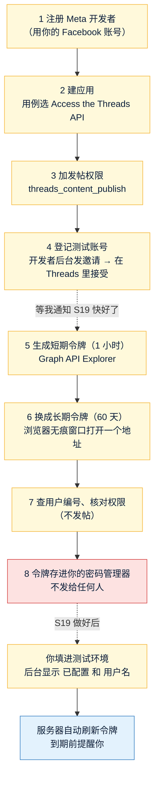

# Threads 应用申请清单：建应用、登记测试账号、拿发帖令牌
- 版本：v1.0（2026-10-28）
- 编写：运维工程师
- 用途：给 Amos 照着做。下一期开发 S19 要实现需求单 P6"Amos 在后台确认帖子后，服务器调用 Threads 官方接口自动发帖"，在那之前要先在 Meta 开发者平台建好应用、登记测试账号、拿到发帖用的令牌。最后一节"给 S19 研发的输入"给研发看。
- 依据：`市场/v2-内容发布和确认.md` v1.0（P6、P10、第三节事实核对）；`开发记录/S16-等候页和机器人.md`（Telegram token 的处理：Amos 自己填进服务器、后台只显示"已配置"）；agents main `6552c1d`（《运维工程师》C66 事实核对、C99 隐藏输入、C104 第三方 key 先确认权限、C107 截图遮挡；《平台规范/云服务器》H2）。
- 状态：**待 Amos 执行**。第 1～4 步随时可以做；第 5～7 步（拿令牌）**等我通知"S19 快做好了"再做**，因为令牌 60 天不刷新就作废，拿早了可能还没用上就过期。
- 实际执行情况：本清单里的 Meta 官方文档都是 2026-10-28 打开核对的；**我没有登录 Meta 开发者平台走一遍**（智能体不登录 Amos 的账号），按钮名称以你看到的界面为准。

> **令牌只由你自己保存。** 长期令牌和应用密钥（App Secret）等于"能用这个 Threads 账号发帖"的钥匙：存在你自己的密码管理器里；**不要发给我或任何 AI 对话框，不要贴进聊天、邮件、仓库**。S19 做好后，按 S19 给你的方式（隐藏输入的 `sudo fc set-key` 或后台的密钥框）自己填进去，填完后台只显示"已配置"。
> **截图前要遮住的东西**见第 9 节。界面和本清单写的不一样时，截图（按第 9 节遮好）发我，以你看到的为准。

## 一图看懂



这张图想说明：黄色是你做的事，一共 7 步加一次保存；红色那一步是"钥匙"，只在你手里；蓝色是 S19 做好后服务器自己做的。第 1～4 步约 20～25 分钟，第 5～7 步约 10～15 分钟，合计 **约 40 分钟**，分两次做。

## 0. 开始前准备

| 准备什么 | 说明 |
|---|---|
| 电脑浏览器（Chrome 或 Safari） | 开发者平台只用电脑操作。第 6 步要用**无痕 / 隐私窗口** |
| 你的 Facebook 账号 | 用来登录 Meta 开发者平台，以后是这个应用的管理员 |
| 一个 Threads **测试账号** | 测试环境只用测试账号发帖（需求单 P10、B12），**不用** `@quickcome6`。没有的话先在手机 Threads 里注册一个，记下它的用户名（@ 后面那串）。手机上要能登录这个账号（第 4 步接受邀请要用） |
| 测试账号设成"公开" | 建议公开：Meta 文档写明公开账号刷新令牌时，授权会顺延 90 天；不公开的账号文档前后说法不一致（见第 10 节）。测试账号没有粉丝，测试帖子公开也没人看到 |
| 密码管理器（或你平时存密码的地方） | 第 6 步拿到的长期令牌存在这里 |

## 1. 注册 Meta 开发者（只做一次）
- **在哪里**：电脑浏览器先登录 Facebook，再打开 https://developers.facebook.com/async/registration （或者打开 https://developers.facebook.com/ 点 **Get Started**）。
- **点什么、填什么**：
  1. 点 **Next**，同意平台条款和开发者政策；
  2. 填手机号和邮箱，输入收到的验证码；
  3. 职业（occupation）选一个最接近的，例如 Founder / Business owner。
- **怎么确认做好了**：打开 https://developers.facebook.com/apps 能看到"我的应用"页面（空的也算）。
- 已经注册过的，跳过这一步。

## 2. 建应用，用例选 Threads
- **在哪里**：https://developers.facebook.com/apps/creation/
- **点什么、填什么**（按页面顺序）：
  1. **App details**：应用名称填 `Quick Come Threads`（只有你自己看得到，可以改）；联系邮箱填你的邮箱 → **Next**。
  2. **Use cases**：勾选 **Access the Threads API**（文档里也写成"Access Threads API"）→ **Next**。只选这一个；其他灰掉的是不能同时选的，不用管。
  3. **Business**：选 **I don't want to connect a business portfolio yet.**（暂时不连商家资产，以后可以再连）→ **Next**。
  4. **Requirements**：只是告诉你以后可能要做 App Review，直接 **Next**。
  5. **Overview**：核对一遍 → 点 **Go to dashboard**。
- **怎么确认做好了**：进入这个应用的后台（Dashboard），左边菜单里有 **Use cases**，点进去能看到 "Access the Threads API"。
- 注意：用例建好后**不能删除**（Meta 文档原话），所以第 2 步只选 Threads 这一个。

## 3. 加发帖权限，记下应用编号
- **在哪里**：应用后台左边菜单 **Use cases** → 点 **Access the Threads API**（或旁边的铅笔图标 → Customize）。
- **点什么**：
  1. 权限列表里 `threads_basic` 已经在了（必需，删不掉）；
  2. 找到 `threads_content_publish`，点右边的 **Add**。**其他权限都不加**（用不到的权限不加，少一分风险）。
  3. 左边点 **Settings**：这里能看到 **Threads app ID**（应用编号）和 **Threads app secret**（应用密钥，要点"显示"才看得到）。
     - 应用编号不是密钥，可以记在任何地方；
     - **应用密钥只在第 6 步用一次**，用完不用另存（以后要用随时回这里看）。
  4. 同一页的三个网址（Client OAuth Settings 的跳转地址、Deauthorize callback URL、Data Deletion Requests URL）：**不要求必填就空着**；如果页面要求填了才能保存，三个都填 `https://fc-test.quickcome.online/`，点 **Save**。
- **怎么确认做好了**：Use cases → Access the Threads API 里，`threads_basic` 和 `threads_content_publish` 两行都显示已添加。
- 注意：Meta 文档提醒建应用时会出现**两套**应用编号和密钥，Threads 要用的是写着 **Threads app ID / Threads app secret** 的那一套，不是 Dashboard → App settings → Basic 里的 Facebook "App ID"。

## 4. 登记测试账号（Threads Tester）
- **4a 发邀请（电脑，开发者后台）**
  - 在哪里：第 3 步那个 Settings 页点 **Add or Remove Threads Test Users**，会跳到 **App roles → Roles**（也可以直接从左边菜单 App roles → Roles 进）。
  - 点什么：**Add People** → 角色选 **Threads Tester** → 填测试账号的 Threads 用户名（不带 @）→ 确认。
  - 注意选的是 **Threads Tester**，不是普通的 "Testers"（那个是 Facebook 测试者）。
- **4b 接受邀请（手机或电脑，测试账号的 Threads）**
  - 在哪里：用**测试账号**登录 Threads → 设置（Settings）→ 账号（Account）→ **网站权限（Website permissions）** → 邀请（Invites）。电脑上可以直接打开 https://www.threads.com/settings/account 。
  - 点什么：看到你的应用名 `Quick Come Threads` → **接受（Accept）**。
- **怎么确认做好了**：开发者后台 App roles → Roles 里，测试账号那一行不再显示"待接受（Pending）"。
- 以后真账号 `@quickcome6` 上生产时，同样用这一步把它登记进来（见第 8 节）。

> **第 5～7 步等我通知再做。** 原因：长期令牌 60 天内必须刷新一次，S19 做好之前没有程序替你刷新；拿早了，S19 还没好令牌就过期，要重做第 5～7 步。

## 5. 生成短期令牌（有效 1 小时）
- **在哪里**：https://developers.facebook.com/tools/explorer/ （Graph API Explorer，Meta 文档写明"测试时可以用 Graph API Explorer 生成令牌、给应用授权"）。
- **点什么**（下面的按钮名称来自第三方教程，是**线索**，以你看到的为准）：
  1. 右上 **Meta App** 选第 2 步建的 `Quick Come Threads`；
  2. 左上的接口地址下拉框，把 `facebook` 换成 **threads**（显示为 `threads.net` 或 `threads.com`）；
  3. 点 **Generate Threads Access Token**；
  4. 弹出 Threads 登录 / 授权窗口：**用测试账号登录**，勾选给应用的权限（要包括发帖 `threads_content_publish`）→ 允许；
  5. 令牌框里出现一长串字符（一般以 `TH` 开头），点旁边的复制。
- **怎么确认做好了**：打开 https://developers.facebook.com/tools/debug/accesstoken/ （Access Token Debugger，官方的令牌检查工具），粘贴令牌 → **Debug**，看到：
  - **App**：`Quick Come Threads`；
  - **Scopes**（权限）：有 `threads_basic` 和 `threads_content_publish`；
  - **Expires**（到期时间）：如果是 1 小时后，做第 6 步；**如果已经是约 60 天后**，说明拿到的就是长期令牌，跳过第 6 步直接做第 7 步。
- 报错"The user has not accepted the invite to test the app"（错误码 1349245）：回第 4b 步，用测试账号接受邀请（Meta 开发者社区的回答，线索）。
- 页面上找不到 threads 选项或 Generate Threads Access Token 按钮：截图（按第 9 节遮好）发我，我改用第 10 节的备选做法。

## 6. 换成长期令牌（有效 60 天）
- **在哪里**：浏览器开一个**无痕 / 隐私窗口**（Chrome：⌘+Shift+N；Safari：⌘+Shift+N），这样地址不会留在浏览历史里。
- **填什么**：先在记事本里拼好下面这个地址，把两处 `<...>` 换掉（连尖括号一起换掉），再粘贴到无痕窗口的地址栏、回车：

```
https://graph.threads.com/access_token?grant_type=th_exchange_token&client_secret=<第 3 步的 Threads app secret>&access_token=<第 5 步的短期令牌>
```

- **看到什么算成功**：页面显示一段文字，类似
  `{"access_token":"TH……很长……","token_type":"bearer","expires_in":5183944}`
  - `expires_in` 是剩下的秒数，5,183,944 秒 ≈ **60 天**；
  - `access_token` 引号里的那一长串就是**长期令牌**：复制进你的密码管理器（第 8 步），名字写"Threads 长期令牌（测试账号 @用户名，2026-xx-xx 拿到）"。
- 做完：关掉无痕窗口，把记事本里拼地址的那段删掉。
- 报错：
  - "Session has expired" 一类：短期令牌超过 1 小时了，回第 5 步重新生成再马上做第 6 步；
  - "Error validating client secret" 一类：密钥复制错了，或者用了 Facebook 的 App Secret 而不是 **Threads app secret**（第 3 步的注意）。

## 7. 查用户编号、核对权限（不发帖）
- **7a 查用户编号**：同样在无痕窗口打开（换掉 `<...>`）：

```
https://graph.threads.com/v1.0/me?fields=id,username&access_token=<长期令牌>
```

  - 看到 `{"id":"一串数字","username":"测试账号的用户名"}`：`id` 就是 **Threads 用户编号**（`threads-user-id`），`username` 应该是你的测试账号。用户编号**不是密钥**，可以记在任何地方，也可以发我核对。
- **7b 核对权限和到期时间**（C104：先确认这把钥匙能做要做的事）：Access Token Debugger（https://developers.facebook.com/tools/debug/accesstoken/ ）粘贴**长期令牌** → Debug：
  - **Scopes** 有 `threads_basic`、`threads_content_publish`；
  - **Expires** 约 60 天后；
  - **Data Access Expires**（数据访问到期）约 90 天后——这是你给应用的授权期限，S19 自动刷新令牌时会顺延（第 11 节）。
- **怎么确认做好了**：上面三项都对，就把**截图里遮掉令牌那一行**（第 9 节）后的 Debugger 结果、和 7a 的用户名告诉我。真正"能发出帖子"由 S19 在测试环境发第一条测试帖时确认，你这里不用试发。

## 8. 保存，等 S19；以后真账号怎么办
- **你手里最后有这几样**：

| 东西 | 是不是密钥 | 放哪里 | S19 要不要填 |
|---|---|---|---|
| 长期令牌（测试账号） | **是** | 只在你的密码管理器 | **要**（S19 做好后你自己填） |
| Threads 用户编号 | 不是 | 随便记 | 不用填（服务器用令牌自己查到，后台显示用户名给你核对） |
| Threads app ID（应用编号） | 不是 | 随便记 | 不用填（按第 11 节的建议） |
| Threads app secret（应用密钥） | **是** | 不用另存，Meta 后台随时能看 | 不用填（按第 11 节的建议） |

- **S19 做好后怎么填**：我会给你一条和填 Telegram token 一样的命令（`sudo fc set-key 变量名`，在阿里云控制台"远程连接"终端粘贴、屏幕上不显示，**不要用控制台的 AI 助手**），或者后台里只能写、不能看的密钥框——由 S19 定，到时写清楚。填完后台显示"已配置"和测试账号的用户名。
- **真账号 `@quickcome6` 上生产时（结论：不用走 App Review）**：
  1. 第 4 步把 `@quickcome6` 也登记成同一个应用的 **Threads Tester**，用 `@quickcome6` 在 Threads 里接受邀请；
  2. 用 `@quickcome6` 重做第 5～7 步，拿到它自己的长期令牌；
  3. 只填进**生产环境**；测试环境一直只放测试账号的令牌。
  - 依据：Meta 文档写明"应用只给在应用里有角色的人用时，不需要 App Review"；"没有通过 `threads_content_publish` 高级权限审核时，只能替应用的 Threads 测试者发帖"。`@quickcome6` 是我们自己的账号，登记成测试者就满足条件。
  - 还要确认的一件事：Meta 通用文档说"开发模式的应用产生的数据（例如测试帖子）只有应用里有角色的人看得到"，这句话没写是否适用于 Threads。**S19 在测试环境发第一条帖子时，用没登录的浏览器打开帖子链接确认别人看得到**；看不到的话，再把应用"发布"（Publish，切到正式模式，要准备图标、隐私政策网址、数据删除网址，不需要 App Review）——这一条是推断，到时再核实（第 12 节）。

## 9. 截图前要遮住的东西（C107）
这次操作里，下面这些出现在屏幕上时**截图前必须遮住（或干脆不截那一屏）**：
1. **任何令牌**：Graph API Explorer 的令牌框、Access Token Debugger 输入框里的令牌、第 6 步返回结果里 `"access_token":"…"` 引号里的内容——一般以 `TH` 开头的一长串；
2. **Threads app secret**（应用密钥）：第 3 步 Settings 页点了"显示"之后的那一串；**没点显示时是一排圆点，可以截**；
3. **第 6、7 步浏览器的地址栏**：里面有 `client_secret=…` 和 `access_token=…`，整条地址栏都遮住；
4. Facebook 的 "App Secret"（Dashboard → App settings → Basic 里那一个），即使这次用不到也遮住；
5. 注册开发者时的手机验证码、邮箱验证码。

可以不遮的：应用名、Threads app ID（应用编号）、Threads 用户编号、用户名、权限列表、到期时间。

## 10. 备选做法（第 5 步走不通时才用，先找我）
Meta 官方文档写的标准做法是"授权窗口"（Authorization Window）：浏览器打开 `https://threads.com/oauth/authorize?client_id=<应用编号>&redirect_uri=<跳转地址>&scope=threads_basic,threads_content_publish&response_type=code`，测试账号同意后跳回跳转地址、地址里带一个 1 小时内有效、只能用一次的授权码，再用 POST 请求带上应用密钥换成短期令牌。POST 请求浏览器地址栏做不了，要用命令行，不适合你手动做。所以如果第 5 步走不通，我建议 S19 在后台加一个"连接 Threads"按钮来走这个流程（你点按钮、在 Threads 里同意即可，令牌不经过你的手），代价是服务器上要多放应用编号和应用密钥两项（第 11 节方案乙）。

## 11. 给 S19 研发的输入
| 项 | 结论 | 依据 |
|---|---|---|
| 令牌类型 | **Threads 用户访问令牌（长期）**，按"应用 + 用户"一对一；测试环境放测试账号的，生产放 `@quickcome6` 的 | 官方 Get Started、Long-Lived Tokens |
| 有效期 | 短期 1 小时；长期 60 天（换取结果里 `expires_in` ≈ 5,183,944 秒）；60 天没刷新就过期，**过期后不能再刷新**，只能让 Amos 重做第 5～7 步 | Long-Lived Tokens |
| 刷新方式 | `GET https://graph.threads.com/refresh_access_token?grant_type=th_refresh_token&access_token=<长期令牌>`；条件：令牌**至少 24 小时**、未过期、有 `threads_basic`；刷新后重新算 60 天。**刷新不需要应用密钥** | Long-Lived Tokens |
| 授权期限 | 授权（`data_access_expires_at`）90 天；公开账号刷新令牌时顺延 90 天；不公开账号的说法前后不一致（见第 12 节），建议两个账号都公开 | Get Started；Long-Lived Tokens |
| 建议：自动刷新 | **服务器自动刷新，不靠 Amos 定期重填**：每天检查一次，令牌年龄 ≥ 24 小时且距上次刷新 ≥ 7 天就刷新（失败时第二天重试，有 50 多天的余量）；刷新返回的 `access_token` 不保证和原来相同，**以返回的为准保存**；所以刷新后的令牌要存进数据库（加密存，加密用的钥匙放 `.env`），初始令牌才从 Amos 填的地方读 | 推断（文档只给了刷新接口，没写返回的是否是同一串） |
| 建议：到期提醒 | 用令牌自己调 `GET /debug_token?access_token=<令牌>&input_token=<令牌>`（测试者的令牌可以查自己）读 `expires_at`、`data_access_expires_at`、`scopes`；告警项例如 `threads.token`：没填 = "未开通"（S12b 的 NOT_CONFIGURED，不发邮件）；刷新连续失败、或距到期 < 14 天、或权限里少了 `threads_content_publish` → 发员工告警邮件，内容写"请按 `部署方案/v1-Threads应用申请清单.md` 第 5～7 步重新拿令牌" | Debug Access Token |
| Amos 要填的字段 | **方案甲（建议，S19 第一期）**：只填 1 项密钥——长期令牌（变量名建议 `FC_THREADS_ACCESS_TOKEN`，和 S16 一样用 `sudo fc set-key`，C99；或者后台只写不读的密钥框）。用户编号由服务器调 `GET /v1.0/me?fields=id,username` 取，后台显示"已配置 · @用户名 · 到期日"给 Amos 核对，不显示令牌。**不需要应用编号和应用密钥**（刷新、发帖、查令牌都用不到） | Profiles、Long-Lived Tokens、Debug Access Token |
| | 方案乙（第 5 步走不通时）：后台"连接 Threads"按钮走授权窗口，要 `FC_THREADS_APP_ID`、`FC_THREADS_APP_SECRET`（密钥）和在 Meta 后台登记的跳转地址；换令牌必须在服务器端做（文档：应用密钥不能放到客户端） | Get Access Tokens、Long-Lived Tokens |
| 接口域名 | 当前文档用 `graph.threads.com`；`graph.threads.net` 也能用（官方更新记录） | Changelog |
| 发帖 | 需求单 P6 已核实：两步（`POST /{threads-user-id}/threads`，`media_type=TEXT` → 约 30 秒后 `POST /{threads-user-id}/threads_publish`）。本次补充：发帖前可以查 `GET /{threads-user-id}/threads_publishing_limit` 看当天还剩多少（`quota_total` 250、`quota_duration` 86400）；建容器后可以查 `GET /{容器编号}?fields=status,error_message`（`FINISHED` 才发，容器 24 小时不发就 `EXPIRED`） | Posts、Troubleshooting、Overview |
| 限制（需求单已核实的不重复） | 补充：一帖最多 5 个链接，超过建容器时报 `THREADS_API__LINK_LIMIT_EXCEEDED`（上线前本来就不放链接）；表情符号按 UTF-8 字节数计入 500 字 | Posts |
| 测试 | 测试替身，不连真实 Threads（和 S16 的 `E2eGuard` 一样，e2e 下接口地址只能是本机）；测试用的令牌用 `ci_only_` 开头的假值；**令牌不进日志、错误信息、接口返回** | S16 惯例 |
| 上生产 | 同一个应用把 `@quickcome6` 登记成 Threads Tester，不走 App Review；第一条测试帖要确认未登录的人看得到（第 8 节） | App Review、App Modes |

## 12. 拿不准的地方
1. **Graph API Explorer 的按钮名称和拿到的令牌是短期还是长期**：官方只写了"测试时可以用 Graph API Explorer 生成令牌"，具体按钮（threads 下拉、Generate Threads Access Token）来自第三方教程。第 5 步用 Debugger 看到期时间来判断要不要做第 6 步。
2. **开发模式下发的帖子别人看不看得到**：Meta 通用文档说开发模式产生的测试帖子只有有角色的人看得到，但没写是否适用于 Threads；第三方说法是测试者账号发的是普通公开帖子（推断）。S19 第一条测试帖时实测。
3. **不公开账号的授权能不能顺延**：Get Started 写"不公开账号授权到期后不能顺延、要重新授权"，Long-Lived Tokens 写"不公开账号的长期令牌现在也能刷新、授权 90 天"。所以建议两个账号都设公开，避开这个问题。
4. **刷新后令牌字符串变不变**：文档没写，S19 按"以返回的为准保存"处理。
5. **第 3 步三个网址是不是必填**：文档只说"添加这些网址"，没说不填不能保存；用 Graph API Explorer 拿令牌时用不到跳转地址（推断）。
6. **Threads 测试者邀请按用户名还是要别的信息**：文档只写"Add People → Threads Tester"，没写填什么；按用户名是推断。

## 13. 事实核对（C66，全部 2026-10-28 打开 Meta 官方文档原文核对）
| 事实 | 出处 | 判断 |
|---|---|---|
| 注册开发者：登录 Facebook → `developers.facebook.com/async/registration` → 同意条款 → 手机和邮箱验证 → 选职业 | [Register as a Meta Developer](https://developers.facebook.com/documentation/development/register) | 证实 |
| 建应用：`developers.facebook.com/apps/creation/` → App details（名称、邮箱）→ Use cases → Business（可选"暂不连接"）→ Requirements → Overview → Go to dashboard；用例建好后不能删除 | [Create an App with Meta](https://developers.facebook.com/documentation/development/create-an-app) | 证实 |
| 要用 Threads use case 建应用；建应用后有两套应用编号和密钥，Threads 用 Threads app ID 和对应的密钥 | [Threads：Get Started](https://developers.facebook.com/documentation/threads/get-started) | 证实 |
| Use cases → Access the Threads API → 每个权限右边 Add；`threads_basic` 必需删不掉，`threads_content_publish` 可选；Settings 里有 Threads app ID / secret 和三个网址；Add or Remove Threads Test Users → App roles → Roles → Add People | [Customize the Threads API use case](https://developers.facebook.com/documentation/development/create-an-app/threads-use-case)、[Threads：Create an app](https://developers.facebook.com/documentation/threads/get-started/create-an-app) | 证实 |
| 测试者：Add People 选 Threads Tester 发邀请；被邀请人在 Threads 网站或手机 App 的账号设置 → Website permissions 接受；测试者随时可以授权，不用 App Review | [Threads：Get Started](https://developers.facebook.com/documentation/threads/get-started) | 证实 |
| 没有 `threads_content_publish` 高级权限时只能替应用的 Threads 测试者发帖 | [Threads：Create Posts](https://developers.facebook.com/documentation/threads/create-posts)、[Posts](https://developers.facebook.com/documentation/threads/posts) | 证实（需求单第三节已核实） |
| 应用只给有角色的人用时不需要 App Review | [App Review](https://developers.facebook.com/documentation/resp-plat-initiatives/individual-processes/app-review) | 证实 |
| 开发模式产生的数据（例如测试帖子）只有有角色的人看得到 | [App Modes](https://developers.facebook.com/documentation/development/build-and-test/app-modes) | 证实（通用文档原话）；是否适用 Threads **未查到** |
| 测试时可以用 Graph API Explorer 生成令牌和授权 | [Threads：Create Posts](https://developers.facebook.com/documentation/threads/create-posts)、[Profiles](https://developers.facebook.com/documentation/threads/threads-profiles) | 证实 |
| Explorer 里切到 threads、点 Generate Threads Access Token；错误 1349245"未接受测试邀请" | [botize 教程](https://botize.com/en/api-credentials/threads)、[Meta 开发者社区帖子](https://developers.secure.facebook.com/community/threads/454430560719367) | 线索（第三方 / 社区，非文档原文） |
| 授权窗口 `threads.com/oauth/authorize`；授权码 1 小时、只能用一次；`POST graph.threads.com/oauth/access_token` 换短期令牌，返回 `access_token`、`user_id` | [Threads：Get Access Tokens](https://developers.facebook.com/documentation/threads/get-started/get-access-tokens-and-permissions) | 证实 |
| 短期 1 小时；长期 60 天；`GET /access_token?grant_type=th_exchange_token&client_secret=&access_token=`；`GET /refresh_access_token?grant_type=th_refresh_token&access_token=`，至少 24 小时、未过期；60 天没刷新就过期不能再刷新；应用密钥只能在服务器端用 | [Threads：Long-Lived Tokens](https://developers.facebook.com/documentation/threads/get-started/long-lived-tokens) | 证实 |
| 公开账号授权 90 天、刷新时顺延；不公开账号两页说法不一致 | [Get Started](https://developers.facebook.com/documentation/threads/get-started)、[Long-Lived Tokens](https://developers.facebook.com/documentation/threads/get-started/long-lived-tokens) | 证实（两处原文确实不一致） |
| 用户编号：`GET /v1.0/me?fields=id,username` | [Threads：Profiles](https://developers.facebook.com/documentation/threads/threads-profiles) | 证实 |
| Access Token Debugger 可以检查 Threads 令牌；`/debug_token` 可用测试者自己的令牌查，返回 `expires_at`、`data_access_expires_at`、`scopes` | [Get Started](https://developers.facebook.com/documentation/threads/get-started)、[Debug Access Token](https://developers.facebook.com/documentation/threads/troubleshooting/debug-access-token) | 证实 |
| 文字帖 500 字；24 小时 250 条（`threads_publishing_limit` 返回 `quota_total` 250）；最多 5 个链接；表情按 UTF-8 字节计 | [Posts](https://developers.facebook.com/documentation/threads/posts)、[Overview](https://developers.facebook.com/documentation/threads/overview)、[Troubleshooting](https://developers.facebook.com/documentation/threads/troubleshooting) | 证实（500 字、250 条需求单已核实；链接和表情是本次补充） |
| `graph.threads.com` 和 `graph.threads.net` 都能用 | [Threads Changelog](https://developers.facebook.com/documentation/threads/changelog) | 证实 |
| 这次没有登录开发者平台实际操作，按钮名称以 Amos 看到的为准 | — | 如实说明 |

## 跨角色反馈 / 分歧记录
| 编号 | 提出方 → 接收方 | 内容 | 状态 |
|---|---|---|---|
| F1 | 运维 → 研发（S19） | 第 11 节：服务器自动刷新令牌、到期提醒、Amos 只填长期令牌一项（方案甲） | 转 S19 |
| F2 | 运维 → 测试（S19） | 第 8 节、第 12 节第 2 条：第一条测试帖用未登录的浏览器确认别人看得到 | 转 S19 |
