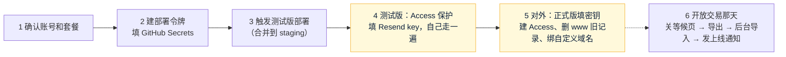

# 公开部分上 Cloudflare：给 Amos 的操作清单
- 版本：v1.0（2026-10-28，S19 研发 / 运维编写）
- 对应：`开发记录/S19-公开部分上Cloudflare.md`；代码 `cf/`；CI 的 `cloudflare (public)`、`deploy-cf` 两个 job
- 前提：本清单的 PR 已经合并到 `main`，并且 main → staging 的 PR 也合并了（`staging` 有了 `cf/`）
- 标注：本清单里的控制台位置来自 Cloudflare、Resend、GitHub 的文档和以往的操作，**智能体没有账号，没有实际点过**【未验证】。**界面和下面写的不一样时，请截图发给我，以界面为准**（C21）

## 截图前请遮住（C107）
这次截图可能出现的、要遮住的东西：
1. **Cloudflare API 令牌**：创建后只显示一次的那一长串；页面上"测试这个令牌"的 `curl` 命令里也有它（`Authorization: Bearer …` 后面的部分）。
2. **Resend 的 API key**：以 `re_` 开头的一串（创建时只显示一次）。
3. GitHub Secrets 填写框里的值（保存以后页面不再显示，列表里只有名字，可以直接截）。
4. Cloudflare 控制台里类型是 **Secret** 的变量（保存以后显示为加密，可以直接截）。

可以直接截、不用遮的：Account ID、D1 的编号、Access 的 AUD 标签和团队域名、健康检查 `/api/health` 的返回、GitHub Actions 的日志（日志里没有密钥）。

## 一图看懂
这张图想说明：Amos 一共做 6 件事，前 4 件做完就能在测试版上验收，第 5 件是"对外"的开关，第 6 件等开放交易那天。

---

## 第 1 步：确认账号和套餐（K0）
- 做法：登录 Cloudflare，确认 `quickcome.online` 在这个账号下（左边 **Websites / 网站** 列表里有它）。打开 **Workers & Pages**，右边栏有 **Account ID**，点复制。再看 **Workers & Pages → Plans**，确认是 **Free**。
- 怎么确认做好了：手里有一串 32 位的 Account ID；Plans 页面写的是 Free。把 Plans 页面截图发给我（K0 要求留档；这页没有要遮的）。

## 第 2 步：建部署令牌，填进 GitHub Secrets（K2、C104）
1. Cloudflare 右上角头像 → **My Profile → API Tokens → Create Token**，最下面 **Custom token → Get started**。
   - Token name：`forecast-github-deploy`
   - Permissions（三行，都是 **Account**，不要选 Zone）：
     | 第一列 | 第二列 | 第三列 |
     |---|---|---|
     | Account | Workers Scripts | Edit |
     | Account | D1 | Edit |
     | Account | Account Settings | Read |
   - Account Resources：**Include → 你的这个账户**（只选这一个）。
   - Zone Resources：不用选（这个令牌不碰域名，域名在第 5 步你自己在控制台绑）。
   - 其他（IP 限制、有效期）留空。→ **Continue to summary → Create Token**。
   - **为什么不用"Edit Cloudflare Workers"模板**：模板带了 KV、R2、路由、域名等用不到的权限，却没有 D1（建库和迁移要用）。
2. 复制显示出来的令牌（只显示一次）。**不要发给任何人，包括 AI**。
3. GitHub 打开 `dollar3651314/forecast` → **Settings → Secrets and variables → Actions → New repository secret**，新建两个：
   - `CLOUDFLARE_API_TOKEN` = 刚才的令牌
   - `CLOUDFLARE_ACCOUNT_ID` = 第 1 步的 Account ID
- 怎么确认做好了：Secrets 列表里有这两个名字（值不显示）。令牌能不能用，第 3 步的部署日志会告诉你（权限不对时日志写"令牌要有 … 权限"）。

## 第 3 步：触发测试版部署（K3）
- 做法：把 main → staging 的 PR 合并（和平时一样）。如果 staging 已经是最新、不想等下一个 PR：GitHub → **Actions → ci**，点最近一次 `staging` 上的运行 → **Re-run all jobs**。
- CI 全部通过后，`deploy-cf` 这个 job 会自动：没有数据库就建一个（`forecast-public-staging`，位置亚太）→ 建表（只执行没执行过的）→ 部署 Worker `forecast-public-staging`。**可以重复运行**，做过的不会重做。
- 怎么确认做好了：
  - `deploy-cf` 的日志里依次有：`✓ 新建 D1 forecast-public-staging`（第二次起是"已存在"）、`✓ 本次部署的配置 … 已写好`、`✓ D1 迁移`、`✓ 部署 staging（版本 <提交号>）`。日志里还有一行 `https://forecast-public-staging.<你的子域名>.workers.dev`，记下这个地址。
  - Cloudflare **Workers & Pages** 列表里有 `forecast-public-staging`；**Storage & Databases → D1** 里有 `forecast-public-staging`。
- 失败时：日志最后一行 `✗` 写了原因。最常见的是令牌少了权限（回第 2 步加上，再 Re-run）。看不懂就把日志截图发我（日志里没有密钥）。

## 第 4 步：测试版加 Access 保护、填 Resend key、自己走一遍
**4.1 用 Cloudflare Access 保护整个测试版**（测试版不对外，只有你能打开）
- 做法：**Workers & Pages → forecast-public-staging → Settings → Domains & Routes**，`workers.dev` 那一行右边的 **…** 或开关里选 **Cloudflare Access / Enable**（新版控制台也可能在 Worker 的 **Access** 标签页）。策略选"**Emails**"，填你自己的邮箱。保存后会显示（或在 **Zero Trust → Access → Applications** 里能找到）这个应用的 **Application Audience (AUD) Tag**；团队域名在 **Zero Trust → Settings → Custom Pages** 或 **Team domain**，形如 `xxx.cloudflareaccess.com`。Zero Trust 第一次打开会让你选免费方案（Free，50 人以内免费），选 Free。
- 怎么确认做好了：用无痕窗口打开第 3 步记下的 workers.dev 地址，先出现 Cloudflare 的登录页（输入邮箱收验证码），登录后才看到等候页，顶部有"测试环境"标识条。

**4.2 填测试版的三个值**（K2：在控制台填，不经过 AI）
- 做法：**forecast-public-staging → Settings → Variables and Secrets → Add**，三个都选类型 **Secret**：
  | 名字 | 值 |
  |---|---|
  | `RESEND_API_KEY` | 见下面的 Resend 部分 |
  | `ACCESS_TEAM_DOMAIN` | 4.1 的团队域名，例如 `xxx.cloudflareaccess.com` |
  | `ACCESS_AUD` | 4.1 的 AUD Tag |
  每填一个点 **Deploy / Save and deploy**（控制台会用现有代码建一个新版本，正常）。
- **Resend key 怎么建**（C104）：resend.com → **API Keys → Create API Key**：Name `forecast-cloudflare`；**Permission 选 Sending access**（不要 Full access）；**Domain 选 `fc-email.quickcome.online`**。复制 `re_` 开头的 key，只粘贴到上面的 `RESEND_API_KEY`。建议和测试服务器用的 key 分开，以后可以单独停用。
- 发信地址：现在写的是 `Quick Come <noreply@fc-email.quickcome.online>`（`cf/wrangler.toml` 的 `MAIL_FROM`）。如果测试服务器 `.env` 的 `FC_MAIL_FROM` 不是 `noreply@…`，告诉我改成一样的。
- 怎么确认做好了：打开 `https://forecast-public-staging.<子域名>.workers.dev/api/health`，`checks` 里 `"mail":"ok"`、`"admin":"ok"`，`"board"` 的 `status` 是 `ok`（部署后 5 分钟内会取到第一次行情）。

**4.3 自己走一遍**（这一步就是验收）
1. 打开测试版首页：繁中、BTC 现价和每小时涨跌、来源写的是 OKX 或 Binance、更新时间；底部"服务条款 / 隐私 / 风险披露"打开的是 `/about/...`。打开 `/about/`：官网，按钮是"加入等候名单"，没有登录、注册。
2. 留你自己的邮箱 → 收到"請確認訂閱 Quick Come 上線通知"（发件人 `noreply@fc-email.quickcome.online`）→ 点链接 → 页面上按"確認訂閱"→ 显示已确认。
3. 打开 `/api/admin/`：能看到合计 1、已确认 1，邮箱是打码的（例如 `a***@gmail.com`），来源一栏是你打开首页时链接上的 `src`（可以用 `/?src=test&cmp=amos` 打开再留一次别的邮箱试试）。
4. 点邮件里的退订链接 → 显示已退订；`/api/admin/` 里变成已退订。
- 怎么确认做好了：上面 4 步都对。**没收到邮件**：Cloudflare → forecast-public-staging → **Logs**（Workers Logs）里搜 `mail.failed`，`status` 是 403 就是 key 没有 `fc-email.quickcome.online` 的发信权限（回 Resend 重建，Domain 选对）；截图发我也行（日志里邮箱是打码的，没有 key）。
- **看板的实测**：`/api/health` 的 `checks.board.sources` 里有 OKX、Binance 各自最近一次的结果。截图发我，我把"Cloudflare 出口能不能访问币安 / OKX"的实测结果写回开发记录。

## 第 5 步：对外（"做好再对外"的开关）
前提：第 4 步验收通过；main 上的 `deploy-cf` 已经成功（日志有 `✓ 部署 production` 和"www.quickcome.online 还没绑到这个 Worker，跳过对外检查"）。正式版 Worker 叫 `forecast-public`，没有 workers.dev 地址，**绑域名之前外面访问不到**。

1. **正式版填三个值**：**forecast-public → Settings → Variables and Secrets**，同 4.2，`RESEND_API_KEY` 可以用同一个 key。`ACCESS_*` 先空着，下一小步拿到再填。
2. **建名单页的 Access 应用**：**Zero Trust → Access → Applications → Add an application → Self-hosted**：Application name `forecast 名单`；Domain 填 `www.quickcome.online`，Path 填 `api/admin`；Policy：Allow，Include → Emails → 你的邮箱。保存后复制 AUD Tag，填进 `forecast-public` 的 `ACCESS_AUD`，团队域名填 `ACCESS_TEAM_DOMAIN`。
3. **删掉 www 的旧记录**：**quickcome.online → DNS → Records**，找到名称 `www`、类型 A、指向测试服务器的那一条（2026-10-28 加的），**Delete**。（S18 的"www 指向测试服务器"方案不启用，测试服务器上**不要**运行 `sudo fc add-domain`。）
4. **绑自定义域名**：**Workers & Pages → forecast-public → Settings → Domains & Routes → Add → Custom domain**，填 `www.quickcome.online` → Add。Cloudflare 自己建 DNS 记录、签证书（几分钟）。
- 怎么确认做好了：
  - DNS 列表里 `www` 变成一条类型 **Worker**（或写着 forecast-public）的记录。
  - 打开 `https://www.quickcome.online/api/health`：`"environment":"production"`，**没有** `env`（不显示测试标识条），`version` 是 main 最新的提交号，`mail`、`admin` 都是 `ok`。
  - 打开 `https://www.quickcome.online/`：等候页；`/about/`：官网。
  - 无痕窗口打开 `https://www.quickcome.online/api/admin/`：先要求登录（Access），登录后看到名单页。
  - 以后每次 main 部署，`deploy-cf` 会自动检查 `www` 的健康检查换成了新版本（1 分钟内），没换成会失败并发邮件。
- 删记录和绑域名之间几分钟 `www` 打不开，现在还没对外宣传，影响很小。

## 第 6 步：开放交易那天（以后，P15）
按这个顺序（每步都有"怎么确认"）：
1. **关等候页**：**forecast-public → Settings → Variables and Secrets → Add**，类型 **Text**，名字 `WAITLIST_OPEN`，值 `false`，Deploy。确认：`/api/health` 里 `"waitlist":"closed"`；首页留邮箱时提示已经关闭。（这个变量故意不写在代码里，部署不会把它改回去。）
2. **导出**：打开 `https://www.quickcome.online/api/admin/`，点 `export.json` 下载（**完整邮箱**，只有已确认和已退订）。超过 2000 个时文件里有 `next`，按它再下载下一份。
3. **导入**：生产后台（以后的正式环境）→ **等候页订阅 → 从 Cloudflare 导入**：选文件、写原因、勾选 → 确认导入。确认：页面显示"已导入 N 个：新增 …"；再导一次同一个文件，新增是 0（可以重复导入）。导入**不发任何邮件**。
4. **发上线通知**：同一页 **发送上线通知**（全站只能一次）。之后每个确认过的人收到一封"正式上线了"。
5. 删掉第 2 步下载的文件（里面是完整邮箱）。
- 之后 `www` 继续由 Cloudflare 提供官网和看板；要不要改指生产的客户端，到时再定（S18 的 SQ-66）。

## 回滚和排查
- **回滚代码**：**Workers & Pages → forecast-public（或 -staging）→ Deployments**，选上一个版本 → **Rollback**（K4，只回滚代码，名单数据不动）。
- **日志**：Worker 的 **Logs**（Workers Logs，Free 保留 3 天）。日志里邮箱打码、没有 key。常用搜索：`mail.failed`（发信失败）、`board.source_failed`（行情取不到）、`api.error`（接口出错）、`admin.view`（谁看了名单页）。
- **额度**：Free 每天 10 万次接口请求（页面本身不算）。超过时接口返回 429、页面照常打开；第二天 0 点（UTC）恢复，**不会产生费用**。
- **备用的查名单方法**（不推荐，要在自己电脑上装 Node）：`npx wrangler login` 后 `npx wrangler d1 execute forecast-public --remote --command "SELECT status, COUNT(*) FROM waitlist GROUP BY status"`。

## 默认关着的功能（C102）
| 功能 | 为什么默认关 | 怎么打开 | 打开后看到什么 |
|---|---|---|---|
| 确认邮件 | 没有 Resend key | 第 4.2 / 5.1 步填 `RESEND_API_KEY` | `/api/health` 的 `mail` 是 `ok`；留邮箱后收到确认邮件 |
| 名单页 `/api/admin/` | 没配 Access 时一律 404 | 第 4.1–4.2 / 5.2 步填 `ACCESS_TEAM_DOMAIN`、`ACCESS_AUD` | `admin` 是 `ok`；登录 Access 后看到名单 |
| 正式版对外 | 没绑域名 | 第 5 步 | `www.quickcome.online` 打开是等候页 |
| 部署 | 没填 GitHub Secrets 时 `deploy-cf` 只打印"跳过" | 第 2 步 | `deploy-cf` 日志有 `✓ 部署` |
| 官方 Telegram 链接 | 频道还没建 | 建好后告诉研发频道地址，改 `cf/wrangler.toml` 的 `TG_CHANNEL_ZH` 等 | 看板下面出现"官方 Telegram" |
| 等候页上的台湾入金教程 | 文案"待市场定稿"（S18） | 市场定稿后研发去掉 `draft` 标记 | 繁中页面多一块"先準備 USDT" |
