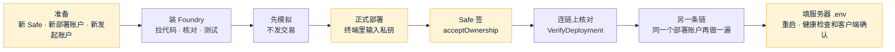

# 归集合约部署：给 Amos 的操作说明（以太坊、BSC）
- 版本：v1.0.1（2026-10-26，S12：第 9 节填完 `.env` 后用 `reload-env.sh` 生效）
- 编写：运维、研发
- 对应：`开发记录/钱包-合约地址方案.md`（为什么 ERC20、BEP20 只用合约地址，没部署时为什么"暂未开通"）；合约说明 `contracts/README.md`；参照复制源的归集合约部署说明改写（合约、脚本、步骤相同，变量前缀、盐、仓库、服务器路径换成本项目的）。
- **为什么要做**：forecast 的 ERC20、BEP20 充值地址**只用** CREATE2 合约地址（Amos 2026-10-25："钱包地址的产生和分配，用我们之前已经调研过的智能合约方案"）。**合约没部署、`.env` 没填之前，测试环境和生产的 ERC20、BEP20 充值都显示"暂未开通"**（TRC20 不受影响）。
- **和复制源完全隔离（NF-11）**：用**新建**的 Safe 冷钱包、**新建**的部署账户、**新建**的发起账户，不能用复制源的任何一个；forecast 的盐前缀是 `forecast-deposit`，即使用同一个工厂，算出的地址也和复制源不同，但合约、冷钱包、账户仍然要分开。
- **私钥只在你自己的电脑上输入**：脚本用 `--interactives 1`（运行时在终端里输入，不显示、不保存）或硬件钱包（`--ledger` / `--trezor`）。**不要**把私钥写进任何文件、命令行参数（`--private-key`）或发给任何人（包括我）。本文只写变量名，不写任何值。
- 先在**测试网**（Sepolia、BSC 测试网）完整做一遍，跑通测试环境的充值和归集，再做主网。

## 一图看懂



这张图想说明：黄色的四步需要你本人操作（钱包、私钥、Safe 签名、服务器）；其余是在你电脑上运行脚本、看结果。测试网、主网各做一遍，每一遍两条链（以太坊、BSC）。

## 0. 先准备好

| 要什么 | 说明 | 这次要用到的地方 | 怎么确认做好了 |
|---|---|---|---|
| Safe 冷钱包（**新建**，forecast 专用） | 2-of-3 多签；**以太坊和 BSC 必须是同一个地址**（Safe 网页创建时选多条网络）。不能用复制源的 Safe。测试网如果 BSC 测试网建不了 Safe，测试网可以先用一个新的普通地址演练（脚本只在主网强制要求是合约） | `SWEEP_PARENT` | app.safe.global 里两条网络下看到同一个 Safe 地址、3 个签名人、阈值 2 |
| 部署账户（**新建**） | 普通账户，只用来部署；两条链上都**没有发过任何交易**（nonce = 0，两条链部署出的合约地址才相同）；测试网领一点测试币，主网约 0.02 ETH + 0.01 BNB【估算：复制源实测整套部署约 388 万 gas】 | 运行脚本时输入私钥 | 区块浏览器上这个地址两条链都是 0 笔交易、有一点手续费币 |
| 发起账户（**新建**，不是热钱包） | 普通账户，服务器用它发归集交易，只付手续费；测试网领测试币，主网约 0.05 ETH + 0.02 BNB【估算】 | `SWEEP_OPERATOR`；私钥以后由你填进服务器 `.env` | 区块浏览器上两条链都有余额；地址和热钱包 `FC_WALLET_ETH_HOT_ADDRESS` 不同 |
| 节点地址 | 测试网可以用公共节点 `https://ethereum-sepolia-rpc.publicnode.com`、`https://bsc-testnet-rpc.publicnode.com`；主网可以用 `https://ethereum-rpc.publicnode.com`、`https://bsc-rpc.publicnode.com`【未核实：主网公共节点的稳定性，部署那天再测】 | `--rpc-url` | 第 3 步模拟能连上 |
| 区块浏览器 API Key（可选） | 在 etherscan.io 注册拿一个 API Key（V2 的 Key 以太坊和 BSC 都能用），用来"验证源码"。这不是钱包密钥，但也不要发给我 | 第 5 步 | — |

## 1. 安装 Foundry（只做一次）

macOS 或 Linux 的终端（Windows 用 WSL）：

```bash
curl -L https://foundry.paradigm.xyz | bash      # 安装 foundryup
# 关掉终端再打开一个
foundryup --install v1.5.1                       # 和本项目测试用的同一个版本
forge --version                                  # 应该显示 1.5.1
```

## 2. 拉代码、核对、跑测试

```bash
git clone https://github.com/dollar3651314/forecast.git
cd forecast
git checkout <我告诉你的提交号>                   # 和测试环境上线的是同一个版本
cd contracts
git submodule update --init                      # 拉 forge-std（只用于测试）
bash script/check-vendor.sh --upstream           # 和 BitGo、OpenZeppelin 官方仓库逐字节比较
forge test                                       # 全部测试，约 1 分钟
```

看到这三行就对了：
- `lib/ 原样源码：sha256 全部一致`
- `和上游 BitGo 9566bcd4…、OpenZeppelin v5.0.0（932fddf6…）逐字节一致`
- `30 tests passed, 0 failed`

## 3. 先模拟（不发交易、不需要私钥）

把下面的地址换成你的（都是公开地址）：

```bash
export SWEEP_PARENT=0x你的Safe地址
export SWEEP_OPERATOR=0x你的发起账户地址
export RPC=https://ethereum-sepolia-rpc.publicnode.com    # 先做 Sepolia
forge script script/Deploy.s.sol --rpc-url $RPC --sender 0x你的部署账户地址
```

最后应该看到 `== 全部通过` 和 5 行 `FC_SWEEP_EVM_…=`。如果报错：
- `部署账户的 nonce 不是 SWEEP_EXPECT_NONCE`：这个部署账户在这条链上发过交易，换一个新账户（两条链都要是新的）。
- `部署账户没有手续费币`：先给部署账户转一点测试币 / 主网币。

## 4. 正式部署（终端里输入私钥）

在上一步的命令后面加 `--broadcast --interactives 1`：

```bash
forge script script/Deploy.s.sol --rpc-url $RPC --sender 0x你的部署账户地址 --broadcast --interactives 1
```

终端提示 `Enter private key:` 时粘贴**部署账户**的私钥（屏幕上不显示），回车。用硬件钱包时把 `--interactives 1` 换成 `--ledger`（或 `--trezor`），在设备上确认 4 笔交易。

完成后会打印：
- 4 笔交易都成功（`ONCHAIN EXECUTION COMPLETE & SUCCESSFUL`）；
- `== 全部通过`（字节码和参数核对）；
- 一段 `FC_SWEEP_EVM_FACTORY=…`、`FC_SWEEP_EVM_IMPLEMENTATION=…`、`FC_SWEEP_EVM_BATCHER=…`、`FC_SWEEP_EVM_PARENT=…`、`FC_SWEEP_EVM_OPERATOR_ADDRESS=…`：**把这 5 行发给我**（都是公开地址，我记进交付记录）。

`contracts/broadcast/` 下会留一份交易记录（公开信息，可以发给我）；`contracts/cache/` 下的文件不要发、用完可以删。

## 5. 在区块浏览器验证源码（可选，建议做）

```bash
export ETHERSCAN_API_KEY=你的浏览器APIKey
forge verify-contract --chain sepolia --watch 0x实现合约地址 lib/eth-multisig-v4/contracts/ForwarderV4.sol:ForwarderV4
forge verify-contract --chain sepolia --watch 0x工厂地址 lib/eth-multisig-v4/contracts/ForwarderFactoryV4.sol:ForwarderFactoryV4 \
  --constructor-args $(cast abi-encode "constructor(address)" 0x实现合约地址)
forge verify-contract --chain sepolia --watch 0x批量合约地址 src/SweepBatcher.sol:SweepBatcher \
  --constructor-args $(cast abi-encode "constructor(address,address,address)" 0x工厂地址 $SWEEP_PARENT $SWEEP_OPERATOR)
```

BSC 测试网把 `--chain sepolia` 换成 `--chain bsc-testnet`；主网是 `mainnet` 和 `bsc`。三条都显示 `Pass - Verified` 就好。

## 6. Safe 接受批量合约的所有权（2-of-3 签名）

部署脚本已经把批量合约的所有权"转给"Safe，Safe 要签一笔"接受"才生效（Ownable2Step，防止转错地址）：

1. 打开 https://app.safe.global ，选你的 Safe 和对应网络。
2. New transaction → Transaction Builder。
3. 地址填**批量合约地址**；ABI 粘贴：`[{"inputs":[],"name":"acceptOwnership","outputs":[],"stateMutability":"nonpayable","type":"function"}]`。
4. 方法选 `acceptOwnership`，Add transaction → Create batch → 第一个签名人签名 → 第二个签名人确认并执行。

测试网如果用的是普通地址当 parent（没有 Safe），用那个地址的钱包直接调用 `acceptOwnership`（或者跳过，测试网演练不影响归集）。

**怎么确认做好了**：下一步的核对里**没有**"Safe 还没有接受所有权"的提示。

## 7. 连链上核对（只读，不需要私钥）

```bash
SWEEP_FACTORY=0x工厂地址 SWEEP_IMPLEMENTATION=0x实现合约地址 SWEEP_BATCHER=0x批量合约地址 \
SWEEP_PARENT=$SWEEP_PARENT SWEEP_OPERATOR=$SWEEP_OPERATOR \
forge script script/VerifyDeployment.s.sol --rpc-url $RPC
```

要看到 `== 全部通过`，并且**没有**"Safe 还没有接受所有权"的提示。把整段输出发给我，我记进交付记录。

能在区块浏览器上找到 BitGo 自己部署的 ForwarderV4 实现合约时（例如某个 BitGo 收款地址的代理指向的合约），加 `BITGO_REFERENCE_FORWARDER=0x那个地址` 再跑一次，会比较两边去掉元数据后的字节码。找不到不影响（BitGo 仓库里没有公布部署地址）。

## 8. 另一条链再做一遍

用**同一个部署账户**、同样的 `SWEEP_PARENT` 和 `SWEEP_OPERATOR`，把 `RPC` 换成 BSC 测试网（主网时换成 BSC 主网），重复第 3～7 步。**打印出的三个合约地址必须和第一条链完全一样**；不一样就停下来告诉我（说明部署账户在其中一条链上发过交易）。服务器上以太坊、BSC 共用同一组 `FC_SWEEP_EVM_*`，两条链地址不同就没法用。

## 9. 填服务器 `.env`、重启、确认

```bash
sudo nano /opt/forecast/.env
```

找到"ERC20、BEP20 充值地址和资金归集"那一段，填上（地址用第 4 步打印的；**私钥只由你填**）：

```
FC_SWEEP_EVM_FACTORY=（第 4 步打印的工厂地址）
FC_SWEEP_EVM_IMPLEMENTATION=（实现合约地址）
FC_SWEEP_EVM_PARENT=（Safe 地址）
FC_SWEEP_EVM_BATCHER=（批量合约地址）
FC_SWEEP_EVM_OPERATOR_ADDRESS=（发起账户地址）
FC_SWEEP_EVM_OPERATOR_KEY=（发起账户的私钥，只由你填）
```

同时确认这两条链的节点和 USDT 合约也填了（`FC_WALLET_ETH_RPC_URL`、`FC_WALLET_BSC_RPC_URL`、`FC_WALLET_ERC20_USDT_CONTRACT`、`FC_WALLET_BSC_USDT_CONTRACT`，测试网 chainId `FC_WALLET_ERC20_CHAIN_ID`、`FC_WALLET_BSC_CHAIN_ID` 默认就是 Sepolia 11155111、BSC 测试网 97，主网要改成 1、56）。**不再需要 `FC_WALLET_ETH_XPUB`**：以太坊体系不用 xpub，填了也不会用；TRON 仍然要 `FC_WALLET_TRON_XPUB`。

保存后运行 `sudo bash /opt/forecast/reload-env.sh`（用当前版本按新的 `.env` 重新启动，最后列出还是 DOWN 的项；v1.0 写的 `deploy.sh` 只在有新版本时才动，版本没变时直接退出，`.env` 不会生效，v1.0.1 改正）。然后逐条确认：

| 确认什么 | 怎么看 | 应该是 |
|---|---|---|
| 应用正常 | 服务器上 `curl -s http://127.0.0.1:8080/api/health` | `status` 是 `UP` |
| ERC20、BEP20 已开通 | 同一个返回的 `alerts` | `deposit.evm` 是 `UP`（填之前是 `DOWN`，只是告警，不影响 `status`、不会让部署回滚） |
| 归集配置对 | 同一个返回的 `alerts` | `sweep.config` 是 `UP`；`DOWN` 时看后台或日志里的原因（例如私钥和地址对不上、parent 填成了 USDT 合约或热钱包） |
| 后台显示对 | 后台"资金 → 资金归集 → 归集设置" | 合约地址、冷钱包、发起账户都显示出来，没有黄色的配置问题提示 |
| 客户端显示对 | 用测试账号打开客户端"资产 → 充值"，选 ERC20、BSC | 显示地址和二维码（不再是"充值暂未开通"），ERC20 和 BSC 是同一个地址；TRC20 不变 |

**注意**：四个合约地址填进去以后，ERC20、BEP20 的充值地址就是由它们算出来的，**以后不能随便改**（改任何一个，客户的地址都会变；老地址停用后只继续扫块 30 天，而且只能用老的批量合约归集）。

## 10. 测试网验收（Amos 在测试环境）

1. 用测试账号在客户端拿到 ERC20 充值地址，往这个地址转 150 测试 USDT（ERC20 归集门槛 100）。测试 USDT 的合约要和 `FC_WALLET_ERC20_USDT_CONTRACT` 一致。
2. 等后台"入金"里这笔变成"已到账"，再等 2 倍确认数（Sepolia 约 5 分钟）。
3. 后台"资金归集 → 生成 / 执行归集"选 ERC20：这个地址"这次归集"、"首次部署"；点"执行归集"，填原因。
4. 批次详情里状态变成"已完成"，Safe 里 USDT 余额增加 150；地址显示已部署。
5. 同一个地址再充一次、再归集：这次"已部署"，手续费更低。
6. BSC 测试网同样做一遍（BSC 门槛 10 USDT）。

## 11. 主网

测试网验收通过后，用**新的**部署账户（主网两条链 nonce 都是 0）、主网的 Safe（主网必须是已经部署好的 Safe，脚本会检查）和主网的发起账户，按第 3～9 步再做一遍，填进**生产**服务器的 `.env`。生产和测试环境的合约地址、冷钱包、发起账户都不同。

## 12. 出问题时

| 情况 | 处理 |
|---|---|
| 发起账户私钥可能泄露 | Safe 调用批量合约 `setOperator(旧地址, false)`、`setOperator(新地址, true)`，服务器换 `FC_SWEEP_EVM_OPERATOR_ADDRESS`、`FC_SWEEP_EVM_OPERATOR_KEY`；客户地址不用换（发起账户碰不到钱，只能把钱归集到 Safe） |
| 批量合约出问题 | Safe 可以自己对每个地址调用工厂 `createForwarder(parent, 批量合约地址, 盐)`（没部署的）和转发合约的 `flushTokens(USDT)`（`contracts/README.md` 第 4 节实测过） |
| 部署到一半失败 | 停下来把终端输出发给我；部署账户 nonce 已经变了的话，两条链要换一个新的部署账户重新来 |
| 填了 `.env` 以后 `deposit.evm` 还是 `DOWN` | 看 `sweep.config` 的原因，或者服务器日志里"合约充值地址的配置有问题"那一行：四个地址是否都填了、格式是否是 `0x` 加 40 位、parent 是否误填成 USDT 合约 / 热钱包 / 我们的充值地址 |
