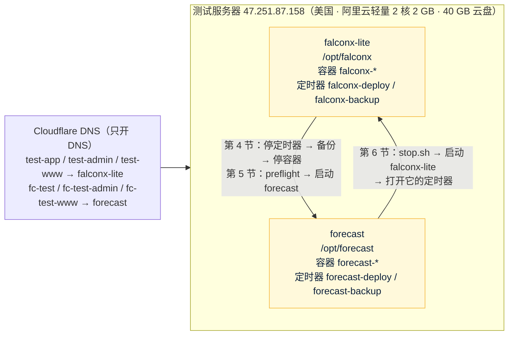

# 测试环境和切换：forecast 与 falconx-lite 轮流使用同一台测试服务器
- 版本：v1.0（2026-10-25）
- 编写：运维工程师（兼研发：`deploy/kit/` 的脚本）
- 来由：Amos 2026-10-25 答复 AQ-23："**AQ-23 我还是会用同一台服务器，但是在跑当前系统时，我会停掉原来cfd的项目 ，其他全部按建议**"（"cfd 的项目"= falconx-lite）。
- 依据：agents main `1f92bbc`（《平台规范/云服务器》v0.4：第二节"容器内存要算总账"C75、H4 被跳过的版本 C77、H7 合并后确认发布 C76、第三节"控制台 AI 助手"的坑；《运维工程师》v0.11）；`技术方案/v1-架构方案.md` v1.3 第 11 节；falconx-lite 的部署工具包和部署方案（远程 `staging` 分支 `2583328`，**只读**：`deploy/kit/`、`部署方案/v1-部署方案.md` 第 4、6、9.2、19 节）。
- 名字：本文要写出 falconx-lite 的目录、定时器、容器名，所以直接用它的名字（本文件已加进 `scripts/brand-check.json` 的排除名单）；本项目的脚本里不写它的名字。
- 状态：**待执行**。测试环境第一次部署（架构方案 S12）时由 Amos 按本文操作；本仓库里的脚本已在开发环境验证（第 10 节）。
- **不改 falconx-lite 的仓库**（已封存）。停它、启动它只用它服务器上已有的脚本和 systemd 定时器。

> **所有命令都由 Amos 在阿里云轻量应用服务器控制台的"远程连接"终端里粘贴执行**，智能体不登录服务器（《云服务器》H1）。
> **不要用控制台自带的 AI 助手执行本文的命令，也不要把命令输出、`.env` 内容、密码、API key 发给任何对话框（包括控制台 AI 助手和我）**：AI 助手会接管交互输入、向你要密钥（《云服务器》第三节）。截图前把密码、key 打码。需要填密钥时用 `sudo nano /opt/forecast/.env` 自己填。

## 一图看懂

这张图想说明：两个项目都装在这台服务器上，**同一时间只运行一个**；切换就是"停一个的定时器和容器 → 起另一个"，两个项目的数据目录都原样保留。两个项目各用各的子域名，DNS 都指向这台机器，哪个项目在运行，哪组域名就能打开。

## 1. 结论和前提

| 项 | 内容 |
|---|---|
| 测试环境放哪里 | falconx-lite 现在的测试服务器 47.251.87.158（美国阿里云轻量应用服务器 2 核 2 GB，40 GB 云盘，Ubuntu 24.04；`free -m` 总量 **1,613 MB**） |
| 怎么共用 | **轮流运行，同一时间只运行一个项目**。不做"两个同时跑"（内存放不下，第 3 节）；不加共用入口；不改 falconx-lite 的部署配置 |
| 生产 | 不受影响：按 AQ-15，新加坡单独一台（4 核 16 GB），上线前另写生产部署方案 |
| 什么时候做 | 测试环境第一次部署时（架构方案 S12）。前提见下表 |

| 前提 | 怎么确认 |
|---|---|
| forecast 仓库已经有 `staging` 分支，合并后那次 CI 全绿，`publish-staging` 推出了镜像（`forecast-app:staging`、`forecast-web:staging`） | GitHub Actions 里 staging 那一次运行的 `publish-staging` 是绿的；研发把提交号告诉 Amos |
| 三个子域名的 DNS 已经指向这台服务器（第 8 节） | 研发从外部 `dig` 查到 47.251.87.158 |
| 服务器上已经 `docker login ghcr.io`（falconx-lite 部署时做过，同一个 GitHub 账号的令牌能读本项目的镜像） | 第 5.2 节第 2 步能拉到镜像 |
| Amos 知道 falconx-lite 在切换期间打不开 | — |

## 2. 两个项目在服务器上的布局

| 项 | falconx-lite（不改） | forecast |
|---|---|---|
| 目录 | `/opt/falconx` | `/opt/forecast` |
| 数据 | `/opt/falconx/data/`（`mysql`、`redis`、`storage`），备份 `/opt/falconx/backup/` | `/opt/forecast/data/`（同样三个），备份 `/opt/forecast/backup/` |
| 密钥 | `/opt/falconx/.env` | `/opt/forecast/.env`（另外生成，不复制 falconx-lite 的任何值） |
| compose 项目名、容器 | `falconx`：`falconx-web-1`、`falconx-app-1`、`falconx-mysql-1`、`falconx-redis-1` | `forecast`：`forecast-web-1`、`forecast-app-1`、`forecast-mysql-1`、`forecast-redis-1` |
| 占用的端口 | 80、443（web）；127.0.0.1:8080（app） | 相同 → **不能同时运行** |
| 自动更新、备份 | systemd 定时器 `falconx-deploy.timer`（**每分钟**运行 `/opt/falconx/deploy.sh`，开机 2 分钟后开始）、`falconx-backup.timer`（每天 UTC 19:30） | `forecast-deploy.timer`、`forecast-backup.timer`（同样的频率） |
| 证书 | Let's Encrypt，证书名 `falconx`（`/etc/letsencrypt/live/falconx/`） | 证书名 `forecast`（`/etc/letsencrypt/live/forecast/`） |
| 域名 | `test-app`、`test-admin`、`test-www` `.quickcome.online` | `fc-test`、`fc-test-admin`、`fc-test-www` `.quickcome.online`（SQ-4） |
| 镜像 | `ghcr.io/dollar3651314/falconx-lite-*`（本机保留最近 5 个版本） | `ghcr.io/dollar3651314/forecast-*`（同样保留 5 个） |
| 系统级的共用部分 | Docker、certbot（系统自带的 `certbot.timer` 每天两次续期全部证书）、2 GB 交换分区、`/var/www/certbot`（证书验证目录）、云防火墙（只开 80、443，22 只对 Amos 的 IP） | 同左，不另装 |

"每分钟自动部署一次"是 falconx-lite 的 **systemd 定时器** `falconx-deploy.timer`，不是 crontab。只停容器不停它也不行：它每分钟运行一次 `deploy.sh`，staging 一有新版本就会把 falconx-lite 的容器重新拉起来；机器重启后它也会在 2 分钟后开始运行。所以第 4 节**先停定时器，再停容器**。

## 3. 内存总账（C75）

### 3.1 为什么不照搬 falconx-lite 的上限

falconx-lite 在这台机器上的上限是 `app` 768 + `mysql` 450 + `redis` 96 + `web` 64 = **1,378 MB**。系统和 Docker 自己用的内存，按 falconx-lite 在这台机器上的两次实测（部署方案第 9.2、19 节，Amos 截图）：

| 时间 | `free -m` 已用 | 容器实际占用（`docker stats`） | 系统 + Docker |
|---|---|---|---|
| 2026-10-16 刚启动 | 1,081 MB | 后端 354 + MySQL 226 + Redis 12 + Nginx 7 = 599 MB | 约 480 MB |
| 2026-10-21 重启后 | 958 MB | 后端 357 + MySQL 180 + Redis 和 Nginx 约 20 = 约 557 MB | 约 400 MB |

1,378 + 400～480 = **1,780～1,860 MB，超过 1,613 MB**。所以本项目不能照搬这组上限，按下表重新设（`deploy/kit/docker-compose.yml`）。JVM 参数的写法和 falconx-lite `deploy/app.Dockerfile` 相同（`MALLOC_ARENA_MAX=2`、`UseSerialGC`、`ExitOnOutOfMemoryError`、各部分都设上限），只是数值按 576 MB 容器算；镜像里的默认值保持和 falconx-lite 一样，测试环境在 compose 里用 `JAVA_TOOL_OPTIONS` 覆盖。

### 3.2 forecast 测试环境的上限

| 容器 | 各部分上限 | 合计 | `mem_limit` = `memswap_limit` | 实测（2026-10-25，开发环境） |
|---|---|---|---|---|
| `web`（Nginx） | — | — | **32 MB** | 7 MB |
| `app` | 堆 `-Xmx256m`（`-Xms128m`）+ 元空间 `-XX:MaxMetaspaceSize=128m` + 代码缓存 `-XX:ReservedCodeCacheSize=48m` + 直接内存 `-XX:MaxDirectMemorySize=32m` + 线程栈 `-Xss512k` × 约 110 个（Tomcat 最多 60 个 `SERVER_TOMCAT_THREADS_MAX=60`，加连接池、定时任务、推送）≈ 55 MB + GC、JIT、类库等其他本地内存约 50 MB | 约 570 MB | **576 MB** | 323 MB（部署形态跑完主流程）；单独测：常驻内存峰值 377 MB，元空间 86 MB、代码缓存 36 MB、堆已提交 131 MB、55 个线程 |
| `mysql` | `innodb_buffer_pool_size=128M` + 日志缓冲 8 + 键缓冲 8 + 其他全局约 100 + `max_connections=30` × 约 2 MB（后端连接池 `FC_DB_POOL_SIZE=15`）；`performance_schema=OFF` | 约 300 MB | **320 MB** | 167 MB |
| `redis` | `maxmemory 32mb` + 进程约 10 MB | 42 MB | **64 MB** | 4 MB |
| **容器合计** | | | **992 MB** | 约 500 MB |
| 系统 + Docker | 按 falconx-lite 的实测取 **450 MB**；停掉 falconx-lite 后用 `free -m` 核对（第 5.1 节） | | 450 MB | 待 Amos 截图 |
| **合计 / 总量 / 余量** | | | **1,442 / 1,613 / 约 170 MB（10%）** | |

- "实测"是在开发环境按同样的参数跑出来的【实测：`e2e/run-deployed.sh` 用的就是这份 compose 和这些上限，9 个用例全部通过；另外用默认形态跑全部端到端时开了 JVM 的 NMT】，不是在这台服务器上。第一次部署后请 Amos 截 `free -m` 和 `docker stats --no-stream`，写进第 9 节。
- 每个容器 `memswap_limit` 等于 `mem_limit`：超出上限时只有那个容器被杀掉、自动重启（`restart: unless-stopped`），不会像 2026-10-20 那样拖着整台机器换页卡死。后端堆满时 `ExitOnOutOfMemoryError` 直接退出重启。
- 交换分区（falconx-lite 建的 2 GB）留着，只给系统自己的进程兜底；容器用不到它。
- **余量不够时先调什么**：停掉 falconx-lite 后 `free -m` 的"已用"超过 450 MB 时（`preflight.sh` 会提醒），先把 MySQL 缓冲池降到 96M、`mem_limit` 降到 288 MB，再考虑后端堆降到 224 MB；改动走 PR、按正常流程发布。
- 抓取程序（AQ-18 第一期不建）、自动化程序（还没开发）都没有算在里面；它们要上测试环境时先重算这张表（架构方案第 18.3 节）。

### 3.3 怎么确认内存没问题

| 什么时候 | 看什么 | 正常 |
|---|---|---|
| 第 4 节停掉 falconx-lite 以后 | `free -m` 的 used（这时没有容器在运行） | ≤ 450 MB |
| forecast 刚启动 | `free -m`、`docker stats --no-stream` | used 约 1,000 MB 以内；四个容器都在上限的 70% 以下 |
| 运行几个小时后 | 同上，再看 `docker ps` 的 STATUS | 没有容器反复重启（STATUS 里 `Up` 的时间一直在增长） |

## 4. 停掉 falconx-lite

每一步做完，按"怎么确认"一栏核对，**有一步不对就停下来截图给我**，不要往下做。

| 步骤 | 命令 | 做什么 | 怎么确认做对了 |
|---|---|---|---|
| 4.1 | `free -m && df -h / && docker ps --format '{{.Names}}  {{.Status}}'` | 记下切换前的状态（截图，密码类不会出现） | 看到 4 个 `falconx-*` 容器都是 `Up` |
| 4.2 | `sudo systemctl disable --now falconx-deploy.timer falconx-backup.timer` | **停掉每分钟自动部署和每天备份的定时器**，并取消开机自动启动 | 运行 `systemctl is-enabled falconx-deploy.timer falconx-backup.timer` 两行都是 `disabled`；`systemctl is-active falconx-deploy.timer falconx-backup.timer` 两行都是 `inactive` |
| 4.3 | `systemctl is-active falconx-deploy.service` | 确认这一刻没有正在进行的自动部署 | 显示 `inactive`。如果是 `activating`，等 1～2 分钟再查，直到 `inactive` |
| 4.4 | `sudo crontab -l; crontab -l` | 确认 crontab 里也没有部署命令（falconx-lite 用的是定时器，正常没有） | 显示 `no crontab for ...`，或者里面没有 `/opt/falconx` 的行；有的话截图给我，先不要往下做 |
| 4.5 | `sudo bash /opt/falconx/backup.sh before-switch` | 切换前给 falconx-lite 的数据库再备份一次（用它自己的备份脚本） | 最后一行是"备份完成：falconx-…-before-switch.sql.gz（…）"；`sudo ls -lh /opt/falconx/backup/ \| tail -3` 能看到这个文件 |
| 4.6 | `sudo bash -c '. /opt/falconx/lib.sh && compose stop'` | **只停止** falconx-lite 的 4 个容器（用它自己的 compose 设置），不删除容器、不删除数据 | `docker ps -a --filter name=falconx --format '{{.Names}}  {{.Status}}'` 四行都是 `Exited`；`docker ps` 里没有 `falconx-*` |
| 4.7 | `sudo ss -ltnp \| grep -E ':(80\|443\|8080) '` | 确认 80、443、8080 端口已经空出来 | 没有任何输出 |
| 4.8 | `free -m` | 看系统和 Docker 自己用多少内存（第 3.3 节第一行） | used ≤ 450 MB（截图给我；超过也先截图，我按第 3.2 节调） |

- 第 4.6 步不要用 `docker compose down -v`、`docker volume prune`、`docker system prune --volumes`，也不要删 `/opt/falconx` 下的任何东西（第 7 节）。
- 停掉以后 falconx-lite 的三个域名打不开（连接被拒绝或证书不匹配），这是预期的。
- 容器是"手动停止"的，服务器重启后 Docker 不会自动把它们拉起来；定时器已经停用，也不会把它们拉起来。

## 5. 启动 forecast

### 5.1 切换前检查（每次切到 forecast 都做）

| 检查 | 命令 | 正常 | 不正常怎么办 |
|---|---|---|---|
| 磁盘 | `df -h / && sudo docker system df` | 根分区剩余 ≥ 10 GB（第一次拉 forecast 镜像约 1～1.5 GB；`mysql:8.4`、`redis:7` 和 falconx-lite 共用，不用重新下载） | 5～10 GB 能启动但要留意；< 5 GB 不要启动：先 `sudo docker image prune -f`（只删没有标签的旧镜像，不碰数据和 falconx-lite 正在用的版本），再截图给我 |
| 数据目录大小 | `sudo du -sh /opt/falconx/data /opt/falconx/backup /opt/forecast/data /opt/forecast/backup 2>/dev/null` | 记下来（截图） | — |
| 内存 | 第 4.8 步 | — | — |
| DNS | 在自己电脑上 `nslookup fc-test.quickcome.online` | 返回 47.251.87.158 | 按第 8 节加记录 |

`preflight.sh`（第一次部署时 `first-start.sh` 会自动运行它；以后的切换由 `start.sh` 运行）会把"另一个项目的容器和定时器已停、80/443 空着、磁盘、内存"再检查一遍，**不通过就不启动**。

### 5.2 第一次部署（只做一次）

和 falconx-lite 第一次部署的步骤一样（它的部署方案第 6 节），只是目录、域名、脚本换成本项目的。Docker、`docker login ghcr.io`、certbot、交换分区、Docker 日志轮转在这台机器上都已经有了，不用重做。

| 步骤 | 命令 | 做什么 | 怎么确认做对了 |
|---|---|---|---|
| 1 | 第 4 节全部 | 停掉 falconx-lite | 第 4 节每一步的确认 |
| 2 | `sudo docker pull ghcr.io/dollar3651314/forecast-web:staging` | 确认能拉到本项目的镜像 | 最后一行显示 `ghcr.io/dollar3651314/forecast-web:staging`；如果是 `denied` / `unauthorized`，截图给我（令牌可能过期，要重新 `docker login ghcr.io`，令牌只粘贴在服务器上） |
| 3 | `sudo mkdir -p /opt/forecast && sudo docker run --rm --entrypoint sh -v /opt/forecast:/out ghcr.io/dollar3651314/forecast-web:staging -c 'cp -r /forecast-kit/. /out/'` | 从镜像里取出本项目的部署工具包 | `ls /opt/forecast` 能看到 `deploy.sh`、`preflight.sh`、`start.sh`、`stop.sh`、`first-start.sh`、`docker-compose.yml`、`systemd` 等；`cat /opt/forecast/VERSION` 是研发告诉你的提交号 |
| 4 | `sudo bash /opt/forecast/server-setup.sh` | 一次性准备：目录、`.env`（空值）、装 `forecast-*` 定时器（先不启动）；交换分区、日志轮转已经有了会跳过 | 最后一行"准备完成"；`ls /etc/systemd/system/forecast-*` 能看到 4 个文件 |
| 5 | `sudo bash /opt/forecast/init-env.sh fc-test.quickcome.online fc-test-admin.quickcome.online <证书提醒邮箱> fc-test-www.quickcome.online` | 生成数据库、Redis 密码、浏览器推送密钥对、第一个超管（用户名 admin、随机初始密码），直接写进 `/opt/forecast/.env`，屏幕上不显示 | 输出"完成"并列出还空着的变量（邮件、区块链的变量这时空着是正常的） |
| 6（可选） | `sudo nano /opt/forecast/.env` | 邮件（T3）：`FC_MAIL_HOST=smtp.resend.com`、`FC_MAIL_PORT=587`、`FC_MAIL_SECURITY=STARTTLS`、`FC_MAIL_USERNAME=resend`、`FC_MAIL_FROM=noreply@fc-email.quickcome.online`（Resend 里验证的必须就是 `fc-email.quickcome.online`），`FC_MAIL_PASSWORD` **由你自己粘贴 Resend 的 API key**；告警收件人 `FC_ALERT_EMAILS`。没定邮件服务时先跳过，邮件只写日志 | `Ctrl+O` 保存、`Ctrl+X` 退出；**不要截图 `.env`** |
| 7 | `sudo bash /opt/forecast/preflight.sh` | 单独先跑一次启动前检查 | 最后一行"检查通过"；有 ✗ 的项截图给我 |
| 8 | `sudo bash /opt/forecast/first-start.sh` | 再检查一次 → 检查 `.env` → 申请证书（三个域名一张，证书名 `forecast`，用 80 端口验证）→ 启动 staging 最新版本 → 证书改为通过 Nginx 续期 → 打开 `forecast-deploy.timer`、`forecast-backup.timer` | 最后显示"完成。当前版本：<提交号>"；`systemctl list-timers 'forecast-*'` 有两行 |
| 9 | 我从外部运行 `bash deploy/verify.sh fc-test.quickcome.online fc-test-admin.quickcome.online <提交号> fc-test-www.quickcome.online` | 版本号、HTTPS 跳转、三个站点、后台接口和测试接口在客户端域名被拦、3306 / 6379 / 8080 不通 | 全部 ✓（证书签发方请你在浏览器里点锁看，开发环境验证不了，《云服务器》第三节） |
| 10 | 浏览器打开 `https://fc-test-admin.quickcome.online` | 超管登录（初始密码用 `sudo grep ^FC_ADMIN_INIT_PASSWORD= /opt/forecast/.env` 在服务器上自己看）、改密码 | 能进后台，顶部有"测试环境"标识条；之后可以 `sudo nano /opt/forecast/.env` 删掉 `FC_ADMIN_INIT_*` 两行 |
| 11 | `free -m && sudo docker stats --no-stream` | 内存（第 3.3 节） | 截图给我，我写进第 9 节 |

第一次部署时我会问你要不要开外部定时探测（《运维工程师》3.7，默认不开）。

### 5.3 以后再切回 forecast

| 步骤 | 命令 | 怎么确认做对了 |
|---|---|---|
| 1 | 第 4 节 4.1～4.8 | 同第 4 节 |
| 2 | `sudo bash /opt/forecast/start.sh` | 先跑 `preflight.sh`（"检查通过"）→ 用上次的版本启动 → 健康检查通过 → 打开两个定时器；最后显示"完成。当前版本：…"。staging 上有更新的版本时，自动更新会在 1 分钟内换上 |
| 3 | 浏览器打开 `https://fc-test.quickcome.online` | 页面能打开，有"测试环境"标识条 |

## 6. 切回 falconx-lite

| 步骤 | 命令 | 做什么 | 怎么确认做对了 |
|---|---|---|---|
| 6.1 | `sudo bash /opt/forecast/stop.sh` | 停用 `forecast-*` 两个定时器 → 等正在进行的自动更新结束 → 备份 forecast 的数据库 → **只停止** forecast 的容器 | 最后一行"完成。80、443 端口已经空出来……"；上面列出的 4 个 `forecast-*` 都是 `Exited`；`systemctl is-enabled forecast-deploy.timer forecast-backup.timer` 两行都是 `disabled` |
| 6.2 | `sudo ss -ltnp \| grep -E ':(80\|443\|8080) '` | 确认端口空着 | 没有输出 |
| 6.3 | `sudo bash -c '. /opt/falconx/lib.sh && compose up -d'` | 用 falconx-lite 上次运行的版本（`/opt/falconx/state/image.env`）启动它的 4 个容器 | 约 1 分钟后 `docker ps --format '{{.Names}}  {{.Status}}'` 四个 `falconx-*` 都是 `Up`，MySQL 是 `(healthy)` |
| 6.4 | `curl -s http://127.0.0.1:8080/api/health` | 后端健康检查 | 里面有 `"status":"UP"`，`"version"` 等于 `sudo cat /opt/falconx/state/image.env` 里的提交号 |
| 6.5 | `sudo systemctl enable --now falconx-deploy.timer falconx-backup.timer` | 恢复 falconx-lite 的自动部署和每天备份 | `systemctl list-timers 'falconx-*'` 有两行，下一次运行时间在 1 分钟内（deploy）和当天 UTC 19:30（backup） |
| 6.6 | 浏览器打开 `https://test-app.quickcome.online` | — | 能打开、能登录 |

- 第 6.3 步不用 `deploy.sh`：它只在 staging 有**新**版本时才动，版本没变时直接退出，不会把停着的容器拉起来。
- 第 6.5 步只在你确实要让 falconx-lite 恢复自动更新时做；它已封存，staging 不会再有新版本，打开定时器主要是为了每天备份。

## 7. 两个项目的数据都保留

| 能做 | 不能做 |
|---|---|
| `docker compose stop`（本文第 4.6、6.1 步用的方式）；`stop.sh`；`docker image prune -f`（只删没有标签的镜像） | `docker compose down -v`、`docker volume prune`、`docker system prune --volumes`、`docker system prune -a` |
| 看数据目录大小 `du -sh` | `rm -rf /opt/falconx/data`、`rm -rf /opt/forecast/data` 或这两个目录下的任何东西；`rm` 任何 `backup/` 下的文件（每天的备份脚本会自己删 7 天以前的） |
| 两个项目各自的 `backup.sh` | 用一个项目的 `restore.sh` 恢复另一个项目的备份 |

- 两个项目的数据都放在各自目录下的**普通文件夹**里（compose 里写的是 `./data/mysql` 这类目录映射，不是 Docker 的命名卷），容器停止、删除都不影响这些文件夹。
- 切换前各自自动备份一次（第 4.5 步、`stop.sh`），备份放在各自的 `backup/` 下，保留 7 天。

## 8. 80 / 443 端口、证书和 DNS

**端口**：两个项目的 Nginx 都要 80、443，后端都要 127.0.0.1:8080，所以只能运行一个。`preflight.sh` 发现别的项目的容器、定时器还在，或者端口被占着，就不启动；forecast 的 `deploy.sh` 发现别的项目占着 443 时也不更新（只在日志里记一行，版本记在 `/opt/forecast/state/paused`）。

**证书**：
- 两个项目各有一张 Let's Encrypt 证书（证书名 `falconx`、`forecast`），都在 `/etc/letsencrypt/` 下，互不影响。
- 续期由系统的 `certbot.timer` 每天两次检查，到期前 30 天自动续。用的是 HTTP 验证：Let's Encrypt 访问 `http://<域名>/.well-known/acme-challenge/...`，**哪个项目的 Nginx 在运行，就由它从共用目录 `/var/www/certbot` 给出验证文件**（两个项目的 Nginx 配置都对任何域名开放这个路径）。所以停着的那个项目的证书也能正常续期。
- 续期后的"重新加载 Nginx"钩子对停着的项目会失败（`docker exec falconx-web-1 ...` 找不到运行中的容器），**不影响证书本身**；那个项目下次启动时会直接读到新证书。
- 第一次部署 forecast 时 `first-start.sh` 用 `certbot --standalone` 申请证书，需要 80 端口空着（第 4 节已经停了 falconx-lite）。
- 确认：`sudo certbot certificates` 能看到 `falconx`、`forecast` 两张，"VALID: xx days"都大于 30。

**DNS**（Cloudflare，`quickcome.online` 站点；SQ-4）：

| 类型 | 名称 | 内容 | 代理状态 | 用途 |
|---|---|---|---|---|
| A | `fc-test` | `47.251.87.158` | **仅 DNS（灰色云）** | forecast 测试环境客户端 |
| A | `fc-test-admin` | `47.251.87.158` | 仅 DNS | forecast 测试环境后台 |
| A | `fc-test-www` | `47.251.87.158` | 仅 DNS | forecast 测试环境官网 |

- 在 Cloudflare 控制台 → `quickcome.online` → DNS → Records → Add record，按上表加三条，TTL 用 Auto。falconx-lite 的 `test-app`、`test-admin`、`test-www` 三条不要动。
- 先只开 DNS、不开代理：和 falconx-lite 一样，证书和真实 IP 的处理不用改；打开 Cloudflare 代理和 Access（AQ-8、AQ-20）要等 Nginx 取真实 IP 的改动做完（架构方案第 11.7 节，S12），那时只给这三条打开代理。**这台服务器的云防火墙不能改成只放行 Cloudflare 的 IP**，否则切回 falconx-lite 时它的域名会打不开。
- 只加记录，不改站点级设置（SSL 模式、WAF 等），不影响其他子域名（AQ-22）。
- 怎么确认：在自己电脑上 `nslookup fc-test.quickcome.online`、`nslookup fc-test-admin.quickcome.online`、`nslookup fc-test-www.quickcome.online`，都返回 `47.251.87.158`；我从外部也会查一次。
- 哪个项目在运行，就只有哪组域名能打开；另一组域名在这期间打不开（443 上的 Nginx 不认识它，直接断开），这是预期的。

## 9. 测试服务器上的实测记录

第一次部署后填写（Amos 截图 + 我从外部验证）。

| 项 | 结果 | 怎么得到的 |
|---|---|---|
| 停掉 falconx-lite 后的 `free -m`（系统 + Docker） | 待填 | Amos 截图 |
| forecast 启动后的 `free -m`、`docker stats` | 待填 | Amos 截图 |
| 外部验证 `deploy/verify.sh` | 待填 | 实际执行（从开发环境） |
| 服务器上能不能访问 `data-api.binance.vision`、OKX、Coinbase、football-data.org、TheSportsDB、balldontlie、`smtp.resend.com`（这台在美国，币安主站会返回 451） | 待填 | 服务器上 `curl -s -o /dev/null -w '%{http_code}\n' <地址>`，Amos 截图 |
| 切回 falconx-lite 一次、再切回 forecast 一次 | 待填 | 按第 6、5.3 节，Amos 截图 |

## 10. 本仓库里的改动和验证

| 文件 | 改动 |
|---|---|
| `deploy/kit/docker-compose.yml` | 四个容器的上限按第 3.2 节；`app` 加 `JAVA_TOOL_OPTIONS`、`SERVER_TOMCAT_THREADS_MAX`、`FC_DB_POOL_SIZE`；MySQL 缓冲池 128M、连接 30；Redis `maxmemory 32mb` |
| `deploy/kit/preflight.sh`（新） | 启动前检查：别的项目的容器、端口、deploy / backup 定时器、crontab；磁盘；内存。只读，不通过返回 1 |
| `deploy/kit/start.sh`、`deploy/kit/stop.sh`（新） | 切回、切走本项目（第 5.3、6.1 步） |
| `deploy/kit/first-start.sh` | 第 0 步先运行 `preflight.sh` |
| `deploy/kit/deploy.sh` | 别的项目占着 443 时不更新 |
| `scripts/brand-check.json` | 本文件加进排除名单（要写 falconx-lite 的名字和服务器 IP） |

验证（2026-10-25，开发环境，实际执行）：
- `bash -n`、`shellcheck -S warning` 检查 `deploy/kit/` 下改动和新增的脚本：没有问题。
- 部署形态端到端 `e2e/run-deployed.sh`（真实镜像 + 这份 compose + 新上限 + Nginx + HTTPS）：9 个用例全部通过；跑完后 `docker stats`：`web` 6.6 / 32 MB、`app` 322.9 / 576 MB、`mysql` 167.0 / 320 MB、`redis` 4.3 / 64 MB。
- 默认形态端到端（同样的 JVM 参数 + NMT）：6 个用例通过（另外 3 个是部署形态专用，跳过）；后端常驻内存峰值 377 MB。
- **没有在测试服务器上执行**：`preflight.sh`、`start.sh`、`stop.sh` 依赖服务器上的 systemd、两个项目的定时器和容器，开发环境只做了语法和静态检查；第一次在服务器上执行时，每一步都按"怎么确认"核对，结果写进第 9 节。

## 11. 出问题怎么办

| 现象 | 原因 | 处理 |
|---|---|---|
| `preflight.sh` 报"这些容器还在运行" | falconx-lite 没停完 | 回到第 4.6 步 |
| `preflight.sh` 报"这些定时器还启用着" | 第 4.2 步没做或没生效 | 回到第 4.2 步 |
| 停了 falconx-lite 几分钟后它又起来了 | 定时器没停 | `sudo systemctl disable --now falconx-deploy.timer falconx-backup.timer`，再做第 4.6 步 |
| forecast 某个容器反复重启，`docker ps` 里 `Up` 的时间总是几秒、几分钟 | 可能超过了内存上限被杀掉 | `sudo docker inspect forecast-app-1 --format '{{.State.OOMKilled}}'` 是 `true` 就是内存；截图 `docker stats`、`free -m` 给我，按第 3.2 节调整（走 PR） |
| 新版本一直没上线 | 失败过的版本记在 `/opt/forecast/state/skip`，不再重试（C77）；或者另一个项目在运行（`/opt/forecast/state/paused`） | 看 `sudo tail -20 /opt/forecast/logs/deploy.log`；环境问题修好后 `sudo rm /opt/forecast/state/skip`，下一分钟会再试 |
| 证书快过期 | 续期失败 | `sudo certbot renew --dry-run` 截图给我 |
| 服务器整台卡住、连不上 | — | 在轻量控制台"重启"；重启后只有重启前在运行的那个项目会自动起来（另一个是手动停止的，定时器也停用了）；再按第 3.3 节看内存 |

## 12. 生产环境

不在这台服务器上。按 AQ-15：阿里云轻量**新加坡**单独一台（4 核 16 GB，省钱版 2 核 8 GB 要 S12 压测后定），MySQL 在容器里、每天全量加每 15 分钟增量加密备份到 Cloudflare R2（AQ-16），Cloudflare 免费代理和 Access（AQ-8、AQ-20）。生产的部署方案在测试环境验收通过、买服务器之前另写，交 Amos 确认（架构方案第 11 节）。

## 变更历史
- v1.0（2026-10-25）首次创建：按 Amos 对 AQ-23 的答复写测试服务器的共用方式、内存总账（C75）、停 falconx-lite、启动 forecast、切回、数据保留、端口和证书、DNS；`deploy/kit/` 加 `preflight.sh`、`start.sh`、`stop.sh`。
