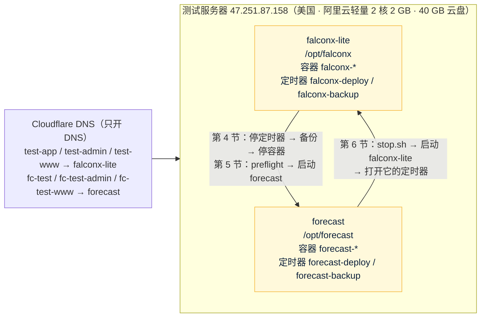

# 测试环境和切换：forecast 与 falconx-lite 轮流使用同一台测试服务器
- 版本：v1.4（2026-10-28）
- 编写：运维工程师（兼研发：`deploy/kit/` 的脚本）
- 来由：Amos 2026-10-25 答复 AQ-23："**AQ-23 我还是会用同一台服务器，但是在跑当前系统时，我会停掉原来cfd的项目 ，其他全部按建议**"（"cfd 的项目"= falconx-lite）。
- 依据：agents main `1f92bbc`（《平台规范/云服务器》v0.4：第二节"容器内存要算总账"C75、H4 被跳过的版本 C77、H7 合并后确认发布 C76、第三节"控制台 AI 助手"的坑；《运维工程师》v0.11）；`技术方案/v1-架构方案.md` v1.3 第 11 节；falconx-lite 的部署工具包和部署方案（远程 `staging` 分支 `2583328`，**只读**：`deploy/kit/`、`部署方案/v1-部署方案.md` 第 4、6、9.2、19 节）。
- 名字：本文要写出 falconx-lite 的目录、定时器、容器名，所以直接用它的名字（本文件已加进 `scripts/brand-check.json` 的排除名单）；本项目的脚本里不写它的名字。
- 状态：**待执行**。本文写为什么这样做（共用方式、内存总账、端口和证书、数据保留、出问题怎么办）；**Amos 照着做的在 `部署方案/v1-测试环境第一次部署清单.md`**：v2.0 起第一次部署是一条命令（`deploy/kit/oneclick.sh`），切换是 `sudo fc to-falconx` / `sudo fc to-forecast`，填密钥是 `sudo fc set-key`（`deploy/kit/fc.sh`）；原来的分步命令在那份清单的附录 A。本仓库里的脚本已在开发环境验证（第 10 节）。
- **不改 falconx-lite 的仓库**（已封存）。停它、启动它只用它服务器上已有的脚本和 systemd 定时器。

> **所有命令都由 Amos 在阿里云轻量应用服务器控制台的"远程连接"终端里粘贴执行**，智能体不登录服务器（《云服务器》H1）。
> **不要用控制台自带的 AI 助手执行本文的命令，也不要把命令输出、`.env` 内容、密码、API key 发给任何对话框（包括控制台 AI 助手和我）**：AI 助手会接管交互输入、向你要密钥（《云服务器》第三节）。截图前把密码、key 打码。需要填密钥时用 `sudo nano /opt/forecast/.env` 自己填。

## 一图看懂

这张图想说明：两个项目都装在这台服务器上，**同一时间只运行一个**；切换就是"停一个的定时器和容器 → 起另一个"，两个项目的数据目录都原样保留。两个项目各用各的子域名，DNS 都指向这台机器，哪个项目在运行，哪组域名就能打开。

## 1. 结论和前提

| 项 | 内容 |
|---|---|
| 测试环境放哪里 | falconx-lite 现在的测试服务器 47.251.87.158（美国阿里云轻量应用服务器 2 核 2 GB，40 GB 云盘，Ubuntu 24.04；`free -m` 总量 **1,613 MB**） |
| 怎么共用 | **轮流运行，同一时间只运行一个项目**。不做"两个同时跑"（内存放不下，第 3 节）；不加共用入口；不改 falconx-lite 的部署配置 |
| 生产 | 不受影响：按 AQ-15，新加坡单独一台（4 核 16 GB），上线前另写生产部署方案 |
| 什么时候做 | 测试环境第一次部署时（架构方案 S12）。前提见下表 |

| 前提 | 怎么确认 |
|---|---|
| forecast 仓库已经有 `staging` 分支，合并后那次 CI 全绿，`publish-staging` 推出了镜像（`forecast-app:staging`、`forecast-web:staging`）；staging 分支由研发从 main 建（SQ-44） | GitHub Actions 里 staging 那一次运行的 `publish-staging` 是绿的；研发把提交号告诉 Amos |
| 三个子域名的 DNS 已经指向这台服务器（第 8 节） | 研发从外部 `dig` 查到 47.251.87.158 |
| 服务器上已经 `docker login ghcr.io`（falconx-lite 部署时做过，同一个 GitHub 账号的令牌能读本项目的镜像） | 一键部署那条命令的 `docker pull` 能拉到镜像 |
| Amos 知道 falconx-lite 在切换期间打不开 | — |

## 2. 两个项目在服务器上的布局

| 项 | falconx-lite（不改） | forecast |
|---|---|---|
| 目录 | `/opt/falconx` | `/opt/forecast` |
| 数据 | `/opt/falconx/data/`（`mysql`、`redis`、`storage`），备份 `/opt/falconx/backup/` | `/opt/forecast/data/`（同样三个），备份 `/opt/forecast/backup/` |
| 密钥 | `/opt/falconx/.env` | `/opt/forecast/.env`（另外生成，不复制 falconx-lite 的任何值） |
| compose 项目名、容器 | `falconx`：`falconx-web-1`、`falconx-app-1`、`falconx-mysql-1`、`falconx-redis-1` | `forecast`：`forecast-web-1`、`forecast-app-1`、`forecast-mysql-1`、`forecast-redis-1` |
| 占用的端口 | 80、443（web）；127.0.0.1:8080（app） | 相同 → **不能同时运行** |
| 自动更新、备份 | systemd 定时器 `falconx-deploy.timer`（**每分钟**运行 `/opt/falconx/deploy.sh`，开机 2 分钟后开始）、`falconx-backup.timer`（每天 UTC 19:30） | `forecast-deploy.timer`、`forecast-backup.timer`（同样的频率） |
| 证书 | Let's Encrypt，证书名 `falconx`（`/etc/letsencrypt/live/falconx/`） | 证书名 `forecast`（`/etc/letsencrypt/live/forecast/`） |
| 域名 | `test-app`、`test-admin`、`test-www` `.quickcome.online` | `fc-test`、`fc-test-admin`、`fc-test-www` `.quickcome.online`（SQ-4） |
| 镜像 | `ghcr.io/dollar3651314/falconx-lite-*`（本机保留最近 5 个版本） | `ghcr.io/dollar3651314/forecast-*`（同样保留 5 个） |
| 系统级的共用部分 | Docker、certbot（系统自带的 `certbot.timer` 每天两次续期全部证书）、2 GB 交换分区、`/var/www/certbot`（证书验证目录）、云防火墙（只开 80、443，22 只对 Amos 的 IP） | 同左，不另装 |

"每分钟自动部署一次"是 falconx-lite 的 **systemd 定时器** `falconx-deploy.timer`，不是 crontab。只停容器不停它也不行：它每分钟运行一次 `deploy.sh`，staging 一有新版本就会把 falconx-lite 的容器重新拉起来；机器重启后它也会在 2 分钟后开始运行。所以第 4 节**先停定时器，再停容器**。

## 3. 内存总账（C75）

### 3.1 为什么不照搬 falconx-lite 的上限

falconx-lite 在这台机器上的上限是 `app` 768 + `mysql` 450 + `redis` 96 + `web` 64 = **1,378 MB**。系统和 Docker 自己用的内存，按 falconx-lite 在这台机器上的两次实测（部署方案第 9.2、19 节，Amos 截图）：

| 时间 | `free -m` 已用 | 容器实际占用（`docker stats`） | 系统 + Docker |
|---|---|---|---|
| 2026-10-16 刚启动 | 1,081 MB | 后端 354 + MySQL 226 + Redis 12 + Nginx 7 = 599 MB | 约 480 MB |
| 2026-10-21 重启后 | 958 MB | 后端 357 + MySQL 180 + Redis 和 Nginx 约 20 = 约 557 MB | 约 400 MB |

1,378 + 400～480 = **1,780～1,860 MB，超过 1,613 MB**。所以本项目不能照搬这组上限，按下表重新设（`deploy/kit/docker-compose.yml`）。JVM 参数的写法和 falconx-lite `deploy/app.Dockerfile` 相同（`MALLOC_ARENA_MAX=2`、`UseSerialGC`、`ExitOnOutOfMemoryError`、各部分都设上限），只是数值按 576 MB 容器算；镜像里的默认值保持和 falconx-lite 一样，测试环境在 compose 里用 `JAVA_TOOL_OPTIONS` 覆盖。

### 3.2 forecast 测试环境的上限

| 容器 | 各部分上限 | 合计 | `mem_limit` = `memswap_limit` | 实测（2026-10-25，开发环境） |
|---|---|---|---|---|
| `web`（Nginx） | — | — | **32 MB** | 7 MB |
| `app` | 堆 `-Xmx256m`（`-Xms128m`）+ 元空间 `-XX:MaxMetaspaceSize=128m` + 代码缓存 `-XX:ReservedCodeCacheSize=48m` + 直接内存 `-XX:MaxDirectMemorySize=32m` + 线程栈 `-Xss512k` × 约 110 个（Tomcat 最多 60 个 `SERVER_TOMCAT_THREADS_MAX=60`，加连接池、定时任务、推送）≈ 55 MB + GC、JIT、类库等其他本地内存约 50 MB | 约 570 MB | **576 MB** | 323 MB（部署形态跑完主流程）；单独测：常驻内存峰值 377 MB，元空间 86 MB、代码缓存 36 MB、堆已提交 131 MB、55 个线程 |
| `mysql` | `innodb_buffer_pool_size=128M` + 日志缓冲 8 + 键缓冲 8 + 其他全局约 100 + `max_connections=30` × 约 2 MB（后端连接池 `FC_DB_POOL_SIZE=15`）；`performance_schema=OFF` | 约 300 MB | **320 MB** | 167 MB |
| `redis` | `maxmemory 32mb` + 进程约 10 MB | 42 MB | **64 MB** | 4 MB |
| **容器合计** | | | **992 MB** | 约 500 MB |
| 系统 + Docker | 按 falconx-lite 的实测取 **450 MB**；停掉 falconx-lite 后用 `free -m` 核对（第 5.1 节） | | 450 MB | 待 Amos 截图 |
| **合计 / 总量 / 余量** | | | **1,442 / 1,613 / 约 170 MB（10%）** | |

- "实测"是在开发环境按同样的参数跑出来的【实测：`e2e/run-deployed.sh` 用的就是这份 compose 和这些上限，9 个用例全部通过；另外用默认形态跑全部端到端时开了 JVM 的 NMT】，不是在这台服务器上。第一次部署后请 Amos 截 `free -m` 和 `docker stats --no-stream`，写进第 9 节。
- 每个容器 `memswap_limit` 等于 `mem_limit`：超出上限时只有那个容器被杀掉、自动重启（`restart: unless-stopped`），不会像 2026-10-20 那样拖着整台机器换页卡死。后端堆满时 `ExitOnOutOfMemoryError` 直接退出重启。
- 交换分区（falconx-lite 建的 2 GB）留着，只给系统自己的进程兜底；容器用不到它。
- **余量不够时先调什么**：停掉 falconx-lite 后 `free -m` 的"已用"超过 450 MB 时（`preflight.sh` 会提醒），先把 MySQL 缓冲池降到 96M、`mem_limit` 降到 288 MB，再考虑后端堆降到 224 MB；改动走 PR、按正常流程发布。
- S15 的事件和文章自动化程序、S16 的 Telegram 机器人都跑在 `app` 进程里（不另起容器：另起一个 JVM 至少要 150 MB，余量只有约 170 MB）：内容程序多 2 个工作线程、堆里同时最多 2 张 1200 × 630 的图（约 6 MB），机器人一个长轮询线程，都在上面"约 110 个线程"和堆 256 MB 以内，上限不变（`deploy/kit/docker-compose.yml` 的注释、`开发记录/S15-自动化程序.md` 第 3 节）。S12 的部署形态端到端（含这两部分的用例）跑完后 `app` 的实测见第 10 节。抓取程序（AQ-18 第一期不建）没有算在里面；要上测试环境时先重算这张表（架构方案第 18.3 节）。

### 3.3 怎么确认内存没问题

| 什么时候 | 看什么 | 正常 |
|---|---|---|
| 停掉 falconx-lite 以后（一键部署第 3 步显示；清单附录 A1.8） | `free -m` 的 used（这时没有容器在运行） | ≤ 450 MB |
| forecast 刚启动 | `free -m`、`docker stats --no-stream` | used 约 1,000 MB 以内；四个容器都在上限的 70% 以下 |
| 运行几个小时后 | 同上，再看 `docker ps` 的 STATUS | 没有容器反复重启（STATUS 里 `Up` 的时间一直在增长） |

## 4. 停掉 falconx-lite

**一键部署第 3 步、`sudo fc to-forecast` 自动做**（`deploy/kit/switch-lib.sh` 的 `other_stop`）；手工命令在 `部署方案/v1-测试环境第一次部署清单.md` 附录 A1。要点：

- **先停定时器，再停容器**：`falconx-deploy.timer` 每分钟运行一次 `deploy.sh`，只停容器它会把容器重新拉起来（第 2 节）；`falconx-backup.timer` 一起停。
- 停之前用 falconx-lite 自己的 `backup.sh before-switch` 备份一次；容器只 `compose stop`，不删容器、不删数据（第 7 节）。
- 停完后确认 80、443、8080 空着，`free -m` 的 used ≤ 450 MB（第 3.3 节第一行）。
- 停掉以后 falconx-lite 的三个域名打不开（连接被拒绝或证书不匹配），这是预期的；服务器重启后 Docker 不会把手动停止的容器拉起来，定时器也已停用。

## 5. 启动 forecast

### 5.1 切换前检查（每次切到 forecast 都做）

`preflight.sh`（第一次部署时 `first-start.sh` 会自动运行它；以后的切换由 `start.sh` 运行；也可以单独运行）检查：另一个项目的容器和 deploy / backup 定时器已停、root 的 crontab 里没有别的部署命令、80 / 443 空着、根分区剩余（< 5 GB 不启动，< 10 GB 提醒；第一次拉 forecast 镜像约 1～1.5 GB，`mysql:8.4`、`redis:7` 和 falconx-lite 共用）、内存（总量够 992 + 450 + 150 MB；没有容器运行时已用 ≤ 450 MB）。**不通过就不启动**。DNS 在第一次部署前由研发从外部查；一键部署第 1 步还会在服务器上查三个域名是不是解析到这台服务器。

### 5.2 第一次部署（只做一次）

**一条命令**（`部署方案/v1-测试环境第一次部署清单.md` 第 2 节，脚本 `deploy/kit/oneclick.sh`，S12 一键部署）：启动前检查（内存、磁盘、端口、DNS）→ 记录切换前的状态 → 停 falconx-lite → 取部署工具包、`server-setup.sh`、装 `fc` → `init-env.sh` 生成密码和密钥对 → `preflight.sh` → `first-start.sh`（先申请证书再启动：Nginx 没有证书起不来）→ 本机验证 → 打印摘要（版本、网址、容器、`free -m`、`docker stats`、没填的可选密钥）。可以重复运行，做完的步骤跳过。之后研发从外部跑 `deploy/verify.sh`、Amos 在浏览器看证书和后台；可选密钥用 `sudo fc set-key` 填。手工分步在清单附录 A。Docker、`docker login ghcr.io`、certbot、交换分区、Docker 日志轮转在这台机器上都已经有了，不用重做。第一次部署时问 Amos 要不要开外部定时探测（《运维工程师》3.7，SQ-45）。

### 5.3 以后再切回 forecast

`sudo fc to-forecast`（清单第 4.1 节；手工步骤附录 A9）：停 falconx-lite（同第 4 节）→ `start.sh`（先跑 `preflight.sh`，用上次的版本启动，健康检查通过后打开两个定时器；staging 上有更新的版本时，自动更新会在 1 分钟内换上）。

### 5.4 改了 `.env` 怎样生效（S12 新增）

`deploy.sh` 只在 staging 有**新**版本时才动，版本没变时直接退出，改了 `.env` 不会生效。改完运行 `sudo bash /opt/forecast/reload-env.sh`：确认本项目在运行 → 等正在进行的自动更新结束 → 用当前版本 `docker compose up -d`（只重建配置变了的容器）→ 健康检查通过 → 列出 `alerts` 里还是 DOWN 的项（清单附录 A10）。Amos 填可选密钥用 `sudo fc set-key 变量名`（清单第 4.2 节）：隐藏输入、写进 `.env`、自动运行 `reload-env.sh`。

## 6. 切回 falconx-lite

**`sudo fc to-falconx`**（清单第 4.1 节，`deploy/kit/fc.sh`；手工步骤附录 A8）。要点：`sudo bash /opt/forecast/stop.sh`（停用 `forecast-*` 两个定时器 → 等正在进行的自动更新结束 → 备份数据库和文件 → **只停止**容器）→ 确认端口空着 → `sudo bash -c '. /opt/falconx/lib.sh && compose up -d'` 用 falconx-lite 上次运行的版本（`/opt/falconx/state/image.env`）启动 → 健康检查的版本号对得上 → 把停之前启用着的定时器原样打开（一键部署第 3 步记在 `/opt/forecast/state/other-project.env`；没有记录时两个都打开）。

- 不用 falconx-lite 的 `deploy.sh` 启动：它只在 staging 有**新**版本时才动，版本没变时直接退出，不会把停着的容器拉起来。
- falconx-lite 已封存，staging 不会再有新版本，打开它的定时器主要是为了每天备份；Amos 要求"原样启动，包括它的定时器"（S12 一键部署）。

## 7. 两个项目的数据都保留

| 能做 | 不能做 |
|---|---|
| `docker compose stop`（`fc`、清单附录 A1.6、`stop.sh` 用的方式）；`stop.sh`；`docker image prune -f`（只删没有标签的镜像） | `docker compose down -v`、`docker volume prune`、`docker system prune --volumes`、`docker system prune -a` |
| 看数据目录大小 `du -sh` | `rm -rf /opt/falconx/data`、`rm -rf /opt/forecast/data` 或这两个目录下的任何东西；`rm` 任何 `backup/` 下的文件（每天的备份脚本会自己删 7 天以前的） |
| 两个项目各自的 `backup.sh` | 用一个项目的 `restore.sh` 恢复另一个项目的备份 |

- 两个项目的数据都放在各自目录下的**普通文件夹**里（compose 里写的是 `./data/mysql` 这类目录映射，不是 Docker 的命名卷），容器停止、删除都不影响这些文件夹。
- 切换前各自自动备份一次（`fc` 用它自己的 `backup.sh before-switch`、`stop.sh`），备份放在各自的 `backup/` 下，保留 7 天。
- forecast 的备份（S12 起）每次是同一前缀的两个文件：`forecast-<时间>-<名字>.sql.gz`（数据库）和 `.storage.tgz`（对象存储目录 `data/storage/`：KYC 证件、裁决台存档截图），权限 600。恢复用 `sudo bash /opt/forecast/restore.sh /opt/forecast/backup/<文件名>.sql.gz`（会要求输入 `RESTORE`；先自动再备份一次 `before-restore`；同一前缀的文件包在时一起恢复）。分享卡片、内容程序的图片是按数据现画的，不落盘，不用备份。Redis 里只有限流计数和推送广播，不备份。

## 8. 80 / 443 端口、证书和 DNS

**端口**：两个项目的 Nginx 都要 80、443，后端都要 127.0.0.1:8080，所以只能运行一个。`preflight.sh` 发现别的项目的容器、定时器还在，或者端口被占着，就不启动；forecast 的 `deploy.sh` 发现别的项目占着 443 时也不更新（只在日志里记一行，版本记在 `/opt/forecast/state/paused`）。

**证书**：
- 两个项目各有一张 Let's Encrypt 证书（证书名 `falconx`、`forecast`），都在 `/etc/letsencrypt/` 下，互不影响。
- 续期由系统的 `certbot.timer` 每天两次检查，到期前 30 天自动续。用的是 HTTP 验证：Let's Encrypt 访问 `http://<域名>/.well-known/acme-challenge/...`，**哪个项目的 Nginx 在运行，就由它从共用目录 `/var/www/certbot` 给出验证文件**（两个项目的 Nginx 配置都对任何域名开放这个路径）。所以停着的那个项目的证书也能正常续期。
- 续期后的"重新加载 Nginx"钩子对停着的项目会失败（`docker exec falconx-web-1 ...` 找不到运行中的容器），**不影响证书本身**；那个项目下次启动时会直接读到新证书。
- 第一次部署 forecast 时 `first-start.sh` 用 `certbot --standalone` 申请证书，需要 80 端口空着（第 4 节已经停了 falconx-lite）。
- 确认：`sudo certbot certificates` 能看到 `falconx`、`forecast` 两张，"VALID: xx days"都大于 30。
- **对外预热域名（S18，P1：`www.quickcome.online`）**：加进同一张 `forecast` 证书，用一条命令 `sudo fc add-domain www.quickcome.online`（检查 DNS 指向本机 → 用 webroot 扩展证书（Nginx 不停，80 端口的验证路径由它回答；续期方式不变）→ 写进 `.env` 的 `PRELAUNCH_DOMAIN` → `reload-env.sh` → 在本机验证），可以重复运行（做完的步骤跳过）。第一次部署时 `.env` 里已经有 `PRELAUNCH_DOMAIN` 的话，`first-start.sh` 申请证书时一起带上。
- **证书里缺域名时**（例如以后改了某个子域名）：不用重跑 `first-start.sh`。forecast 正在运行时，在服务器上运行 `sudo certbot certonly --webroot -w /var/www/certbot --cert-name forecast --expand -d fc-test.quickcome.online -d fc-test-admin.quickcome.online -d fc-test-www.quickcome.online`（三个域名全部列出），成功后 `sudo docker exec forecast-web-1 nginx -s reload`；确认同上。

**DNS**（Cloudflare，`quickcome.online` 站点；SQ-4）：

| 类型 | 名称 | 内容 | 代理状态 | 用途 |
|---|---|---|---|---|
| A | `fc-test` | `47.251.87.158` | **仅 DNS（灰色云）** | forecast 测试环境客户端 |
| A | `fc-test-admin` | `47.251.87.158` | 仅 DNS | forecast 测试环境后台 |
| A | `fc-test-www` | `47.251.87.158` | 仅 DNS | forecast 测试环境官网 |
| A | `www` | `47.251.87.158` | 仅 DNS | S18 对外预热页（等候页，`sudo fc add-domain www.quickcome.online`；Amos 2026-10-28 P1 选方案 A） |

- 在 Cloudflare 控制台 → `quickcome.online` → DNS → Records → Add record，按上表加三条，TTL 用 Auto。falconx-lite 的 `test-app`、`test-admin`、`test-www` 三条不要动。
- 先只开 DNS、不开代理：和 falconx-lite 一样，证书和真实 IP 的处理不用改；打开 Cloudflare 代理和 Access（AQ-8、AQ-20）要等 Nginx 取真实 IP 的改动做完（架构方案第 11.7 节，S12），那时只给这三条打开代理。**这台服务器的云防火墙不能改成只放行 Cloudflare 的 IP**，否则切回 falconx-lite 时它的域名会打不开。
- 只加记录，不改站点级设置（SSL 模式、WAF 等），不影响其他子域名（AQ-22）。
- 怎么确认：在自己电脑上 `nslookup fc-test.quickcome.online`、`nslookup fc-test-admin.quickcome.online`、`nslookup fc-test-www.quickcome.online`，都返回 `47.251.87.158`；我从外部也会查一次。
- 哪个项目在运行，就只有哪组域名能打开；另一组域名在这期间打不开（443 上的 Nginx 不认识它，直接断开），这是预期的。

## 9. 测试服务器上的实测记录

第一次部署后填写（Amos 截图 + 我从外部验证）。

| 项 | 结果 | 怎么得到的 |
|---|---|---|
| 停掉 falconx-lite 后的 `free -m`（系统 + Docker） | 待填 | Amos 截图 |
| forecast 启动后的 `free -m`、`docker stats` | 待填 | Amos 截图 |
| 外部验证 `deploy/verify.sh` | 待填 | 实际执行（从开发环境） |
| 服务器上能不能访问 `data-api.binance.vision`、OKX、Coinbase、football-data.org、TheSportsDB、balldontlie、`smtp.resend.com`（这台在美国，币安主站会返回 451） | 待填 | 服务器上 `curl -s -o /dev/null -w '%{http_code}\n' <地址>`，Amos 截图 |
| 切回 falconx-lite 一次、再切回 forecast 一次 | 待填 | `sudo fc to-falconx`、`sudo fc to-forecast`，Amos 截图 |
| 测试服务器上的备份文件（数据库 + 文件包） | 待填 | 第一次每天备份（UTC 19:30）后 `sudo ls -lh /opt/forecast/backup/`，Amos 截图 |

## 10. 本仓库里的改动和验证

| 文件 | 改动 |
|---|---|
| `deploy/kit/docker-compose.yml` | 四个容器的上限按第 3.2 节；`app` 加 `JAVA_TOOL_OPTIONS`、`SERVER_TOMCAT_THREADS_MAX`、`FC_DB_POOL_SIZE`；MySQL 缓冲池 128M、连接 30；Redis `maxmemory 32mb` |
| `deploy/kit/preflight.sh`（新） | 启动前检查：别的项目的容器、端口、deploy / backup 定时器、crontab；磁盘；内存。只读，不通过返回 1 |
| `deploy/kit/start.sh`、`deploy/kit/stop.sh`（新） | 切回、切走本项目（第 5.3、6.1 步） |
| `deploy/kit/first-start.sh` | 第 0 步先运行 `preflight.sh` |
| `deploy/kit/deploy.sh` | 别的项目占着 443 时不更新 |
| `scripts/brand-check.json` | 本文件加进排除名单（要写 falconx-lite 的名字和服务器 IP）；S12 加第一次部署清单 |
| `deploy/kit/backup.sh`、`restore.sh`（S12） | 备份同时打包对象存储目录（`.storage.tgz`），恢复时一起恢复；用后端镜像临时起一个容器打包、解包（uid 10001，后端停着也能做）；`restore.sh` 等的版本号改成当前镜像里记录的提交号 |
| `deploy/kit/reload-env.sh`（S12，新） | 改了 `.env` 后让它生效（第 5.4 节） |
| `deploy/kit/lib.sh`、`init-env.sh`（S12） | 目录、compose 项目名、覆盖文件可以用环境变量换掉，只用于开发机上演练（服务器上 sudo、systemd 都不带这些变量） |
| `deploy/kit/env.example`（S12） | 每个变量标【必填·自动】【验收前填】【可选】；补上 `FC_WALLET_ERC20_CHAIN_ID`、`FC_WALLET_BSC_CHAIN_ID`；`scripts/check-deploy-env.mjs`（CI 的 checks）检查 application.yml、compose、env.example 三处一致 |
| `deploy/kit/oneclick.sh`、`fc.sh`、`switch-lib.sh`（S12 一键部署，新） | 第一次部署一条命令；切换 `fc to-falconx` / `fc to-forecast`、`fc status`；填密钥 `fc set-key`、`fc keys`；另一个项目按 systemd 定时器找到（脚本里不写它的名字） |
| `deploy/kit/first-start.sh`、`init-env.sh`、`lib.sh`（S12 一键部署） | `first-start.sh` 可以重复运行（证书已有跳过、版本已记录时确保在运行、已改成自动续期的不再改）；证书提醒邮箱可以空着（`--register-unsafely-without-email`，推送联系方式用 `https://<客户端域名>`）；演练时（`FC_OFFLINE_TEST=1`）不清理镜像 |
| `e2e/oneclick-drill.sh`（S12 一键部署，新） | 一键部署和 `fc` 的演练（假的另一个项目、systemctl / certbot 替身）；CI 的 `e2e-deployed` 在部署形态端到端之后运行 |
| `deploy/verify.sh`（S12） | 加 `/data`、robots.txt、sitemap.xml、不存在的市场 404、`/api/e2e/telegram/*` 被拦 |
| `e2e/run-deployed.sh`（S12） | 最后加备份恢复演练；镜像标签可以用 `E2E_IMAGE_TAG` 换掉，不覆盖同一台机器上别人的 `e2e-local` |

验证（2026-10-25，开发环境，实际执行）：
- `bash -n`、`shellcheck -S warning` 检查 `deploy/kit/` 下改动和新增的脚本：没有问题。
- 部署形态端到端 `e2e/run-deployed.sh`（真实镜像 + 这份 compose + 新上限 + Nginx + HTTPS）：9 个用例全部通过；跑完后 `docker stats`：`web` 6.6 / 32 MB、`app` 322.9 / 576 MB、`mysql` 167.0 / 320 MB、`redis` 4.3 / 64 MB。
- 默认形态端到端（同样的 JVM 参数 + NMT）：6 个用例通过（另外 3 个是部署形态专用，跳过）；后端常驻内存峰值 377 MB。
- **没有在测试服务器上执行**：`preflight.sh`、`start.sh`、`stop.sh` 依赖服务器上的 systemd、两个项目的定时器和容器，开发环境只做了语法和静态检查；第一次在服务器上执行时，每一步都按"怎么确认"核对，结果写进第 9 节。

验证（2026-10-26，S12，开发环境，实际执行；详细结果见 `开发记录/S12-测试环境部署准备.md` 第 5 节）：
- 部署形态端到端（整合 4 之后的全部用例 + 新的备份恢复演练）、测试环境配置（不是 e2e profile）在可选密钥全空时启动、`init-env.sh` 生成 `.env`、`reload-env.sh`、`verify.sh`（本机假域名）；结果和内存实测见开发记录。

## 11. 出问题怎么办

| 现象 | 原因 | 处理 |
|---|---|---|
| `preflight.sh` 报"这些容器还在运行" | falconx-lite 没停完 | 再粘贴一次一键部署的命令（第 3 步会停它）；手工见清单附录 A1.6 |
| `preflight.sh` 报"这些定时器还启用着" | 定时器没停 | 同上；手工见清单附录 A1.2 |
| 停了 falconx-lite 几分钟后它又起来了 | 定时器没停 | `sudo systemctl disable --now falconx-deploy.timer falconx-backup.timer`，再做清单附录 A1.6 |
| forecast 某个容器反复重启，`docker ps` 里 `Up` 的时间总是几秒、几分钟 | 可能超过了内存上限被杀掉 | `sudo docker inspect forecast-app-1 --format '{{.State.OOMKilled}}'` 是 `true` 就是内存；截图 `docker stats`、`free -m` 给我，按第 3.2 节调整（走 PR） |
| 新版本一直没上线 | 失败过的版本记在 `/opt/forecast/state/skip`，不再重试（C77）；或者另一个项目在运行（`/opt/forecast/state/paused`） | 看 `sudo tail -20 /opt/forecast/logs/deploy.log`；环境问题修好后 `sudo rm /opt/forecast/state/skip`，下一分钟会再试 |
| 证书快过期 | 续期失败 | `sudo certbot renew --dry-run` 截图给我 |
| 服务器整台卡住、连不上 | — | 在轻量控制台"重启"；重启后只有重启前在运行的那个项目会自动起来（另一个是手动停止的，定时器也停用了）；再按第 3.3 节看内存 |

## 12. 生产环境

不在这台服务器上。按 AQ-15：阿里云轻量**新加坡**单独一台（4 核 16 GB，省钱版 2 核 8 GB 要 S12 压测后定），MySQL 在容器里、每天全量加每 15 分钟增量加密备份到 Cloudflare R2（AQ-16），Cloudflare 免费代理和 Access（AQ-8、AQ-20）。生产的部署方案在测试环境验收通过、买服务器之前另写，交 Amos 确认（架构方案第 11 节）。

## 13. S6、S7 带来的部署事项（v1.1，整合 2 时落实 S6 F-15、S7 F-18）

S6（加密自动生成、自动裁决）和 S7（平台裁决、公示、争议、补偿）给运维的交接，第一次部署（S12）时按下表核对。代码和部署配置已在仓库里，**不需要 Amos 在 `.env` 里新填任何密钥**。

| 项 | 内容 | 什么时候、怎么确认 |
|---|---|---|
| 新环境变量 `FC_SOURCE_COINBASE_ENABLED` | 加密自动裁决的第三源 Coinbase，默认 `false`（主备一方拿不到时才补位）；已写进 `deploy/kit/docker-compose.yml`、`deploy/kit/env.example`，不填就是关 | 不用改；要打开时 Amos 在 `.env` 里写 `true` 后 `sudo bash /opt/forecast/reload-env.sh`（v1.1 写的 `deploy.sh` 在版本没变时直接退出，不会生效，S12 改正） |
| 出站访问 | 服务器要能访问 `data-api.binance.vision`、`www.okx.com`（打开第三源时还有 `api.coinbase.com`）；币安主站 `api.binance.com` 在美国会返回 451，本项目不用它 | 第一次部署时按第 9 节"服务器上能不能访问……"那一行 `curl` 检查，结果写进第 9 节 |
| 数据源冒烟测试 | `RealSourcesSmokeTest`（打真实的币安、OKX、Coinbase）要 JDK 和 Maven，服务器上没有；**在开发环境跑**：`mvn -o -B -ntp test -Dtest=RealSourcesSmokeTest -Dresolve.smoke=true`（项目地图第 6 节）。服务器所在地的可用性用上一行的 `curl` 确认 | S12 第一次部署前后各跑一次，结果写进第 9 节 |
| 新告警项 | 健康检查 `alerts` 里的 `source.binance`、`source.okx`（数据源连续失败、熔断）；只告警、不影响 `status`（不会触发自动回滚） | 部署后看后台域名 `/api/health` 的 `alerts`，这两项是 UP |
| 平台裁决的定时任务 | `forecast.resolve.platform-enabled`（默认 `true`：公示期满结算、E6 / E7 等待到期、超时提醒）；第一期单实例，多实例时每个实例都开、靠租约（`resolve.publicity`、`resolve.timeouts`）只跑一个 | 不用配；测试环境单实例 |
| 裁决提醒的收件人 | `FC_RISK_ALERT_EMAILS` 现在除了结算异常，还收"自动裁决失败""新提议""新争议""超时"提醒（SQ-14：第一期先发告警邮箱，S9 改按角色发） | 填告警收件人时一起填：`sudo fc set-key FC_RISK_ALERT_EMAILS`（清单第 4.2 节） |
| **存档截图要一起备份** | 裁决台上传的截图（S7，只增不改、永久保留）和 KYC 证件一样存在对象存储目录 `/opt/forecast/data/storage/`（截图在 `resolve/` 下，证件在 `kyc/` 下）。v1.1 时 `backup.sh` 只导出数据库，没有打包这个目录 | **S12 已修**：`backup.sh` 每次同时打包 `data/storage/`（`.storage.tgz`，保留 7 天、权限 600），`restore.sh` 一起恢复（第 7 节）；部署形态端到端 `e2e/run-deployed.sh` 每次最后用这两个脚本做一次备份恢复演练（第 10 节） |

## 变更历史
- v1.4（2026-10-28，S18 台湾预热）：第 8 节加对外预热域名 `www.quickcome.online`（DNS 一条 A 记录、`sudo fc add-domain` 扩展证书）。它和三个测试域名在同一台服务器、同一套容器上：切到 falconx-lite 时它也打不开（和三个测试域名一样）。
- v1.3（2026-10-27，S12 一键部署）：第一次部署改成一条命令（`oneclick.sh`），切换、填密钥改成 `fc` 命令；第 4、5.2、5.3、5.4、6 节和第 11 节的引用改到新清单（v2.0）的第 2、4 节和附录 A；切回 falconx-lite 时它的定时器按停之前的样子打开；第 10 节记新脚本。
- v1.2（2026-10-26，S12）：操作步骤（原第 4、5.2、5.3、6 节）移到新文件 `部署方案/v1-测试环境第一次部署清单.md`，本文只留要点；第 3.2 节写明内容程序、Telegram 机器人在 `app` 进程的上限以内；新增第 5.4 节（改了 `.env` 用 `reload-env.sh` 生效）、第 7 节备份含文件包、第 8 节"证书里缺域名"；第 13 节备份问题已修、Coinbase 开关生效的命令改正（`deploy.sh` 在版本没变时不会生效）；第 10 节记 S12 的改动和验证。
- v1.0（2026-10-25）首次创建：按 Amos 对 AQ-23 的答复写测试服务器的共用方式、内存总账（C75）、停 falconx-lite、启动 forecast、切回、数据保留、端口和证书、DNS；`deploy/kit/` 加 `preflight.sh`、`start.sh`、`stop.sh`。
- v1.1（2026-10-25，整合 2）：新增第 13 节，落实 S6、S7 开发记录里给运维的交接（F-15、F-18）：新环境变量、出站访问、冒烟测试在哪里跑、新告警项、平台裁决任务、裁决提醒收件人；发现 `backup.sh` 没有备份对象存储目录（证件、裁决截图），S12 前修。
