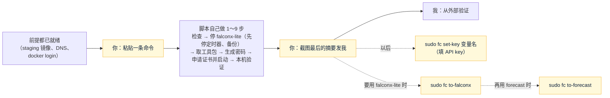

# 测试环境第一次部署：一条命令
- 版本：v2.0（2026-10-27）
- 编写：运维工程师（兼研发），开发阶段 S12（一键部署）
- 来由：Amos 看了 v1.0（一步一步的命令）："你写的部署清单太复杂了，我需要操作很久，可以有简单点儿的操作方式吗，最好是一键式操作"。v2.0 把第一次部署做成**一条命令**，切换、填密钥各一条命令；原来的分步命令移到本文**附录 A**，给研发排查用。为什么这样做（两个项目轮流用一台服务器、内存总账、端口和证书）在 `部署方案/v1-测试环境与切换.md`。
- 状态：**待执行**。脚本在开发环境按服务器的样子演练过（`开发记录/S12-测试环境部署准备.md` 第 10.3 节），**还没有在测试服务器上执行过**。
- 依据：agents main `60f0a70`（《平台规范/云服务器》v0.4 H1、H2、第三节；《运维工程师》v0.12 3.6、C75～C77）。

> **在哪里粘贴**：阿里云轻量应用服务器控制台 → 这台服务器（47.251.87.158）→ "远程连接"打开的终端。**不要用控制台里的 AI 助手**（它会接管输入、向你要密钥）。
> **密钥不经过任何对话框**：脚本自己生成数据库密码等，屏幕上不显示；以后填 API key 时也只粘贴在这个终端里，不发给我。
> **截图前**：一键部署和 `fc` 命令的输出里没有密钥，可以直接截图；只有你自己用 `grep`、`nano` 看 `.env` 的那些画面不要截图。

## 一图看懂



这张图想说明：你只要粘贴一条命令、截一张图；中间的 9 步脚本自己做，出错会停下来告诉你原因。黄色是你做的事。

## 1. 前提（都已就绪）

| 什么 | 状态 |
|---|---|
| 本清单所在的 PR 合并、并发布到 staging（命令要用 staging 镜像里的新脚本） | 研发做（SQ-49）；**我告诉你"可以开始"再粘贴** |
| 三条 DNS `fc-test`、`fc-test-admin`、`fc-test-www` → 47.251.87.158，灰色云 | ✓ 已生效（10-26 我从外部查过） |
| 服务器已经 `docker login ghcr.io` | ✓ falconx-lite 部署时做过 |
| 切换期间 falconx-lite 的三个域名打不开 | 你已知道 |
| （可以以后再做）Resend、Gemini、体育数据源、Telegram 的 key | 部署完用第 4.2 节的命令填，空着也能启动 |

## 2. 复制粘贴这一条命令

```bash
sudo docker pull ghcr.io/dollar3651314/forecast-web:staging && sudo bash -c "$(sudo docker run --rm --entrypoint cat ghcr.io/dollar3651314/forecast-web:staging /forecast-kit/oneclick.sh)"
```

- 整行复制、粘贴、回车。大约 **5～10 分钟**（第一次要下载镜像），中途**不会问你任何问题**，等它自己结束。
- 屏幕上每做完一步出一行"✓ 第 N 步：……"，详细输出写在服务器的 `/opt/forecast/logs/oneclick-<时间>.log`。
- 想收 Let's Encrypt 证书到期提醒（续期是自动的，一般用不到）：把命令最后的 `sudo bash -c` 改成 `sudo FC_CERT_EMAIL=你的邮箱 bash -c`。默认不留邮箱（SQ-50）。

## 3. 看到什么就算成功

1. 屏幕上是 **✓ 第 1 步 到 ✓ 第 9 步**，没有 ✗。
2. 最后有一段"forecast 测试环境部署结果"，里面：
   - "当前版本"后面写着"和 staging 镜像一致 ✓"，提交号的前 8 位和我告诉你的一样；
   - 4 个 `forecast-*` 容器都是 `Up`，`mysql`、`redis` 后面有 `(healthy)`；
   - 内存：`free -m` 的 `used` 在 1,000 MB 左右以内；`docker stats` 里 4 个容器的 `MEM %` 都在 70% 以下。
3. **把这一屏截图发我**（没有密钥，不用遮）。我从外部跑验证脚本，结果写进《测试环境与切换》第 9 节。

成功时大概是这样（开发环境演练 `e2e/oneclick-drill.sh` 的真实输出，只把演练用的假项目名、假域名、IP 换成了真实的；演练机器是 16 GB 内存，服务器上 `total` 约 1,613；去掉了两行演练机器才有的内存提醒）：

```
forecast 测试环境一键部署（2026-10-27 04:01:03 UTC）
详细输出写在 /opt/forecast/logs/oneclick-20261027-040103.log

✓ 第 1 步：启动前检查（内存 16091 MB、磁盘剩 11 GB、端口、DNS 三个域名 → 47.251.87.158）
    另一个项目：falconx（目录 /opt/falconx），第 3 步会先停它
✓ 第 2 步：记录切换前的状态（已用内存 787 MB、运行中的容器 4 个；写在 /opt/forecast/logs/before-switch-20261027-040104.txt）
  … 第 3 步：停掉 falconx（先停定时器 → 备份 → 停容器，约 1 分钟）
✓ 第 3 步：停掉 falconx（定时器已停用、已备份、容器已停止，数据都保留；这时已用内存 786 MB）
  … 第 4 步：一次性准备（certbot、目录、定时器文件；约 1 分钟）
✓ 第 4 步：取出部署工具包到 /opt/forecast（版本 8137fcf8acfc，更新 22 个文件；.env、数据、备份不动），装好切换命令 fc
✓ 第 5 步：生成 .env 里的数据库和 Redis 密码、推送密钥对、超管初始密码（写在 /opt/forecast/.env，只有 root 能读，这里不显示值）
✓ 第 6 步：启动前检查 preflight.sh 通过
  … 第 7 步：申请证书并启动（第一次要下载镜像，约 3～6 分钟，请等它自己结束）
✓ 第 7 步：申请证书并启动（证书包含三个域名；版本 8137fcf8acfc 已启动，健康检查通过；自动更新和每天备份已打开）
✓ 第 8 步：在服务器本机验证（4 个容器正常、健康检查 UP、测试环境标识、三个域名 HTTPS 和跳转、证书还有 89 天、两个定时器已启用）
✓ 第 9 步：完成。下面的摘要没有密钥，可以直接截图发我

==================== forecast 测试环境部署结果 ====================
当前版本：8137fcf8acfc0ff5f92b70a93b518b8a49a014f6（和 staging 镜像一致 ✓）
网址：
  客户端  https://fc-test.quickcome.online
  后台    https://fc-test-admin.quickcome.online
  官网    https://fc-test-www.quickcome.online
容器：
  forecast-app-1  Up 14 seconds
  forecast-mysql-1  Up 24 seconds (healthy)
  forecast-redis-1  Up 24 seconds (healthy)
  forecast-web-1  Up 13 seconds
内存（free -m）：
                 total        used        free      shared  buff/cache   available
  Mem:           16091        1251       12637          15        2507       14839
  Swap:              0           0           0
容器内存（docker stats --no-stream）：
  NAME               MEM USAGE / LIMIT   MEM %     CPU %
  forecast-app-1     324.1MiB / 576MiB   56.27%    7.70%
  forecast-mysql-1   159.9MiB / 320MiB   49.97%    1.17%
  forecast-redis-1   3.84MiB / 64MiB     6.00%     0.33%
  forecast-web-1     3.848MiB / 32MiB    12.02%    0.00%
还没填的可选密钥： FC_MAIL_PASSWORD FC_GEMINI_API_KEY FC_SRC_FOOTBALL_DATA_TOKEN FC_SRC_BALLDONTLIE_KEY FC_SRC_THESPORTSDB_KEY FC_TELEGRAM_BOT_TOKEN
===================================================================
之后：
  填密钥（屏幕上不显示值）：sudo fc set-key 变量名      看哪些填了：sudo fc keys
  切回 falconx：sudo fc to-falconx      再切回 forecast：sudo fc to-forecast      看状态：sudo fc status
  后台初始密码只在服务器上看：sudo grep ^FC_ADMIN_INIT_PASSWORD= /opt/forecast/.env （这一行的输出不要截图）
日志：/opt/forecast/logs/oneclick-20261027-040103.log
```

然后在浏览器里看三件我在外部验证不了的事：

| 看什么 | 怎么做 | 应该是 |
|---|---|---|
| 证书 | 打开 `https://fc-test.quickcome.online`，点地址栏的锁 | 签发方是 Let's Encrypt，不是"不安全" |
| 客户端 | 同一个页面 | 顶部有"测试环境"标识条，市场列表能打开 |
| 后台 | 打开 `https://fc-test-admin.quickcome.online`，用户名 `admin`；初始密码在终端里运行 `sudo grep ^FC_ADMIN_INIT_PASSWORD= /opt/forecast/.env` 自己看（**这一屏不要截图**） | 登录后要求改密码，改完能进后台 |

## 4. 之后的事

### 4.1 在两个项目之间切换

| 要做什么 | 粘贴 | 它会做 |
|---|---|---|
| 用 falconx-lite | `sudo fc to-falconx` | 停 forecast（停定时器 → 备份 → 只停容器）→ 原样启动 falconx-lite 和它的两个定时器 |
| 回到 forecast | `sudo fc to-forecast` | 停 falconx-lite（停定时器 → 用它自己的脚本备份 → 只停容器）→ 启动 forecast |
| 看现在是谁在运行 | `sudo fc status` | 两个项目各自的容器、定时器、版本，谁占着 443 |

两个项目的数据都保留，切换不丢数据；每次大约 1～2 分钟。**命令前一定要带 `sudo`**：不带 `sudo` 敲 `fc` 会运行系统自带的另一个同名命令（SQ-52）。正在用的那组域名能打开，另一组打不开是正常的。

### 4.2 填密钥（API key、token）

```bash
sudo fc set-key FC_MAIL_PASSWORD
```
提示出来以后**粘贴值、回车**（屏幕上不显示，是正常的）。它会写进 `.env`、自动让它生效（约 1～2 分钟），最后显示"已设置（不显示值）"和健康检查结果。`sudo fc keys` 看哪些已填、哪些没填（只显示名字）。

| 变量名 | 是什么 | 去哪申请 |
|---|---|---|
| `FC_MAIL_PASSWORD` | Resend 的 API key（注册验证码邮件要用；填它时发信服务器、发信地址 `noreply@fc-email.quickcome.online` 自动一起填好） | 《Amos 待办》T3 |
| `FC_GEMINI_API_KEY` | Gemini 的 key（后台 AI 起草要用） | 《Amos 待办》T4 |
| `FC_SRC_FOOTBALL_DATA_TOKEN`、`FC_SRC_BALLDONTLIE_KEY`、`FC_SRC_THESPORTSDB_KEY` | 体育数据源（没填的来源"未开通"，用到它的体育市场转人工） | 《Amos 待办》T14a～T14c |
| `FC_TELEGRAM_BOT_TOKEN` | Telegram 机器人 | 《Amos 待办》T16a（后面的 T16b～T16d 在后台操作） |
| `FC_ALERT_EMAILS`、`FC_RISK_ALERT_EMAILS` | 收监控告警、资金告警的邮箱（不是密钥，也用这个命令填；多个用逗号隔开） | 你自己的邮箱 |

变量名打错时它会提示正确的写法。区块链、合约地址那些（待办 T5～T10）按 `部署方案/v1-归集合约部署.md` 用 `sudo nano /opt/forecast/.env` 填，填完运行 `sudo bash /opt/forecast/reload-env.sh`。

## 5. 出错了怎么办

**屏幕上出现 ✗ 时**，下面会写"原因"和"下一步"。按"下一步"处理好，**再粘贴同一条命令**：做完的步骤会自动跳过（`.env` 已有不覆盖、证书已有不重新申请、falconx-lite 已停不再停）。不知道怎么处理，就截图发我（✗ 那几行里没有密钥）。

| 停在哪一步 | 常见原因 | 怎么办 |
|---|---|---|
| 拉取镜像（第 0 步） | `denied` / `unauthorized`：GitHub 令牌过期 | 在终端运行 `sudo docker login ghcr.io`，用户名填 GitHub 用户名、密码粘贴令牌（只粘贴在服务器上），再粘贴命令 |
| 第 1 步 | 端口被不是容器的程序占着；DNS 没指向这台；内存或磁盘不够；有不认识的容器 | 第 1 步**只检查、不改任何东西**，falconx-lite 还在原样运行。截图发我 |
| 第 3 步 | falconx-lite 自己的备份失败 | 脚本**没有停它的容器**，定时器已恢复原样。截图发我 |
| 第 7 步，说"证书没有申请下来" | DNS 还没生效、云防火墙没开 80 | 在 Cloudflare、轻量服务器防火墙里核对后再粘贴命令 |
| 第 7 步，说"启动或健康检查没有通过" | 后端没起来 | 截图发我 |
| 其他 | — | 截图发我；需要时我会让你运行附录 A 里的某一条命令 |

**想回到 falconx-lite**：任何时候都可以 `sudo fc to-falconx`（第一次部署失败了也可以）。

## 附录 A：手工分步（v1.0 的清单，给研发排查用）

一键部署第 1～9 步和 `fc` 命令做的就是下面这些事（脚本：`deploy/kit/oneclick.sh`、`deploy/kit/fc.sh`、`deploy/kit/switch-lib.sh`）。正常情况下 Amos 不用看；排查时研发会指明运行其中某一条。附录里写的"第 N 节 / 第 N.M 步"指本附录的 A N / A N.M。

| 一键部署的步骤 | 对应的手工步骤 |
|---|---|
| 第 1 步 启动前检查 | A1.4（crontab）、A1.7（端口）、A4 的磁盘和内存部分；另外查三个域名的 DNS |
| 第 2 步 记录切换前的状态 | A1.1（写在 `/opt/forecast/logs/before-switch-<时间>.txt`） |
| 第 3 步 停 falconx-lite | A1.2、A1.3、A1.5、A1.6（停之前启用着哪些定时器记在 `/opt/forecast/state/other-project.env`，`fc to-falconx` 原样打开）、A1.8 |
| 第 4 步 取工具包 | A2.2、A2.3（`server-setup.sh` 只在第一次运行）；装 `/usr/local/bin/fc` |
| 第 5 步 生成 `.env` | A3.1（不留证书提醒邮箱时第 3 个参数是空的）；A3.2 由 `fc set-key` 代替 |
| 第 6 步 | A4 |
| 第 7 步 | A5（`first-start.sh`，可以重复运行） |
| 第 8 步 本机验证 | A5 的"怎么确认做好了"、A6.2 的证书部分（按域名访问本机、校验证书） |
| 第 9 步 摘要 | A7 |
| `sudo fc to-falconx` / `to-forecast` | A8 / A9 |
| `sudo fc set-key` | A3.2 + A10 |

### A1 停掉 falconx-lite（先停定时器，再停容器）

"每分钟自动部署"是 falconx-lite 的 systemd 定时器 `falconx-deploy.timer`：只停容器不停它，它会在 1 分钟内把容器重新拉起来，所以**先停定时器**。数据都保留，以后按第 8 节原样启动。

#### A1.1 记下切换前的状态
```bash
free -m && df -h / && docker ps --format '{{.Names}}  {{.Status}}'
```
**怎么确认做好了**：看到 4 个 `falconx-*` 容器都是 `Up`。截图发我（这里没有密钥）。

#### A1.2 停掉 falconx-lite 每分钟自动部署和每天备份的定时器
```bash
sudo systemctl disable --now falconx-deploy.timer falconx-backup.timer
```
**怎么确认做好了**：运行下面两行，
```bash
systemctl is-enabled falconx-deploy.timer falconx-backup.timer
systemctl is-active falconx-deploy.timer falconx-backup.timer
```
第一行输出两个 `disabled`，第二行输出两个 `inactive`。

#### A1.3 确认这一刻没有正在进行的自动部署
```bash
systemctl is-active falconx-deploy.service
```
**怎么确认做好了**：显示 `inactive`。如果是 `activating`，等 1～2 分钟再运行一次，直到 `inactive`。

#### A1.4 确认 crontab 里也没有部署命令
```bash
sudo crontab -l; crontab -l
```
**怎么确认做好了**：显示 `no crontab for ...`，或者里面没有 `/opt/falconx` 的行。有的话截图给我，先不要往下做。

#### A1.5 切换前给 falconx-lite 的数据库备份一次（用它自己的脚本）
```bash
sudo bash /opt/falconx/backup.sh before-switch
```
**怎么确认做好了**：最后一行是"备份完成：falconx-…-before-switch.sql.gz（…）"；再运行 `sudo ls -lh /opt/falconx/backup/` 能看到这个文件。

#### A1.6 只停止 falconx-lite 的 4 个容器（不删容器、不删数据）
```bash
sudo bash -c '. /opt/falconx/lib.sh && compose stop'
```
**怎么确认做好了**：
```bash
docker ps -a --filter name=falconx --format '{{.Names}}  {{.Status}}'
```
四行都是 `Exited`。**不要**用 `docker compose down -v`、`docker volume prune`、`docker system prune`，也不要删 `/opt/falconx` 下的任何东西。

#### A1.7 确认 80、443、8080 端口空出来了
```bash
sudo ss -ltnp | grep -E ':(80|443|8080) '
```
**怎么确认做好了**：没有任何输出。

#### A1.8 看系统和 Docker 自己用多少内存
```bash
free -m
```
**怎么确认做好了**：`Mem:` 那一行的 `used` ≤ 450（内存总账的假设，部署方案第 3 节）。**截图发我**；超过 450 也先截图，我按部署方案第 3.2 节调整，你先不要往下做。

### A2 拉镜像、取部署工具包（服务器上不拉代码）

代码已经在 CI 里测试并打成镜像（第 0.2 步），服务器只拉镜像；部署工具包（脚本、compose、systemd 文件）在前端镜像里，取出来放到 `/opt/forecast/`。

#### A2.1 拉本项目的两个镜像
```bash
sudo docker pull ghcr.io/dollar3651314/forecast-web:staging && sudo docker pull ghcr.io/dollar3651314/forecast-app:staging
```
**怎么确认做好了**：最后两行分别是 `ghcr.io/dollar3651314/forecast-web:staging`、`ghcr.io/dollar3651314/forecast-app:staging`。如果出现 `denied` / `unauthorized`，截图给我（令牌可能过期，要重新 `docker login ghcr.io`，令牌只粘贴在服务器上，不发给我）。

#### A2.2 取出部署工具包
```bash
sudo mkdir -p /opt/forecast && sudo docker run --rm --entrypoint sh -v /opt/forecast:/out ghcr.io/dollar3651314/forecast-web:staging -c 'cp -r /forecast-kit/. /out/'
```
**怎么确认做好了**：
```bash
ls /opt/forecast && cat /opt/forecast/VERSION
```
能看到 `backup.sh`、`deploy.sh`、`docker-compose.yml`、`env.example`、`first-start.sh`、`init-env.sh`、`preflight.sh`、`reload-env.sh`、`restore.sh`、`start.sh`、`stop.sh`、`server-setup.sh`、`systemd`；`VERSION` 是我告诉你的提交号。

#### A2.3 一次性准备（目录、空的 `.env`、`forecast-*` 定时器，先不启动）
```bash
sudo bash /opt/forecast/server-setup.sh
```
**怎么确认做好了**：最后一行"准备完成"；`ls /etc/systemd/system/forecast-*` 能看到 4 个文件。交换分区、Docker 日志轮转这台机器上已经有了，会跳过。

### A3 填 `.env`（这里只写变量名，值由你在服务器上填）

#### A3.1 自动生成不用你提供的值
```bash
sudo bash /opt/forecast/init-env.sh fc-test.quickcome.online fc-test-admin.quickcome.online 证书提醒邮箱 fc-test-www.quickcome.online
```
把"证书提醒邮箱"换成你收 Let's Encrypt 到期提醒的邮箱（会写进 `CERT_EMAIL`，也用作浏览器推送的联系方式）。

**怎么确认做好了**：输出"完成"，并列出"还空着的"变量（邮件、区块链、Gemini、体育数据源、Telegram 这时空着是正常的）。生成的是：`MYSQL_ROOT_PASSWORD`、`FC_DB_PASSWORD`、`FC_REDIS_PASSWORD`、`FC_ADMIN_INIT_USERNAME`（admin）、`FC_ADMIN_INIT_PASSWORD`、`FC_PUSH_VAPID_PUBLIC_KEY`、`FC_PUSH_VAPID_PRIVATE_KEY`、`FC_PUSH_VAPID_SUBJECT`，屏幕上不显示值。

#### A3.2 自己填密钥（用 nano，不要截图）
```bash
sudo nano /opt/forecast/.env
```
在 nano 里找到对应的行，在 `=` 后面填值（不加引号、不加空格）；`Ctrl+O` 回车保存，`Ctrl+X` 退出。每个变量在文件里都标了【必填·自动】【验收前填】【可选】：

| 变量 | 填什么 | 这次要不要填 | 没填会怎样 |
|---|---|---|---|
| `FC_MAIL_HOST` | `smtp.resend.com` | 验收前填（T3） | 邮件只写日志，注册收不到验证码 |
| `FC_MAIL_PORT`、`FC_MAIL_SECURITY` | `587`、`STARTTLS`（文件里已经是这两个值） | 不用改 | — |
| `FC_MAIL_USERNAME` | `resend` | 验收前填（T3） | 同上 |
| `FC_MAIL_PASSWORD` | **Resend 的 API key，你自己粘贴** | 验收前填（T3） | 同上 |
| `FC_MAIL_FROM` | `noreply@fc-email.quickcome.online`（必须是 Resend 里验证过的那个子域名） | 验收前填（T3） | 同上 |
| `FC_ALERT_EMAILS` | 收监控告警的邮箱，多个用逗号隔开 | 验收前填 | 告警只写日志 |
| `FC_RISK_ALERT_EMAILS` | 收资金告警、裁决提醒的邮箱，多个用逗号隔开 | 可选 | 只写日志 |
| `FC_GEMINI_API_KEY` | **Gemini 的 key，你自己粘贴**（T4） | 可选，用到再填 | 后台"Gemini 未配置"，AI 起草不可用，其他照常 |
| `FC_SRC_FOOTBALL_DATA_TOKEN`、`FC_SRC_BALLDONTLIE_KEY`、`FC_SRC_THESPORTSDB_KEY` | **体育数据源的 key，你自己粘贴**（T14） | 可选 | 该来源"未开通"，用到它的体育市场转人工 |
| `FC_TELEGRAM_BOT_TOKEN` | **BotFather 给的 token，你自己粘贴**（T16，第 12 节） | 可选，按第 12 节再填 | 机器人不启动，网站不受影响 |
| `FC_SWEEP_EVM_*`、`FC_WALLET_*` | 合约部署后再填（第 11 节） | 这次不填 | ERC20、BEP20、TRC20 显示"充值暂未开通" |

- 现在没有的就先空着，**空着也能安全启动**，对应功能显示"未开通 / 未配置"（开发环境实测，`开发记录/S12-测试环境部署准备.md` 第 5 节）。以后再填，填完按第 10 节让它生效。
- `FC_SOURCE_POLYMARKET_ENABLED` 保持空着（关闭，SQ-39：打开前我再问你）。

**怎么确认做好了**：保存退出后运行
```bash
sudo grep -cE '^(FC_MAIL_HOST|FC_MAIL_USERNAME|FC_MAIL_PASSWORD|FC_MAIL_FROM)=.+' /opt/forecast/.env
```
填了邮件的话输出 `4`（只数有值的行，不显示值）；没填邮件是 `0`。

### A4 启动前检查（preflight）
```bash
sudo bash /opt/forecast/preflight.sh
```
它检查：别的项目的容器和 deploy / backup 定时器都停了、80 / 443 空着、磁盘剩余、内存。只读，不改任何东西。

**怎么确认做好了**：最后一行是"检查通过"。有 `✗` 的行截图给我；有 `!` 的行（提醒）也截图给我，但可以继续。

### A5 申请证书并启动（first-start.sh）

```bash
sudo bash /opt/forecast/first-start.sh
```
这个脚本**先申请证书、再启动**（Nginx 没有证书起不来，所以这两件事放在同一个脚本里按这个顺序做）：0 启动前检查 → 1 检查 `.env` 必填项（只看有没有，不显示值）→ 2 Let's Encrypt 申请一张包含三个域名的证书（证书名 `forecast`，用 80 端口验证）→ 3 拉 staging 最新版本、启动 4 个容器、3 分钟内健康检查通过 → 4 证书改为通过 Nginx 自动续期 → 5 打开 `forecast-deploy.timer`（每分钟自动更新）和 `forecast-backup.timer`（每天备份）。第一次要下载镜像，大约 3～6 分钟。

**怎么确认做好了**（依次运行）：

1. 最后显示"完成。当前版本：<提交号>"，提交号和我告诉你的一样。
2. 证书：
   ```bash
   sudo certbot certificates
   ```
   有一张 `Certificate Name: forecast`，`Domains:` 是三个 `fc-test*` 域名，`VALID: 89 days` 左右；原来的 `falconx` 那张还在（不要删）。
3. 容器：
   ```bash
   docker ps --format '{{.Names}}  {{.Status}}'
   ```
   4 个 `forecast-*` 都是 `Up`，`forecast-mysql-1`、`forecast-redis-1` 后面有 `(healthy)`；没有 `falconx-*`。
4. 定时器：
   ```bash
   systemctl list-timers 'forecast-*' --no-pager
   ```
   有两行：`forecast-deploy.timer`（1 分钟内）、`forecast-backup.timer`（UTC 19:30）。
5. 健康检查：
   ```bash
   curl -s http://127.0.0.1:8080/api/health; echo
   ```
   里面有 `"status":"UP"`、`"env":"test"`、`"version":"<提交号>"`。`"alerts"` 里有一些 `DOWN` 是正常的：没填的可选功能（开发环境按同样配置实测：`telegram.bot`、`source.football_data`、`source.balldontlie`、`source.thesportsdb`；邮件、Gemini 没填不在这里显示，Gemini 在后台"内容中心"显示"未配置"）。截图发我。

出错时：第 2 步证书失败多半是 DNS 还没生效或 80 端口被占（回到第 0.3、1.7 步）；第 3 步失败看 `sudo tail -40 /opt/forecast/logs/deploy.log`，截图给我。

### A6 外部验证

#### A6.1 我从外部跑验证脚本
你把第 5 步的提交号确认一下就行，我运行：
```bash
bash deploy/verify.sh fc-test.quickcome.online fc-test-admin.quickcome.online <提交号> fc-test-www.quickcome.online
```
检查：版本号、测试环境标识、HTTPS 跳转、三个站点、数据页 `/data`、robots.txt、sitemap.xml、不存在的市场返回 404、后台接口和测试接口在客户端域名被拦、3306 / 6379 / 8080 不通。全部 ✓ 我会告诉你，结果写进部署方案第 9 节。

#### A6.2 你在浏览器里看（开发环境验证不了的部分）
| 看什么 | 怎么做 | 应该是 |
|---|---|---|
| 证书签发方 | 打开 `https://fc-test.quickcome.online`，点地址栏的锁 → 证书 | 签发方是 Let's Encrypt（R10、R11、E5 一类），不是"不安全" |
| 客户端 | 同一个页面 | 顶部有紫色斜纹的"测试环境"标识条，下面的页面不被遮住；市场列表能打开 |
| 后台登录 | 打开 `https://fc-test-admin.quickcome.online`；初始密码在服务器上自己看：`sudo grep ^FC_ADMIN_INIT_PASSWORD= /opt/forecast/.env`（**不要截图这一行**） | 用户名 `admin` 登录后要求改密码，改完能进后台，顶部有"测试环境"标识条 |
| 官网 | 打开 `https://fc-test-www.quickcome.online` | 首页能打开，点"注册"跳到 `https://fc-test.quickcome.online` |
| 注册（填了邮件才做） | 客户端注册一个账号 | 收到验证码邮件，标题带"[测试]"，发件人是 `noreply@fc-email.quickcome.online` |

后台改完密码以后，可以把 `.env` 里 `FC_ADMIN_INIT_USERNAME`、`FC_ADMIN_INIT_PASSWORD` 两行的值删掉（`sudo nano /opt/forecast/.env`），不用重启。

### A7 截图：内存
```bash
free -m && sudo docker stats --no-stream
```
**怎么确认做好了**：`free -m` 的 `used` 在 1,000 MB 左右以内；`docker stats` 里 4 个容器的 `MEM %` 都在 70% 以下（上限：web 32 MB、app 576 MB、mysql 320 MB、redis 64 MB，部署方案第 3.2 节）。**截图发我**，我写进部署方案第 9 节。运行几个小时后再截一次，`docker ps` 的 `Up` 时间一直在增长（没有容器反复重启）。

另外（可选，一次就行），看这台服务器在美国能不能访问要用的外部服务：
```bash
for u in https://data-api.binance.vision/api/v3/ping https://www.okx.com/api/v5/public/time https://api.coinbase.com https://api.football-data.org https://www.thesportsdb.com https://api.balldontlie.io https://api.telegram.org https://generativelanguage.googleapis.com; do echo "$(curl -s -o /dev/null -m 10 -w '%{http_code}' "$u")  $u"; done; timeout 5 bash -c '</dev/tcp/smtp.resend.com/587' && echo "smtp.resend.com:587 能连上"
```
每行前面是一个数字（200、301、401、403、404 都说明网络是通的；`000` 才是连不上）。截图发我。

### A8 切回 falconx-lite

#### A8.1 停掉 forecast（停定时器 → 等自动更新结束 → 备份 → 只停容器）
```bash
sudo bash /opt/forecast/stop.sh
```
**怎么确认做好了**：最后一行"完成。80、443 端口已经空出来……"；上面列出的 4 个 `forecast-*` 都是 `Exited`；运行 `systemctl is-enabled forecast-deploy.timer forecast-backup.timer` 两行都是 `disabled`。

#### A8.2 确认端口空着
```bash
sudo ss -ltnp | grep -E ':(80|443|8080) '
```
**怎么确认做好了**：没有输出。

#### A8.3 启动 falconx-lite（用它上次运行的版本）
```bash
sudo bash -c '. /opt/falconx/lib.sh && compose up -d'
```
**怎么确认做好了**：约 1 分钟后 `docker ps --format '{{.Names}}  {{.Status}}'` 四个 `falconx-*` 都是 `Up`，MySQL 是 `(healthy)`。不要用 `deploy.sh`：它只在有**新**版本时才动，版本没变时直接退出，不会把停着的容器拉起来。

#### A8.4 健康检查
```bash
curl -s http://127.0.0.1:8080/api/health; echo; sudo cat /opt/falconx/state/image.env
```
**怎么确认做好了**：里面有 `"status":"UP"`，`"version"` 等于第二行 `IMAGE_TAG=` 后面的提交号。

#### A8.5 恢复 falconx-lite 的自动部署和每天备份（需要时）
```bash
sudo systemctl enable --now falconx-deploy.timer falconx-backup.timer
```
**怎么确认做好了**：`systemctl list-timers 'falconx-*' --no-pager` 有两行。falconx-lite 已封存，staging 不会再有新版本，打开定时器主要是为了每天备份。

#### A8.6 浏览器打开 `https://test-app.quickcome.online`
**怎么确认做好了**：能打开、能登录。这时 `fc-test*` 三个域名打不开，是预期的。

### A9 以后再切到 forecast

1. 按第 1.1～1.8 步停掉 falconx-lite（第 1.5 步的备份每次都做）。
2. 运行：
   ```bash
   sudo bash /opt/forecast/start.sh
   ```
   它先跑启动前检查（"检查通过"）→ 用上次的版本启动 → 健康检查通过 → 打开两个定时器。**怎么确认做好了**：最后显示"完成。当前版本：…"。staging 上有更新的版本时，自动更新会在 1 分钟内换上。
3. 浏览器打开 `https://fc-test.quickcome.online`：能打开，有"测试环境"标识条。

### A10 以后填密钥、改 `.env` 怎样生效
`deploy.sh` 只在有新版本时才动，**改了 `.env` 以后要运行**：
```bash
sudo nano /opt/forecast/.env
sudo bash /opt/forecast/reload-env.sh
```
`reload-env.sh` 用当前版本重建配置变了的容器（数据不动），等健康检查通过，再列出 `alerts` 里还是 `DOWN` 的项。**怎么确认做好了**：显示"完成。健康检查通过"，刚填的那一项已经不在 `DOWN` 列表里。

### A11 充值合约部署（待办 T5～T10）
测试环境跑起来以后再做，步骤在 `部署方案/v1-归集合约部署.md`（第 0～10 节，全部在你自己的电脑上操作，私钥和助记词不发给我）。和本清单的衔接只有一处：那份说明第 9 节填完 `.env` 以后，运行第 10 节的 `sudo bash /opt/forecast/reload-env.sh` 让它生效。

### A12 Telegram 机器人（待办 T16）
步骤在 `开发记录/S16-等候页和机器人.md` 第 11 节（建机器人、建频道、后台填频道编号、审定模板）。第 1 步把 token 填进 `/opt/forecast/.env` 的 `FC_TELEGRAM_BOT_TOKEN` 后，运行 `sudo bash /opt/forecast/reload-env.sh`（那里写的 `start.sh` 也能生效，`reload-env.sh` 更直接）。token 不发给任何人。

### A13 出问题怎么办
看 `部署方案/v1-测试环境与切换.md` 第 11 节。遇到上面没写的情况，截图（先遮住密钥）发给我，不要在控制台 AI 助手里问。


## 变更历史
- v2.0（2026-10-27，S12 一键部署）：Amos："你写的部署清单太复杂了，我需要操作很久，可以有简单点儿的操作方式吗，最好是一键式操作"。第一次部署改成一条命令（`deploy/kit/oneclick.sh`，可以重复运行），切换、填密钥改成 `sudo fc …`（`deploy/kit/fc.sh`）；正文压成一页（前提、命令、怎样算成功、之后的事、出错了怎么办）；v1.0 的第 1～13 节移到附录 A（编号前加 A），给研发排查用。
- v1.0（2026-10-26，S12）首次创建：按"停 falconx-lite → 拉镜像 → 填 `.env` → preflight → 申请证书并启动 → 外部验证 → 截图"写成一步一步的命令和"怎么确认做好了"；切回 falconx-lite、再切回 forecast、改 `.env` 后生效（新脚本 `reload-env.sh`）；合约部署、Telegram 机器人引用已有文档。原来写在《测试环境和切换》第 4、5.2、5.3、6 节的操作步骤移到本文。
