# forecast 需求说明书（v1）

- 版本：v1.3（2026-10-25）
- 变更历史：
  - v1.0（2026-10-24）首次创建，交测试预审和 Amos 审核。
  - v1.1（2026-10-24）按 Amos 对第 12 节的答复修订（原话见第 12 节开头）：
    - **RQ-4 费率**：默认盈利部分的 5%；每个市场都能在后台单独改（`fee:edit`，高危），结算前任何时候都能改，结算时按当时的费率算；去掉"费率在上架时锁定"（第 3.1、3.8、4.1 节，AC-37，X-12）；每次改动在市场规则区公开显示，已下注客户收到站内信（新增通知 #22）；风控表不单列"费率被随意修改"（Amos 要求删除）。
    - **RQ-16 单笔提现最小金额**：默认 100 USDT，后台可改，一个全局值，保留"必须大于每条链的提现手续费"的校验（第 3.11 节，AC-61）。
    - **RQ-17 取消两人复核**：去掉"复核员"角色和系统强制的职责分离；上架、确认结果、处理争议、作废、补偿都由一个有权限的人完成，默认只有超级管理员有这些权限；状态机去掉"待上架复核""待复核"两个状态；公示、争议窗口和审计保留；已结算页面只显示裁决人编号（一图看懂、G4、第 0、1.3、2、3.2、3.6、3.7、4.1、4.2、4.4、5.2、6、7、8、9 节，第 10 节相关 AC，第 13 节，线框图 W3、W4）。
    - 其余 RQ 全部同意建议，正文里"建议，见 RQ-x"的写法改成已定的口径；第 12 节每个 RQ 加"Amos 结论"；第 13 节 X-1～X-14 全部接受（第二人复核的部分被 RQ-17 取代，费率锁定被 RQ-4 取代）。
  - v1.2（2026-10-25，**轻量变更**，《协作总则》"轻量变更"，由研发在 S2 按 Amos 的要求代 PM 记录）：品牌名和域名的口径。
    - Amos 原话："我有起名困难症，所以很多项目在上线前我都会用 quick come这个名字，域名也会用quickcome.online的子域名，只有正式上线时，才需要改名和域名，这点可以记下来 我总会这样做"。
    - 口径：**上线前沿用 Quick Come 名称和 quickcome.online 子域名；正式上线前改为独立品牌和域名，隔离要求（服务器、数据库、钱包、发信域名等）不变。**
    - 改动：第 0 节"品牌和部署"、NF-11、AC-73、第 12 节 RQ-19。没有改变范围和其他验收标准的含义。
    - 延后验证：AC-73 里"域名"一项（和 falconx-lite 不同的独立域名）在正式上线前验证；测试环境阶段只核对子域名不和 falconx-lite 已用的重复。品牌名、Logo、正式域名（第 15 节）到正式上线前再定。
  - **v1.3（2026-10-25）按 Amos 对架构问题 AQ、研发问题 SQ、推广问题 MQ 的答复修订**，分两部分（详见**第 16 节"v1.3 变更汇总"**，含变更前后对比和流程图）：
    - Amos 原话："AQ1 cloudflare，地区可以调节，你来推荐 / AQ2 cloudflare，的免费服务中是否有？ / AQ3 同意 / AQ6 同意 / AQ7 找免费的数据源，找不到就写个独立的爬虫程序，如有需要可以用我Gemini的模型，我来配置key / AQ8 先用cloudflare免费的，后面再考虑付费 / AQ10 Resend，到时候发给你 / AQ12 同意 / AQ13 同意 / AQ14 同意 / SQ 全部同意 / MQ5 暂时不做返佣和分成 / MQ8 中英文都做 MQ 其他全部同意，另外需要写一个事件和文章自动化程序"。
    - **轻量变更**（不改范围）：AQ-3 结算改为"先算好、校验守恒、落结算单，再分批派彩"（第 3.5、3.9 节，AC-23、AC-71，新增 AC-74）；AQ-14 生产后台不加 IP 白名单（NF-10，新增 AC-75）；AQ-7 体育数据源先找免费的，找不到写独立的抓取程序、必要时用 Gemini 解析（第 4.3 节）；AQ-13 加密第三源（第 4.3 节）；SQ-5 提前截止用 `market:pause`（第 2.2、3.2 节）；SQ-7 下注压测按"服务预热后"判定（AC-70）。
    - **范围变更**（待 Amos 审核）：MQ 结论落进第 1.3～1.5 节，推广功能 MF-1～MF-17 逐条写"纳入 / 不做"（C71）；MQ-1 节目化（第 4.2 节"场次表"、同时开放上限、今日场次）；MQ-2 五种卡片按审定模板自动发布（第 6.3 节）；MQ-5 不做返佣和分成，保留来源统计；MQ-8 推广内容中英文都做；新增"事件和文章自动化程序"，写在独立文档 `需求文档/v1.3-事件和文章自动化.md`（第 6.4 节引用）；新增页面 P11～P15、后台"场次""内容中心""来源统计"、通知 #23、NF-14～NF-16、AC-80～AC-97；线框图 W5～W7。
- 编写：产品经理
- 依据（v1.3）：agents main `1f92bbc`（《协作总则》v0.12.1、《产品经理》v0.12.1）；`市场/v1-市场调研与推广策略.md` v2.1（PR #3 分支 `claude/market-strategy-v1` 提交 `e867569`，本分支上还没有这个文件）；`技术方案/v1-架构方案.md` v1.1 第 4.3、19 节；`开发记录/S3-市场.md`、`开发记录/S4-下注奖池.md` 的 SQ；main 上的《Amos 待办》v1.3（AQ-14 的建议已改为"不加"）。
- 依据（v1.0～v1.2）：agents main `bd492c9`（《协作总则》v0.12、《产品经理》v0.12）；`调研/v1-Polymarket调研报告.md` v1.2 的"Amos 审核结论"（FQ-1～FQ-14）；Amos 2026-10-24 给出的需求结论（见第 0 节）和对 RQ-1～RQ-19 的答复（见第 12 节）；参考项目 falconx-lite（`需求文档/v1-需求说明书.md` v1.5、`技术方案/v1-充值方案.md`、`v1-提现方案.md`、`v2-提现自动审批.md` v1.2、`v1-通知方案.md` v1.2、`v1-后台方案.md` v1.7，提交 `3cc5021`）
- 状态：v1.1 Amos 审核通过（2026-10-24）；**v1.3 的范围变更（推广功能、自动化程序）待 Amos 审核**，轻量变更已按 Amos 2026-10-25 的答复定下；全部验收标准待测试预审。第 12 节 RQ-1～RQ-19 已全部答复，第 13 节 X-1～X-14 已全部接受，X-15～X-22（v1.3）待确认；自动化程序的待决问题 EQ-1～EQ-8 见独立文档。
- 读法：先看"一图看懂"和第 3 节"彩池规则"，再看第 12 节"Amos 的结论"。**只想看 v1.3 改了什么**：看第 16 节。
- 文件位置说明：按《协作总则》第三节"文件夹结构规范"放在 `需求文档/`（和 falconx-lite 一致），没有用任务里写的 `需求/`。

> **标注约定（C66）**：【证实】实际打开了一手资料；【二手】只看到第三方或搜索摘要；【推断】PM 的判断；【未核实】还没有核对，进入架构方案前要核对；【未能打开】访问失败。

---

## 一图看懂

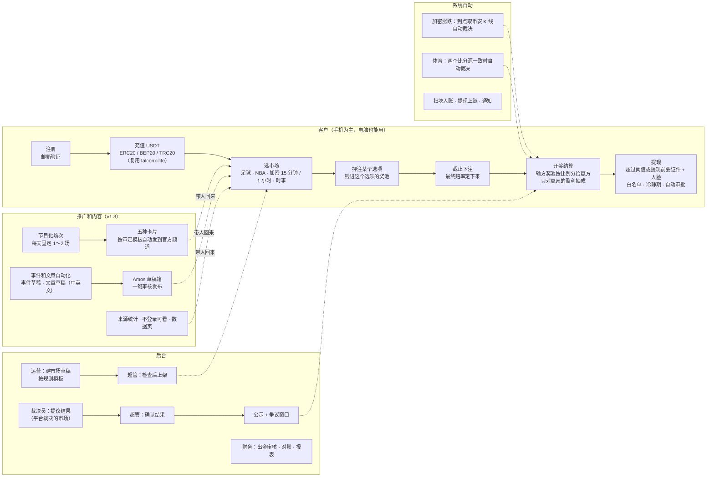

这张图想说明：第一期只做一条主线——**充值 → 押注彩池 → 开奖结算 → 提现**。资金进出、账户、KYC、通知、后台框架从 falconx-lite 复制；新写的是市场、彩池下注、裁决和结算。平台不当对手方，只在开奖后对赢家的盈利抽成。上架和确认结果由一个有权限的人完成（默认只有超管有权限，RQ-17），不要求两个人。v1.3 加了右下角的推广部分：冷启动期把人集中到每天固定的一两场，每场自动产出卡片发到官方频道；自由写作的文章和帖子由程序起草、Amos 审核后发布；**不做返佣和分成**（MQ-5）。

---

## 0. 已定的结论（Amos 2026-10-24，本文不再当成待决问题）

本节是 Amos 给出需求前就定下的结论；第 12 节 RQ-1～RQ-19 的答复也已定，汇总在本表最后一行。

| 事项 | 结论 |
|---|---|
| 用户和资金 | 面向全球用户；只收 USDT；充值方式同 falconx-lite（ERC20 / BEP20 / TRC20 独立地址、扫块入账、热钱包提现、提现自动审批、归集）。不做法币，不做积分版 |
| 玩法 | **彩池模式（pari-mutuel）**：每个市场 2 个或多个选项，用户把 USDT 押进选项的奖池；开奖后输方奖池按押注比例分给赢方；平台不当对手方、不做市、不承担盈亏；当前赔率按奖池比例实时显示，最终赔率在截止时确定 |
| 收费 | 开奖后只向赢家收，按**盈利部分**的百分比收（押 100 赢回 180，只对 80 收）；**默认 5%**，每个市场都能在后台单独调整，结算时按当时的费率算（RQ-4） |
| 结果裁决 | 加密价格和能通过接口拿到的比分自动裁决；其他由平台裁决，并公示、设争议窗口；结果由有权限的管理员确认（默认只有超管，Amos 自己审核），**不要求两人复核**（RQ-17） |
| 第一批品类 | 足球 / NBA、15 分钟和 1 小时的加密涨跌，少量国际经济时事；敏感题不做 |
| KYC | 分级：小额只要邮箱，超过阈值或提现前需要证件 + 人脸 |
| 提现 | 单笔提现最小金额后台可设，**默认 100 USDT**（RQ-16） |
| 品牌和部署 | **上线前沿用 Quick Come 名称和 quickcome.online 子域名；正式上线前改为独立品牌和域名**，隔离要求（独立主体、服务器、数据库、热钱包和冷钱包、发信域名、推送密钥）不变（v1.2，Amos 2026-10-25） |
| 代码 | 从 falconx-lite 复制再改，不抽共享库 |
| 多语言和主题 | 跟随浏览器，取不到时用英文（C82）；第一期英文、简体中文、繁體中文（RQ-18）。默认主题跟随系统（RQ-1，第 11 节） |
| 合规 | 律师、牌照、合规问题以后不再讨论（FQ-2、FQ-3） |
| RQ-1～RQ-19 | 2026-10-24 全部答复：RQ-4、RQ-16、RQ-17 按 Amos 的修改，其余同意建议（见第 12 节） |
| 结算方式（v1.3，AQ-3） | 先算出全部派彩、通过守恒校验、落结算单，再分批派彩；每批是独立事务、可以续跑；客户在几秒内看到"结算中"（第 3.5 节） |
| 推广（v1.3，MQ） | **冷启动期节目化**：每天固定 1～2 场（MQ-1）；**五种卡片按 Amos 审定的模板自动发到官方渠道**（MQ-2）；**暂时不做返佣和分成**（MQ-5），只记来源；**推广内容中英文都做**（MQ-8）；不发首充奖励、体验金、积分，不降费；现金预算为 0。推广功能逐条结论见第 1.5 节 |
| 事件和文章自动化（v1.3） | Amos："另外需要写一个事件和文章自动化程序"。需求写在 `需求文档/v1.3-事件和文章自动化.md`；模板卡片自动发，自由生成的文章和帖子进草稿箱由 Amos 一键审核发布（C73） |
| AQ、SQ、MQ（v1.3） | 2026-10-25 答复：AQ-3、AQ-6、AQ-12、AQ-13、AQ-14 同意建议（AQ-14 的建议是"不加白名单"）；AQ-7 改为先找免费数据源；SQ 全部同意；MQ-5、MQ-8 按 Amos 的修改，其余同意建议。AQ-1、AQ-2、AQ-8、AQ-10 是服务器、数据库、CDN、邮件的选型，由研发和运维在架构方案、部署方案里处理，不改需求 |

---

## 1. 背景、目标、范围

### 1.1 背景
Amos 要做一个类似 Polymarket 的预测网站，客户用和 falconx-lite 相同的方式充入 USDT 参与预测。调研后（`调研/v1-Polymarket调研报告.md`），Amos 把玩法定为**彩池模式**：订单簿要有人做市才有价格，新平台不做市就冷启动不了；彩池模式下只要有人押注就有赔率，平台只抽成、不承担盈亏。

### 1.2 目标

| 编号 | 目标 | 怎么衡量 |
|---|---|---|
| G1 | 客户能在手机上走完主流程 | 390 宽的手机浏览器上完成注册、充值、押注、查看结算、提现，没有横向滚动（AC-50） |
| G2 | 彩池结算一分不差 | 每个已结算市场：派彩合计 + 抽成合计 + 尾差 = 奖池合计，每天自动对账，差额为 0（AC-20、AC-21） |
| G3 | 平台不承担盈亏 | 平台账户在每个市场上的收入只有"抽成"和"结算尾差"两项，不会是负数（AC-22） |
| G4 | 裁决可信 | 平台裁决的市场 100% 经过有权限的管理员确认（默认超管）和公示；每个已结算市场在详情页显示结果、依据、裁决时间、裁决人编号（AC-30～AC-36） |
| G5 | 短周期市场能自动运转 | 加密 15 分钟 / 1 小时市场自动生成、自动截止、自动裁决，窗口结束后 3 分钟内结算（AC-27、AC-28） |
| G6 | 资金安全沿用 falconx-lite 的水平 | falconx-lite 充值、提现、自动审批、归集的验收标准在本项目全部通过（AC-60～AC-64） |

### 1.3 第一期做什么
- **客户端**（手机和电脑分开设计，C64）：注册登录、邮箱验证、忘记和修改密码、KYC（分级）、市场列表、市场详情、押注、我的下注、资产（三链充值、提现、流水）、通知（站内信、推送、邮件）、设置（语言、主题、通知偏好）、新手引导、提交争议、添加到主屏幕（PWA）。
- **后台**：市场管理（规则模板、草稿、上架、暂停、取消、改本市场费率、加密市场自动生成、体育赛程生成草稿）、裁决台（提议和确认结果）、公示和争议处理、结算和补偿、参数设置（品类默认费率、下注限额、争议窗口、KYC 阈值、单笔提现最小金额等）、资金和对账（复用）、客户和 KYC（复用，加下注记录）、风控告警、报表、通知模板、管理员 / 角色 / 权限 / 审计（复用）。
- **系统自动**：扫块入账、提现上链、归集（复用）；加密市场按时生成、截止、取价裁决；体育比分抓取和自动裁决；结算派彩；每日彩池对账；通知。
- **推广（v1.3，第 1.5 节纳入的 MF）**：
  - 客户端：市场列表、详情、已结算市场**不登录可看、可被搜索引擎收录**，附"怎么玩、怎么充、怎么提"说明页（MF-4）；首页"今日场次"（MF-3）；分享卡片和挑战卡（MF-5）；公开开奖记录和周报（MF-6）；上线前等候页兼公开数据页（MF-8、MF-17）；文章页（MF-11）；记录来源（MF-1）。
  - 后台：加密自动生成模板的**场次表**、同时开放的市场数上限、"列入今日场次"标记（MF-3）；**内容中心**（草稿箱、卡片模板、发布渠道和开关、事件候选、日志，MF-7、MF-9 和自动化程序）；来源统计和增长数据 CSV 导出（MF-1、MF-10）；等候页订阅列表（MF-8）。
  - 系统自动：官方 Telegram 机器人（MF-7）；五种卡片按审定模板自动发布（MQ-2）；**事件和文章自动化程序**（事件草稿、文章草稿，见 `需求文档/v1.3-事件和文章自动化.md`）。

### 1.4 明确不做（第一期）

| 不做 | 说明 / 去向 |
|---|---|
| 订单簿、限价单、份额买卖 | 玩法改为彩池（FQ-4），以后人多了再考虑 |
| 中途卖出 / 提前兑现 | 彩池模式下押注一直留到开奖；下注后不能撤单（RQ-2） |
| 平台做市、平台当对手方、平台补贴奖池 | 平台不承担盈亏（FQ-13） |
| 积分版、积分、等级、排行榜 | 不做积分版（FQ-11）；积分不做（Amos 已定）；无奖金排行榜（MF-15）第一期不做，见第 1.5 节 |
| **渠道分成、渠道专属链接的分成报表、用户邀请返佣**（v1.3） | **Amos 2026-10-25："MQ5 暂时不做返佣和分成"**。MF-2、MF-12 不做；只保留"记录用户从哪来"的来源统计（MF-1），不带任何奖励 |
| 首充奖励、体验金、降费 | Amos 已定不做（市场策略 v2.0 起） |
| 可验证战绩页、嵌入组件、Telegram 小程序、在 Telegram 里下注（v1.3） | MF-13、MF-14、MF-16，见第 1.5 节 |
| 自动回复别人的帖子、自动私信、自动进群发言、爬取 X 的数据（v1.3） | 平台规则禁止或风险高，C73；见 `需求文档/v1.3-事件和文章自动化.md` 第 2 节 |
| 串关（多个市场打包一注） | 第二期以后 |
| 比赛进行中下注（滚球） | 第一期所有体育市场在开赛前截止 |
| 用户自建市场 | 只有运营能建市场；用户可以通过客服提建议 |
| 评论区、社交、跟单 | 不做 |
| 法币出入金、USDT 以外的币、SOL 链、原生 ETH、USDC | 只收 USDT（FQ-1） |
| UMA 等链上预言机、链上份额 | 第一期不接（FQ-5） |
| 持仓奖励、奖池生息 | 不做 |
| 负责任博彩的自我限额、自我排除 | 第一期不做，第二期评估 |
| 第三方 KYC / 活体检测服务 | 第一期复用 falconx-lite 的手持证件自拍 + 人工审核（RQ-10） |
| 安卓 App 外壳、原生 App | 第一期只做网页 + PWA |
| 2FA（两步验证） | 沿用 falconx-lite，推迟 |

### 1.5 市场与推广输入（C71，v1.3 写入）

**引用**：市场经理《市场调研与推广策略》v2.1（`市场/v1-市场调研与推广策略.md`，PR #3）。
- **目标用户**：A 华语币圈短线玩家（主力）、B 华语体育球迷（主力）、C 时事观点型（次要）（策略第 1.1 节）。冷启动的目标人群是"本来就打算充 100 USDT 以上、能接受 KYC 的人"，所以说明页、卡片里要提前写明"满 100 USDT 可以提现""提现前要证件 + 人脸认证"（策略第 1.2 节）。
- **定位**：平台不当庄、奖池和结果公开、USDT 三链直充；对外措辞"散户用真钱投票的概率"待 Amos 确认（F-14），说明页仍照实写"用 USDT 押注、平台从赢家盈利里抽 5%"。
- **定价**：赢家盈利的 5%，不打折、不降费（第 3.8 节不变）。
- **打法**：零现金预算；冷启动期节目化（每天固定 1～2 场）、每场自动产出五张卡片、上线前 8～12 周先养数据号（策略第 6、7 节）。

**Amos 对 MQ 的结论（2026-10-25）**：MQ-5 改为"暂时不做返佣和分成"；MQ-8 改为"中英文都做"；**其他全部同意建议**（MQ-1 节目化、MQ-2 模板审定后自动发布、MQ-3 以 Quick Come 名义注册账号、MQ-4 数据号用产品账号、MQ-6 野路子取舍、MQ-7 时间上限、MQ-9 只写不录音、MQ-10 体育优先大小球和大小分、MQ-11 上线日对齐大事件）。对需求的影响：

| MQ | 结论 | 对需求的影响 |
|---|---|---|
| MQ-1 节目化 | 冷启动期加密每天只开 1 场 BTC 1 小时（北京时间 21:00～22:00 = 13:00～14:00 UTC）；体育每天最多 1 场焦点战（周末最多 2 场）；同时开放的市场 ≤ 2；每场中位下注人数连续 2 周 ≥ 8 且有效市场率 ≥ 90% 才加场 | 第 4.2 节"保证未来至少 N 个窗口"改成模板可选"场次表"（按指定 UTC 时刻生成）；新增参数"同时开放的市场数上限"；首页"今日场次"；后台"场次"；加场由 Amos 看数据决定，系统不自动加场（MF-3、AC-80～AC-82） |
| MQ-2 卡片自动发布 | Amos 一次性审定开盘、截止提醒、封盘倒计时、开奖、周报五种卡片的模板，之后系统自动发到官方渠道 | 第 6.3 节：怎么发、发到哪里、模板怎么审定、怎么停用（AC-90～AC-93） |
| MQ-3、MQ-4 | 现在以 Quick Come 名义注册 X、Telegram 频道、用户群、机器人；数据号就用产品账号 | 不改需求；账号由 Amos 注册（C73），机器人和频道的配置写进内容中心的"发布渠道" |
| MQ-5 | **暂时不做返佣和分成** | MF-2、MF-12 不做；MF-1 来源统计保留（见下表）；第 1.4 节 |
| MQ-6、MQ-7、MQ-9 | 野路子、Amos 时间、创始人叙事按建议 | 不改需求；其中大 V 对照图（G-W17）、数据号（G-2）的素材由自动化程序生成，回复和发帖由 Amos 手动 |
| MQ-8 | **中英文都做** | 卡片、数据卡、文章、帖子草稿都出中文和英文两份，英文**不再只限于自动卡片**；网站上的公开页面按第一期三种语言（英文、简体中文、繁體中文）都有（AC-97） |
| MQ-10 | 冷启动期体育优先大小球 2.5、NBA 大小分 | 第 4.2 节赛程生成增加"NBA 大小分"玩法，冷启动期默认选大小球 / 大小分 |
| MQ-11 | L 日选在大事件前 3～7 天 | 不改需求；开发计划由研发安排 |

**推广功能逐条结论（C71）**：市场策略 v2.1 第 10 节的 17 条。MQ 除 MQ-5、MQ-8 外都按建议，所以市场建议第一期做的原则上纳入；和分成有关的不做。

| 编号 | 功能 | 结论 | 理由 | 写在哪里 |
|---|---|---|---|---|
| MF-1 | 来源统计（`src` 渠道、`cmp` 活动、`ref` 分享人；机器人 `start` 参数同样记录） | **纳入**（PM 判断，见下方说明） | MQ-5 不做分成，但**来源统计不带分成也要做**：不记来源就不知道哪个渠道、哪个手法带来了激活，市场策略第 11 节的"按来源的激活""每分钟激活"都算不出来，两周一次的"砍和加"没有依据；工作量小 | 第 5.2 节 P8、第 6.2 节、AC-83 |
| MF-2 | 渠道链接和分成报表、人工结算分成 | **不做** | MQ-5：暂时不做返佣和分成。渠道方要专属链接时，直接给带 `src` 的链接，按来源统计看效果即可 | 第 1.4 节 |
| MF-3 | 场次化（场次表、同时开放上限、今日场次） | **纳入** | MQ-1 | 第 4.2、5.2、6.2 节，AC-80～AC-82 |
| MF-4 | 不登录可浏览、可被搜索收录、说明页 | **纳入** | 从卡片、搜索进来的人先看到内容；SEO 的前提 | 第 5.2 节 P1、P2、P14，NF-14，AC-84、AC-85 |
| MF-5 | 分享卡片（市场卡、开奖卡、挑战卡、封盘倒计时卡），Open Graph | **纳入** | 用户自传播（G-7）；倒计时卡同时是 MQ-2 的五种卡片之一 | 第 5.2 节 P3、P4，第 6.3 节，AC-86、AC-87 |
| MF-6 | 公开开奖记录和每周周报 | **纳入** | 信任证据 + 内容 + SEO；周报卡是 MQ-2 的五种卡片之一 | 第 5.2 节 P12，AC-88 |
| MF-7 | 官方 Telegram 机器人 v1（自动发卡片、订阅开场提醒、`/btc` 等命令、内联模式、加进群和群播报） | **纳入**；"群里来的用户记为该群来源"只用于来源统计，**不分成** | MQ-1、MQ-2 的载体；机器人只提供信息和链接，**不在 Telegram 里下注** | 第 6.3 节、第 7 节通知 #23，AC-89、AC-90 |
| MF-8 | 上线前等候页 + 订阅开场提醒 | **纳入**，L 日前 6 周上线 | 上线当天把人叫到同一个池 | 第 5.2 节 P13，AC-95 |
| MF-9 | 内容数据工具（内部：数据卡、大 V 对照图、草稿素材） | **纳入**，L 日前尽早 | 并入"事件和文章自动化程序"的数据部分 | 自动化文档第 4、5 节 |
| MF-10 | 增长数据：第一期 CSV 导出，看板第二期 | **纳入 CSV 导出**；看板不做（第二期） | 第 11 节指标靠它统计；看板等数据多了再做 | 第 6.2 节，AC-94 |
| MF-11 | SEO 内容页（焦点战页、BTC 每小时涨跌统计页、教程和对比文章） | **纳入**（市场建议第二期，**提前到第一期**，L+4 周前完成即可） | Amos 要求"文章自动化"，文章需要一个发布的地方；页面由自动化程序生成，数据部分自动、文字部分 Amos 审核 | 第 5.2 节 P15，自动化文档第 4 节；X-17 |
| MF-12 | 用户邀请返佣 | **不做** | MQ-5 | 第 1.4 节 |
| MF-13 | 可验证战绩页 | **不做（第一期）**，第二期再评估 | 市场建议第二期；它主要是和 tipster 谈分成的筹码，分成暂时不做后价值下降 | 第 1.4 节 |
| MF-14 | 嵌入组件 | **不做（第一期）** | 市场建议第三期；冷启动没有内容合作方 | 第 1.4 节 |
| MF-15 | 无奖金排行榜 | **不做（第一期）** | 市场建议第三期 | 第 1.4 节 |
| MF-16 | Telegram 小程序（在 Telegram 里下注） | **不做** | 市场建议第三期以后；Telegram 机器人开发者条款禁止"受监管或可疑的商品和服务"，封禁风险高 | 第 1.4 节 |
| MF-17 | 公开概率看板页（和 MF-8 同一页） | **纳入**，L 日前和 MF-8 一起 | 给数据号和大 V 回复一个落地页；有真实独有的数据，可以被收录 | 第 5.2 节 P13，AC-95、AC-96 |

**说明：为什么保留来源统计（MF-1）**（Amos 只说"暂时不做返佣和分成"，没说来源统计）：
- 来源统计只记录"这个客户从哪个链接、哪个群、哪张卡片来的"，不给任何人钱，不涉及分成规则、结算和对外条款。
- 零预算下，Amos 每天只有 30～60 分钟，必须知道哪个手法有用；没有来源数据，两周一次的"砍和加"只能凭感觉。
- 以后如果恢复分成，来源数据可以直接用，不用补数据。
- 工作量小（链接参数记在浏览器里，注册时写进客户记录）。如果 Amos 认为也不需要，删掉 MF-1 不影响其他功能（来源一栏显示为空）。

**跨角色**：本节结论已同步给市场（见文末"跨角色反馈"）；市场的推广方案（C72）按本节的"纳入"清单写。

---

## 2. 角色和权限

### 2.1 使用者和场景

| 使用者 | 典型场景 |
|---|---|
| 客户 | 手机打开网址 → 注册 → 新手引导 → 用 TRC20 充 50 USDT → 押"BTC 下一个 15 分钟涨" → 15 分钟后收到结算推送 → 周末押英超 → 赢了以后完成证件 + 人脸认证 → 提现 |
| 运营（市场管理员） | 每天从赛程生成当天足球 / NBA 市场的草稿，补规则，提交上架（由超管检查后上架）；盯加密市场的自动生成；突发情况暂停市场 |
| 裁决员 | 比赛或事件结束后，在裁决台按规则和证据提议结果（由超管确认）；处理自动裁决失败的市场 |
| 财务 | 出金审核、入金对账、彩池对账、平台收入报表 |
| 超级管理员（Amos） | 上架市场（检查规则是否可判定、来源是否写清、是否敏感题）；确认结果（确认裁决员的提议，或自己填结果直接确认）；处理争议；取消、作废；补偿；改费率和参数；角色和权限；自动审批总开关；审计 |

**不设"复核员"，不要求两个人（RQ-17）**：上架、确认结果、处理争议、作废、补偿都是"**一个有权限的人就能完成**"。默认只有超级管理员有这些权限，所以实际上由 Amos 自己审核；运营、裁决员可以建草稿、提议结果，但由超管确认。以后如果要加回复核，通过配置角色和权限点调整（例如把确认权限给另一个角色），不在第一期做系统强制。

风控在 falconx-lite 里是一个角色；本项目第一期的风控告警发给财务和超级管理员，需要时可以用自定义角色单独建（后台角色可自由配置，沿用 falconx-lite）。

### 2.2 内置角色和权限点
权限框架、管理员、角色、菜单、审计、高危确认（原因必填、勾选确认）全部复用 falconx-lite（权限点清单前后端一致、每个接口都要声明权限点）。去掉差价合约专用的权限点（`order:*`、`position:*`、`pending:*`、`risk:*`、`symbol:*`、`params:*`、`fx:view`），新增下面这些（★ = 高危，写审计且原因必填）。

| 权限点 | 作用 | 运营 | 裁决员 | 财务 | 超管 |
|---|---|---|---|---|---|
| `market:view` | 查看市场、奖池、下注明细 | ✓ | ✓ | ✓ | ✓ |
| `market:edit` | 新建、编辑、复制草稿；提交上架（只是让草稿出现在"待上架"列表，不改变状态） | ✓ | | | ✓ |
| `market:publish` | 上架（按第 4.1 节清单检查后上架 / 退回草稿）；启用加密自动生成模板 | | | | ✓ |
| `market:pause` ★ | 暂停 / 恢复下注 | ✓ | | | ✓ |
| `market:cancel` ★ | 截止前取消市场（全额退款） | | | | ✓ |
| `market:clarify` ★ | 上架后发布"补充说明" | ✓ | | | ✓ |
| `market:autogen` ★ | 加密市场自动生成的模板（新建、修改、关闭；启用要 `market:publish`） | ✓ | | | ✓ |
| `resolve:propose` | 提议结果（平台裁决）、处理自动裁决失败 | | ✓ | | ✓ |
| `resolve:confirm` ★ | 确认结果（确认提议或自己填结果，进入公示）/ 退回提议 | | | | ✓ |
| `resolve:void` ★ | 截止后作废市场（全额退款） | | | | ✓ |
| `dispute:view` | 查看争议 | | ✓ | | ✓ |
| `dispute:handle` ★ | 处理争议（维持 / 改判 / 作废） | | | | ✓ |
| `settle:compensate` ★ | 发起并确认已结算市场的补偿 | | | | ✓ |
| `bet:view` | 查看客户下注记录 | ✓ | ✓ | ✓ | ✓ |
| `fee:edit` ★ | 改品类默认费率、改单个市场的费率 | | | | ✓ |
| `betting_params:edit` ★ | 改下注限额、截止提前量、争议窗口、KYC 阈值、单笔提现最小金额等参数 | | | | ✓ |
| `report:view` | 平台收入和运营报表 | | | ✓ | ✓ |
| `pool_recon:view` / `pool_recon:resolve` | 彩池对账 | | | ✓ | ✓ |
| 复用的资金、客户、KYC、通知、系统权限点 | `deposit:view`、`withdrawal:*`、`recon:*`、`sweep:*`、`task:*`、`customer:*`、`kyc:*`、`notify*`、`admin:*`、`role:*`、`menu:*`、`audit:view`、`config:*`、`session:*`、`dashboard:view` | 按 falconx-lite 的内置角色 | | 财务 | ✓ |
| `content:view`（v1.3） | 查看内容中心：草稿箱、卡片模板、事件候选、发布日志 | ✓ | | | ✓ |
| `content:edit`（v1.3） | 修改草稿和模板草稿、手动触发生成、采纳事件候选生成市场草稿（市场草稿仍要 `market:publish` 才能上架） | ✓ | | | ✓ |
| `content:publish` ★（v1.3） | **对外发布**：审定 / 停用卡片模板、发布草稿箱里的内容、发布渠道和自动发布开关、紧急停止（C73：对外发布由 Amos 决定，默认只有超管有） | | | | ✓ |
| `growth:view`（v1.3） | 来源统计、增长数据 CSV 导出、等候页订阅列表（只看汇总和客户编号，不导出邮箱以外的个人信息） | ✓ | | ✓ | ✓ |

**提前截止的权限（v1.3，SQ-5，Amos 同意）**：第 3.2 节第 4 条"截止时间提前"用 `market:pause`（和暂停一样是处理突发情况，运营和超管都有），高危、原因必填、写审计。

**一个人有权限就能完成（RQ-17）**：
1. 上架、确认结果、处理争议、作废、补偿都**只要求操作人有对应权限点**，不检查"提议人和确认人是不是同一个人"，也不要求第二个人批准。只有一个超级管理员（Amos）时，Amos 一个人就能走完所有流程。
2. 默认只有超级管理员有 `market:publish`、`resolve:confirm`、`resolve:void`、`dispute:handle`、`settle:compensate`、`market:cancel`、`fee:edit`、`content:publish`（v1.3）。
3. 每一步都写审计（谁、什么时候、前 → 后、原因），高危操作原因必填；平台裁决的市场照样公示、设争议窗口。
4. 以后要加回复核时，通过配置角色调整（例如新建一个只有 `resolve:confirm` 的角色给另一个人），第一期不做"提议人不能确认"这类代码里的强制检查。

---

## 3. 彩池规则（核心）

### 3.1 名词

| 名词 | 定义 |
|---|---|
| 市场 | 一个问题，例如"曼城 vs 利物浦（90 分钟胜平负）" |
| 选项 | 市场下互斥的结果，2～10 个，例如"主胜 / 平 / 客胜"。**必须覆盖所有可能**（不能出现"结果不在选项里"） |
| 下注 | 客户一次押注：市场、选项、金额、时间 |
| 持仓 | 同一客户在同一市场同一选项上所有下注的合计（结算按持仓算） |
| 选项奖池 Pᵢ | 选项 i 上所有有效下注的金额合计 |
| 总奖池 T | 所有选项奖池之和 T = ΣPᵢ |
| 赢方奖池 P_W / 输方奖池 L | 开奖后赢的选项的奖池；L = T − P_W |
| 费率 r | 对赢家盈利部分抽成的比例。新建市场时按品类默认值带出（默认 5%）；**结算前任何时候都能在后台单独修改**，结算时按当时的费率算（第 3.8 节） |
| 截止时间 | 停止接受下注的时刻（UTC，按服务器收到请求的时间） |
| 事件时间 | 比赛开赛 / 加密窗口开始等事件开始的时刻；事件结束时刻另记 |

### 3.2 市场状态机

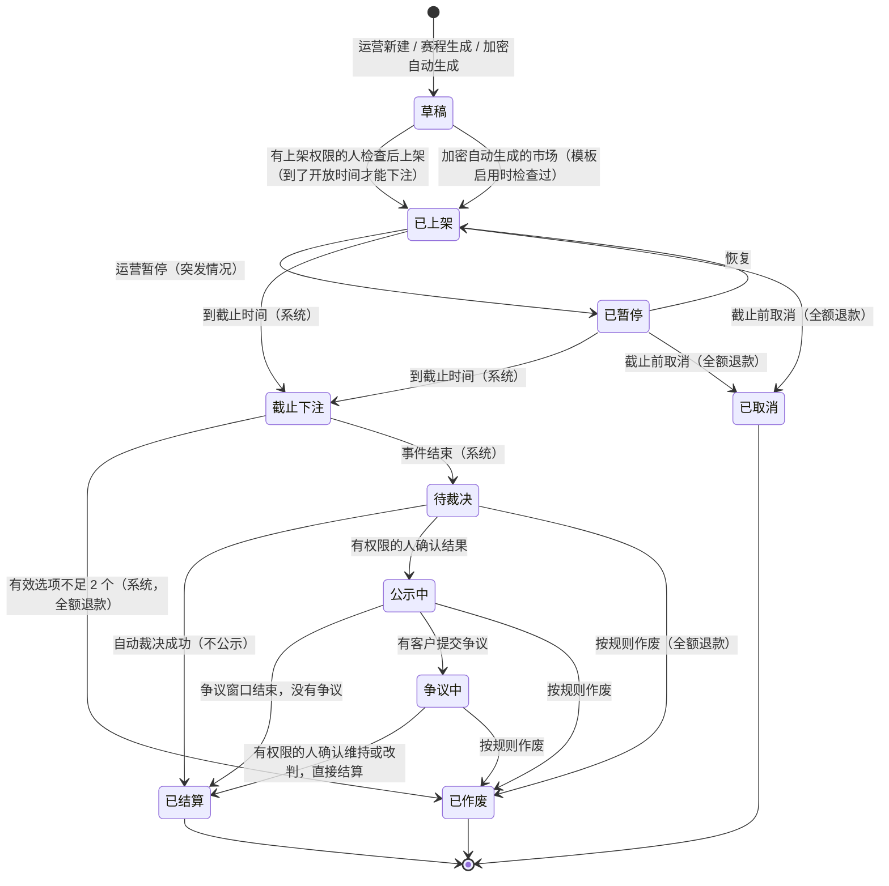

这张图想说明：钱只在三个终点状态动——**已结算**（派彩）、**已取消**和**已作废**（全额退款，不收费）。其余状态里押注金额一直锁在奖池里。每一步人工操作都只要求一个有权限的人（RQ-17），没有"待上架复核""待复核"状态：

- 运营"提交上架"只是给草稿加一个"已提交"标记，让它出现在超管的"待上架"列表，状态仍是草稿；有 `market:publish` 的人检查后上架，或退回（写理由，去掉标记）。有上架权限的人也可以直接上架自己建的草稿。
- 裁决员的提议是挂在"待裁决"市场上的一条记录，状态不变；有 `resolve:confirm` 的人确认这条提议（或自己填结果）后进入"公示中"，也可以退回提议（写理由）。

| 状态 | 客户能下注吗 | 客户看到的 | 进入条件 | 谁操作 |
|---|---|---|---|---|
| 草稿 | 否 | 看不到 | 新建 | 运营 / 系统 |
| 已上架 | 是（到了"开放下注时间"以后） | 可下注；未到开放时间显示"X 时开放" | 检查后上架 | 有 `market:publish` 的人（默认超管）；加密自动生成为系统 |
| 已暂停 | 否 | "暂停下注"，已有下注不变 | 运营暂停 | 运营 / 超管 |
| 截止下注 | 否 | "已截止，等待结果"，奖池定格（结算前改了费率时最终赔率按新费率重新显示） | 到截止时间 | 系统 |
| 待裁决 | 否 | "等待结果" | 事件结束时间到了 | 系统；裁决员在这里提议结果（状态不变） |
| 公示中 | 否 | 拟定结果、依据、争议截止时间、"提交争议"按钮 | 确认结果 | 有 `resolve:confirm` 的人（默认超管） |
| 争议中 | 否 | "争议处理中" | 有争议 | 客户 |
| 已结算 | 否 | 结果、依据、裁决人编号、我的派彩 | 自动裁决成功 / 公示期满 / 争议处理完 | 系统 / 有 `dispute:handle` 的人（默认超管） |
| 已取消 | 否 | "已取消，下注已全额退回"和原因 | 截止前取消 | 有 `market:cancel` 的人（默认超管） |
| 已作废 | 否 | "已作废，下注已全额退回"和原因 | 截止后按规则作废 | 系统 / 有 `resolve:void` 或 `dispute:handle` 的人（默认超管） |

规则：
1. 状态只能按上图走，任何其他跳转都被拒绝（AC-10）。
2. 截止时间到了以后，**不管之前是否在暂停中**，都进入"截止下注"。
3. 已上架以后，**题目、选项、截止时间、裁决来源不能改**（费率可以由 `fee:edit` 修改并公开记录，见第 3.8 节）；只能发布"补充说明"（带发布时间，在规则区按时间顺序显示，只能澄清、不能改变问题含义）。规则写错到无法澄清时，截止前取消、截止后作废。
4. 截止时间可以**提前**（例如比赛改到更早开赛），不能推后；提前时已在新截止时间之后收到的下注全额退回（见 3.7 第 5 条）。提前截止用 `market:pause` 权限（v1.3，SQ-5）。
5. **"结算中"不是新状态**（v1.3，AQ-3）：结算分步进行时（第 3.5 节），市场在状态机里仍停在"待裁决 / 公示中 / 争议中"，直到全部派彩完成才进入"已结算"；客户端在这段时间显示"结算中"。状态机的边不变（AC-10 不变）。

### 3.3 下注

| 规则 | 默认值（后台可改，`betting_params:edit`） | 说明 |
|---|---|---|
| 单笔最小 | 1 USDT | 金额最多 2 位小数 |
| 单笔最大 | 5,000 USDT | |
| 单客户单市场累计上限 | 10,000 USDT（加密 15 分钟 / 1 小时：2,000 USDT） | 按该客户在这个市场所有选项上的有效下注合计；可以在单个市场上单独调低 |
| 同一市场能否押多个选项 | 可以（RQ-12） | 每个选项分别是一个持仓 |
| 撤单 | **下注后不能撤销**（RQ-2） | 确认弹窗和下注抽屉都写明 |
| KYC | 累计充值超过 KYC 阈值、且没通过证件 + 人脸认证的客户，**不能新下注**（已有下注照常结算）；见第 3.10 节 | |
| 冻结的客户 | 不能下注，已有下注照常结算（沿用 falconx-lite 冻结的口径） | |
| 员工账户 | 后台登记为"员工"的客户账户不能下注 | 见第 8 节 |

冷启动期（v1.3，市场策略第 13 节末"请知悉"）：Amos 可以在后台把加密 1 小时市场的单客户单市场上限从 2,000 调到 200～500 USDT，避免一个人押满一边。这是调参数，不改上表的默认值。

下注的处理（同一个事务）：
1. 校验：市场状态是"已上架"、已到开放时间、**服务器收到请求的时间 < 截止时间**、选项属于这个市场、金额在范围内、没超单客户单市场上限、可用余额够、客户状态正常、KYC 条件满足。
2. 扣可用余额、写账本（"下注锁定"）、选项奖池 + 金额、写下注记录（含下注时的奖池快照，只做展示，不影响结算）。
3. 返回下注编号；实时推送新的奖池给正在看这个市场的客户。

拒单时返回具体原因（中英文）：市场未开放、已截止、已暂停、已取消、金额低于最小 / 高于最大、超过本市场上限、余额不足、需要先完成身份认证、账户已冻结、员工账户不能下注。

### 3.4 赔率的显示和计算

**两种显示同时给，主次不同**（RQ-3）：概率 % 为主，预计赔率 x（扣费后）为辅。

| 显示 | 公式 | 精度和舍入 | 在哪里显示 |
|---|---|---|---|
| **概率 %**（主） | Pᵢ ÷ T × 100 | 列表取整数（四舍五入）；详情 1 位小数；> 0 但 < 1% 显示"<1%"，> 99% 但 < 100% 显示 ">99%"；T = 0 时全部显示"—" | 列表、详情（和 Polymarket 一样以概率为主，用户熟悉） |
| **预计赔率 x**（辅） | 扣费后：1 + (T ÷ Pᵢ − 1) × (1 − r) | 2 位小数，**向下取整**（不夸大回报）；Pᵢ = 0 时显示"—"并提示"还没有人押，先押的人赢了拿走输方全部（扣费后）" | 选项按钮、下注抽屉 |
| 本注预计回报 | 把本注加进奖池后按第 3.5 节算：G = b × (T − Pᵢ) ÷ (Pᵢ + b)，F = G × r，回报 = b + G − F | 按第 3.5 节的舍入规则（G 向下取整、F 四舍五入，到 0.01） | 下注抽屉："押 100 → 赢了约回 162.29（已扣抽成）；输了 0" |

预计赔率和预计回报都用市场**当前**的费率 r；费率被修改后立即按新费率显示（第 3.8 节）。

- 页面上必须写明："赔率随奖池变化，**最终赔率在截止时确定**"。
- 赔率刷新：奖池变化后 2 秒内推送到正在看的页面（AC-17）；刷新只换数字，**不闪色、不做跳动动画**（C84）。
- 截止以后显示"最终赔率"；奖池不再变化，只有在结算前修改了费率时按新费率重新显示，并在规则区写明修改记录（第 3.8 节）。

### 3.5 结算公式

赢的选项为 W（只有一个）。对每个**赢方持仓** j（金额 bⱼ，属于某个客户在 W 上的全部下注合计）：

| 步骤 | 公式 | 舍入 |
|---|---|---|
| ① 分得的盈利（毛） | Gⱼ = bⱼ × L ÷ P_W | **向下取整到 0.01 USDT** |
| ② 抽成 | Fⱼ = Gⱼ × r | **四舍五入到 0.01 USDT** |
| ③ 派彩（回到可用余额） | Payⱼ = bⱼ + Gⱼ − Fⱼ | 不再舍入 |
| ④ 尾差 | D = L − ΣGⱼ | 0 ≤ D < 0.01 × 赢方持仓数；**归平台**，单独记"结算尾差"（RQ-7） |

- 输方持仓派彩为 0，不收费。
- 平台收入 = ΣFⱼ + D。
- **守恒**：ΣPayⱼ + ΣFⱼ + D = T（每个市场结算后系统自动校验，不等则这个市场停在"结算异常"，告警财务，不派彩）。
- 中间计算用精确小数（不用浮点），只在上表写明的地方舍入。
- 结算按持仓逐个写账本：赢方"下注锁定 → 派彩"、"抽成"；输方"下注锁定 → 输"；平台账户收"抽成""结算尾差"。幂等：同一市场只能结算一次，每个持仓只派一次。
- **结算分三步（v1.3，AQ-3 = B，Amos 2026-10-25 同意；原来写的是"同一个事务"）**：
  1. **算好、校验、落结算单**（一个事务，钱不动）：按上表算出每个持仓的 G、F、派彩和尾差 D，做守恒校验；通过后把每个持仓的结果写进"结算单"（每个市场一份，每个持仓一行，之后不再改）。**校验不通过**：市场停在"结算异常"，告警财务和超管，**一分钱都不派**。
  2. **分批派彩**：按结算单逐行入账，**每批是一个独立事务**（批大小由研发定，例如 500 个持仓）。每一行只能入账一次；中途中断（服务重启、数据库出错）后从没做完的那一行**接着做（续跑）**，结果和一次做完完全相同，不会重复派、不会漏派。
  3. **收尾**（一个事务）：确认所有行都已入账，尾差入平台"结算尾差"，按账本再核对一次守恒，市场状态 → "已结算"。
- **客户看到的**（v1.3）：从第 2 步开始到第 3 步完成，市场详情和"我的下注"显示"**结算中**"（一般几秒；10,000 个持仓的市场 ≤ 60 秒，NF-03）；某个客户的派彩入账后，他的这笔下注立即显示派彩金额，并收到结算通知（#11、#12）；全部完成后市场显示"已结算"。
- 为什么改：10,000 个持仓放在一个事务里，会同时锁住所有赢家的账户十几秒，期间他们在别的市场下注、提现都会卡住（和 NF-01 冲突）；分批以后，钱动之前所有人的派彩已经算好并通过守恒校验，可靠性不降低（架构方案第 4.3 节）。
- 费率"结算开始后不能改"（第 3.8 节）里的"结算开始"指**第 1 步开始**。

#### 完整例子：3 个选项、费率 5%、有尾差

市场"曼城 vs 利物浦（90 分钟胜平负）"，截止时：

| 选项 | 下注 | 选项奖池 | 概率 | 最终赔率（扣费后） |
|---|---|---|---|---|
| 主胜 | Alice 100（分 2 笔：60 + 40）、Bob 2,500、Carol 3,400 | 6,000 | 60% | 1 + (10,000 ÷ 6,000 − 1) × 0.95 = 1.6333 → **1.63x** |
| 平 | Dave 1,500 | 1,500 | 15% | 1 + (6.6667 − 1) × 0.95 = 6.3833 → **6.38x** |
| 客胜 | Eve 2,000、Frank 500 | 2,500 | 25% | 1 + (4 − 1) × 0.95 = **3.85x** |
| 合计 | | **T = 10,000** | | |

结果：主胜。L = 10,000 − 6,000 = 4,000；L ÷ P_W = 0.6666…

| 赢方持仓 | b | ① G = b × 0.6666… 向下取整 | ② F = G × 5% 四舍五入 | ③ 派彩 = b + G − F |
|---|---|---|---|---|
| Alice | 100 | 66.666… → **66.66** | 3.333 → **3.33** | **163.33** |
| Bob | 2,500 | 1,666.666… → **1,666.66** | 83.333 → **83.33** | **4,083.33** |
| Carol | 3,400 | 2,266.666… → **2,266.66** | 113.333 → **113.33** | **5,553.33** |
| 合计 | 6,000 | 3,999.98 | **199.99** | **9,799.99** |

- 尾差 D = 4,000 − 3,999.98 = **0.02**（归平台"结算尾差"）。
- 平台收入 = 199.99 + 0.02 = **200.01**。
- 守恒：9,799.99 + 199.99 + 0.02 = **10,000.00** ✓。
- Dave、Eve、Frank 派彩 0。
- Alice 的两笔下注合成一个持仓结算（不是每笔单独算），所以只舍入一次。
- 核对 Alice：100 × 1.6333 = 163.33，和最终赔率一致。

#### 例子 2：本注预计回报（下注抽屉）
上面的市场截止前，奖池是 主胜 6,000 / 平 1,500 / 客胜 2,500。Grace 想押主胜 100：把本注加进去，主胜 6,100、T = 10,100、L = 4,000；G = 100 × 4,000 ÷ 6,100 = 65.573… → 65.57；F = 3.2785 → 3.28；预计回报 = 100 + 65.57 − 3.28 = **162.29**。抽屉显示"押 100 → 赢了约回 162.29（已扣抽成），最终以截止时的奖池为准"。

### 3.6 边界情况

| 编号 | 情况 | 处理 | 说明 |
|---|---|---|---|
| E1 | **没人押赢的那一边**（P_W = 0，T > 0） | **作废，全额退款，不收费**（RQ-5） | 另一种做法是"平台没收奖池"，那等于平台在赢钱，和"平台不承担盈亏、不当庄"矛盾，也让人怀疑平台故意判没人押的结果 |
| E2 | 某个选项没人押，但它不是赢的那个 | 正常结算 | 没人押的选项奖池是 0，不影响公式 |
| E3 | **截止时只有一个选项有人押**（包括只有一个人押） | **截止时直接作废，全额退款**，不等结果（RQ-6） | 如果等结果：它赢了，L = 0，大家拿回本金、没有盈利；它输了，就是 E1。两种结果都是退款，所以截止时就退，客户不用等 |
| E4 | 总奖池为 0 | 截止时作废（没有资金变动），客户端不显示 | |
| E5 | **比赛取消** | 作废，全额退款 | 规则模板里写明 |
| E6 | **比赛延期** | 原定开赛时间后 **48 小时内**完赛的，按实际结果结算；超过 48 小时仍没完赛的，作废退款（RQ-14） | 48 小时内裁决员不能提议；市场停在"待裁决" |
| E7 | **比赛腰斩（中途终止）** | 联赛官方宣布比分有效的，按官方比分；宣布重赛或 48 小时内没有宣布的，作废退款 | |
| E8 | **平局** | 足球"胜平负"市场必须有"平"选项；NBA 没有平局（加时到分出胜负）；大小分类市场的分界线必须用 .5（例如 2.5 球），不会出现"正好等于" | 规则模板强制；上架检查清单里有这一项 |
| E9 | 加密涨跌"收盘价 = 开盘价" | 判"涨"（和 Polymarket 的规则一样【证实：polymarket.com 页面内的裁决说明"greater than or equal to … Up"】） | 规则文本写明"≥ 判涨" |
| E10 | 加密数据源出错或拿不到 | 先用备用源；主备不一致或都拿不到 30 分钟以上 → 转人工裁决台；人工也无法确定时作废退款 | 见第 4.3 节 |
| E11 | **规则有歧义** | 截止前：发补充说明（只能澄清）；歧义严重到影响结果的，截止前取消。截止后才发现：裁决员按"规则文本的通常含义"提议，有 `resolve:confirm` 的人（默认超管）确认，公示期内客户可以争议；仍无法判定的，作废退款 | Polymarket 有"50/50"一档，彩池模式下等价于作废退款，更好理解 |
| E12 | **公示期内改判** | 争议成立 → 有 `dispute:handle` 的人（默认超管）确认后按新结果直接结算（不再公示第二轮），争议人和所有下注人收到通知 | |
| E13 | **已结算后发现裁错** | **不回滚、不追回已派的钱**；由平台出钱按正确结果补偿本应赢的一方（补偿 = 按正确结果算的派彩 − 实际已得派彩，只补不扣），由有 `settle:compensate` 的人（默认超管）确认，高危操作、原因必填、写审计（RQ-8、RQ-17） | 已派的钱可能已经提走，回滚会让客户余额变负；补偿走"补偿"流水，不算平台收入的冲减，报表单列 |
| E14 | 下注时间晚于实际开赛（比赛提前开赛、或截止时间设错） | 实际开赛时间之后收到的下注全额退回（不参与结算），其余照常 | 裁决员在提议时填"实际开赛时间"；系统自动退回之后的下注 |
| E15 | 市场里有员工账户的下注（漏登记后补登） | 该笔下注退回，不参与结算 | 见第 8 节 |

### 3.7 截止时间、开奖时间和时区
1. **所有时间按 UTC 存储和判定**；规则文本里的时间写 UTC（例如"2026-11-01 14:55 UTC"）。
2. 客户端显示时，同时显示 UTC 和客户浏览器所在时区的时间（"截止 14:55 UTC（你的时间 22:55）"）。
3. 时间先后：**开放下注 < 截止下注 ≤ 事件开始 < 事件结束 < 裁决**。系统在保存市场时校验。
4. 判定"是否已截止"只看**服务器收到下注请求的时间**，客户端时间不算；正好等于截止时间的请求拒绝（`收到时间 < 截止时间` 才接受）。
5. 各品类的默认值（新建时自动带出，可以改；后台参数可改）：

| 品类 | 开放下注 | 截止下注 | 事件结束 | 裁决 |
|---|---|---|---|---|
| 足球 | 上架即开放（一般在开赛前 1～7 天上架） | 开赛前 5 分钟 | 开赛 + 约 2 小时（以比分源的"完赛"为准） | 自动（第 4.3 节）；失败转人工 |
| NBA | 同上 | 开赛前 5 分钟 | 开赛 + 约 3 小时（以完赛为准） | 同上 |
| 加密 15 分钟 | 窗口开始前 60 分钟 | **窗口开始前 30 秒** | 窗口结束 | 窗口结束后 1 分钟取 K 线，自动 |
| 加密 1 小时 | 窗口开始前 3 小时 | **窗口开始前 30 秒** | 窗口结束 | 同上 |
| 国际经济时事 | 上架即开放 | 按题目（例如议息结果公布前 1 小时） | 按题目 | 平台裁决 + 公示 + 争议窗口 |

> 为什么加密市场要在窗口**开始前**截止：彩池里最终赔率在截止时才定，如果窗口开始后还能押，晚押的人已经看到了价格走势，等于拿早押的人的钱（订单簿模式下价格会随走势变，所以 Polymarket 可以一直交易；彩池不行）【推断】。30 秒是"截止提前量"，后台可调（RQ-13）。

### 3.8 平台抽成的口径
1. 只对赢方持仓的盈利 Gⱼ 收，按 3.5 的舍入；输方、作废、取消都不收。
2. **默认费率：盈利部分的 5%**（RQ-4）。按品类各有一个默认值（足球、NBA、加密 15 分钟、加密 1 小时、时事，初始都是 5%），新建市场（含赛程生成、加密自动生成）时自动带出，写进市场记录和规则文本（"抽成：盈利部分的 5%"）。改品类默认值只影响之后新建的市场。
3. **每个市场都能在后台单独改费率**（RQ-4）：权限 `fee:edit`，高危操作（原因必填、勾选确认、写审计"前 → 后"）；取值 0%～20%，最多 2 位小数（例如 5.25%）。草稿、已上架、已暂停、截止下注、待裁决、公示中、争议中都能改；**结算开始后不能改**。结算时按**当时**的费率算。
4. **每次修改都公开**：在市场详情的规则区按时间顺序显示"费率修改记录"（修改时间 UTC、旧费率 → 新费率），规则文本里的费率同步更新；市场上架后修改的，**这个市场有下注的客户都收到站内信**（第 7 节通知 #22）。
5. 客户端在市场详情、下注抽屉、规则区、结算明细里都显示费率和抽成金额；结算明细显示结算时使用的费率。

### 3.9 账本和对账
1. 新增流水类型：下注锁定、派彩（含本金退回部分和盈利部分）、输、抽成、退款（取消 / 作废 / 晚于开赛的下注）、补偿；平台账户：抽成收入、结算尾差、补偿支出。
2. 每个**还没开始派彩**的市场任何时刻：**Σ 有效下注 = 选项奖池之和 = 账本里这个市场的锁定金额**。**结算中**的市场（v1.3，第 3.5 节第 2 步）：已入账的结算单行 + 仍锁定的金额 = 奖池合计。
3. 每天 UTC 00:30 跑一次彩池对账：未结算市场检查第 2 条（结算中的按第 2 条的结算中口径）；已结算市场检查第 3.5 节的守恒；不一致的列在后台"彩池对账"，告警财务。复用 falconx-lite 的入金对账、热钱包余额告警。

### 3.10 KYC 分级（复用 falconx-lite 的 KYC 模块）

| 级别 | 要求 | 能做什么 |
|---|---|---|
| L0 | 邮箱验证 | 充值；累计充值 ≤ 阈值时可以下注；**不能提现** |
| L1 | 证件（身份证或护照，正反面）+ 人脸（手持证件自拍，人工审核），年满 18 周岁 | 全部功能 |

- 阈值：**累计充值（扣冲正）> 1,000 USDT** 时需要 L1（默认值，后台可改，RQ-10）。
- 达到阈值：充值照常入账（链上转账拦不住），但**不能新下注**，页面提示"请完成身份认证"，同时发通知；已有下注照常结算。
- 提现前必须 L1（沿用 falconx-lite）。

### 3.11 提现
完全复用 falconx-lite：白名单（24 小时生效、最多 10 个）、2 小时冷静期、单笔 / 当日限额、≥ 3,000 USDT 延迟 6 小时、自动审批（规则调整见第 8.2 节）、热钱包签名上链、失败退回、提现手续费（ERC20 5、TRC20 1、BEP20 0.5 USDT，后台可改）。

**新增：单笔提现最小金额后台可设**（Amos 补充，RQ-16）：
- 一个全局值（三条链共用），**默认 100 USDT**，`betting_params:edit` 修改（高危，原因必填、写审计），最多 2 位小数；
- 保存时校验：**最小金额必须大于每条链的提现手续费**（否则到账为 0 或负数），不满足拒绝保存并提示是哪条链；
- 客户端提现页显示"最小 X USDT"，低于时提交按钮不可用并提示。

---

## 4. 市场创建和裁决流程

### 4.1 规则文本模板（每个市场必须填齐才能提交上架或上架）

| 字段 | 要求 | 例子 |
|---|---|---|
| 品类 | 足球 / NBA / 加密 15 分钟 / 加密 1 小时 / 时事 | 足球 |
| 题目 | 一句话，能明确判定；英文、简体中文、繁體中文各一份（RQ-18） | 曼城 vs 利物浦（90 分钟胜平负） |
| 选项 | 2～10 个，互斥且覆盖所有可能；三种语言 | 主胜 曼城 / 平 / 客胜 利物浦 |
| 判定条件 | 每个选项"在什么情况下赢" | 以 90 分钟常规时间（含伤停补时）结束时的比分为准，不含加时和点球 |
| 裁决方式 | 自动 / 平台 | 自动 |
| 裁决来源 | 首选 + 备用；来源冲突时以首选为准 | 首选：英超官网 premierleague.com；备用：API-Football |
| 时间 | 开放下注、截止下注、事件开始、预计事件结束（UTC） | 截止 2026-11-01 14:55 UTC；开赛 15:00 UTC |
| 取消 / 作废条件 | 延期、取消、腰斩、数据修正、无法判定 | 原定开赛后 48 小时内没完赛的，作废退款 |
| 数据修正 | 结果公布后多久内的修正算数 | 以完赛后 1 小时的官方比分为准，之后的修正不算 |
| 争议窗口 | 平台裁决的市场必填（默认按品类） | 不适用（自动） |
| 费率 | 新建时按品类默认值自动带出；之后只能由有 `fee:edit` 的人在后台修改（第 3.8 节），草稿编辑页不能手填 | 5% |
| 单客户上限 | 默认按品类，可调低 | 10,000 |
| 封面图 | 可选（队徽、币种图标） | |

上架时，上架的人（有 `market:publish`，默认超管）逐项检查：可判定吗？来源写清楚了吗？边界情况写了吗？选项是否覆盖所有可能？是否属于"不做"的题目（见下）？**题目不能涉及**：任何国家的政治人物和选举、战争伤亡、暗杀、灾害死亡人数、涉及未成年人、单个人能左右结果的事（例如某主播会不会说某个词）、涉及个人隐私。勾选"已检查以上各项"才能上架。

**自动化程序生成的草稿（v1.3）**：赛程、经济日历、热点新闻生成的市场草稿，同样要按上面的清单检查后由有 `market:publish` 的人上架；"不能涉及"的题目在生成时就过滤掉，只记进"已过滤"日志（`需求文档/v1.3-事件和文章自动化.md` 第 3 节）。**除了加密自动生成模板，任何自动生成的市场都不会自动上架。**

### 4.2 市场怎么来

| 来源 | 做法 |
|---|---|
| 加密 15 分钟 / 1 小时（自动生成） | 后台配置"自动生成模板"：币种（第一期 BTC、ETH，RQ-13）、周期、**生成方式**（v1.3，见下）、规则文本模板（含变量：币种、窗口开始和结束）。模板启用前由有 `market:publish` 的人按第 4.1 节清单检查一次；之后按模板生成的市场**直接上架**，不用逐个检查。模板有开关，关闭后不再生成新的，已生成的照常 |
| 足球、NBA（赛程生成草稿） | 后台"从赛程生成"：从体育数据源拉取未来 7 天的赛程，选比赛和玩法（胜平负 / 胜负 / 大小球 / **NBA 大小分**（v1.3，MQ-10））一键生成草稿，自动填队名、时间、规则模板；大小球、大小分的分界线必须是 .5（E8）；运营检查后提交上架，由有 `market:publish` 的人上架。冷启动期默认勾选大小球 2.5、NBA 大小分（MQ-10），运营可以改 |
| 时事 | 运营手动新建草稿，或复制已有市场改；v1.3 起经济日历（FOMC、CPI）可以由自动化程序生成草稿（见自动化文档第 3 节），上架仍由人检查 |

**加密自动生成模板的两种生成方式（v1.3，MQ-1 节目化，MF-3）**：

| 生成方式 | 做法 | 用在什么时候 |
|---|---|---|
| **场次表**（新增） | 模板里填一个"场次表"：一组 UTC 窗口开始时刻 + 星期几（例如"每天 13:00 UTC"，可以填多个时刻）。系统只为场次表里的时刻生成市场：在"窗口开始 − 开放下注提前量"之前生成并上架（1 小时市场默认提前 3 小时，第 3.7 节），**保证接下来 24 小时内场次表里的每个时刻都已经生成** | **冷启动期（默认）**：只启用"BTC 1 小时"一个模板，场次表 = 每天 13:00 UTC（北京时间 21:00～22:00）；15 分钟和 ETH 的模板关闭 |
| **连续窗口**（原来的做法） | 系统保证未来至少有 N 个窗口可以下注或待开放；N 在模板里填（15 分钟默认 4，1 小时默认 3） | 用户多了以后（加场门槛达到后由 Amos 决定） |

- 改模板的生成方式、场次表和 N，需要 `market:autogen`（高危，原因必填，写审计）；改完后**只影响还没生成的窗口**，已生成的市场照常。
- 已有的模板（S6 以前没有数据，见第 14 节）默认是"连续窗口"；上线时按冷启动配置改成"场次表"。
- **加场由 Amos 看数据决定，系统不自动加场**：市场策略的加场门槛（每场中位下注人数连续 2 周 ≥ 8 且有效市场率 ≥ 90%）用 CSV 导出的数据看（MF-10）；达标后由 Amos 在模板里加一个场次时刻（例如北京时间 9:00 = 01:00 UTC）或多上架一场焦点战。

**同时开放的市场数上限（v1.3，MQ-1，MF-3）**：
- 参数"同时开放的市场数上限"，默认 **2**，`betting_params:edit` 修改（高危，写审计）；0 表示不限。
- "同时开放"= 状态为"已上架"或"已暂停"、还没到截止时间的市场（包括还没到开放下注时间的）。
- **人工上架**时，如果上架后会超过上限：页面提示"当前已开放 X 个，上限 Y 个"，**勾选"仍要上架"才能上架**（不硬拦，热点快反可能需要临时多开一场）；写审计。
- **加密模板自动生成**的市场计入数量，但不受上限阻止（场次表本身就是 Amos 定的）。

**今日场次（v1.3，MF-3）**：
- 市场上有一个标记"列入今日场次"：加密模板按场次表生成的市场自动带这个标记；人工上架的市场（例如焦点战）由上架的人勾选。
- 客户端首页顶部"今日场次"按时间列出今天（按客户所在时区的"今天"）带这个标记的市场：题目、开放 / 截止 / 预计开奖时间、当前两边人数和概率、状态；点进市场详情（第 5.2 节 P1、P11）。
- 只有带这个标记的市场才会自动发卡片（第 6.3 节）。

### 4.3 自动裁决和数据源（选型建议）

**加密涨跌**（建议照 Polymarket 1 小时市场的写法）：

| 项 | 建议 |
|---|---|
| 规则 | "以币安现货 BTC/USDT 的 K 线为准：窗口内第一根 1 分钟 K 线的开盘价为开始价，最后一根 1 分钟 K 线的收盘价为结束价；结束价 ≥ 开始价判'涨'，否则判'跌'" |
| 首选来源 | 币安现货 REST `GET /api/v3/klines`（`symbol`、`interval=1m`、`startTime`、`endTime`，返回开盘价、收盘价等，按 UTC）【证实：developers.binance.com 行情接口文档】。Polymarket 的 1 小时涨跌市场就是用币安 BTC/USDT 1 小时 K 线的"收盘 ≥ 开盘判涨"【证实：polymarket.com 页面内的裁决说明】；它的 15 分钟市场用 Chainlink 数据流【证实：同上】 |
| 备用来源 | OKX 现货 K 线接口；Coinbase 作为第三源，默认关闭，只在主备一方长时间不可用时打开（v1.3，AQ-13 同意：币安为主、OKX 备用、Coinbase 第三源默认关；三家架构阶段实测都能访问） |
| 判定 | 窗口结束后 1 分钟取首选和备用；**两个来源的涨跌方向一致** → 自动结算；不一致或一方拿不到 → 每分钟重试，30 分钟后仍不行转裁决台（人工按首选来源的页面数据判定，截图存档）。"正好相等"在两个来源上方向不同时，以首选为准 |
| 存档 | 保存两个来源的原始返回（时间、价格），已结算市场详情页公开显示开始价、结束价和来源 |
| 注意 | falconx-lite 已接入币安报价（`BinanceFeed`），可以复用连接经验；币安接口对部分地区的服务器 IP 有访问限制【二手，未核实】，**服务器机房位置要在架构方案阶段实测** |

**体育比分**：

**v1.3 口径（AQ-7，Amos 2026-10-25："找免费的数据源，找不到就写个独立的爬虫程序，如有需要可以用我Gemini的模型，我来配置key"）**：
1. **优先用免费的数据源**（免费接口或免费档）。下表的付费档不再是默认选择。
2. 找不到能满足"两个来源比分一致才自动结算"（RQ-15）的免费数据源时，**写一个独立的抓取程序**，从公开的比分页面抓取赛程和完赛比分；必要时用 Amos 的 Gemini 模型把页面解析成结构化数据（key 由 Amos 配置在服务器环境变量里，变量名、调用量和失败时的处理见 `需求文档/v1.3-事件和文章自动化.md` 第 6 节）。
3. 需求层的要求不变：**两个来源必须来自不同的网站或服务**，两个来源比分一致才自动结算，否则转裁决台；抓取或解析得到的比分要通过格式校验（队名能和赛程对上、比分是非负整数、状态是"完赛"），不通过按"拿不到"处理；每次抓取的原始页面或返回内容存档（第 4.3 节"存档"、NF-09）。
4. "独立"指抓取程序挂了、被目标网站限制、或 Gemini 不可用时，**不影响下注和其他功能**：这场比赛按"来源拿不到"处理，30 分钟后转裁决台（第 3.6 节 E10 的思路）。
5. 具体用哪些免费源、抓哪些页面、各家使用条款是否允许，由研发在架构方案里选型并列出，交 Amos 确认（第 15 节）。下表是 v1.0 时的调研，留作参考。

| 项 | v1.0 时的调研（参考） |
|---|---|
| 足球首选 | API-Football（api-sports.io）：有免费档（每天 100 次）和付费档（约 19 美元 / 月、每天 7,500 次），含实时比分和赛程【二手：搜索摘要，官网定价页 403 未能打开】 |
| NBA 首选 | balldontlie：免费档每分钟 5 次（比赛和比分），付费档约 9.99 美元 / 月【二手】；或 API-Basketball（api-sports 同一家）【未核实】 |
| 备用 | 足球：football-data.org 或 Sportmonks【未核实】；NBA：Sportradar（需询价，企业级）【二手】 |
| 判定 | 比赛状态为"完赛"后等 30 分钟（给数据修正时间），**两个来源比分一致** → 自动结算；不一致、只有一个来源、或状态异常（延期、腰斩）→ 转裁决台（RQ-15） |
| 赛程 | 同一个数据源提供赛程，用于 4.2 的"从赛程生成草稿" |
| 费用 | v1.0 估计每月 30～100 美元【推断】；**v1.3 起目标是 0 元**（免费源 + 自建抓取 + Gemini 免费档或少量付费），研发在架构方案里按调用量核算，交 Amos |

**时事**：平台裁决。来源写一手官方页面（例如美联储议息声明 federalreserve.gov、美国劳工统计局 bls.gov 的 CPI 公告）。

### 4.4 平台裁决、公示、争议

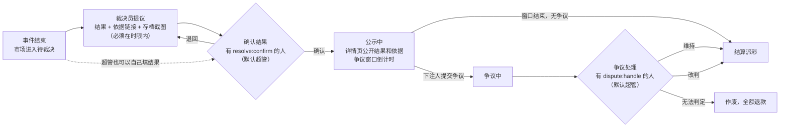

这张图想说明：平台裁决的市场由一个有权限的人（默认 Amos）确认结果，不要求第二个人（RQ-17）；确认后公开一段时间让下注的人挑错；有争议由有权限的人处理，处理完直接结算，不会无限循环。

| 环节 | 时长（默认，后台可改） | 操作 |
|---|---|---|
| 提议时限 | 体育转人工的：进入裁决台后 2 小时；时事：事件结束后 24 小时 | 超时在裁决台标红，邮件提醒裁决员和超管 |
| 确认时限 | 提议后 2 小时 | 超时在裁决台标红，邮件提醒超管（有 `resolve:confirm` 的人） |
| 争议窗口 | 体育（人工裁决的）2 小时；时事 24 小时（RQ-9） | 窗口内，**在这个市场有下注的客户**可以提交争议：选"认为应该是哪个结果"、写理由（必填，≤ 1,000 字）、可附链接；每人每市场 1 次；不收押金 |
| 争议处理时限 | 提交后 24 小时内给出结论 | 结论和理由公开在市场详情页（不显示争议人身份） |
| 自动裁决的市场 | 不公示、没有争议窗口（Amos：自动裁决） | 客户对自动裁决有异议的，走客服工单；确实错了按 E13 补偿 |

裁决记录（每一步都留痕，只增不改）：谁、什么时候、提议 / 确认 / 退回 / 争议结论、依据链接、存档截图、理由。已结算市场详情页公开：结果、依据、裁决时间、**裁决人编号**（确认结果的管理员；争议改判的，显示处理争议的管理员；自动裁决的显示"自动裁决"；编号不是姓名）。

---

## 5. 客户端页面

### 5.1 站点地图

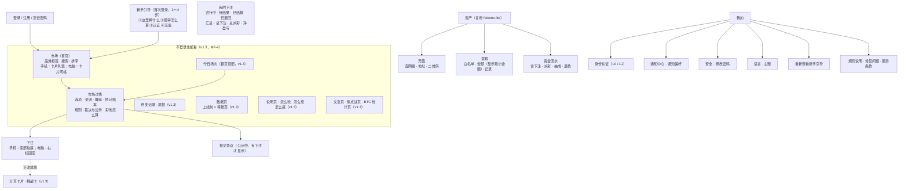

这张图想说明：手机底部 4 个入口（市场、我的下注、资产、我的），通知是顶栏的铃铛；电脑顶部导航是市场、我的下注、资产，右上角余额、充值、通知、我的。v1.3 起，虚线框里的页面**不登录也能看**、可以被搜索引擎收录；下注、我的下注、资产、我的仍要登录（不登录点"押注"时先去登录 / 注册，登录后回到原市场）。开奖记录、数据页、说明页、文章页放在页脚和"我的 → 规则说明"里，不加底部导航入口。

### 5.2 页面清单

| 编号 | 页面 | 内容 | 手机 / 电脑的差别（C64） |
|---|---|---|---|
| P1 | 市场（首页 / 列表） | 品类标签（全部、足球、NBA、加密 15 分钟、加密 1 小时、时事）、搜索、排序（快截止 / 奖池最大 / 最新）；卡片：品类、题目、选项和概率（二选一的直接显示两个按钮，多选项显示前 3 个 + "更多"）、奖池、截止时间（"还剩 8 分"，按分钟更新，最后 1 分钟按秒）、状态标签；已结算的默认隐藏，可筛选。v1.3：顶部"今日场次"（P11）；**不登录可看**（MF-4），不登录时右上角显示"登录 / 注册"，点选项按钮先去登录 | 手机单列卡片；电脑 3～4 列网格 |
| P2 | 市场详情 | 题目、状态、截止时间（UTC + 本地）、总奖池、费率；选项表（奖池、概率、预计赔率）；我在本市场的下注和预计回报；标签页：规则（全文 + 补充说明 + 费率修改记录）、裁决与公示（结果、依据、裁决人编号、争议截止时间、争议结论）、彩池怎么算（通俗说明 + 本市场的数字）。v1.3：**不登录可看**（MF-4），"我在本市场的下注"只在登录后显示；"分享"按钮（市场卡）；结算分步进行时显示"结算中"（第 3.5 节） | 手机：详情 → 点选项弹出下注抽屉；电脑：左边详情、右边固定下注栏 |
| P3 | 下注 | 选中的选项、当前概率和预计赔率、金额输入（快捷 10 / 50 / 100 / 500 / 最大）、可用余额、本市场还可押多少、本注预计回报（按 3.4）、"下注后不能撤销"提示、确认按钮；余额不足时按钮变成"去充值"。v1.3：下注成功后弹出挑战卡（可以关掉，W5） | 确认按钮在首屏内（C79：1366×768、1280×720、390×844、375×667） |
| P4 | 我的下注 | 分 4 个标签；每条：市场、选项、金额、下注时间、状态、最终赔率（截止后）、派彩 / 抽成 / 退款；点进市场详情；顶部汇总。v1.3：已结算的赢单可以分享开奖卡（金额默认隐藏）；结算分步进行时，还没入账的显示"结算中" | 手机列表；电脑表格 |
| P5 | 资产 | 复用 falconx-lite：余额（可用、下注中、提现冻结）、充值、提现、流水；新增"下注中"金额；提现页显示单笔最小金额 | 同 falconx-lite |
| P6 | 通知中心 | 复用 falconx-lite 站内信；点击跳到对应市场或提现 | |
| P7 | 我的 / 设置 | KYC、通知偏好（推送、邮件开关）、修改密码、语言（下拉框，标出当前语言，记住选择，C82）、主题（默认跟随系统，可选深色 / 浅色并记住，RQ-1）、重新查看新手引导、规则说明和常见问题 | |
| P8 | 注册 / 登录 / 忘记密码 | 复用 falconx-lite；注册时勾选"已满 18 周岁并同意服务条款" | |
| P9 | 新手引导（C83） | 首次登录显示 4 步：①"在这里押一件事的结果"；②"赔率随奖池变化，截止时确定；赢了只对盈利抽成"；③"完成认证"（说明什么时候需要）；④"充值 USDT 开始"→ 终点落在充值页；可以跳过，"我的"里能重看 | 不做试玩 |
| P10 | 提交争议 | 弹窗：认为应是哪个结果、理由、链接 | |
| P11（v1.3） | 今日场次（首页顶部，MF-3） | 第 4.2 节"今日场次"：今天带"列入今日场次"标记的市场，时间、两边人数和概率、状态；没有场次时显示下一场的时间；**不登录可看** | 手机：横向一排卡片或折叠列表；电脑：列表上方一行（W5） |
| P12（v1.3） | 开奖记录和周报（MF-6） | 已结算、已作废、已取消的市场列表：结果、依据链接、奖池、派彩合计、抽成、尾差、裁决人编号、作废 / 取消原因；按品类、时间筛选；每周周报（本周场数、有效场数、作废场数和原因、奖池合计、派彩合计、抽成合计），历史周报可翻看；**不登录可看**，可被收录 | 手机列表；电脑表格 |
| P13（v1.3） | 数据页（上线前 = 等候页，MF-8、MF-17） | 三块真实数据：① BTC 实时价格和"过去 N 小时 BTC 每小时涨跌的比例"（币安公开行情）；② Polymarket 上 BTC 涨跌、热门体育和经济题的当前概率（注明"数据来自 Polymarket 公开接口，非 Polymarket 官方"和更新时间）；③ 我们今天场次的两边人数和比例（上线前显示"L 日开场"）；订阅开场提醒（Telegram 机器人或邮箱）。**不放 X 情绪数据**；**不登录可看**，可被收录。上线前它是独立的等候页，上线后是首页旁边的"数据"页 | W6 |
| P14（v1.3） | 说明页（MF-4） | 怎么玩（彩池怎么算、截止时确定赔率、只有一边有人押全额退款）、怎么充（三条链）、怎么提（**单笔最小 100 USDT、提现前要证件 + 人脸认证、新地址 24 小时生效、2 小时冷静期、大额延迟、盈利提现人工复核**）；文字中的事实性描述交 Amos 确认（第 15 节） | |
| P15（v1.3） | 文章页、焦点战页、BTC 统计页（MF-11） | 由自动化程序生成：数据部分自动更新，文字部分 Amos 审核后才显示（自动化文档第 4 节）；三语各有独立地址 | |

**分享卡片和挑战卡（v1.3，MF-5）**：
- 市场详情、下注成功、已结算的下注都有"分享"按钮，生成卡片图片和链接；链接在 Telegram、X 里自动显示卡片图（Open Graph）。
- 卡片种类：**市场卡**（题目、两边概率、截止时间）；**挑战卡**（下注成功后："我押了 X，谁敢押 Y？"，显示两边人数、对面当前预计赔率；对面没人时写"对面目前 0 人；截止时仍只有一边有人押，全额退款"）；**开奖卡**（结果、我的派彩，**金额默认隐藏**、客户可以选择显示）；**封盘倒计时卡**（第 6.3 节，系统生成，不由客户生成）。
- 卡片上只放真实数字和真实规则，**不写"稳赚""必中""翻倍""胜者瓜分""最后入场"等措辞**（F-12）；不显示客户邮箱、客户编号以外的身份信息。
- 链接自带 `src=share` 和分享人 `ref`（客户编号），只用于来源统计（MF-1），**不给分享人任何奖励**（MQ-5）。

**来源统计（v1.3，MF-1）**：链接带 `src`（渠道）、`cmp`（活动）、`ref`（分享人或渠道编号）时，记在浏览器里（30 天）；注册时写进客户记录的"首次来源"（第一次带参数访问时的值）和"注册来源"（注册时的值）；Telegram 机器人深链的 `start` 参数用同样的编码。客户自己看不到这些字段。

**C84**：主工作区（市场列表、详情、下注）旁边**不放跑马灯、滚动的最新下注、整列闪动的赔率**；赔率更新只换数字。v1.3 的"今日场次"只是静态列表，数字随推送更新但不闪动、不滚动。

### 5.3 线框图（低保真）
只表达页面上有什么、怎么操作；视觉效果图由研发在架构方案阶段按选定的风格画。

| 编号 | 页面 | 线框图 |
|---|---|---|
| W1 | 市场列表（手机） | 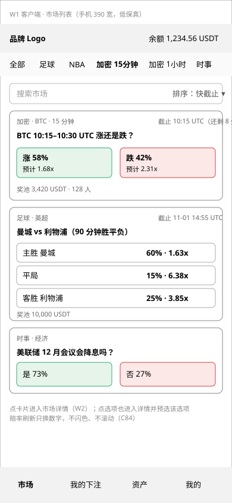 |
| W2 | 市场详情 → 下注抽屉（手机） | 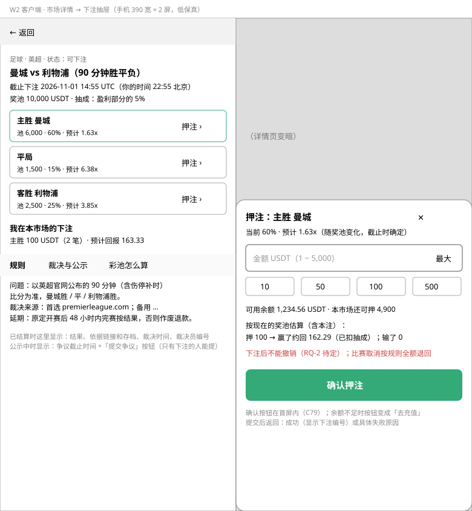 |
| W3 | 市场详情（电脑） | 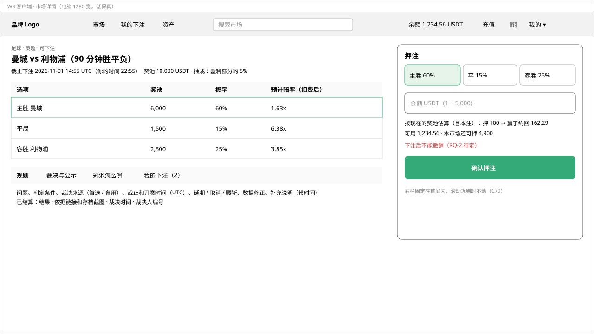 |
| W4 | 后台裁决台 / 确认结果（电脑） | 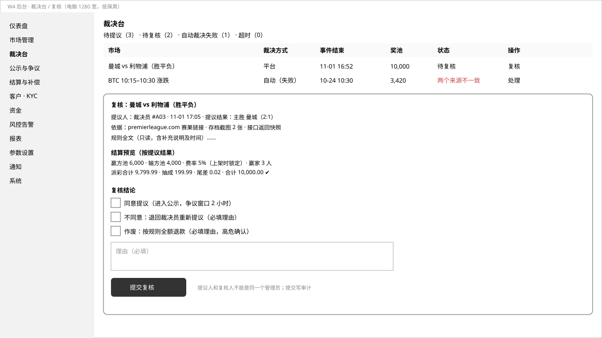 |
| W5（v1.3） | 首页今日场次 + 下注成功后的挑战卡（手机） | 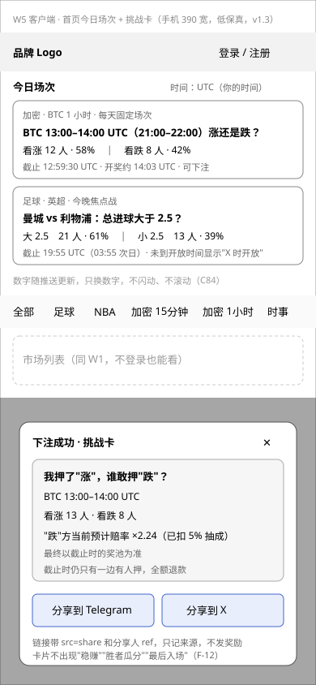 |
| W6（v1.3） | 数据页 / 上线前等候页（手机） | 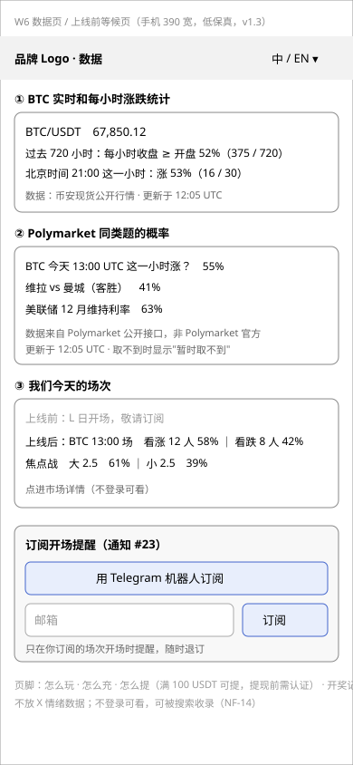 |
| W7（v1.3） | 后台内容中心：草稿箱（电脑） | 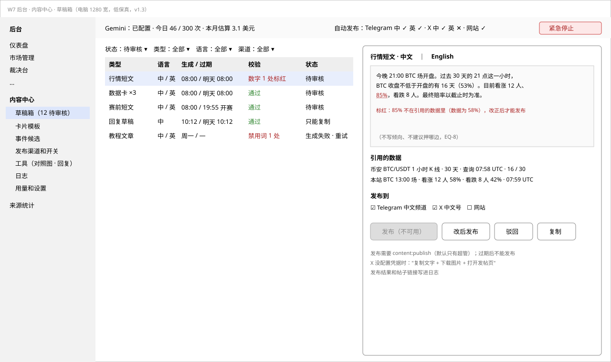 |

资产、提现、注册、KYC 页面沿用 falconx-lite 的线框图和原型（`falconx-lite/assets/v1/wireframes/W3`～`W5`）。

---

## 6. 后台页面

### 6.1 站点地图

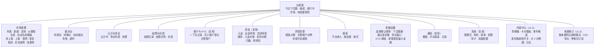

这张图想说明：后台 14 个一级菜单（v1.3 加了"内容中心"和"来源统计"）；资金、客户、通知、系统沿用 falconx-lite，其余是新的。没有单独的"复核"菜单：待上架在市场管理里，待确认结果在裁决台里（RQ-17）。场次的配置在"市场管理 → 自动生成模板"（场次表）和"参数设置"（同时开放上限）里，不单独成菜单。

### 6.2 页面清单

| 页面 | 内容 | 权限点 |
|---|---|---|
| 仪表盘 | 今日 / 本周：下注额、下注人数、平台收入（抽成 + 尾差）、新注册、充值、提现；待处理：待上架、待提议、待确认结果、争议中、结算异常、出金待审核 | `dashboard:view` |
| 市场管理 | 列表（品类、状态、截止时间、奖池、下注人数筛选）；新建 / 编辑草稿（按第 4.1 节模板，必填项没填不能提交上架）；复制；从赛程生成；加密自动生成模板；市场详情：奖池、各选项下注人数和金额、前 20 大下注、状态历史、费率修改记录；暂停 / 恢复、取消、发补充说明；**改本市场费率**（结算开始前，高危，原因必填，第 3.8 节） | `market:*`、`fee:edit` |
| 待上架 | 运营提交的草稿列表 + 所有草稿；逐项检查清单（第 4.1 节）；上架 / 退回（理由必填）。有权限的人可以直接上架自己建的草稿 | `market:publish` |
| 裁决台 | 待提议、待确认、自动裁决失败（显示两个来源的原始数据）、超时；提议表单：结果、实际开赛时间（体育）、依据链接、上传存档截图、说明；按提议结果的**结算预览**（派彩合计、抽成、尾差、守恒检查，见 W4） | `resolve:propose` |
| 确认结果（裁决台内） | 提议详情 + 结算预览；确认（进入公示）/ 退回提议 / 作废（高危）。有权限的人也可以不等提议，自己填结果直接确认 | `resolve:confirm`、`resolve:void` |
| 公示与争议 | 公示中市场（争议截止倒计时）；争议列表（市场、争议人编号、主张的结果、理由、时间）；处理：维持 / 改判 / 作废，结论理由必填，一个有权限的人确认即可 | `dispute:*` |
| 结算与补偿 | 结算记录（每个市场的派彩合计、抽成、尾差、守恒结果、结算时的费率）；结算异常；补偿：选市场和正确结果 → 系统算出每个客户应补金额 → 有权限的人确认（高危，原因必填）→ 入账并通知 | `settle:*` |
| 客户与 KYC | 复用 falconx-lite；客户详情新增：下注记录、累计下注、累计派彩、净盈亏、KYC 级别、是否员工账户、关联账户（同设备、同 IP、同充值来源地址） | `customer:*`、`kyc:*`、`bet:view` |
| 资金 | 复用 falconx-lite；新增"彩池对账"（第 3.9 节） | 复用 + `pool_recon:*` |
| 风控告警 | 第 8 节的告警列表：类型、客户、市场、金额、时间、处理状态（已查看 / 已处理 / 误报） | `risk_alert:view`、`risk_alert:handle` |
| 报表 | 平台收入 = 抽成 + 结算尾差（补偿支出单列）；按天、按品类、按市场；下注额、下注人数、派彩额；可导出 CSV | `report:view` |
| 参数设置 | 品类默认费率（新建市场时带出）；下注限额（单笔最小 / 最大、单客户单市场上限，按品类）；截止提前量（加密）；开放下注提前量（加密）；争议窗口和裁决时限（按品类）；KYC 阈值；**单笔提现最小金额**（默认 100 USDT）；保存走高危确认，显示"前 → 后"，写审计；带版本号，有人同时修改时后保存的提示冲突 | `fee:edit`、`betting_params:edit` |
| 通知 | 复用；新增第 7 节的模板 | 复用 |
| 系统 | 复用 | 复用 |
| 场次（v1.3，市场管理内） | 自动生成模板加"生成方式"（场次表 / 连续窗口）、场次表（UTC 时刻 + 星期几，页面同时显示北京时间）、连续窗口的 N；市场列表加"今日场次"筛选；上架和编辑草稿时可以勾选"列入今日场次"；上架超过同时开放上限时提示并要求勾选"仍要上架"（第 4.2 节） | `market:autogen`、`market:publish` |
| 参数设置（v1.3 新增一项） | 同时开放的市场数上限（默认 2，0 = 不限） | `betting_params:edit` |
| 内容中心（v1.3） | 草稿箱、卡片模板（审定 / 停用 / 预览）、事件候选、发布渠道和开关（含紧急停止）、大 V 对照图工具、每日草稿包、生成和发布日志、Gemini 状态和用量。页面细节见 `需求文档/v1.3-事件和文章自动化.md` 第 7 节；卡片自动发布见本文第 6.3 节 | `content:*` |
| 来源统计（v1.3，MF-1、MF-10） | 按来源（`src`、`cmp`、`ref`）和注册周统计：访问（带参数的）、注册、首充、首注（激活）、第 2 周仍下注；每场下注人数和有效市场率（按作废原因分）；**CSV 导出**（只含客户编号，不含邮箱、地址、KYC 信息）；等候页订阅列表（订阅方式、订阅时间、是否已通知） | `growth:view` |

（风控告警两个权限点 `risk_alert:view`、`risk_alert:handle` 也是新增的，给财务和超管。）

### 6.3 卡片自动发布（v1.3，MQ-2）

Amos 2026-10-25 同意 MQ-2 的建议：**Amos 一次性审定五种卡片的模板，之后系统按模板自动发到官方渠道**；模板改动、评论性内容、回复、私信仍由 Amos 逐条处理。这是 C73"对外发布由 Amos 决定"在卡片上的落实方式：**审定模板 = 同意按这个模板自动发**。

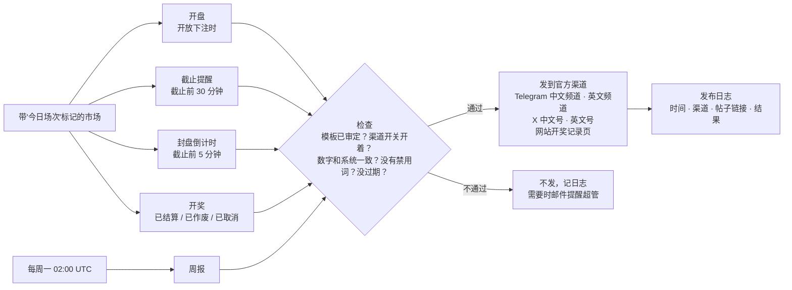

这张图想说明：卡片只为"今日场次"里的市场（加周报）自动生成，生成时全部数字直接取系统数据、套进 Amos 审定过的模板，发之前再检查一遍，任何一项不通过就不发。

**发什么、什么时候发**：

| 卡片 | 触发 | 内容（全部来自系统，不能手改） | 作废 / 人少时 |
|---|---|---|---|
| 开盘卡 | 市场到了"开放下注时间" | 题目、开放和截止时间（UTC + 北京时间）、开奖时间；有同题 Polymarket 数据时附上概率并注明来源 | — |
| 截止提醒卡 | 截止前 30 分钟 | 两边（或各选项）人数、金额、概率、当前预计赔率（扣费后），"最终以截止时为准" | 对面 0 人照实写"目前 0 人；截止时仍只有一边有人押，全额退款" |
| 封盘倒计时卡 | 截止前 5 分钟 | 同上，"距截止 5 分钟" | 同上；**人少照实发，不因为数字难看就不发** |
| 开奖卡 | 市场进入"已结算 / 已作废 / 已取消" | 结果、依据（加密：开始价和结束价、来源）、奖池、派彩合计、抽成、尾差、下注人数；作废 / 取消写原因和"已全额退款" | 作废也发（"没人对赌就全额退，不收一分钱"） |
| 周报卡 | 每周一 02:00 UTC（北京时间 10:00） | 上周场数、有效场数、作废场数和原因、奖池合计、派彩合计、抽成合计 | — |

- 平台裁决的市场在"公示中"不发开奖卡，结算后才发（公示期的拟定结果只在市场详情页显示）。
- 同一场在同一个渠道最多发两次提醒（截止提醒 + 倒计时），避免刷屏（X 自动化规则，市场策略第 12 节）。
- 每张卡片带一个图片（服务器按模板生成）和一段短文字，附市场链接（带 `src` 参数，记来源）。

**发到哪里**（MQ-2、MQ-8）：
- 官方 **Telegram 频道**（中文、英文各一个）——通过官方机器人发；机器人由 Amos 注册（C73），机器人的 token 只由 Amos 填进服务器环境变量。
- 官方 **X 账号**（中文、英文）——通过 X 的发帖接口发；X 开发者账号由 Amos 申请。X 接口的免费额度和条款【未核实】，额度不够或拿不到时，X 渠道改为"一键复制 + 打开发帖页"由 Amos 手动发（见自动化文档 EQ-3、EQ-4）。
- **网站**：开奖卡和周报同时出现在开奖记录页（P12）。
- 群主开启了播报的 Telegram 群：机器人只往开启了播报的群里发开奖卡（MF-7）；群主随时可以关。
- 每个渠道单独一个开关，渠道的名称和地址在"内容中心 → 发布渠道"里配置。中文渠道发简体中文，英文渠道发英文（MQ-8）。中英文是否分开账号是 EQ-3。

**模板怎么审定**：
1. 五种卡片 × 两种语言，各一个模板。模板是固定文字 + 变量（只能用系统提供的变量，例如 `{题目}`、`{看涨人数}`、`{当前预计赔率}`），**不能写变量以外的数字**。PM 起草初始模板（市场策略第 6.3 节和 F-16 的草稿），放进后台（C6）。
2. 模板有三种状态：**草稿 → 已审定 → 已停用**。只有有 `content:publish` 的人（默认超管，即 Amos）能把草稿审定为"已审定"：审定页面显示用最近一个真实市场数据生成的预览（中英文、图片和文字），勾选"我确认按这个模板自动发布"后生效，写审计。
3. **已审定的模板改了任何一个字，就变回草稿**，要重新审定；没有重新审定之前，系统继续用上一个已审定的版本（每个版本都保留）。
4. 保存模板时检查禁用词（F-12、F-15：稳赚、必中、保本、翻倍、胜者瓜分、最后入场、别错过、智能合约秒出、全在链上等，名单在后台可加），有禁用词不能保存。

**怎么停用**：
- **紧急停止**：内容中心顶部一个按钮，按下后**所有自动发布立即停止**（包括草稿箱的一键发布），写审计并邮件通知超管；再按一次恢复。
- **按渠道停**：每个渠道一个开关。
- **按模板停**：把某个模板设为"已停用"，这种卡片不再发。
- **自动停**：发之前检查不通过就不发这一张（数字和系统对不上、模板没审定、渠道开关关着、有禁用词、已过期）；**过期不补发**：开盘卡、截止提醒卡、倒计时卡如果到截止时间还没发出去，就放弃；某个渠道连续 3 次发送失败，系统自动关掉这个渠道的开关并邮件通知超管。
- 发布失败：每张卡片最多重试 3 次（间隔递增），都失败记日志并邮件通知超管（每个渠道每小时最多一封）。
- 删帖：已经发出去的帖子要删，由 Amos 在 Telegram / X 里手动删；日志里有帖子链接。

**默认状态**：全部模板是草稿、全部渠道开关是关；上线前由 Amos 审定模板、打开开关。

### 6.4 事件和文章自动化程序（v1.3，Amos："另外需要写一个事件和文章自动化程序"）

完整需求写在独立文档 **`需求文档/v1.3-事件和文章自动化.md`**（一图看懂、范围、事件自动化、文章自动化、发布规则、Gemini 的调用量和费用、降级、后台页面、通知、风险、验收标准 AC-100～AC-118、待决问题 EQ-1～EQ-8、超出要求的部分）。和本文的关系：

| 本文 | 自动化文档 |
|---|---|
| 第 4.1 节上架检查、"不能涉及"的题目 | 事件草稿生成时先按这份清单过滤，生成后仍要人工上架（加密模板除外） |
| 第 4.2 节市场怎么来 | 赛程、加密场次之外，新增经济日历（FOMC、CPI）草稿和热点新闻候选（可选） |
| 第 4.3 节体育数据源（AQ-7） | 抓取程序用 Gemini 解析页面时，key、调用量、降级按自动化文档第 6 节 |
| 第 6.3 节卡片自动发布 | 卡片属于"模板内容"，不用 AI；自动化文档里的"自由生成内容"进草稿箱，由 Amos 一键审核发布 |
| MF-6、MF-9、MF-11、MF-17 | 数据管道、数据卡、大 V 对照图、SEO 页面和文章的生成 |

---

## 7. 通知清单（C86）

渠道沿用 falconx-lite：站内信（始终发，客户不能关）、Web Push、邮件（客户可以分别关）。**下表"发"指在客户没关闭该渠道时发送**。所有客户通知的文案放进后台可改的模板（C6），PM 起草初始中英文文案。

| # | 事件 | 站内信 | 推送 | 邮件 | 说明 |
|---|---|---|---|---|---|
| 1 | 注册成功（欢迎） | 发 | 不发 | 不发 | 内容和新手引导一致（同 falconx-lite `WELCOME`） |
| 2 | 邮箱验证码 | 不发 | 不发 | 发 | 只发邮件 |
| 3 | 充值到账 | 发 | 发 | 发 | 复用 |
| 4 | 充值低于最小金额未入账 | 发 | 不发 | 不发 | 复用 |
| 5 | 提现状态变化（审核通过、驳回、开始上链、已完成、失败退回、紧急取消） | 发 | 发 | 发 | 复用；客户自己提交、撤销不发 |
| 6 | KYC 通过 / 驳回 | 发 | 发 | 发 | 复用（两个模板） |
| 7 | 累计充值达到 KYC 阈值、需要认证才能继续下注 | 发 | 发 | 发 | 新 |
| 8 | 下注成功 | 发 | 不发 | 不发 | 页面上已看到结果 |
| 9 | 我下注的市场截止下注 | 不发 | 不发 | 不发 | 太频繁（15 分钟一次） |
| 10 | 我下注的市场公示结果（进入争议窗口） | 发 | 发 | 不发 | 写明拟定结果和争议截止时间；只对平台裁决的市场 |
| 11 | 结算：我赢了 | 发 | 发 | 不发 | 写明派彩、抽成；加密短周期很频繁，邮件不发 |
| 12 | 结算：我输了 | 发 | 发 | 不发 | 客户可以在偏好里关推送 |
| 13 | 市场取消 / 作废，下注已退回 | 发 | 发 | 发 | 写明原因 |
| 14 | 晚于开赛的下注被退回（E14） | 发 | 发 | 发 | |
| 15 | 我提交的争议有结论 | 发 | 发 | 发 | |
| 16 | 改判（我下注的市场在争议后改判） | 发 | 发 | 不发 | 结算通知（#11、#12）里会带"改判"说明 |
| 17 | 补偿到账 | 发 | 发 | 发 | |
| 18 | 市场发布补充说明（我有下注的） | 发 | 不发 | 不发 | |
| 19 | 新市场上线、热门推荐 | 不发 | 不发 | 不发 | 第一期不做营销推送 |
| 20 | 修改密码、重置密码成功 | 不发 | 不发 | 不发 | 同 falconx-lite；以后要发再另提 |
| 21 | 账户被冻结 / 解冻 | 不发 | 不发 | 不发 | 同 falconx-lite |
| 22 | 我有下注的市场修改了费率 | 发 | 不发 | 不发 | 新（RQ-4）：写明市场、修改时间、旧费率 → 新费率、"结算按新费率算"；只发给这个市场有有效下注的客户；草稿阶段修改不发 |
| 23 | **我订阅的场次开场提醒**（v1.3，MF-7、MF-8） | 不发 | 不发 | 发（只发给用邮箱订阅的） | 新：**只发给主动订阅的人**，按订阅方式发——Telegram 机器人私聊（订阅时选 Telegram 的）或邮件（等候页用邮箱订阅的）；订阅的人不一定是我们的客户。内容：场次题目、开放和截止时间、链接。L 日第一场也用这一条通知等候页的订阅者。每条都带"退订"；中英文按订阅时的语言 |

**#23 和 #19 不冲突**（v1.3，回复市场的问题）：#19"新市场上线、热门推荐"是平台主动推给所有客户的营销消息，第一期仍然不发；#23 是用户**主动订阅某个场次**以后才发的提醒，可以随时退订，不发给没订阅的人，所以纳入第一期。#23 不发站内信和 Web Push（订阅的人多数还没注册）。

**发给管理员**（沿用 falconx-lite：管理员只收邮件，同时写通知记录）：

| 事件 | 收件人 |
|---|---|
| 运营提交了待上架的草稿、裁决员提议了结果（待确认） | 有 `market:publish` / `resolve:confirm` 的人（默认超管） |
| 待提议超时、确认超时、争议处理超时 | 裁决员（待提议超时）+ 超管 |
| 自动裁决失败转人工 | 裁决员 + 超管 |
| 新的争议 | 有 `dispute:handle` 的人（默认超管）、裁决员 |
| 结算异常（守恒不等）、彩池对账有差异 | 财务 + 超管 |
| 风控告警（第 8 节） | 财务 + 超管 |
| 复用：热钱包余额不足、冲正挂账、入金对账差异、自动审批总开关被改 | 同 falconx-lite |
| 卡片自动发布失败、某个渠道被自动关闭、紧急停止被按下或恢复（v1.3，第 6.3 节） | 有 `content:publish` 的人（默认超管） |
| 自动化程序的每日草稿包已生成、Gemini 未配置 / 额度用完 / 连续失败（v1.3，自动化文档第 8 节） | 有 `content:publish` 的人（默认超管）；草稿包每天一封汇总，不按条发 |

---

## 8. 风控

### 8.1 风险和措施

| 风险 | 表现 | 措施（第一期） |
|---|---|---|
| 同一人多账号对冲 / 洗钱 | A 押选项 1、B 押选项 2，不管谁赢钱都留在自己人手里，把来路不明的钱"洗"成派彩 | ① 后台"关联账户"：同设备指纹、同注册 / 登录 IP、同充值来源地址、同提现地址的账户自动关联；② 告警"关联账户在同一市场押不同选项"；③ 提现自动审批新增 R14（见 8.2） |
| 刷量 | 第一期没有返佣、分成、积分、排行榜（v1.3：MQ-5 确认不做返佣和分成），刷量没有直接收益 | 不做专门措施；以后加激励时再设计 |
| 对外内容出错（v1.3） | 自动发出的卡片数字不对、AI 写的文章有不实内容或敏感题 | 卡片只用系统数据、发之前核对；AI 内容进草稿箱人工审核；紧急停止（第 6.3 节；自动化文档第 9 节） |
| 内幕题 | 能被个人或员工提前知道结果的题目 | ① 上架检查清单里有"单个人能左右结果"一项，这类题目不上；② **员工账户登记，禁止下注**（后台在客户详情标记"员工"）；③ 时事题在结果公布前 1 小时以上截止 |
| 市场操纵：尾盘大额押注 | 彩池的赔率在截止时才定；有人在最后几分钟大额押入，压低别人的赔率或制造假信号 | ① 单客户单市场上限（第 3.3 节）；② 加密市场在窗口开始前截止；③ 告警"截止前 N 分钟内单笔 ≥ 奖池 X%"（默认 N = 5、X = 30%，后台可调）；④ 页面始终写明"最终赔率在截止时确定" |
| 内幕交易 | 新账户在冷门结果上大额押中 | 告警"注册 7 天内、单笔 ≥ 1,000 押中赔率 ≥ 5x 的结果"；自动审批新增 R15 |
| 反洗钱：充了不玩就提 | 充值后少量或不下注直接提现 | 复用自动审批 R8，口径改为"充值后的下注额"（见 8.2） |
| 裁决员作弊 | 裁决员自己或亲友在市场里下注 | 裁决员只能提议，结果由有 `resolve:confirm` 的人（默认超管）确认；平台裁决的市场公示 + 争议窗口；员工账户禁止下注；全部操作写审计 |
| 数据源被操纵 | 单一交易所价格被短暂操纵 | 主备两个来源方向一致才自动结算 |

### 8.2 提现自动审批：复用 falconx-lite 的 13 条规则，调整如下
框架（总开关默认关闭、提交时预判 + 冷静期结束复判、只决定要不要人工看、不放宽任何限额）原样复用。

| 规则 | falconx-lite 口径 | 本项目 |
|---|---|---|
| R1～R7、R11 | 单笔、个人 / 平台 24 小时累计、首笔、新地址、安全事件、注册天数和 KYC、当天次数 | **不变** |
| R8 充值后的交易量 | 开仓名义价值 ≥ 充值额 × N | 改为：近 30 天充值以后的**有效下注本金**合计 ≥ 充值额 × N（取消、作废退回的下注不算；默认 N = 1） |
| R9 累计提现 ≤ 累计充值 + 已实现盈亏 | 已实现盈亏 = 交易盈亏 | 已实现盈亏改为 Σ(派彩 − 本金)（已结算的持仓；输的记 −本金；退款记 0）+ 补偿 |
| R10 近 7 天已实现盈利 | 交易盈亏 | 同 R9 的口径，近 7 天 |
| R12 系统状态 | 报价偏差告警、全局暂停、热钱包余额 | 去掉报价偏差和交易全局暂停；保留热钱包余额；新增"彩池对账没有未处理的差异" |
| R13 盈利客户 | 已实现盈亏 − 手续费 − 隔夜费 > 门槛转人工 | 改为累计 Σ(派彩 − 本金)（派彩已扣抽成）> 门槛转人工；默认门槛 0，上线一个月后按人工审核量再调（RQ-11） |
| **R14（新）** 关联账户对押 | — | 近 30 天，本客户的派彩来自"关联账户押了其他选项"的市场，且这部分盈利 > 100 USDT → 转人工 |
| **R15（新）** 可疑押中 | — | 近 7 天有命中第 8.1 节"内幕交易""尾盘大额"告警且未处理的 → 转人工 |

---

## 9. 非功能需求

| 编号 | 要求 |
|---|---|
| NF-01 性能：下注 | 高峰（大赛开赛前、整点 / 15 分钟加密截止前）**持续 200 笔 / 秒，单个市场 100 笔 / 秒**时，下注接口 p99 ≤ 500 毫秒，没有超卖（余额不为负、不超过单客户上限）（AC-70） |
| NF-02 性能：奖池推送 | 奖池变化后 2 秒内推送到正在看该市场的页面（AC-17） |
| NF-03 性能：结算 | 一个有 10,000 个持仓的市场，从可以结算到全部派彩入账 ≤ 60 秒（AC-71）；加密市场窗口结束后 3 分钟内结算完（AC-27） |
| NF-04 性能：首屏 | 市场列表首屏（登录后第一屏）在 4G 网络下 ≤ 3 秒（服务器所在地以外至少测 2 个地区，测试方式在架构方案里定） |
| NF-05 可用性 | 月可用率 ≥ 99.5%（不含提前公告的维护）；服务停机期间到了截止时间的市场，恢复后按截止时间处理（停机期间不可能收到下注），不会多收 |
| NF-06 时间 | 服务器时钟用 NTP 同步，偏差 > 1 秒告警；截止判定只用服务器时间 |
| NF-07 金额 | 一律精确小数（沿用 falconx-lite 的 `DECIMAL(24,8)`）；下注金额最多 2 位小数；舍入只在第 3.5 节规定的地方 |
| NF-08 审计 | 后台所有写操作写审计；高危操作原因必填；上架、裁决提议、确认结果、争议、作废、补偿、费率修改的每一步只增不改；审计里没有明文密码（沿用） |
| NF-09 数据保留 | 下注、结算、账本、裁决记录（含存档截图和数据源原始返回）**永久保留**；KYC 资料按 falconx-lite 的做法；应用日志 90 天 |
| NF-10 安全 | 沿用 falconx-lite：只开 80 / 443、仓库无密钥、CI 密钥扫描、限流、写请求只接受本站页面。**生产后台不加 IP 白名单**（v1.3，AQ-14，Amos 同意，和 falconx-lite 一致）；后台靠登录、权限点、高危操作确认（原因必填）、审计、限流保护 |
| NF-11 隔离 | 和 falconx-lite 完全独立：服务器、数据库、热钱包和冷钱包、邮件发信域名、推送密钥都分开（FQ-9）。**上线前沿用 Quick Come 名称和 quickcome.online 子域名**（子域名不和 falconx-lite 已用的重复）；**正式上线前改为独立品牌和域名**，以上隔离要求不变（v1.2） |
| NF-12 多语言 | 跟随浏览器，取不到用英文；下拉框切换，标出当前语言，记住选择（C82）。第一期语言：英文、简体中文、繁體中文（RQ-18）。CI 检查缺失的翻译键 |
| NF-13 外部接口 | 所有外部调用（数据源、区块链节点、邮件、推送；v1.3 加 Telegram、X、Polymarket 公开接口、体育抓取程序、Gemini）都有超时和重试（C81）；数据源超时不影响下注 |
| NF-14 公开页面（v1.3，MF-4） | 不登录可看的页面（第 5.1 节虚线框）由服务器输出完整内容（搜索引擎不运行脚本也能读到题目、概率、结果）；三种语言各有独立地址并互相标注（hreflang）；每个页面的标题和描述按内容生成；已结算市场页面永久有效。客户端登录后的体验不变（C64、C79） |
| NF-15 自动化程序隔离（v1.3） | 事件和文章自动化程序、体育抓取程序出故障、被外部限流、Gemini 不可用时，**下注、结算、充值、提现不受影响**；它们只能通过和后台相同的接口建市场草稿、发内容，**不能直接改市场状态、奖池和资金**（自动化文档第 2 节） |
| NF-16 发给 AI 的数据（v1.3） | 发给 Gemini 的只能是公开数据和汇总数据（市场、奖池汇总、公开行情、公开赛程和新闻）；**客户的邮箱、地址、KYC、单个客户的下注记录都不能发**；Gemini 的 key 只放在服务器环境变量里（`FC_GEMINI_API_KEY`），不进仓库、不经过 AI、后台只显示"已配置 / 未配置"（C21） |

---

## 10. 验收标准

测试方式：**自动** = CI 或测试环境的自动化测试；**真机** = 测试人员用真实手机；**Amos** = 需要 Amos 或其安排的人员执行。本节等测试预审（C4）后补判定口径的细节。

### 10.1 市场和状态

| 编号 | 验收标准 | 判定口径 | 测试方式 |
|---|---|---|---|
| AC-10 | 状态机 | 第 3.2 节图上的每条边都能走通；图上没有的跳转（例如 已结算 → 公示中、草稿 → 截止下注）全部被拒绝并返回错误码 | 自动 |
| AC-11 | 必填项 | 第 4.1 节模板任一必填项为空，草稿不能提交上架、不能上架；选项少于 2 或多于 10 不能保存；时间先后不对（第 3.7 节第 3 条）不能保存 | 自动 |
| AC-12 | 上架后不能改 | 已上架市场的题目、选项、截止时间、裁决来源，通过任何接口修改都被拒绝；补充说明可以发布，并按时间显示在规则区 | 自动 |
| AC-13 | 一个人有权限就能完成（RQ-17） | 系统里只有一个超级管理员时：他能自己建草稿并上架、自己提议并确认结果（或不提议直接确认）、处理争议、作废、发起并确认补偿，每一步都不需要第二个账号；只有 `market:edit` 的管理员调用上架接口、只有 `resolve:propose` 的管理员调用确认结果接口都返回 403；每一步都写审计 | 自动 |
| AC-14 | 暂停 | 暂停后下注被拒（原因"市场已暂停"）；恢复后能下注；暂停中到了截止时间进入"截止下注" | 自动 |

### 10.2 下注和赔率

| 编号 | 验收标准 | 判定口径 | 测试方式 |
|---|---|---|---|
| AC-15 | 截止判定 | 服务器收到时间 = 截止时间 − 1 毫秒的下注成功；= 截止时间的被拒；用可调时钟测试 | 自动 |
| AC-16 | 下注拒单原因 | 第 3.3 节的 11 种拒单原因各触发一次，返回对应的中英文原因 | 自动 |
| AC-17 | 奖池推送 | 下注成功后，另一个打开该市场详情的客户端在 2 秒内看到新的奖池和赔率 | 自动 |
| AC-18 | 并发不超限 | 同一客户余额 100，对同一市场并发发 20 笔 10 USDT 下注：恰好 10 笔成功，余额 0，奖池 + 100；单客户单市场上限同理 | 自动 |
| AC-19 | 赔率显示 | 用第 3.5 节例子的奖池：列表显示 60% / 15% / 25%；预计赔率 1.63x / 6.38x / 3.85x；主胜押 100 的预计回报 162.29；某选项奖池为 0 时显示"—"；T = 0 时全部显示"—"；某选项奖池 1、总奖池 1,001 时该选项显示"<1%" | 自动 |

### 10.3 结算和资金

| 编号 | 验收标准 | 判定口径 | 测试方式 |
|---|---|---|---|
| AC-20 | 结算公式 | 用第 3.5 节例子（含 Alice 分 2 笔）结算：Alice 163.33、Bob 4,083.33、Carol 5,553.33，抽成 199.99，尾差 0.02，其他人 0，**逐分相等** | 自动 |
| AC-21 | 守恒 | 随机生成 1,000 个市场（2～10 个选项、1～500 个下注、金额 1～5,000 两位小数、费率 0%～20%）结算：每个市场 Σ派彩 + Σ抽成 + 尾差 = T；尾差 ≥ 0 且 < 0.01 × 赢方持仓数 | 自动 |
| AC-22 | 平台不亏 | AC-21 的每个市场，平台账户在该市场的变动 = 抽成 + 尾差 ≥ 0 | 自动 |
| AC-23 | 幂等 | 同一市场结算任务重复执行 3 次（含并发），只派彩一次；v1.3：派彩进行到一半时（例如第 2 批）让服务中断，重启后续跑，每个持仓只入账一次，最终结果和不中断时逐分相等（AQ-3） | 自动 |
| AC-24 | 边界 E1、E3、E4 | 没人押赢方 → 作废全额退款、不收费；截止时只有一个选项有人押 → 截止后 1 分钟内作废退款；奖池 0 → 作废无资金变动 | 自动 |
| AC-25 | 取消和作废退款 | 截止前取消、截止后作废：每个客户退回金额 = 他在该市场的有效下注合计，不收费，通知 #13 发出 | 自动 |
| AC-26 | 晚于开赛的下注（E14） | 裁决员填的实际开赛时间早于截止时间时，之后收到的下注全额退回、不参与结算，其余按公式结算 | 自动 |
| AC-27 | 加密自动结算 | 测试环境用替身数据源：窗口结束后 3 分钟内状态变为已结算；收盘 = 开盘判"涨"；详情页显示开始价、结束价、来源 | 自动 |
| AC-28 | 加密自动生成 | **连续窗口**方式（v1.3 改写）：模板开启、N 设为 4（15 分钟）和 3（1 小时）后，任何时刻未来至少有 4 个 15 分钟窗口和 3 个 1 小时窗口处于可下注或待开放；关闭模板后不再生成新的。场次表方式见 AC-80 | 自动 |
| AC-74（v1.3） | 结算中（AQ-3） | 10,000 个持仓的市场结算时：第 1 步守恒校验通过之前没有任何派彩流水；派彩进行中，市场详情和"我的下注"显示"结算中"，已入账的客户能看到自己的派彩、收到 #11；全部完成后才显示"已结算"；人为让第 1 步守恒校验不通过时，市场停在"结算异常"，没有任何派彩流水，财务和超管收到邮件；结算中的市场在彩池对账里不报差异（第 3.9 节第 2 条） | 自动 |
| AC-29 | 数据源不一致 | 主备方向不一致或备用拿不到：30 分钟后进入裁决台"自动裁决失败"，裁决员收到邮件 | 自动 |
| AC-37 | 费率修改（RQ-4） | 新建市场自动带出品类默认 5%；市场上架并有下注后，把该市场费率从 5% 改成 8%：要求原因、写审计；规则区显示修改时间和"5% → 8%"；该市场有下注的客户收到站内信 #22；预计赔率按 8% 重新显示；结算按 8%（用第 3.5 节例子，抽成按 8% 逐分核对）；没有 `fee:edit` 的管理员修改返回 403；结算开始后修改被拒；改品类默认值不影响已建的市场 | 自动 |
| AC-38 | 彩池对账 | 人为改动一个市场的奖池记录，次日对账列出差异并邮件告警财务；R12 让提现转人工 | 自动 |
| AC-39 | 流水 | 客户资金流水能看到下注锁定、派彩、抽成、退款、补偿，每条能点到对应市场 | 自动 |

### 10.4 裁决、公示、争议

| 编号 | 验收标准 | 判定口径 | 测试方式 |
|---|---|---|---|
| AC-30 | 确认结果 | 平台裁决的市场：裁决员提议后，没有经过有 `resolve:confirm` 的人确认就不能进入公示；提议人本人有确认权限时可以确认自己的提议（不拒绝）；确认人可以退回提议，市场留在"待裁决" | 自动 |
| AC-31 | 公示期满结算 | 争议窗口（测试中设 2 分钟）结束、无争议，1 分钟内自动结算 | 自动 |
| AC-32 | 提交争议 | 只有在该市场有下注的客户能提交；每人每市场 1 次；窗口结束后不能提交；理由为空不能提交 | 自动 |
| AC-33 | 争议改判 | 有 `dispute:handle` 的人选择改判并确认后，按新结果结算；所有下注人收到通知（#16 或结算通知里带改判说明），争议人收到 #15 | 自动 |
| AC-34 | 公开信息 | 已结算市场详情页显示结果、依据链接、裁决时间、裁决人编号（自动裁决的显示"自动裁决"）；不显示管理员姓名和争议人身份；没有"复核员编号"一栏 | 自动 |
| AC-35 | 补偿（E13） | 对已结算市场发起补偿：系统算出的应补金额 = 按正确结果的派彩 − 实际派彩（只取 > 0 的）；有 `settle:compensate` 的人确认（原因必填、写审计）后入账，不需要第二人；不扣任何人的钱；报表里补偿单列 | 自动 |
| AC-36 | 超时提醒 | 待提议、待确认、争议处理超过时限，裁决台标红并发邮件 | 自动 |

### 10.5 客户端

| 编号 | 验收标准 | 判定口径 | 测试方式 |
|---|---|---|---|
| AC-50 | 手机完成主流程 | 390 宽：注册 → 充值到账 → 下注 → 结算 → KYC → 提现，没有横向滚动 | 自动 + 真机 |
| AC-51 | 手机和电脑分开设计 | 宽度 < 1024 显示手机结构（底部 4 个导航、下注是抽屉）；≥ 1024 显示电脑结构（卡片网格、详情右栏固定下注）；390、1280、1440 截图无横向溢出 | 自动 |
| AC-52 | 主按钮在首屏（C79） | 1366×768、1280×720、390×844、375×667 下不滚动，"确认押注"按钮完整可见 | 自动 |
| AC-53 | 多语言（C82） | 浏览器语言是中文显示中文、英文显示英文、其他语言显示英文；用户手动选过后刷新和重新登录都保持；切换英文后没有中文残留，反之亦然；CI 检查缺失的翻译键 | 自动 |
| AC-54 | 新手引导（C83） | 新客户首次登录显示 4 步引导，终点在充值页；可以跳过；"我的"里能重看；第二次登录不再自动出现 | 自动 |
| AC-55 | 不闪动（C84） | 市场列表、详情、下注页面没有跑马灯、滚动的最新下注；赔率更新时没有颜色闪动动画（检查样式里没有相应动画） | 自动 + 人工看 |
| AC-56 | 时区显示 | 浏览器时区设为 UTC+8 时，截止时间同时显示 UTC 和本地时间，两者相差 8 小时 | 自动 |
| AC-57 | 主题（RQ-1） | 没选过主题时跟随系统：系统设为深色显示深色、浅色显示浅色，系统切换时页面跟着变；在"我的"里选过后按选择显示，刷新和重新登录都保持 | 自动 |
| AC-58 | 通知清单 | 第 7 节每一行触发一次，站内信、推送、邮件发和不发都和表一致（通知记录里"不发"的渠道没有记录或记"跳过"） | 自动 |
| AC-59 | 通知模板可改 | 后台修改 #11"我赢了"的文案后，下一次结算的站内信用新文案 | 自动 |

### 10.6 资金、KYC、后台（复用部分）

| 编号 | 验收标准 | 判定口径 | 测试方式 |
|---|---|---|---|
| AC-60 | 复用 falconx-lite 的充值、提现、自动审批、归集 | falconx-lite AC-06～AC-09、AC-17～AC-21、AC-41 和自动审批、归集方案的测试在本项目全部通过（三条链） | 自动（测试网） |
| AC-61 | 单笔提现最小金额 | 默认值 100：提现 99.99 被拒并提示"最小 100 USDT"，100 成功；后台改成 120 后：119.99 被拒，120 成功；设成小于等于任一链的手续费（例如 5）时保存被拒并指出是哪条链 | 自动 |
| AC-62 | KYC 阈值 | 阈值 1,000：累计充值 1,000 仍能下注；1,000.01 后不能下注，提示认证，收到通知 #7；L1 通过后可以下注 | 自动 |
| AC-63 | 提现需要 L1 | L0 客户提现被拒 | 自动 |
| AC-64 | 自动审批调整 | R8、R9、R10、R12、R13 按第 8.2 节的新口径判定；R14、R15 各测通过和不通过 | 自动 |
| AC-65 | 权限 | 新建只有 `resolve:propose` 的角色：只看到裁决台菜单，调用其他后台接口返回 403；每个后台接口都声明了权限点 | 自动 |
| AC-66 | 参数审计 | 修改费率、限额、最小提现金额等参数：要求原因、写审计（前 → 后）；两个浏览器窗口同时修改，后保存的提示冲突 | 自动 |
| AC-67 | 员工账户 | 标记为员工的客户账户下注被拒 | 自动 |
| AC-68 | 风控告警 | 构造尾盘大额、关联账户对押、新账户押中冷门三种情况，各产生一条告警并邮件通知 | 自动 |
| AC-69 | 报表 | 平台收入报表某一天的数字 = 当天已结算市场的抽成合计 + 尾差合计；补偿单列 | 自动 |

### 10.7 非功能

| 编号 | 验收标准 | 判定口径 | 测试方式 |
|---|---|---|---|
| AC-70 | 下注并发 | 测试环境压测：200 笔 / 秒持续 5 分钟（其中单市场 100 笔 / 秒），p99 ≤ 500 毫秒，错误率 < 0.1%（不含业务拒单），结束后对账无差异。**判定口径（v1.3，SQ-7，Amos 同意）：在服务已运行、预热之后测**（先用小流量预热，再上满负荷）；刚启动就满负荷不在本条要求内，发布避开开赛前高峰由运维在部署方案里写 | 自动（压测） |
| AC-71 | 大市场结算 | 10,000 个持仓的市场 60 秒内全部派彩完（从第 1 步开始到第 3 步完成，v1.3），守恒成立；结算期间同时对其他市场下注、提现，下注 p99 仍 ≤ 500 毫秒（AQ-3 的目的） | 自动（压测） |
| AC-72 | 仓库无密钥 | CI 密钥扫描通过 | 自动 |
| AC-75（v1.3） | 生产后台不加 IP 白名单（AQ-14） | 部署配置和 Nginx 配置里，后台域名没有按来源 IP 放行的限制；后台登录、权限点、高危确认、审计、限流照常（AC-65、AC-66） | 人工核对 |
| AC-73 | 与 falconx-lite 隔离 | 部署清单里服务器、数据库、钱包地址、发信域名、推送密钥和 falconx-lite 都不相同；上线前域名用 quickcome.online 的子域名，不和 falconx-lite 已用的子域名重复；正式上线前换成独立域名后，域名也和 falconx-lite 不同（v1.2） | 人工核对 |

### 10.8 推广功能（v1.3，第 1.5 节纳入的 MF）

| 编号 | 验收标准 | 判定口径 | 测试方式 |
|---|---|---|---|
| AC-80 | 场次表（MF-3） | BTC 1 小时模板设为场次表"每天 13:00 UTC"：可调时钟走过 3 天，每天只生成 1 个 13:00～14:00 UTC 的市场，在 10:00 UTC 开放、12:59:30 UTC 截止；其他时刻没有市场；任何时刻接下来 24 小时内场次表里的时刻都已生成；场次表加一个 01:00 UTC 后，之后每天生成 2 个，已生成的不变；修改要求原因并写审计 | 自动 |
| AC-81 | 同时开放上限（MF-3） | 上限 2、已有 2 个已上架未截止的市场时，人工上架第 3 个：页面提示当前数量和上限，不勾选"仍要上架"时接口拒绝，勾选后成功并写审计；加密模板自动生成的市场计入数量但不被阻止；上限设为 0 时不提示 | 自动 |
| AC-82 | 今日场次（MF-3） | 首页顶部按时间列出今天带"列入今日场次"标记的市场（不登录也能看）；没有标记的市场不出现；今天没有场次时显示下一场的时间；浏览器时区 UTC+8 时，13:00 UTC 的场次显示在当天，时间同时显示 UTC 和本地；数字更新没有闪动动画（C84） | 自动 |
| AC-83 | 来源统计（MF-1） | 用 `?src=tg&cmp=w1&ref=客户编号` 打开网站，3 天后注册：客户记录的首次来源和注册来源都是这组值；先带 `src=x` 再带 `src=tg` 访问后注册：首次来源 = x、注册来源 = tg；从机器人深链 `start` 参数进入的同样记录；客户端看不到这些字段；**没有任何账户因为 `ref` 收到钱**（MQ-5） | 自动 |
| AC-84 | 不登录可看（MF-4） | 不登录打开市场列表、市场详情、已结算市场、今日场次、开奖记录、数据页、说明页、文章页都能看到内容；点"押注"跳到登录，登录后回到原市场和原选项；不登录调用下注、我的下注、资产接口返回 401 | 自动 |
| AC-85 | 可被收录（MF-4，NF-14） | 关闭浏览器脚本请求市场详情页，返回的 HTML 里有题目、选项、概率、截止时间（或结果）；三种语言的地址各不相同，页面里互相标注；每页的标题和描述按市场内容生成、互不相同；草稿状态的市场地址返回 404 | 自动 |
| AC-86 | 分享卡片（MF-5） | 市场卡、挑战卡、开奖卡各生成一次：链接在 Telegram 和 X 的链接预览检查工具里显示卡片图（Open Graph 标签齐全）；卡片上的人数、金额、概率、预计赔率和生成时的系统数据一致；开奖卡金额默认隐藏，客户选择显示后才显示；链接带 `src=share` 和分享人的 `ref` | 自动 + 人工看 |
| AC-87 | 挑战卡（MF-5） | 押"涨"成功后弹出挑战卡，显示两边人数和"跌"方当前预计赔率（和第 3.4 节公式一致）；"跌"方 0 人时显示"对面目前 0 人；截止时仍只有一边有人押，全额退款"；卡片文字里没有禁用词（F-12） | 自动 |
| AC-88 | 开奖记录和周报（MF-6） | 已结算、已作废、已取消的市场出现在开奖记录里，结果、依据、奖池、派彩合计、抽成、尾差、裁决人编号、作废原因和后台结算记录逐项一致；周报的场数、有效场数、作废场数、奖池、派彩、抽成合计等于上周已结束市场的合计；不登录可看 | 自动 |
| AC-89 | Telegram 机器人（MF-7） | 用测试机器人：`/btc` 返回 BTC 价格和今天 BTC 场两边的比例；`/今晚` 返回今天焦点战两边的比例；`/pm 关键词` 返回 Polymarket 同类题的概率并注明来源；内联模式能发市场卡；用 `startgroup` 加进测试群后，群主开启播报才在群里发开奖卡，关闭后不再发；从群里点进来注册的客户来源记为这个群；机器人里**没有下注功能** | 自动（替身 Telegram 接口）+ 真机 |
| AC-90 | 卡片自动发布：触发和渠道（MQ-2） | 模板已审定、渠道开关全开时，一个带"今日场次"标记的市场：开放下注时发开盘卡，截止前 30 分钟发截止提醒卡，截止前 5 分钟发倒计时卡，结算后发开奖卡；作废的市场发作废说明的开奖卡；周一 02:00 UTC 发周报；中文渠道发中文、英文渠道发英文；每次发布在日志里有时间、渠道、帖子链接；**没有标记的市场一张都不发**；平台裁决的市场在公示中不发开奖卡 | 自动（替身 Telegram / X 接口） |
| AC-91 | 模板审定（MQ-2） | 没有 `content:publish` 的管理员审定模板返回 403；模板是草稿时不发这种卡片；审定后修改一个字，模板变回草稿，之后的卡片仍按上一个已审定版本发；模板里写了变量以外的数字或禁用词时不能保存；审定写审计 | 自动 |
| AC-92 | 停用（MQ-2） | 按下紧急停止后，下一张本该发的卡片不发、日志记"已停止"，超管收到邮件；恢复后继续发；关掉某个渠道只停那个渠道；停用某个模板只停那种卡片；替身渠道连续 3 次返回错误后，这个渠道开关自动关闭并邮件通知 | 自动 |
| AC-93 | 卡片不出错（MQ-2） | 在卡片生成后、发出前把市场的奖池改掉（模拟数据不一致），这张卡不发并记日志；截止前 5 分钟的倒计时卡因渠道故障到截止时还没发出，之后不补发；对面 0 人时卡片照实发（不跳过） | 自动 |
| AC-94 | 增长数据 CSV（MF-10） | 导出的 CSV 按注册周和来源列出访问、注册、首充、激活、第 2 周仍下注；按市场列出下注人数和作废原因；数字和数据库计数一致；文件里没有邮箱、地址、KYC 信息；没有 `growth:view` 的管理员导出返回 403 | 自动 |
| AC-95 | 等候页和开场提醒（MF-8，通知 #23） | 上线前访问数据页能看到"L 日开场"和订阅入口；用邮箱订阅、用 Telegram 机器人订阅各一次；L 日第一场开放时两个订阅者都收到 #23（邮件 / 机器人私聊），语言和订阅时一致；点"退订"后不再收到；没订阅的客户收不到；后台订阅列表能看到这两个订阅 | 自动 |
| AC-96 | 数据页（MF-17） | 三块数据都显示更新时间；"过去 N 小时 BTC 每小时涨跌的比例"和用同一段币安 K 线手算的结果一致；Polymarket 那一块注明来源和"非 Polymarket 官方"；我们的场次那一块和市场详情的人数、比例一致；页面里没有 X 的数据；Polymarket 接口不可用时这一块显示"暂时取不到"，其他两块照常 | 自动 |
| AC-97 | 中英文（MQ-8） | 五种卡片、分享卡片、说明页、数据页、开奖记录都有中文和英文版本；英文渠道收到的卡片里没有中文残留，中文渠道收到的没有英文句子（品牌名、币种代号除外）；网站上的公开页面三种语言都有 | 自动 |

事件和文章自动化程序的验收标准（AC-100～AC-118）写在 `需求文档/v1.3-事件和文章自动化.md` 第 10 节。

每条验收标准在任务清单里都至少对应一个任务（C30）。

---

## 11. 竞品风格调研（C65）和默认主题（C85）

### 11.1 调研了什么
调研时间 2026-10-24，美国网络。方法：下载各站首页的 HTML，看它们的主题脚本和页面结构（没有截图，沙箱里没有浏览器）；Kalshi 首页返回 429 打不开，用第三方评测。市场经理的竞品清单还没有，本次按调研报告第 5 节的竞品选。

| 产品 | 默认主题 | 页面风格要点 | 赔率怎么显示 | 标注 |
|---|---|---|---|---|
| **Polymarket** | **跟随系统**（`prefers-color-scheme`），用户选过的存在浏览器里优先用；深色背景 `#0c0e13`，浅色 `#ffffff` | 卡片网格：品类面包屑、标题、小图标；二选一直接两个按钮带百分比；多选项列出前几个；成交量、"Live"、截止日期；顶部品类导航 | **概率 % 为主**；短周期加密卡片显示"Up 1.12x / Down 9.52x"这种**倍数** | 主题和结构【证实：首页 HTML 的主题脚本和 meta theme-color、页面文字】 |
| **Kalshi** | App 默认跟随设备主题，可在设置里切换浅色 / 深色 | 市场卡片下有开盘以来的价格小图 | 价格（美分）= 概率 | 网站【未能打开：429】；App【二手：sportsgambler.com 评测】 |
| **Limitless** | **默认浅色**（主题脚本里没有选择时写入 `light`） | 信息密集：顶部品类筛选（加密、体育、电竞、金融、政治、韩国市场、中文区）、"LIVE"标签和比分；排行榜、持仓榜 | **概率 % 和倍数 x 同时显示**（例如足球胜平负"4.13x"、Yes / No"2.78x / 1.32x"）；15 分钟 BTC 涨跌显示"80.5% Chance" | 主题【证实：首页 HTML 的主题脚本】；结构【证实：页面文字】 |
| **predict.fun** | **跟随系统**，用户选过的优先 | — | — | 主题【证实：首页 HTML 的主题脚本】；页面结构未查 |
| **Myriad** | **深色**（`<body class="dark">`） | 媒体内嵌（新闻页里下注） | — | 主题【证实：首页 HTML】 |

### 11.2 对我们有用的发现
1. **头部产品（Polymarket、Kalshi App、predict.fun）都跟随系统主题**，只有个别固定深色（Myriad）或默认浅色（Limitless）【证实 / 二手，见上表】。
2. **概率 % 是行业主流的主显示**；彩池平台和短周期市场常同时给**倍数 x**（Polymarket 的短周期加密、Limitless）【证实】。我们是彩池，"赢了拿回多少倍"对用户更直接，所以第 3.4 节定为"概率为主、倍数为辅"（RQ-3）。
3. 卡片网格 + 品类标签 + 二选一直接放两个按钮，是共同的列表结构【证实：Polymarket、Limitless】。
4. Limitless 首页有"最新持仓""Top Traders"等滚动内容【证实：页面文字】——按 C84，我们**不放在主工作区旁边**。

### 11.3 默认主题（Amos 已定：A 跟随系统，RQ-1）

| 方案 | 做法 | 适合 | 优点 | 缺点 |
|---|---|---|---|---|
| **A 跟随系统（Amos 选定）** | 打开时按手机 / 电脑的系统设置显示深色或浅色；用户在"我的"里选过就记住 | 面向全球、手机为主的大众用户 | 和 Polymarket、Kalshi App、predict.fun 一致；晚上用深色、白天用浅色，体育和时事用户（非币圈）也不排斥；iPhone 系统切换时自动跟随 | 两套配色都要做好、都要测 |
| B 固定深色 | 和 falconx-lite（默认深色）一样 | 偏币圈、加密短周期为主的用户 | 和"交易"气质一致；只需重点打磨一套 | 体育和时事用户白天在户外看不清；头部产品里只有 Myriad 这样做 |
| C 固定浅色 | 和 Limitless 一样 | 偏内容、新闻读者 | 内容可读性好 | 加密用户习惯深色 |

**Amos 选定 A 跟随系统**（2026-10-24，同意建议）。理由：①目标用户是全球大众，不只是币圈；②头部产品都这样做；③两套配色在 falconx-lite 里已经都有（深色默认、可切浅色），复制过来改色板即可，工作量不大【推断】。

完整的 2～3 个风格方向和对比图（电脑版和手机版关键页面），按 C65 在架构方案阶段由 PM 给方向、研发画对比图。

### 11.4 来源
- Polymarket 首页：https://polymarket.com （2026-10-24 下载 HTML：主题脚本 `localStorage 'color-mode'` / `prefers-color-scheme`、`<meta name="theme-color" content="#0c0e13" media="(prefers-color-scheme: dark)">`、15 分钟和 1 小时涨跌的裁决说明）【证实】
- Kalshi 首页：https://kalshi.com 【未能打开：HTTP 429】
- Kalshi App 评测：https://www.sportsgambler.com/prediction-markets/kalshi/app/ 【二手】
- Limitless 首页：https://limitless.exchange （主题脚本默认 `light`）【证实】
- predict.fun 首页：https://predict.fun 【证实】
- Myriad 首页：https://myriad.markets 【证实】
- 币安行情接口：https://developers.binance.com/docs/binance-spot-api-docs/rest-api/market-data-endpoints 【证实】
- API-Football 定价：https://www.api-football.com/pricing 【未能打开：403】；价格来自搜索摘要【二手】
- balldontlie：https://www.balldontlie.io/blog/getting-started/ （搜索摘要）【二手】
- Sportradar NBA：https://providers.apievangelist.com/providers/sportradar/ （搜索摘要，无公开价格）【二手】

---

## 12. Amos 的结论（RQ-1～RQ-19，2026-10-24 全部答复）

Amos 2026-10-24 的原话：

> 4 默认5% 每个竞猜时间都可以让我在后台调整
> 16 默认100，让我可以在后台调整
> 17 复核暂时不做了，让我自己可以审核就好
> 其他全部同意

口径："竞猜时间"按"竞猜（市场）"理解，即每个市场都能单独调整费率。"其他全部同意"= RQ-4、RQ-16、RQ-17 以外的问题都按下面的"建议"定下来，并接受第 13 节 X-1～X-14。下面保留每个问题当时的选项、建议和理由作为记录；**以"Amos 结论"为准**，正文已按结论改写。

### RQ-1 默认主题（C85）
- 选项：A 跟随系统 / B 固定深色 / C 固定浅色
- 建议：**A 跟随系统**，用户可切换并记住
- 理由：第 11.3 节
- **Amos 结论（2026-10-24）**：同意建议。

### RQ-2 下注后能不能撤单
- 选项：① 不能撤；② 截止前能撤，收 X% 撤单费；③ 下注后 N 秒内能撤
- 建议：**① 不能撤**
- 理由：彩池里能撤单，就能"大额押入抬赔率 → 截止前撤掉"操纵赔率（只能撤不收钱时成本为 0）；不能撤最简单、最好解释。如果要撤：建议 ②，收 2%，截止前 30 分钟内不能撤
- **Amos 结论（2026-10-24）**：同意建议，下注后不能撤单。

### RQ-3 赔率主显示
- 选项：概率 % / 赔率 x / 两者
- 建议：**概率 % 为主，预计赔率 x（扣费后）为辅**
- 理由：第 11.2 节；概率和 Polymarket 一致，倍数让人直接看到"赢了拿多少"
- **Amos 结论（2026-10-24）**：同意建议。

### RQ-4 默认费率
- 当时的建议：全部品类 5%（盈利部分），上线前 1 个月可以设成 0 做推广（由 Amos 定）；费率在上架时锁定
- 理由：在 50 / 50 的市场里，5% 的盈利抽成 = 押注额的 2.5%，和 Polymarket 体育的费率水平相当（调研报告第 3.5 节）
- **Amos 结论（2026-10-24）**：原话"默认5% 每个竞猜时间都可以让我在后台调整"。最终口径：
  - 默认盈利部分的 5%；按品类的默认值保留（初始都是 5%），新建市场时自动带出。
  - 每个市场都能在后台单独改费率（`fee:edit`，高危，原因必填，写审计）；**结算前任何时候都能改，结算时按当时的费率算**；不再"上架时锁定"。
  - 每次修改在市场详情的规则区公开显示（时间、旧费率 → 新费率）；这个市场有下注的客户收到站内信（通知 #22）。
  - 是否在上线初期设成 0 做推广，由 Amos 在后台自己调整，不单独做功能。
  - 正文：第 3.1、3.4、3.8、4.1、6.2、7 节，AC-37。
  - Amos 补充（2026-10-24）：风控里"费率被随意修改"一行删除（"我会尽量不乱改"）。
- **PM 备注**（提醒，不是待决问题）：截止后、结算前改费率，会改变已下注客户的预期回报（例如 5% 改成 8%，例子里 Alice 的派彩从 163.33 变成 161.33）。所以修改记录要公开、已下注的客户要收到站内信；客户端"最终赔率"按新费率重新显示。

### RQ-5 没人押赢的一边
- 选项：全额退款 / 平台收走
- 建议：**作废，全额退款，不收费**
- 理由：平台收走等于平台在赢钱，和"不当庄"矛盾，也会被怀疑故意判没人押的结果
- **Amos 结论（2026-10-24）**：同意建议。

### RQ-6 截止时只有一个选项有人押
- 选项：截止时直接作废 / 等结果再说
- 建议：**截止时直接作废退款**
- 理由：不管结果如何都是退款（第 3.6 节 E3），早退让客户的钱早回来
- **Amos 结论（2026-10-24）**：同意建议。

### RQ-7 结算尾差归谁
- 选项：平台 / 给最大的赢家 / 按顺序每人补 0.01
- 建议：**平台，单独记"结算尾差"**
- 理由：每个市场不到"0.01 × 赢家人数"，金额很小；单独记账方便核对，报表里和抽成分开
- **Amos 结论（2026-10-24）**：同意建议。

### RQ-8 已结算后发现裁错
- 选项：回滚重算 / 不回滚、平台补偿 / 不处理
- 当时的建议：**不回滚、平台出钱补偿本应赢的一方，不追回已派的钱**；补偿双人审批
- 理由：已派的钱可能已经提走；回滚会让余额变负。补偿是平台的成本，所以当时建议裁决和补偿都要两个人
- **Amos 结论（2026-10-24）**：同意建议的处理方式（不回滚、平台补偿、只补不扣）。其中"补偿双人审批"按 RQ-17 改为：由有 `settle:compensate` 的人（默认超管）一个人确认，高危操作、原因必填、写审计。正文：第 3.6 节 E13、AC-35。

### RQ-9 争议窗口时长、要不要押金
- 建议：**人工裁决的体育 2 小时、时事 24 小时；不收押金，每人每市场 1 次，只有下注的人能提**
- 理由：第一期用户少，押金会让人不愿意挑错；限制"有下注的人、一次"足够挡住刷争议
- **Amos 结论（2026-10-24）**：同意建议。

### RQ-10 KYC 阈值和"人脸"做法
- 建议：**累计充值 > 1,000 USDT 需要 L1；超过后不能新下注（不拦充值）；"人脸"第一期用 falconx-lite 的手持证件自拍 + 人工审核**，以后再接第三方活体检测
- 理由：1,000 是 Amos 未给数时的建议值；人工审核复用现成功能，不新增外部服务
- **Amos 结论（2026-10-24）**：同意建议（阈值后台可改）。

### RQ-11 提现自动审批 R13"盈利客户"的门槛
- 选项：0 / 其他
- 建议：**沿用 0（只要赢过钱就人工看）**，上线一个月后按人工审核量再调；总开关仍默认关闭
- 理由：彩池里赢钱的人很多，门槛 0 会让人工量大；但上线初期宁严勿宽，先看数据
- **Amos 结论（2026-10-24）**：同意建议。

### RQ-12 同一客户能不能在同一市场押多个选项
- 选项：能 / 不能
- 建议：**能**；每个选项是独立持仓，抽成按赢的那个持仓的盈利算，不和输的选项相抵
- 理由：和"押 100 赢回 180 只对 80 收"的口径一致、计算简单；不让押多个选项也挡不住用多账号对冲
- **Amos 结论（2026-10-24）**：同意建议。

### RQ-13 加密短周期市场的参数
- 建议：**币种 BTC、ETH；15 分钟市场提前 60 分钟开放、1 小时市场提前 3 小时开放；都在窗口开始前 30 秒截止**
- 理由：第 3.7 节：彩池必须在窗口开始前截止，否则晚押的人看得到走势
- **Amos 结论（2026-10-24）**：同意建议（各参数后台可改）。

### RQ-14 体育延期的等待时间
- 选项：24 / 48 / 72 小时
- 建议：**48 小时**
- 理由：足球常见的当天延期、次日补赛都能覆盖；再长资金锁太久
- **Amos 结论（2026-10-24）**：同意建议。

### RQ-15 体育自动裁决要不要两个数据源一致
- 选项：一个源就够 / 两个一致
- 建议：**两个一致才自动结算，否则转人工**；多花一个数据源的钱（估计每月几十美元）
- 理由：自动裁决不公示、没有争议窗口，数据源错了只能补偿
- **Amos 结论（2026-10-24）**：同意建议。

### RQ-16 单笔提现最小金额
- 选项：一个值 / 每条链一个
- 当时的建议：一个全局值，默认 10 USDT，保存时必须大于每条链的手续费
- 理由：Amos 只说"可以设"；一个值最好理解
- **Amos 结论（2026-10-24）**：原话"默认100，让我可以在后台调整"。最终口径：**一个全局值，默认 100 USDT**，后台可改（`betting_params:edit`）；保留"必须大于每条链的提现手续费"的保存校验。正文：第 3.11 节、AC-61。

### RQ-17 平台裁决要不要两个人
- 当时的建议：上线前 Amos 至少再开 1 个复核员账号，系统强制职责分离（提议人不能复核、建草稿的人不能上架复核、补偿要第二人批准）
- 理由：当时的第 2.2 节把职责分离写成系统强制，只有一个管理员时平台裁决的市场结算不了
- **Amos 结论（2026-10-24）**：原话"复核暂时不做了，让我自己可以审核就好"。最终口径：
  - 去掉"复核员"角色和所有"必须两个人"的要求（上架复核、结果复核、争议处理不能是原提议人、补偿第二人批准、系统强制的职责分离）。
  - 上架、确认结果、处理争议、作废、补偿都由**一个有权限的人**完成；默认只有超级管理员有这些权限，即 Amos 自己审核。运营、裁决员可以建草稿、提议结果，由超管确认。
  - 状态机去掉"待上架复核""待复核"：草稿 → 已上架（有 `market:publish` 的人直接上架）；待裁决 → 公示中（有 `resolve:confirm` 的人确认结果）。
  - 公示、争议窗口、审计都保留；已结算页面只显示裁决人编号。
  - 以后需要复核时，通过配置角色和权限点加回，第一期不做代码里的强制检查。
  - 正文：一图看懂、G4、第 0、1.3、2、3.2、3.6、4.1、4.2、4.4、6、7、8 节，AC-13、AC-30、AC-33～AC-36，第 13 节。

### RQ-18 第一期支持哪些语言
- 建议：**英文、简体中文、繁體中文**；跟随浏览器，取不到用英文
- 理由：面向全球、调研报告认为华语用户是我们的优势；繁体覆盖港台和海外华人；其他语言以后按用户来源加
- **Amos 结论（2026-10-24）**：同意建议。

### RQ-19 品牌名称和域名
- 建议：**由 PM + 市场经理在架构方案阶段提 2～3 个品牌方案（名称、标语、色系、域名查询结果）交 Amos 选**
- 理由：原型和文案需要名字；独立品牌（FQ-9）
- **Amos 结论（2026-10-24）**：同意建议（架构方案阶段交品牌方案）。
- **Amos 补充（2026-10-25，v1.2 轻量变更）**：原话"我有起名困难症，所以很多项目在上线前我都会用 quick come这个名字，域名也会用quickcome.online的子域名，只有正式上线时，才需要改名和域名，这点可以记下来 我总会这样做"。口径：**上线前沿用 Quick Come 名称和 quickcome.online 子域名；正式上线前改为独立品牌和域名，隔离要求（服务器、数据库、钱包、发信域名等）不变。** 架构方案第 15 节的品牌候选（Poolsay 等）留到正式上线前再选。

---

## 13. 超出要求的部分（C7）

下面这些是 PM 在 Amos 的要求之外加的。X-1～X-14：**Amos 2026-10-24 全部接受**（"其他全部同意"），例外如下（X-15～X-22 是 v1.3 新加的，待 Amos 确认）：
- 涉及"第二人复核"的部分（X-2 的"建草稿的人和复核的人不同"、X-11 的"补偿双人审批"）被 RQ-17 取代：改为一个有权限的人完成。
- X-12 的"上架时锁定"被 RQ-4 取代：改为结算前每个市场都能改费率。

| 编号 | 加了什么 | 理由 | Amos 结论 |
|---|---|---|---|
| X-1 | 市场"**已暂停**"状态（第 3.2 节） | 比赛临时有变、数据源出问题时，需要先停止下注再判断，不必直接取消 | 接受 |
| X-2 | **上架前检查**（第 4.1 节清单）；加密自动生成只检查模板 | 规则写错是彩池最常见的事故来源，上架时多看一眼成本最低 | 接受；原来写的"建草稿的人和复核的人不同"（上架前第二人复核）被 RQ-17 取代，改为有 `market:publish` 的人（默认超管）检查后直接上架 |
| X-3 | 从体育赛程**一键生成草稿**、加密市场**自动生成** | 每天几十场比赛和每 15 分钟一个加密市场，手工建不过来；加密自动生成是 15 分钟市场的前提 | 接受 |
| X-4 | 加密市场在**窗口开始前 30 秒截止** | 彩池公平性的必要条件（第 3.7 节）；30 秒可调 | 接受 |
| X-5 | 截止时间只能提前、不能推后；**晚于实际开赛的下注退回**（E14） | 防止开赛后知道比分的人下注 | 接受 |
| X-6 | **员工账户禁止下注**、关联账户识别、三类风控告警（尾盘大额、关联账户对押、新账户押中冷门） | 调研报告第 8.7 节的风控建议，落到需求里 | 接受 |
| X-7 | 提现自动审批新增 **R14、R15** | 同上，针对彩池的洗钱和内幕方式 | 接受 |
| X-8 | **每日彩池对账**、结算守恒检查不过就停在"结算异常" | 资金安全；和 falconx-lite 的入金对账同一思路 | 接受 |
| X-9 | 达到 KYC 阈值后**不能新下注**（不拦充值） | Amos 说"超过阈值需要证件 + 人脸"，没说超过以后限制什么；这是 PM 的口径 | 接受 |
| X-10 | 争议**每人每市场 1 次、只有下注的人能提**；争议处理后直接结算，不再公示第二轮 | 防止刷争议、防止无限循环 | 接受 |
| X-11 | **补偿**流程（E13） | 已结算后裁错的兜底 | 接受；原来写的"补偿双人审批"被 RQ-17 取代，改为有 `settle:compensate` 的人确认 |
| X-12 | 费率**按品类设默认值** | Amos 说"费率后台可设" | 接受；原来写的"上架时锁定"被 RQ-4 取代 |
| X-13 | 注册时勾选"**已满 18 周岁**"，L1 校验年龄 | 调研报告第 6.5 节的建议 | 接受 |
| X-14 | 修正 `CLAUDE.md`、`AGENTS.md`、《项目地图》里"真钱功能上线前必须有律师书面意见"和"订单簿、Yes / No 份额"的旧描述 | 和 Amos 的结论（FQ-2、FQ-3、FQ-4）矛盾，新成员按旧描述会走错 | 接受（v1.0 已改） |
| X-15（v1.3） | **保留来源统计（MF-1）**，只记来源、不带任何奖励 | Amos 只说"暂时不做返佣和分成"；PM 判断来源统计仍要做，理由见第 1.5 节"说明" | 待 Amos 确认 |
| X-16（v1.3） | **#23 开场提醒**判定为和 #19"第一期不做营销推送"不冲突，纳入第一期（只发给主动订阅的人，邮件 / Telegram，不发站内信和推送） | 市场请 PM 判断（策略跨角色反馈）；订阅、可退订，和"平台主动推给所有人"不同 | 待 Amos 确认 |
| X-17（v1.3） | **MF-11 SEO 内容页提前到第一期**（市场建议第二期），L+4 周前完成即可 | Amos 要求"文章自动化"，文章要有发布的地方 | 待 Amos 确认 |
| X-18（v1.3） | 新增权限点 `content:view`、`content:edit`、`content:publish`★、`growth:view`；`content:publish` 默认只给超管 | C73：对外发布由 Amos 决定，用权限点落实 | 待 Amos 确认 |
| X-19（v1.3） | 卡片自动发布的保护：紧急停止、按渠道 / 按模板停、发前核对数字、禁用词检查、过期不补发、连续 3 次失败自动关渠道、模板改一个字就要重新审定 | MQ-2 只说"模板审定后自动发"；自动对外发言出错的代价大，需要能立刻停 | 待 Amos 确认 |
| X-20（v1.3） | 同时开放上限是"提示 + 勾选仍要上架"，不硬拦；加密模板生成的不被阻止 | MQ-1 写"同时开放的市场 ≤ 2"，没说超了怎么办；热点快反（G-9）可能临时多开一场 | 待 Amos 确认 |
| X-21（v1.3） | NF-15 自动化程序和主业务隔离、NF-16 发给 Gemini 的数据只能是公开和汇总数据 | 自动化出故障不能影响资金；客户资料不能发给外部模型 | 待 Amos 确认 |
| X-22（v1.3） | AQ-3 配套：AC-74（结算中显示、守恒不过不派一分钱）、AC-71 加"结算期间其他市场下注 p99 不受影响"、第 3.9 节结算中的对账口径 | 把 AQ-3 的目的写成可测的标准；分批派彩后原来的对账口径在结算中会误报 | 待 Amos 确认 |

---

## 14. 已有的数据怎么办（C55）
新项目，从空数据库开始，没有已有数据。从 falconx-lite 复制代码时，**不带任何 falconx-lite 的数据**（客户、地址、余额、配置值），钱包派生用本项目自己的 xpub（独立热钱包，FQ-9）。

**v1.3**：项目还没上线，没有生产数据；以下改动只影响开发和测试环境的数据：
- **结算方式（AQ-3）**：S5 还在开发中，没有已结算的数据；结算单是新加的数据，不改已有的下注和奖池记录。
- **加密自动生成模板（MF-3）**：已建的模板（如果测试环境里有）默认"连续窗口"、N 按原来的 4 和 3，行为不变；上线时按冷启动配置改成"场次表"。
- **市场的"列入今日场次"标记**：已有的市场默认不带标记。
- **客户的来源字段（MF-1）**：已有的客户为空（显示"未知"），不补。

## 15. 需要 Amos 确认的事实性内容
| 内容 | 需要确认的点 |
|---|---|
| 服务条款、隐私政策、规则说明、风险提示 | 文本由 Amos 提供或确认，PM 起草初稿；以哪个主体签约（独立主体，FQ-9） |
| 品牌 | 名称、Logo（RQ-19） |
| 数据源 | 选定的体育数据源的商用授权条款，**v1.3 起包括免费数据源和抓取页面的使用条款**（研发在架构方案里列出，Amos 确认） |
| 五种卡片的模板（v1.3） | 中英文模板的措辞（市场策略 F-12、F-16）；审定后自动发布（第 6.3 节） |
| 说明页（v1.3，P14） | 提现规则的对外说法，包括"盈利提现人工复核"的时效（市场策略 F-5）；"平台不当庄""只对赢家盈利抽 5%"等（F-1、F-2）；Polymarket 数据的来源说明（F-11） |
| 数据页（v1.3，P13） | "数据来自 Polymarket 公开接口，非 Polymarket 官方"（F-11）；Polymarket 接口的使用条款【未核实】 |
| 自动化程序生成的文章（v1.3） | 每篇由 Amos 在草稿箱审核后发布；文中的事实以引用的系统数据和公开来源为准（自动化文档第 4.3 节） |

---

## 16. v1.3 变更汇总（2026-10-25）

### 16.1 Amos 原话和对应的修改

> AQ1 cloudflare，地区可以调节，你来推荐 / AQ2 cloudflare，的免费服务中是否有？ / AQ3 同意 / AQ6 同意 / AQ7 找免费的数据源，找不到就写个独立的爬虫程序，如有需要可以用我Gemini的模型，我来配置key / AQ8 先用cloudflare免费的，后面再考虑付费 / AQ10 Resend，到时候发给你 / AQ12 同意 / AQ13 同意 / AQ14 同意 / SQ 全部同意 / MQ5 暂时不做返佣和分成 / MQ8 中英文都做 MQ 其他全部同意，另外需要写一个事件和文章自动化程序

| 答复 | 类型 | 本文怎么改 |
|---|---|---|
| AQ-3 同意（B 先算好、再分批派彩） | 轻量变更 | 第 3.2 节第 5 条、第 3.5、3.9 节；AC-23、AC-71 改写，新增 AC-74 |
| AQ-7 先找免费数据源，找不到写独立抓取程序，可用 Gemini | 轻量变更 | 第 4.3 节"v1.3 口径"；Gemini 的 key 和降级引用自动化文档第 6 节 |
| AQ-13 同意 | 轻量变更 | 第 4.3 节加密备用来源 |
| AQ-14 同意（建议是"不加白名单"） | 轻量变更 | NF-10；新增 AC-75 |
| SQ 全部同意 | 轻量变更 | SQ-5：第 2.2、3.2 节提前截止用 `market:pause`；SQ-7：AC-70 判定口径。SQ-2、SQ-3、SQ-4、SQ-6、SQ-8 不涉及需求 |
| AQ-1、AQ-2、AQ-6、AQ-8、AQ-10、AQ-12 | 不改需求 | 服务器、数据库、风格、CDN、邮件、原型的选型，由研发和运维改架构方案和部署方案 |
| MQ-1～MQ-11（MQ-5、MQ-8 按 Amos 的修改） | **范围变更** | 第 0、1.3、1.4、1.5 节；第 4.2 节场次表、同时开放上限、今日场次；第 5 节 P1～P4、P11～P15、分享卡片、来源统计；第 6.2 节场次、内容中心、来源统计；第 6.3 节卡片自动发布；第 7 节 #23；NF-14；第 10.8 节 AC-80～AC-97；线框图 W5～W7 |
| "另外需要写一个事件和文章自动化程序" | **范围变更** | 新文档 `需求文档/v1.3-事件和文章自动化.md`；本文第 4.1、6.4 节，NF-15、NF-16 |

### 16.2 变更前后对比

| 地方 | v1.2（变更前） | v1.3（变更后） |
|---|---|---|
| 结算的事务边界（第 3.5 节） | 全部派彩在"同一个事务"里完成 | 先算出全部派彩、守恒校验、落结算单（钱不动）→ 分批派彩，每批独立事务、可续跑 → 收尾；客户在几秒内看到"结算中" |
| 彩池对账（第 3.9 节） | 任何时刻：Σ 有效下注 = 选项奖池 = 锁定金额 | 还没开始派彩的市场照旧；结算中的市场：已入账 + 仍锁定 = 奖池合计 |
| 后台安全（NF-10） | 生产后台 IP 白名单 | 不加 IP 白名单（和 falconx-lite 一致） |
| 体育数据源（第 4.3 节） | API-Football、balldontlie 等付费档，每月 30～100 美元 | 先找免费源；找不到写独立抓取程序，必要时 Gemini 解析；两源一致才自动结算不变；目标 0 元 |
| 加密自动生成（第 4.2 节） | 系统保证未来至少 4 个 15 分钟窗口、3 个 1 小时窗口 | 模板可选"场次表"（只在指定 UTC 时刻生成）或"连续窗口"（N 可填）；冷启动期只开 BTC 1 小时、每天 13:00 UTC 一场 |
| 同时开放的市场 | 不限 | 参数上限默认 2，人工上架超过时提示 + 勾选确认 |
| 首页 | 品类标签 + 市场列表，要登录 | 顶部"今日场次"；不登录可看 |
| 赛程玩法 | 胜平负 / 胜负 / 大小球 | 加 NBA 大小分；冷启动期默认大小球 2.5、NBA 大小分 |
| 推广功能（第 1.5 节） | 市场策略还没有，没有纳入任何推广功能 | MF-1、MF-3～MF-9、MF-10（CSV）、MF-11、MF-17 纳入；MF-2、MF-12～MF-16 不做 |
| 返佣和分成（第 1.4 节） | "等推广策略，第一期不做" | 明确不做：渠道分成、渠道分成报表、用户邀请返佣（MQ-5）；保留只记来源的统计 |
| 对外发布 | 第一期不做任何对外发布功能 | 五种卡片按 Amos 审定的模板自动发到官方 Telegram 频道、X、网站；其他内容进草稿箱由 Amos 一键发布 |
| 推广内容语言 | — | 中英文都做（MQ-8）；网站公开页面三种语言 |
| 通知 | 22 类 | 23 类（#23 订阅的场次开场提醒） |
| 后台菜单 | 12 个 | 14 个（加内容中心、来源统计） |
| 权限点 | 需求第 2.2 节列的 | 加 `content:view`、`content:edit`、`content:publish`★、`growth:view` |

### 16.3 流程变化的对比图

**结算（AQ-3）**：

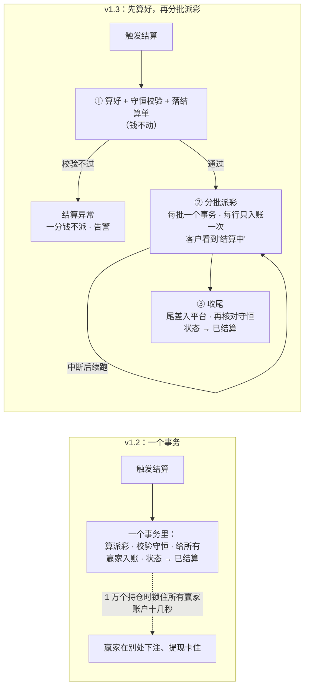

这张图想说明：v1.3 把"算"和"派"分开，钱动之前每个人该得多少已经算好、对平并落在结算单上；派彩分成小批，单批出错只需要接着做，不会锁住所有赢家的账户。

**加密市场生成（MQ-1）**：

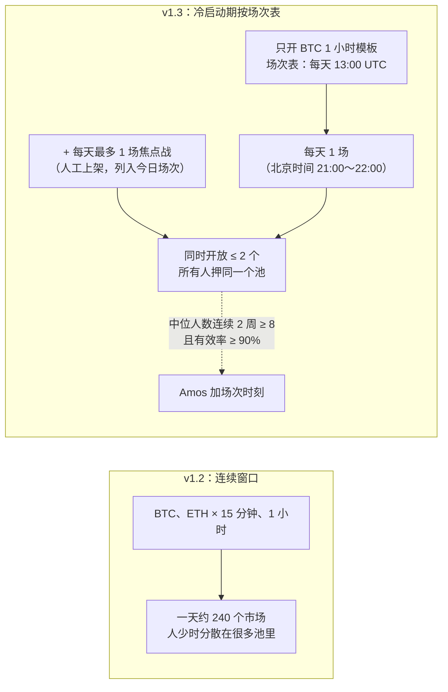

这张图想说明：冷启动期把加密市场从"一直有很多窗口"改成"每天固定时间一场"，把少量用户集中到同一个奖池；用户多了以后由 Amos 加场次，或切回连续窗口。

**对外内容（MQ-2 和自动化程序，新增的流程）**：

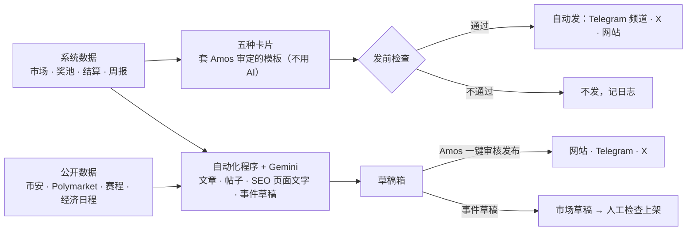

这张图想说明：有两条路——系统数据套审定模板的卡片自动发；AI 写的东西一律进草稿箱，由 Amos 审核后发布；AI 生成的市场只是草稿，要人检查上架。

### 16.4 本次没有改的
- 彩池规则（第 3.1～3.4、3.6～3.8、3.10、3.11 节）、状态机的边、费率、提现、KYC、风控、自动审批都不变。
- 第 12 节 RQ 的结论不变；第 13 节 X-1～X-14 不变。
- 市场：本次的推广功能结论已写入第 1.5 节，市场的推广方案（C72）按纳入清单写；目标用户、定价、对外卖点没有变化。

---

## 跨角色反馈 / 分歧记录
| 编号 | 提出方 → 接收方 | 内容 | 状态 |
|---|---|---|---|
| — | PM → 测试 | 请测试预审第 10 节验收标准的可测性（C4）；v1.1 改动较多的是 AC-13、AC-30、AC-33～AC-37、AC-57、AC-61 | 待预审 |
| — | 研发 → PM | v1.2（品牌和域名口径）是 Amos 要求在开发 S2 里同步的轻量变更，由研发代记；PM 下次修订时复核措辞 | 已采纳（流程说明）；v1.3 复核过，措辞不改 |
| — | PM → 市场 | 需要《市场调研与推广策略》和竞品清单（C71、C65），以便补第 1.5 节和第 11 节 | v1.3 已按策略 v2.1 补第 1.5 节；第 11 节的竞品清单仍用调研报告的 |
| — | PM → 测试（v1.3） | 请预审 AC-74、AC-75、AC-80～AC-97 和自动化文档的 AC-100～AC-118；改写的是 AC-23、AC-28、AC-70、AC-71 | 待预审 |
| — | 市场 → PM（v1.3 答复） | MF-1～MF-17 逐条结论见第 1.5 节；MF-3 已改第 4.2 节写法；MF-7 开场提醒和 #19 不冲突（第 7 节 #23）；MF-2 的"给渠道方记分成"不做（MQ-5），不需要余额调整功能；F-5 人工复核时效放在第 15 节交 Amos 确认 | 已答复 |
| — | PM → 研发（v1.3） | ① 架构方案第 18 节"推广功能占位"可以按第 1.5 节的纳入清单改写（MF 编号已和 v2.1 对齐，架构方案里的旧编号要更新）；② AQ-3 已定 B，S5 的结算参数默认值改为分批；③ AQ-7 的免费源和抓取程序选型、Gemini 在比分解析里的用法写进架构方案和外部调用清单（C81）；④ 自动化程序的进程边界、数据管道、卡片图片生成由研发设计（NF-15） | 待研发 |
| — | PM → 运维（v1.3） | AQ-14 生产后台不加 IP 白名单；AC-70 按预热后判定，发布避开开赛前高峰（SQ-7）；新增环境变量 `FC_GEMINI_API_KEY` 和 Telegram、X 的凭据变量（名字由研发定），都只由 Amos 填 | 待运维 |
