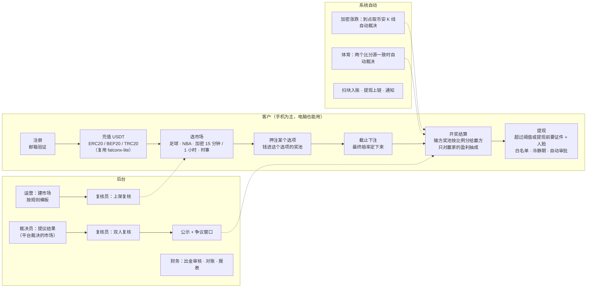
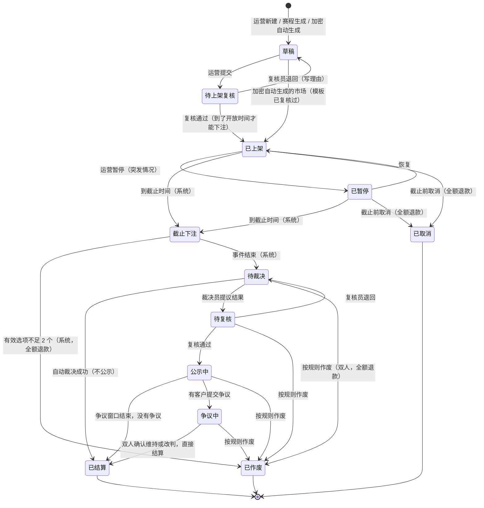
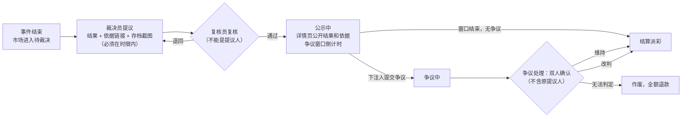
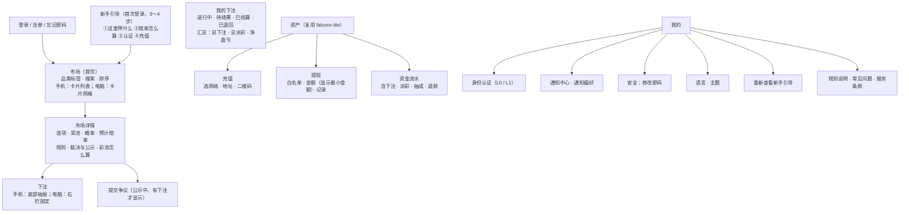
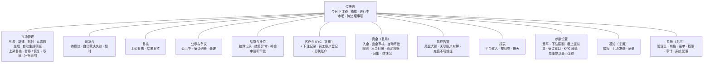

# forecast 需求说明书（v1）

- 版本：v1.0 草稿（2026-10-24）
- 变更历史：v1.0（2026-10-24）首次创建，交测试预审和 Amos 审核
- 编写：产品经理
- 依据：agents main `bd492c9`（《协作总则》v0.12、《产品经理》v0.12）；`调研/v1-Polymarket调研报告.md` v1.2 的"Amos 审核结论"（FQ-1～FQ-14）；Amos 2026-10-24 给出的需求结论（见第 0 节）；参考项目 falconx-lite（`需求文档/v1-需求说明书.md` v1.5、`技术方案/v1-充值方案.md`、`v1-提现方案.md`、`v2-提现自动审批.md` v1.2、`v1-通知方案.md` v1.2、`v1-后台方案.md` v1.7，提交 `3cc5021`）
- 状态：**草稿**。还没有经过测试预审；第 12 节的 RQ 问题等 Amos 决定。Amos 确认前，第 12 节里的"建议"不当作已定的决定。
- 读法：先看"一图看懂"和第 3 节"彩池规则"，再看第 12 节"需要 Amos 决定的问题"。
- 文件位置说明：按《协作总则》第三节"文件夹结构规范"放在 `需求文档/`（和 falconx-lite 一致），没有用任务里写的 `需求/`。

> **标注约定（C66）**：【证实】实际打开了一手资料；【二手】只看到第三方或搜索摘要；【推断】PM 的判断；【未核实】还没有核对，进入架构方案前要核对；【未能打开】访问失败。

---

## 一图看懂

这张图想说明：第一期只做一条主线——**充值 → 押注彩池 → 开奖结算 → 提现**。资金进出、账户、KYC、通知、后台框架从 falconx-lite 复制；新写的是市场、彩池下注、裁决和结算。平台不当对手方，只在开奖后对赢家的盈利抽成。

---

## 0. 已定的结论（Amos 2026-10-24，本文不再当成待决问题）

| 事项 | 结论 |
|---|---|
| 用户和资金 | 面向全球用户；只收 USDT；充值方式同 falconx-lite（ERC20 / BEP20 / TRC20 独立地址、扫块入账、热钱包提现、提现自动审批、归集）。不做法币，不做积分版 |
| 玩法 | **彩池模式（pari-mutuel）**：每个市场 2 个或多个选项，用户把 USDT 押进选项的奖池；开奖后输方奖池按押注比例分给赢方；平台不当对手方、不做市、不承担盈亏；当前赔率按奖池比例实时显示，最终赔率在截止时确定 |
| 收费 | 开奖后只向赢家收，按**盈利部分**的百分比收（押 100 赢回 180，只对 80 收）；费率后台可设 |
| 结果裁决 | 加密价格和能通过接口拿到的比分自动裁决；其他由平台裁决，并公示、设争议窗口、双人复核 |
| 第一批品类 | 足球 / NBA、15 分钟和 1 小时的加密涨跌，少量国际经济时事；敏感题不做 |
| KYC | 分级：小额只要邮箱，超过阈值或提现前需要证件 + 人脸 |
| 提现 | 单笔提现最小金额后台可设 |
| 品牌和部署 | 独立品牌、独立主体、独立热钱包和服务器，不和 Quick Come 互相导流 |
| 代码 | 从 falconx-lite 复制再改，不抽共享库 |
| 多语言 | 跟随浏览器，取不到时用英文（C82）。默认主题本文给建议（第 11 节），交 Amos 定 |
| 合规 | 律师、牌照、合规问题以后不再讨论（FQ-2、FQ-3） |

---

## 1. 背景、目标、范围

### 1.1 背景
Amos 要做一个类似 Polymarket 的预测网站，客户用和 falconx-lite 相同的方式充入 USDT 参与预测。调研后（`调研/v1-Polymarket调研报告.md`），Amos 把玩法定为**彩池模式**：订单簿要有人做市才有价格，新平台不做市就冷启动不了；彩池模式下只要有人押注就有赔率，平台只抽成、不承担盈亏。

### 1.2 目标

| 编号 | 目标 | 怎么衡量 |
|---|---|---|
| G1 | 客户能在手机上走完主流程 | 390 宽的手机浏览器上完成注册、充值、押注、查看结算、提现，没有横向滚动（AC-50） |
| G2 | 彩池结算一分不差 | 每个已结算市场：派彩合计 + 抽成合计 + 尾差 = 奖池合计，每天自动对账，差额为 0（AC-20、AC-21） |
| G3 | 平台不承担盈亏 | 平台账户在每个市场上的收入只有"抽成"和"结算尾差"两项，不会是负数（AC-22） |
| G4 | 裁决可信 | 平台裁决的市场 100% 经过双人复核和公示；每个已结算市场在详情页显示结果、依据、裁决时间、裁决员和复核员编号（AC-30～AC-36） |
| G5 | 短周期市场能自动运转 | 加密 15 分钟 / 1 小时市场自动生成、自动截止、自动裁决，窗口结束后 3 分钟内结算（AC-27、AC-28） |
| G6 | 资金安全沿用 falconx-lite 的水平 | falconx-lite 充值、提现、自动审批、归集的验收标准在本项目全部通过（AC-60～AC-64） |

### 1.3 第一期做什么
- **客户端**（手机和电脑分开设计，C64）：注册登录、邮箱验证、忘记和修改密码、KYC（分级）、市场列表、市场详情、押注、我的下注、资产（三链充值、提现、流水）、通知（站内信、推送、邮件）、设置（语言、主题、通知偏好）、新手引导、提交争议、添加到主屏幕（PWA）。
- **后台**：市场管理（规则模板、草稿、上架复核、暂停、取消、加密市场自动生成、体育赛程生成草稿）、裁决台、复核、公示和争议处理、结算和补偿、参数设置（费率、下注限额、争议窗口、KYC 阈值、单笔提现最小金额等）、资金和对账（复用）、客户和 KYC（复用，加下注记录）、风控告警、报表、通知模板、管理员 / 角色 / 权限 / 审计（复用）。
- **系统自动**：扫块入账、提现上链、归集（复用）；加密市场按时生成、截止、取价裁决；体育比分抓取和自动裁决；结算派彩；每日彩池对账；通知。

### 1.4 明确不做（第一期）

| 不做 | 说明 / 去向 |
|---|---|
| 订单簿、限价单、份额买卖 | 玩法改为彩池（FQ-4），以后人多了再考虑 |
| 中途卖出 / 提前兑现 | 彩池模式下押注一直留到开奖；截止前能不能撤单见 RQ-2 |
| 平台做市、平台当对手方、平台补贴奖池 | 平台不承担盈亏（FQ-13） |
| 积分版、积分、等级、排行榜 | 不做积分版（FQ-11）；积分和排行榜等市场经理的推广策略出来后再议 |
| 邀请返佣、首充奖励、体验金 | 等市场经理的《市场调研与推广策略》（C71），第一期不做 |
| 串关（多个市场打包一注） | 第二期以后 |
| 比赛进行中下注（滚球） | 第一期所有体育市场在开赛前截止 |
| 用户自建市场 | 只有运营能建市场；用户可以通过客服提建议 |
| 评论区、社交、跟单 | 不做 |
| 法币出入金、USDT 以外的币、SOL 链、原生 ETH、USDC | 只收 USDT（FQ-1） |
| UMA 等链上预言机、链上份额 | 第一期不接（FQ-5） |
| 持仓奖励、奖池生息 | 不做 |
| 负责任博彩的自我限额、自我排除 | 第一期不做，第二期评估 |
| 第三方 KYC / 活体检测服务 | 第一期复用 falconx-lite 的人工审核（见 RQ-10） |
| 安卓 App 外壳、原生 App | 第一期只做网页 + PWA |
| 2FA（两步验证） | 沿用 falconx-lite，推迟 |

### 1.5 市场与推广输入（C71）
市场经理的《市场调研与推广策略》**还没有**。本版没有纳入任何推广功能（邀请、分享图卡、落地页、来源统计）。推广策略出来后，PM 逐条写"纳入 / 不做（理由）"，以 v1.x 修订。

---

## 2. 角色和权限

### 2.1 使用者和场景

| 使用者 | 典型场景 |
|---|---|
| 客户 | 手机打开网址 → 注册 → 新手引导 → 用 TRC20 充 50 USDT → 押"BTC 下一个 15 分钟涨" → 15 分钟后收到结算推送 → 周末押英超 → 赢了以后完成证件 + 人脸认证 → 提现 |
| 运营（市场管理员） | 每天从赛程生成当天足球 / NBA 市场的草稿，补规则，提交上架复核；盯加密市场的自动生成；突发情况暂停市场 |
| 裁决员 | 比赛或事件结束后，在裁决台按规则和证据提议结果；处理自动裁决失败的市场 |
| 复核员 | 复核市场上架（规则是否可判定、来源是否写清、是否敏感题）；复核裁决员的提议；处理争议 |
| 财务 | 出金审核、入金对账、彩池对账、平台收入报表、补偿发放的第二人确认 |
| 超级管理员（Amos） | 角色和权限、费率和参数、高危操作（作废已截止市场、补偿、自动审批总开关）、审计 |

风控在 falconx-lite 里是一个角色；本项目第一期的风控告警发给财务和超级管理员，需要时可以用自定义角色单独建（后台角色可自由配置，沿用 falconx-lite）。

### 2.2 内置角色和权限点
权限框架、管理员、角色、菜单、审计、高危确认（原因必填、勾选确认）全部复用 falconx-lite（权限点清单前后端一致、每个接口都要声明权限点）。去掉差价合约专用的权限点（`order:*`、`position:*`、`pending:*`、`risk:*`、`symbol:*`、`params:*`、`fx:view`），新增下面这些（★ = 高危，写审计且原因必填）。

| 权限点 | 作用 | 运营 | 裁决员 | 复核员 | 财务 | 超管 |
|---|---|---|---|---|---|---|
| `market:view` | 查看市场、奖池、下注明细 | ✓ | ✓ | ✓ | ✓ | ✓ |
| `market:edit` | 新建、编辑、复制草稿；提交上架复核 | ✓ | | | | ✓ |
| `market:publish_review` | 上架复核（通过 / 退回） | | | ✓ | | ✓ |
| `market:pause` ★ | 暂停 / 恢复下注 | ✓ | | ✓ | | ✓ |
| `market:cancel` ★ | 截止前取消市场（全额退款） | | | ✓ | | ✓ |
| `market:clarify` ★ | 上架后发布"补充说明" | ✓ | | ✓ | | ✓ |
| `market:autogen` ★ | 加密市场自动生成的模板和开关 | ✓ | | | | ✓ |
| `resolve:propose` | 提议结果（平台裁决）、处理自动裁决失败 | | ✓ | | | ✓ |
| `resolve:review` ★ | 复核结果提议（通过进入公示 / 退回） | | | ✓ | | ✓ |
| `resolve:void` ★ | 截止后作废市场（全额退款） | | | ✓ | | ✓ |
| `dispute:view` | 查看争议 | | ✓ | ✓ | | ✓ |
| `dispute:handle` ★ | 处理争议（维持 / 改判） | | ✓ | ✓ | | ✓ |
| `settle:compensate` ★ | 发起已结算市场的补偿 | | | ✓ | | ✓ |
| `settle:compensate_approve` ★ | 批准补偿（第二人） | | | | ✓ | ✓ |
| `bet:view` | 查看客户下注记录 | ✓ | ✓ | ✓ | ✓ | ✓ |
| `fee:edit` ★ | 改费率 | | | | | ✓ |
| `betting_params:edit` ★ | 改下注限额、截止提前量、争议窗口、KYC 阈值等参数 | | | | | ✓ |
| `report:view` | 平台收入和运营报表 | | | | ✓ | ✓ |
| `pool_recon:view` / `pool_recon:resolve` | 彩池对账 | | | | ✓ | ✓ |
| 复用的资金、客户、KYC、通知、系统权限点 | `deposit:view`、`withdrawal:*`、`recon:*`、`sweep:*`、`task:*`、`customer:*`、`kyc:*`、`notify*`、`admin:*`、`role:*`、`menu:*`、`audit:view`、`config:*`、`session:*`、`dashboard:view` | 按 falconx-lite 的内置角色 | | | 财务 | ✓ |

**系统强制的职责分离**（不靠角色配置，代码里检查）：
1. 同一个市场，**提议结果的人不能复核这次提议**；**建草稿的人不能做这个市场的上架复核**。
2. 争议处理的确认人不能是被争议那次提议的提议人。
3. 补偿的发起人和批准人不能是同一个人。
4. 只有一个超级管理员时，第 1～3 条对超级管理员也生效（Amos 需要再开一个管理员账号才能完成双人操作）——见 RQ-17。

---

## 3. 彩池规则（核心）

### 3.1 名词

| 名词 | 定义 |
|---|---|
| 市场 | 一个问题，例如"曼城 vs 利物浦（90 分钟胜平负）" |
| 选项 | 市场下互斥的结果，2～10 个，例如"主胜 / 平 / 客胜"。**必须覆盖所有可能**（不能出现"结果不在选项里"） |
| 下注 | 客户一次押注：市场、选项、金额、时间 |
| 持仓 | 同一客户在同一市场同一选项上所有下注的合计（结算按持仓算） |
| 选项奖池 Pᵢ | 选项 i 上所有有效下注的金额合计 |
| 总奖池 T | 所有选项奖池之和 T = ΣPᵢ |
| 赢方奖池 P_W / 输方奖池 L | 开奖后赢的选项的奖池；L = T − P_W |
| 费率 r | 对赢家盈利部分抽成的比例，**市场上架时锁定**，之后改费率只影响新上架的市场 |
| 截止时间 | 停止接受下注的时刻（UTC，按服务器收到请求的时间） |
| 事件时间 | 比赛开赛 / 加密窗口开始等事件开始的时刻；事件结束时刻另记 |

### 3.2 市场状态机

这张图想说明：钱只在三个终点状态动——**已结算**（派彩）、**已取消**和**已作废**（全额退款，不收费）。其余状态里押注金额一直锁在奖池里。

| 状态 | 客户能下注吗 | 客户看到的 | 进入条件 | 谁操作 |
|---|---|---|---|---|
| 草稿 | 否 | 看不到 | 新建 | 运营 / 系统 |
| 待上架复核 | 否 | 看不到 | 运营提交 | 运营 |
| 已上架 | 是（到了"开放下注时间"以后） | 可下注；未到开放时间显示"X 时开放" | 复核通过 | 复核员 |
| 已暂停 | 否 | "暂停下注"，已有下注不变 | 运营暂停 | 运营 / 复核员 |
| 截止下注 | 否 | "已截止，等待结果"，赔率定格 | 到截止时间 | 系统 |
| 待裁决 | 否 | "等待结果" | 事件结束时间到了 | 系统 |
| 待复核 | 否 | "等待结果" | 裁决员提议 | 裁决员 |
| 公示中 | 否 | 拟定结果、依据、争议截止时间、"提交争议"按钮 | 复核通过 | 复核员 |
| 争议中 | 否 | "结果复核中" | 有争议 | 客户 |
| 已结算 | 否 | 结果、依据、裁决员 / 复核员编号、我的派彩 | 自动裁决成功 / 公示期满 / 争议处理完 | 系统 / 双人 |
| 已取消 | 否 | "已取消，下注已全额退回"和原因 | 截止前取消 | 复核员 / 超管 |
| 已作废 | 否 | "已作废，下注已全额退回"和原因 | 截止后按规则作废 | 系统 / 双人 |

规则：
1. 状态只能按上图走，任何其他跳转都被拒绝（AC-10）。
2. 截止时间到了以后，**不管之前是否在暂停中**，都进入"截止下注"。
3. 已上架以后，**题目、选项、截止时间、裁决来源不能改**；只能发布"补充说明"（带发布时间，在规则区按时间顺序显示，只能澄清、不能改变问题含义）。规则写错到无法澄清时，截止前取消、截止后作废。
4. 截止时间可以**提前**（例如比赛改到更早开赛），不能推后；提前时已在新截止时间之后收到的下注全额退回（见 3.7 第 5 条）。

### 3.3 下注

| 规则 | 默认值（后台可改，`betting_params:edit`） | 说明 |
|---|---|---|
| 单笔最小 | 1 USDT | 金额最多 2 位小数 |
| 单笔最大 | 5,000 USDT | |
| 单客户单市场累计上限 | 10,000 USDT（加密 15 分钟 / 1 小时：2,000 USDT） | 按该客户在这个市场所有选项上的有效下注合计；可以在单个市场上单独调低 |
| 同一市场能否押多个选项 | 可以（见 RQ-12） | 每个选项分别是一个持仓 |
| 撤单 | **下注后不能撤销**（建议，见 RQ-2） | 确认弹窗和下注抽屉都写明 |
| KYC | 累计充值超过 KYC 阈值、且没通过证件 + 人脸认证的客户，**不能新下注**（已有下注照常结算）；见第 3.10 节和 RQ-10 | |
| 冻结的客户 | 不能下注，已有下注照常结算（沿用 falconx-lite 冻结的口径） | |
| 员工账户 | 后台登记为"员工"的客户账户不能下注 | 见第 8 节 |

下注的处理（同一个事务）：
1. 校验：市场状态是"已上架"、已到开放时间、**服务器收到请求的时间 < 截止时间**、选项属于这个市场、金额在范围内、没超单客户单市场上限、可用余额够、客户状态正常、KYC 条件满足。
2. 扣可用余额、写账本（"下注锁定"）、选项奖池 + 金额、写下注记录（含下注时的奖池快照，只做展示，不影响结算）。
3. 返回下注编号；实时推送新的奖池给正在看这个市场的客户。

拒单时返回具体原因（中英文）：市场未开放、已截止、已暂停、已取消、金额低于最小 / 高于最大、超过本市场上限、余额不足、需要先完成身份认证、账户已冻结、员工账户不能下注。

### 3.4 赔率的显示和计算

**两种显示同时给，主次不同**（建议，见 RQ-3）：

| 显示 | 公式 | 精度和舍入 | 在哪里显示 |
|---|---|---|---|
| **概率 %**（主） | Pᵢ ÷ T × 100 | 列表取整数（四舍五入）；详情 1 位小数；> 0 但 < 1% 显示"<1%"，> 99% 但 < 100% 显示 ">99%"；T = 0 时全部显示"—" | 列表、详情（和 Polymarket 一样以概率为主，用户熟悉） |
| **预计赔率 x**（辅） | 扣费后：1 + (T ÷ Pᵢ − 1) × (1 − r) | 2 位小数，**向下取整**（不夸大回报）；Pᵢ = 0 时显示"—"并提示"还没有人押，先押的人赢了拿走输方全部（扣费后）" | 选项按钮、下注抽屉 |
| 本注预计回报 | 把本注加进奖池后按第 3.5 节算：G = b × (T − Pᵢ) ÷ (Pᵢ + b)，F = G × r，回报 = b + G − F | 按第 3.5 节的舍入规则（G 向下取整、F 四舍五入，到 0.01） | 下注抽屉："押 100 → 赢了约回 162.29（已扣抽成）；输了 0" |

- 页面上必须写明："赔率随奖池变化，**最终赔率在截止时确定**"。
- 赔率刷新：奖池变化后 2 秒内推送到正在看的页面（AC-17）；刷新只换数字，**不闪色、不做跳动动画**（C84）。
- 截止以后显示"最终赔率"，不再变化。

### 3.5 结算公式

赢的选项为 W（只有一个）。对每个**赢方持仓** j（金额 bⱼ，属于某个客户在 W 上的全部下注合计）：

| 步骤 | 公式 | 舍入 |
|---|---|---|
| ① 分得的盈利（毛） | Gⱼ = bⱼ × L ÷ P_W | **向下取整到 0.01 USDT** |
| ② 抽成 | Fⱼ = Gⱼ × r | **四舍五入到 0.01 USDT** |
| ③ 派彩（回到可用余额） | Payⱼ = bⱼ + Gⱼ − Fⱼ | 不再舍入 |
| ④ 尾差 | D = L − ΣGⱼ | 0 ≤ D < 0.01 × 赢方持仓数；**归平台**，单独记"结算尾差"（见 RQ-7） |

- 输方持仓派彩为 0，不收费。
- 平台收入 = ΣFⱼ + D。
- **守恒**：ΣPayⱼ + ΣFⱼ + D = T（每个市场结算后系统自动校验，不等则这个市场停在"结算异常"，告警财务，不派彩）。
- 中间计算用精确小数（不用浮点），只在上表写明的地方舍入。
- 结算按持仓逐个写账本：赢方"下注锁定 → 派彩"、"抽成"；输方"下注锁定 → 输"；平台账户收"抽成""结算尾差"。同一个事务、幂等（同一市场只能结算一次）。

#### 完整例子：3 个选项、费率 5%、有尾差

市场"曼城 vs 利物浦（90 分钟胜平负）"，截止时：

| 选项 | 下注 | 选项奖池 | 概率 | 最终赔率（扣费后） |
|---|---|---|---|---|
| 主胜 | Alice 100（分 2 笔：60 + 40）、Bob 2,500、Carol 3,400 | 6,000 | 60% | 1 + (10,000 ÷ 6,000 − 1) × 0.95 = 1.6333 → **1.63x** |
| 平 | Dave 1,500 | 1,500 | 15% | 1 + (6.6667 − 1) × 0.95 = 6.3833 → **6.38x** |
| 客胜 | Eve 2,000、Frank 500 | 2,500 | 25% | 1 + (4 − 1) × 0.95 = **3.85x** |
| 合计 | | **T = 10,000** | | |

结果：主胜。L = 10,000 − 6,000 = 4,000；L ÷ P_W = 0.6666…

| 赢方持仓 | b | ① G = b × 0.6666… 向下取整 | ② F = G × 5% 四舍五入 | ③ 派彩 = b + G − F |
|---|---|---|---|---|
| Alice | 100 | 66.666… → **66.66** | 3.333 → **3.33** | **163.33** |
| Bob | 2,500 | 1,666.666… → **1,666.66** | 83.333 → **83.33** | **4,083.33** |
| Carol | 3,400 | 2,266.666… → **2,266.66** | 113.333 → **113.33** | **5,553.33** |
| 合计 | 6,000 | 3,999.98 | **199.99** | **9,799.99** |

- 尾差 D = 4,000 − 3,999.98 = **0.02**（归平台"结算尾差"）。
- 平台收入 = 199.99 + 0.02 = **200.01**。
- 守恒：9,799.99 + 199.99 + 0.02 = **10,000.00** ✓。
- Dave、Eve、Frank 派彩 0。
- Alice 的两笔下注合成一个持仓结算（不是每笔单独算），所以只舍入一次。
- 核对 Alice：100 × 1.6333 = 163.33，和最终赔率一致。

#### 例子 2：本注预计回报（下注抽屉）
上面的市场截止前，奖池是 主胜 6,000 / 平 1,500 / 客胜 2,500。Grace 想押主胜 100：把本注加进去，主胜 6,100、T = 10,100、L = 4,000；G = 100 × 4,000 ÷ 6,100 = 65.573… → 65.57；F = 3.2785 → 3.28；预计回报 = 100 + 65.57 − 3.28 = **162.29**。抽屉显示"押 100 → 赢了约回 162.29（已扣抽成），最终以截止时的奖池为准"。

### 3.6 边界情况

| 编号 | 情况 | 处理（建议） | 说明 |
|---|---|---|---|
| E1 | **没人押赢的那一边**（P_W = 0，T > 0） | **作废，全额退款，不收费**（RQ-5） | 另一种做法是"平台没收奖池"，那等于平台在赢钱，和"平台不承担盈亏、不当庄"矛盾，也让人怀疑平台故意判没人押的结果 |
| E2 | 某个选项没人押，但它不是赢的那个 | 正常结算 | 没人押的选项奖池是 0，不影响公式 |
| E3 | **截止时只有一个选项有人押**（包括只有一个人押） | **截止时直接作废，全额退款**，不等结果（RQ-6） | 如果等结果：它赢了，L = 0，大家拿回本金、没有盈利；它输了，就是 E1。两种结果都是退款，所以截止时就退，客户不用等 |
| E4 | 总奖池为 0 | 截止时作废（没有资金变动），客户端不显示 | |
| E5 | **比赛取消** | 作废，全额退款 | 规则模板里写明 |
| E6 | **比赛延期** | 原定开赛时间后 **48 小时内**完赛的，按实际结果结算；超过 48 小时仍没完赛的，作废退款（RQ-14） | 48 小时内裁决员不能提议；市场停在"待裁决" |
| E7 | **比赛腰斩（中途终止）** | 联赛官方宣布比分有效的，按官方比分；宣布重赛或 48 小时内没有宣布的，作废退款 | |
| E8 | **平局** | 足球"胜平负"市场必须有"平"选项；NBA 没有平局（加时到分出胜负）；大小分类市场的分界线必须用 .5（例如 2.5 球），不会出现"正好等于" | 规则模板强制；上架复核检查 |
| E9 | 加密涨跌"收盘价 = 开盘价" | 判"涨"（和 Polymarket 的规则一样【证实：polymarket.com 页面内的裁决说明"greater than or equal to … Up"】） | 规则文本写明"≥ 判涨" |
| E10 | 加密数据源出错或拿不到 | 先用备用源；主备不一致或都拿不到 30 分钟以上 → 转人工裁决台；人工也无法确定时作废退款 | 见第 4.3 节 |
| E11 | **规则有歧义** | 截止前：发补充说明（只能澄清）；歧义严重到影响结果的，截止前取消。截止后才发现：裁决员按"规则文本的通常含义"提议，复核员复核，公示期内客户可以争议；仍无法判定的，作废退款 | Polymarket 有"50/50"一档，彩池模式下等价于作废退款，更好理解 |
| E12 | **公示期内改判** | 争议成立 → 双人确认后按新结果直接结算（不再公示第二轮），争议人和所有下注人收到通知 | |
| E13 | **已结算后发现裁错** | **不回滚、不追回已派的钱**；由平台出钱按正确结果补偿本应赢的一方（补偿 = 按正确结果算的派彩 − 实际已得派彩，只补不扣），双人审批（RQ-8） | 已派的钱可能已经提走，回滚会让客户余额变负；补偿走"补偿"流水，不算平台收入的冲减，报表单列 |
| E14 | 下注时间晚于实际开赛（比赛提前开赛、或截止时间设错） | 实际开赛时间之后收到的下注全额退回（不参与结算），其余照常 | 裁决员在提议时填"实际开赛时间"；系统自动退回之后的下注 |
| E15 | 市场里有员工账户的下注（漏登记后补登） | 该笔下注退回，不参与结算 | 见第 8 节 |

### 3.7 截止时间、开奖时间和时区
1. **所有时间按 UTC 存储和判定**；规则文本里的时间写 UTC（例如"2026-11-01 14:55 UTC"）。
2. 客户端显示时，同时显示 UTC 和客户浏览器所在时区的时间（"截止 14:55 UTC（你的时间 22:55）"）。
3. 时间先后：**开放下注 < 截止下注 ≤ 事件开始 < 事件结束 < 裁决**。系统在保存市场时校验。
4. 判定"是否已截止"只看**服务器收到下注请求的时间**，客户端时间不算；正好等于截止时间的请求拒绝（`收到时间 < 截止时间` 才接受）。
5. 各品类的默认值（新建时自动带出，可以改；后台参数可改）：

| 品类 | 开放下注 | 截止下注 | 事件结束 | 裁决 |
|---|---|---|---|---|
| 足球 | 上架复核通过即开放（建议开赛前 1～7 天上架） | 开赛前 5 分钟 | 开赛 + 约 2 小时（以比分源的"完赛"为准） | 自动（第 4.3 节）；失败转人工 |
| NBA | 同上 | 开赛前 5 分钟 | 开赛 + 约 3 小时（以完赛为准） | 同上 |
| 加密 15 分钟 | 窗口开始前 60 分钟 | **窗口开始前 30 秒** | 窗口结束 | 窗口结束后 1 分钟取 K 线，自动 |
| 加密 1 小时 | 窗口开始前 3 小时 | **窗口开始前 30 秒** | 窗口结束 | 同上 |
| 国际经济时事 | 复核通过即开放 | 按题目（例如议息结果公布前 1 小时） | 按题目 | 平台裁决 + 公示 + 争议窗口 |

> 为什么加密市场要在窗口**开始前**截止：彩池里最终赔率在截止时才定，如果窗口开始后还能押，晚押的人已经看到了价格走势，等于拿早押的人的钱（订单簿模式下价格会随走势变，所以 Polymarket 可以一直交易；彩池不行）【推断】。30 秒是"截止提前量"，后台可调（见 RQ-13）。

### 3.8 平台抽成的口径
1. 只对赢方持仓的盈利 Gⱼ 收，按 3.5 的舍入；输方、作废、取消都不收。
2. 费率：全局默认 + 按品类覆盖（足球、NBA、加密 15 分钟、加密 1 小时、时事各一个），后台 `fee:edit` 修改，取值 0%～20%，最多 2 位小数（例如 5.25%）。默认值见 RQ-4。
3. **费率在市场上架时锁定**，写进市场记录和规则文本（"抽成：盈利部分的 5%"）；之后改费率只影响新上架的市场。
4. 客户端在市场详情、下注抽屉、规则区、结算明细里都显示费率和抽成金额。

### 3.9 账本和对账
1. 新增流水类型：下注锁定、派彩（含本金退回部分和盈利部分）、输、抽成、退款（取消 / 作废 / 晚于开赛的下注）、补偿；平台账户：抽成收入、结算尾差、补偿支出。
2. 每个市场任何时刻：**Σ 有效下注 = 选项奖池之和 = 账本里这个市场的锁定金额**。
3. 每天 UTC 00:30 跑一次彩池对账：未结算市场检查第 2 条；已结算市场检查第 3.5 节的守恒；不一致的列在后台"彩池对账"，告警财务。复用 falconx-lite 的入金对账、热钱包余额告警。

### 3.10 KYC 分级（复用 falconx-lite 的 KYC 模块）

| 级别 | 要求 | 能做什么 |
|---|---|---|
| L0 | 邮箱验证 | 充值；累计充值 ≤ 阈值时可以下注；**不能提现** |
| L1 | 证件（身份证或护照，正反面）+ 人脸（手持证件自拍，人工审核），年满 18 周岁 | 全部功能 |

- 阈值：**累计充值（扣冲正）> 1,000 USDT** 时需要 L1（默认值，后台可改，见 RQ-10）。
- 达到阈值：充值照常入账（链上转账拦不住），但**不能新下注**，页面提示"请完成身份认证"，同时发通知；已有下注照常结算。
- 提现前必须 L1（沿用 falconx-lite）。

### 3.11 提现
完全复用 falconx-lite：白名单（24 小时生效、最多 10 个）、2 小时冷静期、单笔 / 当日限额、≥ 3,000 USDT 延迟 6 小时、自动审批（规则调整见第 8.2 节）、热钱包签名上链、失败退回、提现手续费（ERC20 5、TRC20 1、BEP20 0.5 USDT，后台可改）。

**新增：单笔提现最小金额后台可设**（Amos 补充）：
- 一个全局值，默认 10 USDT（沿用 falconx-lite 现值），`betting_params:edit` 修改，最多 2 位小数；
- 保存时校验：**最小金额必须大于每条链的提现手续费**（否则到账为 0 或负数），不满足拒绝保存并提示是哪条链；
- 客户端提现页显示"最小 X USDT"，低于时提交按钮不可用并提示。
- 是否要按链分别设，见 RQ-16。

---

## 4. 市场创建和裁决流程

### 4.1 规则文本模板（每个市场必须填齐才能提交上架复核）

| 字段 | 要求 | 例子 |
|---|---|---|
| 品类 | 足球 / NBA / 加密 15 分钟 / 加密 1 小时 / 时事 | 足球 |
| 题目 | 一句话，能明确判定；中英文各一份（其他语言见 RQ-18） | 曼城 vs 利物浦（90 分钟胜平负） |
| 选项 | 2～10 个，互斥且覆盖所有可能；中英文 | 主胜 曼城 / 平 / 客胜 利物浦 |
| 判定条件 | 每个选项"在什么情况下赢" | 以 90 分钟常规时间（含伤停补时）结束时的比分为准，不含加时和点球 |
| 裁决方式 | 自动 / 平台 | 自动 |
| 裁决来源 | 首选 + 备用；来源冲突时以首选为准 | 首选：英超官网 premierleague.com；备用：API-Football |
| 时间 | 开放下注、截止下注、事件开始、预计事件结束（UTC） | 截止 2026-11-01 14:55 UTC；开赛 15:00 UTC |
| 取消 / 作废条件 | 延期、取消、腰斩、数据修正、无法判定 | 原定开赛后 48 小时内没完赛的，作废退款 |
| 数据修正 | 结果公布后多久内的修正算数 | 以完赛后 1 小时的官方比分为准，之后的修正不算 |
| 争议窗口 | 平台裁决的市场必填（默认按品类） | 不适用（自动） |
| 费率 | 上架时自动带出并锁定，不能手填 | 5% |
| 单客户上限 | 默认按品类，可调低 | 10,000 |
| 封面图 | 可选（队徽、币种图标） | |

上架复核时复核员逐项检查：可判定吗？来源写清楚了吗？边界情况写了吗？选项是否覆盖所有可能？是否属于"不做"的题目（见下）？**题目不能涉及**：任何国家的政治人物和选举、战争伤亡、暗杀、灾害死亡人数、涉及未成年人、单个人能左右结果的事（例如某主播会不会说某个词）、涉及个人隐私。复核员勾选"已检查以上各项"才能通过。

### 4.2 市场怎么来

| 来源 | 做法 |
|---|---|
| 加密 15 分钟 / 1 小时（自动生成） | 后台配置"自动生成模板"：币种（第一期 BTC、ETH，见 RQ-13）、周期、提前多久生成、规则文本模板（含变量：币种、窗口开始和结束）。模板本身经过一次上架复核；之后按模板生成的市场**直接上架**，不用逐个复核。系统保证未来至少有 4 个 15 分钟窗口和 3 个 1 小时窗口可以下注。模板有开关，关闭后不再生成新的，已生成的照常 |
| 足球、NBA（赛程生成草稿） | 后台"从赛程生成"：从体育数据源拉取未来 7 天的赛程，选比赛和玩法（胜平负 / 胜负 / 大小球）一键生成草稿，自动填队名、时间、规则模板；运营检查后提交上架复核 |
| 时事 | 运营手动新建草稿，或复制已有市场改 |

### 4.3 自动裁决和数据源（选型建议）

**加密涨跌**（建议照 Polymarket 1 小时市场的写法）：

| 项 | 建议 |
|---|---|
| 规则 | "以币安现货 BTC/USDT 的 K 线为准：窗口内第一根 1 分钟 K 线的开盘价为开始价，最后一根 1 分钟 K 线的收盘价为结束价；结束价 ≥ 开始价判'涨'，否则判'跌'" |
| 首选来源 | 币安现货 REST `GET /api/v3/klines`（`symbol`、`interval=1m`、`startTime`、`endTime`，返回开盘价、收盘价等，按 UTC）【证实：developers.binance.com 行情接口文档】。Polymarket 的 1 小时涨跌市场就是用币安 BTC/USDT 1 小时 K 线的"收盘 ≥ 开盘判涨"【证实：polymarket.com 页面内的裁决说明】；它的 15 分钟市场用 Chainlink 数据流【证实：同上】 |
| 备用来源 | OKX 现货 K 线接口【未核实：接口细节和限频】；或 Coinbase【未核实】 |
| 判定 | 窗口结束后 1 分钟取首选和备用；**两个来源的涨跌方向一致** → 自动结算；不一致或一方拿不到 → 每分钟重试，30 分钟后仍不行转裁决台（人工按首选来源的页面数据判定，截图存档）。"正好相等"在两个来源上方向不同时，以首选为准 |
| 存档 | 保存两个来源的原始返回（时间、价格），已结算市场详情页公开显示开始价、结束价和来源 |
| 注意 | falconx-lite 已接入币安报价（`BinanceFeed`），可以复用连接经验；币安接口对部分地区的服务器 IP 有访问限制【二手，未核实】，**服务器机房位置要在架构方案阶段实测** |

**体育比分**：

| 项 | 建议 |
|---|---|
| 足球首选 | API-Football（api-sports.io）：有免费档（每天 100 次）和付费档（约 19 美元 / 月、每天 7,500 次），含实时比分和赛程【二手：搜索摘要，官网定价页 403 未能打开】 |
| NBA 首选 | balldontlie：免费档每分钟 5 次（比赛和比分），付费档约 9.99 美元 / 月【二手】；或 API-Basketball（api-sports 同一家）【未核实】 |
| 备用 | 足球：football-data.org 或 Sportmonks【未核实】；NBA：Sportradar（需询价，企业级）【二手】 |
| 判定 | 比赛状态为"完赛"后等 30 分钟（给数据修正时间），**两个来源比分一致** → 自动结算；不一致、只有一个来源、或状态异常（延期、腰斩）→ 转裁决台。见 RQ-15 |
| 赛程 | 同一个数据源提供赛程，用于 4.2 的"从赛程生成草稿" |
| 费用 | 第一期估计每月 30～100 美元【推断】，研发在架构方案里按调用量核算，交 Amos |

**时事**：平台裁决。来源写一手官方页面（例如美联储议息声明 federalreserve.gov、美国劳工统计局 bls.gov 的 CPI 公告）。

### 4.4 平台裁决、公示、争议、双人复核

这张图想说明：平台裁决的市场至少经过两个人（提议人、复核人），并公开一段时间让下注的人挑错；有争议再由两个人（不含原提议人）处理，处理完直接结算，不会无限循环。

| 环节 | 时长（默认，后台可改） | 操作 |
|---|---|---|
| 提议时限 | 体育转人工的：进入裁决台后 2 小时；时事：事件结束后 24 小时 | 超时在裁决台标红，邮件提醒裁决员和超管 |
| 复核时限 | 提议后 2 小时 | 超时提醒复核员和超管 |
| 争议窗口 | 体育（人工裁决的）2 小时；时事 24 小时（RQ-9） | 窗口内，**在这个市场有下注的客户**可以提交争议：选"认为应该是哪个结果"、写理由（必填，≤ 1,000 字）、可附链接；每人每市场 1 次；不收押金 |
| 争议处理时限 | 提交后 24 小时内给出结论 | 结论和理由公开在市场详情页（不显示争议人身份） |
| 自动裁决的市场 | 不公示、没有争议窗口（Amos：自动裁决） | 客户对自动裁决有异议的，走客服工单；确实错了按 E13 补偿 |

裁决记录（每一步都留痕，只增不改）：谁、什么时候、提议 / 复核 / 争议结论、依据链接、存档截图、理由。已结算市场详情页公开：结果、依据、裁决时间、裁决员编号、复核员编号（编号不是姓名）。

---

## 5. 客户端页面

### 5.1 站点地图

这张图想说明：手机底部 4 个入口（市场、我的下注、资产、我的），通知是顶栏的铃铛；电脑顶部导航是市场、我的下注、资产，右上角余额、充值、通知、我的。

### 5.2 页面清单

| 编号 | 页面 | 内容 | 手机 / 电脑的差别（C64） |
|---|---|---|---|
| P1 | 市场（首页 / 列表） | 品类标签（全部、足球、NBA、加密 15 分钟、加密 1 小时、时事）、搜索、排序（快截止 / 奖池最大 / 最新）；卡片：品类、题目、选项和概率（二选一的直接显示两个按钮，多选项显示前 3 个 + "更多"）、奖池、截止时间（"还剩 8 分"，按分钟更新，最后 1 分钟按秒）、状态标签；已结算的默认隐藏，可筛选 | 手机单列卡片；电脑 3～4 列网格 |
| P2 | 市场详情 | 题目、状态、截止时间（UTC + 本地）、总奖池、费率；选项表（奖池、概率、预计赔率）；我在本市场的下注和预计回报；标签页：规则（全文 + 补充说明）、裁决与公示（结果、依据、裁决员 / 复核员编号、争议截止时间、争议结论）、彩池怎么算（通俗说明 + 本市场的数字） | 手机：详情 → 点选项弹出下注抽屉；电脑：左边详情、右边固定下注栏 |
| P3 | 下注 | 选中的选项、当前概率和预计赔率、金额输入（快捷 10 / 50 / 100 / 500 / 最大）、可用余额、本市场还可押多少、本注预计回报（按 3.4）、"下注后不能撤销"提示、确认按钮；余额不足时按钮变成"去充值" | 确认按钮在首屏内（C79：1366×768、1280×720、390×844、375×667） |
| P4 | 我的下注 | 分 4 个标签；每条：市场、选项、金额、下注时间、状态、最终赔率（截止后）、派彩 / 抽成 / 退款；点进市场详情；顶部汇总 | 手机列表；电脑表格 |
| P5 | 资产 | 复用 falconx-lite：余额（可用、下注中、提现冻结）、充值、提现、流水；新增"下注中"金额；提现页显示单笔最小金额 | 同 falconx-lite |
| P6 | 通知中心 | 复用 falconx-lite 站内信；点击跳到对应市场或提现 | |
| P7 | 我的 / 设置 | KYC、通知偏好（推送、邮件开关）、修改密码、语言（下拉框，标出当前语言，记住选择，C82）、主题（RQ-1）、重新查看新手引导、规则说明和常见问题 | |
| P8 | 注册 / 登录 / 忘记密码 | 复用 falconx-lite；注册时勾选"已满 18 周岁并同意服务条款" | |
| P9 | 新手引导（C83） | 首次登录显示 4 步：①"在这里押一件事的结果"；②"赔率随奖池变化，截止时确定；赢了只对盈利抽成"；③"完成认证"（说明什么时候需要）；④"充值 USDT 开始"→ 终点落在充值页；可以跳过，"我的"里能重看 | 不做试玩 |
| P10 | 提交争议 | 弹窗：认为应是哪个结果、理由、链接 | |

**C84**：主工作区（市场列表、详情、下注）旁边**不放跑马灯、滚动的最新下注、整列闪动的赔率**；赔率更新只换数字。

### 5.3 线框图（低保真）
只表达页面上有什么、怎么操作；视觉效果图由研发在架构方案阶段按选定的风格画。

| 编号 | 页面 | 线框图 |
|---|---|---|
| W1 | 市场列表（手机） |  |
| W2 | 市场详情 → 下注抽屉（手机） |  |
| W3 | 市场详情（电脑） |  |
| W4 | 后台裁决台 / 复核（电脑） |  |

资产、提现、注册、KYC 页面沿用 falconx-lite 的线框图和原型（`falconx-lite/assets/v1/wireframes/W3`～`W5`）。

---

## 6. 后台页面

### 6.1 站点地图

这张图想说明：后台 13 个一级菜单；资金、客户、通知、系统沿用 falconx-lite，其余是新的。

### 6.2 页面清单

| 页面 | 内容 | 权限点 |
|---|---|---|
| 仪表盘 | 今日 / 本周：下注额、下注人数、平台收入（抽成 + 尾差）、新注册、充值、提现；待处理：待上架复核、待提议、待复核、争议中、结算异常、出金待审核 | `dashboard:view` |
| 市场管理 | 列表（品类、状态、截止时间、奖池、下注人数筛选）；新建 / 编辑草稿（按第 4.1 节模板，必填项没填不能提交）；复制；从赛程生成；加密自动生成模板；市场详情：奖池、各选项下注人数和金额、前 20 大下注、状态历史；暂停 / 恢复、取消、发补充说明 | `market:*` |
| 上架复核 | 待复核列表；逐项检查清单（第 4.1 节）；通过 / 退回（理由必填） | `market:publish_review` |
| 裁决台 | 待提议、自动裁决失败（显示两个来源的原始数据）、超时；提议表单：结果、实际开赛时间（体育）、依据链接、上传存档截图、说明；按提议结果的**结算预览**（派彩合计、抽成、尾差、守恒检查，见 W4） | `resolve:propose` |
| 结果复核 | 提议详情 + 结算预览；通过（进入公示）/ 退回 / 作废（高危） | `resolve:review`、`resolve:void` |
| 公示与争议 | 公示中市场（争议截止倒计时）；争议列表（市场、争议人编号、主张的结果、理由、时间）；处理：维持 / 改判 / 作废，结论理由必填，双人确认 | `dispute:*` |
| 结算与补偿 | 结算记录（每个市场的派彩合计、抽成、尾差、守恒结果）；结算异常；补偿：选市场和正确结果 → 系统算出每个客户应补金额 → 发起 → 第二人批准 → 入账并通知 | `settle:*` |
| 客户与 KYC | 复用 falconx-lite；客户详情新增：下注记录、累计下注、累计派彩、净盈亏、KYC 级别、是否员工账户、关联账户（同设备、同 IP、同充值来源地址） | `customer:*`、`kyc:*`、`bet:view` |
| 资金 | 复用 falconx-lite；新增"彩池对账"（第 3.9 节） | 复用 + `pool_recon:*` |
| 风控告警 | 第 8 节的告警列表：类型、客户、市场、金额、时间、处理状态（已查看 / 已处理 / 误报） | `risk_alert:view`、`risk_alert:handle` |
| 报表 | 平台收入 = 抽成 + 结算尾差（补偿支出单列）；按天、按品类、按市场；下注额、下注人数、派彩额；可导出 CSV | `report:view` |
| 参数设置 | 费率（全局 + 按品类）；下注限额（单笔最小 / 最大、单客户单市场上限，按品类）；截止提前量（加密）；开放下注提前量（加密）；争议窗口和裁决时限（按品类）；KYC 阈值；**单笔提现最小金额**；保存走高危确认，显示"前 → 后"，写审计；带版本号，两个人同时改时后保存的提示冲突 | `fee:edit`、`betting_params:edit` |
| 通知 | 复用；新增第 7 节的模板 | 复用 |
| 系统 | 复用 | 复用 |

（风控告警两个权限点 `risk_alert:view`、`risk_alert:handle` 也是新增的，给财务和超管。）

---

## 7. 通知清单（C86）

渠道沿用 falconx-lite：站内信（始终发，客户不能关）、Web Push、邮件（客户可以分别关）。**下表"发"指在客户没关闭该渠道时发送**。所有客户通知的文案放进后台可改的模板（C6），PM 起草初始中英文文案。

| # | 事件 | 站内信 | 推送 | 邮件 | 说明 |
|---|---|---|---|---|---|
| 1 | 注册成功（欢迎） | 发 | 不发 | 不发 | 内容和新手引导一致（同 falconx-lite `WELCOME`） |
| 2 | 邮箱验证码 | 不发 | 不发 | 发 | 只发邮件 |
| 3 | 充值到账 | 发 | 发 | 发 | 复用 |
| 4 | 充值低于最小金额未入账 | 发 | 不发 | 不发 | 复用 |
| 5 | 提现状态变化（审核通过、驳回、开始上链、已完成、失败退回、紧急取消） | 发 | 发 | 发 | 复用；客户自己提交、撤销不发 |
| 6 | KYC 通过 / 驳回 | 发 | 发 | 发 | 复用（两个模板） |
| 7 | 累计充值达到 KYC 阈值、需要认证才能继续下注 | 发 | 发 | 发 | 新 |
| 8 | 下注成功 | 发 | 不发 | 不发 | 页面上已看到结果 |
| 9 | 我下注的市场截止下注 | 不发 | 不发 | 不发 | 太频繁（15 分钟一次） |
| 10 | 我下注的市场公示结果（进入争议窗口） | 发 | 发 | 不发 | 写明拟定结果和争议截止时间；只对平台裁决的市场 |
| 11 | 结算：我赢了 | 发 | 发 | 不发 | 写明派彩、抽成；加密短周期很频繁，邮件不发 |
| 12 | 结算：我输了 | 发 | 发 | 不发 | 客户可以在偏好里关推送 |
| 13 | 市场取消 / 作废，下注已退回 | 发 | 发 | 发 | 写明原因 |
| 14 | 晚于开赛的下注被退回（E14） | 发 | 发 | 发 | |
| 15 | 我提交的争议有结论 | 发 | 发 | 发 | |
| 16 | 改判（我下注的市场在争议后改判） | 发 | 发 | 不发 | 结算通知（#11、#12）里会带"改判"说明 |
| 17 | 补偿到账 | 发 | 发 | 发 | |
| 18 | 市场发布补充说明（我有下注的） | 发 | 不发 | 不发 | |
| 19 | 新市场上线、热门推荐 | 不发 | 不发 | 不发 | 第一期不做营销推送 |
| 20 | 修改密码、重置密码成功 | 不发 | 不发 | 不发 | 同 falconx-lite（见第 13 节，建议另议） |
| 21 | 账户被冻结 / 解冻 | 不发 | 不发 | 不发 | 同 falconx-lite |

**发给管理员**（沿用 falconx-lite：管理员只收邮件，同时写通知记录）：

| 事件 | 收件人 |
|---|---|
| 新的待上架复核 / 待结果复核 | 复核员 |
| 待提议超时、复核超时、争议处理超时 | 对应角色 + 超管 |
| 自动裁决失败转人工 | 裁决员 |
| 新的争议 | 裁决员、复核员 |
| 结算异常（守恒不等）、彩池对账有差异 | 财务 + 超管 |
| 风控告警（第 8 节） | 财务 + 超管 |
| 补偿待批准 | 财务 |
| 复用：热钱包余额不足、冲正挂账、入金对账差异、自动审批总开关被改 | 同 falconx-lite |

---

## 8. 风控

### 8.1 风险和措施

| 风险 | 表现 | 措施（第一期） |
|---|---|---|
| 同一人多账号对冲 / 洗钱 | A 押选项 1、B 押选项 2，不管谁赢钱都留在自己人手里，把来路不明的钱"洗"成派彩 | ① 后台"关联账户"：同设备指纹、同注册 / 登录 IP、同充值来源地址、同提现地址的账户自动关联；② 告警"关联账户在同一市场押不同选项"；③ 提现自动审批新增 R14（见 8.2） |
| 刷量 | 第一期没有返佣、积分、排行榜，刷量没有直接收益 | 不做专门措施；以后加激励时再设计 |
| 内幕题 | 能被个人或员工提前知道结果的题目 | ① 上架复核检查"单个人能左右结果"的题目，不上；② **员工账户登记，禁止下注**（后台在客户详情标记"员工"）；③ 时事题在结果公布前 1 小时以上截止 |
| 市场操纵：尾盘大额押注 | 彩池的赔率在截止时才定；有人在最后几分钟大额押入，压低别人的赔率或制造假信号 | ① 单客户单市场上限（第 3.3 节）；② 加密市场在窗口开始前截止；③ 告警"截止前 N 分钟内单笔 ≥ 奖池 X%"（默认 N = 5、X = 30%，后台可调）；④ 页面始终写明"最终赔率在截止时确定" |
| 内幕交易 | 新账户在冷门结果上大额押中 | 告警"注册 7 天内、单笔 ≥ 1,000 押中赔率 ≥ 5x 的结果"；自动审批新增 R15 |
| 反洗钱：充了不玩就提 | 充值后少量或不下注直接提现 | 复用自动审批 R8，口径改为"充值后的下注额"（见 8.2） |
| 裁决员作弊 | 裁决员自己或亲友在市场里下注 | 双人复核；提议人不能复核；员工账户禁止下注；全部操作写审计 |
| 数据源被操纵 | 单一交易所价格被短暂操纵 | 主备两个来源方向一致才自动结算 |

### 8.2 提现自动审批：复用 falconx-lite 的 13 条规则，调整如下
框架（总开关默认关闭、提交时预判 + 冷静期结束复判、只决定要不要人工看、不放宽任何限额）原样复用。

| 规则 | falconx-lite 口径 | 本项目 |
|---|---|---|
| R1～R7、R11 | 单笔、个人 / 平台 24 小时累计、首笔、新地址、安全事件、注册天数和 KYC、当天次数 | **不变** |
| R8 充值后的交易量 | 开仓名义价值 ≥ 充值额 × N | 改为：近 30 天充值以后的**有效下注本金**合计 ≥ 充值额 × N（取消、作废退回的下注不算；默认 N = 1） |
| R9 累计提现 ≤ 累计充值 + 已实现盈亏 | 已实现盈亏 = 交易盈亏 | 已实现盈亏改为 Σ(派彩 − 本金)（已结算的持仓；输的记 −本金；退款记 0）+ 补偿 |
| R10 近 7 天已实现盈利 | 交易盈亏 | 同 R9 的口径，近 7 天 |
| R12 系统状态 | 报价偏差告警、全局暂停、热钱包余额 | 去掉报价偏差和交易全局暂停；保留热钱包余额；新增"彩池对账没有未处理的差异" |
| R13 盈利客户 | 已实现盈亏 − 手续费 − 隔夜费 > 门槛转人工 | 改为累计 Σ(派彩 − 本金)（派彩已扣抽成）> 门槛转人工；默认门槛 0（见 RQ-11） |
| **R14（新）** 关联账户对押 | — | 近 30 天，本客户的派彩来自"关联账户押了其他选项"的市场，且这部分盈利 > 100 USDT → 转人工 |
| **R15（新）** 可疑押中 | — | 近 7 天有命中第 8.1 节"内幕交易""尾盘大额"告警且未处理的 → 转人工 |

---

## 9. 非功能需求

| 编号 | 要求 |
|---|---|
| NF-01 性能：下注 | 高峰（大赛开赛前、整点 / 15 分钟加密截止前）**持续 200 笔 / 秒，单个市场 100 笔 / 秒**时，下注接口 p99 ≤ 500 毫秒，没有超卖（余额不为负、不超过单客户上限）（AC-70） |
| NF-02 性能：奖池推送 | 奖池变化后 2 秒内推送到正在看该市场的页面（AC-17） |
| NF-03 性能：结算 | 一个有 10,000 个持仓的市场，从可以结算到全部派彩入账 ≤ 60 秒（AC-71）；加密市场窗口结束后 3 分钟内结算完（AC-27） |
| NF-04 性能：首屏 | 市场列表首屏（登录后第一屏）在 4G 网络下 ≤ 3 秒（服务器所在地以外至少测 2 个地区，测试方式在架构方案里定） |
| NF-05 可用性 | 月可用率 ≥ 99.5%（不含提前公告的维护）；服务停机期间到了截止时间的市场，恢复后按截止时间处理（停机期间不可能收到下注），不会多收 |
| NF-06 时间 | 服务器时钟用 NTP 同步，偏差 > 1 秒告警；截止判定只用服务器时间 |
| NF-07 金额 | 一律精确小数（沿用 falconx-lite 的 `DECIMAL(24,8)`）；下注金额最多 2 位小数；舍入只在第 3.5 节规定的地方 |
| NF-08 审计 | 后台所有写操作写审计；高危操作原因必填；裁决、复核、争议、补偿的每一步只增不改；审计里没有明文密码（沿用） |
| NF-09 数据保留 | 下注、结算、账本、裁决记录（含存档截图和数据源原始返回）**永久保留**；KYC 资料按 falconx-lite 的做法；应用日志 90 天 |
| NF-10 安全 | 沿用 falconx-lite：只开 80 / 443、仓库无密钥、CI 密钥扫描、限流、写请求只接受本站页面、后台 IP 白名单（生产） |
| NF-11 隔离 | 和 Quick Come 完全独立：服务器、数据库、域名、热钱包和冷钱包、邮件发信域名、推送密钥都分开（FQ-9） |
| NF-12 多语言 | 跟随浏览器，取不到用英文；下拉框切换，标出当前语言，记住选择（C82）。第一期语言见 RQ-18。CI 检查缺失的翻译键 |
| NF-13 外部接口 | 所有外部调用（数据源、区块链节点、邮件、推送）都有超时和重试（C81）；数据源超时不影响下注 |

---

## 10. 验收标准

测试方式：**自动** = CI 或测试环境的自动化测试；**真机** = 测试人员用真实手机；**Amos** = 需要 Amos 或其安排的人员执行。本节等测试预审（C4）后补判定口径的细节。

### 10.1 市场和状态

| 编号 | 验收标准 | 判定口径 | 测试方式 |
|---|---|---|---|
| AC-10 | 状态机 | 第 3.2 节图上的每条边都能走通；图上没有的跳转（例如 已结算 → 公示中、草稿 → 截止下注）全部被拒绝并返回错误码 | 自动 |
| AC-11 | 必填项 | 第 4.1 节模板任一必填项为空，草稿不能提交上架复核；选项少于 2 或多于 10 不能保存；时间先后不对（第 3.7 节第 3 条）不能保存 | 自动 |
| AC-12 | 上架后不能改 | 已上架市场的题目、选项、截止时间、裁决来源，通过任何接口修改都被拒绝；补充说明可以发布，并按时间显示在规则区 | 自动 |
| AC-13 | 职责分离 | 同一管理员：建了草稿就不能做该市场的上架复核；提议了结果就不能复核这次提议；补偿发起人不能批准；四种情况都返回错误码 | 自动 |
| AC-14 | 暂停 | 暂停后下注被拒（原因"市场已暂停"）；恢复后能下注；暂停中到了截止时间进入"截止下注" | 自动 |

### 10.2 下注和赔率

| 编号 | 验收标准 | 判定口径 | 测试方式 |
|---|---|---|---|
| AC-15 | 截止判定 | 服务器收到时间 = 截止时间 − 1 毫秒的下注成功；= 截止时间的被拒；用可调时钟测试 | 自动 |
| AC-16 | 下注拒单原因 | 第 3.3 节的 11 种拒单原因各触发一次，返回对应的中英文原因 | 自动 |
| AC-17 | 奖池推送 | 下注成功后，另一个打开该市场详情的客户端在 2 秒内看到新的奖池和赔率 | 自动 |
| AC-18 | 并发不超限 | 同一客户余额 100，对同一市场并发发 20 笔 10 USDT 下注：恰好 10 笔成功，余额 0，奖池 + 100；单客户单市场上限同理 | 自动 |
| AC-19 | 赔率显示 | 用第 3.5 节例子的奖池：列表显示 60% / 15% / 25%；预计赔率 1.63x / 6.38x / 3.85x；主胜押 100 的预计回报 162.29；某选项奖池为 0 时显示"—"；T = 0 时全部显示"—"；某选项奖池 1、总奖池 1,001 时该选项显示"<1%" | 自动 |

### 10.3 结算和资金

| 编号 | 验收标准 | 判定口径 | 测试方式 |
|---|---|---|---|
| AC-20 | 结算公式 | 用第 3.5 节例子（含 Alice 分 2 笔）结算：Alice 163.33、Bob 4,083.33、Carol 5,553.33，抽成 199.99，尾差 0.02，其他人 0，**逐分相等** | 自动 |
| AC-21 | 守恒 | 随机生成 1,000 个市场（2～10 个选项、1～500 个下注、金额 1～5,000 两位小数、费率 0%～20%）结算：每个市场 Σ派彩 + Σ抽成 + 尾差 = T；尾差 ≥ 0 且 < 0.01 × 赢方持仓数 | 自动 |
| AC-22 | 平台不亏 | AC-21 的每个市场，平台账户在该市场的变动 = 抽成 + 尾差 ≥ 0 | 自动 |
| AC-23 | 幂等 | 同一市场结算任务重复执行 3 次（含并发），只派彩一次 | 自动 |
| AC-24 | 边界 E1、E3、E4 | 没人押赢方 → 作废全额退款、不收费；截止时只有一个选项有人押 → 截止后 1 分钟内作废退款；奖池 0 → 作废无资金变动 | 自动 |
| AC-25 | 取消和作废退款 | 截止前取消、截止后作废：每个客户退回金额 = 他在该市场的有效下注合计，不收费，通知 #13 发出 | 自动 |
| AC-26 | 晚于开赛的下注（E14） | 裁决员填的实际开赛时间早于截止时间时，之后收到的下注全额退回、不参与结算，其余按公式结算 | 自动 |
| AC-27 | 加密自动结算 | 测试环境用替身数据源：窗口结束后 3 分钟内状态变为已结算；收盘 = 开盘判"涨"；详情页显示开始价、结束价、来源 | 自动 |
| AC-28 | 加密自动生成 | 模板开启后，任何时刻未来至少有 4 个 15 分钟窗口和 3 个 1 小时窗口处于可下注或待开放；关闭模板后不再生成新的 | 自动 |
| AC-29 | 数据源不一致 | 主备方向不一致或备用拿不到：30 分钟后进入裁决台"自动裁决失败"，裁决员收到邮件 | 自动 |
| AC-37 | 费率锁定 | 市场上架后把费率从 5% 改成 8%：该市场仍按 5% 结算；之后新上架的按 8% | 自动 |
| AC-38 | 彩池对账 | 人为改动一个市场的奖池记录，次日对账列出差异并邮件告警财务；R12 让提现转人工 | 自动 |
| AC-39 | 流水 | 客户资金流水能看到下注锁定、派彩、抽成、退款、补偿，每条能点到对应市场 | 自动 |

### 10.4 裁决、公示、争议

| 编号 | 验收标准 | 判定口径 | 测试方式 |
|---|---|---|---|
| AC-30 | 双人复核 | 平台裁决的市场：没有复核通过就不能进入公示；提议人复核自己的提议被拒 | 自动 |
| AC-31 | 公示期满结算 | 争议窗口（测试中设 2 分钟）结束、无争议，1 分钟内自动结算 | 自动 |
| AC-32 | 提交争议 | 只有在该市场有下注的客户能提交；每人每市场 1 次；窗口结束后不能提交；理由为空不能提交 | 自动 |
| AC-33 | 争议改判 | 争议处理选择改判并双人确认后，按新结果结算；所有下注人收到通知（#16 或结算通知里带改判说明），争议人收到 #15 | 自动 |
| AC-34 | 公开信息 | 已结算市场详情页显示结果、依据链接、裁决时间、裁决员编号、复核员编号；不显示管理员姓名和争议人身份 | 自动 |
| AC-35 | 补偿（E13） | 对已结算市场发起补偿：系统算出的应补金额 = 按正确结果的派彩 − 实际派彩（只取 > 0 的）；第二人批准后入账；不扣任何人的钱；报表里补偿单列 | 自动 |
| AC-36 | 超时提醒 | 待提议、待复核、争议处理超过时限，裁决台标红并发邮件 | 自动 |

### 10.5 客户端

| 编号 | 验收标准 | 判定口径 | 测试方式 |
|---|---|---|---|
| AC-50 | 手机完成主流程 | 390 宽：注册 → 充值到账 → 下注 → 结算 → KYC → 提现，没有横向滚动 | 自动 + 真机 |
| AC-51 | 手机和电脑分开设计 | 宽度 < 1024 显示手机结构（底部 4 个导航、下注是抽屉）；≥ 1024 显示电脑结构（卡片网格、详情右栏固定下注）；390、1280、1440 截图无横向溢出 | 自动 |
| AC-52 | 主按钮在首屏（C79） | 1366×768、1280×720、390×844、375×667 下不滚动，"确认押注"按钮完整可见 | 自动 |
| AC-53 | 多语言（C82） | 浏览器语言是中文显示中文、英文显示英文、其他语言显示英文；用户手动选过后刷新和重新登录都保持；切换英文后没有中文残留，反之亦然；CI 检查缺失的翻译键 | 自动 |
| AC-54 | 新手引导（C83） | 新客户首次登录显示 4 步引导，终点在充值页；可以跳过；"我的"里能重看；第二次登录不再自动出现 | 自动 |
| AC-55 | 不闪动（C84） | 市场列表、详情、下注页面没有跑马灯、滚动的最新下注；赔率更新时没有颜色闪动动画（检查样式里没有相应动画） | 自动 + 人工看 |
| AC-56 | 时区显示 | 浏览器时区设为 UTC+8 时，截止时间同时显示 UTC 和本地时间，两者相差 8 小时 | 自动 |
| AC-57 | 主题 | 按 Amos 定的 RQ-1：默认主题符合结论；可以切换；刷新后保持 | 自动 |
| AC-58 | 通知清单 | 第 7 节每一行触发一次，站内信、推送、邮件发和不发都和表一致（通知记录里"不发"的渠道没有记录或记"跳过"） | 自动 |
| AC-59 | 通知模板可改 | 后台修改 #11"我赢了"的文案后，下一次结算的站内信用新文案 | 自动 |

### 10.6 资金、KYC、后台（复用部分）

| 编号 | 验收标准 | 判定口径 | 测试方式 |
|---|---|---|---|
| AC-60 | 复用 falconx-lite 的充值、提现、自动审批、归集 | falconx-lite AC-06～AC-09、AC-17～AC-21、AC-41 和自动审批、归集方案的测试在本项目全部通过（三条链） | 自动（测试网） |
| AC-61 | 单笔提现最小金额 | 后台把最小金额从 10 改成 20：提现 19.99 被拒并提示"最小 20 USDT"，20 成功；设成小于等于任一链的手续费（例如 5）时保存被拒并指出是哪条链 | 自动 |
| AC-62 | KYC 阈值 | 阈值 1,000：累计充值 1,000 仍能下注；1,000.01 后不能下注，提示认证，收到通知 #7；L1 通过后可以下注 | 自动 |
| AC-63 | 提现需要 L1 | L0 客户提现被拒 | 自动 |
| AC-64 | 自动审批调整 | R8、R9、R10、R12、R13 按第 8.2 节的新口径判定；R14、R15 各测通过和不通过 | 自动 |
| AC-65 | 权限 | 新建只有 `resolve:propose` 的角色：只看到裁决台菜单，调用其他后台接口返回 403；每个后台接口都声明了权限点 | 自动 |
| AC-66 | 参数审计 | 修改费率、限额、最小提现金额等参数：要求原因、写审计（前 → 后）；两个人同时改，后保存的提示冲突 | 自动 |
| AC-67 | 员工账户 | 标记为员工的客户账户下注被拒 | 自动 |
| AC-68 | 风控告警 | 构造尾盘大额、关联账户对押、新账户押中冷门三种情况，各产生一条告警并邮件通知 | 自动 |
| AC-69 | 报表 | 平台收入报表某一天的数字 = 当天已结算市场的抽成合计 + 尾差合计；补偿单列 | 自动 |

### 10.7 非功能

| 编号 | 验收标准 | 判定口径 | 测试方式 |
|---|---|---|---|
| AC-70 | 下注并发 | 测试环境压测：200 笔 / 秒持续 5 分钟（其中单市场 100 笔 / 秒），p99 ≤ 500 毫秒，错误率 < 0.1%（不含业务拒单），结束后对账无差异 | 自动（压测） |
| AC-71 | 大市场结算 | 10,000 个持仓的市场 60 秒内全部派彩完，守恒成立 | 自动（压测） |
| AC-72 | 仓库无密钥 | CI 密钥扫描通过 | 自动 |
| AC-73 | 与 Quick Come 隔离 | 部署清单里服务器、数据库、域名、钱包地址、发信域名、推送密钥和 falconx-lite 都不相同 | 人工核对 |

每条验收标准在任务清单里都至少对应一个任务（C30）。

---

## 11. 竞品风格调研（C65）和默认主题建议（C85）

### 11.1 调研了什么
调研时间 2026-10-24，美国网络。方法：下载各站首页的 HTML，看它们的主题脚本和页面结构（没有截图，沙箱里没有浏览器）；Kalshi 首页返回 429 打不开，用第三方评测。市场经理的竞品清单还没有，本次按调研报告第 5 节的竞品选。

| 产品 | 默认主题 | 页面风格要点 | 赔率怎么显示 | 标注 |
|---|---|---|---|---|
| **Polymarket** | **跟随系统**（`prefers-color-scheme`），用户选过的存在浏览器里优先用；深色背景 `#0c0e13`，浅色 `#ffffff` | 卡片网格：品类面包屑、标题、小图标；二选一直接两个按钮带百分比；多选项列出前几个；成交量、"Live"、截止日期；顶部品类导航 | **概率 % 为主**；短周期加密卡片显示"Up 1.12x / Down 9.52x"这种**倍数** | 主题和结构【证实：首页 HTML 的主题脚本和 meta theme-color、页面文字】 |
| **Kalshi** | App 默认跟随设备主题，可在设置里切换浅色 / 深色 | 市场卡片下有开盘以来的价格小图 | 价格（美分）= 概率 | 网站【未能打开：429】；App【二手：sportsgambler.com 评测】 |
| **Limitless** | **默认浅色**（主题脚本里没有选择时写入 `light`） | 信息密集：顶部品类筛选（加密、体育、电竞、金融、政治、韩国市场、中文区）、"LIVE"标签和比分；排行榜、持仓榜 | **概率 % 和倍数 x 同时显示**（例如足球胜平负"4.13x"、Yes / No"2.78x / 1.32x"）；15 分钟 BTC 涨跌显示"80.5% Chance" | 主题【证实：首页 HTML 的主题脚本】；结构【证实：页面文字】 |
| **predict.fun** | **跟随系统**，用户选过的优先 | — | — | 主题【证实：首页 HTML 的主题脚本】；页面结构未查 |
| **Myriad** | **深色**（`<body class="dark">`） | 媒体内嵌（新闻页里下注） | — | 主题【证实：首页 HTML】 |

### 11.2 对我们有用的发现
1. **头部产品（Polymarket、Kalshi App、predict.fun）都跟随系统主题**，只有个别固定深色（Myriad）或默认浅色（Limitless）【证实 / 二手，见上表】。
2. **概率 % 是行业主流的主显示**；彩池平台和短周期市场常同时给**倍数 x**（Polymarket 的短周期加密、Limitless）【证实】。我们是彩池，"赢了拿回多少倍"对用户更直接，所以第 3.4 节建议"概率为主、倍数为辅"。
3. 卡片网格 + 品类标签 + 二选一直接放两个按钮，是共同的列表结构【证实：Polymarket、Limitless】。
4. Limitless 首页有"最新持仓""Top Traders"等滚动内容【证实：页面文字】——按 C84，我们**不放在主工作区旁边**。

### 11.3 默认主题建议（交 Amos 定，RQ-1）

| 方案 | 做法 | 适合 | 优点 | 缺点 |
|---|---|---|---|---|
| **A 跟随系统（建议）** | 打开时按手机 / 电脑的系统设置显示深色或浅色；用户在"我的"里选过就记住 | 面向全球、手机为主的大众用户 | 和 Polymarket、Kalshi App、predict.fun 一致；晚上用深色、白天用浅色，体育和时事用户（非币圈）也不排斥；iPhone 系统切换时自动跟随 | 两套配色都要做好、都要测 |
| B 固定深色 | 和 falconx-lite（默认深色）一样 | 偏币圈、加密短周期为主的用户 | 和"交易"气质一致；只需重点打磨一套 | 体育和时事用户白天在户外看不清；头部产品里只有 Myriad 这样做 |
| C 固定浅色 | 和 Limitless 一样 | 偏内容、新闻读者 | 内容可读性好 | 加密用户习惯深色 |

**建议 A 跟随系统**。理由：①目标用户是全球大众，不只是币圈；②头部产品都这样做；③两套配色在 falconx-lite 里已经都有（深色默认、可切浅色），复制过来改色板即可，工作量不大【推断】。

完整的 2～3 个风格方向和对比图（电脑版和手机版关键页面），按 C65 在架构方案阶段由 PM 给方向、研发画对比图。

### 11.4 来源
- Polymarket 首页：https://polymarket.com （2026-10-24 下载 HTML：主题脚本 `localStorage 'color-mode'` / `prefers-color-scheme`、`<meta name="theme-color" content="#0c0e13" media="(prefers-color-scheme: dark)">`、15 分钟和 1 小时涨跌的裁决说明）【证实】
- Kalshi 首页：https://kalshi.com 【未能打开：HTTP 429】
- Kalshi App 评测：https://www.sportsgambler.com/prediction-markets/kalshi/app/ 【二手】
- Limitless 首页：https://limitless.exchange （主题脚本默认 `light`）【证实】
- predict.fun 首页：https://predict.fun 【证实】
- Myriad 首页：https://myriad.markets 【证实】
- 币安行情接口：https://developers.binance.com/docs/binance-spot-api-docs/rest-api/market-data-endpoints 【证实】
- API-Football 定价：https://www.api-football.com/pricing 【未能打开：403】；价格来自搜索摘要【二手】
- balldontlie：https://www.balldontlie.io/blog/getting-started/ （搜索摘要）【二手】
- Sportradar NBA：https://providers.apievangelist.com/providers/sportradar/ （搜索摘要，无公开价格）【二手】

---

## 12. 需要 Amos 决定的问题

> 每个问题都给了建议。可以一句"全部按建议"确认；和建议不同的请写明编号。

| 编号 | 问题 | 选项 | **建议** | 理由 |
|---|---|---|---|---|
| **RQ-1** | 默认主题（C85） | A 跟随系统 / B 固定深色 / C 固定浅色 | **A 跟随系统**，用户可切换并记住 | 第 11.3 节 |
| **RQ-2** | 下注后能不能撤单 | ① 不能撤；② 截止前能撤，收 X% 撤单费；③ 下注后 N 秒内能撤 | **① 不能撤** | 彩池里能撤单，就能"大额押入抬赔率 → 截止前撤掉"操纵赔率（只能撤不收钱时成本为 0）；不能撤最简单、最好解释。如果要撤：建议 ②，收 2%，截止前 30 分钟内不能撤 |
| **RQ-3** | 赔率主显示 | 概率 % / 赔率 x / 两者 | **概率 % 为主，预计赔率 x（扣费后）为辅** | 第 11.2 节；概率和 Polymarket 一致，倍数让人直接看到"赢了拿多少" |
| **RQ-4** | 默认费率 | — | **全部品类 5%**（盈利部分），上线前 1 个月可以设成 0 做推广（由 Amos 定） | 在 50 / 50 的市场里，5% 的盈利抽成 = 押注额的 2.5%，和 Polymarket 体育的费率水平相当（调研报告第 3.5 节） |
| **RQ-5** | 没人押赢的一边 | 全额退款 / 平台收走 | **作废，全额退款，不收费** | 平台收走等于平台在赢钱，和"不当庄"矛盾，也会被怀疑故意判没人押的结果 |
| **RQ-6** | 截止时只有一个选项有人押 | 截止时直接作废 / 等结果再说 | **截止时直接作废退款** | 不管结果如何都是退款（第 3.6 节 E3），早退让客户的钱早回来 |
| **RQ-7** | 结算尾差归谁 | 平台 / 给最大的赢家 / 按顺序每人补 0.01 | **平台，单独记"结算尾差"** | 每个市场不到"0.01 × 赢家人数"，金额很小；单独记账方便核对，报表里和抽成分开 |
| **RQ-8** | 已结算后发现裁错 | 回滚重算 / 不回滚、平台补偿 / 不处理 | **不回滚、平台出钱补偿本应赢的一方，不追回已派的钱**；补偿双人审批 | 已派的钱可能已经提走；回滚会让余额变负。补偿是平台的成本，所以裁决必须双人复核 |
| **RQ-9** | 争议窗口时长、要不要押金 | — | **人工裁决的体育 2 小时、时事 24 小时；不收押金，每人每市场 1 次，只有下注的人能提** | 第一期用户少，押金会让人不愿意挑错；限制"有下注的人、一次"足够挡住刷争议 |
| **RQ-10** | KYC 阈值和"人脸"做法 | — | **累计充值 > 1,000 USDT 需要 L1；超过后不能新下注（不拦充值）；"人脸"第一期用 falconx-lite 的手持证件自拍 + 人工审核**，以后再接第三方活体检测 | 1,000 是 Amos 未给数时的建议值；人工审核复用现成功能，不新增外部服务 |
| **RQ-11** | 提现自动审批 R13"盈利客户"的门槛 | 0 / 其他 | **沿用 0（只要赢过钱就人工看）**，上线一个月后按人工审核量再调；总开关仍默认关闭 | 彩池里赢钱的人很多，门槛 0 会让人工量大；但上线初期宁严勿宽，先看数据 |
| **RQ-12** | 同一客户能不能在同一市场押多个选项 | 能 / 不能 | **能**；每个选项是独立持仓，抽成按赢的那个持仓的盈利算，不和输的选项相抵 | 和"押 100 赢回 180 只对 80 收"的口径一致、计算简单；不让押多个选项也挡不住用多账号对冲 |
| **RQ-13** | 加密短周期市场的参数 | — | **币种 BTC、ETH；15 分钟市场提前 60 分钟开放、1 小时市场提前 3 小时开放；都在窗口开始前 30 秒截止** | 第 3.7 节：彩池必须在窗口开始前截止，否则晚押的人看得到走势 |
| **RQ-14** | 体育延期的等待时间 | 24 / 48 / 72 小时 | **48 小时** | 足球常见的当天延期、次日补赛都能覆盖；再长资金锁太久 |
| **RQ-15** | 体育自动裁决要不要两个数据源一致 | 一个源就够 / 两个一致 | **两个一致才自动结算，否则转人工**；多花一个数据源的钱（估计每月几十美元） | 自动裁决不公示、没有争议窗口，数据源错了只能补偿 |
| **RQ-16** | 单笔提现最小金额：一个值还是每条链一个 | 一个 / 每条链一个 | **一个全局值，默认 10 USDT**，保存时必须大于每条链的手续费 | Amos 只说"可以设"；一个值最好理解。ERC20 手续费 5，如果 Amos 想让 TRC20 能提更小的数，就选"每条链一个" |
| **RQ-17** | 双人操作需要第二个管理员 | — | **上线前 Amos 至少再开 1 个复核员账号**（可以是 Amos 信任的人，也可以是 Amos 自己的第二个账号——但第二种做法失去双人复核的意义） | 职责分离是系统强制的（第 2.2 节），只有一个管理员时平台裁决的市场结算不了 |
| **RQ-18** | 第一期支持哪些语言 | — | **英文、简体中文、繁體中文**；跟随浏览器，取不到用英文 | 面向全球、调研报告认为华语用户是我们的优势；繁体覆盖港台和海外华人；其他语言以后按用户来源加 |
| **RQ-19** | 品牌名称和域名 | — | **由 PM + 市场经理在架构方案阶段提 2～3 个品牌方案（名称、标语、色系、域名查询结果）交 Amos 选** | 原型和文案需要名字；独立品牌（FQ-9） |

---

## 13. 超出要求的部分（C7）

下面这些是 PM 在 Amos 的要求之外加的，Amos 确认前不当作已定的决定；不要的直接划掉。

| 编号 | 加了什么 | 理由 |
|---|---|---|
| X-1 | 市场"**已暂停**"状态（第 3.2 节） | 比赛临时有变、数据源出问题时，需要先停止下注再判断，不必直接取消 |
| X-2 | **上架复核**（建草稿的人和复核的人不同）；加密自动生成只复核模板 | Amos 要求的是"裁决"双人复核；规则写错是彩池最常见的事故来源，上架时多看一眼成本最低 |
| X-3 | 从体育赛程**一键生成草稿**、加密市场**自动生成** | 每天几十场比赛和每 15 分钟一个加密市场，手工建不过来；加密自动生成是 15 分钟市场的前提 |
| X-4 | 加密市场在**窗口开始前 30 秒截止** | 彩池公平性的必要条件（第 3.7 节）；30 秒可调 |
| X-5 | 截止时间只能提前、不能推后；**晚于实际开赛的下注退回**（E14） | 防止开赛后知道比分的人下注 |
| X-6 | **员工账户禁止下注**、关联账户识别、三类风控告警（尾盘大额、关联账户对押、新账户押中冷门） | 调研报告第 8.7 节的风控建议，落到需求里 |
| X-7 | 提现自动审批新增 **R14、R15** | 同上，针对彩池的洗钱和内幕方式 |
| X-8 | **每日彩池对账**、结算守恒检查不过就停在"结算异常" | 资金安全；和 falconx-lite 的入金对账同一思路 |
| X-9 | 达到 KYC 阈值后**不能新下注**（不拦充值） | Amos 说"超过阈值需要证件 + 人脸"，没说超过以后限制什么；这是 PM 的口径 |
| X-10 | 争议**每人每市场 1 次、只有下注的人能提**；争议处理后直接结算，不再公示第二轮 | 防止刷争议、防止无限循环 |
| X-11 | **补偿**流程（E13）和补偿双人审批 | 已结算后裁错的兜底 |
| X-12 | 费率**按品类覆盖**、**上架时锁定** | Amos 说"费率后台可设"；锁定是为了对已下注的人公平 |
| X-13 | 注册时勾选"**已满 18 周岁**"，L1 校验年龄 | 调研报告第 6.5 节的建议 |
| X-14 | 修正 `CLAUDE.md`、`AGENTS.md`、《项目地图》里"真钱功能上线前必须有律师书面意见"和"订单簿、Yes / No 份额"的旧描述 | 和 Amos 的结论（FQ-2、FQ-3、FQ-4）矛盾，新成员按旧描述会走错 |

---

## 14. 已有的数据怎么办（C55）
新项目，从空数据库开始，没有已有数据。从 falconx-lite 复制代码时，**不带任何 falconx-lite 的数据**（客户、地址、余额、配置值），钱包派生用本项目自己的 xpub（独立热钱包，FQ-9）。

## 15. 需要 Amos 确认的事实性内容
| 内容 | 需要确认的点 |
|---|---|
| 服务条款、隐私政策、规则说明、风险提示 | 文本由 Amos 提供或确认，PM 起草初稿；以哪个主体签约（独立主体，FQ-9） |
| 品牌 | 名称、Logo（RQ-19） |
| 数据源 | 选定的体育数据源的商用授权条款（研发在架构方案里列出，Amos 确认后购买） |

## 跨角色反馈 / 分歧记录
| 编号 | 提出方 → 接收方 | 内容 | 状态 |
|---|---|---|---|
| — | PM → 测试 | 本草稿请测试预审第 10 节验收标准的可测性（C4） | 待预审 |
| — | PM → 市场 | 需要《市场调研与推广策略》和竞品清单（C71、C65），以便补第 1.5 节和第 11 节 | 待市场 |
