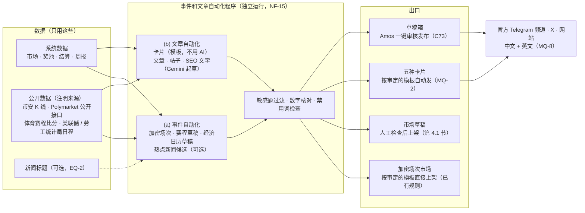

# forecast 需求：事件和文章自动化程序（随需求说明书 v1.3）

- 版本：v1.0（2026-10-25）
- 变更历史：v1.0（2026-10-25）首次创建，随《需求说明书》v1.3 交 Amos 审核。
- 编写：产品经理
- 来由：Amos 2026-10-25 的答复最后一句"**另外需要写一个事件和文章自动化程序**"（完整原话见《需求说明书》第 16.1 节）。
- 依据：agents main `1f92bbc`（《协作总则》v0.12.1：C7、C21、C53、C62、C66、C73；《产品经理》v0.12.1：C6、C71、C86；《研发工程师》C81）；`需求文档/v1-需求说明书.md` v1.3（第 1.5、4.1～4.3、6.3、7 节，NF-13～NF-16）；`市场/v1-市场调研与推广策略.md` v2.1（PR #3 分支 `claude/market-strategy-v1` 提交 `e867569`：第 6.3 节五张卡、第 6.4 节借热点、第 7.2 节每日草稿包、第 8 节 G-2 / G-6 / G-9 / G-W17、第 9 节"不做的事"、第 10 节 MF-9 / MF-11 / MF-17、第 12 节平台规则、第 14 节 F-1～F-16）。
- 状态：**待 Amos 审核**。EQ-1～EQ-8 待答复；第 12 节"超出要求的部分"待确认；验收标准待测试预审。
- 读法：先看"一图看懂"和第 1 节"我对这句话的理解"，再看第 4.4 节"对外发布的规则"和第 11 节 EQ。
- 和需求说明书的关系：本文是《需求说明书》v1.3 的一部分（第 6.4 节引用），编号和需求说明书统一：验收标准 AC-100～AC-118，待决问题 EQ-1～EQ-8，超出要求的部分 EX-1～EX-11。

> **标注约定（C66）**：【证实】实际打开了一手资料；【二手】只看到第三方或搜索摘要；【推断】PM 的判断；【未核实】本次没有去查，进入架构方案前由研发核对，或由 Amos 配置时确认。本文写作时**没有联网核对**任何外部服务的价格和条款，所以外部服务的价格、额度、条款都标【未核实】。

---

## 一图看懂

这张图想说明：程序做两件事——**(a) 想题目**（把赛程、加密窗口、经济日程、可选的新闻变成市场草稿），**(b) 写内容**（卡片、文章、帖子、SEO 页面）。出口只有四个：加密场次照旧按审定模板上架；其他市场一律是草稿、要人检查上架；五种卡片按 Amos 审定的模板自动发；**AI 写的所有东西都进草稿箱，Amos 点一下才发**。Gemini 只用来起草文字和解析页面，**不碰任何数字的来源**。

---

## 1. 我对这句话的理解

Amos 的原话只有一句："另外需要写一个事件和文章自动化程序"。结合市场策略 v2.1（数据号、五种卡片、周报、大 V 对照图、内容数据工具 MF-9、公开概率看板 MF-17）和需求里已有的"加密市场自动生成、体育赛程生成草稿"，我的理解是：

| 部分 | 是什么 | 解决什么 |
|---|---|---|
| **(a) 事件自动化** | 自动发现和生成**可以下注的事件（市场）**：加密场次、体育赛程、经济日历（FOMC、CPI）、热点新闻（可选）；产出市场草稿和"焦点战建议" | Amos 每天不用自己想题目、填规则；冷启动期每天 1～2 场的题目能稳定供应 |
| **(b) 文章自动化** | 自动生成**对外内容**：开盘 / 截止提醒 / 封盘倒计时 / 开奖卡片和周报（MQ-2）、赛前和行情分析短文、SEO 页面、X 和 Telegram 帖子草稿、大 V 对照图，中英文都有 | 市场策略的"AI 每天起草全部内容、Amos 每天只审核和发布"（策略第 7 节）需要一个真正的程序来做 |

**在任务给的理解上，我做了这几处修正和补充**：
1. **五种卡片不用 Gemini 写**。卡片是"系统数据套进 Amos 审定的模板"，每次措辞完全一样、每个数字都直接取系统数据。原因：MQ-2 审定的是模板；如果每张卡都由 AI 重新措辞，就等于每次发的都是没审定过的内容，而且 AI 可能写错数字。Gemini 只负责**自由文字**（文章、帖子、SEO 段落、新闻提炼、页面解析）。
2. **事件自动化不等于"自动开市场"**。除了需求里已有的"加密自动生成模板"（模板审定一次、之后直接上架），**任何来源生成的市场都只是草稿**，要有 `market:publish` 的人按第 4.1 节清单检查后上架。热点新闻只产出"候选题"，比草稿还低一级。
3. **加一个底层：数据管道**。(a)(b) 和 MF-9 内容数据工具、MF-17 公开数据页用的是同一份数据（系统数据 + 币安 + Polymarket + 赛程 + 经济日程），只拉一次、存一份、各处共用；每个数字都带来源和取数时间，数字核对（第 4.3 节）靠它。
4. **回复、私信、进群发言只出草稿，程序里没有"发布"按钮**。X 禁止按关键词自动回复别人的帖子（市场策略第 12 节），Telegram 禁止未经请求的消息；而且 C73 规定不以 Amos 或公司的名义自动发言。大 V 对照图（G-W17）程序只出图和回复草稿，由 Amos 手动回复。
5. **"程序"按独立运行的程序来要求**（NF-15）：它出故障、被外部服务限流、Gemini 不可用时，下注、结算、充值、提现不受影响；它只能通过和后台相同的接口建市场草稿、发内容，不能直接改市场状态、奖池和资金。具体怎么部署由研发在架构方案里定。
6. **AQ-7 的体育抓取程序**是另一个独立程序（为裁决服务），但和本程序**共用 Gemini 的接入、每日调用上限和日志**，所以 Gemini 的部分（第 6 节）两者一起写。

---

## 2. 范围

| 做 | 不做（理由） |
|---|---|
| 加密场次：沿用需求第 4.2 节的自动生成模板和场次表 | 自动上架加密模板以外的任何市场（第 4.1 节：上架必须有人检查） |
| 体育：每天拉赛程，按规则给出"焦点战建议"，一键生成草稿 | 政治、选举、战争、灾害、涉及未成年人、单个人能左右结果、个人隐私类题目（第 4.1 节"不能涉及"），生成时就过滤 |
| 经济日历：FOMC 利率决议、美国 CPI（EQ-6），事件前 7 天生成草稿 | 爬取 X 的数据、"情绪雷达"（市场策略第 9 节：X 接口收费、条款限制爬取） |
| 热点新闻候选（可选，默认关，EQ-2） | 自动回复别人的帖子、自动私信、自动进别人的群发言（平台规则、C73） |
| 五种卡片按审定模板自动发（需求第 6.3 节） | AI 自动发布任何自由生成的内容（默认；是否加开关见 EQ-1） |
| 数据卡、大 V 对照图、每日草稿包、赛前和行情分析短文、SEO 页面文字、教程和对比文章、周报文章、Build in public 周帖：Gemini 起草，进草稿箱 | 视频、直播、语音（市场策略 G-W12：YouTube 等平台规则风险高） |
| 中文 + 英文（MQ-8）；网站页面三语（繁體由简体自动转换） | 付费数据源、付费新闻接口（现金预算为 0） |
| 后台：内容中心（草稿箱、模板、事件候选、渠道和开关、日志、用量） | 用 AI 改写或生成任何数字；用 AI 生成图片里的数字（图片由程序按模板画） |
| 管理员通知（每日草稿包、失败、额度） | 给客户发营销消息（需求第 7 节 #19 第一期不发） |

---

## 3. (a) 事件自动化

### 3.1 事件从哪里来

| 来源 | 产出什么 | 频率 | 上架方式 | 数据来源 | 要 Gemini 吗 |
|---|---|---|---|---|---|
| **加密场次**（已有） | 按场次表 / 连续窗口生成的 BTC、ETH 涨跌市场 | 按模板 | **直接上架**（模板启用前检查过一次，需求第 4.2 节） | 币安、OKX K 线 | 不要 |
| **体育赛程**（已有，增强） | ① 未来 7 天赛程（已有）；② **焦点战建议**：每天给出 1～3 场建议，附理由（联赛、开赛时间、两队情况、Polymarket 有没有同题）；③ 一键生成草稿，冷启动期默认玩法大小球 2.5 / NBA 大小分（MQ-10） | 每天 1 次（00:00 UTC），赛程变动时更新 | **草稿 → 人工上架** | 体育数据源（AQ-7：免费源或抓取程序）；Polymarket 公开接口 | 只有赛程来自抓取程序时用来解析页面 |
| **经济日历**（新增） | FOMC 利率决议、美国 CPI 公布（EQ-6）的市场草稿，按第 3.2 节的题型模板生成 | 官方日程每月检查 1 次；事件前 **7 天**生成草稿 | **草稿 → 人工上架** | 美联储 FOMC 日程页、美国劳工统计局 CPI 公布日程页（官方一手页面；运营也可以手动录入日期） | 不要（题型模板）；日程页解析失败时可以用 Gemini 解析，结果要人看 |
| **热点新闻**（可选，默认关，EQ-2） | **候选题**：题目、选项、判定条件、裁决来源、建议的截止时间，附新闻链接 | 开关打开后每小时 1 次 | **候选 → 运营采纳成草稿 → 人工上架** | 后台配置的新闻源（RSS，免费，只配加密、经济、体育类）【未核实：具体用哪些源由研发选】 | 要（提炼题目和规则草稿、敏感分类） |

### 3.2 题型模板（规则写法固定，保证"能判定、覆盖所有可能"）

| 题型 | 题目（例） | 选项 | 判定条件和来源 | 时间 |
|---|---|---|---|---|
| 足球胜平负（已有） | 曼城 vs 利物浦（90 分钟胜平负） | 主胜 / 平 / 客胜 | 需求第 4.1 节例子 | 开赛前 5 分钟截止 |
| 足球大小球（已有） | 曼城 vs 利物浦：总进球大于 2.5？ | 大 2.5 / 小 2.5 | 90 分钟常规时间总进球；分界线必须是 .5（E8） | 同上 |
| NBA 胜负（已有） | 湖人 vs 勇士：谁赢？ | 主胜 / 客胜 | 含加时的最终比分 | 开赛前 5 分钟截止 |
| **NBA 大小分**（v1.3） | 湖人 vs 勇士：总得分大于 228.5？ | 大 / 小 | 含加时的两队总得分；分界线必须是 .5，默认按两队本赛季场均得分之和取最近的 .5，运营可以改【推断】 | 同上 |
| **FOMC 利率决议**（v1.3） | 美联储 12 月议息：联邦基金利率目标区间会怎样？ | 降息 / 维持 / 加息 | 以美联储官网议息声明里的**目标区间上限**和上一次相比：变低 = 降息、不变 = 维持、变高 = 加息（覆盖所有可能）；以声明首次发布为准 | 声明公布前 1 小时截止（需求第 3.7 节、第 8 节"时事题在结果公布前 1 小时以上截止"）；平台裁决 + 公示 24 小时 |
| **美国 CPI 同比**（v1.3） | 美国 10 月 CPI 同比会高于 3.0% 吗？ | 高于 X% / 等于 X% / 低于 X% | 以美国劳工统计局首次公布的 CPI-U 同比（未季调，保留 1 位小数）为准，之后的修正不算；X = 上一个月公布的值 | 公布前 1 小时截止；平台裁决 + 公示 24 小时 |
| 加密涨跌（已有） | BTC 13:00～14:00 UTC 涨还是跌？ | 涨 / 跌 | 需求第 4.3 节 | 窗口开始前 30 秒截止 |

- 题目、选项、判定条件都按模板出**英文、简体中文、繁體中文**三份（需求 RQ-18）；模板文字由 PM 起草、放在后台能改的地方（C6）。
- 热点新闻的候选题没有固定模板，由 Gemini 起草，**必须**逐项填齐第 4.1 节的字段；缺字段的候选不显示。

### 3.3 哪些自动上架、哪些必须人工确认

| 产出 | 自动做到哪一步 | 人做什么 | 依据 |
|---|---|---|---|
| 加密场次市场 | **自动上架**（模板启用时已检查） | 启用 / 修改模板时检查一次 | 需求第 4.2 节（已有规则） |
| 体育赛程草稿 | 自动拉赛程、给建议；**点"生成"才建草稿** | 运营选比赛和玩法生成草稿；有 `market:publish` 的人检查后上架 | 需求第 4.1、4.2 节 |
| 经济日历草稿 | **自动建草稿**（事件前 7 天） | 有 `market:publish` 的人检查后上架；不想开就删除草稿 | 同上 |
| 热点新闻候选 | **只出候选**，不建草稿 | 运营"采纳"后变成草稿（可以改），再由有 `market:publish` 的人检查上架；"忽略"的候选 7 天后清理 | 同上；候选最容易出错，多一层人工 |
| 任何来源中命中"不能涉及"的 | **不出现在候选和草稿里**，只记进"已过滤"日志（原因、命中的词或分类） | 运营可以查看已过滤日志；确实是误判的，按正常流程手动新建草稿 | 需求第 4.1 节 |

- 程序用来建草稿的后台账号**没有 `market:publish` 权限**；程序不能上架、暂停、取消、改费率，也不能碰裁决和结算（NF-15）。
- 程序生成的草稿上标"来源：赛程 / 经济日历 / 热点候选"，草稿列表可以按来源筛选。
- 草稿自动预检：生成后自动跑第 4.1 节清单里机器能判断的项（必填项齐、选项 2～10 个、时间先后、分界线是 .5、裁决来源有链接、品类在白名单里），结果显示在草稿上；**人仍要勾选"已检查以上各项"才能上架**。
- 草稿的截止时间过了还没上架，自动标"已过期"，不能再上架。
- 节目化（MQ-1）：程序只给建议，**不替 Amos 决定开哪场**；上架时照常受"同时开放的市场数上限"的提示（需求第 4.2 节）。

### 3.4 敏感题怎么过滤（两层）

1. **品类白名单**：只接受加密、体育（足球、NBA）、经济（央行利率、CPI）。新闻源也只配这几类。
2. **关键词名单 + Gemini 分类**：
   - 关键词名单按第 4.1 节"不能涉及"的类别写（例如选举、总统、候选人、战争、伤亡、暗杀、地震死亡、儿童、未成年，以及单个人能左右结果的题型），中英文各一份，后台可以加；命中就过滤。
   - 有 Gemini key 时，再让 Gemini 按同样的类别判断一次，判断"可能敏感"的也过滤。
   - **没有 Gemini key 时只用关键词名单**；热点新闻候选在没有 key 时整体关闭（它本来就要 Gemini 才能提炼）。
3. 过滤是"宁错杀"：被误过滤的题，运营可以手动建；没被过滤的，上架前还有人检查。

---

## 4. (b) 文章自动化

### 4.1 内容类型

| # | 类型 | 什么时候生成 | 用到的数据 | 怎么生成 | 语言 | 发到哪里 | 发布方式 |
|---|---|---|---|---|---|---|---|
| 1 | **五种卡片**：开盘、截止提醒、封盘倒计时、开奖（含作废、取消）、周报 | 需求第 6.3 节 | 系统数据 | **模板（不用 AI）**，图片按模板画 | 中、英 | 官方 Telegram 频道、X、网站开奖记录页、开启播报的群 | **自动**（MQ-2） |
| 2 | **数据卡**（数据号 G-2） | 每天早上的草稿包里 3 张 | Polymarket 热门体育 / 加密 / 经济题的概率、BTC 统计、我们的场次 | 图片按模板画（数字取数据管道）；配文由 Gemini 起草 | 中、英 | X、Telegram 频道 | 草稿箱 → Amos 一键发 |
| 3 | **大 V 对照图**（G-W17） | Amos 在后台手动触发：贴大 V 帖子的链接或观点摘要，选一个市场或 Polymarket 同类题 | 我们的池子的真实人数和比例；上线前用 Polymarket 公开数据 | 图片按模板画，自动印数据来源和查询时间；回复文字由 Gemini 起草 | 中、英 | — | **只出图和草稿，Amos 手动回复**（没有发布按钮） |
| 4 | **赛前分析短文**（焦点战） | 焦点战上架后、开赛前 24 小时内 | 我们的奖池、Polymarket 同题概率、公开的近期战绩和交锋（体育数据源） | Gemini 起草 | 中、英 | X、Telegram 频道、网站焦点战页 | 草稿箱 |
| 5 | **行情短文**（BTC 场） | 每天 BTC 场开盘后 | 币安 K 线统计（过去 N 小时涨跌比例、波动）、我们的场次两边比例 | Gemini 起草 | 中、英 | X、Telegram 频道 | 草稿箱 |
| 6 | **SEO 页面**：每场焦点战一页、BTC 每小时涨跌统计页（MF-11） | 焦点战上架时建页；统计页每天更新数据 | 同 4、5 | **数据部分程序自动生成、自动更新**；开头一段说明文字由 Gemini 起草 | 网站三语 | 网站 | 数据部分自动；**文字部分审核后才显示**，没审核的页面只显示数据 |
| 7 | **教程 / 对比文章**（MF-11） | 每周最多 2 篇（EQ-7），Amos 也可以给个题目让它写 | 需求里的规则、说明页、可核实的公开资料（每条注明出处和查询日期） | Gemini 起草 | 网站三语；中、英帖子摘要 | 网站文章页 | 草稿箱 |
| 8 | **X / Telegram 帖子草稿**（每日草稿包） | 每天 00:00 UTC（北京 08:00）：3 条 X（2 条数据卡 + 1 条观点或进展）、1 条 Telegram 频道 | 同上 | Gemini 起草 | 中、英 | X、Telegram 频道 | 草稿箱 |
| 9 | **周报文章**、**Build in public 周帖**（G-8） | 每周一 | 周报卡的数字（MF-6）、本周上线的功能（由 Amos 在后台写几句要点） | Gemini 起草 | 中、英 | 网站、X | 草稿箱 |
| 10 | **评论区回复草稿**（G-W1） | Amos 在后台贴原帖链接和内容（程序不读取 X） | 数据管道 | Gemini 起草 | 中、英 | — | **只出草稿**，Amos 手动回复 |

### 4.2 每日草稿包
- 每天 00:00 UTC 生成，01:00 UTC 前发一封邮件给有 `content:publish` 的人：今天的草稿条数、焦点战建议、经济日历草稿、失败的条目、Gemini 用量。
- 草稿箱里按"今天要发的"排在最前；每条可以"发布 / 改后发布 / 驳回 / 复制"。
- 市场策略估计 Amos 早上审稿 10 分钟（策略第 7.2 节）；草稿包的条数后台可调，默认按上表。

### 4.3 写作规则（红线）

所有自由生成的内容（第 4.1 节 #2～#10）都要遵守，程序在生成后自动检查，人审核时再看一遍：

1. **只用两种数据**：系统数据，以及**标明来源**的公开数据（币安、Polymarket、体育数据源、美联储、劳工统计局、配置的新闻源）。每条草稿附"引用的数据"清单：来源、取数时间、数值。
2. **数字核对**：文中出现的每一个数字（金额、百分比、人数、价格、比分、日期、倍数）都必须能在"引用的数据"里找到（允许按显示规则四舍五入）。找不到的数字标红，**这条草稿不能发布**，直到人改掉或驳回。
3. **禁用的说法**（市场策略第 9 节、F-12、F-15，名单在后台可加）：
   - 承诺或诱导收益："稳赚""必中""保本""翻倍""胜者瓜分对手的奖金""最后入场""别错过"；
   - 和事实不符："智能合约秒出""自动化秒出""输赢全在链上""链上公开可查""平台不留一分钱私房钱"；
   - 点名贬损竞品（"客服装死""提现慢"之类的评价）；只能引用可核实的事实并附链接和日期（F-13）。
   命中禁用词的草稿**不能发布**。
4. **不写成事实的预测**：不写"BTC 今晚必涨""这场必出大球"；分析只摆数据（两边比例、Polymarket 概率、历史统计），**不建议押哪边**（EQ-8）。
5. **Polymarket 数据**必须写"数据来自 Polymarket 公开接口，非 Polymarket 官方"和查询时间（F-11）；不用"Polymarket 中文""Polymarket 官方华语"一类的说法（市场策略 G-W16）。
6. **身份**：内容以官方账号的身份写，不冒充第三方（不写"作为一个资深操盘手"之类，市场策略第 9 节）。
7. **敏感题**：内容不涉及第 4.1 节"不能涉及"的题目；生成前后都过第 3.4 节的过滤。
8. **人少照实写**：奖池小、人少就写真实数字，不凑整、不放大（市场策略第 6.3 节）。
9. **SEO**（市场策略 G-6、第 12 节 Google 垃圾内容政策）：每个页面必须有本页独有的真实数据；不做空壳页；每天新增页面有上限（默认 5，EQ-7）。

### 4.4 对外发布的规则（C73）

| 内容 | 发布方式 | 谁按按钮 |
|---|---|---|
| 五种卡片 | **按审定模板自动发**（MQ-2，需求第 6.3 节） | 模板由 Amos 审定一次；之后系统发 |
| 数据卡、帖子、赛前 / 行情短文、文章、SEO 页面文字、周报文章、Build in public 周帖 | **默认进草稿箱，Amos 一键发布**：选渠道（Telegram 中文 / 英文频道、X 中文 / 英文号、网站），可以先改再发 | 有 `content:publish` 的人（默认只有超管 = Amos） |
| 回复别人的帖子、私信、在别人的群里发言 | **只出草稿和"复制"按钮，程序不提供发布功能** | Amos 手动 |
| 事件草稿 | 变成市场草稿，按需求第 4.1 节人工检查上架 | 有 `market:publish` 的人 |
| "Amos 开启后自动发布"开关 | **待决（EQ-1）**；第一期建议不做，所有 AI 内容都要审核 | — |

- **一键发布**：Telegram 频道通过官方机器人发；X 通过发帖接口发（X 接口额度不够或拿不到时，改为"复制文字 + 下载图片 + 打开 X 发帖页"，由 Amos 手动贴，EQ-4）；网站直接发布。发布结果（成功 / 失败、帖子链接）记日志。
- **过期**：有时效的草稿过期后不能发布——赛前短文在开赛时过期，行情短文和数据卡 24 小时后过期，回复草稿 24 小时后过期。
- **紧急停止**（需求第 6.3 节）同样会停掉本程序的一键发布和卡片自动发布。

### 4.5 中英文（MQ-8）
- 每条草稿同时生成中文和英文两个版本（用同一份"引用的数据"分别起草，不是机器翻译中文稿），两个版本各自过数字核对和禁用词检查，可以分别发布。
- 对外渠道：中文渠道发简体中文，英文渠道发英文（账号是否分开见 EQ-3）。
- 网站页面三语：繁體中文由简体中文**按固定规则自动转换**（不再调用 AI），转换后同样过禁用词检查。

---

## 5. 数据来源（只用这些）

| 来源 | 用来做什么 | 费用 | 标注要求 | 拿不到时 |
|---|---|---|---|---|
| 系统数据（市场、奖池、结算、周报） | 所有卡片和文章 | 0 | 不用标注 | — |
| 币安现货 K 线（OKX 备用） | BTC 统计、行情短文、数据页 | 0（公开接口，需求第 4.3 节） | "数据：币安现货 BTC/USDT，查询时间 …" | 用备用；都拿不到时这类草稿不生成，标"数据不可用" |
| Polymarket 公开接口 | 数据卡、对照图、开盘卡附带的概率、数据页 | 0【未核实：接口使用条款，市场策略 F-11】 | "数据来自 Polymarket 公开接口，非 Polymarket 官方，查询时间 …" | 这一块不显示，其他照常 |
| 体育数据源（AQ-7：免费源或抓取程序） | 赛程、焦点战建议、赛前短文 | 目标 0（需求第 4.3 节） | 写明数据源名称 | 不出焦点战建议，运营手动建 |
| 美联储、美国劳工统计局官方日程页 | 经济日历草稿、裁决来源 | 0 | 写一手页面链接 | 运营手动录入日期 |
| 新闻源（RSS，可选） | 热点候选 | 0【未核实：具体源和条款】 | 候选附新闻链接 | 不出候选 |
| **不用**：X 的数据、付费数据、来源不明的数据、客户个人数据 | — | — | — | — |

---

## 6. Gemini

### 6.1 key 和配置（C21）
- **key 只由 Amos 填进服务器的环境变量**，变量名 **`FC_GEMINI_API_KEY`**；不进仓库、不写进任何文档和聊天、不经过 AI、后台不显示（只显示"已配置 / 未配置"）。
- 可选变量 `FC_GEMINI_MODEL`：用哪个模型；不填用研发定的默认值（建议 Flash 一类便宜、快的模型，具体型号研发在架构方案里定）。
- 其他都是后台参数（`content:publish` 修改，写审计）：每日调用上限（默认 **300 次**）、每月费用提醒线（默认 10 美元，按估算费用提醒）、每个功能的开关（文章起草、热点候选、页面解析）。
- 本程序和 AQ-7 的体育抓取程序**共用同一个 key 和同一个每日上限**；抓取程序的调用优先（裁决比写文章重要）：当天用量到 80% 后，文章起草暂停，只留给比分解析。

### 6.2 调用量估算【推断】

按冷启动期（每天 1 场 BTC + 1～2 场焦点战）估：

| 用途 | 每天次数 | 说明 |
|---|---|---|
| 每日草稿包的帖子（X 3 条 + Telegram 1 条） | 8 | 中英文各一次 |
| 数据卡配文 | 6 | 3 张 × 中英文 |
| 赛前分析短文 | 2～4 | 1～2 场 × 中英文 |
| 行情短文 | 2 | 1 场 × 中英文 |
| SEO 页面说明段落 | ≤ 10 | 每天新页上限 5 × 中英文（繁体自动转换，不调用） |
| 教程 / 对比文章、周报文章、Build in public | 约 2 | 每周 4～6 篇 × 中英文，折算到每天 |
| 大 V 对照回复、评论区回复草稿 | 3～8 | Amos 手动触发 |
| 敏感题分类（赛程、经济日历草稿） | 约 2 | 批量判断 |
| 体育页面解析（AQ-7，只有走抓取程序时） | 约 10 | 赛程页 7 天 + 冷启动期每天 1～2 场的比分 |
| 小计 | **约 45～55** | |
| 失败重试（× 1.3） | 约 60～70 | |
| 热点新闻候选（可选，EQ-2） | + 24 | 每小时 1 次 |
| **合计** | **约 60～100 次 / 天** | 每日上限默认 300，留 3 倍余量 |

每次调用按平均输入约 3,000 tokens（数据 + 写作规则）、输出约 800 tokens 估【推断】。

### 6.3 费用估算【推断，价格未核实】

价格按 PM 知道的 Google 2025 年公开价目估算，**没有在本次核实**，以 Amos 配置 key 时 Google AI Studio 的价格页为准：

| 档位 | 价格（每百万 tokens，输入 / 输出） | 每天 100 次的月费 | 每天 300 次（上限）的月费 |
|---|---|---|---|
| 免费档 | 0（有每分钟和每天的请求数限制） | **0**（每天 100 次多半在免费限额内【未核实】） | 可能超出免费限额【未核实】 |
| Flash 一类 | 约 0.30 / 2.50 美元 | 约 **9 美元** | 约 26 美元 |
| Flash-Lite 一类 | 约 0.10 / 0.40 美元 | 约 2 美元 | 约 6 美元 |

算法：每月 3,000 次 × (3,000 × 输入单价 + 800 × 输出单价) ÷ 1,000,000。例如 Flash：3,000 × (3,000 × 0.30 + 800 × 2.50) ÷ 1,000,000 = 3,000 × 0.0029 ≈ 8.7 美元。

**结论**：冷启动期每月 **0～10 美元**；加场以后大约按场次数线性增加。**免费档的条款里，Google 可能会用提交的内容改进产品【未核实】**——我们只发公开数据和汇总数据（第 6.5 节），所以可以接受；建议先用免费档，不够再开付费（EQ-5）。

### 6.4 没有 key 或调用失败时怎么降级（C81）

| 情况 | 系统怎么做 | Amos 看到什么 |
|---|---|---|
| **没有配置 key** | 所有用 Gemini 的功能关闭：文章、帖子、SEO 段落、回复草稿不生成；热点候选关闭；敏感过滤只用关键词名单；体育页面只用不需要 AI 的解析方式，解析不了就按"来源拿不到"处理 | 内容中心顶部显示"Gemini 未配置"；**照常工作的**：五种卡片（模板，不用 AI）、数据卡和对照图的**图片**、SEO 页面的数据部分、加密场次、赛程和经济日历草稿（题型模板） |
| 调用超时 | 每次调用有连接超时和读取超时（例如 30 秒，研发定）；超时后最多重试 2 次，间隔递增 | 草稿标"生成失败"，有"重试"按钮 |
| 返回错误、被限流（429） | 按退避重试，最多 2 次；限流时这一类功能暂停 10 分钟 | 同上；连续失败 10 次发邮件（每天最多一封） |
| 返回的内容不合格（数字核对不过、有禁用词、缺字段、格式不对） | 丢掉重新生成 1 次；还不合格就标"生成失败"并附原因 | 草稿上显示原因 |
| 达到每日上限 | 当天停止调用（比分解析的余量见第 6.1 节）；第二天恢复 | 邮件通知；内容中心显示"今日额度已用完" |
| key 失效、被停用 | 按"没有配置 key"处理 | 邮件通知："Gemini key 不可用，请检查" |
| 比分解析失败（AQ-7） | 这个来源按"拿不到"处理；两个来源不一致或拿不到 30 分钟后转裁决台（需求第 4.3 节） | 裁决台"自动裁决失败" |

任何情况下：**Gemini 的问题都不影响下注、结算、充值、提现**（NF-15）；也不会让卡片少发（卡片不依赖 Gemini）。

### 6.5 发给 Gemini 的数据（NF-16）
- 只能发：市场题目和规则、奖池的汇总数字（人数、金额、比例）、公开行情、公开赛程和比分页面、新闻标题和摘要、写作规则。
- **不能发**：客户的邮箱、充值地址、KYC 资料、IP、设备信息、客户编号、单个客户的下注记录、后台账号信息、任何密钥。
- 程序在调用前检查请求内容，发现像邮箱、链上地址、密钥的字符串就拦下并记日志。

---

## 7. 后台页面（内容中心）

菜单"内容中心"（需求第 6.1、6.2 节），权限 `content:view` / `content:edit` / `content:publish`★。线框图见 W7（`assets/v1/wireframes/W7-后台内容中心草稿箱-电脑.svg`）。

| 页面 | 内容 | 操作 | 权限 |
|---|---|---|---|
| **草稿箱** | 列表：类型、语言、目标渠道、生成时间、过期时间、状态（待审核 / 已发布 / 已驳回 / 已过期 / 生成失败）、校验结果（数字核对、禁用词）；按状态、类型、语言筛选。详情：正文（可改）、图片预览、"引用的数据"清单（来源、时间、数值）、校验结果（标红的数字和词）、中英文对照 | 发布（选渠道）、改后发布、驳回（可写原因，用来改进写作规则）、复制、重试；回复类草稿只有"复制" | 看：`content:view`；改：`content:edit`；发布：`content:publish` |
| **卡片模板** | 五种卡片 × 中英文；每个模板的状态（草稿 / 已审定 / 已停用）、版本历史；用最近一个真实市场生成预览 | 编辑（变回草稿）、审定（勾选确认）、停用 | 编辑：`content:edit`；审定、停用：`content:publish` |
| **事件候选** | 焦点战建议（附理由）、经济日历草稿、热点候选（开关打开时）、已过滤日志（原因） | 生成草稿 / 采纳、忽略；跳到市场草稿 | `content:edit`（上架仍要 `market:publish`） |
| **发布渠道和开关** | 渠道列表（Telegram 中文频道、英文频道、X 中文号、英文号、网站、开启播报的群）；每个渠道的连接状态（凭据是否已配置，不显示凭据）、自动发布开关；全局"紧急停止" | 开 / 关、紧急停止 / 恢复 | `content:publish` |
| **工具** | 大 V 对照图：贴链接或观点 → 选市场 → 出图和回复草稿；评论区回复草稿：贴原帖 → 出草稿；手动让程序写一篇（给题目） | 生成、复制、下载图片 | `content:edit` |
| **日志** | 每次生成（类型、用了哪些数据、调用次数、结果）和每次发布（时间、渠道、操作人或"自动"、帖子链接、失败原因）；按日期、类型、渠道筛选 | 导出 CSV | `content:view` |
| **用量和设置** | Gemini 状态（已配置 / 未配置 / 不可用）、今天和本月的调用次数、估算费用；每日上限、费用提醒线、各功能开关、禁用词名单、关键词过滤名单、新闻源（热点候选打开时）、每日草稿包条数 | 修改（写审计） | 看：`content:view`；改：`content:publish` |

---

## 8. 通知（C86）

| 事件 | 收件人 | 渠道 | 频率 |
|---|---|---|---|
| 每日草稿包已生成 | 有 `content:publish` 的人（默认超管） | 邮件 | 每天一封汇总（01:00 UTC 前） |
| 卡片自动发布失败、渠道被自动关闭、紧急停止被按下或恢复 | 同上 | 邮件 | 每次；同一渠道的失败每小时最多一封（需求第 6.3 节） |
| Gemini 未配置、key 不可用、额度用完、连续失败 | 同上 | 邮件 | 每天最多一封 |
| 经济日历草稿已生成（等待上架） | 有 `market:publish` 的人 | 合并在每日草稿包里 | 不单独发 |
| 客户 | — | — | **本程序不给客户发任何消息**；客户能收到的只有需求第 7 节的通知（含 #23 订阅的开场提醒） |

邮件文案放进后台可改的模板（C6），PM 起草初始中英文文案。

---

## 9. 风险

| 风险 | 表现 | 措施 |
|---|---|---|
| **AI 写错事实** | 文章里的数字、比分、日期不对；编造"某机构称"；把预测写成事实 | 卡片不用 AI；AI 只能用"引用的数据"；**数字核对**不过不能发；每条附来源；人审核后才发；驳回原因回流改写作规则 |
| **题目敏感** | 热点新闻里提炼出政治、战争、灾害类题目；或体育题里出现涉及未成年人的赛事 | 品类白名单 + 关键词 + Gemini 两层过滤；热点候选默认关（EQ-2）；**除加密模板外不自动上架** |
| **平台规则** | X 自动化规则（按关键词自动回复禁止、重复刷屏可能被移除或封号）；Telegram 条款（未经请求的消息、受监管商品）；Google 批量生成内容、doorway 页面 | 只自动发自己账号的信息类卡片；同一场同一渠道最多两次提醒；回复和私信只出草稿；机器人不下注；SEO 每页独有数据、每天新页上限、文字人审（市场策略第 12 节） |
| 数据源条款 | Polymarket 公开接口、抓取的比分页面不允许商用或限频 | 研发选型时列出条款交 Amos（需求第 15 节）；拿不到时对应功能降级，不影响其他 |
| 发错帖 | 卡片发到错误的渠道、模板写错 | 模板审定时看真实预览；紧急停止；日志里有帖子链接，Amos 手动删 |
| 费用失控 | Gemini 调用异常增多 | 每日上限、费用提醒线、用量页 |
| key 泄露 | key 出现在日志、页面、仓库 | 只在服务器环境变量；后台不显示；CI 密钥扫描（AC-72）；日志里不打印请求头 |
| 商标 | 用 Polymarket 名字做内容被投诉 | 一律写"非 Polymarket 官方"；不用"Polymarket 中文"一类说法 |
| 内容千篇一律 | 每天的帖子读起来一样，没人看 | 草稿包条数可调；驳回原因回流；Amos 可以改后发；L+4 周按数据调整（市场策略的"砍和加"） |

---

## 10. 验收标准

测试方式同需求说明书第 10 节。外部服务（Gemini、Telegram、X、Polymarket、新闻源）在测试中都用**替身**，另外各用真实服务冒烟一次（Gemini 和渠道的真实冒烟需要 Amos 配置凭据后进行）。

| 编号 | 验收标准 | 判定口径 | 测试方式 |
|---|---|---|---|
| AC-100 | 经济日历草稿 | 录入一个 FOMC 日期和一个 CPI 公布日期：事件前 7 天各生成一个草稿，三语题目、选项（降息 / 维持 / 加息；高于 / 等于 / 低于 X%）、判定条件、一手来源链接、截止时间（公布前 1 小时）齐全；状态是草稿，没有上架 | 自动 |
| AC-101 | 焦点战建议 | 替身赛程里有 20 场比赛：每天 00:00 UTC 生成 1～3 场建议，每条有理由；一键生成的草稿默认玩法是大小球 2.5 / NBA 大小分，分界线是 .5 | 自动 |
| AC-102 | 只有加密模板自动上架 | 赛程、经济日历、热点候选生成的市场全部停在草稿；用程序的账号调用上架、暂停、取消、改费率、裁决、结算接口都返回 403 | 自动 |
| AC-103 | 敏感题过滤 | 替身新闻源里放入含"选举""战争伤亡""某主播会不会说"的标题，以及正常的加密、经济标题：敏感的不出现在候选里，出现在"已过滤"日志并写明原因；正常的出现在候选里；没有 Gemini key 时关键词过滤仍然生效 | 自动 |
| AC-104 | 热点候选 | 开关打开、有 key（替身）：每小时生成候选，每条字段齐全（第 4.1 节），缺字段的不显示；"采纳"后变成可编辑的草稿；开关关闭时不调用 Gemini、不拉新闻 | 自动 |
| AC-105 | 草稿预检 | 程序生成的草稿上显示机器预检结果；人为改出一个错误（选项只剩 1 个、分界线写成 2.0），预检标红；不勾选"已检查以上各项"不能上架 | 自动 |
| AC-106 | 文章草稿 | 第 4.1 节 #2、#4、#5、#7、#8、#9 每类生成一次：每条都有中文和英文两个版本、"引用的数据"清单（来源、时间、数值）、过期时间；进入草稿箱，状态"待审核"，**没有任何一条被自动发出** | 自动（替身 Gemini） |
| AC-107 | 数字核对 | 让替身 Gemini 返回一段含有"引用的数据"里没有的数字（例如把 58% 写成 85%）：这个数字标红，发布按钮不可用；改成正确数字后可以发布 | 自动 |
| AC-108 | 禁用词 | 替身 Gemini 返回含"稳赚""胜者瓜分""智能合约秒出"的文字：先自动重新生成 1 次，仍含有时标"生成失败"并写明原因；人工在草稿里加入禁用词后不能发布 | 自动 |
| AC-109 | 一键发布 | 有 `content:publish` 的人发布一条草稿到 Telegram 中文频道和网站：替身渠道收到内容，日志记录时间、渠道、操作人、帖子链接；没有 `content:publish` 的管理员发布返回 403；X 渠道没配置凭据时显示"复制 + 打开发帖页" | 自动 |
| AC-110 | 回复和私信只出草稿 | 回复草稿、评论区回复草稿只有"复制"按钮；程序里不存在把内容发到别人帖子下、私信、别人群里的接口 | 自动 + 代码走查 |
| AC-111 | 过期 | 赛前短文在开赛时间之后、行情短文在 24 小时之后显示"已过期"，发布被拒 | 自动 |
| AC-112 | SEO 页面 | 焦点战上架后生成三语页面：数据部分（奖池、概率、开赛时间）和系统一致并随推送更新；说明文字没审核前不显示，审核后显示；同一天第 6 个新页面不生成（上限 5）；页面能被不运行脚本的请求读到（NF-14） | 自动 |
| AC-113 | 大 V 对照图 | 输入一条观点并选一个市场：图上的人数和比例和市场一致，印有数据来源和查询时间；选 Polymarket 题时印"非 Polymarket 官方"；只有"复制""下载"，没有发布 | 自动 |
| AC-114 | 没有 key 时降级 | 去掉 `FC_GEMINI_API_KEY` 重启：内容中心显示"Gemini 未配置"；五种卡片照常自动发；数据卡和对照图的图片、SEO 数据部分、赛程和经济日历草稿照常；文章类草稿不生成；热点候选关闭 | 自动 |
| AC-115 | 调用失败（C81） | 替身 Gemini 分别模拟：超过读取超时、返回 500、返回 429、返回格式错误：每次重试不超过 2 次、间隔递增，最后标"生成失败"；连续失败 10 次发一封邮件；达到每日上限后当天不再调用并发邮件；**期间下注接口 p99 不受影响**（和不调用时相比） | 自动 |
| AC-116 | 不发个人数据（NF-16） | 替身 Gemini 记录全部请求：一天的全部请求里没有客户邮箱、链上地址、客户编号、KYC 字段、密钥；人为在输入里塞一个邮箱，请求被拦下并记日志 | 自动 |
| AC-117 | 和主业务隔离（NF-15） | 停掉自动化程序、或让它持续报错：下注、结算、充值、提现的自动化测试全部照常通过；自动化程序的账号没有改市场状态、奖池、资金的权限 | 自动 |
| AC-118 | 日志、用量和通知 | 每次生成和发布都有日志；用量页显示当天和本月的调用次数、估算费用；每日草稿包邮件每天一封，列出草稿条数、失败条目、用量；紧急停止后草稿箱的发布按钮不可用 | 自动 |

每条验收标准在任务清单里都至少对应一个任务（C30）。

---

## 11. 需要 Amos 决定的问题（EQ）

每题附建议，可以一句"EQ 全部按建议"确认。

| 编号 | 问题 | 选项 | **建议** | 理由 |
|---|---|---|---|---|
| **EQ-1** | AI 写的文章和帖子，要不要做"Amos 开启后自动发布"的开关 | A 第一期不做，全部审核后发 / B 做开关、默认关，只允许数据卡配文和行情短文这两类开启 / C 做开关，所有类型都能开 | **A** | C73 要求对外发布由 Amos 决定；AI 可能写错事实，自动发错一次，"公开透明"的卖点就受损；每天审核约 10 分钟（市场策略第 7.2 节）。上线 4 周后按驳回率（例如某一类驳回率 < 10%）再决定要不要对这一类开 B |
| **EQ-2** | 热点新闻候选题第一期做不做 | A 第一期不做，L+4 周后再做 / B 第一期做，默认关 / C 第一期做，默认开 | **A** | 冷启动期每天只开 1～2 场（MQ-1），热点快反（G-9）由 Amos 人工判断就够；热点新闻最容易碰到敏感题、也最容易写错规则；先把赛程、经济日历这两个规则固定的来源做稳 |
| **EQ-3** | 英文内容发在哪里 | A 单独开英文 X 号和英文 Telegram 频道 / B 和中文发在同一个账号、频道 | **A，中英文分开** | 中英文混在一个账号里，两边的读者都会觉得一半看不懂；卡片自动发，多一个账号不增加 Amos 的时间；英文号同样以 Quick Come 名义注册（MQ-3），由 Amos 注册（C73） |
| **EQ-4** | X 怎么自动发卡片 | A Amos 申请 X 开发者账号，用发帖接口自动发 / B X 不自动发，系统准备好文字和图片，Amos 一键复制手动发 | **先 A，不行就 B** | 冷启动期每个 X 账号每月约 250 条卡片（每天 8 张 + 每周 1 张周报）；X 接口免费档的发帖额度和条款【未核实】，Amos 申请时看一下；额度不够或条款不允许，X 改 B，Telegram 照常全自动 |
| **EQ-5** | Gemini 用免费档还是付费档，每日上限多少 | A 先用免费档、上限 300 次 / 天 / B 直接开付费档 | **A** | 冷启动期估计每天 60～100 次，多半在免费限额内；付费档估计每月 < 10 美元（第 6.3 节，价格未核实）；免费档可能用提交内容改进产品，我们只发公开数据，可以接受 |
| **EQ-6** | 经济日历第一期做哪些 | A FOMC 利率决议 + 美国 CPI / B 再加非农就业、GDP 等 | **A** | 和市场策略的热点日历一致（FOMC 2026-12-08/09、2027-01-26/27）；两类都有一手官方来源、规则好写；其他以后按用户反馈加 |
| **EQ-7** | SEO 页面和文章的数量 | 见建议 | **焦点战每场一页（自动）、BTC 统计一页（每天更新）、教程 / 对比文章每周最多 2 篇、每天新增页面上限 5，全部三语** | Google 把批量生成的空壳页当垃圾内容（市场策略第 12 节）；每页要有真实独有的数据；每周 2 篇是 Amos 能审完的量（市场策略第 7.4 节"每周抽 20 分钟审 2 篇"） |
| **EQ-8** | 赛前 / 行情分析写不写"倾向"（例如"数据看偏向主队"） | A 不写倾向，只摆数据 / B 写倾向 | **A** | 写倾向等于建议押哪边，接近诱导（F-12）；AI 判断错了还会损害信任；只摆两边比例、Polymarket 概率、历史统计，读者自己判断 |

---

## 12. 超出要求的部分（C7）

下面是 PM 在 Amos"写一个事件和文章自动化程序"这句话之外加的，**Amos 确认前不当作已定的决定**：

| 编号 | 加了什么 | 理由 |
|---|---|---|
| EX-1 | **数字核对**：AI 文中的数字必须能在引用的数据里找到，否则不能发布 | AI 写错数字是最大的风险；人审核时容易漏看数字 |
| EX-2 | **五种卡片不用 AI**，只用模板和系统数据（修正了"用 Gemini 生成卡片"的理解） | MQ-2 审定的是模板；每次 AI 重新措辞等于没审定 |
| EX-3 | 敏感题**两层过滤**（关键词 + Gemini）和"已过滤"日志 | 第 4.1 节的"不能涉及"要在自动化里落地；日志让人能查误判 |
| EX-4 | **每日调用上限、费用提醒线、用量页**；比分解析优先 | 防止费用失控；裁决比写文章重要 |
| EX-5 | **不把客户个人数据发给 Gemini**，调用前检查（NF-16） | 客户资料不能发给外部模型；免费档的内容可能被用来改进产品 |
| EX-6 | 草稿**过期**不能发布；市场草稿过了截止时间自动"已过期" | 防止发出过时的数据 |
| EX-7 | **FOMC、CPI 的题型模板**和判定规则（目标区间上限、CPI-U 同比首次公布值） | "能判定、覆盖所有可能"是上架检查的硬要求，要在模板里先写死 |
| EX-8 | SEO 页面**每天新增上限**、文字部分审核前不显示 | Google 垃圾内容政策 |
| EX-9 | 繁體中文**按固定规则自动转换**，不再调用 AI | 网站三语；省调用量，转换结果可预期 |
| EX-10 | 程序**独立运行**、没有上架和资金权限（NF-15） | 自动化出故障不能影响资金 |
| EX-11 | **每日草稿包邮件** | Amos 早上一封邮件就知道今天要审什么 |

---

## 13. 和推广功能（MF）的对应、建议的开发顺序

| 本文的部分 | 对应 | 什么时候要 |
|---|---|---|
| 数据管道、数据卡图片、大 V 对照图、草稿箱、每日草稿包、帖子草稿 | MF-9（G-2 数据号、G-W17） | **L 日前尽早**（上线前 8～12 周养号要用） |
| 数据页的数据 | MF-17、MF-8 | L 日前 6 周 |
| 五种卡片和自动发布、Telegram 机器人 | MQ-2、MF-5、MF-6、MF-7 | L 日 |
| 赛程焦点战建议、经济日历草稿 | MQ-1、MQ-10、G-9 | L 日（L 日要对齐 FOMC 等大事件，MQ-11） |
| SEO 页面、教程和对比文章 | MF-11、G-6 | L+4 周前 |
| 热点新闻候选 | G-9 | 按 EQ-2，建议 L+4 周后 |

具体排进哪一步由研发在开发计划里定（架构方案第 16 节）；本文只给先后。

---

## 14. 来源（C66）

本文没有新做外部调研，引用的外部事实都来自市场策略 v2.1 和需求说明书已标注的来源：
- 卡片、数据号、大 V 对照、SEO、平台规则：`市场/v1-市场调研与推广策略.md` v2.1 第 6.3、8、9、12 节（其中 X 自动化规则【二手】、Telegram 条款【证实】、Google 垃圾内容政策【证实】，以该文标注为准）。
- 币安 K 线接口：需求说明书第 4.3 节【证实】。
- **Gemini 的价格、免费档限额和数据使用条款**：【未核实】，按 PM 已知的 2025 年公开价目估算，Amos 配置 key 时以 Google AI Studio 的价格页和条款为准。
- **X 发帖接口的免费额度和条款**：【未核实】。
- **Polymarket 公开接口的使用条款**、**新闻源的条款**：【未核实】，研发选型时列出。
- 美联储 FOMC 日程页、美国劳工统计局 CPI 公布日程页：作为一手来源写进题型模板；页面结构【未核实】，研发接入时确认。
