# 项目地图：forecast
- 用途：**新加入的人或大模型先读这一份**，10 分钟了解项目现在是什么样、代码在哪里、有哪些不能破坏的约定。要查具体的文件、接口、表、变量、历史问题，看《[项目索引](项目索引.md)》。
- 只写**当前状态**。按版本追加的文档（调研报告、架构方案、开发记录）是当时的记录；和本文件不一致时，以本文件和代码为准。
- 版本：v0.32（2026-10-28，对应代码：`claude/s18-taiwan-prelaunch`（**S18 台湾预热**：市场需求单 `市场/v1-台湾第一期推广.md` P1～P3、`市场/v2-内容发布和确认.md` P9（Amos 2026-10-28："P1 选 A，排期同意"）。P1：对外预热域名 `www.quickcome.online` 的根路径就是测试环境的等候页兼公开概率看板（Nginx 的 prelaunch server 块，只放行等候页接口，注册登录等页面 302 回根路径，可以被搜索收录、有分享图），不显示测试环境标识（Nginx 按 server 块传 `X-Fc-Site`，后端不返回 `env`；客户端按页面里的 `fc-site-mode` 只渲染等候页，约定 65）；`sudo fc add-domain www.quickcome.online` 一条命令扩展证书并生效；P2：说明页"怎么充"后面加台湾入金教程（只在繁中，待市场定稿）；P3 / P9：自动化程序的繁体改成 OpenCC s2twp + 自定义词表 `tw-terms.txt`，客户端、官网、公开页面、通知模板（V31）的繁体做一轮台湾用语替换（对照表给市场校对）；`开发记录/S18-台湾预热.md`，SQ-61～SQ-66；PR 到 main）。上一版 v0.31（2026-10-28，运维：新增 `部署方案/v1-Threads应用申请清单.md`，第 3 节加 Threads 应用一行说明）；v0.30（2026-10-27，对应代码：`claude/s17b-manual-adjust`（**S17B 人工调账**，基于 S17A、PR 到 main，先合 A 再合 B：需求说明书 v1.5 第 21 节（"Amos 2026-10-27：A、B 两个都要"）。后台客户详情"人工加款""人工扣款"（`balance:adjust` 高危；金额、类别、原因必填，参考号选填；扣款只扣可用余额；超过单笔上限 `adjust.manualMax` 要再勾一次，SQ-57）；对手方平台账户"人工调账"`PLATFORM_MANUAL_ADJUST`（可正可负）；调账单 `ledger_adjust`；通知 #24 `BALANCE_ADJUSTED`；"充值未到账补入"当充值算（SQ-58）；风控告警"24 小时人工加款过大"（SQ-59）；"资金 → 人工调账记录"（`recon:view`，导出写审计）；迁移 V30；约定 64）。上一版 v0.29（2026-10-27，对应代码：`claude/s17a-test-credit`（**S17A 测试入金**：Amos 2026-10-27"我需要给客户调整资金"、"A、B 两个都要"。测试环境的充值合约还没部署，后台客户详情加"测试入金"，**只在测试环境（`FC_ENV_LABEL=test`）存在**，生产接口 404、按钮不显示（约定 63）；流水类型 `TEST_CREDIT` / `TEST_CREDIT_EXPENSE`、平台账户"测试入金"`PLATFORM_TEST_CREDIT`（可以为负）、测试入金单 `ledger_test_credit`、迁移 V29、权限点 `balance:test_credit`、参数 `adjust.testCreditMax`（默认 10,000，SQ-56）；风控和提现当充值算；对账页"平台账户"、报表单列；`开发记录/S17-测试入金和人工调账.md`；PR 到 main。B 人工调账在 `claude/s17b-manual-adjust`）。上一版 v0.28（2026-10-27，对应代码：`claude/fix-autogen-slot-format`（**S12c 测试环境反馈**：加密自动生成的场次填 `1:00` 页面显示"北京 09:00"、保存却报"场次格式不正确"。前后端改成同一套宽松规则（`1:00`、`1`、两边空格等都规范成 `HH:mm`，后端保存时为准、后台失焦和保存前提前提示），错误写明"场次第 n 行：错在哪"；其他时间输入检查过，没有同样的问题；`开发记录/S12c-测试环境反馈.md`；PR 到 main）。上一版 v0.27（2026-10-27，对应代码：`claude/alert-mail-control`（**S12b 告警邮件控制**：Amos 收到很多"数据源未开通"的告警邮件，要能控制发不发。告警项分"出错"和"未开通"（`AlertCheck.Status`），未开通不发邮件；一次故障一封、恢复一封，一直没恢复每 24 小时提醒一次（`forecast.alert.remind-every`）；后台"参数设置 → 告警邮件"加总开关和"不发邮件的告警项"（权限点 `alert_params:edit`，迁移 V28）；`开发记录/S12b-告警邮件控制.md`，SQ-53～SQ-55；PR 到 main）。上一版 v0.26（2026-10-27，对应代码：`claude/fix-preflight-timers`（修复：线上第一次运行一键部署时第 6 步 `preflight.sh` 把系统自带的 `dpkg-db-backup.timer` 当成别的项目；PR 到 main）。上一版 v0.25（2026-10-27，对应代码：`claude/s12-oneclick`（**S12 一键部署**：Amos 觉得分步清单太复杂，第一次部署改成粘贴一条命令 `deploy/kit/oneclick.sh`，切换和填密钥改成服务器上的 `fc` 命令；清单 v2.0；PR 到 main，合并后发布到 staging 才能用，SQ-49）。上一版 v0.24（2026-10-26，对应代码：`claude/fix-joblease-test`（修复定时任务租约释放后同一毫秒内偶发拿不到，PR 到 main；S12 已合并，staging 已建）。上一版 v0.23：对应代码 `claude/s12-test-deploy`，**当前阶段：S12 测试环境第一次部署的准备**（只准备、不部署：部署方案和代码核对、备份补上对象存储目录、生产去掉测试标识的 24px 留白、给 Amos 的分步清单 `部署方案/v1-测试环境第一次部署清单.md`；合并后等 SQ-44 建 staging 分支，再由 Amos 按清单在控制台操作）。上一阶段：S16 完成，整合 4（PR #32 已合并到 main，S10 风控和自动审批、S11 客户端页面、S13 推广功能第一批、S14 分享卡片、S15 事件和文章自动化程序第一期 + 随机分享码、S16 等候页和公开概率看板 + Telegram 机器人 v1 + SQ-24 / SQ-27 一起合进 main；S16 的迁移 V40～V42 整合时改成 V25～V27，V1～V27 连续；Telegram 机器人页并进后台"内容中心"；S12 测试环境另行进行）
- 维护：研发整合，各角色写自己的部分（C53）。**每次功能迭代，在同一个 PR 里更新本文件和《项目索引》**；`scripts/check-project-index.mjs` 检查索引（CI 的 `checks` 每次运行）。
- 名词：**复制源**指本项目 S1 复制的那个差价合约项目（远程 `staging` 分支提交 `2583328`）。代码和文档里提到它时一律写"复制源"，不写它的名字。
- 变更历史（整合时按时间合成一条；括号里是各分支当时用过的编号）：v0.1～v0.6（2026-10-24）调研、需求、架构阶段（FQ、RQ 全部答复，需求说明书 v1.1，架构方案 v1.0；另一条分支上的市场调研与推广策略 v1.0、v2.0 当时也记成了 v0.6、v0.7）；v0.7（2026-10-24）开发 S1：从复制源复制后端、三个前端、合约、端到端测试、部署和 CI，删除差价合约部分，改名，重建迁移基线（`开发记录/S1-复制骨架.md`）；v0.8（2026-10-25）开发 S2：账户三项（可用 / 下注锁定 / 提现冻结）、彩池流水类型、平台收入和补偿支出账户、不变量测试、单笔最小提现默认 100、品牌上线前沿用 Quick Come（`开发记录/S2-账本拆分.md`）；v0.9（2026-10-25）开发 S3：market 模块（市场、选项、状态机 17 条边、上架检查、补充说明、提前截止、费率修改和公开记录、截止和事件结束任务）、定时任务租约、e2e 可调时钟、参数设置接口（单笔最小提现改用 `betting_params:edit`）、需求第 2.2 节的 21 个权限点（`开发记录/S3-市场.md`）；v0.10（2026-10-25）开发 S4：pool 模块（下注事务、幂等、拒单原因、持仓、选项奖池、截止定格、`MarketPoolView` 的实现）、赔率和预计回报（前后端共用测试向量）、奖池推送 `/api/ws/markets`（每个市场每秒最多一次、Redis 广播）、我的下注、后台下注明细、客户端资金流水的下注类型、员工账户列、通知 #8、下注预压测（`开发记录/S4-下注奖池.md`）；v0.11（2026-10-25）SQ-8 修复（充值地址并发分配死锁，约定 34）和开发 S5：settle 模块（结算三段、三道防重复、事务边界参数 `forecast.settle.batch-size`（AQ-3 已定 B，默认 500）、取消作废全额退款、E14 / E15 / 提前截止的退回、彩池对账和结算异常）、超管手工结算的临时入口、批量记账和批量通知、通知 #11～#14、10,000 持仓压测（`开发记录/SQ-8-充值地址并发死锁.md`、`开发记录/S5-结算.md`）；v0.11.1（2026-10-25）钱包：ERC20、BEP20 充值地址只用 CREATE2 合约地址（Amos 2026-10-25），合约没配齐时这两条链暂未开通、告警 `deposit.evm`、不退回 xpub，删除以太坊体系 xpub，端到端用 anvil 部署出的合约参数，新增合约部署操作说明（约定 7、22、38，`开发记录/钱包-合约地址方案.md`、`部署方案/v1-归集合约部署.md`）；v0.12（2026-10-25）**整合**（C62）：把 `claude/s5-settle`、`claude/wallet-create2`、`claude/arch-v1.2`、`claude/req-v1.3`、`claude/market-strategy-v1` 和 main（《Amos 待办》v1.0～v1.7）合在一起，按代码和文档的实际情况重新整理本文件（各分支当时的 v0.11、v0.11.1、v0.7 合成这一版）。内容：需求说明书 v1.3（推广功能和事件、文章自动化，**Amos 审核通过**）、架构方案 v1.3（AQ-15～AQ-23 的结论、充值合约方案、推广功能按需求 v1.3 改写）、市场调研与推广策略 v2.2（**Amos 审核通过**）、`Amos待办.md`；**测试环境和复制源轮流用同一台测试服务器**（AQ-23，约定 39），测试环境的容器内存上限按 2 核 2 GB 重算（C75），部署工具包加 `preflight.sh`、`start.sh`、`stop.sh`（`部署方案/v1-测试环境与切换.md`）；v0.11（2026-10-25，`claude/m1-prototype` 分支上的编号）M1 效果图和原型：方向 A 清爽数据的设计 token，客户端 P1～P5、P9、P10 和登录、后台市场管理 / 规则模板 / 裁决台 / 参数设置（只在原型模式显示）、官网首页的 mock 原型，主题跟随系统，客户端和官网加繁体，25 张截图 `assets/v1/prototype/`（`开发记录/M1-原型.md`）；v0.12～v0.13（2026-10-25，`claude/s6-crypto`、`claude/s7-resolve` 分支上的编号，和 main 的 v0.12 重号）开发 S6：加密市场自动生成（按场次配置，默认节目化：BTC 1 小时每天 13:00 UTC 一场，MQ-1；滚动保留为可切换的选项）、resolve 模块（币安 / OKX / Coinbase 三个 K 线适配器、数据源网关：超时、有上限的退避重试、熔断、原始返回存档含 sha256；自动裁决：两源一致自动结算，不一致或拿不到每分钟重试、30 分钟后转人工）、已结算市场详情公开开始价、结束价、来源、迁移 V14、员工告警 `RESOLVE_AUTO_FAILED`（`开发记录/S6-加密自动化.md`）；开发 S7：resolve 的平台裁决（`resolve/platform/`：裁决台的提议、确认、退回、直接确认、作废、E6 延期 / E7 腰斩的等待、存档截图、时限和超时提醒；公示期满自动结算（带租约）；客户提交争议、维持 / 改判 / 无法判定后直接结算；客户端详情公开裁决信息）、settle 的结算预览和补偿（E13，只补不扣、平台补偿支出单列、报表）、**删除 S5 的临时入口"超管手工填结果直接结算"（SQ-10）**、迁移 V15、通知 #10、#15～#17 和三个员工提醒、9 个参数（`开发记录/S7-平台裁决.md`）；v0.14（2026-10-25）**整合 2**（C62）：把 `claude/s7-resolve`（含 S6）、`claude/m1-prototype` 合进 main，按代码和文档的实际情况重新整理本文件（各分支当时的 v0.11、v0.12、v0.13 合成这一版）：约定按 main 的 38、39 在前，S6、S7 的约定顺延为 40～45；原型的前端类型和模拟数据按 S5～S7 的后端接口调整；需求说明书 v1.3 记下 PQ-1～PQ-5、SQ-12～SQ-14 的结论和 AC-28 的新口径；架构方案 v1.4；v0.14～v0.15（2026-10-25，`claude/s8-sports`、`claude/s9-admin` 分支上的编号，和 main 的 v0.14 重号）开发 S8：resolve 的体育部分（`resolve/sports/`：从主源同步未来 7 天赛程，按队名 + 开赛时间在备源里找候选、运营确认两个来源的比赛对应，按玩法（胜平负 / 大小球 / 胜负 / 大小分，MQ-10）一键生成三语草稿；体育自动裁决：完赛后等 30 分钟、两个来源比分一致自动结算，不一致 / 只有一个来源 / 状态异常转人工，延期、腰斩由数据源自动标记 E6 / E7 等待，实际开赛时间按数据源交给结算（E14））、三个体育适配器（football-data、balldontlie、TheSportsDB，AQ-17）、网关加限频排队和"未开通"（没配 key）、迁移 V16、两个员工告警、4 个参数（`开发记录/S8-体育自动化.md`）；开发 S9：合并 M1 原型（效果图、客户端市场页面、繁体）；后台页面接真实接口（仪表盘、市场管理、待上架、新建 / 编辑 / 检查上架、市场详情的全部操作、加密自动生成、体育赛程、裁决台、公示与争议、结算记录、补偿、彩池对账、报表、参数设置），原型菜单转为正式菜单（`Menus.java` + 迁移 V17 的 `admin_menu`）；通知：需求第 7 节 22 类对齐（新 #4、#7、#18、#23 和上架提醒），客户文案 PM 定稿、加繁体，员工提醒按角色发（SQ-14）；迁移 V17、V18（默认加密模板提前 1440 分钟生成，F-I2-1）（`开发记录/S9-后台和通知.md`）；v0.16（2026-10-25）**整合 3**（C62）：把 `claude/s9-admin`（含 S8，已合过 M1 原型）合进 main，按代码和文档的实际情况重新整理本文件（各分支当时的 v0.14、v0.15 合成这一版）：约定沿用 main 的编号 1～48（原型菜单那条 47 已不适用，换成 S9 的"后台页面"），S8、S9 新加的约定顺延为 49～51；保留整合 2 的 `CaseBook.sync` 修复（约定 34、44）；需求说明书 v1.3.2 记下 SQ-18～SQ-20；架构方案 v1.5（S8 的实现补记改为第 6.8 节）；v0.17（2026-10-25）开发 S10：`riskalert` 模块（关联账户：同设备、同 IP、同充值来源地址、同提现地址；告警：尾盘大额、关联账户对押、新账户押中冷门、充了不玩就提，新告警邮件 `RISK_ALERT`；每 30 秒扫描，租约 `riskalert.scan`）、后台风控告警页和客户详情的关联账户、员工账户登记（E15 当场退回）、提现自动审批 R8～R13 彩池口径 + R14、R15、`account_device`、客户端设备号 `fc.device`、参数设置"风控"一组、迁移 V19（`开发记录/S10-风控和自动审批.md`）；v0.18（2026-10-25）开发 S11：客户端页面全部接真实接口（列表搜索 / 按奖池排序 / 加载更多 / 列表和详情的奖池推送、详情的结算明细和未开放市场、我的下注汇总和按持仓的结果、通知 `link` 跳转、注册 18 岁勾选和 `terms_accepted_at`）、#23 开赛提醒（`market/remind/`、`market_reminder`、定时任务 `market.reminder`、免登录退订 `/unsubscribe`）、`FC_CLIENT_URL`、客户端到官网的链接（Nginx 替换 `__FC_SITE_URL__`）、官网法律页三语初稿和 `?lang=`、迁移 V20（`开发记录/S11-客户端.md`）；v0.19（2026-10-25）开发 S13：推广功能第一批：来源统计（`account_attribution`、`growth_visit`、新模块 `growth`、后台"来源统计"和 CSV 导出、权限点 `growth:view`）、场次化（场次表的星期、参数 `market.maxOpen`、今日场次 `today_slate`、仪表盘两项）、不登录可浏览（`FC_PUBLIC_BROWSE_ENABLED`；Nginx SSI 给搜索引擎的标题、OG 和正文，草稿 404，robots、sitemap、`/m/`）、开奖记录和周报（`ended_at`）、迁移 V21（`开发记录/S13-推广功能1.md`）；v0.20（2026-10-25）开发 S14：`crypto.spec.ts` 偶发失败的根因是产品代码的并发问题（定时任务和手动触发 / 另一个实例同时跑到同一个市场，都在事务外取数、各存一组原始返回，只有一边的结果生效），加密和体育自动裁决改成取数前先认领这一次尝试（约定 42、49）；MF-5 分享卡片（`market/card/`：五种卡片，服务器用 Java2D 画 1200 × 630 PNG，三语模板 `content/cards.json`；挑战卡和押中的开奖卡用随机凭证 `market_share`；`og:image`、robots 放行卡片图片；镜像装文泉驿正黑；客户端市场详情 / 下注成功 / 我的下注 / 周报的分享入口）、迁移 V22（`开发记录/S14-分享卡片.md`）；v0.21（2026-10-26）开发 S15：分享链接的 `ref` 改用随机分享码（`account_share_code`，旧链接兼容）；事件和文章自动化程序第一期（`content` 模块：经济日历 FOMC / CPI 按题型模板生成市场草稿并提交上架、S8 赛程进事件候选（焦点战建议、敏感词和品类过滤）、赛前前瞻 / 赛后简报 / SEO 说明 / 文章 / X 和 Telegram 帖子 / 回复的中英文草稿（Gemini，数字核对、禁用词、倾向词）、草稿箱一键发布、SEO 页面 `/insights`（焦点战、BTC 每小时涨跌统计、文章）、数据卡和大 V 对照图、后台"内容中心"、权限点 `content:*`；跑在主应用进程里，C75 余量放不下另一个进程）、迁移 V23、V24（`开发记录/S15-自动化程序.md`）；v0.21（2026-10-26，S16 分支上同号，和 S15 同时开发）开发 S16：SQ-24（参数 `risk.lateBet.minAmount`，尾盘大额只看单笔 ≥ 100 USDT）、SQ-27（注册成功后的自动登录也写 `last_login_at`，开赛提醒资格按新口径）；MF-8 / MF-17 等候页和公开概率看板（`growth/board/`、`growth/waitlist/`：`/data` 不登录可看、SSI 和 sitemap，邮箱双重确认、防刷、免登录退订，后台"发送上线通知"全站只能一次）；MF-7 Telegram 机器人 v1（`growth/telegram/`：token `FC_TELEGRAM_BOT_TOKEN` 由 Amos 填，没填不启动、只在 `alerts` 提示；开奖卡推频道和开了播报的群，模板默认草稿、频道默认关）；迁移 V40～V42（编号从 V40 起避开 S15；整合 4 改成 V25～V27）；权限点 `content:view`、`content:publish`（`开发记录/S16-等候页和机器人.md`）；v0.23（2026-10-26）S12 测试环境部署准备（`开发记录/S12-测试环境部署准备.md`）：核对部署方案和代码（S10～S16 的变量都在 compose 和 `env.example` 里，`env.example` 每个变量标必填 / 可选，新检查 `scripts/check-deploy-env.mjs`）；`backup.sh` / `restore.sh` 加对象存储目录（证件、裁决截图），部署形态端到端最后做一次备份恢复演练；新脚本 `reload-env.sh`（改了 `.env` 后生效，原来文档里写的 `deploy.sh` 在版本没变时不会生效）；`verify.sh` 加 S13、S16 的检查；客户端真实模式不再给顶部横幅留 24px（约定 61）；给 Amos 的分步清单，《测试环境和切换》v1.2 只留要点；SQ-44～SQ-48；v0.22（2026-10-26）整合 4：S10～S16 合成 `claude/integration-4`（PR 到 main）；S16 的迁移 V40～V42 改成 V25～V27；权限点 `content:view`、`content:publish` 去重（S15、S16 同名同义，共 57 个）；"Telegram 机器人"页并进"内容中心"分组（菜单和路由 `/content/telegram`），内容中心"用量和设置"的发布渠道显示 Telegram 频道的真实状态；数据页的 Polymarket 一块跟 S15 的数据开关；S16 的 `PublicPageView` 合进 S15 的 `PublicPageProvider`；Amos 对 SQ-22～SQ-29、SQ-35、SQ-37、SQ-40～SQ-42 的答复写进各开发记录（《Amos 待办》v1.21、v1.23"已完成"），S10、S11 开发记录里的 SQ 编号按《Amos 待办》改正；S16 的研发决定 D-201～D-220 改成 D-215～D-234（和 S15 的 D-193～D-214 重号）；v0.24（2026-10-26）修复定时任务租约：释放时到期时间设成 1970 年，别的实例在同一毫秒里也能拿到（staging 第一次 CI 的 `JobLeaseTest` 因此失败）；v0.27（2026-10-27）S12b 告警邮件控制：告警项加"未开通"状态（`AlertCheck.Status.NOT_CONFIGURED`：`telegram.bot`、体育数据源、`deposit.evm` 没填合约地址），健康检查照样 DOWN、不发邮件；持续异常每 24 小时提醒一次（新模板 `OPS_STILL_DOWN`）；参数设置"告警邮件"一组（`alert.mail.enabled`、`alert.mail.muted`，权限点 `alert_params:edit`），迁移 V28；端到端 `e2e/tests/alert-mail.spec.ts` 和替身接口 `/api/e2e/alerts/check`；v0.28（2026-10-27）S12c 测试环境反馈：自动生成的场次时刻宽松读入、前后端同一套规则（约定 62），场次错误码改成 `required` / `timeFormat` / `outOfRange` / `invalidDays` / `hourOnly` / `quarterOnly` / `duplicate`，后台字段错误对 `名字[n]` 显示"第 n+1 行"

## 一图看懂

```mermaid
flowchart LR
    R["调研、需求、架构<br/>（已完成）"] --> S1["S1～S5<br/>骨架 · 账本 · 市场 · 下注 · 结算<br/>（已完成，整合 1）"] --> S6["S6、S7、M1<br/>加密自动化 · 平台裁决 · 原型<br/>（已完成，整合 2）"] --> S8["S8 体育<br/>（已完成）"] --> S9["S9 后台和通知<br/>（已完成）"] --> INT["整合 3<br/>（S8 + S9，PR #24）"] --> S10["S10 风控和自动审批<br/>（已完成）"] --> S11["S11 客户端页面<br/>（已完成）"] --> S13["S13 推广功能第一批<br/>（已完成）"] --> S14["S14 分享卡片<br/>（已完成）"] --> S15["S15 自动化程序<br/>（已完成）"] --> S16["S16 等候页和机器人<br/>（已完成）"] --> INT4["整合 4<br/>（S10～S16，已合并）"] --> S12["S12<br/>测试环境<br/>（准备完成，待部署）"]:::now --> T["测试环境验收 → 生产"]
    classDef now fill:#FFF4D6,stroke:#F5B83D,color:#0B1F3A
```

这张图想说明：S1 搭了骨架（从复制源复制账户、KYC、账本、钱包、通知、后台权限，删除差价合约部分）；S2 把账本拆成彩池要用的三项余额和流水类型；S3 写了市场本身（建草稿、上架、暂停、取消、补充说明、提前截止、改费率，到点自动截止、事件结束进入待裁决）；S4 能下注了（钱锁进"下注中"、进选项奖池，赔率实时推给正在看的客户，截止时奖池定格），S5 能结算和退款了（超管先用临时入口手工填结果；输方奖池按比例分给赢方、对盈利抽成、尾差归平台，守恒校验通过才动钱；取消、作废全额退回；每天核对奖池和账本，对不上就停止派彩）；S6 让加密市场自己跑起来了（按模板的场次自动生成并直接上架；窗口结束 1 分钟后取币安和 OKX 的 K 线，方向一致就自动结算，不一致或拿不到每分钟重试、30 分钟后转人工）；S7 把其他市场的结果交给裁决台（裁决员提议结果 + 依据链接 + 截图 → 一个有权限的人确认 → 公示、争议窗口倒计时 → 到期没有争议自动结算；有下注的客户可以提争议 → 维持 / 改判后直接结算，无法判定作废；已结算后发现裁错由平台出钱补偿，只补不扣），S5 的"超管手工填结果直接结算"删掉了；M1 按风格 A 做了客户端、后台、官网的原型和 25 张截图（PQ-1～PQ-5 按现在的做法）；S8 让体育市场半自动：赛程从数据源同步，运营确认两个数据源里是同一场比赛后一键生成草稿（仍要有权限的人检查上架），完赛 30 分钟后两个来源比分一致就自动结算，不一致、只有一个来源、延期腰斩都转裁决台；第一期只用免费档，覆盖之外的联赛平台裁决（SQ-18）；S9 把后台页面全部接上真实接口（市场从建草稿、检查上架到暂停、补充说明、改费率、取消、作废、补偿，裁决台从提议、确认到争议处理，结算记录、彩池对账、报表、参数设置），菜单和后端菜单表一致，通知按需求第 7 节对齐成 22 类（简体、繁体、英文，员工提醒按角色发）；客户端页面在 S11 按原型接完（`技术方案/v1-架构方案.md` 第 1、16 节）。S10 加了风控：系统每 30 秒看一遍新的登录、充值、白名单、提现、下注，把同设备、同 IP、同地址的账户关联起来，发现尾盘大额、关联账户对押、新账户押中冷门、充了不玩就提时记告警并发邮件给超管，后台"风控告警"页处理；提现自动审批的 R8～R13 改成按真实的下注和结算算（S1 的过渡口径恒为 0），新增 R14（关联账户对押的盈利）、R15（有没处理的可疑告警）；后台可以把客户登记为员工（不能下注，已有下注当场退回）。S11 把客户端页面全部接上真实接口（列表搜索和排序、详情实时奖池和结算明细、我的下注的派彩和汇总、通知点了跳到相关页面、注册要勾选满 18 周岁），加了开赛提醒：在还没开放的市场详情订阅，开放下注时给账户邮箱发一封邮件（只给注册后用邮箱密码登录过的客户）；官网的三份法律文件有了三语初稿（待法务审核）。S8、S9 在整合 3（PR #24）里；需求 v1.3 的推广功能和自动化程序排在后面。 S13 做了推广功能第一批（来源统计、场次化、不登录可浏览和搜索收录、公开开奖记录和周报、CSV 导出），和 S12 测试环境互不依赖。S14 做了分享卡片：市场详情、下注成功（挑战卡"我押了 X，谁敢押 Y？"）、我的下注里押中的单子（金额默认不显示）、周报都能分享，卡片图片由服务器生成、只有系统里的真实数字；链接在 Telegram、X 里显示这张卡片，带 `src=share` 和分享人编号，只用于来源统计、不发奖励；同时修好了加密自动裁决"同一个市场被两个触发同时取数"的问题。 S15 做了事件和文章自动化程序第一期：运营录入 FOMC、美国 CPI 的公布时间，程序提前 7 天按固定的题型模板建市场草稿、放进"待上架"（上架仍要人检查）；体育赛程给出焦点战建议；Gemini 按系统数据和公开行情起草中英文的前瞻、简报、文章、帖子，每个数字都要在引用的数据里找得到，否则标红、不能发布；所有文字都进草稿箱由 Amos 点发布，网站上多了 `/insights`（焦点战页、BTC 每小时涨跌统计、文章），X、Telegram 只能复制后手动发；没有 Gemini key 时只是不能 AI 起草，其他照常。分享链接里的分享人编号换成了随机分享码。 S16 做了上线前的等候页兼公开数据页 `/data`（BTC 每小时涨跌比例来自币安公开行情；上线后再显示我们今天场次的人数和比例），留邮箱要点邮件里的链接确认，上线那天后台按一次"发送上线通知"给确认过的人各发一封邮件（全站只能按一次）；还做了官方 Telegram 机器人：结束的场次市场把开奖卡发到中英文频道和群主开了播报的群（模板要先审定、频道要先打开），`/btc` 回 BTC 价格和今天的比例；机器人里不能下注、不绑账户，没填 token 时不启动。 S10～S16 在整合 4 里一起合进 main：S16 的 Telegram 机器人页放进了 S15 的"内容中心"，作为它的发布渠道；X 和草稿箱里的帖子仍是复制后手动发。

## 1. 这个项目做什么
一个类似 Polymarket 的预测网站，玩法是**彩池（pari-mutuel）**：客户用 USDT 充值（ERC20 / BEP20 / TRC20，每人独立充值地址、扫块入账），把 USDT 押进某个市场某个选项的奖池；开奖后输方奖池按押注比例分给赢方，平台只对赢家的盈利部分抽成（默认 5%，每个市场都能在后台单独改，结算时按当时的费率算），不当对手方、不做市；再用 USDT 提现。规则全文见 `需求文档/v1-需求说明书.md` 第 3 节。

| 业务 | 版本 | 使用者 | 页面 | 接口 | 数据 |
|---|---|---|---|---|---|
| 账户、KYC | S1（复制源原样） | 客户、运营 | 客户端登录注册、我的；后台客户、KYC | 《项目索引》第 2.1、2.2 节 | `account_*` |
| 账户余额和流水 | S2（三项：可用、下注锁定（"下注中"）、提现冻结；平台收入、平台补偿支出两个账户；下注、结算等流水类型已定义，业务在 S4 起）；S17A 测试入金（只在测试环境，平台账户"测试入金"，约定 63）；S17B 人工调账（生产可用，平台账户"人工调账"，约定 64） | 客户、财务 | 客户端资产、资金流水；后台客户详情 | 第 2.3 节 | `ledger_*` |
| 充值、提现、自动审批、对账、归集 | S1（复制源原样）；S10 自动审批 R8～R13 改成彩池口径（有效下注本金、已结算的盈亏），新增 R14、R15（读风控），总开关仍默认关闭；ERC20、BEP20 充值地址只用合约地址（v0.11.1，合约由 Amos 按 `部署方案/v1-归集合约部署.md` 部署，没部署前暂未开通） | 客户、运营、财务 | 客户端资产；后台资金 | 第 2.4、2.6 节 | `wallet_*` |
| 通知 | S1（模板只保留第一期用得到的）；S10 加员工模板 `RISK_ALERT`（有 `risk_alert:view` 的人，第一期是超管）；S9 按需求第 7 节对齐：客户模板 20 个（#1～#8、#10～#18、#22、#23；#9、#19～#21 不发），文案 PM 定稿、三种语言（繁体空时用简体），员工提醒按角色发（有对应权限点的在职管理员，没有人时发告警邮箱，SQ-14）；S11 通知列表每条带 `link`（客户端点了跳到相关页面），#23 由开赛提醒发 | 客户、员工 | 站内信、邮件、推送；后台通知模板页可改三种语言 | 第 2.5 节 | `notify_*` |
| 后台权限、审计、系统配置、参数设置 | S1；S3 按需求第 2.2 节加到 53 个权限点，加参数设置接口（品类默认费率 `fee:edit`；下注限额、争议窗口、KYC 阈值、单笔最小提现、裁决时限、体育 `betting_params:edit`）；S9 参数设置页、菜单表（`Menus.java` + `admin_menu`）；S10 菜单加"风控告警"（12 个一级菜单）、参数设置加"风控"一组 | 管理员 | 后台系统、参数设置 | 第 2.6 节 | `admin_*`、`common_config` |
| 市场 | S3（市场和选项（三语）、状态机 17 条边、上架检查、补充说明、提前截止、费率修改和公开记录、截止和事件结束任务、租约；后台和客户端接口，后台页面 S9） | 客户、运营、超管 | 后台：S9 页面；客户端市场列表（搜索、按奖池排序、加载更多）、详情（S11 接完，含结算明细、未开放市场） | 第 2.3a、2.6 节 | `market_*`、`common_job_lease` |
| 彩池：下注、持仓、奖池、赔率、推送 | S4（下注事务、幂等、11 种拒单原因、持仓、截止定格、赔率和预计回报（前后端共用测试向量）、奖池推送；接口，后台页面 S9） | 客户、运营 | 客户端下注（手机抽屉、电脑右栏）、我的下注（汇总、按持仓的派彩和抽成，S11）；列表和详情的奖池推送（S11）；后台下注明细（S9 市场详情） | 第 2.3a、2.3、2.6 节 | `pool_*` |
| 结算、退款、彩池对账、补偿 | S5（结算计算和守恒、派彩和抽成、尾差归平台、取消作废全额退款、E14 / E15 / 提前截止的退回、每日彩池对账和结算异常；接口，后台页面 S9）；S7 加结算预览（守恒数字）、补偿（E13：只补不扣，平台补偿支出账户，报表单列），删除 S5 的临时入口"超管手工填结果直接结算"（SQ-10） | 客户、超管、财务 | 后台：S9 页面；客户端：详情的结算明细、我的下注（S11，`MarketSettleView`、`PoolResultView` 由 settle 实现） | 第 2.6 节（`/api/admin/markets/{publicNo}/compensations` 等） | `settle_*` |
| 加密市场自动生成、自动裁决 | S6（自动生成模板按场次 / 滚动、生成即上架；三个 K 线适配器、数据源网关（超时、重试、熔断、存档）；两源一致自动结算、30 分钟后转人工；接口，后台页面 S9） | 运营、超管、裁决员、客户 | 后台：S9 页面；客户端：S11 已接完 | 第 2.6 节（`/api/admin/market-autogens` 等）、第 2.3a 节（详情的 `resolution`） | `market_autogen`、`market_template`、`resolve_*` |
| 平台裁决、公示、争议 | S7（裁决台：提议、确认、退回、直接确认、作废、E6 / E7 的等待、存档截图、时限和超时提醒；公示期满自动结算；争议：只有下注的人、每人一次、维持 / 改判 / 无法判定后直接结算；客户端详情公开裁决信息；接口；后台页面 S9，客户端页面 S11） | 客户、裁决员、超管 | 后台裁决台、公示与争议（S9）；客户端结果和提交争议（S11 已接完） | 第 2.3a 节（`/api/markets/{publicNo}/disputes`）、第 2.6 节（`/api/admin/resolve/**`） | `resolve_case`、`resolve_dispute`、`resolve_attachment`、`resolve_record` |
| 体育赛程、体育自动裁决 | S8（主源 football-data / balldontlie、备源 TheSportsDB；赛程同步、候选 + 运营确认对应、按玩法一键生成三语草稿；完赛后等 30 分钟两源比分一致自动结算，否则转人工；E6 / E7 自动标记；接口，后台页面 S9） | 运营、裁决员 | 后台体育赛程（S9） | 《项目索引》第 2.6 节 `/api/admin/sports/**` | `resolve_fixture`、`resolve_fixture_market`、`resolve_sports_task`、`resolve_sports_template` |
| 风控告警、员工账户 | S10（关联账户：同设备、同注册 / 登录 IP、同充值来源地址、同提现白名单地址；告警：尾盘大额、关联账户对押、新账户押中冷门、充了不玩就提；员工登记、E15 当场退回；提现自动审批 R14、R15 读它） | 超管（以后财务） | 后台"风控告警"、客户详情的员工和关联账户（S10） | 《项目索引》第 2.6 节 `/api/admin/risk-alerts/**`、`/api/admin/customers/{id}/staff`、`/links` | `riskalert_*`、`account_device` |
| 开赛提醒（#23） | S11（SQ-20：只给注册后用邮箱密码登录过的客户；按市场订阅；到开放时间由 `ReminderJob`（租约 `market.reminder`）发一次邮件 `MATCH_REMINDER`，邮件里有免登录退订链接） | 客户 | 客户端市场详情（订阅）、通知偏好（查看、退订）、`/unsubscribe` | 《项目索引》第 2.3a 节 `/api/markets/{publicNo}/reminder`、`/api/me/reminders`、`/api/reminders/unsubscribe` | `market_reminder` |
| 推广功能（MF） | 需求 v1.3（Amos 2026-10-25 审核通过）定了范围；**S13 做了第一批**：MF-1 来源统计（只记来源，**不做返佣和分成**，MQ-5）、MF-3 场次化（场次表可选星期、同时开放上限默认 2（超过只提示、勾"仍要上架"）、今日场次、仪表盘两项 SQ-21）、MF-4 不登录可浏览和搜索收录（Nginx SSI）、MF-6 公开开奖记录和周报、MF-10 CSV 导出；**S14 做了 MF-5 分享卡片**（市场卡、开奖卡、挑战卡、押中的开奖卡、封盘倒计时卡、周报卡；Open Graph；手机系统分享、电脑复制链接 / 下载图片；开奖卡以外的卡片没有自动发布）；**S15 做了 MF-9 数据工具（数据卡、大 V 对照图）和 MF-11 SEO 页面（`/insights`）**，分享链接的 `ref` 改成随机分享码；**S16 做了 MF-8 / MF-17 等候页和公开概率看板**（`/data`；Polymarket 一块跟 S15 的数据开关，默认关）**和 MF-7 Telegram 机器人 v1**（SQ-22：公开频道只自动推开奖卡；开奖卡推频道和群、`/btc`、`/today`、start 参数记来源；内联模式、`/pm`、机器人订阅开场提醒、其他四种卡片的自动发布没做）。逐条结论见需求说明书第 1.5 节；架构落点见架构方案第 18 节；做法见 `开发记录/S13-推广功能1.md`、`开发记录/S14-分享卡片.md`、`开发记录/S16-等候页和机器人.md` | 客户、Amos、运营 | 客户端 `/markets`（今日场次）、`/results`、`/results/weekly`、`/how-to-play`、市场详情和我的下注、周报的"分享"、`/data`；后台 `/growth`、`/waitlist`、"内容中心 → Telegram 机器人" | 《项目索引》第 2.1、2.3a、2.6 节 | `account_attribution`、`growth_visit`、`market_question.today_slate` / `ended_at`、`market_share`、`growth_waitlist`、`growth_launch`、`growth_tg_*` |
| 事件和文章自动化程序 | S15 第一期（EQ-1～EQ-8 按建议）：经济日历（FOMC、美国 CPI，运营录入日期）按题型模板生成市场草稿并提交上架；S8 赛程进"事件候选"（焦点战建议、敏感词和品类过滤）；中英文文字草稿（赛前前瞻、赛后简报、SEO 说明、文章、X / Telegram 帖子、回复；Gemini，数字核对、禁用词、倾向词）进草稿箱，Amos 一键发布（网站页面）或复制（帖子、回复，不自动发）；SEO 页面、数据卡、对照图；跑在主应用进程里，隔离和内存见约定 58。热点新闻（EQ-2）没做；X 帖子和草稿箱里的 Telegram 帖子只复制、不自动发（Telegram 频道只自动发开奖卡，是 S16 的机器人，SQ-22） | Amos、运营；客户看 `/insights` | 后台"内容中心"（含 S16 的"Telegram 机器人"页）；客户端 `/insights` | 《项目索引》第 2.1、2.6、2.7 节 | `content_*`、`account_share_code` |

核心流程（计划）：充值（三链扫块入账）→ 选市场、押注选项奖池 → 截止下注（最终赔率确定）→ 结果裁决（加密和比分自动；其他平台裁决：裁决员提议、有权限的人（默认超管）确认，公示 + 争议窗口）→ 结算派彩（对盈利抽成）→ 提现（白名单、冷静期、自动审批、签名上链）。现在（S9）从充值、下注到裁决、结算派彩、提现整条线都通了（端到端 `e2e/tests/settle.spec.ts`：提议 → 确认 → 公示 → 窗口到期 → 结算）；加密市场全自动（端到端 `e2e/tests/crypto.spec.ts`）；争议改判和补偿（端到端 `e2e/tests/resolve.spec.ts`）；取消、作废的市场全额退回。体育市场两个来源比分一致自动结算（端到端 `e2e/tests/sports.spec.ts`），免费档覆盖之外的联赛平台裁决；后台页面全部接上真实接口（端到端 `e2e/tests/admin-pages.spec.ts`）。S11 起客户端页面全部接上真实接口：手机注册 → 充值 → 抽屉下注 → 奖池实时更新 → 结算 → 我的下注看到派彩，开赛提醒订阅 → 到点只发一封邮件 → 邮件退订（端到端 `e2e/tests/client.spec.ts`）。

## 2. 代码怎么分层
| 目录 | 内容 | 角色 |
|---|---|---|
| `backend/` | 单体：Java 25、Spring Boot 4.1.1、MyBatis（XML）、Flyway、MySQL 8.4、Redis 7。包 `com.forecast.app`，模块 `common`、`ledger`、`account`、`wallet`、`notification`、`admin`、`market`（S3；S6 加 `autogen`）、`pool`（S4）、`settle`（S5）、`resolve`（S6）、`riskalert`（S10）、`growth`（S13，来源统计）、`content`（S15，事件和文章自动化，约定 58）；S16 在 `growth` 加等候页和数据看板、Telegram 机器人（约定 59、60） | 研发 |
| `web/client/` | 客户端（React 18、Vite、PWA，手机和电脑两套结构）；S11 起全部页面接真实接口（模拟数据只在原型模式） | 研发 |
| `web/admin/` | 管理后台（React 18、Ant Design） | 研发 |
| `web/site/` | 官网（首页、服务条款、隐私、风险披露；S11 三语初稿，待法务审核） | 研发 |
| `contracts/` | 资金归集合约（Foundry；BitGo 转发合约原样 + 批量合约） | 研发 |
| `e2e/` | 端到端测试（Playwright）：主流程、客户端（S11 `client.spec.ts`）、官网、部署形态 | 测试 |
| `deploy/` | 镜像、Nginx、服务器上的部署工具包（沿用复制源；测试环境和复制源轮流用同一台服务器，内存上限、切换脚本 `preflight.sh`、`start.sh`、`stop.sh` 见 `部署方案/v1-测试环境与切换.md`；测试环境在 S12 第一次部署） | 运维 |
| `scripts/` | 索引检查、旧品牌名检查、模拟层检查、原型构建 | 研发 |
| `.github/` | CI（`ci.yml`）和三个前端共用的检查步骤 | 研发、运维 |

模块之间只通过对方的 `api` 包调用；改余额只能经 `ledger` 模块的 `LedgerApi`。

## 3. 环境
| 环境 | 分支 | 地址 | 数据 | 外部服务 |
|---|---|---|---|---|
| 本地 | 任意 | 后端 8080；前端 `npm run dev` | 本机 MySQL 8.4、Redis 7（测试库每次可以删掉重建） | 不配节点、SMTP 时只记日志 |
| 原型 | 开发分支 | 不部署：本地构建后截图交 Amos（AQ-12，架构方案第 9.5 节；`vercel.json` 留着不用）；本地 `bash scripts/build-prototype.sh` 后打开 `dist/`；M1 效果图在 `assets/v1/prototype/`（25 张） | 浏览器内模拟数据 | — |
| 测试 | `staging`（已建，SQ-44：main → staging 走 PR） | 镜像已发布（`c722523`），服务器还没部署。**和复制源轮流用复制源现在的测试服务器**（美国阿里云轻量 2 核 2 GB，`free -m` 总量 1,613 MB；AQ-23，Amos 2026-10-25："我还是会用同一台服务器，但是在跑当前系统时，我会停掉原来cfd的项目"），同一时间只运行一个项目，目录 `/opt/forecast`；域名 `fc-test`、`fc-test-admin`、`fc-test-www` `.quickcome.online`（SQ-4，DNS 先只开 DNS）；S18 起再加一个对外预热域名 `www.quickcome.online`（同一套容器，根路径是等候页、没有测试标识，`sudo fc add-domain`，约定 65）；S12 第一次部署：Amos 在控制台粘贴 `部署方案/v1-测试环境第一次部署清单.md` 第 2 节的一条命令（`oneclick.sh`），以后用 `sudo fc …` 切换、填密钥，为什么这样做见 `部署方案/v1-测试环境与切换.md`（约定 39） | 独立测试库（容器 MySQL，数据在 `/opt/forecast/data/`） | 区块链测试网（ERC20、BEP20 要等 Amos 部署测试网合约，WQ-1）；体育数据源免费档（AQ-17） |
| 生产 | `main` | 未建（AQ-15、AQ-16 已定：阿里云轻量新加坡单独一台 4 核 16 GB + Cloudflare 免费代理和 Access；容器 MySQL，binlog 和每日全量加密备份到 Cloudflare R2；上线前另写生产部署方案） | — | 区块链主网 |

- **Threads 发帖应用**（需求单 P6，S19 要用）：还没建。Amos 按 `部署方案/v1-Threads应用申请清单.md` 在 Meta 开发者平台建应用、把测试账号登记成 Threads 测试者、拿 60 天长期令牌（只由 Amos 保存，S19 做好后自己填）；测试环境只用测试账号，`@quickcome6` 上生产时登记成测试者，不走 App Review。

## 4. 关键流程在哪里
| 流程 | 入口 | 核心代码 |
|---|---|---|
| 注册、登录 | `POST /api/auth/register`、`POST /api/auth/login` | `backend/src/main/java/com/forecast/app/account/auth/` |
| KYC | `POST /api/me/kyc`；后台 `POST /api/admin/kyc/{id}/review` | `backend/src/main/java/com/forecast/app/account/kyc/` |
| 充值入账 | 定时扫块 | `backend/src/main/java/com/forecast/app/wallet/deposit/DepositService.java` → `LedgerApi` |
| 提现 | `POST /api/wallet/withdrawals` → 冷静期 → 自动审批复判 / 人工审核 → 广播 → 确认 | `backend/src/main/java/com/forecast/app/wallet/withdraw/` |
| 改余额、记流水 | 客户：`LedgerApi.apply` / `applyAll`（一组变动同一事务）/ `applyBatch`（S5，一批客户：按 user_id 升序锁、结果和逐条相同）；平台：`PlatformLedgerApi.apply`；核对：`LedgerQueryApi.mismatches` | `backend/src/main/java/com/forecast/app/ledger/service/LedgerService.java`；流水类型规则 `ledger/api/LedgerEntryType.java` |
| 推给本人 | `UserEventsApi.send` → `WS /api/ws/user` | `backend/src/main/java/com/forecast/app/common/push/` |
| 市场：建草稿 → 提交上架 → 上架 → 暂停 / 恢复 / 取消 / 补充说明 / 提前截止 / 改费率 | 后台 `/api/admin/markets/**`（审计在 `admin/ops/MarketOps`） | `backend/src/main/java/com/forecast/app/market/core/MarketService.java`；状态机 `market/core/MarketStateMachine.java` |
| 市场：到点截止 → 事件结束进入待裁决 | 定时任务 `MarketClockJob`（5 秒 / 15 秒，带租约）；e2e 下 `POST /api/e2e/markets/tick` | `MarketService.closeDue()`、`endDue()`；下注前的截止屏障 `MarketApi.lockForBet`（S4 调用） |
| 市场列表、详情（客户端） | `GET /api/markets`、`GET /api/markets/{publicNo}` | `backend/src/main/java/com/forecast/app/market/web/MarketController.java`、字段 `market/core/ClientViews.java`；奖池部分（`pool` 字段）由 pool 模块给：`pool/bet/PoolQueries.java`、字段 `pool/bet/PoolViews.java` |
| 下注 | `POST /api/markets/{publicNo}/bets` → 市场行共享锁（截止屏障）→ 金额、客户检查 → 账户行排他锁 → 幂等、上限、余额 → 记账"下注锁定" → 下注 → 通知 #8 → 持仓 → 选项奖池原子加 → 提交后推送 | `backend/src/main/java/com/forecast/app/pool/bet/BetService.java` |
| 赔率、预计回报 | 后端 `Odds`、`PoolMath`；客户端 `web/client/src/lib/pool.ts`；共用测试向量 `backend/src/test/resources/pool/pool-vectors.json`（生成 `scripts/gen-pool-vectors.py`） | `backend/src/main/java/com/forecast/app/pool/api/` |
| 奖池推送 | 事务提交后 `PoolChanges.afterCommit` → 本机标记 + Redis 广播 → `PoolPush` 每 200 毫秒看一次、每个市场每秒最多推一次 → `WS /api/ws/markets` | `backend/src/main/java/com/forecast/app/pool/push/` |
| 截止时定格奖池、有效选项、下注客户名单 | market 截止事务里调 `MarketPoolView`（pool 实现） | `backend/src/main/java/com/forecast/app/pool/bet/PoolMarketView.java` |
| 我的下注、后台下注明细 | `GET /api/me/bets`；`GET /api/admin/markets/{publicNo}/bets`（`bet:view`） | `pool/bet/PoolQueries.java`、`admin/ops/BetAdminController.java` |
| 结算（S5） | 裁决台确认的结果公示期满 / 争议处理完、自动裁决成功 → `resolve.api.ResultHandler`（settle 实现）→ `SettleService.settle`（S7 起可以要求市场"正好在某个状态"，公示期满的结算和提交争议在市场行锁上只生效一个）：锁市场 → 结算前对账 → E14 / E15 退回 → `SettleMath` 算 → 守恒校验 → 结算单和明细 → 派彩（batch-size 0 同一事务；大于 0 由 `PayoutWorker` 分批）→ 收尾（尾差入平台、按账本复核、已结算） | `backend/src/main/java/com/forecast/app/settle/run/SettleService.java`、`settle/api/SettleMath.java` |
| 取消、作废的全额退款；E14、提前截止后的退回 | market 进入已取消 / 已作废的同一事务 → `SettleMarketListener.onRefundRequired` 建退款单；`onCloseAdvanced` 当场退回新截止时间之后的下注 | `settle/run/SettleMarketListener.java`、`SettleService.createRefundRun`、`refundNow`；退回下注 `pool/bet/PoolSettle.markRefunded` |
| 彩池对账、结算异常 | 每天 UTC 00:30 `PoolReconJob`；e2e 下 `POST /api/e2e/settle/recon`；差异 `/api/admin/pool-recon/issues`，处理后 `/api/admin/settle/runs/{runNo}/retry` | `settle/recon/PoolReconService.java`；停止派彩 `SettleService.payOneBatch` / `pause` |
| 通知 | `NotifyApi.toUser`；一批客户用 `toUsers`（S5，结果和逐个发相同）→ 任务表 → 邮件、推送；客户语言 `notify_pref.lang`（S9 起有 `zh-TW`），模板按语言取（`Render`，繁体空时用简体）；员工用 `StaffAlertApi`（见下面"员工提醒"） | `backend/src/main/java/com/forecast/app/notification/service/` |
| 加密市场自动生成（S6） | 后台 `/api/admin/market-autogens/**`（建、改（只能在关闭时）、关：`market:autogen`；启用：`market:publish` + 勾选检查）→ 生成任务 `CryptoAutogenJob`（每分钟，租约 `market.autogen`；e2e 下 `POST /api/e2e/autogen/tick`）→ 每个窗口一个事务：模板行共享锁 → 插入 → 必填项检查 → 直接上架 | `backend/src/main/java/com/forecast/app/market/autogen/AutogenService.java`、窗口计算 `AutogenWindows.java`、`market/core/MarketService.createGenerated` |
| 加密自动裁决（S6） | 进入待裁决时建进度（`ResolveMarketListener`）→ `CryptoResolveJob`（每 15 秒，租约 `resolve.crypto`；e2e 下 `POST /api/e2e/resolve/tick`）→ 窗口结束 + 1 分钟：事务外并行取币安、OKX（网关：超时、重试、熔断、存档）→ `CryptoDecision` 判定 → 一致：记结果 → `ResultHandler`（settle 实现）结算；不一致或拿不到：每分钟重试，30 分钟后 MANUAL + AUTO_FAILED + 告警 | `backend/src/main/java/com/forecast/app/resolve/auto/CryptoResolver.java`、`resolve/source/SourceGateway.java`、适配器 `resolve/source/BinanceSpot.java`、`OkxSpot.java`、`CoinbaseSpot.java` |
| 裁决依据（S6） | 客户端详情 `GET /api/markets/{publicNo}` 的 `resolution`（已结算才有：开始价、结束价、来源）；后台 `GET /api/admin/markets/{publicNo}/resolution`（进度、记录、原始返回）、`/api/admin/resolve/auto-failed`（转人工的） | `resolve/auto/ResolutionViews.java`、`resolve/auto/ResolveAdmin.java` |
| 平台裁决（S7） | 市场进入待裁决（平台裁决的）或加密自动裁决转人工 → 建进度 `resolve_case`（`CaseBook`）→ 裁决台 `/api/admin/resolve/cases/**`：提议（`resolve:propose`，依据链接 + 截图 + 理由；或提议作废）→ 确认（`resolve:confirm`★，作废还要 `resolve:void`）或退回；也可以直接确认 → 公示中（拟定结果、争议截止时间、通知 #10）→ `PlatformJob`（每 15 秒，租约 `resolve.publicity`）窗口到期没有争议 → `ResultHandler.settle(…, PUBLICIZING)` | `backend/src/main/java/com/forecast/app/resolve/platform/ResolveDesk.java`、`PublicityService.java`；审计 `admin/ops/ResolveOps.java` |
| 争议（S7） | 客户 `POST /api/markets/{publicNo}/disputes`（有效持仓、每人一次、收到时间 < 争议截止时间；第一个争议 → 争议中）→ 后台 `/api/admin/resolve/cases/{publicNo}/disputes/decide`（`dispute:handle`★：维持 / 改判 → 直接结算，无法判定 → 作废）；结论公开在详情的 `resolution.dispute`，不显示争议人 | `ResolveDesk.dispute`、`decideDisputes`；公开信息 `resolve/platform/PlatformViews.java` |
| 时限和提醒（S7） | `PlatformJob` 每分钟（租约 `resolve.timeouts`）：E6 / E7 等满 48 小时 → 作废；待提议 / 待确认 / 争议处理超时 → 邮件 `RESOLVE_OVERDUE`（每项一次；裁决台标红 `overdue`）；时限在参数设置（`resolve.*`、`dispute.handleMinutes`） | `PublicityService.holdsDue`、`remindOverdue`；`PlatformParams.java` |
| 补偿（S7，E13） | 后台 `GET /api/admin/markets/{publicNo}/compensation-preview` → `POST …/compensations`（`settle:compensate`★）→ 客户 `COMPENSATION`、平台补偿支出 `COMPENSATION_EXPENSE`（可为负）、通知 #17；报表 `/api/admin/reports/settle`（收入和补偿支出分开） | `backend/src/main/java/com/forecast/app/settle/comp/CompensationService.java` |
| 体育赛程和草稿（S8） | 同步：`SportsJob` 每 4 小时（租约 `resolve.sports.sync`）或后台 `POST /api/admin/sports/fixtures/sync` → 主源未来 7 天 → `resolve_fixture`；找候选 `POST …/fixtures/{no}/candidates`（备源按联赛 + 日期、队名 + 日期，`Candidates` 打分）→ 运营确认 `POST …/mapping`（`market:edit`，开赛以前）→ 生成草稿 `POST …/drafts`（`SportsDrafts`：模板渲染三语、`source_ref` 带比赛和结果 → 选项序号）→ 照常提交上架、上架 | `backend/src/main/java/com/forecast/app/resolve/sports/FixtureService.java`、`SportsDrafts.java` |
| 体育自动裁决（S8） | 进入待裁决时 `ResolveMarketListener` → `SportsResolver.onPending`（参数不全、对应没确认 → 直接转人工）→ `SportsJob` 每 30 秒（租约 `resolve.sports`；e2e 下 `POST /api/e2e/sports/tick`）→ 按比赛分组、事务外取主源 → 完赛：等 30 分钟 → 取备源 → `SportsDecision.compare` → 一致：AUTO_RESULT → `ResultHandler.settle`（带数据源的开赛时间，E14）；不一致 / 状态异常 → MANUAL + AUTO_FAILED + 裁决台 + 邮件 `SPORTS_AUTO_FAILED`；延期 / 腰斩再 `ResolveDesk.systemHold` 标记 E6 / E7 | `backend/src/main/java/com/forecast/app/resolve/sports/SportsResolver.java` |
| 员工提醒（S9 按角色） | 业务调 `StaffAlertApi.notifyStaff(模板, 参数[, 权限点])` → `StaffAlerts` 找有这些权限点（或超管）的在职管理员（`admin.api.StaffDirectoryApi`）→ 每人一封邮件 + 通知记录；没有人时发 `FC_RISK_ALERT_EMAILS` | `backend/src/main/java/com/forecast/app/notification/service/StaffAlerts.java`、`admin/security/StaffDirectory.java` |
| 后台页面（S9） | 菜单随 `GET /api/admin/me` 返回（`Menus.java` 的结构 + `admin_menu` 的顺序和显示，按权限过滤）→ 页面 `web/admin/src/pages/**` → `web/admin/src/api/realFc.ts` → `/api/admin/**`；分组数量 `/api/admin/markets/counts`、`/api/admin/resolve/counts`，仪表盘 `/api/admin/dashboard/markets` | `backend/src/main/java/com/forecast/app/admin/ops/DashboardAdminController.java`、`MarketDashboardOps.java` |
| 风控扫描（S10） | `RiskScanJob` 每 30 秒（租约 `riskalert.scan`；e2e 下 `POST /api/e2e/riskalert/scan`）→ `RiskScanner` 按 id 往后读各模块 api 的新数据（写入满 `scan-lag` 10 秒才处理）→ `RiskRules`：线索 → 关联（`riskalert_link`）、尾盘大额、关联账户对押、充了不玩就提 → `AlertBook.raise`（同一情况一次 + 邮件 `RISK_ALERT`）；派彩完成由 settle 发 `SettleApi.PayoutDone`，`PayoutDoneListener` 提交后查押中冷门 | `backend/src/main/java/com/forecast/app/riskalert/` |
| 提现自动审批（S10 口径） | 提交时预判、冷静期满复判（复制源的流程不变）→ `AutoApproveEngine` 15 条：R8 `PoolApi.effectiveStakeSince`、R9 / R10 / R13 `CustomerFlowApi.realized`（派彩 + 补偿 − 已结算本金 − 抽成）、R12 彩池对账、R14 / R15 `RiskAlertApi` | `backend/src/main/java/com/forecast/app/wallet/withdraw/AutoApproveEngine.java`、`ledger/service/LedgerQueries.java` |
| 员工登记（S10） | 后台 `POST /api/admin/customers/{id}/staff`（`customer:edit`，高危）→ `CustomerAdminApi.setStaff` → `SettleService.refundStaffBets`（每个市场一个事务：锁市场行 → 结算没开始才退）→ 审计 | `backend/src/main/java/com/forecast/app/admin/ops/CustomerOps.java`、`settle/run/SettleService.java` |
| 开赛提醒（S11） | 客户在未开放市场的详情 `POST /api/markets/{publicNo}/reminder`（登录过、未开放、最多 100 个）→ `market_reminder` ACTIVE → `ReminderJob` 每 30 秒（租约 `market.reminder`；e2e 下 `POST /api/e2e/reminders/tick`）→ `sendDue`：到开放时间的一条一个事务，市场不能下注 / 过截止 / 账户冻结 → MISSED，否则条件更新成 SENT 再 `NotifyApi.toUser(MATCH_REMINDER)`（同一事务）→ 邮件里的退订链接 `/unsubscribe?t=…` → `POST /api/reminders/unsubscribe` | `backend/src/main/java/com/forecast/app/market/remind/ReminderService.java` |
| 客户端结算明细、我的下注结果（S11） | `MarketService.clientDetail` → `market.api.MarketSettleView`；`PoolQueries.myBets` → `pool.api.PoolResultView`；两个都由 `settle/view/ClientSettleViews` 实现（只读 `settle_*`） | `backend/src/main/java/com/forecast/app/settle/view/ClientSettleViews.java` |
| 来源记录和统计（S13） | 客户端 `lib/attribution.ts` 的 `captureAttribution()`（`?src=&cmp=&ref=` / `start`，本机 30 天）→ `POST /api/attribution/visit`（访问去重）；注册带 `attribution` → `account_attribution`；后台 `/api/admin/growth/report`、`/export`（审计） | `backend/src/main/java/com/forecast/app/growth/`、`account/attribution/` |
| 不登录浏览和搜索引擎版本（S13） | `SessionFilter.PUBLIC_BROWSE`（开关 `forecast.public-browse.enabled`）；Nginx `/markets/{no}` 等先 `auth_request /__seo/exists`（草稿 404），`ssi` 插入 `/api/public/seo/head`、`/body`；`/robots.txt`、`/sitemap.xml`、`/m/{no}` | `backend/src/main/java/com/forecast/app/market/pub/`、`deploy/nginx/site.conf.template`、`e2e/server.mjs` |
| 今日场次和同时开放上限（S13） | 上架 `POST /api/admin/markets/{no}/publish`（`todaySlate`、`overLimit`）、`/today-slate`；客户端 `GET /api/markets/today`；场次表生成的自动列入 | `MarketService.publish`、`openLimit`、`MarketPublicService.today` |
| 分享卡片（S14） | 客户端"分享"→ `GET /api/public/share`（市场卡 / 开奖卡、周报卡、倒计时卡）或 `POST /api/me/share`（挑战卡、押中的开奖卡：核对押过 / 押中 → `market_share` 凭证）→ 链接 `/m/{编号}?src=share&cmp=card-…&ref=…&cl=…&card=…`；图片 `GET /api/public/cards/{kind}/{key}.png`（`CardService` 取系统数据 → `CardModel` → `CardPainter` 画 PNG，按内容缓存）；Nginx SSI 的页面头部带 `og:image`（`SeoPages.card`） | `backend/src/main/java/com/forecast/app/market/card/`、`web/client/src/components/share/` |
| 事件和文章自动化（S15） | 经济日历：后台录入 → `ContentJob`（每分钟，租约 `content.job`）到发布前 7 天 → `EconService` 认领（DRAFTING）→ 过滤 → 模板 → `MarketDraftApi.createDraft`（建草稿并提交上架）；文字草稿：后台"生成"或每日草稿包 → `DraftService` 建一组中英文（GENERATING）→ 线程池 `Workers` → `DataRefs` 引用的数据 → `Prompts` → `PiiGuard`（NF-16）→ `GeminiClient`（额度、熔断、重试）→ `DraftChecks`（数字、禁用词、倾向词、长度）→ 待审核 → 发布（`content:publish`，审计 `ContentOps`）→ `PageService`（`/insights`）；公开页 `GET /api/public/insights/**` + `InsightsProvider`（Nginx SSI、sitemap） | `backend/src/main/java/com/forecast/app/content/`、`backend/src/main/java/com/forecast/app/admin/ops/ContentAdminController.java`、`web/admin/src/pages/content/`、`web/client/src/pages/insights/` |
| 等候页和数据看板（S16） | 客户端 `/data` → `GET /api/public/board`（`BtcBoard` 每 60 秒取币安 1 小时 K 线；上线后加今日场次，经 `market.api.PublicMarketsApi`）；留邮箱 `POST /api/public/waitlist`（陷阱字段、按 IP 限次）→ `WAITLIST_CONFIRM` → `/data/confirm?t=…` 点按钮 → CONFIRMED；后台 `POST /api/admin/waitlist/launch`（高危，插 `growth_launch` id = 1 成功才发）→ `LaunchNoticeJob` 每 15 秒逐个 CONFIRMED → NOTIFIED + `WAITLIST_LAUNCH`；退订 `/data/unsubscribe?t=…`；搜索引擎版本经 `market.api.PublicPageProvider`（`DataPage`；S16 分支上是 `PublicPageView`，整合 4 合并成一个接口） | `backend/src/main/java/com/forecast/app/growth/board/`、`growth/waitlist/`、`web/client/src/pages/data/` |
| 对外预热域名（S18） | `https://www.quickcome.online/` → Nginx prelaunch server 块（`X-Fc-Site: prelaunch`、`fc-site-mode=prelaunch`、SSI `/__seo/head` → `SeoPages.prelaunchHead`）→ 客户端 `PrelaunchApp`（等候页 `DataPage`，繁中上线前加台湾入金教程）→ 只放行 `/api/public/board`、`/api/public/waitlist*`、`/api/attribution/visit`、`/api/public/pages/how-to-play`、`/api/health`（不返回 `env`）；确认邮件的链接用 `forecast.prelaunch-domain` | `deploy/nginx/site.conf.template`、`web/client/src/app/PrelaunchApp.tsx`、`backend/src/main/java/com/forecast/app/common/web/PrelaunchSite.java`、`deploy/kit/fc.sh`（`add-domain`） |
| Telegram 机器人（S16） | `TelegramBot` 长轮询 `getUpdates`（租约 `growth.telegram.poll`）→ 命令 `/start`（参数记来源 `growth_visit`）、`/btc`、`/today`、群管理员 `/broadcast_on`；`TelegramPublisher` 每 10 秒（租约 `growth.telegram.publish`）：结束的今日场次市场 × 打开的频道和开了播报的群 → `growth_tg_post`（唯一）→ 发前检查紧急停止、模板审定指纹、开关、24 小时、数字一致 → `sendPhoto`（S14 开奖卡图片）；`TelegramClient` 超时 / 重试 / 429 / 熔断，不在事务里调；后台"内容中心 → Telegram 机器人"（`/admin/content/telegram`，`TelegramAdminController`） | `backend/src/main/java/com/forecast/app/growth/telegram/` |

## 5. 不能破坏的约定
1. 平台不当对手方：每个市场结算后 派彩合计 + 抽成合计 + 尾差 = 奖池合计，平台在任何市场上的变动只有抽成和尾差（需求说明书第 3.5 节）。律师、牌照、合规问题 Amos 已处理，不再讨论。
2. 密钥（热钱包私钥、归集发起账户私钥、VAPID 私钥、SMTP 密码、数据源 key、数据库密码）只由 Amos 填在服务器 `.env` 上，不进仓库、不经过 AI、不进日志（agents C21）。仓库里不出现任何密钥的值（CI 的 gitleaks）；测试里的假值用 `ci_only_` 开头。
3. 金额只用 `BigDecimal` / `DECIMAL(24,8)`，不用浮点；舍入只在需求第 3.5 节规定的三处（S2 起）。
4. 余额每次变动和对应的账本记录必须在同一个数据库事务里：客户的钱只通过 `LedgerApi`、平台账户只通过 `PlatformLedgerApi` 改（`ledger` 模块），**任何时刻每个账户每一项的账本合计 = 这一项的金额**（`LedgerQueryApi.mismatches()`，`LedgerInvariantTest` 并发随机测试）。账户三项：可用 `available`、下注锁定 `bet_locked`、提现冻结 `withdraw_frozen`，都不能为负（数据库 CHECK 兜底）；只有平台补偿支出账户、测试入金账户（S17A，`PLATFORM_TEST_CREDIT`）和人工调账账户（S17B，`PLATFORM_MANUAL_ADJUST`）的可用可以为负。每种流水类型只能用在规定的账户、项和方向（`LedgerEntryType`，不符合直接拒绝）；同一笔业务动两项时（例如下注：可用 −b、下注锁定 +b）用 `applyAll` 放在同一个事务。幂等键 `biz_type`+`biz_id`+`entry_type`+`bucket` 只记一次，同一个键换了账户或金额是程序错误。金额为 0 的记录不能记（抽成为 0 时不记 FEE）。`ledger_entry` 只增不改。可提金额 = 可用余额；冲正只扣可用余额（不动下注锁定和提现冻结）；客户看到的"余额" = 可用 + 下注锁定。
5. 模块之间只通过对方的 `api` 包调用，由 ArchUnit 测试强制（`backend/src/test/java/com/forecast/app/arch/`）；表名以模块名开头，只由该模块读写。
6. 表结构只通过 Flyway 迁移脚本修改，**已合并的脚本不再改**（S1 的基线 V1～V5 合并后同样不改，以后只加新脚本；现在到 V30，下一个是 V31）。
7. 服务器上不放充值地址的私钥：TRON 只放 xpub；ERC20、BEP20 的充值地址是 CREATE2 合约地址，服务器只有四个公开的合约地址和归集发起账户（只付手续费、转不走钱），**没有以太坊体系的 xpub**（约定 38）。只扫描配置好的 USDT 合约，合约未配置时扫块不启动。
8. 提现只有在确定交易没上链时才退款（节点明确拒绝、链上执行失败、TRON 过期查不到）；连不上节点、超时都不退款。
9. 提现自动审批：规则只决定"要不要人工看"，不能放宽冷静期、大额延迟、白名单生效、单笔和当日限额；**总开关默认关闭**；规则出错或数据读不到 → 转人工，不能因为出错放行；前后端规则定义（`wallet/api/AutoApprove.java`、`web/admin/src/config/autoApprove.ts`）改一边要同时改另一边。S10 起 15 条：R8 = 近 30 天充值以后的**有效下注本金**（退回的不算），R9 / R10 / R13 = **已结算的盈亏**（派彩 + 补偿 − 已结算本金 − 抽成，没结算的下注不算，`ledger.api.CustomerFlowApi.realized`），R14 关联账户对押、R15 没处理的可疑告警（`riskalert.api.RiskAlertApi`）；口径改了要同时改后台的判定说明（`web/admin/src/pages/funds/AutoReview.tsx`、翻译 `autoRule.*`，`开发记录/S10-风控和自动审批.md` 第 2.2 节）。单笔最小提现 `withdraw.minAmount` 默认 100（RQ-16），**必须大于每条链的提现手续费**：后台改最小金额或手续费时都检查（`admin/system/SystemService`，不满足时指出是哪条链）；S3 起最小金额在参数设置里改（`betting_params:edit`），手续费仍在系统配置页（`config:edit`）。
10. 通知要和业务在同一个事务里写（在业务事务里调用 `NotifyApi`），业务回滚就不发；邮件失败不能影响业务，也不进健康检查的 `status`。
11. 健康检查的 `status` 只表示"应用活着"（数据库、Redis、模块配置）；外部服务（链节点、邮件、归集）的故障只进 `alerts` 和告警邮件（`common.health.AlertCheck`），不能让 `status` 变成 DOWN；`alerts` 只给后台域名和本机。告警邮箱没有默认值，由 Amos 填。**S12b**：没配 key 的可选功能是"未开通"（`AlertCheck.Item.notConfigured`，不要靠匹配"未开通"文字判断），`alerts` 里照样显示 DOWN（部署脚本按 DOWN 列出没填的可选功能），但不发告警邮件；告警邮件一次故障一封、恢复一封，持续异常每 `forecast.alert.remind-every`（24 小时）提醒一次；后台"参数设置 → 告警邮件"可以关总开关、静音某几项（`common.config.AlertMailConfig`），只影响邮件、不影响 `alerts`。新加告警项时想清楚哪种情况是"未开通"。
12. 每个后台接口都必须声明权限点（`@RequiresPermission`）或标明只要登录（`@AdminLoginOnly`）；权限点、菜单和后台前端（`web/admin/src/config/`）保持一致（现在 60 个：S12b 加 `alert_params:edit`、S17A 加 `balance:test_credit`、S17B 加 `balance:adjust`；后端 `AdminSystemTest`、`AdminSecurityTest`，后台 `sweepNextPhase.test.tsx` 核对个数）。参数设置的项不在系统配置页（`ConfigKey.params`）：费率组要 `fee:edit`、其余要 `betting_params:edit`，不能让 `config:edit` 绕过去改。**菜单（S9 起）**：结构在 `admin/security/Menus.java`，顺序和是否显示在表 `admin_menu`（迁移写默认顺序），后台 `web/admin/src/config/menu.tsx` 的 `MENU` 和 `Menus.java` 一模一样（`AdminSystemTest` 核对）；加菜单三处一起改。**内置角色只有超级管理员（SQ-19，Amos 2026-10-25"只创建一个角色，我自己登录用，我要什么都可以做"）**：超管的权限不存表，按 `Permission` 枚举全部给（`RoleService.permissionsOf`、`AdminContext.has`），新加的权限点自动归超管，不要为超管写 `admin_role_permission`、也不要在迁移里加别的内置角色；其他角色由 Amos 在后台自己建（`AdminSystemTest` 的 SQ-19 用例核对）。
13. 端到端测试的替身和 `/api/e2e/**` 只在 Spring profile `e2e` 下存在；测试环境和生产绝不能设 `SPRING_PROFILES_ACTIVE=e2e`、`FC_E2E_ENABLED`，也不能用 `e2e/compose.deployed.yml`。新加替身时类名以 `E2e` 开头、标 `@Profile(E2eGuard.PROFILE)`。
14. 写请求只接受本站页面发起、`/api/` 路径不能带分号（`common/web/CrossSiteGuard`）：不要关掉，也不要给前端开发代理加 `changeOrigin`。Nginx 客户端域名拦截后台和端到端测试接口用正则（`deploy/nginx/site.conf.template`）。
15. 真实接口模式的前端构建产物里不能有原型模拟层（`src/mocks/`）：`src/api/` 只能按编译期常量 `IS_MOCK` 选用模拟层；CI 的 `scripts/check-no-mocks.mjs` 检查。
16. 限流：IP 只用 `request.getRemoteAddr()`（Nginx 传来的真实 IP）；Redis 不可用时必须放行；客户端的写接口（下注、提交争议（S7）、提现、白名单）要标 `@UserWriteLimited`（`RateLimitTest` 列出了全部接口）。测试和 e2e profile 调大的上限不能用在测试环境和生产。
17. 品牌和域名：**上线前沿用 Quick Come 名称和 `quickcome.online` 的子域名；正式上线前改为独立品牌和域名，隔离要求（服务器、数据库、钱包、发信域名、推送密钥等和复制源分开）不变**（Amos 2026-10-25 原话："我有起名困难症，所以很多项目在上线前我都会用 quick come这个名字，域名也会用quickcome.online的子域名，只有正式上线时，才需要改名和域名，这点可以记下来 我总会这样做"；需求说明书 v1.2、架构方案 v1.1 第 15 节）。测试环境子域名是 `fc-test`、`fc-test-admin`、`fc-test-www`（SQ-4，`部署方案/v1-测试环境与切换.md` 第 8 节），**不能和复制源已用的 `test-app` 等子域名重复**；Cookie 不设 `Domain`。品牌名只写在 `web/*/src/lib/brand.ts`、各前端 `index.html`、PWA 名称（`web/client/vite.config.ts`）、`web/client/public/push-sw.js`、通知模板里。复制源的旧品牌名不能出现在仓库里（`node scripts/check-brand.mjs --repo`）、前端构建产物里（`scripts/check-brand.mjs dist`）、后端模板和代码里（`BrandTextTest`），名单在 `scripts/brand-check.json`；**Quick Come 的检查在那里关着，正式上线改名时打开**。通知模板是运营可改的数据：改品牌用新迁移，只改仍等于原始默认文字的模板（V8 的做法）。
18. 对外编号（提现、充值，以后的下注）是雪花 ID，**接口里一律字符串**，前端只当字符串用；节点号 `FC_ID_NODE` 多实例时必须不同。
19. 追踪号只接受 `[A-Za-z0-9._-]{8,64}`；Nginx 必须用 `$request_id` 覆盖客户端带的 `X-Request-Id`。
20. 日期输入：已知日期（出生日期等）一律用三框组件 `DateFields`（客户端、后台各一份，`dateParts` 逻辑改一边要同时改另一边）；接口里是 `YYYY-MM-DD` 字符串。
21. 客户密码规则前后端一致：8–64 位，至少一个字母和一个数字（后端 `account/auth/AuthRequests.java`，客户端 `web/client/src/lib/validators.ts`）。
22. 资金归集：`contracts/lib/` 下的 BitGo、OpenZeppelin 源码一行不能改（`lib/SHA256SUMS` 在 CI 核对）；批量合约保持"碰不到钱"、覆盖率 100%；充值地址的盐（keccak256("forecast-deposit" ‖ 用户ID)）在 Java（`wallet/address/Create2`）、合约和测试向量三处一致；**`FC_SWEEP_EVM_*` 四个地址填了以后不要改**（它们决定 ERC20、BEP20 每个客户的充值地址，约定 38）；归集不写账本、不改客户余额，出错只进 `alerts`。
23. 默认语言：客户端和官网都跟随浏览器语言（`zh-TW`、`zh-HK`、`zh-MO`、`zh-Hant` 用繁体，其他 zh 用简体，其他英文；RQ-18，M1 起三种；繁体是自动转换加人工修改，等懂繁体的人校对，PQ-5）；客户自己选过的记住、优先（客户端 `web/client/src/i18n/urlLang.ts`、官网 `web/site/src/i18n/lang.ts` 同一规则）。三份翻译文件键名一致（各前端 `i18n.test.ts`）；后台只有中英文。
24. CI 按改动路径跑（`.github/workflows/ci.yml`）：push 到 staging、main 必须全部都跑；新增目录或 job 时在 `changes` 的过滤规则里加路径，并把 job 加进 `ci-ok` 的 `needs`；不要改检查名字。
25. 单实例部署，但代码按多实例写：不在内存里放只有一份的业务状态，推送靠 Redis 广播（S4 起：奖池变化经频道 `fc:pool:changed`，Redis 不可用时只推本实例，不影响下注），**新的定时任务都先拿数据库租约**（`common/job/JobLease.runExclusive`，表 `common_job_lease`），任务本身还要是幂等的（条件更新），租约意外失效时重复执行也没有效果（架构方案第 5.3 节）。
26. 市场状态（S3）：**只允许 17 条边**（`market/core/MarketStateMachine`，需求第 3.2 节的图），其余一律 409 `ILLEGAL_TRANSITION`（AC-10，`MarketStateMachineTest` 穷举 100 种组合）；每次跳转是带旧状态的条件更新（`WHERE status = 旧状态`），同一事务写 `market_status_log`；别的模块只能经 `MarketApi.transition` 改状态，不能直接改表。进入取消、作废时同一事务通知 `MarketListener.onRefundRequired`（settle 在这里建退款单，S5）。
27. 市场上架后**题目、选项、时间、裁决来源不能改**（Mapper 的修改语句都带 `status = 'DRAFT'`，AC-12）；只能发补充说明（截止前）、提前截止（只能提前）、改费率（结算开始前，写 `market_fee_change`，上架后改的发 #22）。`market_status_log`、`market_clarification`、`market_fee_change` 只增不改（`MarketAppendOnlyTest`）。费率在库里是小数（0.0500），接口里一律是百分比字符串（"5"）。
28. 截止判定只看服务器收到请求的时间：`openAt ≤ receivedAt < closeAt`，正好等于截止时间的拒绝（AC-15）。下注事务必须先调 `MarketApi.lockForBet`（市场行共享锁），截止任务拿排他锁，这样截止时奖池里只有截止前已经提交的下注（架构方案第 4.2、5.2 节）。market 不依赖 pool / settle：截止时要的奖池信息由 pool 实现 `MarketPoolView` 提供（没有实现时按"没有下注"处理）。
29. 所有"现在"都来自注入的 `java.time.Clock`：后端测试用 `support/MutableClock` 往前拨，端到端测试用 e2e profile 下的 `/api/e2e/clock/*`（只在 e2e 下存在）。拨过时钟会让后台会话过期（30 分钟无操作），测试要重新登录并在结束时 reset。
30. 下注（S4）：**一笔下注一个事务，三把锁固定顺序**：市场行共享锁（`MarketApi.lockForBet`）→ 客户账户行排他锁（`LedgerApi.lock`）→ 选项奖池原子加（最后一条语句）；单客户单市场上限、请求号查重都在账户行锁之内读。事务用 **READ COMMITTED**（`BetService`）：可重复读的快照可能停在加锁之前，上限会算错，持仓的二级索引上还会加间隙锁。别的操作要同时锁这几样时按同一个顺序（截止任务：市场行排他锁；提现：只锁账户行）。改了下注事务要跑 `BetConcurrencyTest`（AC-18、截止竞争、死锁检查）。请求号 `clientReqId` 同一客户唯一：重复提交返回第一次的结果，换了内容 409。下注不能撤销（RQ-2）。
31. 赔率、预计回报的规则前后端各一份（后端 `pool/api/Odds.java`、`PoolMath.java`；客户端 `web/client/src/lib/pool.ts`），**改一边必须改另一边，并重新生成共用的测试向量**（`python3 scripts/gen-pool-vectors.py > backend/src/test/resources/pool/pool-vectors.json`，两边的向量测试都要过）。舍入只在需求第 3.4、3.5 节写明的地方：盈利向下取整、抽成四舍五入、预计赔率向下取整、概率四舍五入，`<1%`、`>99%`、`—` 的规则在 `Odds.percent`。
32. 奖池推送每个市场每秒最多一次（合并），从变化到推出 ≤ 约 1.2 秒（AC-17 要求 2 秒内）；推送内容和市场详情的 `pool` 字段同一个结构，不含本人的持仓。下注事务里只在提交后标记变化（`PoolChanges.afterCommit`），不在事务里推送。
33. MySQL 驱动开着 `useLocalSessionState`（`application.yml` 的 `spring.datasource.hikari.data-source-properties`，S4 下注预压测加的）：会话状态（autocommit、隔离级别、只读）只能经驱动的方法改，**代码里不要直接执行 `SET SESSION …`**，否则驱动记的状态和服务器不一致。
34. **不要对可能不存在的行做加锁读**（`SELECT … FOR UPDATE / FOR SHARE` 查一个还没有的键）：可重复读下加的是间隙锁，并发插入时互相等待就死锁（SQ-8：充值地址分配，`开发记录/SQ-8-充值地址并发死锁.md`）。要"没有就插入"时先普通读、再 `INSERT IGNORE` 靠唯一键兜底；要串行化就锁一行确定存在的行（例如客户账户行）。**`UPDATE … WHERE 主键 = 一个还没有的键` 在可重复读下同样加间隙锁**（market 的状态跳转事务是默认的可重复读）：先普通读确认有这一行再改（整合 2：`CaseBook.sync`，`CaseBookGapLockTest`）。同理，**先加锁、再读**：要锁的行先用加锁读拿到（`MarketService.lock(publicNo)` 直接 `lockByPublicNo`），不要先普通读一次（可重复读的快照会停在加锁之前，后面的普通读看不到锁等待期间刚提交的数据，S5 发现）。
35. 结算（S5）：**同一市场只结算一次**，三道防重复缺一不可：`settle_run` 唯一 `(market_id, kind)`、明细 PENDING → DONE 条件更新（改的行数不对整批回滚）、账本幂等键（`SETTLE` / `REFUND` : 明细 id，平台抽成 `SETTLE_FEE`、尾差 `SETTLE_RUN`）。加锁顺序：市场行 → 结算单行 → 客户账户行（user_id 升序）→ pool 的行 → 平台账户行，事务用 READ COMMITTED；一个事务里要记几次账时先 `LedgerApi.lockAll` 按升序锁齐。**守恒校验（ΣPay + ΣF + D = T、0 ≤ D < 0.01 × 赢方持仓数）不通过、结算前对账不平、对账发现这个市场有差异，一律不动钱、停在"结算异常"（`settle_phase = ABNORMAL`）、告警**，处理完差异后在后台重试；不要绕过。`settle_item`、`settle_refund_item` 的金额写入后不改，结算相关的表不删行（`SettleAppendOnlyTest`）。改了结算要跑 `SettleIdempotencyTest`（AC-23、中途崩溃续跑）、`SettleConcurrencyTest`（死锁检查）、`SettlePropertyTest`（守恒）。
36. 结算的事务边界由 `forecast.settle.batch-size`（`FC_SETTLE_BATCH_SIZE`）决定：**默认 500 = 先算好、落结算单，再每批 500 个持仓一个事务、`PayoutWorker` 推进、可以续跑**（AQ-3 已定：B，Amos 2026-10-25）；0 = 计算、派彩、收尾在同一个事务（保留为可配置项，会锁住全部下注客户的账户几秒，见 `开发记录/S5-结算.md` 第 6 节）。后端测试配置固定 0，settle 的用例参数化切到分批。两种模式的结果必须完全相同：新加的结算用例要两种都跑（参数化 0 和 2）。
37. 批量接口和逐个接口写出来的必须完全一样：`LedgerApi.applyBatch` 对 `apply`（`LedgerBatchTest` 比较金额和 `value_after` 序列）、`NotifyApi.toUsers` 对 `toUser`（`NotifyBulkTest` 比较站内信、记录、任务）；改了其中一边要同时改另一边。
38. **ERC20、BEP20 的充值地址只用 CREATE2 合约地址**（Amos 2026-10-25："钱包地址的产生和分配，用我们之前已经调研过的智能合约方案"；`开发记录/钱包-合约地址方案.md`）：`FC_SWEEP_EVM_FACTORY / IMPLEMENTATION / PARENT / BATCHER` 没配齐或检查不通过时这两条链**"暂未开通"**（不分配、`GET /api/wallet/addresses` 不返回、客户端显示"充值暂未开通"），**不能退回 xpub 派生，也不要为了测试加回以太坊体系的 xpub**；缺配置只在健康检查 `alerts` 的 `deposit.evm` 里报（`wallet/address/EvmDepositAlert`），**不能做成 `HealthCheck`**（`status` DOWN 会让部署回滚，约定 11）。后端测试默认配了假合约地址，端到端（`application-e2e.yml`）配的是 `contracts/script/anvil-e2e.sh` 在 anvil 上部署出的固定地址，链替身只记转账、不模拟合约；合约本身在 `sweep-anvil` 里测。TRON 不能用这套 EVM 合约，维持方案 B（xpub 派生 + 离线签名归集，下一阶段租能量）。合约部署由 Amos 按 `部署方案/v1-归集合约部署.md` 在自己电脑上做，Safe、部署账户、发起账户都和复制源分开（NF-11），测试网和主网各一套（WQ-2）。
39. **测试服务器和复制源轮流使用，同一时间只运行一个项目**（AQ-23，`部署方案/v1-测试环境与切换.md`）：两个项目都要 80、443、127.0.0.1:8080，内存也只够一个。①测试环境的容器上限按这台 2 核 2 GB 机器算总账（C75，`deploy/kit/docker-compose.yml` 开头的说明、部署方案第 3 节）：`web` 32 + `app` 576 + `mysql` 320 + `redis` 64 = 992 MB，`memswap_limit` 等于 `mem_limit`；**改任何一个上限、JVM 参数（compose 里的 `JAVA_TOOL_OPTIONS`）、Tomcat 线程数、连接池大小，都要同时改部署方案第 3 节的表，并让合计加系统 450 MB 仍然低于 1,613 MB、余量不少于 150 MB**（`preflight.sh` 里的 `CONTAINERS_MB` 一起改）；镜像 `deploy/app.Dockerfile` 的默认 JVM 参数保持和复制源一样，不按测试环境改。②启动本项目前必须确认另一个项目的容器和 deploy / backup 定时器都停了（`preflight.sh`，不通过不启动）；切走用 `stop.sh`，只停止、不删数据。③两个项目的数据目录、备份、`.env`、证书都分开，**任何脚本和文档里的命令都不能删 `/opt/*/data`、不能 `docker compose down -v`、`docker system prune --volumes`**。④`deploy/kit/` 的脚本里不写复制源的名字和服务器 IP（品牌检查会拦），按"别的项目的容器、定时器"通用地判断（S12 一键部署：`switch-lib.sh` 按 systemd 的 `<名字>-deploy.timer` 找到它，`fc to-<名字>` 的子命令名也是运行时得到的）。⑤（S12）备份 = 数据库 `.sql.gz` + 同一前缀的对象存储文件包 `.storage.tgz`（证件、裁决截图），`restore.sh` 一起恢复；改了 `.env` 用 `reload-env.sh` 生效（`deploy.sh` 只认新版本）；新增环境变量要同时进 `application.yml`、compose、`env.example`（标必填 / 可选），`scripts/check-deploy-env.mjs` 检查。⑥（S12 一键部署）`oneclick.sh` 必须能重复运行（做完的步骤跳过，`.env` 不覆盖、证书不重申请），不问 y/n，屏幕和日志都不打印密钥的值；`fc set-key` 只收名单里的变量。改这几个脚本要跑 `sudo bash e2e/oneclick-drill.sh`（CI 的 `e2e-deployed` 也跑）。生产是新加坡单独一台（AQ-15），不受这条限制。
40. **外部接口（S6 起数据源）一律走 `common/http/ExternalHttp` + `resolve/source/SourceGateway`**（agents C81）：连接超时、读取超时（读完响应体的总时长）、响应体上限、有上限的退避重试（只重试超时、连不上、断开、5xx、429、408）、熔断；**不能在数据库事务里调用**（网关直接报错：先在事务外取数、存档，再开事务结算）；**每次调用和每次熔断跳过都写一行 `resolve_source_fetch`（原文 + sha256，只增不改、永久保留）**，存档失败的数据不能用来结算。数据源的故障只进健康检查的 `alerts`（`source.binance`、`source.okx`），不影响 `status`（约定 11）。
41. 加密自动生成（S6）：按模板生成的市场**直接上架**（不经过"提交上架"，状态历史 actor `AUTOGEN`），所以**模板启用前必须由 `market:publish` 的人检查一次、启用中的模板（含它用的规则文本模板）不能改**，改了要关闭、改完重新检查启用；开放 / 截止提前量用参数设置（`betting_params:edit`）、费率用品类默认值（`fee:edit`），不要放进模板。同一模板同一窗口只有一个市场（唯一键 `uk_market_autogen_window`，生成时先锁模板行（共享）再插入，关闭提交以后不再生成）。默认模板（BTC 1 小时、每天 13:00 UTC，MQ-1 节目化）新库里是关闭的。
42. 加密自动裁决（S6）：**取数之前先认领这一次尝试**（S14，`ResolveMapper.claim`：带版本号和"到时间"的条件更新，下一次时间推到认领期 `forecast.resolve.claim-ttl`（2 分钟，要比一轮取数长）之后；没认领到的返回 `busy`、不取数）——定时任务、e2e 的 `/api/e2e/resolve/tick`、另一个实例同时到时只取一次、原始返回只存一组（`开发记录/S14-分享卡片.md` 第 2 节）。**两个来源方向一致才自动结算**（收盘 = 开盘判涨；正好相等导致方向不同时以首选（币安）为准；Coinbase 只在主备一方拿不到时补位）；不一致或拿不到每分钟重试，第一次取数（窗口结束 + 1 分钟）后 30 分钟仍不行转人工（进度 MANUAL、裁决记录 AUTO_FAILED、告警），**市场留在待裁决**、进 S7 的裁决台（"自动裁决失败"）由人处理。进度 `resolve_auto_task` 的改动都是带旧状态（和版本号）的条件更新；结果先记下（RESOLVING）再调结算（`resolve.api.ResultHandler`，settle 实现，结算本身幂等），崩溃后下一轮接着结算、不再取数。resolve 不依赖 settle 的内部类，market 不依赖 resolve（详情的 `resolution` 由 resolve 实现 `MarketResolutionView`）。
43. 平台裁决（S7）：**结果只能经裁决台进入公示，再由公示期满或争议处理交给结算**（S5 的"超管手工填结果直接结算"已删除，SQ-10，不要加回来）。一个有权限的人就能完成每一步（RQ-17，不检查提议人和确认人是不是同一人）；确认、退回、直接确认、处理争议、作废、补偿是高危（原因必填，确认类还要勾选），审计在 `admin/ops/ResolveOps`、`SettleOps`。写操作都是：**市场行锁（`MarketApi.lockPlatform`）→ 进度行锁 → 争议行 → 结算自己的锁**，READ COMMITTED。公示期满的结算必须用 `ResultHandler.settle(…, PUBLICIZING)`（市场"正好在公示中"才开始），提交争议必须检查"结算还没开始（`settle_phase = NONE`）且收到时间 < 争议截止时间"——两者在市场行锁上排队，只有一个生效（`PlatformConcurrencyTest`）。同一客户同一市场一个争议（唯一键）。`resolve_record`、`resolve_attachment` 只增不改（`ResolveAppendOnlyTest`）；每一步一条裁决记录。公开信息（详情的 `resolution`）**不显示争议人和管理员姓名**，只有裁决人编号（管理员 id / `AUTO` / `SYSTEM`）。
44. 状态跳转后 resolve 的监听（`ResolveMarketListener` → `CaseBook.sync`）在同一事务里同步进度行的阶段（没有进度行时先普通读、直接返回，不 UPDATE 不存在的行，约定 34）；新加触发平台裁决边的地方只能经 `MarketApi.publicize` / `transition`，不要直接改 `resolve_case.stage`。
45. 补偿（S7，E13）：**只补不扣、不回滚已派的钱**，每个市场只补偿一次（唯一键），按原结算单的持仓和费率算"应得 − 实际"（只取 > 0，按客户合计；正确结果是作废或正确选项没人押时应得 = 本金）；客户 `COMPENSATION`、平台补偿支出账户 `COMPENSATION_EXPENSE`（唯一能为负的账户）在同一事务；报表里平台收入（抽成 + 尾差）和补偿支出分开列，不相互冲减。`settle_compensation*` 只增不改（`SettleAppendOnlyTest`）。
46. 主题和配色（M1）：方向 A 清爽数据（AQ-6），颜色只用 token（客户端 `web/client/src/styles/tokens.css`、官网 `web/site/src/styles/tokens.css`、后台 `web/admin/src/theme.ts` 和 `styles/global.css`），新样式不写死颜色；蓝色主色只表示主操作、选中、概率，涨跌和赢输用绿红；**二选一只有加密"涨 / 跌"用绿红，"大 / 小""是 / 否"等用中性色；固定绿涨红跌，没有"红涨绿跌"切换**（PQ-1、PQ-4，Amos 2026-10-25"PQ 按现在的"）。主题默认跟随系统（`fc.theme` 没有值 = 跟随系统）。不放跑马灯和闪色动画（C84）。
47. 后台页面（S9）：真实接口和模拟层同一套类型（`web/admin/src/api/fcTypes.ts`），真实实现在 `realFc.ts`、模拟层在 `mocks/fc.ts`，`api/index.ts` 按 `IS_MOCK` 选；**模拟层的数据结构要跟后端一样**（原型站和单元测试用它）。改后端字段时三处一起改。高危操作一律走 `useHighRisk`（原因必填 + 勾选，按钮"确认执行"），和后端的高危接口（原因必填、`checked: true`，权限点表里标了高危的）一一对应。
48. 前端的接口类型和模拟数据**以后端接口为准**：M1 原型里标"M1 提议"的结算、裁决、争议字段，整合 2 时已按 S5～S7 的后端字段改（客户端 `web/client/src/api/types.ts`）；后台 S9 起全部按后端字段（`web/admin/src/api/fcTypes.ts`，约定 47），原型专用的 `protoMenu.tsx`、`protoRoutes.tsx`、`mocks/markets.ts` 已删除；以后后端改了字段，同一个 PR 里改前端类型、模拟数据和真实接口实现，`check-no-mocks` 保证模拟层不进产物。
49. 体育自动裁决（S8）：同样**取数之前先认领**（S14，`SportsMapper.claim`，认领期 `forecast.sports.claim-ttl` 5 分钟）。**两个来源（不同网站）比分一致才自动结算**（RQ-15，AQ-17），完赛（主源首次报告）后**等 30 分钟**再比较；比分不一致、只有一个来源（对应没确认、备源未开通）、延期、腰斩、取消、判定结果、足球加时点球 → 转人工，**不自动作废**（延期、腰斩只自动标记 E6 / E7 等待，到期没解除才由 S7 的任务作废）。两个来源的比赛对应**只能由人确认**（系统只给候选，X-12），开赛以后不能改；进入待裁决时把当时的对应记进进度，之后改对应不影响已开始的裁决。football-data 覆盖不到的联赛只能平台裁决（SQ-18，Amos 2026-10-25"同意"：第一期只用免费档）。
50. 体育数据源的 key（`FC_SRC_FOOTBALL_DATA_TOKEN`、`FC_SRC_BALLDONTLIE_KEY`、`FC_SRC_THESPORTSDB_KEY`）只从环境变量来；没配的来源"未开通"：网关不调用、健康检查 alerts 显示 DOWN（不影响 `status`）。存档、日志里的请求地址不能带 key（TheSportsDB 的 key 在路径里，存档换成 `{key}`）。**各家限频按配置排队、不能超**（football-data 免费档每分钟 10 次 → 配 8，balldontlie 5 → 4，TheSportsDB 30 → 25；限频按配置的来源 key 共用，单实例内存里计数）；改限额先看官方页面并实测（C39）。
51. 通知（S9）：客户模板的文案三种语言（`title_tw`、`body_tw` 空时用简体），**不能出现诱导收益、和事实不符的说法**（市场策略 F-12、F-15：稳赚、必中、保本、翻倍、胜者瓜分、最后入场、别错过、恭喜、guaranteed、risk-free 等；名单在后端 `S9NotifyFlowTest.BANNED` 和后台 `web/admin/src/utils/market.ts` 的 `BANNED_WORDS`，两边一起改；后台模板页编辑时提示）；员工提醒用 `StaffAlertApi.notifyStaff`，收件人按模板的 `staff_perms`（或调用方传的权限点）找在职管理员，没有人时才发告警邮箱；新员工模板要写 `staff_perms`。
52. 风控告警（S10）：**riskalert 只读别的模块的 api、只写自己的表和员工邮件，不改任何业务数据**；数据按 id 往后扫（`riskalert_cursor`），一行一个事务，写入满 `forecast.riskalert.scan-lag`（默认 10 秒，测试 0）才处理（等 id 小、提交晚的事务），充值表用数据库时间（`WalletSignalsApi` 的 `ripe`）；告警唯一 `(kind, user_id, ref_key)`，**同一情况只告警一次、只发一次邮件**，处理（已处理、误报）要写说明；**不要在下注、结算的事务里加风控逻辑**（下注 p99、约定 30），派彩完成用事件 `SettleApi.PayoutDone` 在提交后查。wallet 读 `RiskAlertApi`（R14、R15），riskalert 读 `WalletSignalsApi`：两边的实现类互不依赖（`AlertBook` 不能注入 wallet 的 bean，`WalletSignals` 不能注入自动审批），否则 Spring 循环依赖。关联账户的 IP 只算公网 IP，同一个值的客户超过 `risk.link.maxUsersPerKey`（默认 10）不再按它关联。
53. 员工账户（S10）：登记 / 取消只经后台 `POST /api/admin/customers/{id}/staff`（`customer:edit`，高危，审计）；登记后下注拒绝（`BET_STAFF_ACCOUNT`），**结算还没开始的市场里的有效下注当场退回**（`SettleService.refundStaffBets`：每个市场一个事务、先锁市场行，和下注、截止、结算同一个加锁顺序；结算已开始、已结算的不动、已派的不回滚），结算时的 E15 退回保留作兜底；员工的退回不发客户通知。
54. 客户端页面（S11）：页面只经 `src/api/*.ts` 门面取数，真实实现在 `src/api/real/`，模拟层只在原型模式（`IS_MOCK`，`check-no-mocks` 检查产物）；列表一律"加载更多"（`hooks/usePaged.ts` + `AsyncView` 的 `LoadMore`），五种状态（正常、空、超过一页、加载中、出错）都要有；奖池推送最多同时订 20 个市场（`api/real/marketPush.ts`）；通知跳转用后端给的 `link`（新通知要带 `marketNo` 等参数，`NotifyService.link`）；去官网的链接用 `lib/siteUrl.ts`（地址由 Nginx 在页面里替换 `__FC_SITE_URL__`）；手机电脑分开设计（C64）、主按钮在首屏（C79）、共用框架位置不动（C90），截图走查的做法见 `开发记录/S11-客户端.md` 第 6 节；不能下注的市场（未开放、已截止）不显示押注按钮。
55. 开赛提醒（S11，SQ-20；S16 按 SQ-27 改）：只给 `AccountApi.hasLoggedIn` 的客户（**S16 起注册成功后的自动登录也算**，注册时写 `last_login_at`，老账户由 V25（S16 分支上的 V40） 按第一次会话补上）；每人每个市场一行（`market_reminder`），状态只用条件更新（ACTIVE → SENT / CANCELLED / MISSED）；**先把 ACTIVE 改成 SENT 成功了才发邮件，同一个事务**（不会发两次）；开放前市场取消、已过截止、账户冻结记 MISSED 不发；邮件链接用 `forecast.client-url`（`FC_CLIENT_URL`，部署工具包按 `APP_DOMAIN` 给）；退订链接免登录、只能退订这一条。
56. 推广功能（S13）：**公开接口和公开页面不返回任何客户的个人信息**（裁决人只给编号；来源统计和导出只有客户编号，没有邮箱、地址、证件）；来源只记录、**不带任何奖励**（MQ-5）；来源参数只收 `[A-Za-z0-9._~-]{1,64}`，访问只存设备号 / IP 的哈希。搜索引擎版本由 Nginx SSI 插入后端拼好的片段（全部转义），后端不可用时页面照常；公开页的路由、`SessionFilter.PUBLIC_BROWSE` 和 `deploy/nginx/site.conf.template`、`e2e/server.mjs` 要一起改。
57. 分享卡片（S14，MF-5）：**卡片上只有系统里的真实数字和真实规则**（文字模板 `content/cards.json`，数字由程序填，模板里不写数字；不能出现诱导收益的说法，F-12，`CardTextsTest`、`S14CardsTest` 检查），**没有任何客户的个人信息**：挑战卡、押中的开奖卡用随机凭证（`market_share`，只增不改），链接和图片地址里只有凭证；生成时核对这个客户确实押了 / 押中了；押中的开奖卡**金额默认不显示**，客户勾选才显示（AC-86）。分享链接带 `src=share`、`cmp=card-<种类>`、登录了带 `ref`=分享人的随机分享码（S15 起；S14 是客户编号，旧链接照样统计；**只用于来源统计，不发任何奖励**，MQ-5）。图片由服务器画（`market/card/CardPainter`，1200 × 630 PNG），镜像要有中文字体（`deploy/app.Dockerfile` 的 `fonts-wqy-zenhei`；没有时 `alerts` 的 `cards.font` DOWN）。`robots.txt` 要放行 `/api/public/cards/`（X 的抓取遵守 robots）。**开奖卡自动发到 Telegram 频道和群由 S16 的机器人做（约定 60，SQ-22）**，其他卡片和 X 没有自动发布；电脑上的"发到 Telegram / X"只是打开对方的分享页、由客户自己发。
58. 事件和文章自动化（S15）：**程序只建草稿、不对外发任何东西**——市场只经 `market.api.MarketDraftApi`（没有上架和改状态的方法）建草稿；AI 写的每一条（中文、英文）都进草稿箱，网站页面由有 `content:publish` 的人点发布（高危、审计），X / Telegram 的帖子和回复只有"复制"（EQ-1、C73）。**每个数字都要在这条草稿的"引用的数据"里找得到**（`check/NumberCheck`），禁用词、倾向词保存时检查、发布时再查（词表在后台，内置词不能删）。**发给 Gemini 的只有公开数据和汇总数据**：发出前 `PiiGuard` 检查邮箱、链上地址、IP、key 等，有就整次不发（NF-16）；`GeminiClient` 不能在数据库事务里调用（会报错）；key 只从 `FC_GEMINI_API_KEY` 来，后台只显示"已配置 / 未配置"；**测试一律用替身**（后端 `ContentTestSupport`、端到端 `/api/e2e/gemini/**`），不连真实的 Gemini。**内容程序跑在主应用进程里**（C75 余量放不下另一个 JVM；SQ-37 Amos 2026-10-26 按建议：先放在主程序里，上线时再评估拆分）：只读写 `content_*`，自己的线程池（2 个线程、队列 50）和租约 `content.job`，总开关 `FC_CONTENT_ENABLED`，不依赖 ledger、wallet、pool、settle 和 resolve 的写接口（`arch/ContentIsolationTest`）；加功能时不要破坏这几条。
59. 等候页（S16，MF-8）：**上线通知全站只能发一次**——只有插入 `growth_launch`（id = 1，CHECK 约束）成功的那次才发，第二次 409 `LAUNCH_ALREADY_SENT`；每个订阅者先条件更新 CONFIRMED → NOTIFIED 成功才发邮件（同一个事务，不会发两次）；只给点过确认链接的人发；确认、退订链接免登录、只认 token，确认要在页面上点按钮（邮件预取不会误确认）；留邮箱的接口不透露邮箱是否已经在名单里；公开看板只用自有数据和币安公开行情，**Polymarket 一块跟 S15 的数据开关 `FC_SOURCE_POLYMARKET_ENABLED`**（默认关；使用条款核实前不打开，SQ-39；打开后看板只报告"已打开"，页面数据块以后再做）。
60. Telegram 机器人（S16，MF-7）：**token 只从 `FC_TELEGRAM_BOT_TOKEN` 来（Amos 填），不进仓库、日志、接口返回**；没填时不启动，只在健康检查 `alerts` 的 `telegram.bot` 提示，**不影响 `status`**；机器人里**不下注、不绑账户**，只给信息和链接；自动发帖要同时满足：没有紧急停止、这种语言的模板已审定且指纹没变、频道打开（群开了播报）、市场在打开以后结束且不超过 24 小时、发前重算的卡片和系统一致；频道和群的编号只在后台填；调用 Telegram 走 `TelegramClient`（不在事务里，超时、重试、429 `retry_after`、熔断，C81），测试只用替身。 后台页面在"内容中心"分组里（`/content/telegram`，整合 4）；**Telegram 的紧急停止只停 Telegram 自动发帖，内容中心的紧急停止只停草稿箱的发布和复制**，两个互不影响（内容中心"用量和设置"的发布渠道只读显示 Telegram 状态）。
61. 客户端顶部横幅的预留高度（S12，原 S11 的 SQ-28）：`--banner-h` 默认 24px 给原型横幅；真实接口模式启动时根元素加 `no-proto`（0px，生产没有测试标识，顶部不留空白），健康检查返回 `env`（测试环境 `FC_ENV_LABEL=test`）时 `EnvBanner` 再加 `env-on`（恢复 24px）。和后台的做法一样；改顶部布局时用 `var(--banner-h)`，不要写死 24px（`web/client/src/lib/bannerSpace.ts`、`styles/layout.css`；单元测试 `EnvBanner.test.tsx`，端到端 `client.spec.ts` 两种情况都量）。
62. 后台的时刻输入（S12c）：**前端显示、前端提示和后端是否接受必须用同一套解析规则**——加密自动生成的场次由后端 `AutogenService.parseSlot` 为准（宽松读入、保存成 `HH:mm`），后台 `web/admin/src/utils/market.ts` 的 `normalizeSlotTime` / `slotProblems` 是同一套规则和同一组错误码，北京时间也用它；改一边必须同时改另一边和两边的测试（`AutogenWindowsTest`、`s12c.test.tsx` 用同一组用例）
63. 测试入金（S17A）：**只在测试环境存在，判断依据只用现有的 `FC_ENV_LABEL`（等于 `test`）**，不要为它另加开关（生产不设这个变量，就没有可误开的配置）。接口控制器 `admin/ops/TestCreditAdminController` 带 `@ConditionalOnProperty(forecast.env-label = test)`（生产 404），`CustomerOps.testCredit` 和账本 `ledger/adjust/TestCreditService` 各再挡一次；后台按钮只按客户详情的 `testCredit`（测试环境才不为空）显示。账本：客户 `TEST_CREDIT`、平台"测试入金"账户 `TEST_CREDIT_EXPENSE`（可以为负）同一事务，入金单 `ledger_test_credit` 只增不改，请求号防重复点击；风控、R8～R10、KYC 阈值把它当充值（`depositsSince`），钱包对账只看 `DEPOSIT`；报表、对账页"平台账户"单列（`开发记录/S17-测试入金和人工调账.md` 第 1 节）
64. 人工调账（S17B，需求说明书第 21 节）：**改客户余额只能经调账（或账本里已有的业务），不能直接改表**；调账单 `ledger_adjust` 和账本都只增不改，改错了只能再做一笔反方向的。扣款只扣可用余额（不动下注锁定、提现冻结，`ADJUST_INSUFFICIENT`）；对手方是平台"人工调账"账户（`MANUAL_ADJUST_OUT` / `MANUAL_ADJUST_IN`），同一事务；请求号防重复；超过 `adjust.manualMax` 要 `overLimitConfirmed`；通知 #24 在同一事务里（约定 10），不写操作人和原因。"充值未到账补入"的账本来源业务是 `ADJUST_DEPOSIT`，`depositsSince` 靠它把这类加款算成充值（改类别或来源业务时要一起改）；新告警 `MANUAL_CREDIT_LARGE` 由风控扫描读 `ManualAdjustApi.creditsAfter`，不在调账事务里做（约定 52）

65. 对外预热域名（S18，P1）：**判断只靠服务器配置**——Nginx 按"哪一个 server 块接的请求"（`map $server_name $fc_site`）给后端 `X-Fc-Site: prelaunch`（`proxy.inc` 总是覆盖，客户端伪造不了），在页面里把 `<meta name="fc-site-mode">` 填成 `prelaunch`；后端（`common/web/PrelaunchSite`）据此不返回 `env`、搜索引擎版本把根路径当成数据页，客户端（`lib/siteMode.ts`）据此只渲染等候页。**前端不按域名字符串判断**。预热域名上只开放等候页用到的接口（看板、留邮箱、确认、退订、来源统计、说明页文字、健康检查），**不开放注册、登录、下注、资产**，也不跳到测试环境的客户端域名（SQ-61）；加接口、加页面时三处一起改：`deploy/nginx/site.conf.template` 的 prelaunch 块、`web/client/src/app/PrelaunchApp.tsx`、`e2e/tests/deployed.spec.ts`。测试环境的其他三个域名照旧显示标识。域名的写法前后端（`WaitlistService.prelaunchBase`、`fc add-domain`）用同一个正则（C108）。繁体文案（S18 P3）：自动化程序的繁体只经 `content/check/Hant`（自定义词表 `tw-terms.txt` 优先 → s2tw → 台湾用语），和 `scripts/tw-terms.mjs` 同一组用例 `tw-vectors.json`，改一边要两边都跑

## 6. 常用命令
| 做什么 | 命令 |
|---|---|
| 安装 | `npm ci --prefix web/client`、`npm ci --prefix web/admin`、`npm ci --prefix web/site`、`npm ci --prefix e2e`；后端需要 JDK 25 和 Maven；合约 `git submodule update --init` 后用 Foundry |
| 后端测试 | 先起 MySQL 8.4 和 Redis 7（例如 `docker run -d -p 3306:3306 -e MYSQL_ROOT_PASSWORD=<本机密码> -e MYSQL_DATABASE=forecast_test mysql:8.4`、`docker run -d -p 6379:6379 redis:7`），设 `FC_DB_URL`、`FC_DB_USERNAME`、`FC_DB_PASSWORD`、`FC_REDIS_HOST` 后 `mvn -f backend verify` |
| 前端检查 | 在 `web/client`、`web/admin`、`web/site` 下：`npm run lint`、`npm test`、`npm run build`，再 `node ../../scripts/check-brand.mjs dist`；客户端、后台再 `node ../../scripts/check-no-mocks.mjs src/mocks dist` |
| 仓库检查 | `node scripts/check-project-index.mjs`；`node scripts/check-brand.mjs --repo`；`node scripts/check-deploy-env.mjs`（S12） |
| 合约 | `cd contracts && bash script/check-vendor.sh && forge test`；覆盖率 `forge coverage --report summary --no-match-coverage "(test|script|lib)"`；本地链端到端 `bash contracts/script/anvil-e2e.sh` |
| 端到端测试 | 准备空库 `forecast_e2e` → `mvn -f backend package -DskipTests`、三个前端 `npm run build` → 设好 `FC_DB_*`、`FC_REDIS_HOST`、`FC_ADMIN_INIT_*` 后 `bash e2e/start-backend.sh` → `cd e2e && npx playwright test` |
| 端到端测试（部署形态） | `bash e2e/run-deployed.sh`（需要 Docker、JDK 25 + Maven、Node 22；本机 80、443、8080 空闲；全部通过后自动做一次备份恢复演练，S12；同一台机器上有别人在用 `e2e-local` 镜像时加 `E2E_IMAGE_TAG=<自己的标签>`，跑完删掉） |
| 结算的长跑和压测（本地验收） | 在 `backend/` 下：`mvn -o -B -ntp test -Dtest=SettlePropertyTest -Dsettle.propertyMarkets=100000`；`-Dtest=SettleConcurrencyTest -Dsettle.mixedSeconds=60`；10,000 持仓压测 `-Dtest=SettleLoadTest -Dsettle.load=true`（加 `-Dsettle.loadNoNotify=true` 是不发通知的对照）；端到端一个事务模式：起后端前设 `FC_SETTLE_BATCH_SIZE=0`（默认是 500 分批），再跑 `npx playwright test tests/settle.spec.ts` |
| 真实体育数据源冒烟测试（S8，手动；要外网和 key） | 在 `backend/` 下：`FC_SRC_FOOTBALL_DATA_TOKEN=… FC_SRC_BALLDONTLIE_KEY=… FC_SRC_THESPORTSDB_KEY=… mvn -o -B -ntp test -Dtest=RealScoreSourcesSmokeTest -Dresolve.sportsSmoke=true`（没有 key 的来源打印"未测"；默认跳过） |
| 真实数据源冒烟测试（S6，手动；要外网） | 在 `backend/` 下：`mvn -o -B -ntp test -Dtest=RealSourcesSmokeTest -Dresolve.smoke=true`（打真实的币安、OKX、Coinbase，最近的 1 小时和 15 分钟窗口；默认跳过） |
| 本地运行 | 后端：设置 `FC_DB_*`、`FC_REDIS_*` 后 `mvn -f backend spring-boot:run`；前端 `npm run dev --prefix web/client`（`/api` 转发到 `FC_API_PROXY`，默认 `http://localhost:8080`）；整站原型：`bash scripts/build-prototype.sh` 后用任意静态服务器打开 `dist/` |
| 看线上状态 | 测试环境：从外部 `bash deploy/verify.sh fc-test.quickcome.online fc-test-admin.quickcome.online <提交号> fc-test-www.quickcome.online www.quickcome.online`（第五个参数是 S18 的对外预热域名，加好以后才写） |
| 台湾用语（S18） | `node scripts/tw-terms.mjs "简体"`（自动化程序会转成什么）、`--localize "繁体"`、`--test`（词表格式 + 共用用例）；词表 `backend/src/main/resources/content/tw-terms.txt` |
| 测试服务器（Amos 在控制台执行） | 第一次部署：清单第 2 节的一条命令（`oneclick.sh`，可以重复运行）；切换：`sudo fc to-<复制源>`、`sudo fc to-forecast`、`sudo fc status`；填可选密钥：`sudo fc set-key 变量名`、`sudo fc keys`；S18 对外预热域名：`sudo fc add-domain www.quickcome.online`（清单第 4.3 节）（`部署方案/v1-测试环境第一次部署清单.md` 第 4 节）；底层脚本照旧：`first-start.sh`、`start.sh`、`stop.sh`、`preflight.sh`、`reload-env.sh`（清单附录 A）。开发机演练：`sudo bash e2e/oneclick-drill.sh`（先跑 `e2e/run-deployed.sh` 构建镜像） |

## 7. 排查从哪里开始
健康检查 `/api/health`（哪一项 DOWN；后台域名的 `alerts`）→ 错误响应里的追踪号 `traceId`（响应头 `X-Request-Id`）→ 后端日志 `grep 追踪号` → 429 `RATE_LIMITED`：限流（约定 16）→ 写请求 403 `FORBIDDEN`"不接受其他网站发起的请求"：页面和接口不同源（约定 14）→ 客户端 ERC20、BEP20 显示"充值暂未开通"：看 `alerts` 的 `deposit.evm` 和 `sweep.config`（合约地址没配齐或配错，约定 38）→ 《项目索引》第 8 节问题索引 → 本地复现。

## 8. 常见改动的检查清单
| 改动 | 要改的地方 |
|---|---|
| 新增接口 | 后端控制器；客户端 / 后台 `src/api/`（真实实现和模拟层）；后台接口加权限点；限流注解；《项目索引》第 2 节 |
| 新增权限点或菜单 | `Permission.java`、`Menus.java`、迁移（角色、`admin_menu` 默认顺序）、`web/admin/src/config/permissions.ts` 和 `menu.tsx`、`config/routes.tsx`；《项目索引》第 2a 节 |
| 新增数据表或列 | 新迁移脚本（不改旧的，下一个是 V31；整合 4 已把 S16 的 V40～V42 改成 V25～V27，S12b 用了 V28，S17A 用了 V29，S17B 用了 V30，V1～V30 连续、没有重号）；对应模块的 Mapper XML；《项目索引》第 4.1 节 |
| 新增市场状态跳转的触发（17 条边 S7 起都有入口：`MarketStateMachineTest.TRIGGERS`） | 只调 `MarketApi.transition` / `publicize`（边已经在状态机里）；不要新加边，要加先改需求第 3.2 节；`MarketStateMachineTest` 的 `EDGES` 是照需求的图抄的；平台裁决的操作 × 状态穷举在 `PlatformStatesTest` |
| 新增定时任务 | 用 `JobLease.runExclusive` 包起来；任务按"条件已满足"扫描、状态更新带旧状态；加开关（测试配置关掉、测试直接调用）；《项目索引》第 6 节 |
| 新增参数（参数设置页） | `ConfigKey` 加一项（`Params.FEE`、`BETTING` 或 `ALERT`（S12b）、取值范围）、新迁移写初始值；后台前端模拟层 `db.params` |
| 新增告警项（`AlertCheck`） | 只检查配置了的东西；没配 key 的可选功能用 `Item.notConfigured`（不发邮件），配了出错用 DOWN；名字只用字母、数字、点、下划线、横线（后台"不发邮件的告警项"按名字静音）；`titleZh` 会显示在后台；《项目索引》第 3 节 |
| 新增下注的拒单原因 | `BetService` 抛 `BizException`（错误码）、`BetService.REJECT_CODES`（需求第 3.3 节那 11 种）；客户端 `web/client/src/api/errors.ts` 的 `SERVER_CODES` 和中英文翻译；需要非 400 时 `GlobalExceptionHandler.STATUS` |
| 改赔率、预计回报的规则 | 后端 `pool/api/Odds.java`、`PoolMath.java` 和客户端 `web/client/src/lib/pool.ts` 一起改，重新生成 `pool-vectors.json`（约定 31） |
| 新增裁决台操作（S7） | `ResolveDeskApi` / `ResolveDesk`（先锁市场行再锁进度行，写一条裁决记录）；`ResolveOps`（审计、高危）、`ResolveAdminController`（权限点）；`PlatformStatesTest` 加一行允许的状态；《项目索引》第 2.6 节 |
| 新增账本流水类型 | `ledger/api/LedgerEntryType.java`（写明账户、项、方向；新的平台账户还要 `AccountKind`、迁移改 `ledger_account` 的两个 CHECK、`FundsOps.platformKind` 和后台 `recon.platformKinds.*`，像 S17A）；需要客户端显示时 `LedgerController.LEDGER_TYPES` 和客户端翻译；后台 `CustomerOps.ledgerType` 和 `web/admin` 的 `ledger.*` 翻译；`LedgerBucketsTest` |
| 新增环境变量 | `application.yml`、`deploy/kit/docker-compose.yml`、`deploy/kit/env.example`（标【必填·自动】【验收前填】【可选】，没填时要能安全启动、显示"未开通"）；`node scripts/check-deploy-env.mjs`；给 Amos 的填写说明（第一次部署清单第 3.2 步）；《项目索引》第 5 节 |
| 改容器内存上限、JVM 参数、线程数、连接池、新增容器 | 约定 39：`deploy/kit/docker-compose.yml`、`deploy/kit/preflight.sh` 的 `CONTAINERS_MB`、`部署方案/v1-测试环境与切换.md` 第 3 节的表、架构方案第 11.3 节；本地跑 `bash e2e/run-deployed.sh` 看 `e2e/logs/deployed/memory.txt` |
| 新增通知模板 | 新迁移（三种语言、`req_no`；员工模板写 `staff_perms`）；`BrandTextTest` 检查旧品牌名、`S9NotifyFlowTest` 检查禁用说法和需求编号表；后台模拟层 `web/admin/src/mocks/data/db.ts`；《项目索引》第 4.3 节 |
| 新增前端文字 | 翻译文件同一个键（客户端、官网：简体、繁体、英文；后台：中英文）；品牌名用 `{{brand}}`（客户端）/ `{brand}`（官网） |
| 新增目录或 CI job | `ci.yml` 的 `changes` 过滤规则和 `ci-ok`；`项目索引.config.json` 的 `files.include` |
| 新增外部数据源（S8 体育等） | 适配器只拼地址和解析（像 `resolve/source/CandleSource`）；超时、重试、熔断、存档走 `SourceGateway` / `common/http/ExternalHttp`，不在事务里调用（约定 40）；`application.yml` 的 `forecast.resolve.*`（S8 起每个来源可以配 key（环境变量）、`key-required`、超时覆盖、限频 `rate-limit`）；通用取数用 `SourceRequest` + `SourceGateway.call`（像 S8 的 `ScoreSource`）；告警项（`AlertCheck`）；测试用 `support/StubHttp` 测慢响应、断开、5xx、格式错误、熔断、存档；手动的真实接口冒烟测试（默认跳过）；架构方案第 6.3 节的外部调用清单 |
| 新增风控告警类型（S10 起） | `riskalert/core/RiskRules`（判定，按唯一键只记一次）、`RiskAlertAdminApi.KINDS`；参数放 `ConfigKey`（`Params.BETTING`、组 `risk`）+ 新迁移 + 后台模拟层 `db.params`；后台 `fcTypes.ts` 的 `RiskAlertKind`、翻译 `ra.kind.*` / `ra.detail.*`、`RiskAlertsPage` 的 `riskSummary`；要拦提现时再在自动审批里加规则（前后端一起改，约定 9） |
| 新增卡片种类或改卡片文字（S14 起） | `market/card/CardService`（内容只取系统数据）、`content/cards.json` 三种语言（`CardTextsTest`：键一致、没有禁用词、模板里没有数字）、`CardController` 的种类、`SeoPages.card`（链接预览用哪张）、客户端 `api/types.ts` 的 `ShareKind`；改了措辞要交 PM / Amos 确认（F-12、F-16） |
| 新增内容草稿种类、改提示或检查（S15 起） | `content/draft/Prompts`（中英文任务说明、长度）、`DataRefs`（只放系统数据和标明来源的公开数据）、`DraftService`（种类、过期、去哪里）、`DraftChecks`；后台 `fcTypes.ts` 的 `ContentKind` 和翻译 `ct.kind.*`；测试 `S15DraftsTest`（替身 Gemini）；改了对外措辞交 PM / Amos 确认（SQ-40） |
| 新增客户端页面（S11 起） | `web/client/src/pages/`；接口进 `api/types.ts` + `api/real/` + `mocks/` + `api/*.ts` 门面；路由 `App.tsx`；三语翻译；五种状态的单元测试（像 `src/s11.test.tsx`）；手机、电脑都截图看（约定 54） |
| 新增后台页面（S9 起） | `web/admin/src/pages/`；接口进 `api/fcTypes.ts` + `realFc.ts` + `mocks/fc.ts` + `api/index.ts`；路由 `config/routes.tsx`、菜单（上一行）；中英文翻译；五种状态（正常、空、超过一页、加载中、出错）的单元测试（像 `web/admin/src/s9.test.tsx`）；主操作在首屏（C79），换页时框架不动（C90） |

## 9. 冷启动问题清单
1. 项目现在处于哪个阶段？下一步要等什么？（当前：**S12 一键部署**（`claude/s12-oneclick`，PR 到 main，等 Amos 审核和 SQ-49～SQ-52）；合并并发布到 staging 后，Amos 粘贴清单第 2 节的一条命令部署测试环境。之前：S12 测试环境部署准备已合并，staging 已建（`c722523`）。上一阶段：S16 完成，整合 4（PR #32 已合并）；Gemini key 等 Amos 填（T4）；Telegram 机器人要 Amos 建机器人、填 token 和频道（`开发记录/S16-等候页和机器人.md` 第 11 节）；等候页上要不要写上线日期等 Amos 定（SQ-43）；开奖卡以外的四种卡片自动发布（MQ-2）还没做；等 Amos 做的事看 `Amos待办.md`）
2. 彩池怎么结算？抽成、舍入、尾差归谁？没人押赢的一边怎么办？为什么分批派彩？（需求说明书第 3 节，第 3.5 节 v1.3）
3. 从复制源复制了哪些、删了哪些、还剩哪些过渡处理？（`开发记录/S1-复制骨架.md`）
4. 一个 PR 合并前要通过哪些自动检查？没通过时去哪里看原因？（`.github/workflows/ci.yml`：`ci-ok` 汇总全部检查；本地命令见第 6 节）
5. 下注时账本怎么记？结算时谁的哪一项加、哪一项减？平台收入从哪里来？（架构方案第 3.2 节；代码 `ledger/api/LedgerEntryType.java`；测试 `ledger/LedgerBucketsTest` 的第 3.5 节例子）
6. 市场有哪些状态、怎么跳转？谁能做什么？截止时有效选项不足 2 个怎么办？（需求说明书第 3.2、3.6 节；代码 `market/core/MarketStateMachine.java`、`MarketService.closeDue`；权限点见《项目索引》第 2a 节）
7. 一笔下注按什么顺序加锁、为什么用 READ COMMITTED？截止时奖池怎么定格？（约定 30；`pool/bet/BetService.java`、`PoolMarketView.java`；测试 `pool/BetConcurrencyTest`）
8. 一个市场怎么结算？怎么保证不重复派彩、崩溃后能续跑？两种事务边界有什么区别？结算异常怎么处理？（约定 35、36；`开发记录/S5-结算.md` 第 4、6 节；代码 `settle/run/SettleService.java`）
9. 第一期做哪些推广功能、哪些不做？哪些内容会自动对外发布？（需求说明书第 1.5、6.3 节；`需求文档/v1.3-事件和文章自动化.md` 第 4.4 节；架构方案第 18 节）
10. ERC20、BEP20 的充值地址怎么来的？为什么测试环境一开始只能充 TRC20？（约定 38；`开发记录/钱包-合约地址方案.md`；WQ-1）
11. 测试环境在哪台服务器？怎么和复制源切换？每个容器的内存上限是怎么算出来的？（约定 39；为什么：`部署方案/v1-测试环境与切换.md` 第 3 节；怎么做：`部署方案/v1-测试环境第一次部署清单.md`，一条命令 + `fc` 命令）
12. 加密市场每天开几场、怎么生成？窗口结束后怎么取数据、两个来源不一致或接口挂了怎么办？转人工以后在哪里看？（约定 40～42；`开发记录/S6-加密自动化.md` 第 1、2 节；代码 `market/autogen/AutogenService.java`、`resolve/auto/CryptoResolver.java`）
13. 平台裁决的市场从待裁决到结算要经过哪几步？公示期满的结算和最后一刻的争议同时到怎么办？裁错了怎么补偿？（约定 43～45；`开发记录/S7-平台裁决.md` 第 1、4 节；代码 `resolve/platform/ResolveDesk.java`、`PublicityService.java`、`settle/comp/CompensationService.java`）
14. 原型在哪里看？页面和接口字段对不上时以谁为准？（`开发记录/M1-原型.md` 第 3、4 节；`bash scripts/build-prototype.sh`；以后端接口为准，见约定 46～48）
15. 体育市场怎么来、怎么判？两个数据源怎么知道是同一场比赛？比分不一致、延期、某个来源没配 key 怎么办？（约定 49、50；`开发记录/S8-体育自动化.md` 第 1、2 节；代码 `resolve/sports/SportsResolver.java`、`SportsDecision.java`、`FixtureService.java`）
16. 后台的市场、裁决、结算页面在哪里，用的是哪些接口？通知有哪 22 类、员工提醒发给谁、繁体怎么来的？（约定 47、51；`开发记录/S9-后台和通知.md`；代码 `web/admin/src/api/realFc.ts`、`backend/src/main/java/com/forecast/app/notification/service/StaffAlerts.java`、迁移 V17）
17. 风控告警有哪几类、什么时候产生、发给谁、在哪里处理？提现自动审批的 R8～R15 现在按什么算，"净盈利"包括什么？员工账户怎么登记，已有的下注怎么办？（约定 9、52、53；`开发记录/S10-风控和自动审批.md` 第 2、3 节；代码 `riskalert/core/RiskRules.java`、`wallet/withdraw/AutoApproveEngine.java`、`settle/run/SettleService.refundStaffBets`）
18. 客户端页面的数据从哪个接口来？开赛提醒谁能订、什么时候发、怎么退订？通知点了跳到哪里？（约定 54、55；`开发记录/S11-客户端.md` 第 2、3 节；代码 `web/client/src/api/real/markets.ts`、`backend/src/main/java/com/forecast/app/market/remind/ReminderService.java`、`notification/service/NotifyService.link`）
19. 分享卡片有哪几种、图片怎么生成、卡片上能放什么不能放什么？链接预览（Telegram、X）为什么能显示卡片？自动裁决为什么要"先认领再取数"？（约定 42、57；`开发记录/S14-分享卡片.md` 第 2、3 节；代码 `backend/src/main/java/com/forecast/app/market/card/CardService.java`、`market/pub/SeoPages.java`、`resolve/auto/CryptoResolver.java`）
20. 自动化程序生成了什么、去哪里审核？数字核对怎么判？没有 Gemini key 会怎样？为什么不单独起一个进程？分享链接里的 `ref` 是什么？（约定 58；`开发记录/S15-自动化程序.md` 第 1～4 节；代码 `backend/src/main/java/com/forecast/app/content/`）
21. 上线前的等候页在哪里、上线通知怎么保证只发一次？Telegram 机器人没填 token 会怎样？开奖卡什么时候会发到频道，怎么紧急停止？（约定 59、60；`开发记录/S16-等候页和机器人.md`；代码 `backend/src/main/java/com/forecast/app/growth/waitlist/WaitlistService.java`、`backend/src/main/java/com/forecast/app/growth/telegram/TelegramPublisher.java`）
22. 对外预热域名 `www.quickcome.online` 和测试环境是什么关系？为什么那里没有测试标识、不能注册登录？怎么加、怎么验证？订阅数据以后怎么迁到生产？繁体为什么是台湾用语、词表在哪里改？（约定 65；`开发记录/S18-台湾预热.md`；`部署方案/v1-测试环境第一次部署清单.md` 第 4.3 节；代码 `deploy/nginx/site.conf.template`、`web/client/src/app/PrelaunchApp.tsx`、`backend/src/main/java/com/forecast/app/content/check/Hant.java`）
