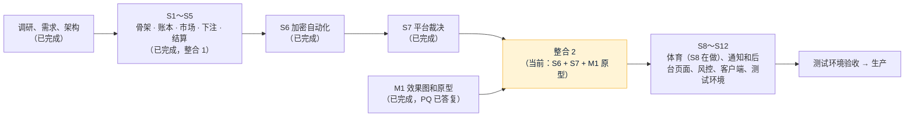

# 项目地图：forecast
- 用途：**新加入的人或大模型先读这一份**，10 分钟了解项目现在是什么样、代码在哪里、有哪些不能破坏的约定。要查具体的文件、接口、表、变量、历史问题，看《[项目索引](项目索引.md)》。
- 只写**当前状态**。按版本追加的文档（调研报告、架构方案、开发记录）是当时的记录；和本文件不一致时，以本文件和代码为准。
- 版本：v0.14（2026-10-25，对应代码：`claude/integration-2`（S6、S7、M1 原型，整合到 main 的第二个 PR），**当前阶段：S7 完成，整合 2**（S6 加密自动生成和自动裁决、S7 平台裁决 / 公示 / 争议 / 补偿、M1 效果图和原型合进一个 PR；Amos 对 PQ-1～PQ-5、SQ-12～SQ-14 的答复已写进需求说明书 v1.3 和架构方案 v1.4；**SQ-15、SQ-16 待 Amos 决定**）；下一步：S8 体育赛程 + 自动裁决（`claude/s8-sports`，在做），之后 S9 通知和后台页面）
- 维护：研发整合，各角色写自己的部分（C53）。**每次功能迭代，在同一个 PR 里更新本文件和《项目索引》**；`scripts/check-project-index.mjs` 检查索引（CI 的 `checks` 每次运行）。
- 名词：**复制源**指本项目 S1 复制的那个差价合约项目（远程 `staging` 分支提交 `2583328`）。代码和文档里提到它时一律写"复制源"，不写它的名字。
- 变更历史（整合时按时间合成一条；括号里是各分支当时用过的编号）：v0.1～v0.6（2026-10-24）调研、需求、架构阶段（FQ、RQ 全部答复，需求说明书 v1.1，架构方案 v1.0；另一条分支上的市场调研与推广策略 v1.0、v2.0 当时也记成了 v0.6、v0.7）；v0.7（2026-10-24）开发 S1：从复制源复制后端、三个前端、合约、端到端测试、部署和 CI，删除差价合约部分，改名，重建迁移基线（`开发记录/S1-复制骨架.md`）；v0.8（2026-10-25）开发 S2：账户三项（可用 / 下注锁定 / 提现冻结）、彩池流水类型、平台收入和补偿支出账户、不变量测试、单笔最小提现默认 100、品牌上线前沿用 Quick Come（`开发记录/S2-账本拆分.md`）；v0.9（2026-10-25）开发 S3：market 模块（市场、选项、状态机 17 条边、上架检查、补充说明、提前截止、费率修改和公开记录、截止和事件结束任务）、定时任务租约、e2e 可调时钟、参数设置接口（单笔最小提现改用 `betting_params:edit`）、需求第 2.2 节的 21 个权限点（`开发记录/S3-市场.md`）；v0.10（2026-10-25）开发 S4：pool 模块（下注事务、幂等、拒单原因、持仓、选项奖池、截止定格、`MarketPoolView` 的实现）、赔率和预计回报（前后端共用测试向量）、奖池推送 `/api/ws/markets`（每个市场每秒最多一次、Redis 广播）、我的下注、后台下注明细、客户端资金流水的下注类型、员工账户列、通知 #8、下注预压测（`开发记录/S4-下注奖池.md`）；v0.11（2026-10-25）SQ-8 修复（充值地址并发分配死锁，约定 34）和开发 S5：settle 模块（结算三段、三道防重复、事务边界参数 `forecast.settle.batch-size`（AQ-3 已定 B，默认 500）、取消作废全额退款、E14 / E15 / 提前截止的退回、彩池对账和结算异常）、超管手工结算的临时入口、批量记账和批量通知、通知 #11～#14、10,000 持仓压测（`开发记录/SQ-8-充值地址并发死锁.md`、`开发记录/S5-结算.md`）；v0.11.1（2026-10-25）钱包：ERC20、BEP20 充值地址只用 CREATE2 合约地址（Amos 2026-10-25），合约没配齐时这两条链暂未开通、告警 `deposit.evm`、不退回 xpub，删除以太坊体系 xpub，端到端用 anvil 部署出的合约参数，新增合约部署操作说明（约定 7、22、38，`开发记录/钱包-合约地址方案.md`、`部署方案/v1-归集合约部署.md`）；v0.12（2026-10-25）**整合**（C62）：把 `claude/s5-settle`、`claude/wallet-create2`、`claude/arch-v1.2`、`claude/req-v1.3`、`claude/market-strategy-v1` 和 main（《Amos 待办》v1.0～v1.7）合在一起，按代码和文档的实际情况重新整理本文件（各分支当时的 v0.11、v0.11.1、v0.7 合成这一版）。内容：需求说明书 v1.3（推广功能和事件、文章自动化，**Amos 审核通过**）、架构方案 v1.3（AQ-15～AQ-23 的结论、充值合约方案、推广功能按需求 v1.3 改写）、市场调研与推广策略 v2.2（**Amos 审核通过**）、`Amos待办.md`；**测试环境和复制源轮流用同一台测试服务器**（AQ-23，约定 39），测试环境的容器内存上限按 2 核 2 GB 重算（C75），部署工具包加 `preflight.sh`、`start.sh`、`stop.sh`（`部署方案/v1-测试环境与切换.md`）；v0.11（2026-10-25，`claude/m1-prototype` 分支上的编号）M1 效果图和原型：方向 A 清爽数据的设计 token，客户端 P1～P5、P9、P10 和登录、后台市场管理 / 规则模板 / 裁决台 / 参数设置（只在原型模式显示）、官网首页的 mock 原型，主题跟随系统，客户端和官网加繁体，25 张截图 `assets/v1/prototype/`（`开发记录/M1-原型.md`）；v0.12～v0.13（2026-10-25，`claude/s6-crypto`、`claude/s7-resolve` 分支上的编号，和 main 的 v0.12 重号）开发 S6：加密市场自动生成（按场次配置，默认节目化：BTC 1 小时每天 13:00 UTC 一场，MQ-1；滚动保留为可切换的选项）、resolve 模块（币安 / OKX / Coinbase 三个 K 线适配器、数据源网关：超时、有上限的退避重试、熔断、原始返回存档含 sha256；自动裁决：两源一致自动结算，不一致或拿不到每分钟重试、30 分钟后转人工）、已结算市场详情公开开始价、结束价、来源、迁移 V14、员工告警 `RESOLVE_AUTO_FAILED`（`开发记录/S6-加密自动化.md`）；开发 S7：resolve 的平台裁决（`resolve/platform/`：裁决台的提议、确认、退回、直接确认、作废、E6 延期 / E7 腰斩的等待、存档截图、时限和超时提醒；公示期满自动结算（带租约）；客户提交争议、维持 / 改判 / 无法判定后直接结算；客户端详情公开裁决信息）、settle 的结算预览和补偿（E13，只补不扣、平台补偿支出单列、报表）、**删除 S5 的临时入口"超管手工填结果直接结算"（SQ-10）**、迁移 V15、通知 #10、#15～#17 和三个员工提醒、9 个参数（`开发记录/S7-平台裁决.md`）；v0.14（2026-10-25）**整合 2**（C62）：把 `claude/s7-resolve`（含 S6）、`claude/m1-prototype` 合进 main，按代码和文档的实际情况重新整理本文件（各分支当时的 v0.11、v0.12、v0.13 合成这一版）：约定按 main 的 38、39 在前，S6、S7 的约定顺延为 40～45；原型的前端类型和模拟数据按 S5～S7 的后端接口调整；需求说明书 v1.3 记下 PQ-1～PQ-5、SQ-12～SQ-14 的结论和 AC-28 的新口径；架构方案 v1.4

## 一图看懂

这张图想说明：S1 搭了骨架（从复制源复制账户、KYC、账本、钱包、通知、后台权限，删除差价合约部分）；S2 把账本拆成彩池要用的三项余额和流水类型；S3 写了市场本身（建草稿、上架、暂停、取消、补充说明、提前截止、改费率，到点自动截止、事件结束进入待裁决）；S4 能下注了（钱锁进"下注中"、进选项奖池，赔率实时推给正在看的客户，截止时奖池定格），S5 能结算和退款了（超管先用临时入口手工填结果；输方奖池按比例分给赢方、对盈利抽成、尾差归平台，守恒校验通过才动钱；取消、作废全额退回；每天核对奖池和账本，对不上就停止派彩）；S6 让加密市场自己跑起来了（按模板的场次自动生成并直接上架；窗口结束 1 分钟后取币安和 OKX 的 K 线，方向一致就自动结算，不一致或拿不到每分钟重试、30 分钟后转人工）；S7 把其他市场的结果交给裁决台（裁决员提议结果 + 依据链接 + 截图 → 一个有权限的人确认 → 公示、争议窗口倒计时 → 到期没有争议自动结算；有下注的客户可以提争议 → 维持 / 改判后直接结算，无法判定作废；已结算后发现裁错由平台出钱补偿，只补不扣），S5 的"超管手工填结果直接结算"删掉了；体育在 S8；M1 按风格 A 做了客户端、后台、官网的原型和 25 张截图，Amos 已答复原型取舍（PQ-1～PQ-5 按现在的做法），页面在 S9（后台）、S11（客户端）按原型接真实接口（`技术方案/v1-架构方案.md` 第 1、16 节）。现在这一步是把 S6、S7、M1 整合成第二个 PR 合进 main；需求 v1.3 的推广功能和自动化程序排在后面。

## 1. 这个项目做什么
一个类似 Polymarket 的预测网站，玩法是**彩池（pari-mutuel）**：客户用 USDT 充值（ERC20 / BEP20 / TRC20，每人独立充值地址、扫块入账），把 USDT 押进某个市场某个选项的奖池；开奖后输方奖池按押注比例分给赢方，平台只对赢家的盈利部分抽成（默认 5%，每个市场都能在后台单独改，结算时按当时的费率算），不当对手方、不做市；再用 USDT 提现。规则全文见 `需求文档/v1-需求说明书.md` 第 3 节。

| 业务 | 版本 | 使用者 | 页面 | 接口 | 数据 |
|---|---|---|---|---|---|
| 账户、KYC | S1（复制源原样） | 客户、运营 | 客户端登录注册、我的；后台客户、KYC | 《项目索引》第 2.1、2.2 节 | `account_*` |
| 账户余额和流水 | S2（三项：可用、下注锁定（"下注中"）、提现冻结；平台收入、平台补偿支出两个账户；下注、结算等流水类型已定义，业务在 S4 起） | 客户、财务 | 客户端资产、资金流水；后台客户详情 | 第 2.3 节 | `ledger_*` |
| 充值、提现、自动审批、对账、归集 | S1（复制源原样，自动审批里和交易有关的规则 S1 过渡）；ERC20、BEP20 充值地址只用合约地址（v0.11.1，合约由 Amos 按 `部署方案/v1-归集合约部署.md` 部署，没部署前暂未开通） | 客户、运营、财务 | 客户端资产；后台资金 | 第 2.4、2.6 节 | `wallet_*` |
| 通知 | S1（模板只保留第一期用得到的） | 客户、员工 | 站内信、邮件、推送 | 第 2.5 节 | `notify_*` |
| 后台权限、审计、系统配置、参数设置 | S1；S3 按需求第 2.2 节加到 53 个权限点，加参数设置接口（品类默认费率 `fee:edit`；下注限额、争议窗口、KYC 阈值、单笔最小提现 `betting_params:edit`）；M1 参数设置页（接真实接口，菜单暂在原型模式） | 管理员 | 后台系统、参数设置 | 第 2.6 节 | `admin_*`、`common_config` |
| 市场 | S3（市场和选项（三语）、状态机 17 条边、上架检查、补充说明、提前截止、费率修改和公开记录、截止和事件结束任务、租约；后台和客户端接口）；M1 原型页面 | 客户、运营、超管 | 客户端市场列表、详情（M1 原型，客户端已接真实接口）；后台市场管理、规则模板（M1 原型，模拟数据） | 第 2.3a、2.6 节 | `market_*`、`common_job_lease` |
| 彩池：下注、持仓、奖池、赔率、推送 | S4（下注事务、幂等、11 种拒单原因、持仓、截止定格、赔率和预计回报（前后端共用测试向量）、奖池推送；接口）；M1 原型页面 | 客户、运营 | 客户端下注（手机抽屉、电脑右栏）、我的下注（M1 原型，已接真实接口；奖池推送还没接） | 第 2.3a、2.3、2.6 节 | `pool_*` |
| 结算、退款、彩池对账、补偿 | S5（结算计算和守恒、派彩和抽成、尾差归平台、取消作废全额退款、E14 / E15 / 提前截止的退回、每日彩池对账和结算异常；接口，页面待原型）；S7 加结算预览（守恒数字）、补偿（E13：只补不扣，平台补偿支出账户，报表单列），删除 S5 的临时入口"超管手工填结果直接结算"（SQ-10） | 客户、超管、财务 | 后台结算预览在裁决台原型里（M1，模拟数据）；补偿、报表页面 S9 | 第 2.6 节（`/api/admin/markets/{publicNo}/compensations` 等） | `settle_*` |
| 加密市场自动生成、自动裁决 | S6（自动生成模板按场次 / 滚动、生成即上架；三个 K 线适配器、数据源网关（超时、重试、熔断、存档）；两源一致自动结算、30 分钟后转人工；接口，页面待原型） | 运营、超管、裁决员、客户 | 客户端已结算详情的开始价、结束价、来源（M1 原型，类型已按 S6 接口）；后台模板页面 S9 | 第 2.6 节（`/api/admin/market-autogens` 等）、第 2.3a 节（详情的 `resolution`） | `market_autogen`、`market_template`、`resolve_*` |
| 平台裁决、公示、争议 | S7（裁决台：提议、确认、退回、直接确认、作废、E6 / E7 的等待、存档截图、时限和超时提醒；公示期满自动结算；争议：只有下注的人、每人一次、维持 / 改判 / 无法判定后直接结算；客户端详情公开裁决信息；接口，页面待原型：后台 S9、客户端 S11） | 客户、裁决员、超管 | M1 原型：客户端公示中 / 已结算的裁决信息和提交争议（P2、P10，类型已按 S7 接口）、后台裁决台（模拟数据）；正式页面后台 S9、客户端 S11 | 第 2.3a 节（`/api/markets/{publicNo}/disputes`）、第 2.6 节（`/api/admin/resolve/**`） | `resolve_case`、`resolve_dispute`、`resolve_attachment`、`resolve_record` |
| 体育赛程、体育自动裁决 | 计划（S8） | 运营、裁决员 | 见需求说明书第 4.2、4.3 节 | 架构方案第 2.4 节 | 架构方案第 3 节 |
| 推广功能（MF） | 需求 v1.3（Amos 2026-10-25 审核通过）定了范围，还没开发：来源统计、场次表和今日场次、不登录可看和搜索收录、分享卡片和挑战卡、开奖记录和周报、Telegram 机器人、等候页兼数据页、五种卡片按审定模板自动发布、增长数据 CSV；**不做返佣和分成**（MQ-5）。逐条结论见需求说明书第 1.5 节；架构落点见架构方案 v1.3 第 18 节 | 客户、Amos、运营 | 需求说明书第 5.2 节 P11～P15、第 6.2、6.3 节 | — | — |
| 事件和文章自动化程序 | 需求 v1.3 新增（Amos 审核通过，EQ-1～EQ-8 按建议），还没开发：事件草稿（赛程、经济日历、可选的热点新闻）、文章和帖子草稿（Gemini，中英文）、草稿箱由 Amos 一键审核发布；独立运行，不影响下注和资金（边界见架构方案 v1.3 第 18.3 节） | Amos、运营 | 后台"内容中心"（`需求文档/v1.3-事件和文章自动化.md` 第 7 节） | — | — |

核心流程（计划）：充值（三链扫块入账）→ 选市场、押注选项奖池 → 截止下注（最终赔率确定）→ 结果裁决（加密和比分自动；其他平台裁决：裁决员提议、有权限的人（默认超管）确认，公示 + 争议窗口）→ 结算派彩（对盈利抽成）→ 提现（白名单、冷静期、自动审批、签名上链）。现在（S7）从充值、下注到裁决、结算派彩、提现整条线都通了（端到端 `e2e/tests/settle.spec.ts`：提议 → 确认 → 公示 → 窗口到期 → 结算）；加密市场全自动（端到端 `e2e/tests/crypto.spec.ts`）；争议改判和补偿（端到端 `e2e/tests/resolve.spec.ts`）；取消、作废的市场全额退回。体育市场在 S8 之前也进裁决台人工裁决。

## 2. 代码怎么分层
| 目录 | 内容 | 角色 |
|---|---|---|
| `backend/` | 单体：Java 25、Spring Boot 4.1.1、MyBatis（XML）、Flyway、MySQL 8.4、Redis 7。包 `com.forecast.app`，模块 `common`、`ledger`、`account`、`wallet`、`notification`、`admin`、`market`（S3；S6 加 `autogen`）、`pool`（S4）、`settle`（S5）、`resolve`（S6）（`riskalert` 已在模块边界测试里登记，S10 建） | 研发 |
| `web/client/` | 客户端（React 18、Vite、PWA，手机和电脑两套结构）；S1 首页是占位 | 研发 |
| `web/admin/` | 管理后台（React 18、Ant Design） | 研发 |
| `web/site/` | 官网（首页、服务条款、隐私、风险披露；文案是占位，PM 在 S11 写） | 研发 |
| `contracts/` | 资金归集合约（Foundry；BitGo 转发合约原样 + 批量合约） | 研发 |
| `e2e/` | 端到端测试（Playwright）：主流程、官网、部署形态 | 测试 |
| `deploy/` | 镜像、Nginx、服务器上的部署工具包（沿用复制源；测试环境和复制源轮流用同一台服务器，内存上限、切换脚本 `preflight.sh`、`start.sh`、`stop.sh` 见 `部署方案/v1-测试环境与切换.md`；测试环境在 S12 第一次部署） | 运维 |
| `scripts/` | 索引检查、旧品牌名检查、模拟层检查、原型构建 | 研发 |
| `.github/` | CI（`ci.yml`）和三个前端共用的检查步骤 | 研发、运维 |

模块之间只通过对方的 `api` 包调用；改余额只能经 `ledger` 模块的 `LedgerApi`。

## 3. 环境
| 环境 | 分支 | 地址 | 数据 | 外部服务 |
|---|---|---|---|---|
| 本地 | 任意 | 后端 8080；前端 `npm run dev` | 本机 MySQL 8.4、Redis 7（测试库每次可以删掉重建） | 不配节点、SMTP 时只记日志 |
| 原型 | 开发分支 | 不部署：本地构建后截图交 Amos（AQ-12，架构方案第 9.5 节；`vercel.json` 留着不用）；本地 `bash scripts/build-prototype.sh` 后打开 `dist/`；M1 效果图在 `assets/v1/prototype/`（25 张） | 浏览器内模拟数据 | — |
| 测试 | `staging`（未建） | 未建。**和复制源轮流用复制源现在的测试服务器**（美国阿里云轻量 2 核 2 GB，`free -m` 总量 1,613 MB；AQ-23，Amos 2026-10-25："我还是会用同一台服务器，但是在跑当前系统时，我会停掉原来cfd的项目"），同一时间只运行一个项目，目录 `/opt/forecast`；域名 `fc-test`、`fc-test-admin`、`fc-test-www` `.quickcome.online`（SQ-4，DNS 先只开 DNS）；S12 第一次部署，按 `部署方案/v1-测试环境与切换.md`（约定 39） | 独立测试库（容器 MySQL，数据在 `/opt/forecast/data/`） | 区块链测试网（ERC20、BEP20 要等 Amos 部署测试网合约，WQ-1）；体育数据源免费档（AQ-17） |
| 生产 | `main` | 未建（AQ-15、AQ-16 已定：阿里云轻量新加坡单独一台 4 核 16 GB + Cloudflare 免费代理和 Access；容器 MySQL，binlog 和每日全量加密备份到 Cloudflare R2；上线前另写生产部署方案） | — | 区块链主网 |

## 4. 关键流程在哪里
| 流程 | 入口 | 核心代码 |
|---|---|---|
| 注册、登录 | `POST /api/auth/register`、`POST /api/auth/login` | `backend/src/main/java/com/forecast/app/account/auth/` |
| KYC | `POST /api/me/kyc`；后台 `POST /api/admin/kyc/{id}/review` | `backend/src/main/java/com/forecast/app/account/kyc/` |
| 充值入账 | 定时扫块 | `backend/src/main/java/com/forecast/app/wallet/deposit/DepositService.java` → `LedgerApi` |
| 提现 | `POST /api/wallet/withdrawals` → 冷静期 → 自动审批复判 / 人工审核 → 广播 → 确认 | `backend/src/main/java/com/forecast/app/wallet/withdraw/` |
| 改余额、记流水 | 客户：`LedgerApi.apply` / `applyAll`（一组变动同一事务）/ `applyBatch`（S5，一批客户：按 user_id 升序锁、结果和逐条相同）；平台：`PlatformLedgerApi.apply`；核对：`LedgerQueryApi.mismatches` | `backend/src/main/java/com/forecast/app/ledger/service/LedgerService.java`；流水类型规则 `ledger/api/LedgerEntryType.java` |
| 推给本人 | `UserEventsApi.send` → `WS /api/ws/user` | `backend/src/main/java/com/forecast/app/common/push/` |
| 市场：建草稿 → 提交上架 → 上架 → 暂停 / 恢复 / 取消 / 补充说明 / 提前截止 / 改费率 | 后台 `/api/admin/markets/**`（审计在 `admin/ops/MarketOps`） | `backend/src/main/java/com/forecast/app/market/core/MarketService.java`；状态机 `market/core/MarketStateMachine.java` |
| 市场：到点截止 → 事件结束进入待裁决 | 定时任务 `MarketClockJob`（5 秒 / 15 秒，带租约）；e2e 下 `POST /api/e2e/markets/tick` | `MarketService.closeDue()`、`endDue()`；下注前的截止屏障 `MarketApi.lockForBet`（S4 调用） |
| 市场列表、详情（客户端） | `GET /api/markets`、`GET /api/markets/{publicNo}` | `backend/src/main/java/com/forecast/app/market/web/MarketController.java`、字段 `market/core/ClientViews.java`；奖池部分（`pool` 字段）由 pool 模块给：`pool/bet/PoolQueries.java`、字段 `pool/bet/PoolViews.java` |
| 下注 | `POST /api/markets/{publicNo}/bets` → 市场行共享锁（截止屏障）→ 金额、客户检查 → 账户行排他锁 → 幂等、上限、余额 → 记账"下注锁定" → 下注 → 通知 #8 → 持仓 → 选项奖池原子加 → 提交后推送 | `backend/src/main/java/com/forecast/app/pool/bet/BetService.java` |
| 赔率、预计回报 | 后端 `Odds`、`PoolMath`；客户端 `web/client/src/lib/pool.ts`；共用测试向量 `backend/src/test/resources/pool/pool-vectors.json`（生成 `scripts/gen-pool-vectors.py`） | `backend/src/main/java/com/forecast/app/pool/api/` |
| 奖池推送 | 事务提交后 `PoolChanges.afterCommit` → 本机标记 + Redis 广播 → `PoolPush` 每 200 毫秒看一次、每个市场每秒最多推一次 → `WS /api/ws/markets` | `backend/src/main/java/com/forecast/app/pool/push/` |
| 截止时定格奖池、有效选项、下注客户名单 | market 截止事务里调 `MarketPoolView`（pool 实现） | `backend/src/main/java/com/forecast/app/pool/bet/PoolMarketView.java` |
| 我的下注、后台下注明细 | `GET /api/me/bets`；`GET /api/admin/markets/{publicNo}/bets`（`bet:view`） | `pool/bet/PoolQueries.java`、`admin/ops/BetAdminController.java` |
| 结算（S5） | 裁决台确认的结果公示期满 / 争议处理完、自动裁决成功 → `resolve.api.ResultHandler`（settle 实现）→ `SettleService.settle`（S7 起可以要求市场"正好在某个状态"，公示期满的结算和提交争议在市场行锁上只生效一个）：锁市场 → 结算前对账 → E14 / E15 退回 → `SettleMath` 算 → 守恒校验 → 结算单和明细 → 派彩（batch-size 0 同一事务；大于 0 由 `PayoutWorker` 分批）→ 收尾（尾差入平台、按账本复核、已结算） | `backend/src/main/java/com/forecast/app/settle/run/SettleService.java`、`settle/api/SettleMath.java` |
| 取消、作废的全额退款；E14、提前截止后的退回 | market 进入已取消 / 已作废的同一事务 → `SettleMarketListener.onRefundRequired` 建退款单；`onCloseAdvanced` 当场退回新截止时间之后的下注 | `settle/run/SettleMarketListener.java`、`SettleService.createRefundRun`、`refundNow`；退回下注 `pool/bet/PoolSettle.markRefunded` |
| 彩池对账、结算异常 | 每天 UTC 00:30 `PoolReconJob`；e2e 下 `POST /api/e2e/settle/recon`；差异 `/api/admin/pool-recon/issues`，处理后 `/api/admin/settle/runs/{runNo}/retry` | `settle/recon/PoolReconService.java`；停止派彩 `SettleService.payOneBatch` / `pause` |
| 通知 | `NotifyApi.toUser`；一批客户用 `toUsers`（S5，结果和逐个发相同）→ 任务表 → 邮件、推送 | `backend/src/main/java/com/forecast/app/notification/service/` |
| 加密市场自动生成（S6） | 后台 `/api/admin/market-autogens/**`（建、改（只能在关闭时）、关：`market:autogen`；启用：`market:publish` + 勾选检查）→ 生成任务 `CryptoAutogenJob`（每分钟，租约 `market.autogen`；e2e 下 `POST /api/e2e/autogen/tick`）→ 每个窗口一个事务：模板行共享锁 → 插入 → 必填项检查 → 直接上架 | `backend/src/main/java/com/forecast/app/market/autogen/AutogenService.java`、窗口计算 `AutogenWindows.java`、`market/core/MarketService.createGenerated` |
| 加密自动裁决（S6） | 进入待裁决时建进度（`ResolveMarketListener`）→ `CryptoResolveJob`（每 15 秒，租约 `resolve.crypto`；e2e 下 `POST /api/e2e/resolve/tick`）→ 窗口结束 + 1 分钟：事务外并行取币安、OKX（网关：超时、重试、熔断、存档）→ `CryptoDecision` 判定 → 一致：记结果 → `ResultHandler`（settle 实现）结算；不一致或拿不到：每分钟重试，30 分钟后 MANUAL + AUTO_FAILED + 告警 | `backend/src/main/java/com/forecast/app/resolve/auto/CryptoResolver.java`、`resolve/source/SourceGateway.java`、适配器 `resolve/source/BinanceSpot.java`、`OkxSpot.java`、`CoinbaseSpot.java` |
| 裁决依据（S6） | 客户端详情 `GET /api/markets/{publicNo}` 的 `resolution`（已结算才有：开始价、结束价、来源）；后台 `GET /api/admin/markets/{publicNo}/resolution`（进度、记录、原始返回）、`/api/admin/resolve/auto-failed`（转人工的） | `resolve/auto/ResolutionViews.java`、`resolve/auto/ResolveAdmin.java` |
| 平台裁决（S7） | 市场进入待裁决（平台裁决的、体育在 S8 之前）或加密自动裁决转人工 → 建进度 `resolve_case`（`CaseBook`）→ 裁决台 `/api/admin/resolve/cases/**`：提议（`resolve:propose`，依据链接 + 截图 + 理由；或提议作废）→ 确认（`resolve:confirm`★，作废还要 `resolve:void`）或退回；也可以直接确认 → 公示中（拟定结果、争议截止时间、通知 #10）→ `PlatformJob`（每 15 秒，租约 `resolve.publicity`）窗口到期没有争议 → `ResultHandler.settle(…, PUBLICIZING)` | `backend/src/main/java/com/forecast/app/resolve/platform/ResolveDesk.java`、`PublicityService.java`；审计 `admin/ops/ResolveOps.java` |
| 争议（S7） | 客户 `POST /api/markets/{publicNo}/disputes`（有效持仓、每人一次、收到时间 < 争议截止时间；第一个争议 → 争议中）→ 后台 `/api/admin/resolve/cases/{publicNo}/disputes/decide`（`dispute:handle`★：维持 / 改判 → 直接结算，无法判定 → 作废）；结论公开在详情的 `resolution.dispute`，不显示争议人 | `ResolveDesk.dispute`、`decideDisputes`；公开信息 `resolve/platform/PlatformViews.java` |
| 时限和提醒（S7） | `PlatformJob` 每分钟（租约 `resolve.timeouts`）：E6 / E7 等满 48 小时 → 作废；待提议 / 待确认 / 争议处理超时 → 邮件 `RESOLVE_OVERDUE`（每项一次；裁决台标红 `overdue`）；时限在参数设置（`resolve.*`、`dispute.handleMinutes`） | `PublicityService.holdsDue`、`remindOverdue`；`PlatformParams.java` |
| 补偿（S7，E13） | 后台 `GET /api/admin/markets/{publicNo}/compensation-preview` → `POST …/compensations`（`settle:compensate`★）→ 客户 `COMPENSATION`、平台补偿支出 `COMPENSATION_EXPENSE`（可为负）、通知 #17；报表 `/api/admin/reports/settle`（收入和补偿支出分开） | `backend/src/main/java/com/forecast/app/settle/comp/CompensationService.java` |

## 5. 不能破坏的约定
1. 平台不当对手方：每个市场结算后 派彩合计 + 抽成合计 + 尾差 = 奖池合计，平台在任何市场上的变动只有抽成和尾差（需求说明书第 3.5 节）。律师、牌照、合规问题 Amos 已处理，不再讨论。
2. 密钥（热钱包私钥、归集发起账户私钥、VAPID 私钥、SMTP 密码、数据源 key、数据库密码）只由 Amos 填在服务器 `.env` 上，不进仓库、不经过 AI、不进日志（agents C21）。仓库里不出现任何密钥的值（CI 的 gitleaks）；测试里的假值用 `ci_only_` 开头。
3. 金额只用 `BigDecimal` / `DECIMAL(24,8)`，不用浮点；舍入只在需求第 3.5 节规定的三处（S2 起）。
4. 余额每次变动和对应的账本记录必须在同一个数据库事务里：客户的钱只通过 `LedgerApi`、平台账户只通过 `PlatformLedgerApi` 改（`ledger` 模块），**任何时刻每个账户每一项的账本合计 = 这一项的金额**（`LedgerQueryApi.mismatches()`，`LedgerInvariantTest` 并发随机测试）。账户三项：可用 `available`、下注锁定 `bet_locked`、提现冻结 `withdraw_frozen`，都不能为负（数据库 CHECK 兜底）；只有平台补偿支出账户的可用可以为负。每种流水类型只能用在规定的账户、项和方向（`LedgerEntryType`，不符合直接拒绝）；同一笔业务动两项时（例如下注：可用 −b、下注锁定 +b）用 `applyAll` 放在同一个事务。幂等键 `biz_type`+`biz_id`+`entry_type`+`bucket` 只记一次，同一个键换了账户或金额是程序错误。金额为 0 的记录不能记（抽成为 0 时不记 FEE）。`ledger_entry` 只增不改。可提金额 = 可用余额；冲正只扣可用余额（不动下注锁定和提现冻结）；客户看到的"余额" = 可用 + 下注锁定。
5. 模块之间只通过对方的 `api` 包调用，由 ArchUnit 测试强制（`backend/src/test/java/com/forecast/app/arch/`）；表名以模块名开头，只由该模块读写。
6. 表结构只通过 Flyway 迁移脚本修改，**已合并的脚本不再改**（S1 的基线 V1～V5 合并后同样不改，以后只加新脚本；现在到 V15，下一个是 V16）。
7. 服务器上不放充值地址的私钥：TRON 只放 xpub；ERC20、BEP20 的充值地址是 CREATE2 合约地址，服务器只有四个公开的合约地址和归集发起账户（只付手续费、转不走钱），**没有以太坊体系的 xpub**（约定 38）。只扫描配置好的 USDT 合约，合约未配置时扫块不启动。
8. 提现只有在确定交易没上链时才退款（节点明确拒绝、链上执行失败、TRON 过期查不到）；连不上节点、超时都不退款。
9. 提现自动审批：规则只决定"要不要人工看"，不能放宽冷静期、大额延迟、白名单生效、单笔和当日限额；**总开关默认关闭**；规则出错或数据读不到 → 转人工，不能因为出错放行；前后端规则定义（`wallet/api/AutoApprove.java`、`web/admin/src/config/autoApprove.ts`）改一边要同时改另一边。S1 删除差价合约后，R8（充值后交易量）、R9、R13 的交易数据暂时记为 0（有充值的客户 R8 一定转人工），S10 按下注口径重写（S2 已定义好要用的流水类型，`开发记录/S2-账本拆分.md`）。单笔最小提现 `withdraw.minAmount` 默认 100（RQ-16），**必须大于每条链的提现手续费**：后台改最小金额或手续费时都检查（`admin/system/SystemService`，不满足时指出是哪条链）；S3 起最小金额在参数设置里改（`betting_params:edit`），手续费仍在系统配置页（`config:edit`）。
10. 通知要和业务在同一个事务里写（在业务事务里调用 `NotifyApi`），业务回滚就不发；邮件失败不能影响业务，也不进健康检查的 `status`。
11. 健康检查的 `status` 只表示"应用活着"（数据库、Redis、模块配置）；外部服务（链节点、邮件、归集）的故障只进 `alerts` 和告警邮件（`common.health.AlertCheck`），不能让 `status` 变成 DOWN；`alerts` 只给后台域名和本机。告警邮箱没有默认值，由 Amos 填。
12. 每个后台接口都必须声明权限点（`@RequiresPermission`）或标明只要登录（`@AdminLoginOnly`）；权限点、菜单和后台前端（`web/admin/src/config/`）保持一致（现在 53 个，后端 `AdminSystemTest` 核对）。参数设置的项不在系统配置页（`ConfigKey.params`）：费率组要 `fee:edit`、其余要 `betting_params:edit`，不能让 `config:edit` 绕过去改。
13. 端到端测试的替身和 `/api/e2e/**` 只在 Spring profile `e2e` 下存在；测试环境和生产绝不能设 `SPRING_PROFILES_ACTIVE=e2e`、`FC_E2E_ENABLED`，也不能用 `e2e/compose.deployed.yml`。新加替身时类名以 `E2e` 开头、标 `@Profile(E2eGuard.PROFILE)`。
14. 写请求只接受本站页面发起、`/api/` 路径不能带分号（`common/web/CrossSiteGuard`）：不要关掉，也不要给前端开发代理加 `changeOrigin`。Nginx 客户端域名拦截后台和端到端测试接口用正则（`deploy/nginx/site.conf.template`）。
15. 真实接口模式的前端构建产物里不能有原型模拟层（`src/mocks/`）：`src/api/` 只能按编译期常量 `IS_MOCK` 选用模拟层；CI 的 `scripts/check-no-mocks.mjs` 检查。
16. 限流：IP 只用 `request.getRemoteAddr()`（Nginx 传来的真实 IP）；Redis 不可用时必须放行；客户端的写接口（下注、提交争议（S7）、提现、白名单）要标 `@UserWriteLimited`（`RateLimitTest` 列出了全部接口）。测试和 e2e profile 调大的上限不能用在测试环境和生产。
17. 品牌和域名：**上线前沿用 Quick Come 名称和 `quickcome.online` 的子域名；正式上线前改为独立品牌和域名，隔离要求（服务器、数据库、钱包、发信域名、推送密钥等和复制源分开）不变**（Amos 2026-10-25 原话："我有起名困难症，所以很多项目在上线前我都会用 quick come这个名字，域名也会用quickcome.online的子域名，只有正式上线时，才需要改名和域名，这点可以记下来 我总会这样做"；需求说明书 v1.2、架构方案 v1.1 第 15 节）。测试环境子域名是 `fc-test`、`fc-test-admin`、`fc-test-www`（SQ-4，`部署方案/v1-测试环境与切换.md` 第 8 节），**不能和复制源已用的 `test-app` 等子域名重复**；Cookie 不设 `Domain`。品牌名只写在 `web/*/src/lib/brand.ts`、各前端 `index.html`、PWA 名称（`web/client/vite.config.ts`）、`web/client/public/push-sw.js`、通知模板里。复制源的旧品牌名不能出现在仓库里（`node scripts/check-brand.mjs --repo`）、前端构建产物里（`scripts/check-brand.mjs dist`）、后端模板和代码里（`BrandTextTest`），名单在 `scripts/brand-check.json`；**Quick Come 的检查在那里关着，正式上线改名时打开**。通知模板是运营可改的数据：改品牌用新迁移，只改仍等于原始默认文字的模板（V8 的做法）。
18. 对外编号（提现、充值，以后的下注）是雪花 ID，**接口里一律字符串**，前端只当字符串用；节点号 `FC_ID_NODE` 多实例时必须不同。
19. 追踪号只接受 `[A-Za-z0-9._-]{8,64}`；Nginx 必须用 `$request_id` 覆盖客户端带的 `X-Request-Id`。
20. 日期输入：已知日期（出生日期等）一律用三框组件 `DateFields`（客户端、后台各一份，`dateParts` 逻辑改一边要同时改另一边）；接口里是 `YYYY-MM-DD` 字符串。
21. 客户密码规则前后端一致：8–64 位，至少一个字母和一个数字（后端 `account/auth/AuthRequests.java`，客户端 `web/client/src/lib/validators.ts`）。
22. 资金归集：`contracts/lib/` 下的 BitGo、OpenZeppelin 源码一行不能改（`lib/SHA256SUMS` 在 CI 核对）；批量合约保持"碰不到钱"、覆盖率 100%；充值地址的盐（keccak256("forecast-deposit" ‖ 用户ID)）在 Java（`wallet/address/Create2`）、合约和测试向量三处一致；**`FC_SWEEP_EVM_*` 四个地址填了以后不要改**（它们决定 ERC20、BEP20 每个客户的充值地址，约定 38）；归集不写账本、不改客户余额，出错只进 `alerts`。
23. 默认语言：客户端和官网都跟随浏览器语言（`zh-TW`、`zh-HK`、`zh-MO`、`zh-Hant` 用繁体，其他 zh 用简体，其他英文；RQ-18，M1 起三种；繁体是自动转换加人工修改，等懂繁体的人校对，PQ-5）；客户自己选过的记住、优先（客户端 `web/client/src/i18n/urlLang.ts`、官网 `web/site/src/i18n/lang.ts` 同一规则）。三份翻译文件键名一致（各前端 `i18n.test.ts`）；后台只有中英文。
24. CI 按改动路径跑（`.github/workflows/ci.yml`）：push 到 staging、main 必须全部都跑；新增目录或 job 时在 `changes` 的过滤规则里加路径，并把 job 加进 `ci-ok` 的 `needs`；不要改检查名字。
25. 单实例部署，但代码按多实例写：不在内存里放只有一份的业务状态，推送靠 Redis 广播（S4 起：奖池变化经频道 `fc:pool:changed`，Redis 不可用时只推本实例，不影响下注），**新的定时任务都先拿数据库租约**（`common/job/JobLease.runExclusive`，表 `common_job_lease`），任务本身还要是幂等的（条件更新），租约意外失效时重复执行也没有效果（架构方案第 5.3 节）。
26. 市场状态（S3）：**只允许 17 条边**（`market/core/MarketStateMachine`，需求第 3.2 节的图），其余一律 409 `ILLEGAL_TRANSITION`（AC-10，`MarketStateMachineTest` 穷举 100 种组合）；每次跳转是带旧状态的条件更新（`WHERE status = 旧状态`），同一事务写 `market_status_log`；别的模块只能经 `MarketApi.transition` 改状态，不能直接改表。进入取消、作废时同一事务通知 `MarketListener.onRefundRequired`（settle 在这里建退款单，S5）。
27. 市场上架后**题目、选项、时间、裁决来源不能改**（Mapper 的修改语句都带 `status = 'DRAFT'`，AC-12）；只能发补充说明（截止前）、提前截止（只能提前）、改费率（结算开始前，写 `market_fee_change`，上架后改的发 #22）。`market_status_log`、`market_clarification`、`market_fee_change` 只增不改（`MarketAppendOnlyTest`）。费率在库里是小数（0.0500），接口里一律是百分比字符串（"5"）。
28. 截止判定只看服务器收到请求的时间：`openAt ≤ receivedAt < closeAt`，正好等于截止时间的拒绝（AC-15）。下注事务必须先调 `MarketApi.lockForBet`（市场行共享锁），截止任务拿排他锁，这样截止时奖池里只有截止前已经提交的下注（架构方案第 4.2、5.2 节）。market 不依赖 pool / settle：截止时要的奖池信息由 pool 实现 `MarketPoolView` 提供（没有实现时按"没有下注"处理）。
29. 所有"现在"都来自注入的 `java.time.Clock`：后端测试用 `support/MutableClock` 往前拨，端到端测试用 e2e profile 下的 `/api/e2e/clock/*`（只在 e2e 下存在）。拨过时钟会让后台会话过期（30 分钟无操作），测试要重新登录并在结束时 reset。
30. 下注（S4）：**一笔下注一个事务，三把锁固定顺序**：市场行共享锁（`MarketApi.lockForBet`）→ 客户账户行排他锁（`LedgerApi.lock`）→ 选项奖池原子加（最后一条语句）；单客户单市场上限、请求号查重都在账户行锁之内读。事务用 **READ COMMITTED**（`BetService`）：可重复读的快照可能停在加锁之前，上限会算错，持仓的二级索引上还会加间隙锁。别的操作要同时锁这几样时按同一个顺序（截止任务：市场行排他锁；提现：只锁账户行）。改了下注事务要跑 `BetConcurrencyTest`（AC-18、截止竞争、死锁检查）。请求号 `clientReqId` 同一客户唯一：重复提交返回第一次的结果，换了内容 409。下注不能撤销（RQ-2）。
31. 赔率、预计回报的规则前后端各一份（后端 `pool/api/Odds.java`、`PoolMath.java`；客户端 `web/client/src/lib/pool.ts`），**改一边必须改另一边，并重新生成共用的测试向量**（`python3 scripts/gen-pool-vectors.py > backend/src/test/resources/pool/pool-vectors.json`，两边的向量测试都要过）。舍入只在需求第 3.4、3.5 节写明的地方：盈利向下取整、抽成四舍五入、预计赔率向下取整、概率四舍五入，`<1%`、`>99%`、`—` 的规则在 `Odds.percent`。
32. 奖池推送每个市场每秒最多一次（合并），从变化到推出 ≤ 约 1.2 秒（AC-17 要求 2 秒内）；推送内容和市场详情的 `pool` 字段同一个结构，不含本人的持仓。下注事务里只在提交后标记变化（`PoolChanges.afterCommit`），不在事务里推送。
33. MySQL 驱动开着 `useLocalSessionState`（`application.yml` 的 `spring.datasource.hikari.data-source-properties`，S4 下注预压测加的）：会话状态（autocommit、隔离级别、只读）只能经驱动的方法改，**代码里不要直接执行 `SET SESSION …`**，否则驱动记的状态和服务器不一致。
34. **不要对可能不存在的行做加锁读**（`SELECT … FOR UPDATE / FOR SHARE` 查一个还没有的键）：可重复读下加的是间隙锁，并发插入时互相等待就死锁（SQ-8：充值地址分配，`开发记录/SQ-8-充值地址并发死锁.md`）。要"没有就插入"时先普通读、再 `INSERT IGNORE` 靠唯一键兜底；要串行化就锁一行确定存在的行（例如客户账户行）。**`UPDATE … WHERE 主键 = 一个还没有的键` 在可重复读下同样加间隙锁**（market 的状态跳转事务是默认的可重复读）：先普通读确认有这一行再改（整合 2：`CaseBook.sync`，`CaseBookGapLockTest`）。同理，**先加锁、再读**：要锁的行先用加锁读拿到（`MarketService.lock(publicNo)` 直接 `lockByPublicNo`），不要先普通读一次（可重复读的快照会停在加锁之前，后面的普通读看不到锁等待期间刚提交的数据，S5 发现）。
35. 结算（S5）：**同一市场只结算一次**，三道防重复缺一不可：`settle_run` 唯一 `(market_id, kind)`、明细 PENDING → DONE 条件更新（改的行数不对整批回滚）、账本幂等键（`SETTLE` / `REFUND` : 明细 id，平台抽成 `SETTLE_FEE`、尾差 `SETTLE_RUN`）。加锁顺序：市场行 → 结算单行 → 客户账户行（user_id 升序）→ pool 的行 → 平台账户行，事务用 READ COMMITTED；一个事务里要记几次账时先 `LedgerApi.lockAll` 按升序锁齐。**守恒校验（ΣPay + ΣF + D = T、0 ≤ D < 0.01 × 赢方持仓数）不通过、结算前对账不平、对账发现这个市场有差异，一律不动钱、停在"结算异常"（`settle_phase = ABNORMAL`）、告警**，处理完差异后在后台重试；不要绕过。`settle_item`、`settle_refund_item` 的金额写入后不改，结算相关的表不删行（`SettleAppendOnlyTest`）。改了结算要跑 `SettleIdempotencyTest`（AC-23、中途崩溃续跑）、`SettleConcurrencyTest`（死锁检查）、`SettlePropertyTest`（守恒）。
36. 结算的事务边界由 `forecast.settle.batch-size`（`FC_SETTLE_BATCH_SIZE`）决定：**默认 500 = 先算好、落结算单，再每批 500 个持仓一个事务、`PayoutWorker` 推进、可以续跑**（AQ-3 已定：B，Amos 2026-10-25）；0 = 计算、派彩、收尾在同一个事务（保留为可配置项，会锁住全部下注客户的账户几秒，见 `开发记录/S5-结算.md` 第 6 节）。后端测试配置固定 0，settle 的用例参数化切到分批。两种模式的结果必须完全相同：新加的结算用例要两种都跑（参数化 0 和 2）。
37. 批量接口和逐个接口写出来的必须完全一样：`LedgerApi.applyBatch` 对 `apply`（`LedgerBatchTest` 比较金额和 `value_after` 序列）、`NotifyApi.toUsers` 对 `toUser`（`NotifyBulkTest` 比较站内信、记录、任务）；改了其中一边要同时改另一边。
38. **ERC20、BEP20 的充值地址只用 CREATE2 合约地址**（Amos 2026-10-25："钱包地址的产生和分配，用我们之前已经调研过的智能合约方案"；`开发记录/钱包-合约地址方案.md`）：`FC_SWEEP_EVM_FACTORY / IMPLEMENTATION / PARENT / BATCHER` 没配齐或检查不通过时这两条链**"暂未开通"**（不分配、`GET /api/wallet/addresses` 不返回、客户端显示"充值暂未开通"），**不能退回 xpub 派生，也不要为了测试加回以太坊体系的 xpub**；缺配置只在健康检查 `alerts` 的 `deposit.evm` 里报（`wallet/address/EvmDepositAlert`），**不能做成 `HealthCheck`**（`status` DOWN 会让部署回滚，约定 11）。后端测试默认配了假合约地址，端到端（`application-e2e.yml`）配的是 `contracts/script/anvil-e2e.sh` 在 anvil 上部署出的固定地址，链替身只记转账、不模拟合约；合约本身在 `sweep-anvil` 里测。TRON 不能用这套 EVM 合约，维持方案 B（xpub 派生 + 离线签名归集，下一阶段租能量）。合约部署由 Amos 按 `部署方案/v1-归集合约部署.md` 在自己电脑上做，Safe、部署账户、发起账户都和复制源分开（NF-11），测试网和主网各一套（WQ-2）。
39. **测试服务器和复制源轮流使用，同一时间只运行一个项目**（AQ-23，`部署方案/v1-测试环境与切换.md`）：两个项目都要 80、443、127.0.0.1:8080，内存也只够一个。①测试环境的容器上限按这台 2 核 2 GB 机器算总账（C75，`deploy/kit/docker-compose.yml` 开头的说明、部署方案第 3 节）：`web` 32 + `app` 576 + `mysql` 320 + `redis` 64 = 992 MB，`memswap_limit` 等于 `mem_limit`；**改任何一个上限、JVM 参数（compose 里的 `JAVA_TOOL_OPTIONS`）、Tomcat 线程数、连接池大小，都要同时改部署方案第 3 节的表，并让合计加系统 450 MB 仍然低于 1,613 MB、余量不少于 150 MB**（`preflight.sh` 里的 `CONTAINERS_MB` 一起改）；镜像 `deploy/app.Dockerfile` 的默认 JVM 参数保持和复制源一样，不按测试环境改。②启动本项目前必须确认另一个项目的容器和 deploy / backup 定时器都停了（`preflight.sh`，不通过不启动）；切走用 `stop.sh`，只停止、不删数据。③两个项目的数据目录、备份、`.env`、证书都分开，**任何脚本和文档里的命令都不能删 `/opt/*/data`、不能 `docker compose down -v`、`docker system prune --volumes`**。④`deploy/kit/` 的脚本里不写复制源的名字和服务器 IP（品牌检查会拦），按"别的项目的容器、定时器"通用地判断。生产是新加坡单独一台（AQ-15），不受这条限制。
40. **外部接口（S6 起数据源）一律走 `common/http/ExternalHttp` + `resolve/source/SourceGateway`**（agents C81）：连接超时、读取超时（读完响应体的总时长）、响应体上限、有上限的退避重试（只重试超时、连不上、断开、5xx、429、408）、熔断；**不能在数据库事务里调用**（网关直接报错：先在事务外取数、存档，再开事务结算）；**每次调用和每次熔断跳过都写一行 `resolve_source_fetch`（原文 + sha256，只增不改、永久保留）**，存档失败的数据不能用来结算。数据源的故障只进健康检查的 `alerts`（`source.binance`、`source.okx`），不影响 `status`（约定 11）。
41. 加密自动生成（S6）：按模板生成的市场**直接上架**（不经过"提交上架"，状态历史 actor `AUTOGEN`），所以**模板启用前必须由 `market:publish` 的人检查一次、启用中的模板（含它用的规则文本模板）不能改**，改了要关闭、改完重新检查启用；开放 / 截止提前量用参数设置（`betting_params:edit`）、费率用品类默认值（`fee:edit`），不要放进模板。同一模板同一窗口只有一个市场（唯一键 `uk_market_autogen_window`，生成时先锁模板行（共享）再插入，关闭提交以后不再生成）。默认模板（BTC 1 小时、每天 13:00 UTC，MQ-1 节目化）新库里是关闭的。
42. 加密自动裁决（S6）：**两个来源方向一致才自动结算**（收盘 = 开盘判涨；正好相等导致方向不同时以首选（币安）为准；Coinbase 只在主备一方拿不到时补位）；不一致或拿不到每分钟重试，第一次取数（窗口结束 + 1 分钟）后 30 分钟仍不行转人工（进度 MANUAL、裁决记录 AUTO_FAILED、告警），**市场留在待裁决**、进 S7 的裁决台（"自动裁决失败"）由人处理。进度 `resolve_auto_task` 的改动都是带旧状态（和版本号）的条件更新；结果先记下（RESOLVING）再调结算（`resolve.api.ResultHandler`，settle 实现，结算本身幂等），崩溃后下一轮接着结算、不再取数。resolve 不依赖 settle 的内部类，market 不依赖 resolve（详情的 `resolution` 由 resolve 实现 `MarketResolutionView`）。
43. 平台裁决（S7）：**结果只能经裁决台进入公示，再由公示期满或争议处理交给结算**（S5 的"超管手工填结果直接结算"已删除，SQ-10，不要加回来）。一个有权限的人就能完成每一步（RQ-17，不检查提议人和确认人是不是同一人）；确认、退回、直接确认、处理争议、作废、补偿是高危（原因必填，确认类还要勾选），审计在 `admin/ops/ResolveOps`、`SettleOps`。写操作都是：**市场行锁（`MarketApi.lockPlatform`）→ 进度行锁 → 争议行 → 结算自己的锁**，READ COMMITTED。公示期满的结算必须用 `ResultHandler.settle(…, PUBLICIZING)`（市场"正好在公示中"才开始），提交争议必须检查"结算还没开始（`settle_phase = NONE`）且收到时间 < 争议截止时间"——两者在市场行锁上排队，只有一个生效（`PlatformConcurrencyTest`）。同一客户同一市场一个争议（唯一键）。`resolve_record`、`resolve_attachment` 只增不改（`ResolveAppendOnlyTest`）；每一步一条裁决记录。公开信息（详情的 `resolution`）**不显示争议人和管理员姓名**，只有裁决人编号（管理员 id / `AUTO` / `SYSTEM`）。
44. 状态跳转后 resolve 的监听（`ResolveMarketListener` → `CaseBook.sync`）在同一事务里同步进度行的阶段（没有进度行时先普通读、直接返回，不 UPDATE 不存在的行，约定 34）；新加触发平台裁决边的地方只能经 `MarketApi.publicize` / `transition`，不要直接改 `resolve_case.stage`。
45. 补偿（S7，E13）：**只补不扣、不回滚已派的钱**，每个市场只补偿一次（唯一键），按原结算单的持仓和费率算"应得 − 实际"（只取 > 0，按客户合计；正确结果是作废或正确选项没人押时应得 = 本金）；客户 `COMPENSATION`、平台补偿支出账户 `COMPENSATION_EXPENSE`（唯一能为负的账户）在同一事务；报表里平台收入（抽成 + 尾差）和补偿支出分开列，不相互冲减。`settle_compensation*` 只增不改（`SettleAppendOnlyTest`）。
46. 主题和配色（M1）：方向 A 清爽数据（AQ-6），颜色只用 token（客户端 `web/client/src/styles/tokens.css`、官网 `web/site/src/styles/tokens.css`、后台 `web/admin/src/theme.ts` 和 `styles/global.css`），新样式不写死颜色；蓝色主色只表示主操作、选中、概率，涨跌和赢输用绿红；**二选一只有加密"涨 / 跌"用绿红，"大 / 小""是 / 否"等用中性色；固定绿涨红跌，没有"红涨绿跌"切换**（PQ-1、PQ-4，Amos 2026-10-25"PQ 按现在的"）。主题默认跟随系统（`fc.theme` 没有值 = 跟随系统）。不放跑马灯和闪色动画（C84）。
47. 后台的 M1 原型菜单（市场管理、裁决台、参数设置）在 `web/admin/src/config/protoMenu.tsx`，只在原型模式加到菜单：后端 `AdminSystemTest` 核对 `menu.tsx` 的 `MENU` 和 `Menus.java` 一致，**不要把这三项直接写进 `MENU`**，正式开发时连同 `Menus.java` 和迁移一起加。
48. 前端的接口类型和模拟数据**以后端接口为准**：M1 原型里标"M1 提议"的结算、裁决、争议字段，整合 2 时已按 S5～S7 的后端字段改（客户端 `web/client/src/api/types.ts`、后台 `web/admin/src/api/types.ts`）；以后后端改了字段，同一个 PR 里改前端类型、模拟数据和真实接口实现，`check-no-mocks` 保证模拟层不进产物。

## 6. 常用命令
| 做什么 | 命令 |
|---|---|
| 安装 | `npm ci --prefix web/client`、`npm ci --prefix web/admin`、`npm ci --prefix web/site`、`npm ci --prefix e2e`；后端需要 JDK 25 和 Maven；合约 `git submodule update --init` 后用 Foundry |
| 后端测试 | 先起 MySQL 8.4 和 Redis 7（例如 `docker run -d -p 3306:3306 -e MYSQL_ROOT_PASSWORD=<本机密码> -e MYSQL_DATABASE=forecast_test mysql:8.4`、`docker run -d -p 6379:6379 redis:7`），设 `FC_DB_URL`、`FC_DB_USERNAME`、`FC_DB_PASSWORD`、`FC_REDIS_HOST` 后 `mvn -f backend verify` |
| 前端检查 | 在 `web/client`、`web/admin`、`web/site` 下：`npm run lint`、`npm test`、`npm run build`，再 `node ../../scripts/check-brand.mjs dist`；客户端、后台再 `node ../../scripts/check-no-mocks.mjs src/mocks dist` |
| 仓库检查 | `node scripts/check-project-index.mjs`；`node scripts/check-brand.mjs --repo` |
| 合约 | `cd contracts && bash script/check-vendor.sh && forge test`；覆盖率 `forge coverage --report summary --no-match-coverage "(test|script|lib)"`；本地链端到端 `bash contracts/script/anvil-e2e.sh` |
| 端到端测试 | 准备空库 `forecast_e2e` → `mvn -f backend package -DskipTests`、三个前端 `npm run build` → 设好 `FC_DB_*`、`FC_REDIS_HOST`、`FC_ADMIN_INIT_*` 后 `bash e2e/start-backend.sh` → `cd e2e && npx playwright test` |
| 端到端测试（部署形态） | `bash e2e/run-deployed.sh`（需要 Docker、JDK 25 + Maven、Node 22；本机 80、443、8080 空闲） |
| 结算的长跑和压测（本地验收） | 在 `backend/` 下：`mvn -o -B -ntp test -Dtest=SettlePropertyTest -Dsettle.propertyMarkets=100000`；`-Dtest=SettleConcurrencyTest -Dsettle.mixedSeconds=60`；10,000 持仓压测 `-Dtest=SettleLoadTest -Dsettle.load=true`（加 `-Dsettle.loadNoNotify=true` 是不发通知的对照）；端到端一个事务模式：起后端前设 `FC_SETTLE_BATCH_SIZE=0`（默认是 500 分批），再跑 `npx playwright test tests/settle.spec.ts` |
| 真实数据源冒烟测试（S6，手动；要外网） | 在 `backend/` 下：`mvn -o -B -ntp test -Dtest=RealSourcesSmokeTest -Dresolve.smoke=true`（打真实的币安、OKX、Coinbase，最近的 1 小时和 15 分钟窗口；默认跳过） |
| 本地运行 | 后端：设置 `FC_DB_*`、`FC_REDIS_*` 后 `mvn -f backend spring-boot:run`；前端 `npm run dev --prefix web/client`（`/api` 转发到 `FC_API_PROXY`，默认 `http://localhost:8080`）；整站原型：`bash scripts/build-prototype.sh` 后用任意静态服务器打开 `dist/` |
| 看线上状态 | 无环境（测试环境在 S12 第一次部署） |
| 测试服务器切换（Amos 在控制台执行） | 切到本项目：先按部署方案第 4 节停复制源，第一次 `sudo bash /opt/forecast/first-start.sh`，以后 `sudo bash /opt/forecast/start.sh`；切走：`sudo bash /opt/forecast/stop.sh`，再按第 6 节启动复制源；只检查：`sudo bash /opt/forecast/preflight.sh`（`部署方案/v1-测试环境与切换.md`） |

## 7. 排查从哪里开始
健康检查 `/api/health`（哪一项 DOWN；后台域名的 `alerts`）→ 错误响应里的追踪号 `traceId`（响应头 `X-Request-Id`）→ 后端日志 `grep 追踪号` → 429 `RATE_LIMITED`：限流（约定 16）→ 写请求 403 `FORBIDDEN`"不接受其他网站发起的请求"：页面和接口不同源（约定 14）→ 客户端 ERC20、BEP20 显示"充值暂未开通"：看 `alerts` 的 `deposit.evm` 和 `sweep.config`（合约地址没配齐或配错，约定 38）→ 《项目索引》第 8 节问题索引 → 本地复现。

## 8. 常见改动的检查清单
| 改动 | 要改的地方 |
|---|---|
| 新增接口 | 后端控制器；客户端 / 后台 `src/api/`（真实实现和模拟层）；后台接口加权限点；限流注解；《项目索引》第 2 节 |
| 新增权限点或菜单 | `Permission.java`、`Menus.java`、迁移（角色和菜单数据）、`web/admin/src/config/permissions.ts` 和 `menu.tsx`；《项目索引》第 2a 节 |
| 新增数据表或列 | 新迁移脚本（不改旧的，下一个是 V16）；对应模块的 Mapper XML；《项目索引》第 4.1 节 |
| 新增市场状态跳转的触发（17 条边 S7 起都有入口：`MarketStateMachineTest.TRIGGERS`） | 只调 `MarketApi.transition` / `publicize`（边已经在状态机里）；不要新加边，要加先改需求第 3.2 节；`MarketStateMachineTest` 的 `EDGES` 是照需求的图抄的；平台裁决的操作 × 状态穷举在 `PlatformStatesTest` |
| 新增定时任务 | 用 `JobLease.runExclusive` 包起来；任务按"条件已满足"扫描、状态更新带旧状态；加开关（测试配置关掉、测试直接调用）；《项目索引》第 6 节 |
| 新增参数（参数设置页） | `ConfigKey` 加一项（`Params.FEE` 或 `BETTING`、取值范围）、新迁移写初始值；后台前端模拟层 `db.params` |
| 新增下注的拒单原因 | `BetService` 抛 `BizException`（错误码）、`BetService.REJECT_CODES`（需求第 3.3 节那 11 种）；客户端 `web/client/src/api/errors.ts` 的 `SERVER_CODES` 和中英文翻译；需要非 400 时 `GlobalExceptionHandler.STATUS` |
| 改赔率、预计回报的规则 | 后端 `pool/api/Odds.java`、`PoolMath.java` 和客户端 `web/client/src/lib/pool.ts` 一起改，重新生成 `pool-vectors.json`（约定 31） |
| 新增裁决台操作（S7） | `ResolveDeskApi` / `ResolveDesk`（先锁市场行再锁进度行，写一条裁决记录）；`ResolveOps`（审计、高危）、`ResolveAdminController`（权限点）；`PlatformStatesTest` 加一行允许的状态；《项目索引》第 2.6 节 |
| 新增账本流水类型 | `ledger/api/LedgerEntryType.java`（写明账户、项、方向）；需要客户端显示时 `LedgerController.LEDGER_TYPES` 和客户端翻译；后台 `CustomerOps.ledgerType` 和 `web/admin` 的 `ledger.*` 翻译；`LedgerBucketsTest` |
| 新增环境变量 | `application.yml`、`deploy/kit/docker-compose.yml`、`deploy/kit/env.example`；《项目索引》第 5 节 |
| 改容器内存上限、JVM 参数、线程数、连接池、新增容器 | 约定 39：`deploy/kit/docker-compose.yml`、`deploy/kit/preflight.sh` 的 `CONTAINERS_MB`、`部署方案/v1-测试环境与切换.md` 第 3 节的表、架构方案第 11.3 节；本地跑 `bash e2e/run-deployed.sh` 看 `e2e/logs/deployed/memory.txt` |
| 新增通知模板 | 新迁移；`BrandTextTest` 会检查旧品牌名；《项目索引》第 4.3 节 |
| 新增前端文字 | 翻译文件同一个键（客户端、官网：简体、繁体、英文；后台：中英文）；品牌名用 `{{brand}}`（客户端）/ `{brand}`（官网） |
| 新增目录或 CI job | `ci.yml` 的 `changes` 过滤规则和 `ci-ok`；`项目索引.config.json` 的 `files.include` |
| 新增外部数据源（S8 体育等） | 适配器只拼地址和解析（像 `resolve/source/CandleSource`）；超时、重试、熔断、存档走 `SourceGateway` / `common/http/ExternalHttp`，不在事务里调用（约定 40）；`application.yml` 的 `forecast.resolve.*`；告警项（`AlertCheck`）；测试用 `support/StubHttp` 测慢响应、断开、5xx、格式错误、熔断、存档；手动的真实接口冒烟测试（默认跳过）；架构方案第 6.3 节的外部调用清单 |

## 9. 冷启动问题清单
1. 项目现在处于哪个阶段？下一步要等什么？（当前：S7 完成，S6、S7、M1 原型整合成第二个 PR 合进 main；下一步 S8 体育赛程 + 自动裁决（`claude/s8-sports`）；等 Amos 做的事、等他回答的 SQ-15、SQ-16 看 `Amos待办.md`）
2. 彩池怎么结算？抽成、舍入、尾差归谁？没人押赢的一边怎么办？为什么分批派彩？（需求说明书第 3 节，第 3.5 节 v1.3）
3. 从复制源复制了哪些、删了哪些、还剩哪些过渡处理？（`开发记录/S1-复制骨架.md`）
4. 一个 PR 合并前要通过哪些自动检查？没通过时去哪里看原因？（`.github/workflows/ci.yml`：`ci-ok` 汇总全部检查；本地命令见第 6 节）
5. 下注时账本怎么记？结算时谁的哪一项加、哪一项减？平台收入从哪里来？（架构方案第 3.2 节；代码 `ledger/api/LedgerEntryType.java`；测试 `ledger/LedgerBucketsTest` 的第 3.5 节例子）
6. 市场有哪些状态、怎么跳转？谁能做什么？截止时有效选项不足 2 个怎么办？（需求说明书第 3.2、3.6 节；代码 `market/core/MarketStateMachine.java`、`MarketService.closeDue`；权限点见《项目索引》第 2a 节）
7. 一笔下注按什么顺序加锁、为什么用 READ COMMITTED？截止时奖池怎么定格？（约定 30；`pool/bet/BetService.java`、`PoolMarketView.java`；测试 `pool/BetConcurrencyTest`）
8. 一个市场怎么结算？怎么保证不重复派彩、崩溃后能续跑？两种事务边界有什么区别？结算异常怎么处理？（约定 35、36；`开发记录/S5-结算.md` 第 4、6 节；代码 `settle/run/SettleService.java`）
9. 第一期做哪些推广功能、哪些不做？哪些内容会自动对外发布？（需求说明书第 1.5、6.3 节；`需求文档/v1.3-事件和文章自动化.md` 第 4.4 节；架构方案第 18 节）
10. ERC20、BEP20 的充值地址怎么来的？为什么测试环境一开始只能充 TRC20？（约定 38；`开发记录/钱包-合约地址方案.md`；WQ-1）
11. 测试环境在哪台服务器？怎么和复制源切换？每个容器的内存上限是怎么算出来的？（约定 39；`部署方案/v1-测试环境与切换.md` 第 3～6 节）
12. 加密市场每天开几场、怎么生成？窗口结束后怎么取数据、两个来源不一致或接口挂了怎么办？转人工以后在哪里看？（约定 40～42；`开发记录/S6-加密自动化.md` 第 1、2 节；代码 `market/autogen/AutogenService.java`、`resolve/auto/CryptoResolver.java`）
13. 平台裁决的市场从待裁决到结算要经过哪几步？公示期满的结算和最后一刻的争议同时到怎么办？裁错了怎么补偿？（约定 43～45；`开发记录/S7-平台裁决.md` 第 1、4 节；代码 `resolve/platform/ResolveDesk.java`、`PublicityService.java`、`settle/comp/CompensationService.java`）
14. 原型在哪里看？页面和接口字段对不上时以谁为准？（`开发记录/M1-原型.md` 第 3、4 节；`bash scripts/build-prototype.sh`；以后端接口为准，见约定 46～48）
