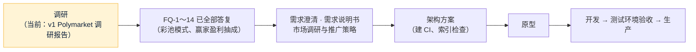

# 项目地图：forecast
- 用途：**新加入的人或大模型先读这一份**，10 分钟了解项目现在是什么样、代码在哪里、有哪些不能破坏的约定。要查具体的文件、接口、表、变量、历史问题，看《[项目索引](项目索引.md)》。
- 只写**当前状态**。按版本追加的文档（调研报告、架构方案、技术方案）是当时的记录；和本文件不一致时，以本文件和代码为准。
- 版本：v0.3（2026-10-24，对应代码：无，**当前阶段：调研**）
- 维护：研发整合，各角色写自己的部分（C53）。**每次功能迭代，在同一个 PR 里更新本文件和《项目索引》**；`scripts/check-project-index.mjs` 在 CI 里检查索引（C54，架构方案阶段建立）。
- 变更历史：v0.1（2026-10-24）首次创建框架（调研阶段）；v0.2（2026-10-24）Amos 答复 FQ-1～FQ-6：面向全球用户、只收 USDT、不做法币真钱版本、律师和牌照不再讨论；方案 A、自动加平台裁决、体育和加密为主；v0.3（2026-10-24）FQ 全部答复：彩池模式、向赢家盈利抽成、不做市、不做积分版

## 一图看懂

这张图想说明：项目刚开始，只有调研报告；下一步等 Amos 对调研报告第 9 节的问题做决定。计划的系统形态见调研报告第 7 节（建议方案 A：复用 falconx-lite 的充值、提现、账本和后台，新写市场、订单簿和裁决）。

## 1. 这个项目做什么
一个类似 Polymarket 的预测市场：客户用 USDT 充值（ERC20 / BEP20 / TRC20，每人独立充值地址、扫块入账，和 falconx-lite 相同），买卖事件结果的 Yes / No 份额，价格即概率，事件结束后猜对的份额每份兑付 1 USDT，再用 USDT 提现。

| 业务 | 版本 | 使用者 | 页面 | 接口 | 数据 |
|---|---|---|---|---|---|
| 全部业务 | 调研中 | 客户、运营、裁决员、风控、超管 | 待需求说明书 | 待架构方案 | 待架构方案 |

核心流程（计划）：充值（三链扫块入账）→ 选市场、买卖 Yes / No → 结果裁决 → 兑付 → 提现（白名单、冷静期、自动审批、签名上链）。

## 2. 代码怎么分层
还没有代码。计划从 falconx-lite 复制钱包、账户、KYC、通知、后台框架、部署和 CI（调研报告 FQ-10，待 Amos 决定）。

## 3. 环境
| 环境 | 分支 | 地址 | 数据 | 外部服务 |
|---|---|---|---|---|
| 原型 | 开发分支 | 未建 | — | — |
| 测试 | `staging`（未建） | 未建 | — | — |
| 生产 | `main` | 未建 | — | — |

## 4. 关键流程在哪里
还没有代码。

| 流程 | 入口 | 核心代码 |
|---|---|---|

## 5. 不能破坏的约定
1. 真钱充值、交易功能上线前，必须有律师的书面意见（调研报告第 6 节：中国大陆可能构成开设赌场罪；USDT 服务境内居民属非法金融活动）。
2. 密钥（热钱包私钥、归集发起账户私钥等）只由 Amos 填在服务器上，不进仓库、不经过 AI（agents C21）。

## 6. 常用命令
| 做什么 | 命令 |
|---|---|
| 安装 | 无代码 |
| 单元测试 | 无代码 |
| 项目地图和索引检查 | `node scripts/check-project-index.mjs`（架构方案阶段建立） |
| 端到端测试 | 无代码 |
| 本地运行 | 无代码 |
| 看线上状态 | 无环境 |

## 7. 排查从哪里开始
还没有代码和环境。

## 8. 常见改动的检查清单
还没有代码。

| 改动 | 要改的地方 |
|---|---|

## 9. 冷启动问题清单
1. 项目现在处于哪个阶段？下一步要等什么？
2. 调研报告建议的技术方案是哪个？复用 falconx-lite 的哪些部分？
3. 真钱功能上线前有什么法律前提？
4. 一个 PR 合并前要通过哪些自动检查？没通过时去哪里看原因？（CI 建立后回答）
