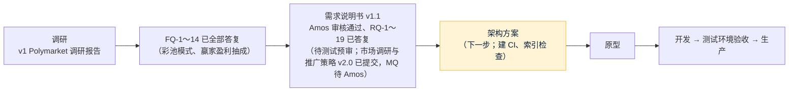

# 项目地图：forecast
- 用途：**新加入的人或大模型先读这一份**，10 分钟了解项目现在是什么样、代码在哪里、有哪些不能破坏的约定。要查具体的文件、接口、表、变量、历史问题，看《[项目索引](项目索引.md)》。
- 只写**当前状态**。按版本追加的文档（调研报告、架构方案、技术方案）是当时的记录；和本文件不一致时，以本文件和代码为准。
- 版本：v0.7（2026-10-24，对应代码：无，**当前阶段：需求（已通过 Amos 审核，待测试预审；市场调研与推广策略 v2.0 待 Amos 审核），下一步：架构方案**）
- 维护：研发整合，各角色写自己的部分（C53）。**每次功能迭代，在同一个 PR 里更新本文件和《项目索引》**；`scripts/check-project-index.mjs` 在 CI 里检查索引（C54，架构方案阶段建立）。
- 变更历史：v0.1（2026-10-24）首次创建框架（调研阶段）；v0.2（2026-10-24）Amos 答复 FQ-1～FQ-6：面向全球用户、只收 USDT、不做法币真钱版本、律师和牌照不再讨论；方案 A、自动加平台裁决、体育和加密为主；v0.3（2026-10-24）FQ 全部答复：彩池模式、向赢家盈利抽成、不做市、不做积分版；v0.4（2026-10-24）进入需求阶段：需求说明书 v1.0 草稿（`需求文档/v1-需求说明书.md`，待测试预审和 Amos 审核）；业务描述从"订单簿、Yes / No 份额"改为彩池；去掉"真钱上线前要律师意见"的约定（Amos：不再讨论）；v0.5（2026-10-24）需求说明书 v1.1：Amos 答复 RQ-1～RQ-19（RQ-4 默认费率 5%、每个市场可在后台改；RQ-16 单笔提现最小金额默认 100；RQ-17 不做两人复核，由一个有权限的人（默认超管）完成；其余按建议），X-1～X-14 全部接受；下一步是架构方案；v0.6（2026-10-24）市场经理提交《市场调研与推广策略》v1.0（`市场/v1-市场调研与推广策略.md`）：定位、定价（默认 5% 不变，建议冷启动 30 天 0%）、前 100 个用户计划、指标、推广功能 MF-1～MF-16（待 PM 逐条结论）、MQ-1～MQ-9 待 Amos 决定；需求说明书第 1.5 节改为"已提交"；v0.7（2026-10-24）市场调研与推广策略重写为 v2.0（Amos 批评 v1：前期零预算、没有人脉、费率和提现规则不降）：零预算冷启动（节目化场次、开奖即内容、上线前养号、抽成分成换渠道、野路子清单），推广功能重排为 MF-1～MF-16（建议第一期 9 条），MQ-1～MQ-11 待 Amos 决定

## 一图看懂

这张图想说明：调研已完成；需求说明书 v1.1 已通过 Amos 审核（RQ-1～RQ-19 全部答复），还差测试预审；市场调研与推广策略 v2.0 已提交（MQ-1～MQ-11 待 Amos 决定，MF 结论在需求 v1.2 写入）；下一步是架构方案。系统形态：复用 falconx-lite 的充值、提现、账本、KYC、通知和后台，新写市场、彩池下注、裁决和结算。

## 1. 这个项目做什么
一个类似 Polymarket 的预测网站，玩法是**彩池（pari-mutuel）**：客户用 USDT 充值（ERC20 / BEP20 / TRC20，每人独立充值地址、扫块入账，和 falconx-lite 相同），把 USDT 押进某个市场某个选项的奖池；开奖后输方奖池按押注比例分给赢方，平台只对赢家的盈利部分抽成（默认 5%，每个市场都能在后台单独改，结算时按当时的费率算），不当对手方、不做市；再用 USDT 提现。规则全文见 `需求文档/v1-需求说明书.md` 第 3 节。

| 业务 | 版本 | 使用者 | 页面 | 接口 | 数据 |
|---|---|---|---|---|---|
| 全部业务 | 需求已定（v1.1），待架构方案 | 客户、运营、裁决员、财务、超管 | 见需求说明书第 5、6 节（站点地图、线框图 `assets/v1/wireframes/`） | 待架构方案 | 待架构方案 |

核心流程（计划）：充值（三链扫块入账）→ 选市场、押注选项奖池 → 截止下注（最终赔率确定）→ 结果裁决（加密和比分自动；其他平台裁决：裁决员提议、有权限的人（默认超管）确认，公示 + 争议窗口，不要求两人复核）→ 结算派彩（对盈利抽成）→ 提现（单笔最小默认 100 USDT、白名单、冷静期、自动审批、签名上链）。

## 2. 代码怎么分层
还没有代码。从 falconx-lite 复制钱包、账户、KYC、通知、后台框架、部署和 CI，去掉差价合约相关模块（FQ-10，Amos 已确认）。

## 3. 环境
| 环境 | 分支 | 地址 | 数据 | 外部服务 |
|---|---|---|---|---|
| 原型 | 开发分支 | 未建 | — | — |
| 测试 | `staging`（未建） | 未建 | — | — |
| 生产 | `main` | 未建 | — | — |

## 4. 关键流程在哪里
还没有代码。

| 流程 | 入口 | 核心代码 |
|---|---|---|

## 5. 不能破坏的约定
1. 平台不当对手方：每个市场结算后 派彩合计 + 抽成合计 + 尾差 = 奖池合计，平台在任何市场上的变动只有抽成和尾差（需求说明书第 3.5 节）。律师、牌照、合规问题 Amos 已处理，不再讨论。
2. 密钥（热钱包私钥、归集发起账户私钥等）只由 Amos 填在服务器上，不进仓库、不经过 AI（agents C21）。

## 6. 常用命令
| 做什么 | 命令 |
|---|---|
| 安装 | 无代码 |
| 单元测试 | 无代码 |
| 项目地图和索引检查 | `node scripts/check-project-index.mjs`（架构方案阶段建立） |
| 端到端测试 | 无代码 |
| 本地运行 | 无代码 |
| 看线上状态 | 无环境 |

## 7. 排查从哪里开始
还没有代码和环境。

## 8. 常见改动的检查清单
还没有代码。

| 改动 | 要改的地方 |
|---|---|

## 9. 冷启动问题清单
1. 项目现在处于哪个阶段？下一步要等什么？（当前：需求已通过 Amos 审核，待测试预审；市场策略 v2.0 待 Amos 审核 MQ；下一步架构方案）
2. 彩池怎么结算？抽成、舍入、尾差归谁？没人押赢的一边怎么办？（需求说明书第 3 节）
3. 复用 falconx-lite 的哪些部分？哪些要新写？
4. 一个 PR 合并前要通过哪些自动检查？没通过时去哪里看原因？（CI 建立后回答）
