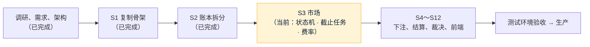

# 项目地图：forecast
- 用途：**新加入的人或大模型先读这一份**，10 分钟了解项目现在是什么样、代码在哪里、有哪些不能破坏的约定。要查具体的文件、接口、表、变量、历史问题，看《[项目索引](项目索引.md)》。
- 只写**当前状态**。按版本追加的文档（调研报告、架构方案、开发记录）是当时的记录；和本文件不一致时，以本文件和代码为准。
- 版本：v0.9（2026-10-25，对应代码：`claude/s3-market` 分支，**当前阶段：开发 S3（市场）**，下一步：S4 下注和奖池）
- 维护：研发整合，各角色写自己的部分（C53）。**每次功能迭代，在同一个 PR 里更新本文件和《项目索引》**；`scripts/check-project-index.mjs` 检查索引（CI 的 `checks` 每次运行）。
- 名词：**复制源**指本项目 S1 复制的那个差价合约项目（远程 `staging` 分支提交 `2583328`）。代码和文档里提到它时一律写"复制源"，不写它的名字。
- 变更历史：v0.1～v0.6（2026-10-24）调研、需求、架构阶段（FQ、RQ 全部答复，需求说明书 v1.1，架构方案 v1.0）；v0.7（2026-10-24）开发 S1：从复制源复制后端、三个前端、合约、端到端测试、部署和 CI，删除差价合约部分，改名，重建迁移基线（`开发记录/S1-复制骨架.md`）；v0.8（2026-10-25）开发 S2：账户三项（可用 / 下注锁定 / 提现冻结）、彩池流水类型、平台收入和补偿支出账户、不变量测试、单笔最小提现默认 100、品牌上线前沿用 Quick Come（`开发记录/S2-账本拆分.md`）；v0.9（2026-10-25）开发 S3：market 模块（市场、选项、状态机 17 条边、上架检查、补充说明、提前截止、费率修改和公开记录、截止和事件结束任务）、定时任务租约、e2e 可调时钟、参数设置接口（单笔最小提现改用 `betting_params:edit`）、需求第 2.2 节的 21 个权限点（`开发记录/S3-市场.md`）

## 一图看懂

这张图想说明：S1 搭了骨架（从复制源复制账户、KYC、账本、钱包、通知、后台权限，删除差价合约部分）；S2 把账本拆成彩池要用的三项余额和流水类型；S3 写了市场本身（建草稿、上架、暂停、取消、补充说明、提前截止、改费率，到点自动截止、事件结束进入待裁决），但还不能下注（S4），取消和作废还不退款（S5，没有下注所以也没有钱要退）；页面在原型确认后做（`技术方案/v1-架构方案.md` 第 1、16 节）。

## 1. 这个项目做什么
一个类似 Polymarket 的预测网站，玩法是**彩池（pari-mutuel）**：客户用 USDT 充值（ERC20 / BEP20 / TRC20，每人独立充值地址、扫块入账），把 USDT 押进某个市场某个选项的奖池；开奖后输方奖池按押注比例分给赢方，平台只对赢家的盈利部分抽成（默认 5%，每个市场都能在后台单独改，结算时按当时的费率算），不当对手方、不做市；再用 USDT 提现。规则全文见 `需求文档/v1-需求说明书.md` 第 3 节。

| 业务 | 版本 | 使用者 | 页面 | 接口 | 数据 |
|---|---|---|---|---|---|
| 账户、KYC | S1（复制源原样） | 客户、运营 | 客户端登录注册、我的；后台客户、KYC | 《项目索引》第 2.1、2.2 节 | `account_*` |
| 账户余额和流水 | S2（三项：可用、下注锁定（"下注中"）、提现冻结；平台收入、平台补偿支出两个账户；下注、结算等流水类型已定义，业务在 S4 起） | 客户、财务 | 客户端资产、资金流水；后台客户详情 | 第 2.3 节 | `ledger_*` |
| 充值、提现、自动审批、对账、归集 | S1（复制源原样，自动审批里和交易有关的规则 S1 过渡） | 客户、运营、财务 | 客户端资产；后台资金 | 第 2.4、2.6 节 | `wallet_*` |
| 通知 | S1（模板只保留第一期用得到的） | 客户、员工 | 站内信、邮件、推送 | 第 2.5 节 | `notify_*` |
| 后台权限、审计、系统配置、参数设置 | S1；S3 按需求第 2.2 节加到 53 个权限点，加参数设置接口（品类默认费率 `fee:edit`；下注限额、争议窗口、KYC 阈值、单笔最小提现 `betting_params:edit`） | 管理员 | 后台系统（参数设置页待原型） | 第 2.6 节 | `admin_*`、`common_config` |
| 市场 | S3（市场和选项（三语）、状态机 17 条边、上架检查、补充说明、提前截止、费率修改和公开记录、截止和事件结束任务、租约；后台和客户端接口，页面待原型） | 客户、运营、超管 | 待原型（需求说明书第 5、6 节） | 第 2.3a、2.6 节 | `market_*`、`common_job_lease` |
| 彩池、裁决、结算 | 计划（S4 起） | 客户、裁决员、财务 | 见需求说明书第 5、6 节 | 架构方案第 2.4 节 | 架构方案第 3 节 |

核心流程（计划）：充值（三链扫块入账）→ 选市场、押注选项奖池 → 截止下注（最终赔率确定）→ 结果裁决（加密和比分自动；其他平台裁决：裁决员提议、有权限的人（默认超管）确认，公示 + 争议窗口）→ 结算派彩（对盈利抽成）→ 提现（白名单、冷静期、自动审批、签名上链）。现在（S3）有充值、提现两头和市场的全部状态管理（建、上架、暂停、取消、到点截止、进入待裁决）；还不能下注（S4），所以到点截止的市场一律按 E4（总奖池为 0）作废；账本已经能记下注、派彩、抽成、退款、补偿（S4 起由业务调用）。

## 2. 代码怎么分层
| 目录 | 内容 | 角色 |
|---|---|---|
| `backend/` | 单体：Java 25、Spring Boot 4.1.1、MyBatis（XML）、Flyway、MySQL 8.4、Redis 7。包 `com.forecast.app`，模块 `common`、`ledger`、`account`、`wallet`、`notification`、`admin`、`market`（S3）（`pool`、`resolve`、`settle`、`riskalert` 已在模块边界测试里登记，S4 起建） | 研发 |
| `web/client/` | 客户端（React 18、Vite、PWA，手机和电脑两套结构）；S1 首页是占位 | 研发 |
| `web/admin/` | 管理后台（React 18、Ant Design） | 研发 |
| `web/site/` | 官网（首页、服务条款、隐私、风险披露；文案是占位，PM 在 S11 写） | 研发 |
| `contracts/` | 资金归集合约（Foundry；BitGo 转发合约原样 + 批量合约） | 研发 |
| `e2e/` | 端到端测试（Playwright）：主流程、官网、部署形态 | 测试 |
| `deploy/` | 镜像、Nginx、服务器上的部署工具包（沿用复制源，测试服务器在 S14） | 运维 |
| `scripts/` | 索引检查、旧品牌名检查、模拟层检查、原型构建 | 研发 |
| `.github/` | CI（`ci.yml`）和三个前端共用的检查步骤 | 研发、运维 |

模块之间只通过对方的 `api` 包调用；改余额只能经 `ledger` 模块的 `LedgerApi`。

## 3. 环境
| 环境 | 分支 | 地址 | 数据 | 外部服务 |
|---|---|---|---|---|
| 本地 | 任意 | 后端 8080；前端 `npm run dev` | 本机 MySQL 8.4、Redis 7（测试库每次可以删掉重建） | 不配节点、SMTP 时只记日志 |
| 原型 | 开发分支 | 未建（计划 Vercel 预览，AQ-12；`vercel.json` 已有） | 浏览器内模拟数据 | — |
| 测试 | `staging`（未建） | 未建（计划独立云服务器，架构方案第 11 节，S12～S14；域名用 `quickcome.online` 的子域名，建议 `fc-test` 前缀，约定 17） | 独立测试库 | 区块链测试网 |
| 生产 | `main` | 未建 | — | 区块链主网 |

## 4. 关键流程在哪里
| 流程 | 入口 | 核心代码 |
|---|---|---|
| 注册、登录 | `POST /api/auth/register`、`POST /api/auth/login` | `backend/src/main/java/com/forecast/app/account/auth/` |
| KYC | `POST /api/me/kyc`；后台 `POST /api/admin/kyc/{id}/review` | `backend/src/main/java/com/forecast/app/account/kyc/` |
| 充值入账 | 定时扫块 | `backend/src/main/java/com/forecast/app/wallet/deposit/DepositService.java` → `LedgerApi` |
| 提现 | `POST /api/wallet/withdrawals` → 冷静期 → 自动审批复判 / 人工审核 → 广播 → 确认 | `backend/src/main/java/com/forecast/app/wallet/withdraw/` |
| 改余额、记流水 | 客户：`LedgerApi.apply` / `applyAll`（一组变动同一事务）；平台：`PlatformLedgerApi.apply`；核对：`LedgerQueryApi.mismatches` | `backend/src/main/java/com/forecast/app/ledger/service/LedgerService.java`；流水类型规则 `ledger/api/LedgerEntryType.java` |
| 推给本人 | `UserEventsApi.send` → `WS /api/ws/user` | `backend/src/main/java/com/forecast/app/common/push/` |
| 市场：建草稿 → 提交上架 → 上架 → 暂停 / 恢复 / 取消 / 补充说明 / 提前截止 / 改费率 | 后台 `/api/admin/markets/**`（审计在 `admin/ops/MarketOps`） | `backend/src/main/java/com/forecast/app/market/core/MarketService.java`；状态机 `market/core/MarketStateMachine.java` |
| 市场：到点截止 → 事件结束进入待裁决 | 定时任务 `MarketClockJob`（5 秒 / 15 秒，带租约）；e2e 下 `POST /api/e2e/markets/tick` | `MarketService.closeDue()`、`endDue()`；下注前的截止屏障 `MarketApi.lockForBet`（S4 调用） |
| 市场列表、详情（客户端） | `GET /api/markets`、`GET /api/markets/{publicNo}` | `backend/src/main/java/com/forecast/app/market/web/MarketController.java`、字段 `market/core/ClientViews.java` |
| 通知 | `NotifyApi` → 任务表 → 邮件、推送 | `backend/src/main/java/com/forecast/app/notification/service/` |

## 5. 不能破坏的约定
1. 平台不当对手方：每个市场结算后 派彩合计 + 抽成合计 + 尾差 = 奖池合计，平台在任何市场上的变动只有抽成和尾差（需求说明书第 3.5 节）。律师、牌照、合规问题 Amos 已处理，不再讨论。
2. 密钥（热钱包私钥、归集发起账户私钥、VAPID 私钥、SMTP 密码、数据源 key、数据库密码）只由 Amos 填在服务器 `.env` 上，不进仓库、不经过 AI、不进日志（agents C21）。仓库里不出现任何密钥的值（CI 的 gitleaks）；测试里的假值用 `ci_only_` 开头。
3. 金额只用 `BigDecimal` / `DECIMAL(24,8)`，不用浮点；舍入只在需求第 3.5 节规定的三处（S2 起）。
4. 余额每次变动和对应的账本记录必须在同一个数据库事务里：客户的钱只通过 `LedgerApi`、平台账户只通过 `PlatformLedgerApi` 改（`ledger` 模块），**任何时刻每个账户每一项的账本合计 = 这一项的金额**（`LedgerQueryApi.mismatches()`，`LedgerInvariantTest` 并发随机测试）。账户三项：可用 `available`、下注锁定 `bet_locked`、提现冻结 `withdraw_frozen`，都不能为负（数据库 CHECK 兜底）；只有平台补偿支出账户的可用可以为负。每种流水类型只能用在规定的账户、项和方向（`LedgerEntryType`，不符合直接拒绝）；同一笔业务动两项时（例如下注：可用 −b、下注锁定 +b）用 `applyAll` 放在同一个事务。幂等键 `biz_type`+`biz_id`+`entry_type`+`bucket` 只记一次，同一个键换了账户或金额是程序错误。金额为 0 的记录不能记（抽成为 0 时不记 FEE）。`ledger_entry` 只增不改。可提金额 = 可用余额；冲正只扣可用余额（不动下注锁定和提现冻结）；客户看到的"余额" = 可用 + 下注锁定。
5. 模块之间只通过对方的 `api` 包调用，由 ArchUnit 测试强制（`backend/src/test/java/com/forecast/app/arch/`）；表名以模块名开头，只由该模块读写。
6. 表结构只通过 Flyway 迁移脚本修改，**已合并的脚本不再改**（S1 的基线 V1～V5 合并后同样不改，以后只加新脚本；现在到 V10，下一个是 V11）。
7. 服务器上不放充值地址的私钥（只放 xpub）；只扫描配置好的 USDT 合约，合约未配置时扫块不启动。
8. 提现只有在确定交易没上链时才退款（节点明确拒绝、链上执行失败、TRON 过期查不到）；连不上节点、超时都不退款。
9. 提现自动审批：规则只决定"要不要人工看"，不能放宽冷静期、大额延迟、白名单生效、单笔和当日限额；**总开关默认关闭**；规则出错或数据读不到 → 转人工，不能因为出错放行；前后端规则定义（`wallet/api/AutoApprove.java`、`web/admin/src/config/autoApprove.ts`）改一边要同时改另一边。S1 删除差价合约后，R8（充值后交易量）、R9、R13 的交易数据暂时记为 0（有充值的客户 R8 一定转人工），S10 按下注口径重写（S2 已定义好要用的流水类型，`开发记录/S2-账本拆分.md`）。单笔最小提现 `withdraw.minAmount` 默认 100（RQ-16），**必须大于每条链的提现手续费**：后台改最小金额或手续费时都检查（`admin/system/SystemService`，不满足时指出是哪条链）；S3 起最小金额在参数设置里改（`betting_params:edit`），手续费仍在系统配置页（`config:edit`）。
10. 通知要和业务在同一个事务里写（在业务事务里调用 `NotifyApi`），业务回滚就不发；邮件失败不能影响业务，也不进健康检查的 `status`。
11. 健康检查的 `status` 只表示"应用活着"（数据库、Redis、模块配置）；外部服务（链节点、邮件、归集）的故障只进 `alerts` 和告警邮件（`common.health.AlertCheck`），不能让 `status` 变成 DOWN；`alerts` 只给后台域名和本机。告警邮箱没有默认值，由 Amos 填。
12. 每个后台接口都必须声明权限点（`@RequiresPermission`）或标明只要登录（`@AdminLoginOnly`）；权限点、菜单和后台前端（`web/admin/src/config/`）保持一致（现在 53 个，后端 `AdminSystemTest` 核对）。参数设置的项不在系统配置页（`ConfigKey.params`）：费率组要 `fee:edit`、其余要 `betting_params:edit`，不能让 `config:edit` 绕过去改。
13. 端到端测试的替身和 `/api/e2e/**` 只在 Spring profile `e2e` 下存在；测试环境和生产绝不能设 `SPRING_PROFILES_ACTIVE=e2e`、`FC_E2E_ENABLED`，也不能用 `e2e/compose.deployed.yml`。新加替身时类名以 `E2e` 开头、标 `@Profile(E2eGuard.PROFILE)`。
14. 写请求只接受本站页面发起、`/api/` 路径不能带分号（`common/web/CrossSiteGuard`）：不要关掉，也不要给前端开发代理加 `changeOrigin`。Nginx 客户端域名拦截后台和端到端测试接口用正则（`deploy/nginx/site.conf.template`）。
15. 真实接口模式的前端构建产物里不能有原型模拟层（`src/mocks/`）：`src/api/` 只能按编译期常量 `IS_MOCK` 选用模拟层；CI 的 `scripts/check-no-mocks.mjs` 检查。
16. 限流：IP 只用 `request.getRemoteAddr()`（Nginx 传来的真实 IP）；Redis 不可用时必须放行；新增客户端的资金写接口（以后的下注、提交争议）要标 `@UserWriteLimited`（`RateLimitTest` 列出了全部接口）。测试和 e2e profile 调大的上限不能用在测试环境和生产。
17. 品牌和域名：**上线前沿用 Quick Come 名称和 `quickcome.online` 的子域名；正式上线前改为独立品牌和域名，隔离要求（服务器、数据库、钱包、发信域名、推送密钥等和复制源分开）不变**（Amos 2026-10-25 原话："我有起名困难症，所以很多项目在上线前我都会用 quick come这个名字，域名也会用quickcome.online的子域名，只有正式上线时，才需要改名和域名，这点可以记下来 我总会这样做"；需求说明书 v1.2、架构方案 v1.1 第 15 节）。测试环境子域名由运维在部署方案里定，建议 `fc-test` 前缀（例如 `fc-test.quickcome.online`），**不能和 复制源已用的 `test-app` 等子域名重复**；Cookie 不设 `Domain`。品牌名只写在 `web/*/src/lib/brand.ts`、各前端 `index.html`、PWA 名称（`web/client/vite.config.ts`）、`web/client/public/push-sw.js`、通知模板里。复制源的旧品牌名不能出现在仓库里（`node scripts/check-brand.mjs --repo`）、前端构建产物里（`scripts/check-brand.mjs dist`）、后端模板和代码里（`BrandTextTest`），名单在 `scripts/brand-check.json`；**Quick Come 的检查在那里关着，正式上线改名时打开**。通知模板是运营可改的数据：改品牌用新迁移，只改仍等于原始默认文字的模板（V8 的做法）。
18. 对外编号（提现、充值，以后的下注）是雪花 ID，**接口里一律字符串**，前端只当字符串用；节点号 `FC_ID_NODE` 多实例时必须不同。
19. 追踪号只接受 `[A-Za-z0-9._-]{8,64}`；Nginx 必须用 `$request_id` 覆盖客户端带的 `X-Request-Id`。
20. 日期输入：已知日期（出生日期等）一律用三框组件 `DateFields`（客户端、后台各一份，`dateParts` 逻辑改一边要同时改另一边）；接口里是 `YYYY-MM-DD` 字符串。
21. 客户密码规则前后端一致：8–64 位，至少一个字母和一个数字（后端 `account/auth/AuthRequests.java`，客户端 `web/client/src/lib/validators.ts`）。
22. 资金归集：`contracts/lib/` 下的 BitGo、OpenZeppelin 源码一行不能改（`lib/SHA256SUMS` 在 CI 核对）；批量合约保持"碰不到钱"、覆盖率 100%；充值地址的盐（keccak256("forecast-deposit" ‖ 用户ID)）在 Java（`wallet/address/Create2`）、合约和测试向量三处一致；**`FC_SWEEP_EVM_*` 四个地址填了以后不要改**；归集不写账本、不改客户余额，出错只进 `alerts`。
23. 默认语言：客户端和官网都跟随浏览器语言（zh 或 zh-* 用简体中文，其他英文）；客户自己选过的记住、优先（客户端 `web/client/src/i18n/urlLang.ts`、官网 `web/site/src/i18n/lang.ts` 同一规则）。
24. CI 按改动路径跑（`.github/workflows/ci.yml`）：push 到 staging、main 必须全部都跑；新增目录或 job 时在 `changes` 的过滤规则里加路径，并把 job 加进 `ci-ok` 的 `needs`；不要改检查名字。
25. 单实例部署，但代码按多实例写：不在内存里放只有一份的业务状态，推送靠 Redis 广播（S4 起），**新的定时任务都先拿数据库租约**（`common/job/JobLease.runExclusive`，表 `common_job_lease`），任务本身还要是幂等的（条件更新），租约意外失效时重复执行也没有效果（架构方案第 5.3 节）。
26. 市场状态（S3）：**只允许 17 条边**（`market/core/MarketStateMachine`，需求第 3.2 节的图），其余一律 409 `ILLEGAL_TRANSITION`（AC-10，`MarketStateMachineTest` 穷举 100 种组合）；每次跳转是带旧状态的条件更新（`WHERE status = 旧状态`），同一事务写 `market_status_log`；别的模块只能经 `MarketApi.transition` 改状态，不能直接改表。进入取消、作废时同一事务通知 `MarketListener.onRefundRequired`（S5 在这里建退款单）。
27. 市场上架后**题目、选项、时间、裁决来源不能改**（Mapper 的修改语句都带 `status = 'DRAFT'`，AC-12）；只能发补充说明（截止前）、提前截止（只能提前）、改费率（结算开始前，写 `market_fee_change`，上架后改的发 #22）。`market_status_log`、`market_clarification`、`market_fee_change` 只增不改（`MarketAppendOnlyTest`）。费率在库里是小数（0.0500），接口里一律是百分比字符串（"5"）。
28. 截止判定只看服务器收到请求的时间：`openAt ≤ receivedAt < closeAt`，正好等于截止时间的拒绝（AC-15）。下注事务必须先调 `MarketApi.lockForBet`（市场行共享锁），截止任务拿排他锁，这样截止时奖池里只有截止前已经提交的下注（架构方案第 4.2、5.2 节）。market 不依赖 pool / settle：截止时要的奖池信息由 pool 实现 `MarketPoolView` 提供（没有实现时按"没有下注"处理）。
29. 所有"现在"都来自注入的 `java.time.Clock`：后端测试用 `support/MutableClock` 往前拨，端到端测试用 e2e profile 下的 `/api/e2e/clock/*`（只在 e2e 下存在）。拨过时钟会让后台会话过期（30 分钟无操作），测试要重新登录并在结束时 reset。

## 6. 常用命令
| 做什么 | 命令 |
|---|---|
| 安装 | `npm ci --prefix web/client`、`npm ci --prefix web/admin`、`npm ci --prefix web/site`、`npm ci --prefix e2e`；后端需要 JDK 25 和 Maven；合约 `git submodule update --init` 后用 Foundry |
| 后端测试 | 先起 MySQL 8.4 和 Redis 7（例如 `docker run -d -p 3306:3306 -e MYSQL_ROOT_PASSWORD=<本机密码> -e MYSQL_DATABASE=forecast_test mysql:8.4`、`docker run -d -p 6379:6379 redis:7`），设 `FC_DB_URL`、`FC_DB_USERNAME`、`FC_DB_PASSWORD`、`FC_REDIS_HOST` 后 `mvn -f backend verify` |
| 前端检查 | 在 `web/client`、`web/admin`、`web/site` 下：`npm run lint`、`npm test`、`npm run build`，再 `node ../../scripts/check-brand.mjs dist`；客户端、后台再 `node ../../scripts/check-no-mocks.mjs src/mocks dist` |
| 仓库检查 | `node scripts/check-project-index.mjs`；`node scripts/check-brand.mjs --repo` |
| 合约 | `cd contracts && bash script/check-vendor.sh && forge test`；覆盖率 `forge coverage --report summary --no-match-coverage "(test|script|lib)"`；本地链端到端 `bash contracts/script/anvil-e2e.sh` |
| 端到端测试 | 准备空库 `forecast_e2e` → `mvn -f backend package -DskipTests`、三个前端 `npm run build` → 设好 `FC_DB_*`、`FC_REDIS_HOST`、`FC_ADMIN_INIT_*` 后 `bash e2e/start-backend.sh` → `cd e2e && npx playwright test` |
| 端到端测试（部署形态） | `bash e2e/run-deployed.sh`（需要 Docker、JDK 25 + Maven、Node 22；本机 80、443、8080 空闲） |
| 本地运行 | 后端：设置 `FC_DB_*`、`FC_REDIS_*` 后 `mvn -f backend spring-boot:run`；前端 `npm run dev --prefix web/client`（`/api` 转发到 `FC_API_PROXY`，默认 `http://localhost:8080`）；整站原型：`bash scripts/build-prototype.sh` 后用任意静态服务器打开 `dist/` |
| 看线上状态 | 无环境（测试环境在 S14） |

## 7. 排查从哪里开始
健康检查 `/api/health`（哪一项 DOWN；后台域名的 `alerts`）→ 错误响应里的追踪号 `traceId`（响应头 `X-Request-Id`）→ 后端日志 `grep 追踪号` → 429 `RATE_LIMITED`：限流（约定 16）→ 写请求 403 `FORBIDDEN`"不接受其他网站发起的请求"：页面和接口不同源（约定 14）→ 《项目索引》第 8 节问题索引 → 本地复现。

## 8. 常见改动的检查清单
| 改动 | 要改的地方 |
|---|---|
| 新增接口 | 后端控制器；客户端 / 后台 `src/api/`（真实实现和模拟层）；后台接口加权限点；限流注解；《项目索引》第 2 节 |
| 新增权限点或菜单 | `Permission.java`、`Menus.java`、迁移（角色和菜单数据）、`web/admin/src/config/permissions.ts` 和 `menu.tsx`；《项目索引》第 2a 节 |
| 新增数据表或列 | 新迁移脚本（不改旧的，下一个是 V11）；对应模块的 Mapper XML；《项目索引》第 4.1 节 |
| 新增市场状态跳转的触发（S5～S7） | 只调 `MarketApi.transition`（边已经在状态机里）；不要新加边，要加先改需求第 3.2 节；`MarketStateMachineTest` 的 `EDGES` 是照需求的图抄的 |
| 新增定时任务 | 用 `JobLease.runExclusive` 包起来；任务按"条件已满足"扫描、状态更新带旧状态；加开关（测试配置关掉、测试直接调用）；《项目索引》第 6 节 |
| 新增参数（参数设置页） | `ConfigKey` 加一项（`Params.FEE` 或 `BETTING`、取值范围）、新迁移写初始值；后台前端模拟层 `db.params` |
| 新增账本流水类型 | `ledger/api/LedgerEntryType.java`（写明账户、项、方向）；需要客户端显示时 `LedgerController.LEDGER_TYPES` 和客户端翻译；后台 `CustomerOps.ledgerType` 和 `web/admin` 的 `ledger.*` 翻译；`LedgerBucketsTest` |
| 新增环境变量 | `application.yml`、`deploy/kit/docker-compose.yml`、`deploy/kit/env.example`；《项目索引》第 5 节 |
| 新增通知模板 | 新迁移；`BrandTextTest` 会检查旧品牌名；《项目索引》第 4.3 节 |
| 新增前端文字 | 中英文翻译文件同一个键；品牌名用 `{{brand}}`（客户端）/ `{brand}`（官网） |
| 新增目录或 CI job | `ci.yml` 的 `changes` 过滤规则和 `ci-ok`；`项目索引.config.json` 的 `files.include` |

## 9. 冷启动问题清单
1. 项目现在处于哪个阶段？下一步要等什么？（当前：开发 S3 市场；下一步 S4 下注和奖池）
2. 彩池怎么结算？抽成、舍入、尾差归谁？没人押赢的一边怎么办？（需求说明书第 3 节）
3. 从复制源复制了哪些、删了哪些、还剩哪些过渡处理？（`开发记录/S1-复制骨架.md`）
5. 下注时账本怎么记？结算时谁的哪一项加、哪一项减？平台收入从哪里来？（架构方案第 3.2 节；代码 `ledger/api/LedgerEntryType.java`；测试 `ledger/LedgerBucketsTest` 的第 3.5 节例子）
4. 一个 PR 合并前要通过哪些自动检查？没通过时去哪里看原因？（`.github/workflows/ci.yml`：`ci-ok` 汇总全部检查；本地命令见第 6 节）
6. 市场有哪些状态、怎么跳转？谁能做什么？截止时有效选项不足 2 个怎么办？（需求说明书第 3.2、3.6 节；代码 `market/core/MarketStateMachine.java`、`MarketService.closeDue`；权限点见《项目索引》第 2a 节）
